# 健身新手的训练完全手册（文字版）

> **来源**
> - 视频标题：💪🏻B站版《健身新手的训练完全手册》™
> - UP 主：好人松松
> - 链接：https://www.bilibili.com/video/BV1Hk4y187jF/
> - 时长：56 分 33 秒（视频自带 3 个章节：1. 分化方式 00:00；2. 动作模式&关节活动 11:46；3. 训练计划 39:42）
> - 整理日期：2026-10-17
> - 整理方式：B 站字幕接口不可用，讲解文字由 Whisper 语音转写得到，再对照视频内嵌字幕和画面中的表格校对。正文中的 `[mm:ss]` 是对应的视频时间点，图片是视频截图。

## 总览

这是好人松松「健身新手」系列四期里的第一期，讲**健身训练**这一块（后面三期分别讲健身饮食、减脂方案和基础解剖）。他认为，比起「做什么动作」「要一份训练计划」，更先要弄清的是三件事：**训练分化**（各部位怎么组合到同一天练）、**动作模式**（十来种动作模式统领着几十个具体动作，每种模式背后是一种关节运动），以及**训练计划**（三分化/四分化计划、动作库、组数、组间休息、配重和训练频率）。贯穿全片的核心思路是利用**肌肉的协同关系**「趁热打铁」：推胸带肩前束和肱三头，划船带肩后束。还有一条判断规则：看大臂在哪个平面、往哪个方向动，就知道一个动作练的是胸、背还是肩的哪一束。最后，增肌的主流配重是 6–12RM，五大项可以偶尔尝试 3–5RM。

**目录**

- 第一部分 训练分化
- 第二部分 动作模式与关节活动
- 第三部分 训练计划
- 要点速查
- 初学者练习建议

---

## 第一部分 训练分化

### 1.1 先有分化，再谈动作 [01:00]

很多人一上来就问「什么动作好」「能给我一份训练计划吗」。UP 主说这些都是「更后置的问题」，训练要先考虑的是**训练的分化**。

**从五分化到二分化** [01:06]：

- 把**背、胸、肩、手、腿**五个部位各安排一天训练，就是大家熟知的**五分化**。
- 把肩膀**或**手臂放到别的训练日去，节约一天，变成**四分化**。
- 把肩膀**和**手臂都放到别的训练日去，节约两天，变成**三分化**。
- 继续合并训练部位，还能做成**二分化**。

### 1.2 不同分化的优缺点 [01:33]

两个维度此消彼长：

- **循环速度**：部位分得越细，全身练完一轮越慢。「别人都在练第二轮第三轮了，你的第一轮循环还没结束。」
- **单部位训练组数**：部位分得越细，一个部位能分到的组数越多，「肌肉就能练得更彻底一些」。

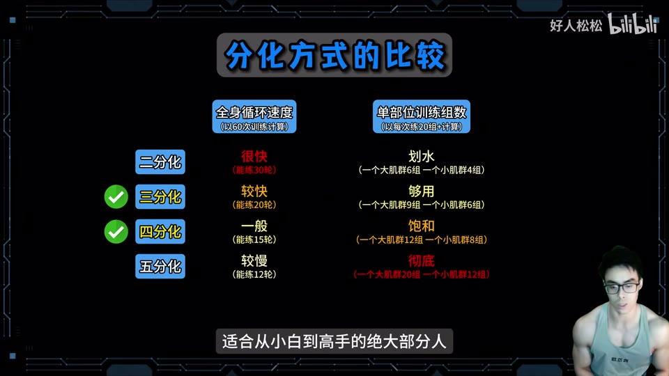

*图 1：分化方式的比较（画面表格：以 60 次训练计算循环轮数，以每次练 20 组以上计算单部位组数）。*

画面表格内容整理如下：

| 分化 | 全身循环速度（以 60 次训练计算） | 单部位训练组数（以每次练 20 组以上计算） |
|---|---|---|
| 二分化 | 很快（能练 30 轮） | 划水（一个大肌群 6 组，一个小肌群 4 组） |
| 三分化 ✅ | 较快（能练 20 轮） | 够用（一个大肌群 9 组，一个小肌群 6 组） |
| 四分化 ✅ | 一般（能练 15 轮） | 饱和（一个大肌群 12 组，一个小肌群 8 组） |
| 五分化 | 较慢（能练 12 轮） | 彻底（一个大肌群 20 组，一个小肌群 12 组） |

UP 主的结论：

- **三分化和四分化**兼顾循环速度和训练组数，「适合从小白到高手的绝大部分人」。
- **二分化**比较牺牲训练组数，「刚接触健身的新手可以考虑使用」。
- **五分化**比较牺牲循环速度，「职业选手里的一部分人会使用」。

### 1.3 该选哪种分化：先看训练频率 [02:12]

- 每周**只能练两次**：直接用二分化。虽然各部位是「蜻蜓点水、雨露均沾的状态」，但一周好歹能练一轮。
- 每周**只能练一次**：增肌速度会非常慢，「是不太可能练出多大的肌肉的」。
- **认真健身的人**：要保证每周练 3–5 次，这种人可以选择三分化或四分化。

### 1.4 三分化与四分化的基本安排 [02:41]

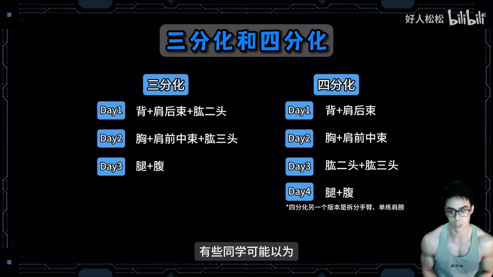

*图 2：三分化和四分化的基本安排；四分化的另一个版本是拆分手臂、单练肩膀。*

| | 三分化 | 四分化 |
|---|---|---|
| Day1 | 背 + 肩后束 + 肱二头 | 背 + 肩后束 |
| Day2 | 胸 + 肩前中束 + 肱三头 | 胸 + 肩前中束 |
| Day3 | 腿 + 腹 | 肱二头 + 肱三头 |
| Day4 | — | 腿 + 腹 |

UP 主强调，「把所有部位拆成三天练完就叫三分化」只是表面现象。**每天的训练部位不是任意组合的，背后的思路是利用肌肉的协同关系。**

### 1.5 协同肌群 1：胸 + 肩前束 + 肱三头 [02:59]

**现象**：所有推胸类动作，包括躺着推的卧推、坐着推的器械推胸、「趴着」做的双杠臂屈伸和俯卧撑，都是**胸肌、肩前束、肱三头协同发力，大约各分担三分之一的重量**。这些动作的肌肉示意图里，标蓝的训练部位除了胸，一定还有肩前束和肱三头。练完推胸，第二天这三个部位往往都有点酸痛。

**肌电证据** [03:34]：一项研究让受试者做从窄到宽不同握距的卧推。结果显示，无论哪种握距，**胸大肌、肩前束、肱三头的肌电水平都很高**，它们是推胸的**主要肌群**；三角肌中束、后束、肱二头肌、背阔肌的肌电水平低得多，是**辅助肌群**。

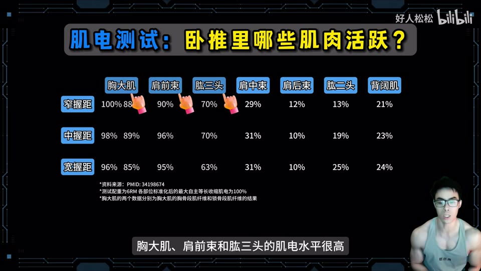

*图 3：肌电测试：不同握距卧推中，胸大肌、肩前束、肱三头的激活都很高。*

**解剖解释** [04:01]：所有推胸动作都包含三种运动。看大臂，不要看小臂：

1. **肩关节水平内收**：水平面上，大臂从躯干外侧往内侧移动，由胸大肌和肩前束负责。
2. **肩关节屈**：矢状面上，大臂从躯干后侧往前侧移动，也由胸大肌和肩前束负责。前两种复合起来，就是卧推时大臂的运动轨迹。
3. **肘关节伸**：肘关节从折叠变为打直，由肱三头肌负责。

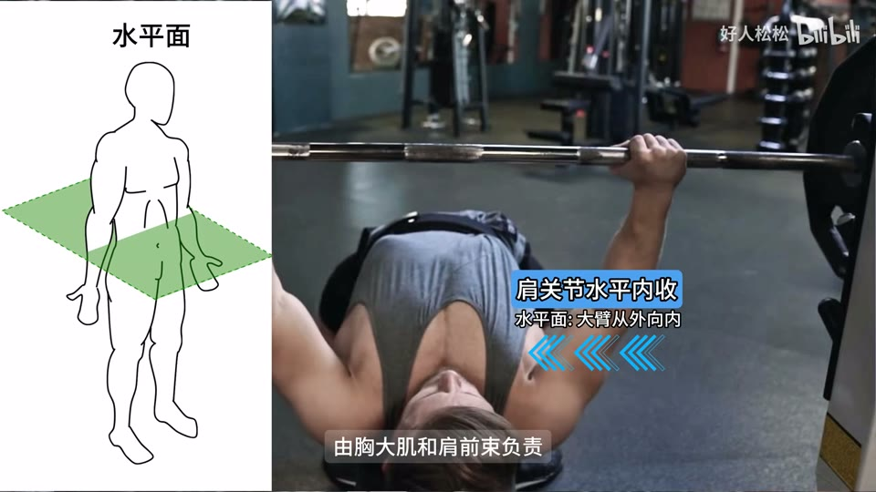

*图 4：卧推中大臂在水平面上从外向内移动，即肩关节水平内收，由胸大肌和肩前束负责。*

**两种选择：放弃还是补练？** [05:04]

用推胸把胸肌练到十成后，肩前束和肱三头「起码也有六成热度了」。接下来有两种选择：

- **放弃这六成热度**，以后再单独练它们，一次只练一个部位，这就是**五分化**。
- **趁热打铁**：在推胸后面追加少量专门练肩前束（某种推举、前平举）和肱三头（某种臂屈伸）的动作，把六成追加到十成。一次训练练完三个部位，总组数比一天只练一个部位少，从而**节约训练天数、加快循环速度**。这就是**三分化/四分化**。

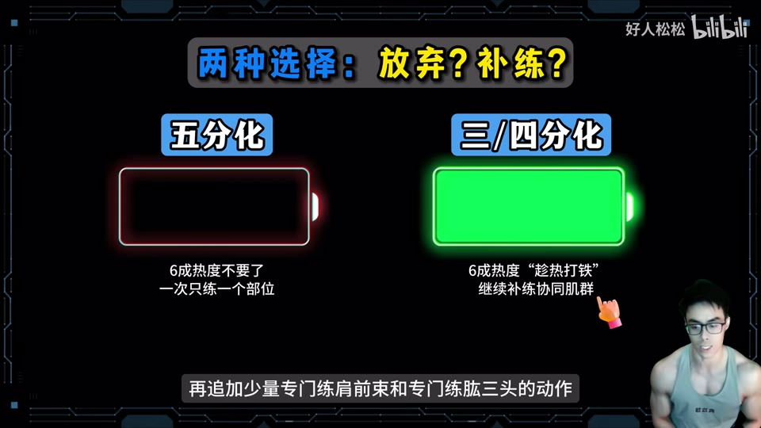

*图 5：五分化放弃推胸带来的「六成热度」；三/四分化选择趁热打铁，继续补练协同肌群。*

所以三分化、四分化里，练胸后面基本都接肩前束或肱三头。「这不是随便安排的，而是在利用肌肉的协同关系来节约时间、提高效率。」

### 1.6 协同肌群 2：背 + 肩后束 [06:14]

**现象**：背部训练里所有划船动作，肩后束都会明显参与：

- **下背划船**：握距窄、开肘小、拉向腹部一线。肩后束参与相对较少。
- **上背划船**：握距宽、开肘大、拉向胸口。肩后束参与更多，「甚至它本身都可以视为一个练肩后束的动作」。

**肌电证据** [06:43]：一篇论文测的正是宽握距、开肘大、拉向胸口的上背划船（画面标题为「开肘 45° 上背划船」）。结果显示，这种上背划船里**背阔肌不太活跃，肩后束很活跃**，「说它是一个练肩后束的动作都不为过」。

**解剖解释** [07:07]：

- **肩关节伸**：矢状面上，大臂从前侧向后侧移动，由背阔肌、大圆肌、肱三头肌长头、肩后束「四个小伙伴」一起完成。肩后束会参与，「但只是带到它而已」。
- **肩关节水平外展**：水平面上，大臂从中线往外移动，是**肩后束的独立功能**。
- 下背划船是纯粹的肩关节伸。上背划船中大臂的行进角度介于肩关节伸和肩关节水平外展之间：**开肘越小越接近肩关节伸，开肘越大越接近肩关节水平外展**，肩后束的发力比例也随之增加。

**练背会带到肱二头吗？** [08:16]

- 肱二头的功能是**肘关节屈**，只要对抗阻力时屈肘，就一定有肱二头参与。下拉和划船都有屈肘，但阻力方向不是肱二头的最佳受力方向，屈肘幅度也不大，所以练背确实能带到一点二头，但「聊胜于无」。
- 新手练背后常觉得肱二头酸痛，是因为「他们不知道背部的发力感觉」，在下拉和引体里不自觉地大幅屈肘去拉配重，所以有较强的**肱二头肌代偿**。
- 因此 UP 主把练背的协同肌群定为**肩后束**，「就不带上肱二头肌了」。

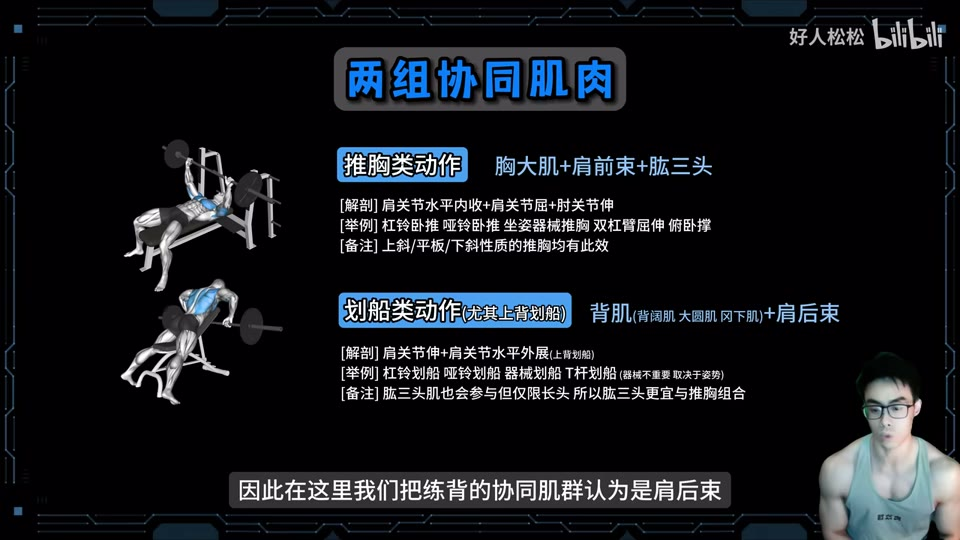

*图 6：两组协同肌肉：推胸类动作（胸大肌 + 肩前束 + 肱三头）与划船类动作，尤其是上背划船（背肌 + 肩后束）。*

画面备注：上斜、平板、下斜性质的推胸都有此效。划船器械不重要，取决于姿势。肱三头也会参与划船，但仅限长头，所以肱三头更适合与推胸组合。

### 1.7 名人观点：克里斯谈三分化 [09:14]

UP 主引用了「著名运动员克里斯」的一段视频（英文原声配中文字幕；视频只称「克里斯」，未给全名），大意如下：

- 许多研究发现，增肌最优的训练频率是**每个部位一周至少练 2 次**。
- 五分化练完一个部位后要休息 5 天才能再练，显然不是最优分化。三分化周一练了，周四或周五就能再练，这时五分化的人第一轮还没结束，所以收益更好。
- 三分化还有一个好处：不会在一次训练里对一个部位做很多组。花 1 到 1.5 个小时练一个部位的是「crazy people」（猛人们），后面已经上不了强度、没有体能，「肌肉已经很疲惫了」，**最后那些组基本是「垃圾组」**。

UP 主的总结 [10:13]：要兼顾训练组数和循环速度。与其过分追求加组数，不如适可而止，用剩余时间补练其他部位。补练要**利用肌肉的协同关系**：协同部位在前面的训练里已经积累了收益，只需少量组数就能练完；补练部位选错了，就等于「从头开始」，效率更低。

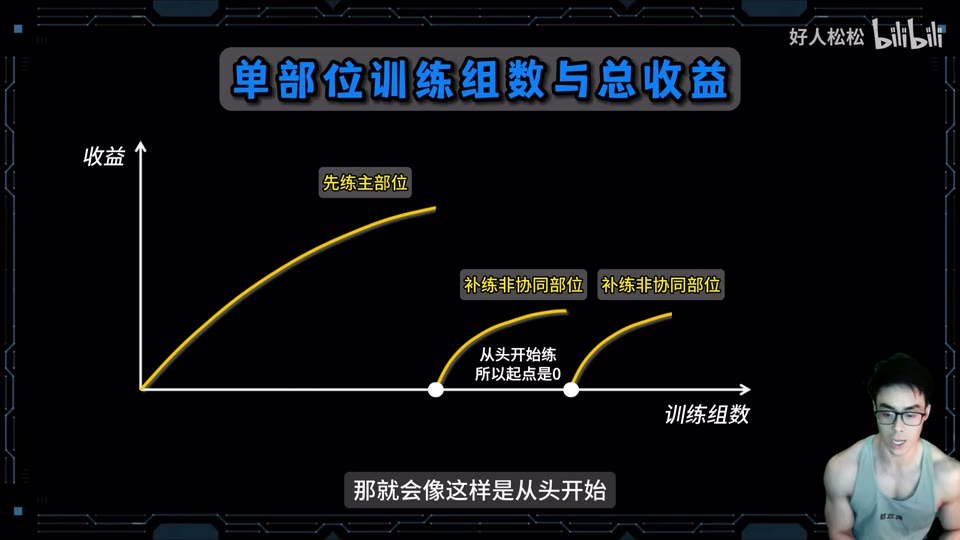

*图 7：单部位组数与收益的关系：补练非协同部位要从零开始积累，补练协同部位则能接着前面的收益往上走。*

### 1.8 后练的协同部位配重变轻，正常吗？ [10:54]

有人问：先练推胸再练肩前束或肱三头，重量会轻不少，这样还有效吗？

- **配重变轻恰恰说明推胸已经狠狠练到了肩前束和肱三头。**你练肩前束和肱三头的第 1 组其实从推胸就开始了，到专门练它们时已经是第 N 组，配重当然会减轻。
- UP 主自己的例子：肩膀不单独一天练，前中束跟胸一起练，后束跟背一起练。客观说配重会比单独练肩低一点，但肩膀并没有比其他单独练的部位差。「利用好肌肉协同关系，用趁热打铁的方式去带着练，是不会吃亏的。」

---

## 第二部分 动作模式与关节活动

### 2.1 什么是动作模式 [11:46]

分化没问题，也就是大小肌群的组合方式没问题之后，才轮到训练动作。训练动作有「大几十种」，但**每一种都归属于特定的动作模式**，而动作模式只有十来种。「你不要一上来就扎进具体的一个动作里」，要先搞清楚动作模式，让动作「各回各家各找各妈」。

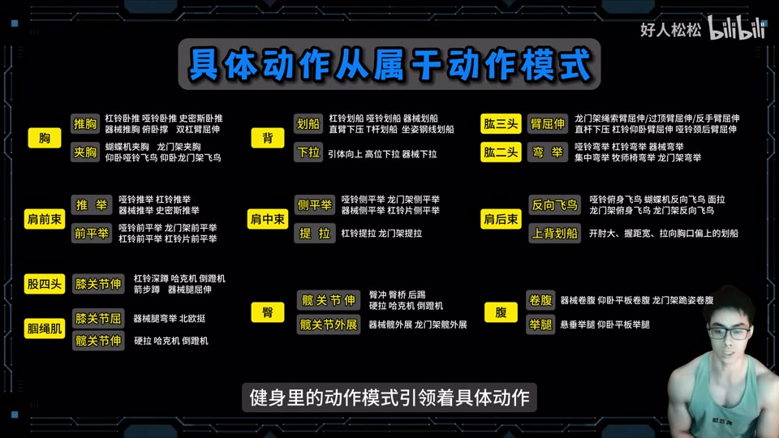

*图 8：具体动作从属于动作模式（全片的动作归类总表）。*

画面表格整理：

| 部位 | 动作模式 | 具体动作 |
|---|---|---|
| 胸 | 推胸 | 杠铃卧推、哑铃卧推、史密斯卧推、器械推胸、俯卧撑、双杠臂屈伸 |
| 胸 | 夹胸 | 蝴蝶机夹胸、龙门架夹胸、仰卧哑铃飞鸟、仰卧龙门架飞鸟 |
| 背 | 划船 | 杠铃划船、哑铃划船、器械划船、直臂下压、T 杆划船、坐姿钢线划船 |
| 背 | 下拉 | 引体向上、高位下拉、器械下拉 |
| 肱三头 | 臂屈伸 | 龙门架绳索臂屈伸/过顶臂屈伸/反手臂屈伸、直杆下压、杠铃仰卧臂屈伸、哑铃颈后臂屈伸 |
| 肱二头 | 弯举 | 哑铃弯举、杠铃弯举、器械弯举、集中弯举、牧师椅弯举、龙门架弯举 |
| 肩前束 | 推举 | 哑铃推举、杠铃推举、器械推举、史密斯推举 |
| 肩前束 | 前平举 | 哑铃前平举、龙门架前平举、杠铃前平举、杠铃片前平举 |
| 肩中束 | 侧平举 | 哑铃侧平举、龙门架侧平举、器械侧平举、杠铃片侧平举 |
| 肩中束 | 提拉 | 杠铃提拉、龙门架提拉 |
| 肩后束 | 反向飞鸟 | 哑铃俯身飞鸟、蝴蝶机反向飞鸟、面拉、龙门架俯身飞鸟、龙门架反向飞鸟 |
| 肩后束 | 上背划船 | 开肘大、握距宽、拉向胸口偏上的划船 |
| 股四头 | 膝关节伸 | 杠铃深蹲、哈克机、倒蹬机、箭步蹲、器械腿屈伸 |
| 腘绳肌 | 膝关节屈 | 器械腿弯举、北欧挺 |
| 腘绳肌 | 髋关节伸 | 硬拉、哈克机、倒蹬机 |
| 臀 | 髋关节伸 | 臀冲、臀桥、后踢、硬拉、哈克机、倒蹬机 |
| 臀 | 髋关节外展 | 器械髋外展、龙门架髋外展 |
| 腹 | 卷腹 | 器械卷腹、仰卧平板卷腹、龙门架跪姿卷腹 |
| 腹 | 举腿 | 悬垂举腿、仰卧平板举腿 |

### 2.2 胸

#### 主要动作模式：推胸 [12:30]

- **是什么**：把阻力从胸口推出去的动作都叫推胸。角度多种多样：躺着推（杠铃卧推、哑铃卧推）、坐着推（不同角度的器械推胸），甚至「趴着推」（双杠臂屈伸、俯卧撑）。
- **解剖原理**：胸大肌的肌纤维不管起于胸骨还是锁骨，最后都汇集成一束连在大臂上；肩前束也汇成一束连在大臂上。推胸包含三种运动：
  1. 胸大肌和肩前束收缩，把大臂在水平方向从躯干外侧拉向躯干前方：**肩关节水平内收**。
  2. 同样是胸大肌和肩前束收缩，把大臂从躯干后侧拉向前侧：**肩关节屈**。
  3. 肱三头肌收缩，把肘关节从折叠变为打直：**肘关节伸**。

#### 次要动作模式：夹胸 / 飞鸟 [13:41]

- **是什么**：蝴蝶机夹胸、龙门架夹胸、仰卧飞鸟等。
- **和推胸的区别**：它们**只有肩关节水平内收**这一个动作。大臂在水平面上从躯干外侧移到躯干前方，靠胸大肌和肩前束收缩，这一点和推胸相同。不同的是，大臂没有从躯干后侧往前侧的运动，所以没有肩关节屈；肘关节保持稳定不变，所以没有肘关节伸。

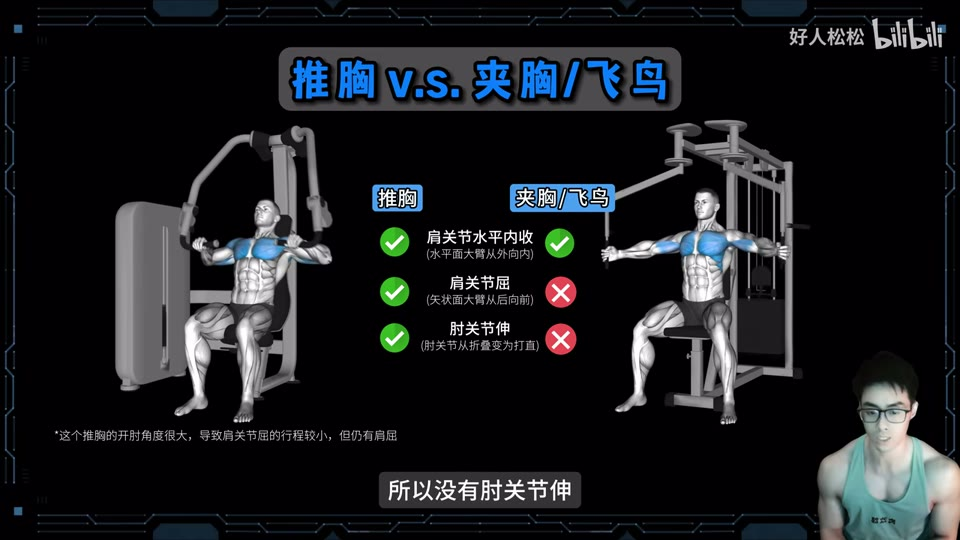

*图 9：推胸 = 肩关节水平内收 + 肩关节屈 + 肘关节伸；夹胸/飞鸟只有肩关节水平内收。*

**总结** [14:24]：

- 推胸涉及肩、肘两个关节的三种运动，属于**多关节运动**，除了胸和肩前束还能练到肱三头，**所以配重更大**。
- 飞鸟、夹胸只有肩关节的一种运动，属于**单关节运动**，排除了肱三头的参与，**所以配重比较小**。
- 不管怎样，「练胸就是要做肩关节水平内收，把大臂从外侧拉向内侧」，推胸、夹胸、飞鸟都在做这件事。

### 2.3 背

#### 动作模式 1：划船 [14:58]

- **是什么**：把阻力拉向躯干的动作都叫划船。按开肘程度分为**下背划船**和**上背划船**。

**下背划船 = 肩关节伸** [15:16]

- **做法特征**：夹肘，肘距与肩同宽，大臂在矢状面上从躯干前侧向后侧移动（画面标注：开肘小、握距窄、拉向腹部一线）。
- **原理**：靠连在大臂上的四个小伙伴，即背阔肌、大圆肌、肩后束、肱三头肌长头收缩，把大臂从躯干前方拉到后方。
- **判断要点**：所有划船动作「无一例外」都是把大臂从躯干前方拉向后方。至于是俯身趴着还是坐着，用哑铃、杠铃还是钢线，「这都无所谓，你只要看大臂是不是发生了这种移动就行了」。
- **类比** [16:03]：「划船」一词就来源于真实的划船。划船运动员对抗水阻时大臂从躯干前侧移到后侧；自由泳运动员反复做大臂从前往后的划水；攀爬类运动也靠大臂从前往后的肩关节伸让身体往上走，「确实是背肌在让你往上爬」。

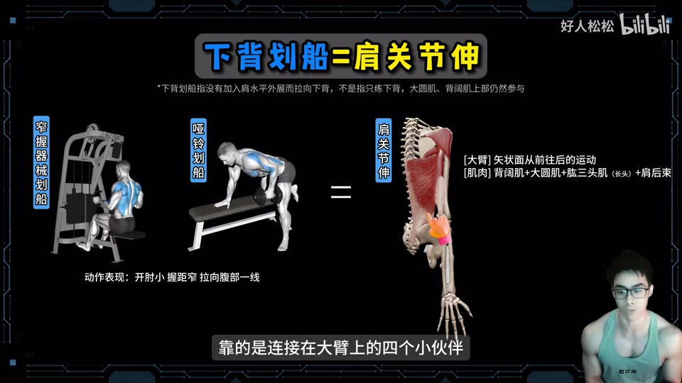

*图 10：下背划船 = 肩关节伸，靠背阔肌、大圆肌、肩后束、肱三头长头把大臂从躯干前方拉到后方。*

**上背划船 = 肩关节伸 + 肩关节水平外展** [16:45]

- 肩关节伸是大臂在矢状面上从前往后，肩关节水平外展是大臂在水平面上从内往外。上背划船开肘较大，角度介于两者之间，是两种运动的混合。
- **连锁反应**：开肘大 → 握距超过肩宽 → 手肘上移 → 拉动方向从腹部提高到胸口乃至更高一点。
- **效果**：相对减少背阔肌、大圆肌的发力，相对增加肩后束的发力。如果再加入**肩胛骨的前引后缩**，还有利于斜方肌和菱形肌发力。

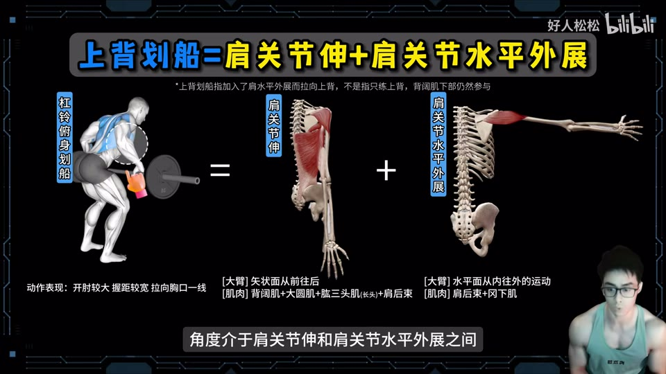

*图 11：上背划船 = 肩关节伸 + 肩关节水平外展，开肘大、握距宽、拉向胸口。*

#### 动作模式 2：下拉 [17:41]

- **是什么**：高位下拉、器械下拉、引体向上都是下拉类动作。
- **原理**：和划船不同，它是在**额状面上大臂从躯干外侧靠近躯干**，即**肩关节内收**。背阔肌、大圆肌汇成一束连在大臂上；高位下拉的配重或引体时的自重让大臂处于躯干外侧很远的位置，背阔肌、大圆肌收缩把大臂拉向躯干。
- 下拉动作还伴有**肩胛骨下回旋**，靠菱形肌、胸小肌、肩胛提肌收缩完成。所以下拉能让背部这些主要肌肉都参与进来。

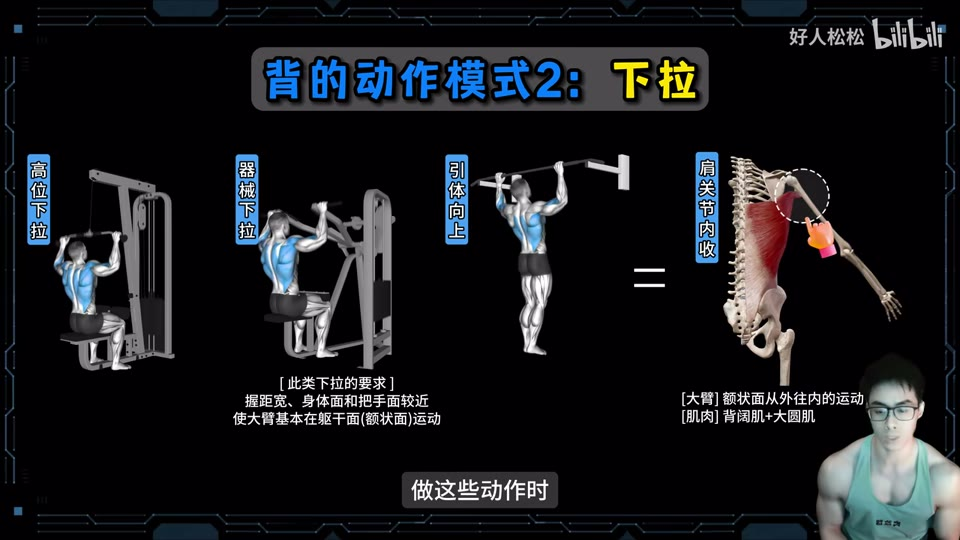

*图 12：下拉 = 额状面上大臂从躯干外侧靠近躯干（肩关节内收）。*

#### 进阶：下拉也可以做成「划船」 [18:36]

对比两种高位下拉：一种是大臂从外向内的**肩关节内收**；另一种是大臂从前往后的**肩关节伸**，和划船性质相同。要做成后者，动作要求是：

1. **握距不要超过肩宽**；
2. **杆子面和躯干面之间要留出大臂长度的距离**：往后坐一些，或稍微后仰一些，这样大臂轨迹就能做成标准的肩关节伸。

引体向上同理：握距不超过肩宽，躯干面和把手面之间留出距离，让大臂能从前面「放得下」。但引体不像高位下拉那样可以直接往后坐，要留出距离难度较大，**力量不足的人可以稍微后仰一点**，变相增加这个距离。

握法：做肩关节伸的下拉和引体，用正握、反握还是对握「并不关键」，怎么握都能做肩关节伸。只是对握和反握时手肘不容易往两边张开，有利于保持标准的肩关节伸姿势。

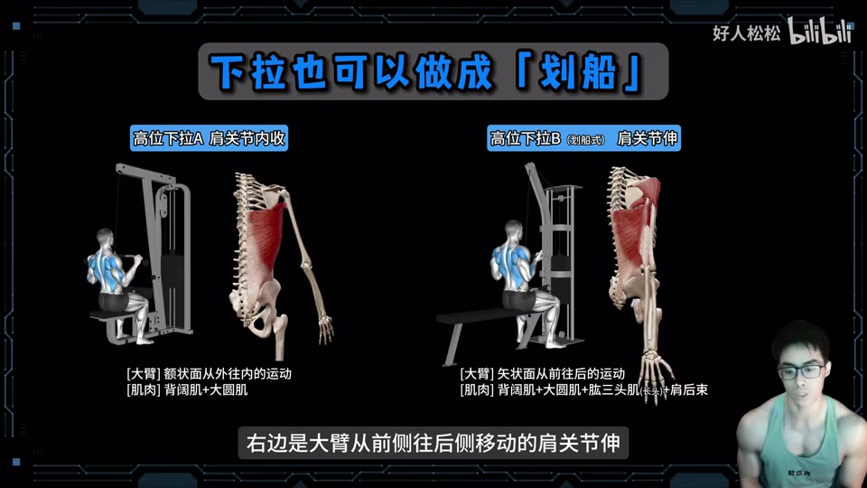

*图 13：左为肩关节内收的下拉/引体，右为肩关节伸的下拉/引体（握距不超过肩宽，躯干与把手之间留出距离）。*

**这台器械是下拉还是划船？** [20:14] 很多健身房都有一种器械，很多人第一反应是下拉。但它的大臂运动是从前往后的肩关节伸，所以应该算划船，厂家官网上的产品名称就叫 **High Row（高位划船机）**。「下拉类动作变化一下也能做成划船。」

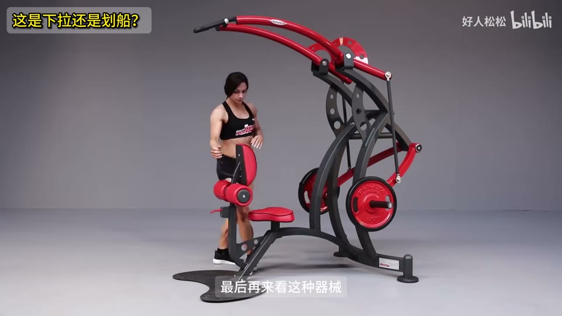

*图 14：看起来像下拉的「高位划船机」，大臂做的是肩关节伸，所以属于划船。*

### 2.4 手臂

手掌朝上时，大臂上面是肱二头肌，下面是肱三头肌。[20:46]

#### 肱三头：臂屈伸（肘关节伸）[20:55]

- 各种看起来不一样的动作，实际上都在做屈臂和伸臂的交替，所以叫**臂屈伸**。
- **原理**：肱三头肌的止点在小臂上端，一收缩就能把小臂打直，即**肘关节伸**。

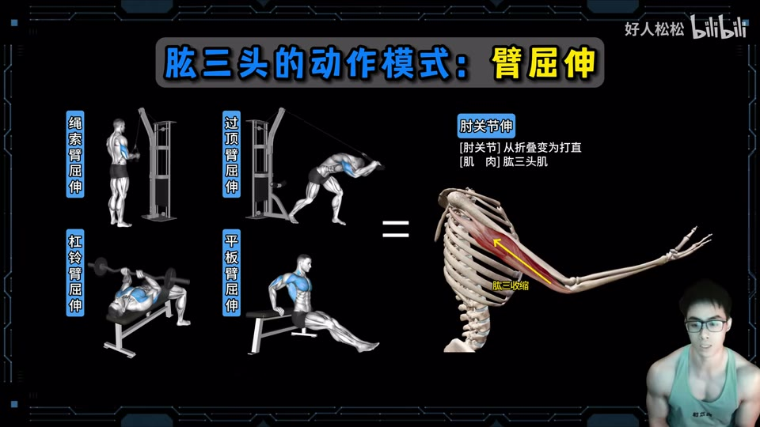

*图 15：各种臂屈伸本质上都是肘关节伸：肱三头一收缩就能把小臂打直。*

**唯一的例外：肩关节伸** [21:21] 肱三头还参与练背时的肩关节伸（大臂从躯干前侧往后侧，需要背阔肌、大圆肌、肩后束和肱三头长头一起发力）。视频里演示了一个动作：第一阶段做臂屈伸，用的是肱三头负责的肘关节伸；臂屈伸结束后，大臂还故意往躯干后侧移动，这是肱三头长头参与的肩关节伸，此时背阔肌、大圆肌、肩后束也在发力，「其实是一个划船动作」。

**为什么肱三头不和背一起练？** [22:09] 练背划船带到的肱三头**仅限长头**。外侧头和内侧头不长在肩胛骨上，大臂怎么后伸都和它俩没关系；而推胸自带的肘关节伸需要**三个头一起参与**。所以在三分化、四分化里，肱三头跟着推胸练，而不是跟着划船练。

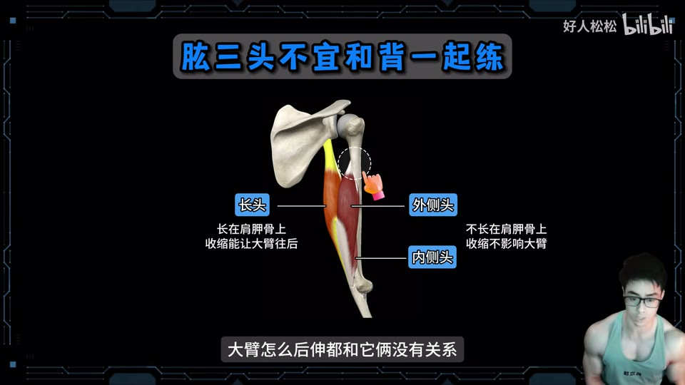

*图 16：只有长头长在肩胛骨上、能参与大臂后伸，外侧头和内侧头不参与，所以肱三头跟推胸练。*

#### 肱二头：弯举（肘关节屈）[22:38]

- 动作模式「就是两个字：弯举」。练二头的所有动作都叫「某某弯举」，「绝无例外」。区别只是阻力器械不同，杠铃、哑铃、器械、龙门架都能做。
- **原理**：肱二头肌的止点在小臂上端，一收缩就能把小臂拉起来。对抗阻力让肘关节从打直变为折叠，叫**肘关节屈**。

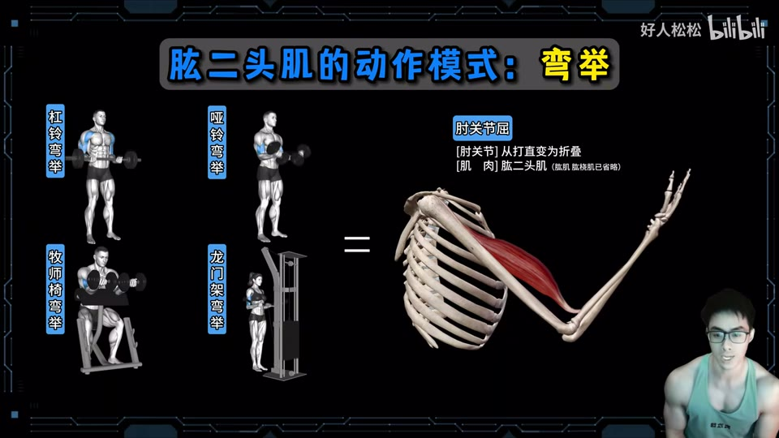

*图 17：弯举 = 肘关节屈：肱二头一收缩就能把小臂拉起来。*

**弯举和臂屈伸的区别** [23:15]：把器械撤掉、只看动作模样，分不清练的是二头还是三头，因为都在做屈伸。区别在于：**阻力用来阻止肘关节屈，就是练二头；阻力用来阻止肘关节伸，就是练三头。**只是肱三头先把「臂屈伸」这个名字「抢走了」，肱二头只好用「弯举」。

### 2.5 肩（三角肌）

三角肌顾名思义分为三部分，所以动作模式较多。[23:51]

#### 肩前束 主要模式：推举 [23:58]

- **原理**：推举时大臂既不完全在躯干前侧，也不完全外展到躯干外侧，是两种运动的混合：
  1. 矢状面上大臂从躯干往前：**肩关节屈**，由肩前束和胸大肌收缩实现；
  2. 额状面上大臂从躯干往外展：**肩关节外展**，主要由肩中束和冈上肌收缩实现。
- 推举练前束时也能带到中束，就是因为肩关节外展必须有肩中束参与。

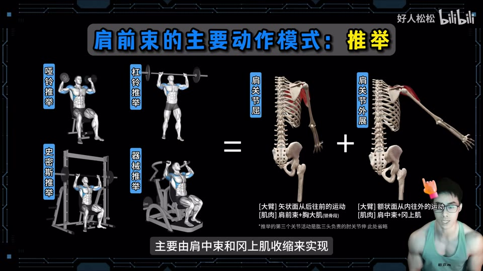

*图 18：推举 = 肩关节屈 + 肩关节外展，所以练前束的同时也带到中束。*

- **握距的影响** [24:54]：健身房的器械推肩常有不同握距的把手。**握距越宽，开肘越多，肩关节屈的成分越少、外展的成分越多，中束参与比例越高。**想多练前束就选窄一点的握距，想多练中束就选宽一点。
- **杠铃自由推举同理**：随着推起，开肘程度越来越大，肩关节屈的成分减少，外展的成分增加，中束参与越来越多。

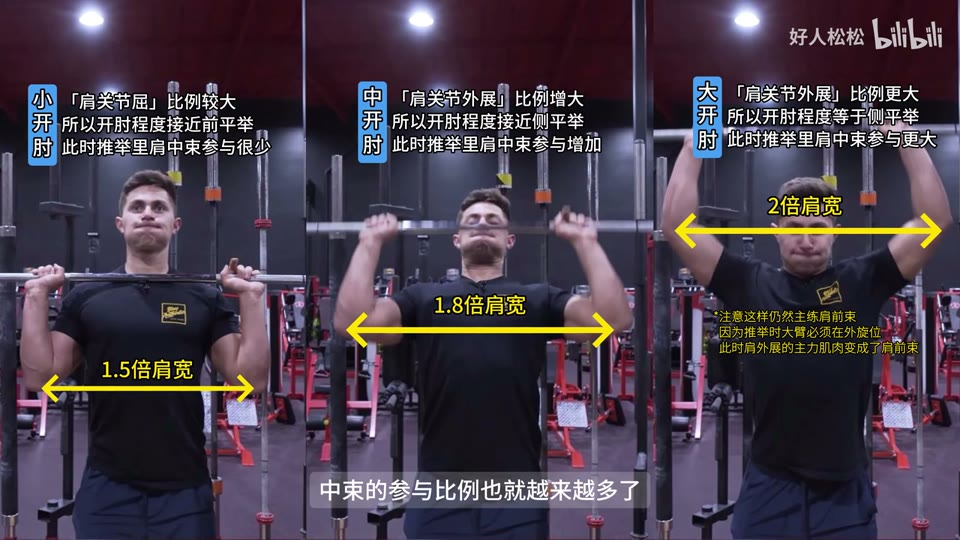

*图 19：握距从 1.5 倍到 2 倍肩宽，开肘越大，肩关节外展的比例越大，中束参与越多。*

#### 肩前束 次要模式：前平举 [25:33]

- 前平举时大臂只做从后往前的运动，是**标准的肩关节屈**，不像推举那样混合了肩关节外展，所以**基本不会有肩中束参与**。
- 因此前平举能有效抑制肩中束发力，是「一个比推举更小的练肩动作」。

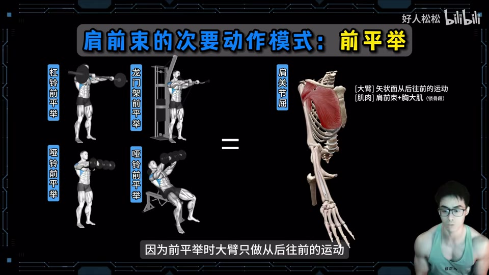

*图 20：前平举 = 标准的肩关节屈，基本没有中束参与。*

#### 肩中束：推举、侧平举、提拉 [25:59]

1. **推举**：上面已经讲过为什么推举能练到中束，略过。
2. **侧平举** [26:07]：推举时大臂是屈和外展的混合，开肘「留有余地」，不是标准的外展；侧平举开肘更大，基本就是标准的大臂从躯干往外的**肩关节外展**，由冈上肌和肩中束负责。
   - 补充：说「肩中束负责」并不是说往前或往后过了哪根肌纤维就不发力了，这是**连续变量**，前束、后束靠近中束的部分也会发一点力。所以肩关节外展有的解剖软件只标肩中束，有的把前中后束都标上。
3. **提拉** [26:52]：大臂轨迹和侧平举一模一样，都是在做肩关节外展；区别是提拉还有**肘关节屈**（肱二头肌在努力），侧平举肘关节稳定、肱二头不参与。所以提拉的配重**必然明显大于**侧平举，「人家是一个多关节运动」。

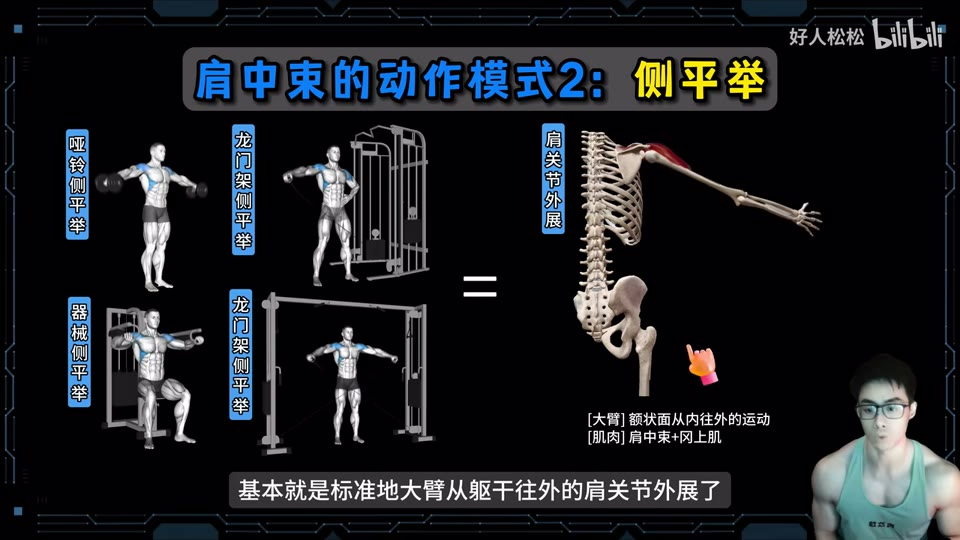

*图 21：侧平举 = 标准的肩关节外展（肩中束 + 冈上肌）。*

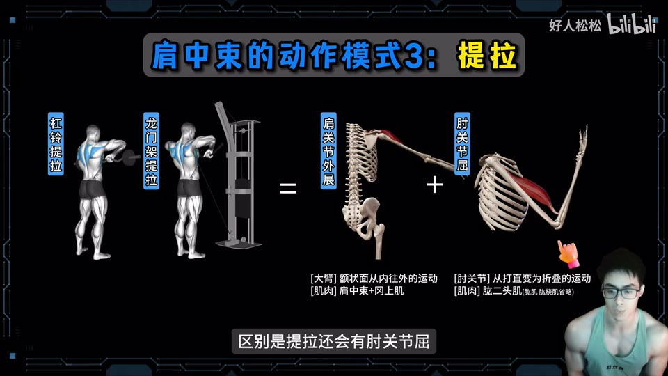

*图 22：提拉 = 肩关节外展 + 肘关节屈，属于多关节运动，配重更大。*

#### 肩后束：反向飞鸟 / 上背划船 [27:19]

- 两者都是肩后束收缩、拉动大臂在水平面上从前侧向后侧运动，即**肩关节水平外展**。
- **反向飞鸟**是纯粹的肩关节水平外展，大臂和躯干基本成 90°。
- **上背划船**是肩关节伸 + 肩关节水平外展的混合，引入了背肌（背阔肌、大圆肌）参与，**配重也会更大**。
- **为什么练肩后束一定要用握距宽、开肘大、拉向胸口乃至更高一点的上背划船？**因为只有这样的划船才接近肩关节水平外展，而不是接近肩关节伸。肩关节伸虽然也有肩后束参与，但更多靠背部肌肉；肩关节水平外展才是肩后束的独立功能。「即便用划船去练肩后束，也要选择偏向于肩关节水平外展的上背划船才行。」

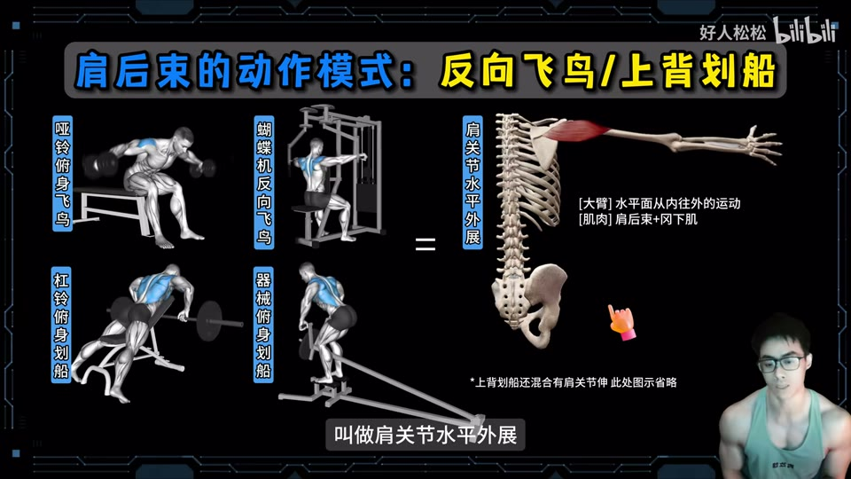

*图 23：反向飞鸟是纯粹的肩关节水平外展；上背划船混合了肩关节伸，所以背肌参与、配重更大。*

### 2.6 小总结：胸？背？肩？就看大臂怎么运动 [28:34]

肩关节的运动在胸、背、肩的训练里都出现了，UP 主做了一个小总结：

| 平面 | 运动 | 主要肌肉 | 举例 |
|---|---|---|---|
| 水平面 | 肩关节水平内收（从外往内） | 胸大肌 + 肩前束 | 夹胸 |
| 水平面 | 肩关节水平外展（从内往外） | 肩后束 + 冈下肌 | 反向飞鸟 |
| 矢状面 | 肩关节屈（从后往前） | 肩前束 + 胸大肌（锁骨段） | 前平举 |
| 矢状面 | 肩关节伸（从前往后） | 背阔肌 + 大圆肌 + 肱三头（长头）+ 肩后束 | 下背划船 |
| 额状面 | 肩关节外展（从内往外） | 肩中束 + 冈上肌 | 侧平举 |
| 额状面 | 肩关节内收（从外往内） | 背阔肌 + 大圆肌 | 宽距下拉 |

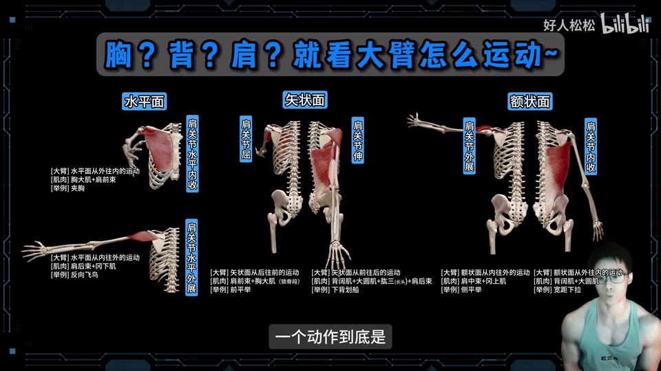

*图 24：三个平面上的六种肩关节运动：看大臂在哪个面、往哪个方向动，就能判断练的是胸、背还是肩的哪一束。*

- 「一个动作到底是练胸还是练背，还是练肩的前中后束，你看大臂是在哪个面上往哪个方向运动就能判断了。」
- 有的动作只有一种运动，比如**直臂下压**，只有矢状面上大臂从前往后，所以是肩关节伸，是一个主要练背的动作。
- 有的动作混合了两种运动轨迹，比较难辨认，比如前面讲的推胸、推举。

### 2.7 腿

大腿前侧是**股四头肌**，后侧是**腘绳肌**。[29:37]

#### 股四头肌：膝关节伸 [29:43]

- **原理**：股四头肌连在小腿前侧，收缩会把膝关节从折叠变为打直，即**膝关节伸**。
- 练股四头的动作不像其他部位那样有统一的名字，但原理都是「阻力让你难以把膝盖打直，你需要用股四头肌收缩的力量把膝盖从折叠变为打直」。
- **注意** [30:23]：视频里说的关节「打直」是形象表述，「并不是让你在训练时去做关节的锁死和超伸」。

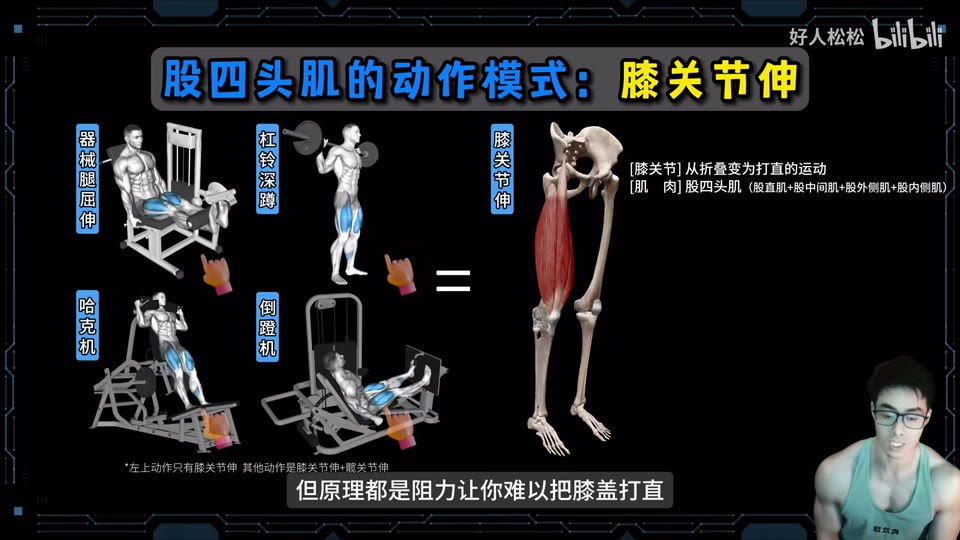

*图 25：练股四头就是对抗阻力打直膝关节（深蹲、腿屈伸、倒蹬机、哈克机等）。*

#### 腘绳肌 模式 1：膝关节屈 [30:36]

- 腘绳肌连在小腿后侧，收缩会把膝关节从打直变为折叠，即**膝关节屈**。这些动作用阻力增加屈膝的难度，让腘绳肌负重收缩（如器械腿弯举、北欧挺）。

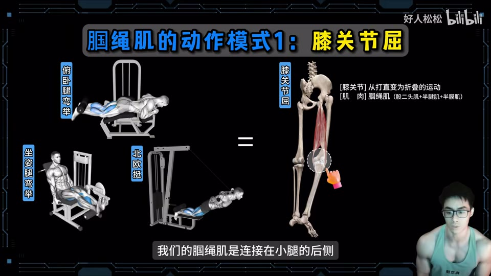

*图 26：腘绳肌模式 1：膝关节屈（腿弯举、北欧挺）。*

#### 腘绳肌 模式 2（更重要）：髋关节伸 [31:05]

- 腘绳肌一端跨过膝关节连在小腿上，另一端连在骨盆下方，收缩时能让大腿相对骨盆从前往后运动，即**髋关节伸**。
- 图里画的是大腿从站立位往后走，实际上**大腿从前方回到站立位也是髋关节伸**。
- 这些动作也没有统一的名字，原理都是腘绳肌对抗阻力收缩，让大腿相对于骨盆从前往后运动。

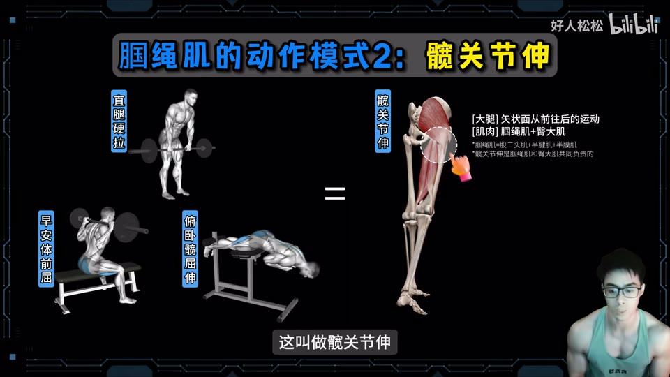

*图 27：腘绳肌模式 2：髋关节伸，让大腿相对骨盆从前往后运动（硬拉等）。*

#### 伸膝与伸髋的比例：深蹲 vs 硬拉 [31:52]

- 深蹲、硬拉都**既伸膝又伸髋**，所以大腿前后侧都参与，只是幅度不同让动作有所侧重：
  - **深蹲伸膝幅度更大 → 比硬拉更练大腿前侧**；
  - **硬拉伸髋幅度更大 → 比深蹲更练大腿后侧**；
  - **直腿硬拉**要求膝关节全程接近打直不动，取消了伸膝，就是「完全在练大腿后侧了」。
- 倒蹬机和哈克机也既伸膝又伸髋，大腿前后侧都参与。
- **小腿（脚）放前放后的区别** [32:45]：网上说脚放在不同位置会侧重不同部位，实质是：
  - 脚放**靠前**一点 → 预先减少屈膝 → 伸膝幅度少一些 → 减少大腿前侧发力，**更练大腿后侧**；
  - 脚放**靠后**一点 → 预先增加屈膝 → 伸膝幅度多一些 → **更练大腿前侧**。

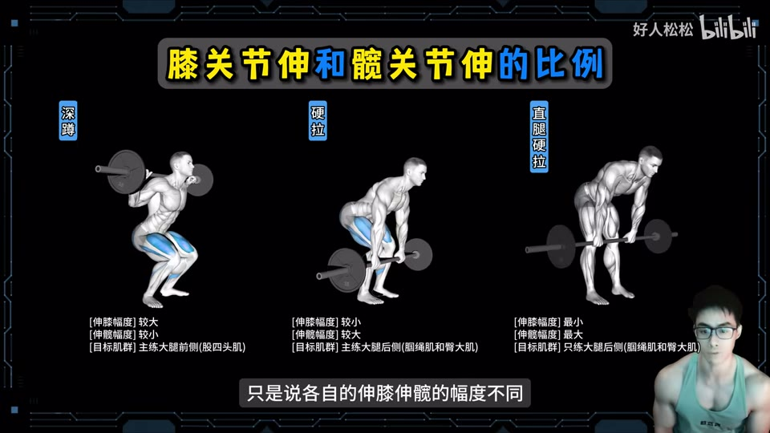

*图 28：深蹲、硬拉、直腿硬拉中伸膝与伸髋的幅度不同，所以侧重大腿前侧还是后侧不同。*

### 2.8 臀

（UP 主说是「为了照顾我 10% 的女粉丝」顺便讲。）[33:18]

#### 主要模式：髋关节伸 [33:23]

- 「臀腿不分家」：**臀大肌的功能也是髋关节伸**，和练腘绳肌一样的练法。臀大肌连着骨盆与大腿，髋关节伸是臀大肌和腘绳肌一起收缩完成的。
- **男生**：用硬拉练腘绳肌，就顺便练到了臀大肌。
- **女生**想继续加练臀，可以做臀冲、臀桥、后踢等，这些动作「无一例外都是在做髋关节伸」。
- 因为髋关节伸需要臀大肌和腘绳肌一起完成，**臀肌发达的话大腿后侧一定也比较发达**，职业比基尼运动员就很明显。那些教你「臀变得很大但腿要变细」的教程，「要么是 P 图骗人，要么就是往臀部里注射了奇奇怪怪的东西」。

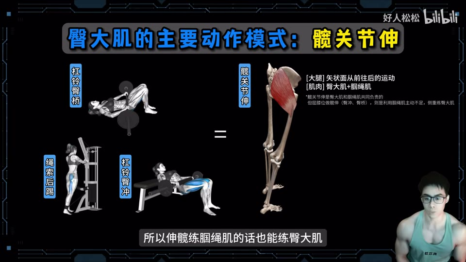

*图 29：臀大肌的主要模式是髋关节伸，需要臀大肌和腘绳肌一起完成。*

#### 次要模式：髋关节外展 [34:36]

- 这是臀大肌、臀中肌的孤立训练，大腿肌肉基本不参与（画面注：除了大腿外侧的阔筋膜张肌）。网上一些「练臀不练腿」的教练就是让你做这些动作。
- 但这些动作对臀肌的训练效率**弱于**髋关节伸的动作，「使用这类动作还是很难练出好的臀肌的」，所以是次要模式。
- 结论：「练臀完全不练腿是不太可能的。」

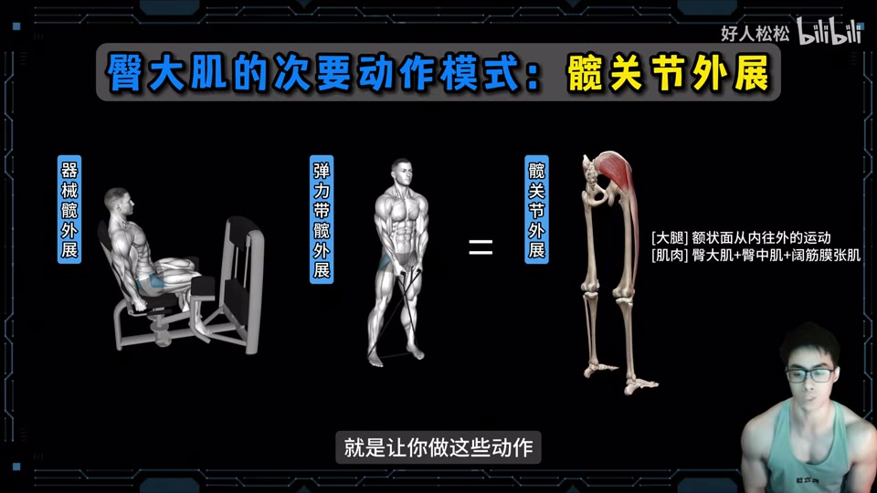

*图 30：髋关节外展（器械髋外展等）是臀肌的孤立训练，效率不如髋关节伸。*

**嫌腿粗？问题在脂肪而非肌肉** [35:07]：UP 主认为「粗腿忧虑是多余的」。99% 嫌自己腿粗的人是因为体脂率太高，把体脂降到大腿能「皮肉分离」，就会发现腿的问题是太细而不是太粗。「不要担心力量训练会让你的腿太粗，不要把脂肪的锅甩到肌肉上面去。」

### 2.9 腹：卷腹与举腿 [35:30]

练腹是「新手的最爱，也是新手错误率最高的动作，没有之一」。

- **原理**：腹肌上段连在肋骨、胸骨上，下段连在骨盆最前面。保持下段不动、拉动上段，胸腰椎前屈，脊柱屈度增加，这就是腹肌在解剖上的功能：**脊柱屈**。
- **卷腹** [36:02]：腹直肌下端不动、拉动上端，表现为**骨盆不动，胸腰椎微向前屈**。
- **举腿** [36:14]：腹直肌上端不动、拉动下端，骨盆被拉起来，从侧面看是**骨盆往后旋转**。因为骨盆的骶骨也是脊柱的一部分，所以这种后旋其实也是「脊柱屈」。举腿时表现为躯干不动、骨盆后旋；幅度够大时，骨盆后旋的同时胸腰椎也会有一点前屈。
- **本质相同**：都是腹直肌收缩让脊柱屈。卷腹屈的是上面的胸椎、腰椎；举腿屈的是下面的骶椎。

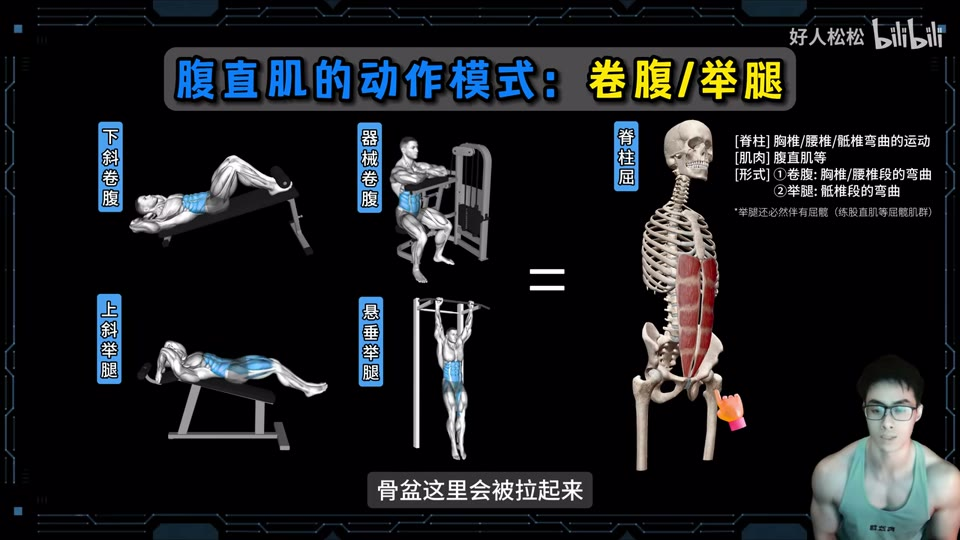

*图 31：卷腹（上端拉动，胸腰椎前屈）与举腿（下端拉动，骨盆后旋）本质上都是脊柱屈。*

#### 常见错误：把卷腹做成了仰卧起坐 [37:13]

| | 正确的卷腹（脊柱屈） | 常见错误：仰卧起坐（髋关节屈） |
|---|---|---|
| 脊柱 | 从直变微弯，在做脊柱屈 | 接近一直打直，缺乏脊柱屈 |
| 髋部 | 大腿和骨盆都不动，没有髋关节屈 | 大腿不动、骨盆前旋，在做髋关节屈 |
| 练到的肌肉 | 腹直肌 | 屈髋肌群（股直肌、髂腰肌等） |
| 上半身抬起幅度 | 很小（「做不起来」） | 特别大 |

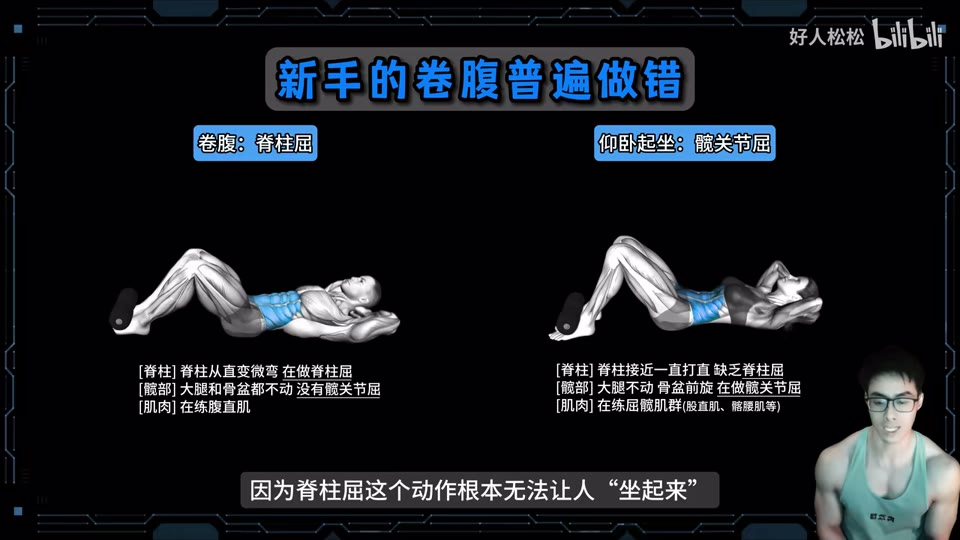

*图 32：左为正确卷腹（脊柱屈），右为常见错误「仰卧起坐」（髋关节屈）。*

- 仰卧起坐前半程脊柱一直打直，完全没有脊柱屈，和腹肌没关系；后半程脊柱有一点弯曲，略能练到一点腹肌。
- 还有人「坐起来」全程保持背部刚性，脊柱一直是直的，「这样就彻彻底底和腹肌无关了」。
- **要点**：卷腹时一定要把意识放到腹肌收缩上，拉动胸腰椎微微往前屈。
- UP 主的经验：「我感觉一组做十来个都挺难。那些一组能做二三十个、做起来的卷腹一定是错的，因为脊柱屈这个动作根本无法让人『坐起来』。」

### 2.10 动作模式总结 [38:40]

新手要知道这十多种动作模式。「先要记住动作模式，而不是一上来就扎进具体动作的汪洋大海里。」解剖上的关节运动看图理解不了，「也就算了」。

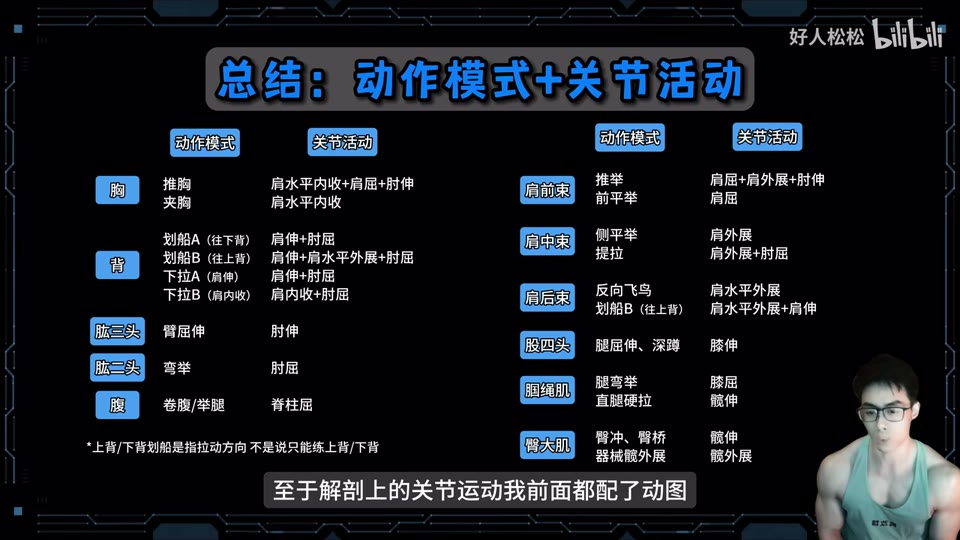

*图 33：动作模式与关节活动总表。*

| 部位 | 动作模式 | 关节活动 |
|---|---|---|
| 胸 | 推胸 | 肩水平内收 + 肩屈 + 肘伸 |
| 胸 | 夹胸 | 肩水平内收 |
| 背 | 划船 A（往下背） | 肩伸 + 肘屈 |
| 背 | 划船 B（往上背） | 肩伸 + 肩水平外展 + 肘屈 |
| 背 | 下拉 A（肩伸） | 肩伸 + 肘屈 |
| 背 | 下拉 B（肩内收） | 肩内收 + 肘屈 |
| 肱三头 | 臂屈伸 | 肘伸 |
| 肱二头 | 弯举 | 肘屈 |
| 腹 | 卷腹/举腿 | 脊柱屈 |
| 肩前束 | 推举 / 前平举 | 肩屈 + 肩外展 + 肘伸 / 肩屈 |
| 肩中束 | 侧平举 / 提拉 | 肩外展 / 肩外展 + 肘屈 |
| 肩后束 | 反向飞鸟 / 划船 B（往上背） | 肩水平外展 / 肩水平外展 + 肩伸 |
| 股四头 | 腿屈伸、深蹲 | 膝伸 |
| 腘绳肌 | 腿弯举 / 直腿硬拉 | 膝屈 / 髋伸 |
| 臀大肌 | 臀冲、臀桥 / 器械髋外展 | 髋伸 / 髋外展 |

画面注：上背/下背划船是指拉动方向，不是说只能练上背/下背。

**全身关节运动的通俗理解：「往前为屈，往后为伸」** [38:59]

对健身最相关的肩、肘、髋、膝四个关节（加上脊柱）：

- 大臂往前：肩关节屈；大臂往后：肩关节伸。
- 小臂往前：肘关节屈；小臂往后：肘关节伸。
- 大腿往前：髋关节屈；大腿往后：髋关节伸。
- 躯干往前：脊柱屈；躯干往后：脊柱伸。

肩关节在屈伸之外还有四种活动：往外的**外展**、往内的**内收**、水平面上往外的**水平外展**、水平面上往内的**水平内收**。

（膝关节在这组口诀中的具体说法，原视频此处只提到「肩肘髋膝四个关节」，未单独展开膝关节的「往前/往后」表述（此处原视频未明确）。前文讲腿时已说明：膝从折叠到打直是膝关节伸，从打直到折叠是膝关节屈。）

---

## 第三部分 训练计划

### 3.1 三分化训练计划 [39:44]

- 一个大肌群练 **9 组**，两个小肌群各练 **6 组**，合计 **21 组**。组数适中，每次训练大约需要**一小时或一小时出头**。
- 如果要增加组数，一般**不要练超过一个半小时**。
- 大小肌群不是随意组合，而是按前面说的肌肉协同关系来发挥「趁热打铁」的功效。
- 练腿日因为少练一个部位，所以腿的组数稍多一点。
- **组间休息**：指**同一动作里各组之间**的休息，「不是只换一个动作才能休息」。**胸、背、腿这种大部位可以休 3 分钟，肩膀、手臂这种小部位可以休 2 分钟**。练腿动作对心肺要求很高，可以根据自己的情况再延长一点。

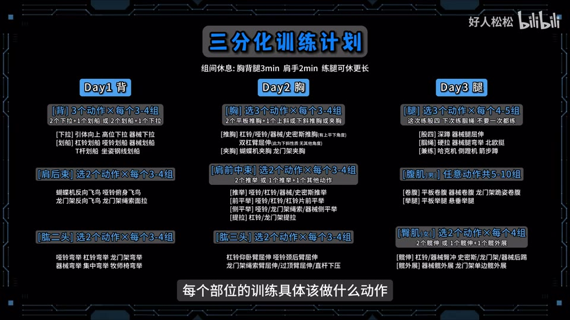

*图 34：三分化训练计划（含动作库）。*

画面表格整理（组间休息：胸背腿 3min，肩手 2min，练腿可休更长）：

**Day1 背**

- **[背] 3 个动作 × 每个 3–4 组**（2 个下拉 + 1 个划船，或 2 个划船 + 1 个下拉）
  - [下拉] 引体向上、高位下拉、器械下拉
  - [划船] 杠铃划船、哑铃划船、器械划船、T 杆划船、坐姿钢线划船
- **[肩后束] 选 2 个动作 × 每个 3–4 组**：蝴蝶机反向飞鸟、哑铃俯身飞鸟、龙门架反向飞鸟、龙门架绳索面拉
- **[肱二头] 选 2 个动作 × 每个 3–4 组**：哑铃弯举、杠铃弯举、龙门架弯举、器械弯举、集中弯举、牧师椅弯举

**Day2 胸**

- **[胸] 选 3 个动作 × 每个 3–4 组**（2 个平板推胸 + 1 个上斜或下斜推胸或夹胸）
  - [推胸] 杠铃/哑铃/器械/史密斯推胸（有上平下角度）、双杠臂屈伸（此为下斜性质，无其他角度）
  - [夹胸] 蝴蝶机夹胸、龙门架夹胸
- **[肩前中束] 选 2 个动作 × 每个 3–4 组**（2 个推举，或 1 个推举 + 1 个其他动作）
  - [推举] 哑铃/杠铃/器械/史密斯推举
  - [前平举] 哑铃/杠铃/杠铃片前平举
  - [侧平举] 哑铃/龙门架绳索/器械侧平举
  - [提拉] 杠铃/龙门架提拉
- **[肱三头] 选 2 个动作 × 每个 3–4 组**：杠铃仰卧臂屈伸、哑铃颈后臂屈伸、龙门架绳索臂屈伸/过顶臂屈伸/直杆下压

**Day3 腿**

- **[腿] 选 3 个动作 × 每个 4–5 组**（这次练股四，下次练腘绳，不要一次都练）
  - [股四] 深蹲、器械腿屈伸
  - [腘绳] 硬拉、器械腿弯举、北欧挺
  - [兼练] 哈克机、倒蹬机、箭步蹲
- **[腹肌（男）] 任意动作共 5–10 组**
  - [卷腹] 平板卷腹、器械卷腹、龙门架跪姿卷腹
  - [举腿] 平板举腿、悬垂举腿
- **[臀肌（女）] 选 2 个动作 × 每个 4 组**（2 个髋伸，或 1 个髋伸 + 1 个髋外展）
  - [髋伸] 杠铃/器械臀冲、史密斯/龙门架/器械后踢
  - [髋外展] 器械髋外展、龙门架单边髋外展

**为什么提供「动作库」而不是指定动作** [40:38]：库里都是最主流、最常规的动作。新手学动作有先有后，有的感觉好、有的感觉差，计划里指定必须做某个动作，反而会让人无所适从。

**主次之分** [41:18]：计划按动作模式的主次来设计（不是时间分配上的主次不均）：

- 胸：以**推胸**为主，夹胸为次；
- 肩前束：以**推举**为主，前平举为次；
- 腿：以**深蹲、硬拉**为主，其他动作为次；
- 臀：以**髋关节伸**为主，髋关节外展为次；
- 背、肩中后束、手臂、腹肌的动作模式一般**没有主次之分**，都可以做。

**三天的顺序能换吗？** [41:54] 可以随便换。UP 主的个人习惯是**练背放在练胸之前**：练完胸之后的胸肌酸痛会影响第二天练背的下拉类动作，而练背不容易酸痛，即便酸痛也不太影响练胸。

### 3.2 四分化训练计划 [42:16]

- UP 主写的是「肩膀拆分、手臂单练」的四分化版本。四分化多练一天，所以**大小肌群的组数都比三分化多一点**，其他方面一样，还是从动作库里选动作。

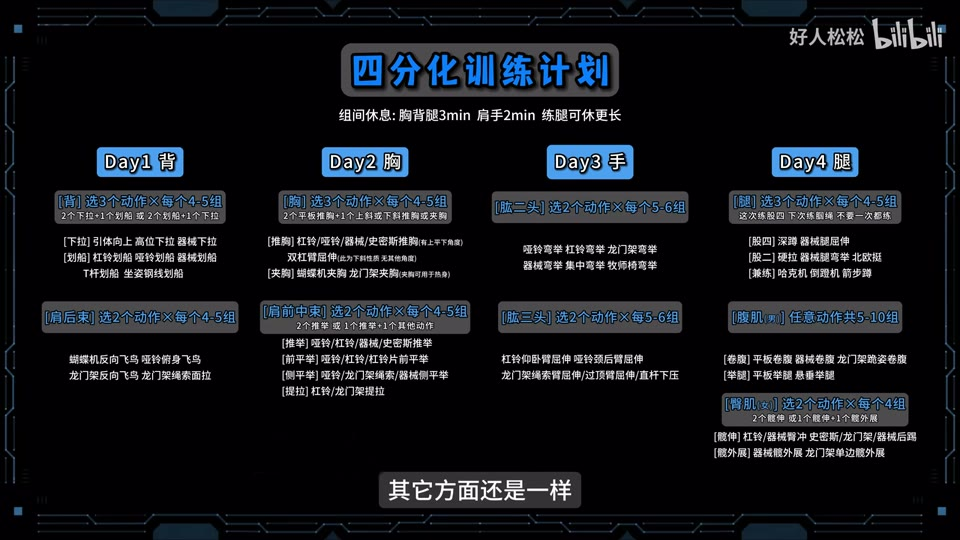

*图 35：四分化训练计划（肩膀拆分、手臂单练）。*

画面表格整理（组间休息同三分化）：

- **Day1 背**：[背] 选 3 个动作 × 每个 4–5 组（2 下拉 + 1 划船，或 2 划船 + 1 下拉）；[肩后束] 选 2 个动作 × 每个 4–5 组。动作库同三分化。
- **Day2 胸**：[胸] 选 3 个动作 × 每个 4–5 组（2 个平板推胸 + 1 个上斜或下斜推胸或夹胸；画面注：夹胸可用于热身）；[肩前中束] 选 2 个动作 × 每个 4–5 组（2 个推举，或 1 个推举 + 1 个其他动作）。
- **Day3 手**：[肱二头] 选 2 个动作 × 每个 5–6 组；[肱三头] 选 2 个动作 × 每个 5–6 组。
- **Day4 腿**：[腿] 选 3 个动作 × 每个 4–5 组（股二即腘绳：硬拉、器械腿弯举、北欧挺；这次练股四，下次练股二，不要一次都练）；[腹肌（男）] 任意动作共 5–10 组；[臀肌（女）] 选 2 个动作 × 每个 4 组。

**三分化还是四分化？** [42:33] 都可以。三分化每次多练一个部位，「需要抓紧时间不能划水」，也需要更好的恢复能力。可以先用三分化，觉得压力太大再换四分化。

### 3.3 怎样学具体动作 [42:50]

- **利用网络资源**：在 B 站（「本站」）或某音搜索动作、肌肉、部位的名称，比如搜「胸肌」「深蹲」；想缩小范围可以加一个「教」字（教学、教程）。然后对着教程「照猫画虎」，去健身房练习体会。
- **完全自学要注意先易后难** [43:11]。**固定器械比自由动作好上手得多**，可以先用固定器械学动作模式、找动作感觉，体会到那个意思后再转向自由动作。

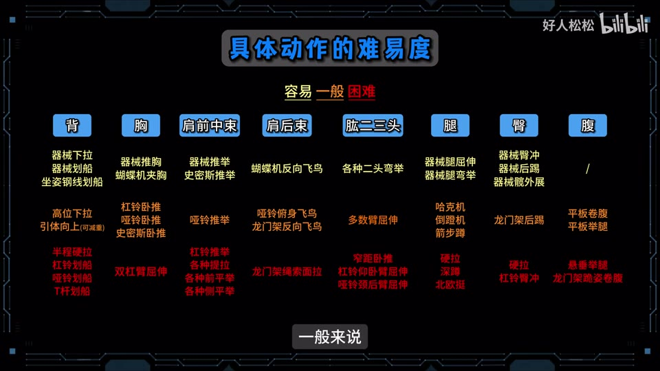

*图 36：具体动作的难易度（黄 = 容易，橙 = 一般，红 = 困难）。*

| 部位 | 容易 | 一般 | 困难 |
|---|---|---|---|
| 背 | 器械下拉、器械划船、坐姿钢线划船 | 高位下拉、引体向上（可减重） | 半程硬拉、杠铃划船、哑铃划船、T 杆划船 |
| 胸 | 器械推胸、蝴蝶机夹胸 | 杠铃卧推、哑铃卧推、史密斯卧推 | 双杠臂屈伸 |
| 肩前中束 | 器械推举、史密斯推举 | 哑铃推举 | 杠铃推举、各种提拉、各种前平举、各种侧平举 |
| 肩后束 | 蝴蝶机反向飞鸟 | 哑铃俯身飞鸟、龙门架反向飞鸟 | 龙门架绳索面拉 |
| 肱二三头 | 各种二头弯举 | 多数臂屈伸 | 窄距卧推、杠铃仰卧臂屈伸、哑铃颈后臂屈伸 |
| 腿 | 器械腿屈伸、器械腿弯举 | 哈克机、倒蹬机、箭步蹲 | 硬拉、深蹲、北欧挺 |
| 臀 | 器械臀冲、器械后踢、器械髋外展 | 龙门架后踢 | 硬拉、杠铃臀冲 |
| 腹 | / | 平板卷腹、平板举腿 | 悬垂举腿、龙门架跪姿卷腹 |

- **找小伙伴** [43:35]：特别建议自学的人找一个小伙伴一起学一起练，两个人互相帮助上手更快。能找到练得还行的朋友更好：在自学基础上请他带你练几次、帮你纠正动作，「大不了给他买蛋白粉当感谢费」。
- **买私教课**：经济宽裕的话，「花三五千去买二十节私教课也是可以的」，练几个循环下来基本动作就差不多了，接下来自学提高。「网上的资源会比一个教练能教你的要多一百倍，所以一定要学会自我提高。」

### 3.4 训练频率与时长 [44:14]

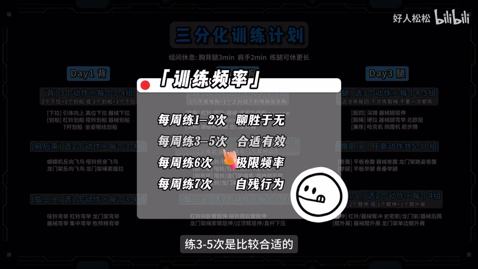

*图 37：训练频率：每周 1–2 次聊胜于无，3–5 次合适有效，6 次极限频率，7 次自残行为。*

| 每周训练次数 | 评价 |
|---|---|
| 1–2 次 | 增肌很慢，聊胜于无 |
| 3–5 次 | 比较合适、有效 |
| 6 次 | 极限操作，需要平时休息得很好 |
| 7 次 | 自残行为 |

- 一周最少也需要**一天休息**，用来缓解肌肉延迟酸痛和中枢神经疲劳。
- **训练时长**：除去热身拉伸的时间，正式训练一般是**两三个部位、一共 1–1.5 小时、大概 20 多组**。继续加时长、加组数，「基本就没太多好处了」。

**几分化和「一周」毫无关系** [44:53]：新手容易误以为三分化/四分化必须一周练三次/四次。其实不是，按顺序一直往后排就行。比如三分化里「部位 1」可能出现在一周的任何一天，不是说某个部位一定在周几练。中间的休息日也可以根据身体感受和忙碌程度临时安排。

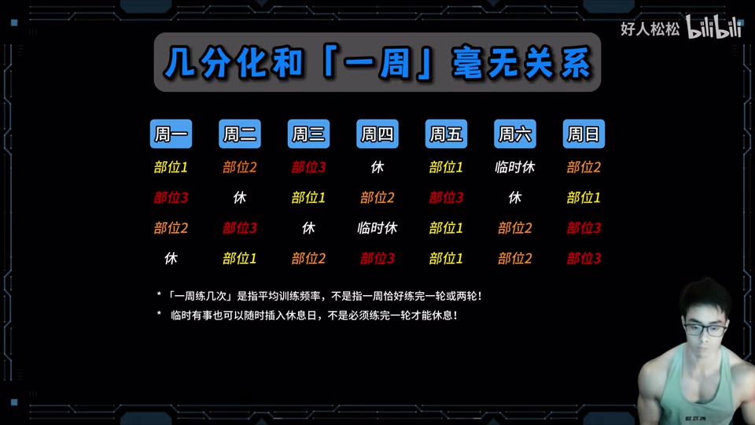

*图 38：三分化按顺序循环排下去即可；「一周练几次」是平均频率，临时有事可以随时插入休息日。*

### 3.5 健身动作的命名方式 [45:18]

多数动作的名字由以下要素组合而成：

| 要素 | 选项 |
|---|---|
| 阻力器械 | 杠铃、哑铃、史密斯、龙门架、固定器械 |
| 凳子角度 | 上斜、平板、下斜 |
| 身体姿势 | 站姿、坐姿、卧姿、跪姿、悬垂、俯身、仰卧、过顶、颈前、颈后 |
| 动作模式 | 胸（推胸/夹胸/飞鸟）、背（划船/下拉/引体）、肱三头（臂屈伸）、肱二头（弯举）、腹（卷腹/举腿）、肩前束（推举/前平举）、肩中束（侧平举/提拉）、肩后束（反向飞鸟/面拉） |

例子：**杠铃上斜卧推**：阻力器械是杠铃（不是哑铃、器械、龙门架），凳子角度是上斜（不是平板、下斜），身体姿势是卧着（不是坐、站、俯身），动作模式是推胸（不是夹胸）。

除了**练腿的动作有独特的名字、不按这个规矩来**，其他大部分动作都按这些要素组合命名。

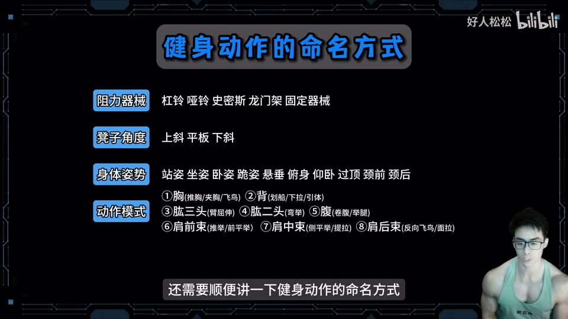

*图 39：动作名 = 阻力器械 + 凳子角度 + 身体姿势 + 动作模式。*

### 3.6 配重：用 RM 描述 [46:16]

- **RM（Repetition Maximum，可完成的最大重复次数）**：配重 8RM，就是在接近标准动作模式下，这个重量你能做 8 个。**RM 越大越轻，RM 越小越重。**
- 增减少量配重就能显著改变重复次数：在极限重量（1RM）基础上减轻 30%，就能从只能做 1 个变为能做 12 个之多。

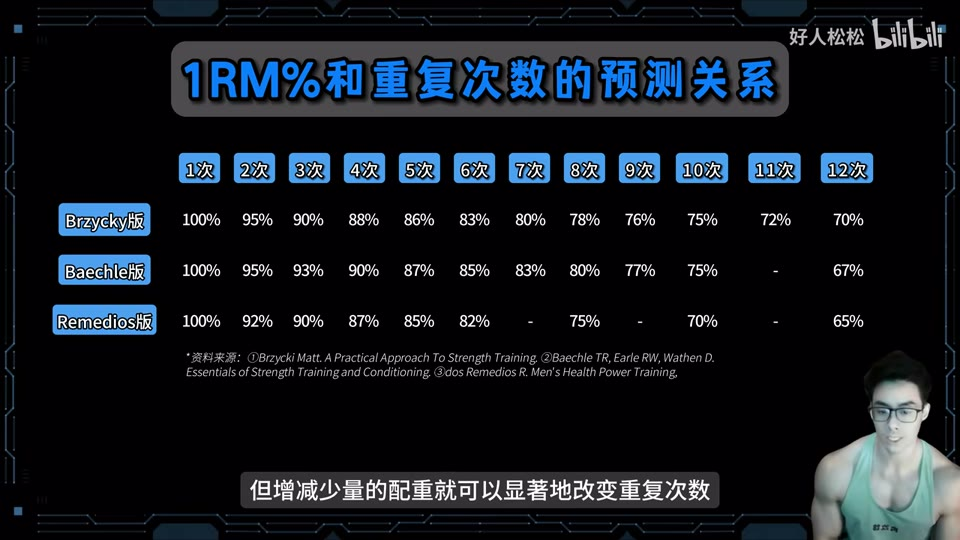

*图 40：1RM 百分比与可重复次数的预测关系（三个版本的换算表）。*

| 次数 | 1 | 2 | 3 | 4 | 5 | 6 | 7 | 8 | 9 | 10 | 11 | 12 |
|---|---|---|---|---|---|---|---|---|---|---|---|---|
| Brzycky 版 | 100% | 95% | 90% | 88% | 86% | 83% | 80% | 78% | 76% | 75% | 72% | 70% |
| Baechle 版 | 100% | 95% | 93% | 90% | 87% | 85% | 83% | 80% | 77% | 75% | - | 67% |
| Remedios 版 | 100% | 92% | 90% | 87% | 85% | 82% | - | 75% | - | 70% | - | 65% |

（画面资料来源：Brzycki Matt, *A Practical Approach To Strength Training*；Baechle TR, Earle RW, Wathen D, *Essentials of Strength Training and Conditioning*；dos Remedios R, *Men's Health Power Training*。）

### 3.7 不同目的，不同配重 [46:54]

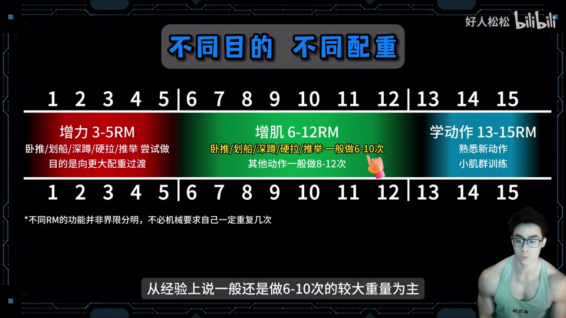

*图 41：增力 3–5RM、增肌 6–12RM、学动作 13–15RM。*

| 目的 | RM 区间 | 适用 |
|---|---|---|
| 增力 | 3–5RM | 卧推/划船/深蹲/硬拉/推举尝试做，目的是向更大配重过渡 |
| 增肌 | 6–12RM | 卧推/划船/深蹲/硬拉/推举一般做 6–10 次，其他动作一般做 8–12 次 |
| 学动作 | 13–15RM | 熟悉新动作、小肌群训练 |

画面注：不同 RM 的功能并非界限分明，不必机械要求自己一定重复几次。

**增肌主区间 6–12 次**：根据健身圈的实践和运动科学研究，增肌最好每组选能做 6–12 次的重量。

- **卧推、划船、深蹲、硬拉、推举这五个多关节大动作**（UP 主称「五大项」），经验上一般以 **6–10 次**的较大重量为主；
- **其他动作**一般做 **8–12 次**的稍轻重量。
- 这不是绝对的，大动作做高次数、小动作做低次数的人也有，这里只是一种主流配重方式。

**要不要力竭？** [47:29]「很简单，做得动就做，预感快要做不动了就放下。」既不要刻意保留力量，也不要死拼到底。特别是**卧推、深蹲、推举**这类配重会「自由落体砸下来」的大动作，**没有保护的情况下不要死拼力竭**，否则只是增加受伤风险。

**3–5RM 大重量** [47:55]：

- 肌肉需要更大的配重刺激才能长大，而加重不是一蹴而就的，稍微加重就会让重复次数迅速降到 3–5 次。
- 仍然**只有卧推、划船、硬拉、深蹲、推举这几个复合大动作**会尝试 3–5RM。所谓尝试，就是偶尔做一下，比如**一次训练最多做一两组**。绝大多数组数还是用 6–12 次的重量。
- 有人连续几年用 **5×5** 训练模式、使用大重量，这偏向增力，会损失一些增肌效率。
- 反过来，有人因为一个人练，觉得大重量「试试就逝世」而从来不敢用，这也不对。但这种顾虑有道理：3–5RM 很容易接近力竭，危险性较大，**卧推、深蹲、推举最好有人保护**。

**12–15RM 小重量** [49:03]：

- 刚学一个新动作时，可以用 12–15 次的较轻重量来熟悉动作、体会发力感。
- 另一种情况是前面说的：有人认为五大项以外的训练更适合用轻一点的配重。但这只是一种观点，也有很多人小肌群也用较大配重。

**15RM 以上** [49:27]：除了热身，基本不会用。网上一些跟练教学教你用很轻的重量反复做，相当于 30–50RM 的力量训练，虽然很容易有酸痛和泵感，但「又费时又低效」。「**有感觉不等于长肌肉。**你现在拿起自己的手机推举 50 次也会有点感觉，但推举手机不可能长出大肩膀来。」

### 3.8 按肌纤维类型选次数？难以应用 [50:01]

一种流行理论说：I 型肌纤维是慢肌纤维，适合小重量高次数；II 型是快肌纤维，适合大重量低次数；每块肌肉应按两类肌纤维的比例确定配重。（画面举例：一份股外侧肌的取样染色切片，I 型较少、II 型较多，理论上这位测试者练这块肌肉适合较大配重。）

UP 主认为这在健身实践中很难运用，理由有三：

1. **大部分要练的肌肉两种肌纤维接近五五开**，差别不大，不好说因为几个百分点的差别就要用不同配重。
2. **多数动作牵涉多块肌肉**，它们不会恰好都偏慢肌或都偏快肌。例如某文献中菱形肌偏快肌、斜方肌偏慢肌，但练菱形肌的肩胛骨后缩动作也会练到斜方肌，那配重该迁就哪块？很难执行。
3. **个体差异很大**：不同文献测得的比例不同；同一部位在不同个体之间差异很大；甚至同一个人同一块肌肉，取样点不同，测出的比例也差异较大。

所以还是建议采用 **6–12 次的主流配重**：五大项做稍重一点的 **6–10 次**，其他动作做稍轻一点的 **8–12 次**；并且**动作熟悉后，五大项要稍带做一点 3–5 次的增力配重**。这就是配重的总体原则。

### 3.9 配重的顺序 [52:20]

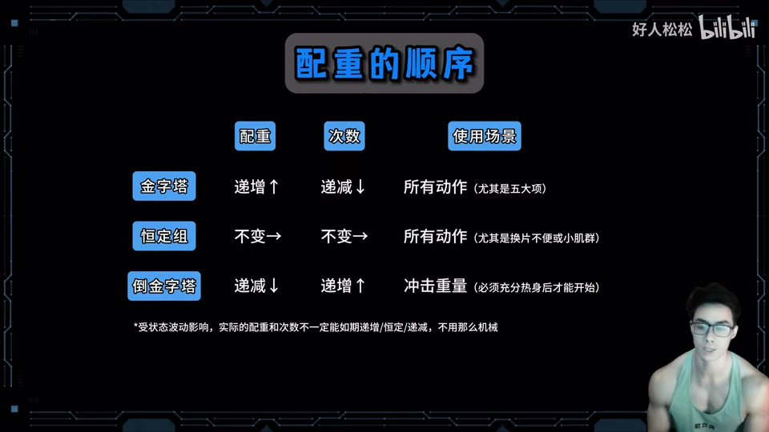

*图 42：金字塔、恒定组、倒金字塔三种配重顺序。*

| 方式 | 配重 | 次数 | 使用场景 |
|---|---|---|---|
| 金字塔 | 递增 ↑ | 递减 ↓ | 所有动作（尤其是五大项） |
| 恒定组 | 不变 → | 不变 → | 所有动作（尤其是换片不便或小肌群） |
| 倒金字塔 | 递减 ↓ | 递增 ↑ | 冲击重量（必须充分热身后才能开始） |

- **金字塔**：配重递增、次数递减，在卧推、划船、硬拉、深蹲这几个复合大动作里比较常见。
- **恒定组**：配重不变、次数不变，也很常见，各种动作都能用。原因要么是换配重太麻烦，要么是在侧平举、俯身飞鸟、二头弯举、三头臂屈伸这类小肌群训练里，「加一档配重就可能完全做不了了」。
- **倒金字塔**：热身后先做最大重量，再逐渐减重，比较少见。有人为了冲大重量，认为应该在力气最大的时候做最大重量，力气衰减后再做较小重量。
- 这些模式「你都可以适时去用，这倒不是影响训练效应的关键」。另外，实际运用时次数不一定真的乖乖递增、递减或恒定，每组状态不同，次数有波动很正常。**同一个配重，在动作比较标准的情况下能做 6、8、10、12 次都还行，都能练到。**

### 3.10 全片回顾 [53:39]

这个视频讲了三个问题：一是各部位怎么分化组合；二是各部位有哪些动作模式及其解剖原理；三是具体训练计划的制定。配重选择、组间间歇等小问题也都融入了讲解。UP 主在片尾把重点画面集中放了一遍供截图（分化与训练计划、各部位动作模式及解剖、配重的选择与顺序），并说：「新手可以只知道动作模式，逐渐有基础后再结合动图理解功能解剖。」

---

## 要点速查

**分化**

- 五分化 → 四分化 → 三分化 → 二分化：合并部位，加快循环，减少单部位组数。
- 三/四分化适合绝大部分人；二分化适合刚接触健身或每周只能练 2 次的人；五分化是部分职业选手用的。
- 认真健身：每周 3–5 次。每周 1 次增肌非常慢。
- 三分化：背 + 肩后束 + 肱二头 / 胸 + 肩前中束 + 肱三头 / 腿 + 腹。
- 四分化：背 + 肩后束 / 胸 + 肩前中束 / 肱二头 + 肱三头 / 腿 + 腹（另一版本：拆分手臂、单练肩膀）。
- 协同关系：**推胸 → 胸 + 肩前束 + 肱三头（各约 1/3）**；**划船（尤其上背划船）→ 背 + 肩后束**。肱三头跟胸练，不跟背练（划船只带到长头）。
- 后练的协同部位配重变轻是正常的，说明前面已经练到了。

**动作模式（看大臂在哪个面、往哪个方向动）**

| 部位 | 主要模式 | 次要/其他模式 | 关键关节运动 |
|---|---|---|---|
| 胸 | 推胸 | 夹胸/飞鸟 | 肩水平内收（+ 肩屈 + 肘伸） |
| 背 | 划船、下拉（无主次） | 下拉可做成划船 | 肩伸 / 肩内收 |
| 肱三头 | 臂屈伸 | — | 肘伸 |
| 肱二头 | 弯举 | — | 肘屈 |
| 肩前束 | 推举 | 前平举 | 肩屈（推举另含肩外展） |
| 肩中束 | 推举、侧平举、提拉 | — | 肩外展 |
| 肩后束 | 反向飞鸟、上背划船 | — | 肩水平外展 |
| 股四头 | 膝关节伸（深蹲等） | — | 膝伸 |
| 腘绳肌 | 髋关节伸（硬拉等） | 膝关节屈（腿弯举） | 髋伸 / 膝屈 |
| 臀 | 髋关节伸 | 髋关节外展 | 髋伸 / 髋外展 |
| 腹 | 卷腹、举腿 | — | 脊柱屈 |

- 推举握距越宽 → 中束越多；越窄 → 前束越多。
- 深蹲更练大腿前侧，硬拉更练大腿后侧，直腿硬拉几乎只练后侧；倒蹬/哈克脚放前更练后侧，脚放后更练前侧。
- 卷腹 ≠ 仰卧起坐：卷腹是脊柱屈、幅度小；能一组做二三十个「坐起来」的，一定是错的。
- 「打直」只是形象表述，不要锁死或超伸关节。

**训练计划参数**

| 项目 | 三分化 | 四分化 |
|---|---|---|
| 大肌群（胸/背） | 3 个动作 × 3–4 组 | 3 个动作 × 4–5 组 |
| 小肌群（肩各束/手臂） | 2 个动作 × 3–4 组 | 肩：2 × 4–5 组；手臂：2 × 5–6 组 |
| 腿 | 3 个动作 × 4–5 组（股四、腘绳轮换） | 同左 |
| 腹（男） | 共 5–10 组 | 同左 |
| 臀（女） | 2 个动作 × 4 组 | 同左 |
| 组间休息 | 胸背腿 3 分钟，肩手 2 分钟，腿可更长 | 同左 |
| 单次时长 | 约 1 小时出头，不超过 1.5 小时（约 20 多组，不含热身拉伸） | 同左 |

**配重**

- 增肌主区间 **6–12RM**：五大项（卧推、划船、深蹲、硬拉、推举）**6–10 次**；其他动作 **8–12 次**。
- 五大项动作熟悉后偶尔尝试 **3–5RM**，每次训练最多一两组；卧推、深蹲、推举最好有人保护。
- **12–15RM**：学新动作、体会发力。15RM 以上只用于热身。
- 力竭：做得动就做，预感做不动就放下；没保护时不死拼。
- 配重顺序：金字塔 / 恒定组 / 倒金字塔，都可以，「不关键」。
- 「有感觉不等于长肌肉。」

## 初学者练习建议

以下只是对视频内容的归纳，不是视频之外的新建议：

1. **先保证频率**：每周练 3–5 次，至少休息 1 天。刚接触健身可以先用二分化，有条件就用三分化（可以先用三分化，压力太大再换四分化）。
2. **按顺序循环，不必对齐周几**：Day1 → Day2 → Day3 → Day1……，休息日按身体感受和忙碌程度插入。UP 主的习惯是背放在胸之前。
3. **先记动作模式，再挑具体动作**：每个部位先弄清它的主要动作模式（推胸、划船/下拉、推举、侧平举、反向飞鸟、弯举、臂屈伸、深蹲/硬拉、髋伸、卷腹），再从动作库里选自己感觉好的动作。
4. **先易后难**：先用固定器械（器械下拉、器械划船、器械推胸、蝴蝶机、器械推举、器械腿屈伸/腿弯举等）学动作模式、找发力感，再过渡到杠铃、哑铃等自由动作。
5. **学新动作用 12–15RM 的轻重量**熟悉动作；熟悉后进入 6–12RM 的增肌区间；五大项熟练后再偶尔尝试 3–5RM，并且要有人保护。
6. **练背注意不要用手臂硬拉**：新手练背后二头酸痛，说明在下拉、引体里屈肘代偿了，要体会背部发力。
7. **卷腹要做脊柱屈**，把意识放在腹肌收缩上，让胸腰椎微微前屈，不要「坐起来」。
8. **每次训练 1–1.5 小时、20 多组就够**，不要为了加组数在一个部位上耗太久（后面多是「垃圾组」）。
9. **学动作的途径**：在 B 站或某音搜「部位/动作名 + 教」看教程照着练；最好找个小伙伴一起练，或请练得不错的朋友带几次、纠正动作；预算宽裕可以买一轮私教课，学会基本动作后再自学提高。
