# 02 健身新手的饮食完全手册（选修：饮食全解）

## 来源信息

| 项目 | 内容 |
|---|---|
| 视频标题 | 💪🏻B站版《健身新手的饮食完全手册》™ |
| UP 主 | 好人松松 |
| 链接 | https://www.bilibili.com/video/BV1yX4y1q7LP/ |
| 时长 | 约 110 分 45 秒（6645 秒） |
| 合集标注 | 选修：饮食全解 |
| 视频章节 | 0.开场 [00:00]／1.摄入总量 [02:10]／2.日内分配 [37:26]／3.食物来源&配餐 [56:20]／4.专题&常见错误 [81:47] |
| 整理日期 | 2026-10-17 |
| 整理方式 | B 站字幕接口不可用，所以用 mlx-whisper（whisper-large-v3-turbo，中文）对音频做了带时间戳的转写，再对照视频画面上的内嵌字幕和幻灯片校对术语与数字。画面上出现但口头没念的表格、清单和公式，都从 1280×720 原始截图里读出来整理成了文字。截图按知识点挑选，不是均匀抽帧。正文用整理者自己的话概括 UP 主的讲解，必要处保留 UP 主原话术语。 |

> 说明：视频里的「训练」专指**力量训练**。只做有氧的日子，在本视频里算作休息日。所有「x 克」如果没有特别说明，指的都是**每公斤体重每天摄入多少克**（g/kg）。

## 总览

UP 主用一句话概括健身饮食：**它管的不是具体吃哪种食物，而是食物背后的碳水、蛋白质、脂肪（碳蛋脂）**。管理分两层，第一层是**摄入总量**：按「经验化配额」先试吃两周，再根据体重变化的方向和速度，以 0.5 g 为一档增减碳水。第二层是**日内分配**：利用胰岛素的规律，把全天最大的一次碳水放在力量训练后的「练后餐」，休息日则各餐均摊。第三部分教你认识日常生活里碳水、蛋白质、脂肪各从哪些食物来，以及在食堂、宿舍、聚餐、火锅、快餐等场景下怎样「先找蛋白质，脂肪不专门吃，碳水看本餐需要」来配餐。最后几个专题讲增肌与减脂饮食的区别、糖与果糖的管理、补剂、几种被大众误会的食物、怎样吃得舒服可持续，并点名新手最常犯的三种错误：食物决定论、热量决定论、按感觉吃饭。

## 目录

- [0. 开场与课程大纲 [00:00]](#0-开场与课程大纲-0000)
- [1. 第一节：碳蛋脂的摄入总量 [02:10]](#1-第一节碳蛋脂的摄入总量-0210)
  - [1.1 热量平衡公式 [02:43]](#11-热量平衡公式-0243)
  - [1.2 该算热量还是算碳蛋脂？[03:02]](#12-该算热量还是算碳蛋脂0302)
  - [1.3 食物热效应 [04:05]](#13-食物热效应-0405)
  - [1.4 热量平衡/盈余/缺口理论：正确但实践用不上 [05:14]](#14-热量平衡盈余缺口理论正确但实践用不上-0514)
  - [1.5 增肌减脂的经验化饮食配额 [12:18]](#15-增肌减脂的经验化饮食配额-1218)
  - [1.6 配额怎么调整 [15:22]](#16-配额怎么调整-1522)
  - [1.7 为什么要以两周为周期看体重 [20:34]](#17-为什么要以两周为周期看体重-2034)
  - [1.8 怎样计算自己吃了多少碳蛋脂 [25:13]](#18-怎样计算自己吃了多少碳蛋脂-2513)
  - [1.9 奉劝新手：辛苦一阵，建立饮食基线 [34:59]](#19-奉劝新手辛苦一阵建立饮食基线-3459)
- [2. 第二节：碳蛋脂的日内分配 [37:25]](#2-第二节碳蛋脂的日内分配-3725)
  - [2.1 为什么总量定了还要讲分餐：胰岛素 [37:39]](#21-为什么总量定了还要讲分餐胰岛素-3739)
  - [2.2 饮食怎样影响胰岛素 [39:31]](#22-饮食怎样影响胰岛素-3931)
  - [2.3 四种餐：早饭、练前餐、练后餐、其他餐 [41:54]](#23-四种餐早饭练前餐练后餐其他餐-4154)
  - [2.4 按训练时间排的训练日分餐方案 [48:40]](#24-按训练时间排的训练日分餐方案-4840)
  - [2.5 减脂期训练日的分配变化 [51:15]](#25-减脂期训练日的分配变化-5115)
  - [2.6 休息日的分餐方案 [53:16]](#26-休息日的分餐方案-5316)
  - [2.7 碳水的日际变化 [54:24]](#27-碳水的日际变化-5424)
- [3. 第三节：碳蛋脂的食物来源与配餐方法 [56:19]](#3-第三节碳蛋脂的食物来源与配餐方法-5619)
  - [3.1 碳水食物：碳水率与 GI [56:31]](#31-碳水食物碳水率与-gi-5631)
  - [3.2 脂肪的食物来源 [61:50]](#32-脂肪的食物来源-6150)
  - [3.3 蛋白质的食物来源 [69:11]](#33-蛋白质的食物来源-6911)
  - [3.4 配餐原则与实战场景 [74:14]](#34-配餐原则与实战场景-7414)
- [4. 第四节：专题与常见错误 [81:39]](#4-第四节专题与常见错误-8139)
  - [4.1 专题 1：增肌与减脂的饮食区别 [81:48]](#41-专题-1增肌与减脂的饮食区别-8148)
  - [4.2 专题 2：饮料、水果等糖制品的管理 [84:57]](#42-专题-2饮料水果等糖制品的管理-8457)
  - [4.3 专题 3：健身补剂的选择 [89:42]](#43-专题-3健身补剂的选择-8942)
  - [4.4 专题 4：大众有误会的食物 [97:40]](#44-专题-4大众有误会的食物-9740)
  - [4.5 专题 5：生活化、舒适化饮食 [100:54]](#45-专题-5生活化舒适化饮食-10054)
  - [4.6 新手常见错误 1–3 [103:12]](#46-新手常见错误-13-10312)
  - [4.7 结尾：重点截图与回查索引 [108:26]](#47-结尾重点截图与回查索引-10826)
- [要点速查（一页式）](#要点速查一页式)
- [初学者实践建议](#初学者实践建议)
- [不确定与未明确之处汇总](#不确定与未明确之处汇总)

---

## 0. 开场与课程大纲 [00:00]

- 这期视频用「网课」形式，一次讲完增肌和减脂饮食的全部内容。UP 主说看的时候不用截图记笔记，视频最后会集中放出没有字幕的重点截图（本文第 4.7 节和「要点速查」已经整理了这些内容）。
- 课程的核心观点 [00:58]：**健身饮食不是管理具体的食物，而是管理食物背后的碳水、蛋白质和脂肪**。这种管理分为两方面：
  1. **摄入总量**（第一节）：男女、增肌减脂、训练日休息日分别该吃多少碳蛋脂。
  2. **日内分配**（第二节）：总量定好以后，怎样分到一天的各餐里。
  - 「总量 + 分配」就是健身饮食的基本逻辑。
- 第三节讲**食物来源与配餐**：管的虽然是碳蛋脂，但最终要靠具体食物组合出来，所以要知道生活里哪些食物提供碳水、蛋白质、脂肪，以及怎样方便地配出需要的量。
- 第四节讲**专题和新手常见错误**。

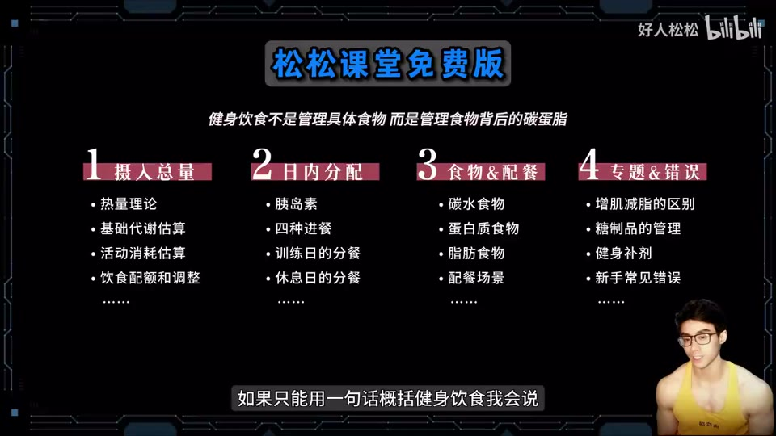

*图 1：课纲。第 1 节讲热量理论、基础代谢估算、活动消耗估算、配额与调整；第 2 节讲胰岛素、四种进餐、训练日和休息日的分餐；第 3 节讲碳水、蛋白质、脂肪食物和配餐场景；第 4 节讲增肌减脂的区别、糖制品、补剂和新手常见错误。*

---

## 1. 第一节：碳蛋脂的摄入总量 [02:10]

本节回答一个问题：男性和女性，在增肌期和减脂期、训练日和休息日，分别该吃多少碳蛋脂。

UP 主先给出一个结论：大家常听到的「算基础代谢 + 算活动消耗，加起来再上浮或下调若干热量」的做法，**理论上没错，但在你的饮食实践里用不上，不要试图去算它**。下面先解释为什么，然后再讲真正该怎么做。

### 1.1 热量平衡公式 [02:43]

**热量摄入 = 基础代谢 + 活动消耗 + 食物热效应**

- **热量摄入**：吃进去的食物热量。每克碳水、蛋白质、脂肪分别按 **4 / 4 / 9 大卡**计算后求和。
- **基础代谢**：人体完全静息、没有任何活动时维持身体运转所需的热量（UP 主比喻成手机息屏也要耗电）。
- **活动消耗**：走路、骑车、运动、劳动等一切肢体活动消耗的热量。
- **食物热效应**：吃下食物后身体会额外散热，不吃就没有这部分散热。

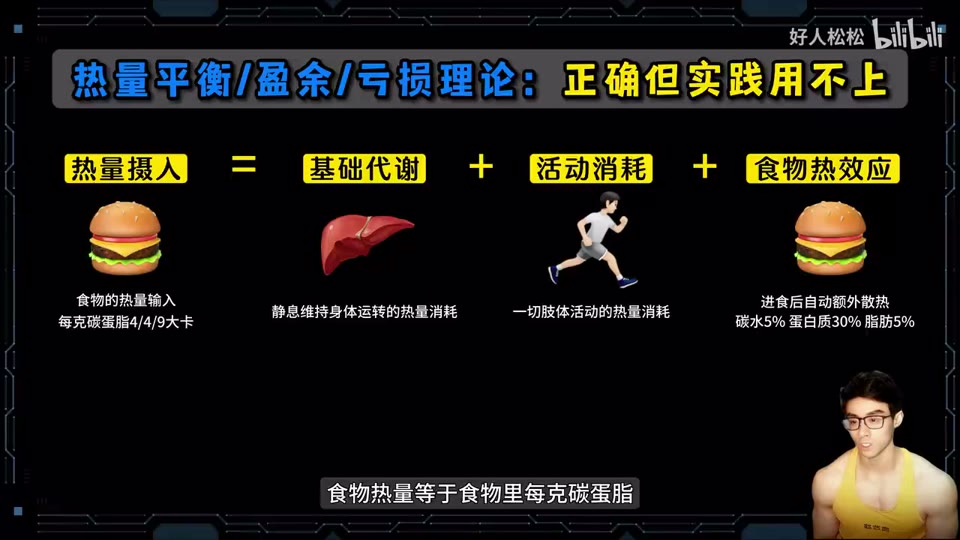

*图 2：热量平衡公式。食物热量按每克碳蛋脂 4/4/9 大卡计；食物热效应为碳水 5%、蛋白质 30%、脂肪 5%。*

**例：用营养表算一包牛奶的热量（画面示例）**

| 成分（每 100 mL） | 含量 | 换算 |
|---|---|---|
| 能量 | 277 kJ | 总热量 277 kJ ≈ 66.2 大卡 |
| 蛋白质 | 3.2 g | 3.2 × 4 = 12.8 大卡 |
| 脂肪 | 3.8 g | 3.8 × 9 = 34.2 大卡 |
| 碳水化合物 | 4.8 g | 4.8 × 4 = 19.2 大卡 |

公式：**总热量 = 碳水 × 4 + 蛋白质 × 4 + 脂肪 × 9**（12.8 + 34.2 + 19.2 = 66.2 大卡）。

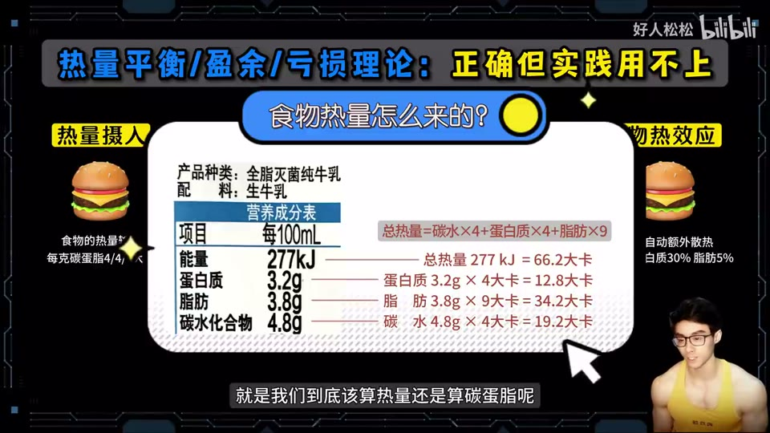

*图 3：营养表上的热量，就是碳蛋脂克数分别乘 4/9/4 大卡后求和得到的。*

### 1.2 该算热量还是算碳蛋脂？[03:02]

新手常问这个问题，UP 主的回答是**算碳蛋脂**。

- 理由：从食物热量公式可以看出，**定好了碳蛋脂，热量也就跟着定好了**，一举两得（画面写的是「定碳蛋脂 = 定热量」）。
- 反过来不行：只定一个热量数字，并不能推出碳蛋脂各是多少。同样是 2000 大卡，可以由无数种碳蛋脂比例组成，**吃出来的效果差别很大**。
- 所以健身饮食**一定是管理碳蛋脂的量，而不是管理热量**。

### 1.3 食物热效应 [04:05]

- 碳水和脂肪：每吃 100 大卡约散掉 5 大卡，即 **5%**。
- 蛋白质：每吃 100 大卡约散掉 30 大卡，即 **30%**。
- 如果把食物热效应从等式右边移到左边，从食物热量里扣掉，碳蛋脂每克的「**到手热量**」就会变成一个比 4/4/9 更低的数字。画面上没有给出这组更低数字的具体值（此处原视频未明确）。
- 两种写法背后的含义：
  - 用最常见的 **4/4/9 大卡/克**时，热量消耗一侧**必须包含**食物热效应，不能省略。
  - 用扣过热效应的更低数字时，热量消耗一侧就**不用再考虑**食物热效应了。

### 1.4 热量平衡/盈余/缺口理论：正确但实践用不上 [05:14]

**理论本身：**

- 热量摄入 = 热量消耗时，体重不增不减，这一点叫**热量平衡点**。
- **增肌**：在平衡点上多吃一两成，形成**热量盈余**，体重才能增加。
- **减脂**：在平衡点上少吃一两成，形成**热量缺口**，体重才能下降。

**为什么用不上：你根本不知道自己的热量平衡点是多少** [05:40]

- 只有极少数长期坚持记录饮食的人，才知道自己吃多少会让体重不变。
- UP 主举了自己的例子 [06:02]：体重稳定在 65 kg 的几个月里，他每天记录碳蛋脂，按 4/4/9 求和，平均每天约 **2200 大卡**，这就是他的热量平衡点。他可以在这个数字上多吃或少吃一两成来增肌减脂，但没做过长期记录的人做不到这一点。

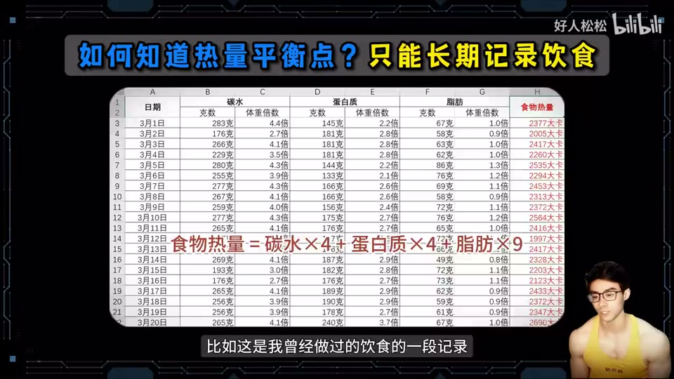

*图 4：UP 主自己的饮食记录表，逐日记下碳水、蛋白质、脂肪的克数和体重倍数，再算出食物热量。*

**那用网上的公式估算行不行？也不行，估出来的平衡点很不可靠。**

**① 基础代谢估算：意义有限** [06:47]

- 科研界的做法：先用仪器实测大量受试者的基础代谢，再结合体重（W）、身高（H）、年龄（A）等指标拟合出公式，让代入公式的结果尽量接近实测值。体重是影响结果最大的因素，很多公式只用体重。
- 同一个人代入不同的公式，结果并不一样。UP 主以「男 70 kg、175 cm、20 岁」和「女 55 kg、160 cm、20 岁」为例代入 9 个公式（以最低估计值为基准），其他结果比最低值高出几个百分点到十几个百分点：

| 公式（发表年） | 男（70 kg/175 cm/20 岁） | 女（55 kg/160 cm/20 岁） |
|---|---|---|
| ① FAO/WHO/UNU（1985） | 1601 大卡 | 1301 大卡 |
| ② W N Schofield（1985） | 1749 大卡 | 1301 大卡 |
| ③ O E Owen（1987） | 1593 大卡 | 1191 大卡 |
| ④ M D Mifflin（1990） | 1710 大卡 | 1299 大卡 |
| ⑤ J E Hayter（1994） | 1691 大卡 | 1283 大卡 |
| ⑥ H Y Liu（1995） | 1694 大卡 | 1313 大卡 |
| ⑦ C J K Henry（2005） | 1765 大卡 | 1279 大卡 |
| ⑧ Xiaojiao Yang（2010） | 1743 大卡 | 1227 大卡 |
| ⑨ S G Camps（2016） | 1548 大卡（基准） | 1161 大卡（基准） |

- 关键点：增肌减脂只需要比平衡点多吃或少吃**一两成**，而基础代谢估算公式之间的浮动就快接近这个比例了，所以它对我们的意义有限。

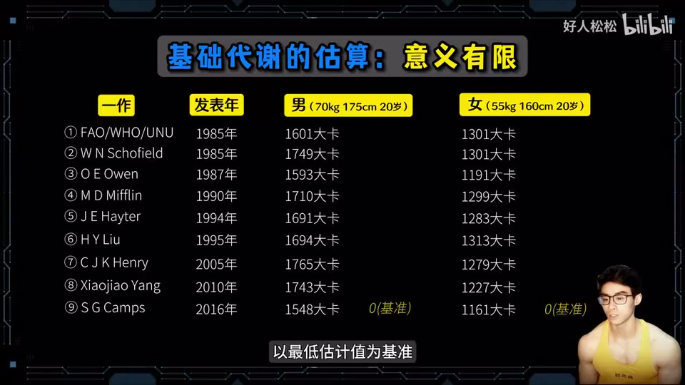

*图 5：9 个基础代谢估算公式对同一男一女的估算结果，相互之间差了百分之几到十几。*

**② 活动消耗估算：「离谱到家」** [08:01]

活动消耗估算不像基础代谢那样代入客观数字，而是给一段文字描述让你对号入座，主观又粗糙。网上最常见的三种方法（画面内容）：

| 方法 | 档位与系数（活动消耗 = 基础代谢 × 系数） |
|---|---|
| 1. 按运动次数估算 | 不运动/很少运动 ×0.2；每周运动 1–3 次 ×0.375；每周 3–5 次 ×0.55；每周 6–7 次 ×0.725；每天运动 2 次或从事体力工作 ×0.9 |
| 2. 按职业分类估算 | 轻型劳动（办公室/售货员/讲课等）×0.55（男）/0.56（女）；中型劳动（学生/驾驶员/电工等）×0.78（男）/0.64（女）；重型劳动（农业/炼钢/装卸/采矿等）×1.1（男）/0.82（女） |
| 3. 按活动程度估算 | 长期休息卧床 ×0.2；久坐、无体力劳动 ×0.45；常坐、有时站立走动 ×0.68；站、走 ×0.89；重体力劳动 ×1.3；额外计入：每周运动 3–5 次 ×0.3 |

UP 主逐一指出它们的问题：

- **按运动次数**：逻辑上就不合理。活动消耗不只有运动，还有走动、干活等日常活动；就算只看运动，也不区分时长、强度、类型，只要每周次数相同就算消耗相同。
- **按职业**：也说不通。就算同一职业上班时的消耗完全一样，下班后有人不运动、有人爱运动，差异很明显。照这个标准，全校学生无论宅还是爱运动，活动消耗都一样。
- **按活动程度**：措辞模糊。「久坐」和「常坐」有什么区别？一个人既不是体力劳动者，又是「常坐但有时站立走动」，该选哪档？

UP 主拿自己代入 [10:00]：按方法 1（每周健身 3–5 次）系数是 0.55；按方法 2（学生）是 0.78；按方法 3（常坐有时站立走动 0.68，再加每周健身 3–5 次 0.3）是 0.98。三个结果高低之间差了将近一倍。

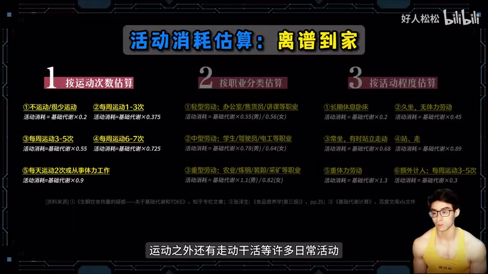

*图 6：按运动次数、按职业、按活动程度三种活动消耗估算方法及其系数。*

**③ 实测 vs 公式估算** [10:33]

- 实测：UP 主维持 65 kg 时，食物热量按 4/4/9 算是 2200 大卡；按碳水、脂肪 5%、蛋白质 30% 算出食物热效应约 200 大卡，所以他**真实的「基础代谢 + 活动消耗」≈ 2000 大卡**。
- 公式：基础代谢用薄荷健康 App 内置算法得到 1460 大卡；活动消耗按三种方法分别是 803 / 1139 / 1431 大卡。
- 两者求和得 **2263 / 2599 / 2891 大卡**，比实测**分别高估 13% / 30% / 45%**，全部偏高，少的高出一成多，多的高出四成多。
- 后果：如果信以为真，在这些偏高的数字上做增减，想要的「干净增肌」会变成「**脏增肌**」，想要的减脂会变成体重不掉，甚至上涨。

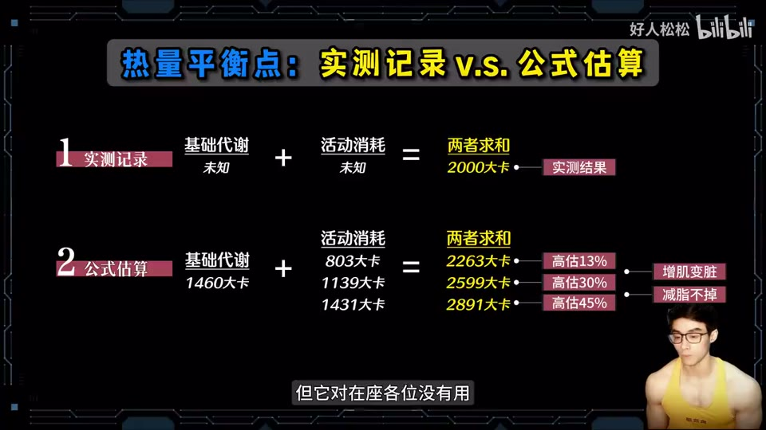

*图 7：公式估算结果比 UP 主的实测结果高估 13%–45%，导致「增肌变脏、减脂不掉」。*

**小结**：热量平衡/盈余/缺口理论本身没错，但你没有长期记录过饮食，不知道自己的平衡点，也就没法在它的基础上上浮或下调来确定增肌减脂该吃多少。

### 1.5 增肌减脂的经验化饮食配额 [12:18]

**健身饮食到底吃多少总量，是直接按「经验化配额」试吃、再根据结果调整来确定的**，UP 主称这是健身饮食里最重要的正题。

- **经验化配额**：长期的健身实践和运动科学总结出来的一套饮食量。对大多数人来说，按它吃就能很快试探出自己需要的热量盈余或缺口。
- UP 主的类比：你去问健身运动员基础代谢和活动消耗是多少，他会说不知道；但他一定知道按某个碳蛋脂配额开吃，就能开始增肌或减脂。实践中就是这么做的，这叫「**按经验化配额试吃并调整**」。

**单位说明** [13:01]：健身饮食里说的「吃几克」不是实际的克重，而是**每公斤体重的日摄入量**，也可以说成「吃几倍体重」。例如「碳水 4 克」或「碳水 4 倍体重」，指 70 kg 的人每天吃 70 × 4 = **280 g** 碳水。

**经验化饮食配额表**（单位：g/kg 体重/日；本表指训练日；以视频 13:00 处和片尾汇总截图为准）

| 时期 | 性别 | 碳水 | 蛋白质 | 脂肪 |
|---|---|---|---|---|
| 增肌期 | 男 | 3.5–4.5 g | 1.5–2 g | 1 g |
| 增肌期 | 女 | 3–3.5 g | 1.5 g | 1 g |
| 减脂期 | 男 | 2.5–3 g（初期）→ 2–2.5 g（末期） | 1.5 g | 0.8 g |
| 减脂期 | 女 | 2.5–3 g（初期）→ 2–2.5 g（末期） | 1.2–1.5 g | 0.8 g |

表下注释（画面内容）：

- ⚠ 上表指**训练日**。**休息日碳水降低**（比力量训练日约降低 0.5 g）。
- ⚠ 大体重肥胖群体 **BMI > 28**：减脂期起始碳水降低（男 2.5 g、女 2.1 g），蛋白质降低（男女 1.2 g），脂肪降低（男女 0.6 g）。
- ⚠ 大体重肥胖群体 **BMI > 32**：减脂期起始碳水降低（男 2.0 g、女 1.7 g），蛋白质降低（男女 1.0 g），脂肪降低（男女 0.5 g）。

调整办法（画面右栏，以碳水作为热量变量）：

1. 增肌试吃 2 周，体重增长约 1% 就不调整；长太快就减碳水，长太慢就加碳水，碳水增减尺度约 0.5 g。
2. 减脂试吃 2 周，体重下降约 2% 就不调整；掉太慢就减碳水，掉太快就加碳水，碳水增减尺度约 0.5 g。减脂从初期到末期有较大的碳水递减空间，但不要着急。
3. 体重变化后不用重算配额，因为也就增减几克而已。增肌期不用重算；减脂期体重降低 5–10 公斤后可以重算一次。

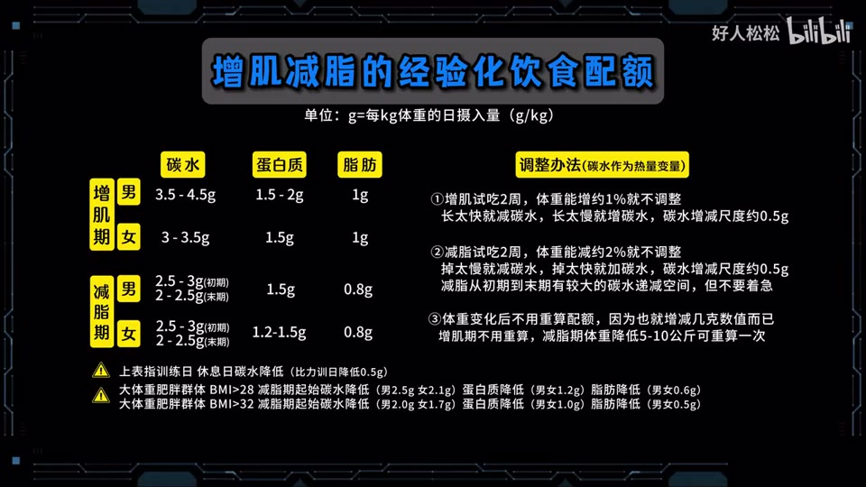

*图 8：经验化饮食配额表（片尾无字幕版），本文以此版为准。*

> ⚠ **视频内前后版本不一致**：视频 [25:15] 处回顾配额时出现过另一版表格：增肌男碳水 4–5 g、女 3–4 g；减脂男碳水 3–3.5 g（初期）→ 2–2.5 g（末期）、蛋白质 1.5–2 g；减脂女碳水 2.5–3 g（初期）→ 1.5–2 g（末期）、蛋白质 1.5 g；注释为「休息日碳水降低（增肌吃 2–3 g，减脂吃 1.5–2 g）」。第四节专题 1 的画面 [81:57] 写的也是「增肌 4–4.5 g、减脂 3–3.5 g 起步」，和这一版接近。13:00 讲解时和片尾汇总截图都用上面那版（3.5–4.5 g / 2.5–3 g）。UP 主没有口头说明以哪版为准（此处原视频未明确）。两版的思路、调整方法和注释结构完全相同，差别只在具体数字。

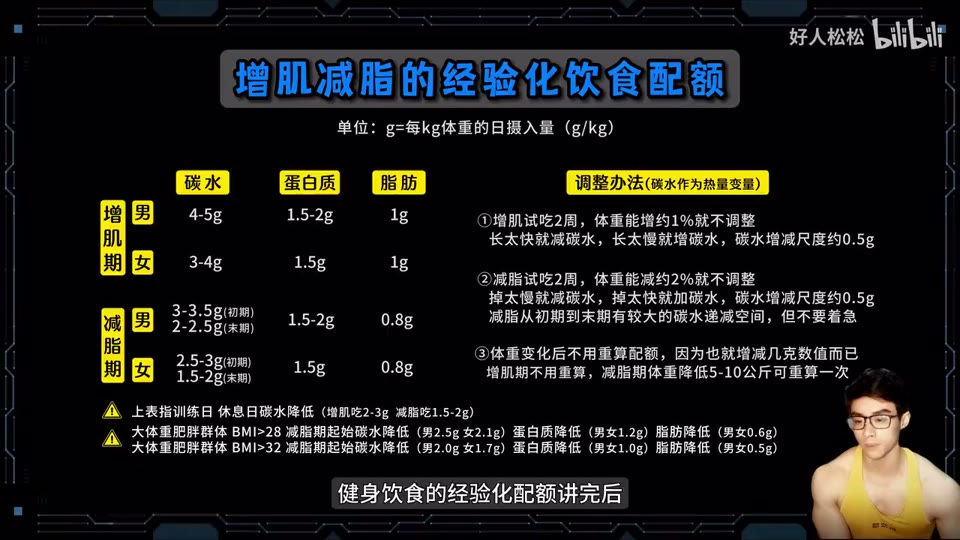

*图 9：视频 25:15 处出现的另一版配额表，数字与主表不同，仅供对照。*

**表里几个区分的理由** [13:22]

- **男女区分**：同体重、同活动量的女性，热量平衡点比男性低一两成，不用吃那么多就能同样增肌减脂，所以女性的碳水和蛋白质低一些。女性肌肉量占体重的比例比男性低得多，对蛋白质的需求也低一些，表里的蛋白质对女性是够用的。
- **训练日 vs 休息日** [13:47]：
  - 「训练」**特指力量训练**：一个动作最多只能做十几次就做不动了，需要休息两三分钟才能做下一组。
  - 帕梅拉、跳操、团课等**都不算力量训练**，哪怕拿着小哑铃、小杠铃片做也不算，因为这些动作能连续做几十分钟、几百次不休息，属于消耗热量的有氧活动。
  - **休息日**指纯休息或只做有氧的日子。休息日没有多少糖原消耗，也没有可以用高胰岛素去增肌的窗口期，所以**休息日要明显降低碳水**，蛋白质和脂肪可以大体不变，多一点少一点都没关系。
- **大体重肥胖群体（如 BMI > 28）要降低减脂起始配额** [14:38]：基础代谢主要靠器官，其次靠肌肉，而不是脂肪。大体重者多出来的主要是脂肪，器官没有更大，肌肉也没有更多，所以**单位体重的基础代谢比别人低**，减脂起始配额要相应降低。至于增肌要不要降配额，UP 主的回答是：大体重肥胖群体应该先减脂，不用考虑增肌。

### 1.6 配额怎么调整 [15:22]

**核心：以碳水的增减作为热量变量。**

**增肌的调整** [15:29]

1. 先按配额试吃 **2 周**。
2. 2 周内体重增加约 **1%**：不用调整（不必很精确，大概就行）。
3. 增长太快（例如 2 周涨 2%–3%）：热量盈余太多，变成了**脏增肌**，增加的体重里脂肪比例太高，要**降低碳水**。
4. 增长太慢（几乎看不到体重增长）：盈余不够，要**增加碳水**。
5. 增减尺度约 **0.5 g 碳水**就够，不需要更大。对 70 kg 的人来说，0.5 g 碳水大约相当于训练日多吃（或少吃）100 多克米饭。
6. 有的人不用调整，有的人调整一两次就能找到合适的配额。

**减脂的调整** [16:25]

1. 先试吃 **2 周**。
2. 2 周内体重下降约 **2%**：不用调整（同样不必精确）。
3. 减脂掉体重比增肌长体重快，原因是**脂肪分解比肌肉合成快得多**。自然健身的肌肉合成非常慢，一两年长两三公斤肌肉已经很了不起，一年掉两三公斤脂肪却很容易。
4. 体重不太掉：热量缺口太小，**降低碳水**来扩大缺口。
5. 掉得太快（例如 2 周掉 3%–4%）：缺口太大。快速减脂会流失更多肌肉，而健身者减脂的目的是让肌肉好看，这样减就「舍本逐末」了，所以要控制下降速度，**增加一些碳水**来缩小缺口。
6. 增减尺度同样约 **0.5 g**。
7. 大部分人按表里配额一开始就能掉体重，少数人调整一次也能开始掉。如果用了远低于表中的配额还不掉体重，UP 主认为要么计算有错，要么身体有问题，建议单独咨询。

**减脂要做「碳水递减」** [17:49]

- 减脂从初期到末期，碳水有较大的递减空间，所以表里给了训练日碳水的**初期配额**和**末期配额**，可以降两三次碳水。
- 初期和末期之间的中间位置，比如**男性训练日碳水 2.5 g 左右、女性 2 g 左右**，是可以待很久、让体重稳定下降的阶段，**一定不要匆匆忙忙降配额**。
- 常见错误：有人三天体重不掉就降碳水，没几天就降到了末期配额。UP 主认为这是错的，**至少要两周体重完全不动，才考虑降碳水**。
- 碳水递减是减脂的基本操作，也是和增肌期的区别，所以表里增肌期没有写初期和末期。

**体重变了要不要重算配额？** [18:51]

- 一般不需要。体重增减一两公斤，代入原来的 g/kg 配额，碳蛋脂总量也就各变化几克，而你的计算误差和每日摄入波动都远不止这点。
- 增肌期肌肉长得很慢，干净增肌几个月体重最多增加大几公斤，基本不用重算。
- 减脂期如果是第一次减脂，可能掉十几二十公斤，一直不重算误差会累积，所以**体重降低 5–10 公斤后可以重算一次**。

**本小节总结** [19:45]

- 热量是盈余还是亏损，盈余或亏损是太大还是太小，**用体重变化的方向和速度来判断**。
- 方向或速度不对，**用增减碳水 0.5 g 来调节总热量**。
- 表里的**蛋白质和脂肪可以略加，但不能减**，因为它们已经是接近底线的数字。
- UP 主建议新手把蛋白质和脂肪基本固定，**只增减碳水**，也就是把各餐的主食量增减一些，这样操作最简单。碳蛋脂三者一起调也不是不行，但对新手来说复杂了。

### 1.7 为什么要以两周为周期看体重 [20:34]

UP 主建议以两周为周期，而不是两三天就看体重变化来判断配额是否合适，理由是影响体重的因素有三个：

1. **食物驻留排空的程度** [20:51]：很多人说自己总是空腹称体重，但那是「假空腹」，消化道里仍有大量没排出的食糜，它们每天的重量差异就会造成体重波动。真正的空腹（比如做肠镜前）需要喝泻药把食糜排出，平时做不到。
2. **人体脱水吸水** [21:16]：碳水摄入和水盐浓度能快速改变人体含水量。
   - 碳水影响糖原储量，**1 g 糖原能吸收约 3 g 水**。例如糖原变化 300 g，会带来约 900 g 水分变化，加起来体重变化一公斤多。
   - 盐的影响更大：增加或减少盐分，身体必须相应增加或减少水分来保持水盐比例不变。健美运动员赛前有「**停盐灌水**」阶段，少吃或不吃盐并大量喝纯净水，身体被迫排水，几天就能掉几公斤，以此展示肌肉线条；赛后恢复正常饮食，几天又能涨回几公斤。UP 主说你也可以自己试两天：少盐多水会掉体重，多盐少水会长体重。
3. **肌肉和脂肪量** [22:35]：这才是大家真正关心的，但它对体重的影响**非常非常微弱**。
   - 例：增肌半年肌肉增加 2 kg 已经很了不起，平均每天约 **10 g**；减脂半年分解 5 kg 脂肪也算很不错，平均每天约 **30 g**。
   - 而每天的体重可以波动 1 kg 之多，其中肌肉变化最多约占 1%，脂肪变化最多约占 3%，所以**从短期体重波动里根本看不出肌肉和脂肪的变化**。

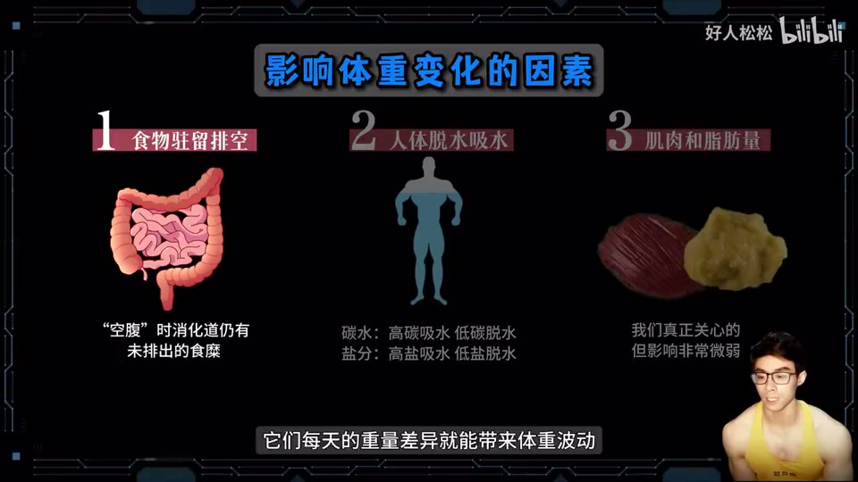

*图 10：影响体重的三个因素：食物驻留排空、人体脱水吸水（碳水、盐分）、肌肉和脂肪量。*

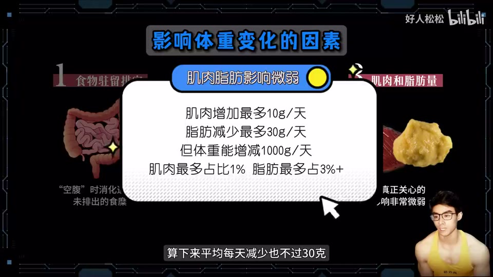

*图 11：肌肉增加最多约 10 g/天，脂肪减少最多约 30 g/天，而体重一天能增减约 1000 g。*

**示意图解释** [23:43]

- 绿线：食物和水分引起的体重变化，**每天波动很大，但不会持续积累**。
- 红线：脂肪量（增肌期则是肌肉量）的变化，**每天变化很小，但会持续积累**。
- 两三天就对比体重时，绿线的大幅波动很容易掩盖红线的变化；拉长到**两周**比较，红线的累计变化更大，体重变化才比较有可能反映脂肪或肌肉的真实变化。
- UP 主的态度：你可以天天称体重，但不要以为这个数字能代表什么；为一两天的体重变化纠结烦恼，等于「和自己的屎尿较劲」。

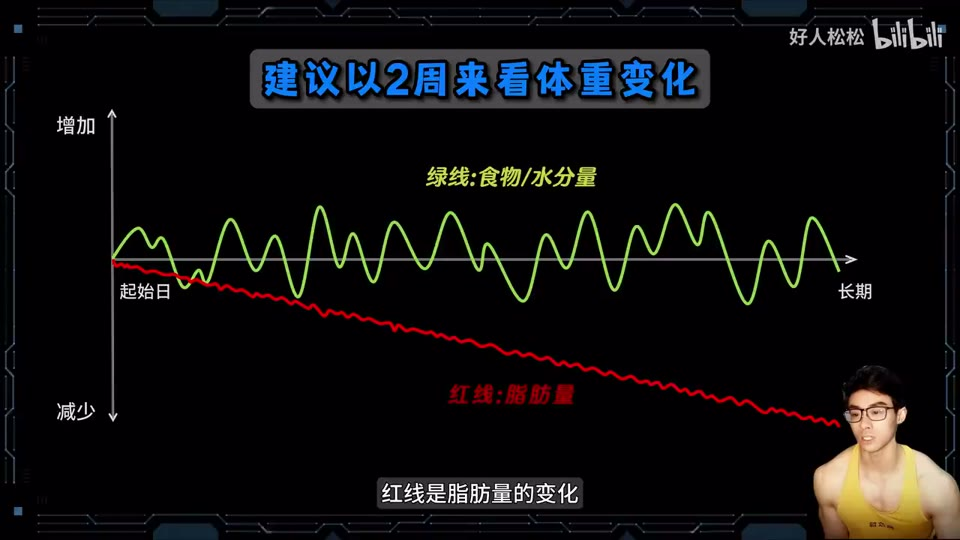

*图 12：短期体重变化和红线（肌肉量）几乎无关，要拉长周期看。*

### 1.8 怎样计算自己吃了多少碳蛋脂 [25:13]

**① 包装食品：看营养成分表** [25:20]

- 表上「每 100 g」这一列，就是 100 g 食物里有多少克碳水、蛋白质、脂肪（碳蛋脂率）。
- **NRV%** 指吃 100 g 这种食物能满足全天需求量的多少比例。这个需求量不分男女、体重、普通人还是健身者，相当于要求所有人吃一样多的碳蛋脂，所以**对你没有意义，不用管**。

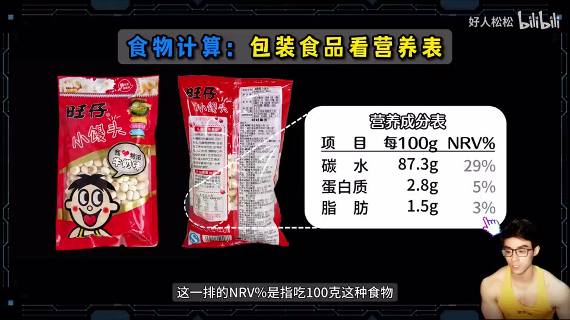

*图 13：营养表每 100 g 的碳水 87.3 g、蛋白质 2.8 g、脂肪 1.5 g 有用，NRV% 不用管。*

**② 非包装食品：先称重** [25:48]

- 买一个二三十块钱的**厨房秤**（画面备注：在外使用建议买按键开机而不是触感开机的）。
- 不是让你每天每顿都称，而是把**常吃的食物称几次**，心里就有数了，例如学校或单位一碗米饭多重、一个馒头多重、一份炒菜里有多少瘦肉（画面备注：每次误差不影响，配额本来就是波动的）。
- 想偷懒的话，也可以打包拿到水果店请店员帮忙称。

**③ 用薄荷健康 App 查数据** [26:24]

- 薄荷的数据库收录了中国疾控中心营养所《中国食物成分表》里近万种基本食物的数据，以及大部分包装食品营养表的数据。
- **不用开会员，不用买付费产品。**
- **先自定义全天摄入量**：App 默认给的碳蛋脂量不适合健身人群（画面示例：默认约为碳水 3.1 倍、蛋白质 1.0 倍、脂肪 0.6 倍体重），要按经验化配额改。
- 麻烦之处在于薄荷要求先输入自定义总热量，才能再分给碳蛋脂。所以要先把自己的碳蛋脂配额按 4/4/9 换算成总热量填进去。
  - UP 主的例子：65 kg，增肌配额碳水 4 倍、蛋白质 2 倍、脂肪 1 倍体重。
  - 计算：碳水 65 × 4 = 260 g → 1040 大卡；蛋白质 65 × 2 = 130 g → 520 大卡；脂肪 65 × 1 = 65 g → 585 大卡；合计 **2145 大卡**。
  - 先填 2145 大卡，再把它分配成对应的碳蛋脂量。

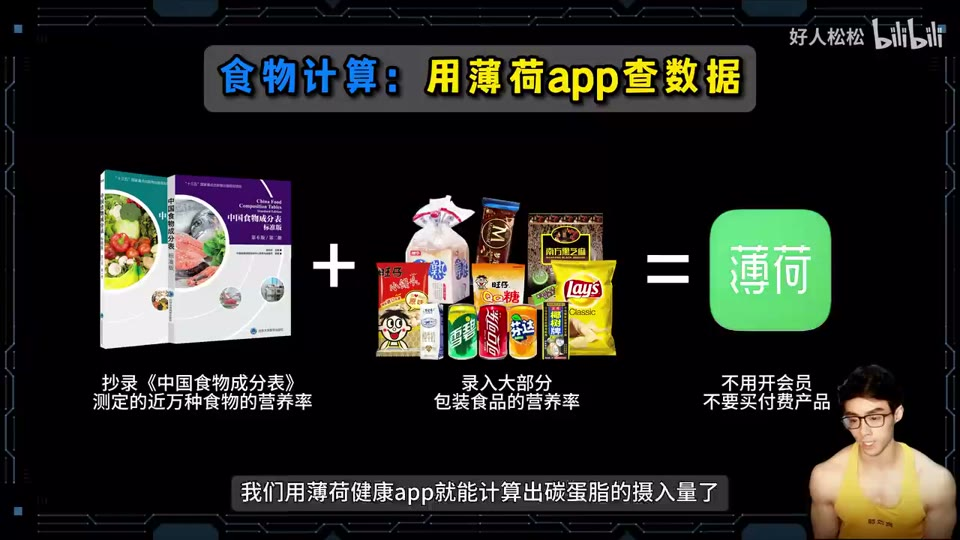

*图 14：薄荷数据 = 《中国食物成分表》近万种食物 + 大部分包装食品营养表；不用开会员。*

**④ 按食物大类的注意事项**

**主食：一定要分清生熟** [27:52]

| 主食 | 碳水率 |
|---|---|
| 生米 | 75% |
| 干饭 | 30%（常规）/ 25%（偏软） |
| 稀饭 | 10–15%（受加水量影响大） |
| 生面 | 70% |
| 熟面 | 23% |

- 因为加水量不同，从生米到干饭到稀饭，碳水率越来越低，面条也一样。分不清生熟，会吃出相差几倍的错误碳水量。
- 算生的更准一些，但**算熟的也完全没问题**，那点误差不重要。

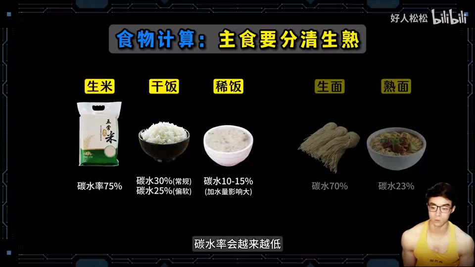

*图 15：主食的生熟碳水率差别很大。*

**肉类：用简化数据** [28:19]

- 不要细分肉的种类和部位，**自定义一个「瘦肉」食物**按下面的数据算就行：

| 指标 | 数值 |
|---|---|
| 碳水率 | 0% |
| 蛋白质率 | 生肉 20%，炒熟 25%，卤炖 30%，肉干 40%+ |
| 脂肪率 | 精瘦肉 2%，一般瘦肉 5%，肥肉部分 90% |

- 蛋白质率不同，是因为不同加工方式的脱水程度不同。
- 这种简化会有一点误差（比如猪肉的脂肪率会被低估一些，鱼虾的蛋白质率会被高估一些），但不影响大局。
- 细分种类和部位很麻烦，而且薄荷里很多肉类数据本身就是错的，新手又不会鉴别。例：薄荷里的卤鸡腿写可食部分蛋白质率只有 15.3%，这肯定是错的，因为生鸡腿肉就有约 20%，卤熟后脱水还会更高。

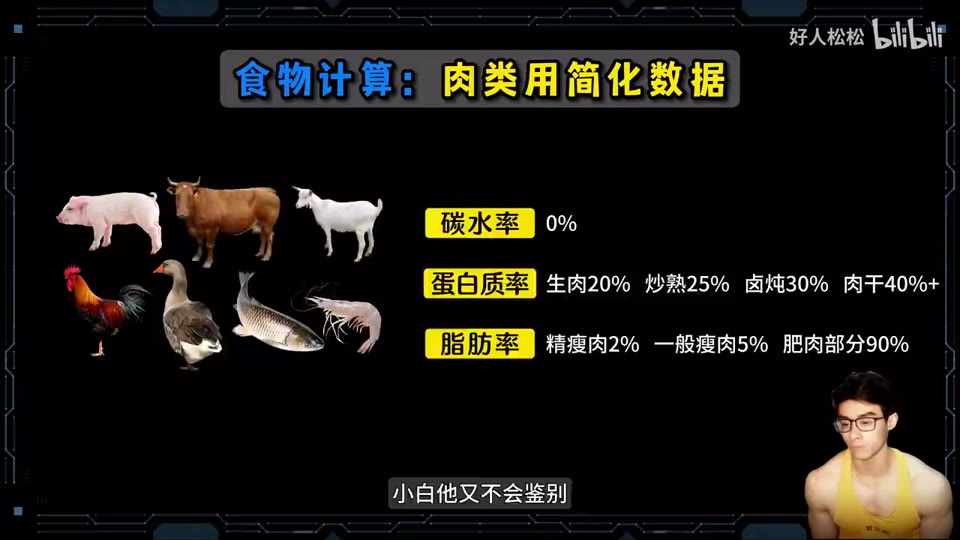

*图 16：猪牛羊鸡鸭鱼虾都按一套简化的蛋白质率和脂肪率计算。*

**脂肪：并不难算** [29:23]

| 来源 | 脂肪量 |
|---|---|
| 鸡蛋 | 蛋白 0 g/个，蛋黄 5 g/个，全蛋 5 g/个 |
| 牛奶 | 全脂 9 g/包，低脂 3 g/包，脱脂 0 g/包 |
| 包装食品 | 看营养表 |
| 瘦肉 | 精瘦肉 2%，一般瘦肉 5%（需要称重或估重） |
| 炒菜（靠估计） | 清淡炒菜 **5 g 油/一人份**；重口炒菜 **10 g 油/一人份** |

- 鸡蛋、牛奶、包装食品的脂肪量是固定的。瘦肉需要称重或估重几次形成认知，否则蛋白质也算不出来。这些录进薄荷就能自动出结果。
- 唯一要全靠主观估计的是**菜里的油**：这里说的是直接用油（不含瘦肉自带的脂肪），而且是**一个人吃下的那份**炒菜，不是一桌人吃的整盘。
- 算法：想一下全天吃了几份炒菜，最后统一加若干克植物油。例：在食堂吃了两个清淡炒菜和一个重口炒菜，就计 5 + 5 + 10 = **20 g 植物油**。

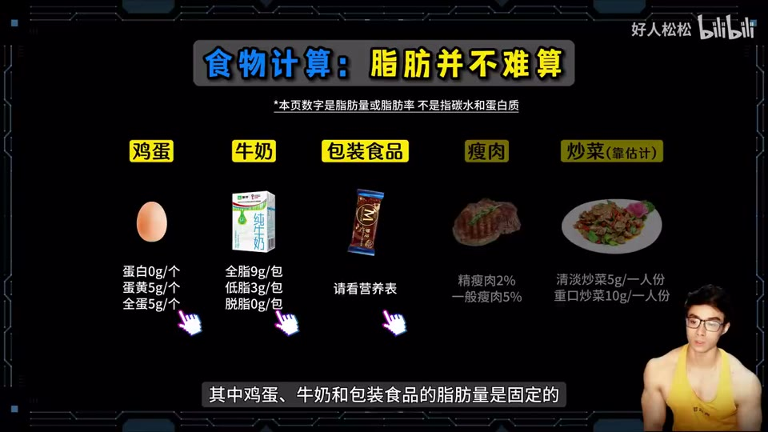

*图 17：鸡蛋、牛奶、包装食品、瘦肉、炒菜各自的脂肪计算方式。*

**蔬菜很少数计入，水果都该计入** [30:23]

- 大部分蔬菜可以忽略不计，只有下面这些碳水率可观的要计入：

| 蔬菜 | 碳水率 |
|---|---|
| 薯类 | 20% |
| 土豆 | 18% |
| 芋头 | 13% |
| 山药 | 13% |
| 鲜豌豆 | 20% |
| 蒜薹 | 15% |
| 红萝卜 | 10% |
| 洋葱 | 10% |
| 其他高碳水蔬菜（很少吃到） | 鲜百合 39%，鲜菱角 20%，鲜玉兰 19%，鲜荸荠 14% |

- 最主要的是根茎类的所谓「蔬菜」：薯类、土豆、芋头、山药，它们其实是富含淀粉的**主食**。
- 豆类、蒜薹、胡萝卜碳水率较高，可以酌情注意，但每次吃得不多，低估了也没什么影响。
- 真要严格，可以每天碳水里**加 10 g 作为蔬菜的碳水**。
- **水果完全不同，都要计入碳水管理**：一是水果碳水率比蔬菜高得多；二是人们吃水果的量比蔬菜大得多（一斤叶子菜吃不下，一斤水果很容易吃完），而且水果的碳水基本是糖，很好吃。画面给出的水果碳水率：香蕉/榴莲 20%+；苹果/梨/蓝莓/猕猴桃 14%；橘/柚/桃/菠萝 10%；西瓜/蜜瓜/草莓 7%。
- 结论：大部分蔬菜可以随便吃，**水果一定要纳入碳水管理**。

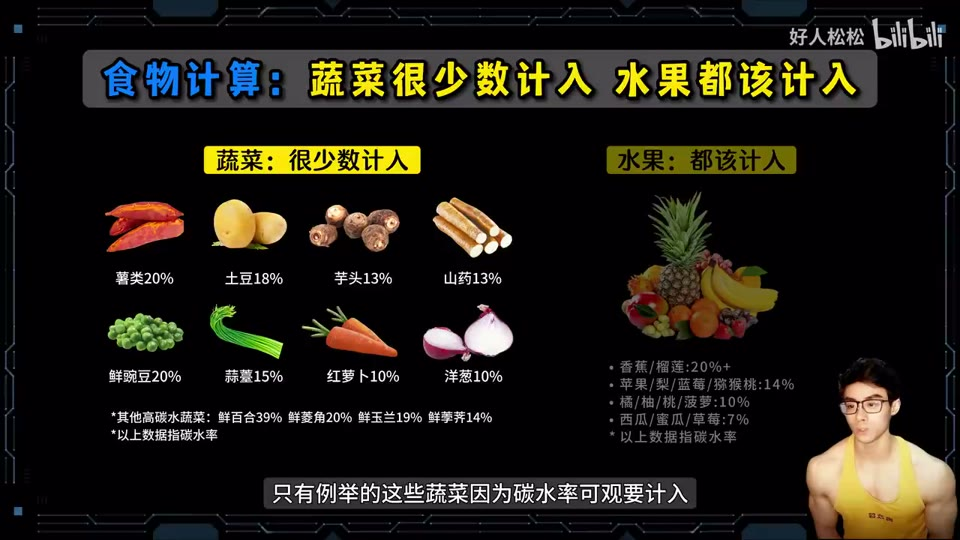

*图 18：需要计入的高碳水蔬菜，以及各类水果的碳水率。*

**混合食物不能用薄荷数据** [31:34]

- 混合食物指一种食物里有多种原料，比如牛肉面、酸菜鱼、各种炒菜。
- 案例：一位粉丝天天吃牛肉拉面，称了面条重量，在薄荷查到「牛肉拉面」碳水率 13%，乘出来算碳水。这是错的：熟面条碳水率约 23%，按 13% 算会**低估近一倍碳水**，于是他会多吃出一倍碳水。
- 原因：薄荷里很多混合食物是用**整份食物的总重量**（整碗面包括汤、面、辅料）做分母，碳水率被严重拉低。加水、面、辅料的比例各家不同，不可能有全国通用的数据，所以薄荷上的「牛肉面」数据五花八门、互相矛盾，没法用。画面上不同来源的牛肉面碳水率有 6.1%、12.3%、13.4%、17.9%、21.9% 等多种。
- **正确算法**：用「熟面条」的数据乘熟面条重量，或者用「生面条」的数据乘生面条重量。
- 炒菜也一样，例如鱼香肉丝：薄荷写蛋白质率只有约 11%，而熟瘦肉应在 25% 左右，同样是整盘菜做分母造成的。正确算法：**① 熟瘦肉重量 × 25%** 算蛋白质；**② 一人份的油计 5 g 或 10 g** 脂肪；少量蔬菜忽略不计。
- UP 主批评薄荷保留这些混合食物数据，看似方便，实际是在坑人。

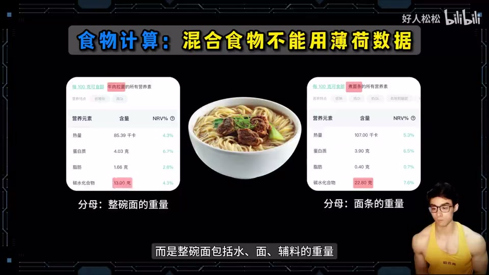

*图 19：牛肉拉面的数据以整碗面的重量为分母，面条本身的数据才是对的。*

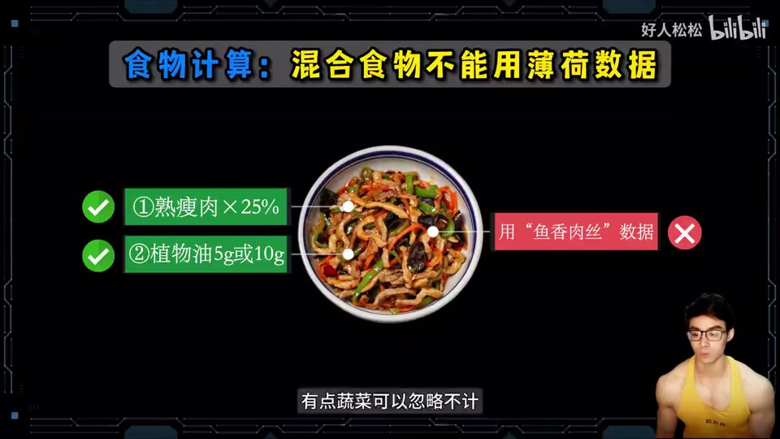

*图 20：鱼香肉丝 = 熟瘦肉 × 25% + 植物油 5 g 或 10 g，不要直接用「鱼香肉丝」的数据。*

**另一种工具：自建 Excel 表** [34:02]

- 把自己常吃的食物在薄荷上查好数据写进表格，规定好「一份」的重量（例如食堂一两饭算一份、一包牛奶算一份、一勺蛋白粉算一份），吃了几份就输入几份，Excel 自动求出碳蛋脂总量和体重倍数。取数据时同样遵循上面几条注意事项。
- 对食谱比较固定的人，这比在薄荷里逐条记录更快，还可以改份数来试算该多吃什么、少吃什么才能达到配额。
- UP 主说可以私信他「表格」二字索取模板；片尾又提到他主页 2024 年 2 月 3 日的视频里有配套的饮食底表可以下载。

### 1.9 奉劝新手：辛苦一阵，建立饮食基线 [34:59]

- UP 主强烈建议健身新手**经历一两周的称重和计算**，建立自己的**饮食基线**，这是终身受益的事。
- **饮食基线**：新手期通过一段时间的计算和规划，逐渐明白自己每餐、每天吃多少主食、多少瘦肉、多少鸡蛋牛奶、多少零食，能让碳蛋脂摄入大致合规。
- 例：过去早饭是两根油条、一个包子、一个鸡蛋，不计算的话可能一辈子都这样吃也不觉得错；一算就会发现碳水和脂肪太高、蛋白质太低，于是会去调整结构，把错误的基线改成正确的。
- 以蛋白质基线为例：正确的基线不是每天都不波动，每天实际摄入有波动很正常，也不影响大局，**前提是围绕正确的基线波动**。
  - 力量训练者的蛋白质至少要有 **1.5–2 g**，这是正确的基线（画面备注：大体重不需要这么多）。
  - 不计算的新手，蛋白质普遍只有 **0.5–1 g**，基线错了，无论增肌减脂都会严重影响进步。
- 磨刀不误砍柴工：花一段时间把正确的碳蛋脂基线建立起来，就能一劳永逸。UP 主说自己天天吃食堂外卖、也不怎么计算，却能全年保持良好的体脂率，靠的就是正确的饮食基线：知道每餐吃多少主食、多少瘦肉合适，想长体重就加，想掉体重就减。

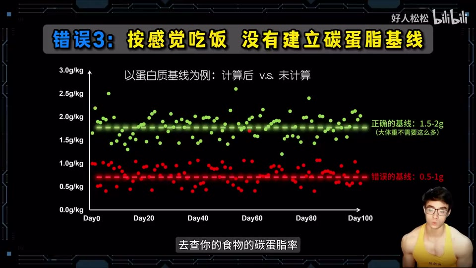

*图 21：计算后的蛋白质摄入围绕 1.5–2 g 的正确基线波动；不计算的新手基线常在 0.5–1 g。*

---

## 2. 第二节：碳蛋脂的日内分配 [37:25]

同样的总量，用不同方式分到一天各餐，效果也不同。本节教你怎样分餐。

### 2.1 为什么总量定了还要讲分餐：胰岛素 [37:39]

**根本原因：人为操纵胰岛素来趋利避害。**

| 方面 | 内容（画面整理） |
|---|---|
| 功能 | 把血液里的葡萄糖、氨基酸等转运进入肌肉和脂肪组织；是帮助增肌也帮助增脂的**合成代谢激素**；作用强大，而且能自我操纵 |
| 好处 | **力量训练 + 高胰岛素 = 增肌增脂**。练后餐：全天 4–5 成碳水 + 30–50 g 蛋白质 + 少吃不吃蔬菜 |
| 坏处 | **无力量训练 + 高胰岛素 = 增脂（不会增肌）**。非力量训练后和休息日：较少的碳水 + 多吃先吃蔬菜 |

- **合成代谢激素**是能帮你长肌肉或长脂肪的激素，包括胰岛素、生长激素、胰岛素样生长因子等。胰岛素是其中作用最强的，而且你能轻易操纵它的升降，所以不能放过它。
- **好处**：力量训练破坏肌纤维之后，配合高胰岛素能起到增肌（也增脂）的作用。所以练后要用特殊的练后餐（一般是全天 4–5 成碳水 + 30–50 g 蛋白质，少吃不吃蔬菜）故意把胰岛素冲高。
  - 有人担心会增脂所以不敢吃，但这就是你**增肌的主要机会时间**，有点增脂也得做。
  - 减脂期练后照样要吃一顿大的练后餐：虽然不可避免有点增脂，但这是在减脂期获得一点增肌、抵消其他时候分解代谢造成的肌肉损失的机会。增肌期更要抓住练后这个「窗口期」。
- **坏处**：没有力量训练破坏肌纤维时，高胰岛素**只会增脂**。增肌的前提是肌纤维被破坏，否则宅在家里狂吃米饭馒头就能长肌肉了，这显然不可能。所以非力量训练后的其他时间和休息日，各餐碳水要比练后餐少，有条件还要**多吃、先吃蔬菜**，保持胰岛素相对稳定。

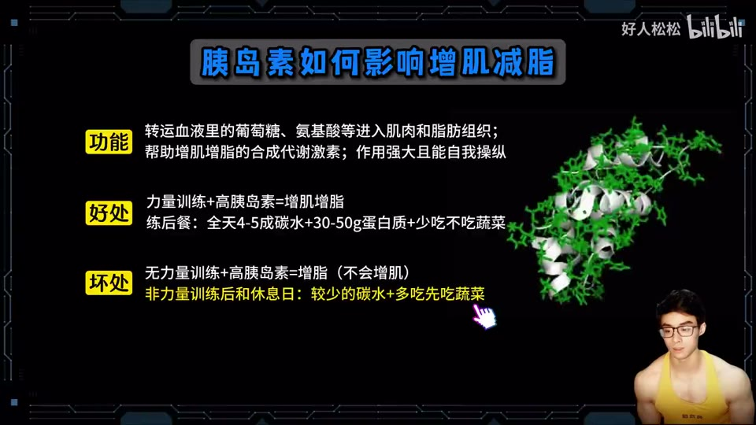

*图 22：胰岛素的功能、好处（力量训练后）与坏处（非训练时段）。*

### 2.2 饮食怎样影响胰岛素 [39:31]

**① 碳水 > 蛋白质 > 脂肪**

- 实验让受试者摄入同等热量的碳水、蛋白质、脂肪，监测胰岛素变化（画面标注来源 PMID: 18198223）。进食后胰岛素在基础水平上立即上升：**碳水刺激最强，蛋白质一般，脂肪很弱**。
- 我们的饮食配额里，碳水无论按克数还是热量占比都远高于蛋白质和脂肪。碳水刺激最强、吃得又最多，所以**管理胰岛素主要就是管理碳水**。

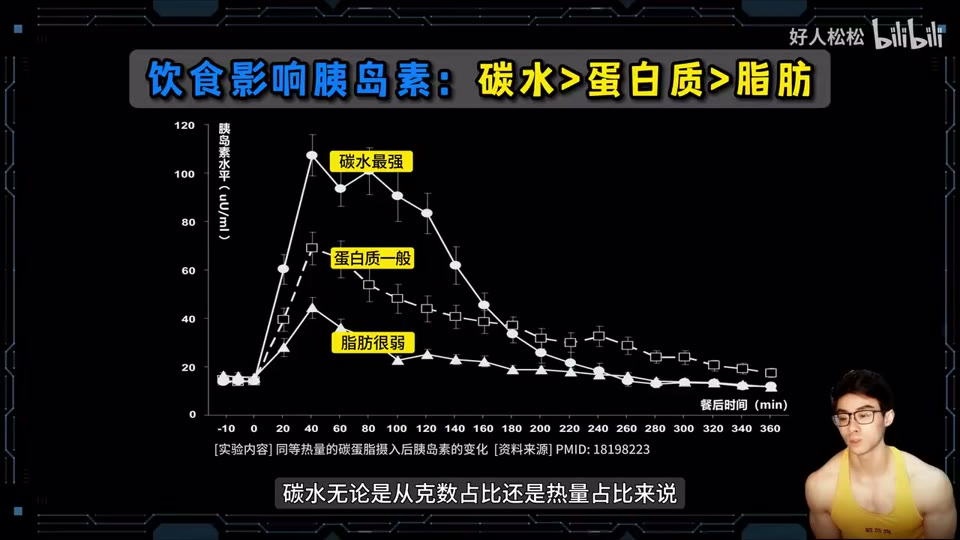

*图 23：同等热量的碳水、蛋白质、脂肪摄入后的胰岛素曲线。*

**② 纤维素抑制胰岛素** [40:17]

- 研究让健康人按不同顺序吃同一份「米饭 + 鸡胸肉 + 蔬菜」（画面标注来源 PMID: 31053510）：
  - **先吃米饭，再吃瘦肉和蔬菜**：胰岛素最高。
  - **先吃蔬菜，再吃米饭和瘦肉**，或**三者混合一起吃**：胰岛素都较低。
  - 仅仅进食顺序不同，胰岛素就相差约三成。
- 研究者推测：纤维素能降低胃排空速度，「缓释」需要消化的食物，让身体只需分泌更少的胰岛素就能完成血糖和氨基酸的转运。
- 实验特别强调，**只需要约 2 g 纤维素就够了，大约相当于 100 g 蔬菜**。
- 结论：**多吃、先吃蔬菜能抑制胰岛素；少吃、不吃、后吃蔬菜能提高胰岛素。**

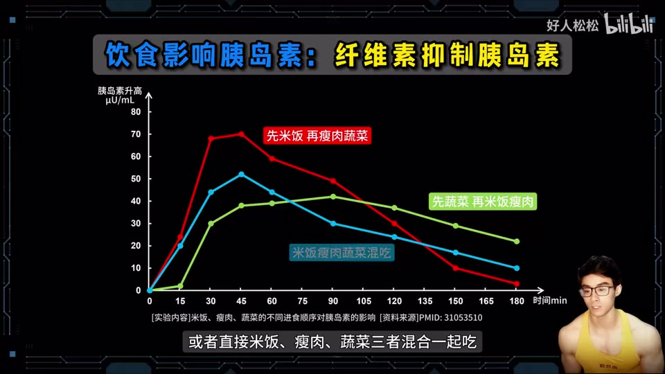

*图 24：先米饭再瘦肉蔬菜的胰岛素最高；先蔬菜或三者混吃的较低。*

**本节的前置知识小结** [41:25]：胰岛素水平与碳蛋脂摄入量**正相关**，刺激能力碳水 > 蛋白质 > 脂肪；胰岛素水平与纤维素（蔬菜）量**负相关**，100 来克蔬菜就足以产生可观的抑制。

### 2.3 四种餐：早饭、练前餐、练后餐、其他餐 [41:54]

日常饮食分为四类，没有单列「午饭」「晚饭」，因为根据训练时间不同，午饭或晚饭本身可能就是你的练前餐、练后餐或其他餐。

| 餐 | 碳水 | 蛋白质 | 脂肪 | 蔬菜 | 典型吃法 | 时间 |
|---|---|---|---|---|---|---|
| ① 早饭 | 约全天 2 成 | 不严格 | 不严格 | — | [食堂] 主食 + 2 个鸡蛋 + 1 包牛奶；[速配] 燕麦等谷物粉 + 蛋白粉 | — |
| ② 练前餐 | 约全天 2 成 | 可吃可不吃 | 一般不吃 | — | [碳水] 馒头、面包、香蕉、葡萄干、蔗糖饮料 | 练前 10–30 分钟 |
| ③ 练后餐 | 约全天 4 成**快碳** | 30–50 g | 一般 20 g 内 | 少吃、不吃、后吃 | [正餐] 主食 + 瘦肉 + 蔬菜少后；[速配] 便携快碳 + 蛋白粉 | 最好练后 30 分钟内 |
| ④ 其他餐 | 约全天 2 成 | 不严格 | 不严格 | 多吃 | [正餐] 主食 + 瘦肉 + 蔬菜多吃 | — |

画面注：碳水和蛋白质的「不严格」指各餐不用均分，注意总量符合即可。

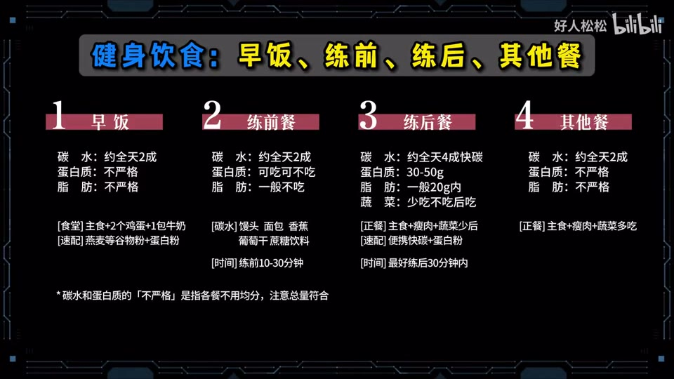

*图 25：早饭、练前餐、练后餐、其他餐的碳蛋脂配置（片尾无字幕版）。*

**① 早饭** [42:13]

- 约全天两成碳水，蛋白质和脂肪「不严格」。
- 「**不严格**」的意思：蛋白质和脂肪在一天里可以分摊一些，也可以集中一些，但 UP 主一般建议**偏分摊**，尤其是蛋白质。比如早饭吃鸡蛋牛奶、午饭吃瘦肉炒菜，每餐都有二三十克蛋白质和二十来克脂肪，这符合大众的饮食习惯；非要集中到一顿、其他几顿几乎不吃，反而奇怪。但也不需要机械地按克数均分。

**② 练前餐** [43:05]

- 约全天两成碳水，蛋白质可吃可不吃，脂肪一般不吃。说白了就是**训练前吃点碳水垫垫肚子**，甚至算不上一顿饭。
- 目的：给训练提供一点血糖支持，让训练更有力气，也有利于抑制训练中的肌肉分解。
- **时间：正式组开始前 10–30 分钟**，简单说就是**到了健身房再吃都来得及**。
  - 原理：任何碳水不管快慢，吃下去都会立即让血糖升高，在半小时到一小时达到高点。到健身房就吃，加上换衣服、热身的时间，整个训练都会落在血糖较高的时段。
  - 反例：练前一小时吃所谓练前餐，等到训练时血糖已经回到饭前水平，吃了等于没吃。
- 选择：任意中高 GI 碳水，最好方便携带、开练前掏出来就能吃，比如馒头、面包、香蕉、葡萄干、蔗糖饮料。想吃蛋白质也可以：瘦肉、牛肉干、蛋白粉、氨基酸。

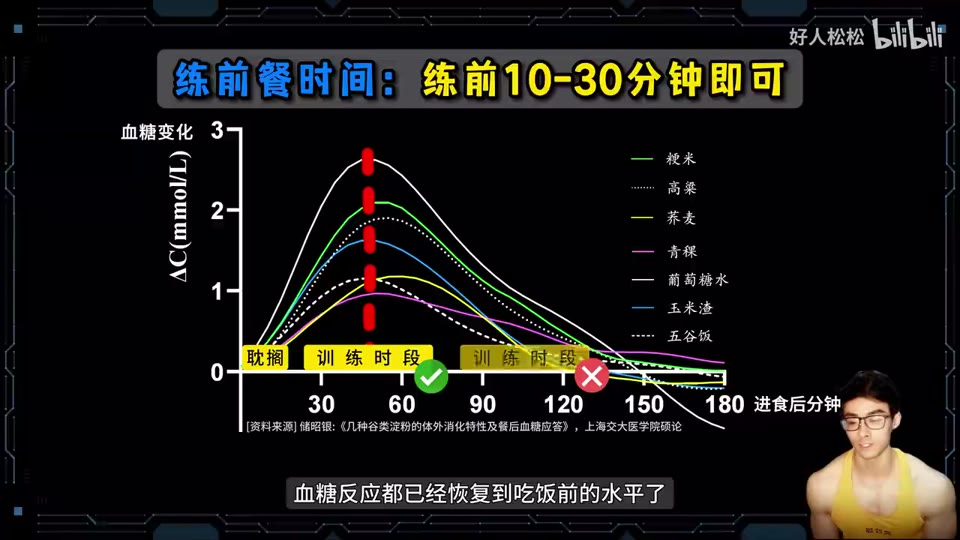

*图 26：各种碳水的餐后血糖曲线。练前太早吃，训练时段血糖已经回落。*

**③ 练后餐：健身饮食里最重要的一顿** [44:24]

- 配置：全天约 **4 成高 GI 快碳** + **30–50 g 蛋白质** + 脂肪一般 **20 g 以内** + 蔬菜**少吃不吃后吃**。
- 理由：
  - 全天最大一次碳水提供快碳，加上较多蛋白质，既为练后的肌肉修复提供营养，也是**故意升高胰岛素来促进增肌**。
  - **脂肪 20 g 以内**：脂肪刺激胰岛素的能力很弱，练后餐大吃脂肪没什么意义，不如留给其他几顿。尤其减脂期碳水和脂肪总配额本来就低，练后餐吃掉大部分的话，其他几顿热量会很低，容易挨饿。既不用追求一点油都没有的零脂（太麻烦），也不要一顿吃掉四五十克脂肪。
  - **蔬菜少吃不吃后吃**：前面说过 100 来克蔬菜就能让胰岛素降低约三成。UP 主提到职业运动员的 vlog 里练后餐常常没有蔬菜或很少，就是在抠这个细节。
- UP 主提到某健身团队内部成员曾曝光他们的饮食方案：训练后吃 **150 g 巨量快碳**来升高内源性胰岛素，还要**注射 15 单位外源性胰岛素**。他强调不是让大家用药，而是说你自己能操纵的内源性胰岛素部分，一定要用这套练后餐模式做好：「别人是打药，你的药就是吃好你的练后餐。」
- **时间：最好练完半小时内开始吃**。晚一些也不是就没效果了。研究有的说越早越好，有的说晚点吃也没事，但在普遍的健身实践里，练后餐就是**不要磨蹭、尽快吃上**，别因为玩手机、拍照、聊天、洗澡拖到一两个小时以后。所以这里写的是「最好」，不是「必须」。
- **形式**：
  - **正餐**：主食 + 瘦肉。
  - **速配练后餐**（时间紧、不方便吃正餐时）：**便携快碳 + 蛋白粉**，从包里掏出来配蛋白粉就能吃完。其中成人米粉、旺仔小馒头甚至能和蛋白粉一起冲水，边做事边喝掉。
  - **两者结合**：在健身房先吃一部分速配，剩下的用正餐补齐。比如胃口小的人在练后的蛋白粉里加二三十克葡萄糖或米粉，正餐就可以少吃 100 g 米饭，减轻练后餐的饮食任务。

便携快碳举例（画面内容，「碳水率是脂肪率 5 倍以上的精致快碳」）：

| 食物 | 碳水率 | 食物 | 碳水率 |
|---|---|---|---|
| 旺仔小馒头 | 89% | 米粉/米浆 | 77% |
| 光酥饼 | 75% | 速食八宝粥 | 12% |
| 云片糕/阜阳糕 | 80% | 米花糖 | 79% |
| 炒米花 | 94% | 白面包 | 51% |

画面注：① 不宜把葡萄糖作为练后主要碳水来源，可以随蛋白粉吃二三十克，吃多了可能恶心不适；② 不宜把蔗糖、果葡糖浆、果糖类食物（如可乐、冰棍、水果）作为练后主要碳水来源，吃多了会导致果糖摄入过量。

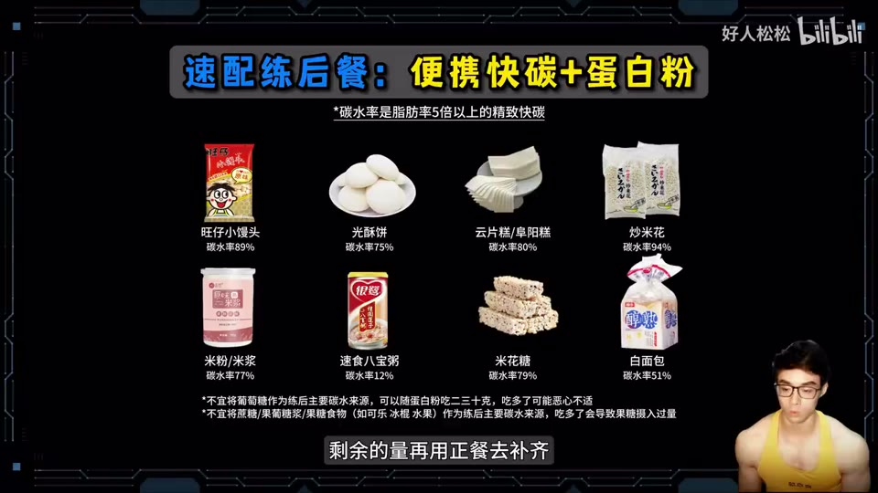

*图 27：可以随身带、练后配蛋白粉吃的便携快碳及其碳水率。*

**④ 其他餐** [47:48]

- 早饭、练前餐、练后餐之外的正餐。例如你在晚饭前后训练，午餐就是其他餐，它和练前练后都没有关系。
- 约全天两成碳水，蛋白质和脂肪不严格（偏分摊即可），注意全天总量符合配额。

**一句话总结四种餐** [48:22]：碳水要做日内分配，**练后餐最多，其他几顿都来一点**；蛋白质和脂肪大概分摊、总量符合即可。

### 2.4 按训练时间排的训练日分餐方案 [48:40]

| 训练时间 | 早饭 | 第 2 餐 | 第 3 餐 | 第 4 餐 |
|---|---|---|---|---|
| ① 早饭后训练 | 早饭（练前餐）碳水 20% | **练后餐 40%**，蛋白 30–50 g，脂肪 20 g 内 | 午饭（其他餐）20% | 晚饭（其他餐）20% |
| ② 午饭前训练 | 早饭 20% | 练前餐 20%，蛋白可吃可不吃，脂肪不吃 | **午饭（练后餐）40%**，蛋白 30–50 g，脂肪 20 g 内 | 晚饭（其他餐）20% |
| ③ 晚饭前训练 | 早饭 20% | 午饭（其他餐）20% | 练前餐 20%，蛋白可吃可不吃，脂肪不吃 | **晚饭（练后餐）40%**，蛋白 30–50 g，脂肪 20 g 内 |
| ④ 晚饭后训练 | 早饭 20% | 午饭（其他餐）20% | 晚饭（练前餐）20%，蛋白可吃可不吃，脂肪不吃 | **练后餐 40%**，蛋白 30–50 g，脂肪 20 g 内 |

表中没写的蛋白质和脂肪都是「不严格」；每种方案的碳蛋脂全天总量都是 100%。

画面注：

- 减脂期：随着碳水总配额递减，其他餐的 2 成碳水要逐渐少吃不吃，从 **2242** 逐渐变成 **3052** 的比例（0 指其他餐碳水）。
- 蛋白质和脂肪的「不严格」指分配上可以偏均摊，也可以偏集中，注意总量大概符合。
- 每天不一定只吃 4 次，可能还有零食和加餐，注意总量大概符合。

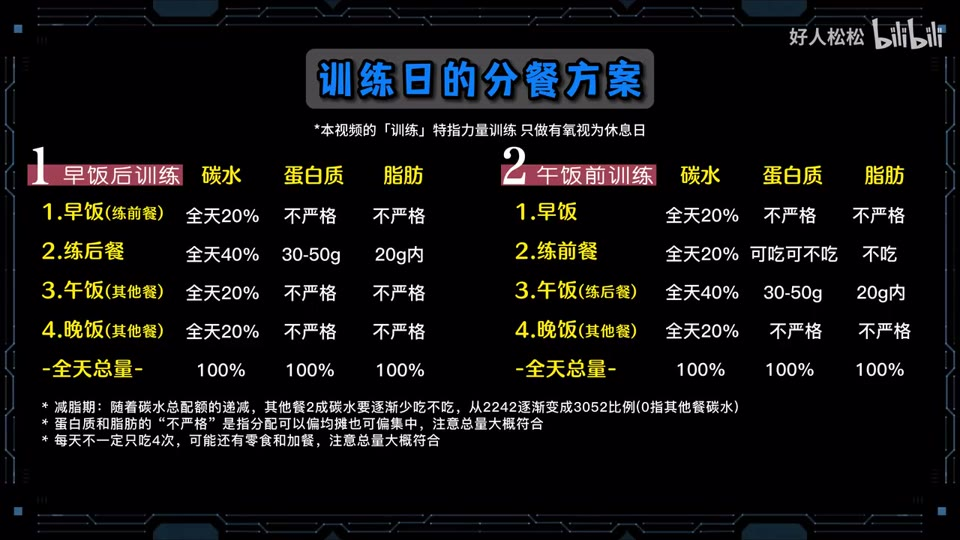

*图 28：早饭后训练、午饭前训练的分餐方案。*

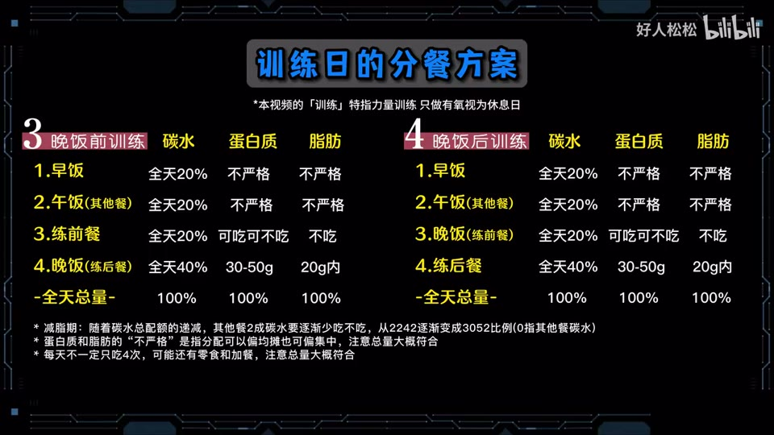

*图 29：晚饭前训练、晚饭后训练的分餐方案。*

各方案要点：

- **早饭后训练** [48:46]：早饭当练前餐，吃到五六分饱就去练；练完吃一顿单独的、碳水最大的练后餐，不方便吃正餐就用速配练后餐。午饭、晚饭都是其他餐，碳水较少。如果练后餐离午饭太近吃不下，午饭可以晚点吃或少吃点。
- **午饭前训练** [49:11]：午饭当练后餐，吃全天最大一次碳水；晚饭是其他餐，虽然也是正餐，地位不同，碳水较少。
- **晚饭前训练** [49:22]：晚饭当练后餐，午饭是其他餐。虽然大众眼里午饭晚饭都是正餐，但健身饮食要适配力量训练时间，这时晚饭的地位比午饭高。
- **晚饭后训练** [49:42]：**最容易搞乱碳水分配的一批人**。晚饭当练前餐，垫垫肚子五六分饱就去练；晚上练完**必须**吃一顿单独的、最大的碳水练后餐。
  - 常见错误是反着吃：午饭晚饭这些不太需要大碳水的时候拼命吃米饭馒头面条，练完反而不敢吃碳水，理由是「白天吃过了，晚上再吃会胖」。结果别人是练后胰岛素高、平时低，他们变成平时高、练后低。实际上是午饭晚饭把练后的碳水「抢劫」来吃掉了。
  - 正确做法：午饭和晚饭都**浅吃碳水**，把大碳水留到晚上练后。这就叫「碳水的日内分配要适配力量训练的时间点」。
- 四种方案都是把 100% 的总量分到各餐，大家总量相同，没有谁比谁多吃，区别只在训练时间不同导致的分配不同。

**关于视频里的数字** [50:48]：UP 主强调视频里所有数字和倍数都只是大概数，不是让你按克数吃饭。作为讲解者他必须给出具体数字作参考，否则满屏都是「请适量吃」，等于什么也没说。

### 2.5 减脂期训练日的分配变化 [51:15]

- 减脂期训练日的分配思路一样，但要加一句：**随着碳水总配额递减，其他餐的两成碳水要逐渐少吃不吃，比例从 2242 逐渐变成 3052**。
- 含义：减脂期碳水配额比增肌期低不少，而且会越来越低。前期碳水总量还算充足，其他餐吃两成没问题；往后总量越来越紧时，**不是各餐等比例递减**，而是**多牺牲其他餐，少牺牲早饭、练前、练后，尤其少牺牲练后餐**。
- 于是各餐碳水比例从开始的「早饭 2 / 练前 2 / 练后 4 / 其他餐 2」逐渐变成「早饭 3 / 练前 2 / 练后 5 / 其他餐 0」。注意这只是**比例**变化：总量大幅减少了，各餐碳水的**绝对量都在下降**。
- **什么时候开始削减其他餐？** UP 主的看法：**男性碳水递减到 2.5 g、女性递减到 2 g 时**，其他餐基本可以不吃碳水，基本变成 3052 的比例。总量这么低时还要给其他餐两成碳水，练后餐的碳水就太少了。

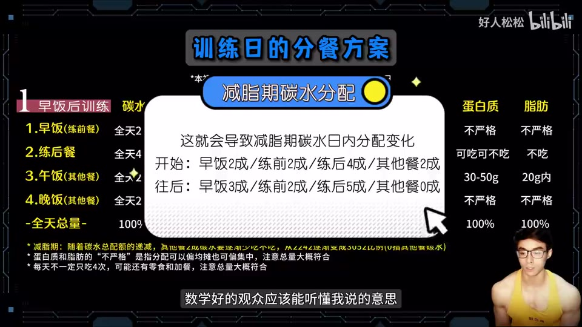

*图 30：减脂期碳水分配。开始时早饭 2 成 / 练前 2 成 / 练后 4 成 / 其他餐 2 成，往后变成 3 成 / 2 成 / 5 成 / 0 成。*

### 2.6 休息日的分餐方案 [53:16]

| 项目 | 内容 |
|---|---|
| 构成 | 各餐碳蛋脂**大概均摊**，不做碳水集中 |
| 配置 | 碳水减少（没有练前碳水和练后大碳水）；碳水：**增肌期 2.5–3 g，减脂期 1.5–2 g**；蛋白质、脂肪：和训练日大体相同 |
| 效果 | 碳水总量减少且均摊，**稳定胰岛素，抑制增脂** |

- 休息日的目标是保持胰岛素相对稳定、减少增脂。不管增肌期还是减脂期，都是各餐碳蛋脂大概均摊，不要像训练日那样故意集中碳水。
- 休息日碳水总量会减少，这是**自然发生的，不是刻意压出来的**：休息日不吃练前那份碳水，练后大碳水也减量成普通的一顿饭。
- 不用怕挨饿：减脂期 1.5–2 g 看起来很低，实际上三餐都有大半碗饭。
- 蛋白质和脂肪总量可以大概不变，多点少点都没事。

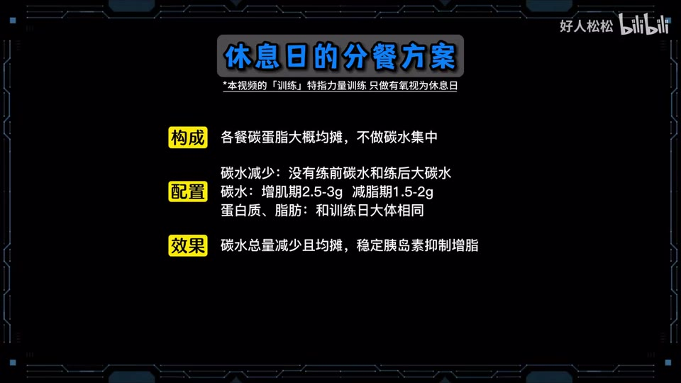

*图 31：休息日各餐碳蛋脂均摊，碳水自然减少。*

### 2.7 碳水的日际变化 [54:24]

| 项目 | 内容 |
|---|---|
| 原因 | 各训练部位对肌糖原的储备和消耗能力不同：腿、背、胸 > 肩膀、手臂 |
| 办法 | 三分化不需要考虑碳水的日际变化；四/五分化中肩膀或手臂单独练的那天，练后餐碳水减少约 1/3 |
| 注意 | 由此导致全天碳水分配比例和总量的变化，是无所谓的 |

- 糖原在训练时被消耗，练后摄入较多碳水后又能很快恢复。不同部位肌肉量差别很大，所以理论上各部位练后需要的碳水量不同。
- **三分化**：肩膀、手臂分到了胸、背、腿日里一起练，不会单独一天练，相当于每天都是大部位训练，不用考虑。
- **四分化、五分化**：会有肩膀或手臂单独练的日子，这天要减少练后餐碳水。减多少 UP 主没见过公认说法，他感觉**减少三分之一**差不多；减太多的话这一餐碳水就太普通了，胰岛素升不上去。
- 这样做会让练后餐占全天碳水的比例、全天碳水总量和前面的数字对不上，UP 主说这无所谓：这些数字都是大概建议，「你是吃饭，不是造原子弹」。

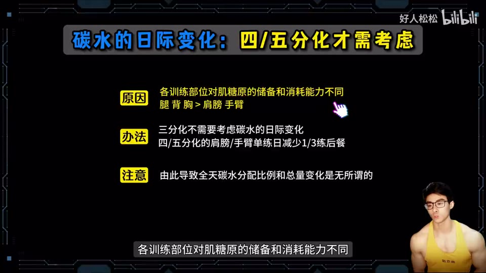

*图 32：四/五分化时，肩膀或手臂单练日的练后餐碳水减少约 1/3。*

**第二节小结** [55:48]：到这里，碳蛋脂的总量和分配都讲完了，理论层面的健身饮食也就讲完了。不管吃什么，本质都是在吃碳蛋脂，食物只是提供碳蛋脂的工具。但很多人对食物缺乏了解，所以第三节讲食物来源和配餐。

---

## 3. 第三节：碳蛋脂的食物来源与配餐方法 [56:19]

### 3.1 碳水食物：碳水率与 GI [56:31]

**碳水食物有两个属性** [56:32]

1. **碳水率**：100 g 食物里有多少克碳水。
2. **分解为葡萄糖的速度**：所有碳水都必须在消化系统里分解为葡萄糖后才能进入血液，**GI** 就是描述这个速度的指数。

- **碳水率和 GI 没有任何关系**：碳水率高也可以 GI 很低（藕粉、粉条）；碳水率低也可以 GI 很高（西瓜、南瓜、胡萝卜）。因为 GI 本来就不表示碳水率，只表示这种碳水和那种碳水分解成葡萄糖的速度不同。

| 食物 | 碳水率 | 分解速度 | 食物 | 碳水率 | 分解速度 |
|---|---|---|---|---|---|
| 西瓜 | 8% | GI=72 快碳 | 白米饭 | 25% | GI=83 快碳 |
| 可乐 | 11% | GI=65 中碳 | 白馒头 | 47% | GI=88 快碳 |
| 烤土豆 | 18% | GI=82 快碳 | 白面包 | 50% | GI=87 快碳 |
| 煮红薯 | 20% | GI=77 快碳 | 速食燕麦片 | 60% | GI=83 快碳 |
| 香蕉 | 22% | GI=52 中碳 | 白砂糖（蔗糖） | 100% | GI=65 中碳 |
| 煮玉米 | 22% | GI=55 中碳 | 无水葡萄糖 | 100% | GI=100 快碳 |

画面补充示例：藕粉碳水率 90%、GI=33 慢碳；粉条（红薯、土豆等）碳水率 90%、GI=33 慢碳；南瓜碳水率 5%、GI=75 快碳；胡萝卜碳水率 3%、GI=71 快碳。数据来源标注为中国疾控营养所《中国食物成分表标准版第 6 版》附录三，以及杨月欣《常见谷类和薯类的血糖生成指数》（营养学报，2003）。

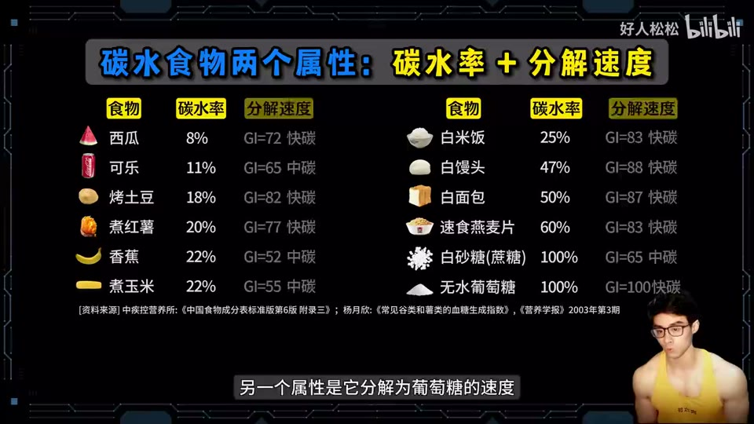

*图 33：碳水率和 GI 是两个独立属性。*

**GI 的测定：50 g 碳水 120 分钟的血糖面积变化** [57:12]

1. 让受试者吃 **50 g 葡萄糖**（例如浓度 20% 的葡萄糖水喝 250 g），以进食前的基础血糖为 0，记录 120 分钟内的血糖升高量，把曲线下方的面积定为 **100**。
2. 再让受试者吃含 **50 g 碳水**的其他食物（例如白米饭碳水率 25%，就吃 200 g），同样记录 120 分钟的血糖曲线。
3. 和葡萄糖曲线相比，如果面积是 80，这种食物的 GI 就是 80（这是 UP 主举的假设数字）。

- **特别注意**：「高 GI 高血糖、低 GI 低血糖」是在**碳水量完全相同**的前提下说的，不能脱离碳水量谈 GI。例如荞麦面吃多一点，血糖就很容易比吃白米饭的人还高。连自己吃了多少碳水都搞不清，就去纠结 GI，没什么意义。

**烹饪方式能强烈改变 GI** [58:36]

| 食物 | GI |
|---|---|
| 生红薯 | 54（中低） |
| 煮红薯（100 °C 水温） | 77（高，已属快碳） |
| 烤红薯（200 °C 以上） | 94（高，类似直接灌葡萄糖） |
| 煮燕麦米（100 °C） | 42（低） |
| 速食燕麦片（物理挤压 + 高温熟化） | 83（高，快碳） |

- 原因是淀粉的糊化程度不同。
- 一种食物只要有多种烹饪方式，介绍 GI 时就**必须注明烹饪方式**。《中国食物成分表》附录里的马铃薯 GI 就分别注明了烤、蒸、炸、微波。网上很多资料不注明烹饪方式就说「红薯 GI 多少」「燕麦 GI 多少」，一看就是以讹传讹。

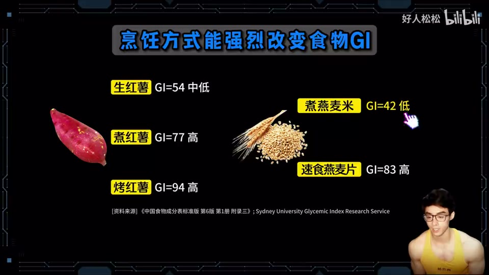

*图 34：同样是红薯和燕麦，烹饪方式不同，GI 差别很大。*

**碳水的食物来源：高、中、低 GI 碳水清单** [59:33]

| 类别 | 食物（画面清单） |
|---|---|
| 总量 & 分配 | 碳水总量见第一节 13 min，日内分配见第二节 48 & 54 min |
| 高 GI 碳水（70 < GI < 100）［高饱腹感］ | 米饭、红薯、土豆、西瓜、燕麦片、八宝粥 |
| 高 GI 碳水［低饱腹感］ | 馒头、发糕、米糕、豆沙包、白面包、米线米粉、面条（鲜湿面）、青团、粽子、糍粑、小汤圆、阜阳糕、云片糕、炒米花、米花糖、光酥饼、冲调米粉、旺仔小馒头、旺仔 QQ 糖 |
| 中 GI 碳水（55 < GI < 70） | 煮玉米、粗粮面包、燕麦麸、葡萄干、面条（挂面、意面）、多数水果（香蕉、橘子、葡萄、榴莲等） |
| 低 GI 碳水（0 < GI < 55） | 藕粉、粉条（土豆、红薯等） |
| GI 的应用 | 练后餐一般吃高 GI 碳水，其他时候比较随意。胰岛素影响因素：碳水 GI（正）、碳水量（正）、蛋白质量（正）、纤维素量（负） |

- 生活中**大部分碳水都是高 GI 的**，中 GI 不多，低 GI 据 UP 主所知只有藕粉和粉条。蔬菜、牛奶也是低 GI，但不算主食，所以没列。

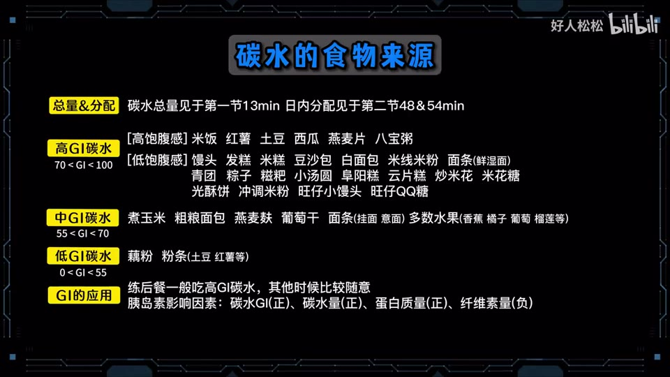

*图 35：按 GI 和饱腹感分类的碳水食物清单（片尾无字幕版）。*

**碳水的饱腹感：按碳水配额和胃口选** [60:02]

- 碳水食物的饱腹感差别明显，选哪种取决于**你的碳水配额和胃口**。
  - 增肌期练后餐碳水量大，全吃米饭可能吃不下，可以把一部分甚至全部换成**低饱腹感**碳水，比如少吃点米饭、多吃一个米糕或青团，或在蛋白粉里加米粉、葡萄糖、旺仔小馒头。
  - 减脂期碳水总配额少，早饭碳水不多，吃面条、馒头、汉堡这类低饱腹感快碳可能吃不饱、上午挨饿，可以换成燕麦片、燕麦麸等**高饱腹感**的，同样的碳水量更扛饿。
- 碳水**不是饱腹感越高越好，也不是越低越好**，因人而异。
- **GI 的应用** [61:14]：练后餐一般吃高 GI 快碳来冲高胰岛素，其他时候比较随意。有人建议非练后餐吃中低 GI 碳水让胰岛素稳定，有道理，但中低 GI 碳水在生活里太少，没法强求。想压制胰岛素，最简单的办法是**管好这一餐的碳水量**，再加上**多吃、先吃蔬菜**，不要只盯着 GI。

### 3.2 脂肪的食物来源 [61:50]

| 项目 | 内容（画面整理） |
|---|---|
| 总量 | 增肌 1 g，减脂 0.8 g，基本不变以免麻烦 |
| 分配 | 不严格，但练后餐建议（不是必须）20 g 以内，节约点脂肪配额 |
| 功能 | 性激素的前体；脂溶性维生素的吸收载体；其他生理功能 |
| 正常吃 | 一般炒菜（煎炸菜除外）；蛋黄（一个 5 g 脂肪）；纯牛奶（一包 9 g 脂肪） |
| 少吃不吃 | 煎炸类炒菜；固体脂肪（肥肉、糖油混合物、坚果） |

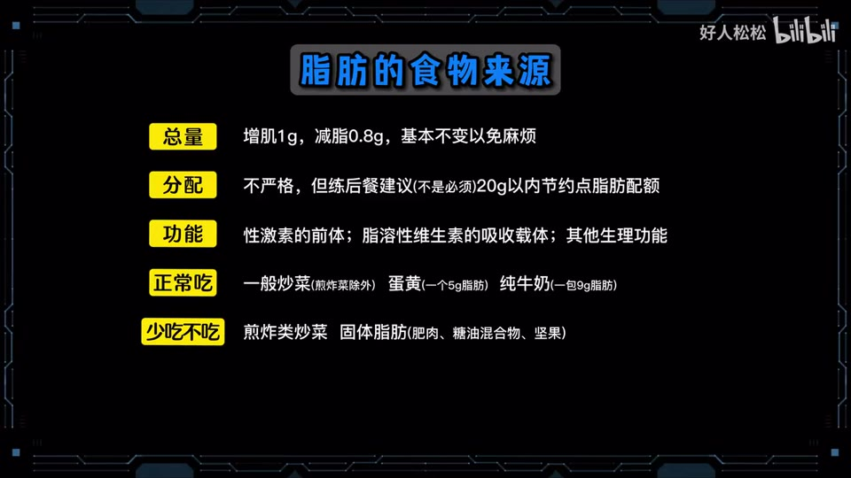

*图 36：脂肪的总量、分配、功能，以及正常吃和少吃不吃的食物（片尾无字幕版）。*

**要克服「恐惧脂肪」的心理** [62:02]

- 脂肪是性激素的前体，也是脂溶性维生素 A、D、E、K 的吸收载体，还有很多其他生理功能。
- 新手常有一种心理：蛋白质是好的，碳水没那么好，脂肪最坏。UP 主认为碳蛋脂不该分好坏，就像维生素 A、B、C 都是必需的，往一个大致合适的量去吃就行。

**UP 主觉得最舒服的方案** [62:23]

- **炒菜正常吃**：夹一筷子菜、一片肉，表面附着的油量有限（又不是舔盘子喝油汤）。清淡炒菜一人份算 5 g 油，重口炒菜一人份算 10 g 油；特别油、夹起来会滴油的菜，刮一下再吃。每天脂肪配额有大几十克，一天吃三四个炒菜完全没问题。
- **鸡蛋、牛奶正常吃** [62:56]：鸡蛋每天两三个、牛奶一两包差不多，再多就要打个问号。
  - 鸡蛋、牛奶和瘦肉不同，**不是「干净」的蛋白质**：鸡蛋是蛋白质和脂肪差不多的「蛋 + 脂」混合物；牛奶是碳水、蛋白质、脂肪差不多的「碳 + 蛋 + 脂」混合物。
  - 每天脂肪配额只有大几十克，6 个鸡蛋就占 30 g，一升牛奶也占约 30 g，吃多了很占配额。除非特别爱吃，否则不建议把大部分脂肪配额花在鸡蛋牛奶上。只吃蛋清或喝脱脂奶则没有脂肪，另当别论。

| 食物 | 碳水 | 蛋白质 | 脂肪 |
|---|---|---|---|
| 1 个蛋清 | 0 g | 3 g | 0 g |
| 1 个蛋黄 | 0 g | 3 g | 5 g |
| 1 个全蛋 | 0 g | 6 g | 5 g |
| 1 包牛奶 | 12 g | 9 g | 9 g |

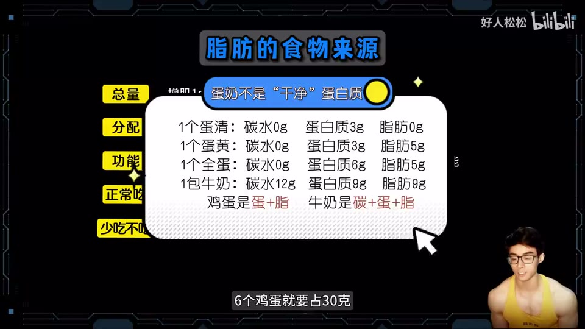

*图 37：鸡蛋是「蛋 + 脂」，牛奶是「碳 + 蛋 + 脂」。*

**少吃不吃的几类** [63:48]

1. **少数煎炸类炒菜**：炒鸡蛋、炒茄子、炸蘑菇等会把植物油大量吸进内部。例如食堂饭馆的宽油炒鸡蛋，一个鸡蛋本身只有 5 g 脂肪，UP 主看过的测评说能额外吸油二三十克，吃一个煎鸡蛋相当于吃了三四个炒菜。不是绝对不能吃，但很「奢侈」。
2. **固体脂肪** [64:16]：肥肉、糖油混合物、坚果。问题在于**看不出它有脂肪**，所以会觉得自己没吃脂肪而大吃特吃。
   - 一个普通白瓷勺一勺油约 **6 g**，让你直接喝下去你会觉得离谱。但下面这些东西你可能毫无戒备：
     - 一小块肥肉：约 30 g 脂肪 ≈ 5 勺油，全天脂肪配额的一半没了；
     - 两根油条：约 30 g ≈ 5 勺油；
     - 肯德基两个蛋挞：约 30 g ≈ 5 勺油；
     - 星巴克一个小糕点：近 40 g ≈ 6 勺油，一半多的配额没了；
     - 两把坚果：40 多克 ≈ 7 勺油，一半多的配额没了。
   - 人们对液体油很警惕，对固体脂肪却毫无意识。生活里很多人对炒菜里的油斤斤计较，饿了却靠饼干、甜品、糕点、零食填饱，这是「颠倒主次」。
   - UP 主断言：生活里脂肪超标的人，**绝不是因为吃了炒菜而没吃水煮，也不是因为吃了鸡蛋牛奶**，而是在无意识中吃了太多肥肉、糖油混合物、坚果等固体脂肪。它们的脂肪率看起来比植物油低得多，但重量大得多，**脂肪量 = 脂肪率 × 重量**，乘出来很可观。
   - 不是说不能吃，而是不要把它们当成**基础性食物**（比如下午饿了加餐，全靠饼干甜品糕点吃饱），否则一顿就花掉全天大部分脂肪配额，再吃点炒菜、鸡蛋、牛奶就超标了。偶尔作为**调节性食物**可以。

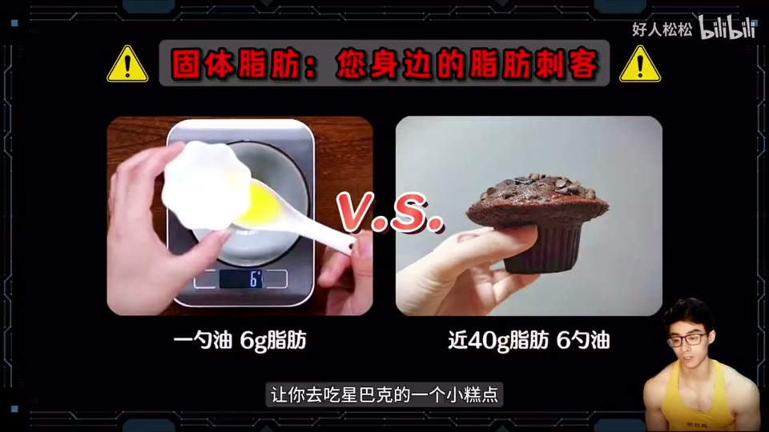

*图 38：一勺油 6 g 脂肪，一个小糕点近 40 g 脂肪，约等于 6 勺油。*

| 类别 | 脂肪率 | 举例（画面清单） |
|---|---|---|
| 1. 肥肉 | 90%（指其肥肉部分） | 培根、午餐肉、红烧肉、雪花肉、五花肉、带皮肉 |
| 2. 糖油混合物 | 15–40% | [煎炸] 油条、煎饼、煎饺、麻花、麻团、炸糕；[糕点] 蛋糕、蛋挞、蛋卷、可颂、麦芬、月饼、曲奇、桃酥、奶黄酥、蛋黄派、沙琪玛；[膨化] 薯条、薯片、虾条、锅巴、雪饼、仙贝；[甜点] 雪糕、蛋糕、泡芙、马卡龙、甜甜圈；[快餐] 披萨、薯条、汉堡（部分）、方便面（多数）；[其他] 辣条、士力架、饼干（多数）、巧克力（多数） |
| 3. 坚果 | 40–70% | 瓜子、核桃、花生、巴旦木、扁桃仁、开心果 |

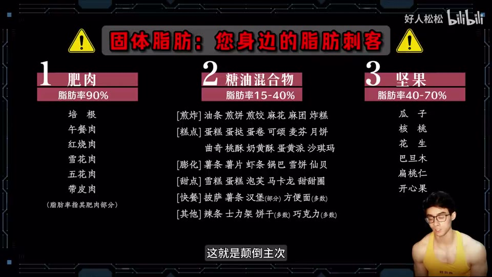

*图 39：肥肉、糖油混合物、坚果三类固体脂肪清单。*

**推荐的脂肪摄入方案与试算** [66:37]

- 方案：**一般炒菜正常吃 + 鸡蛋牛奶正常吃 + 瘦肉里不可避免的微量脂肪**，脂肪摄入就大体合适；肥肉、糖油混合物、坚果等固体脂肪少吃不吃，偶尔调节可以，不当基础性食物。在这个方案下，**不算脂肪也大体合适**。
- 试算：
  - 早饭 2 个鸡蛋 + 1 包牛奶：5 × 2 + 9 × 1 = 19 g；
  - 午饭晚饭的一人份炒菜，清淡 2 份 + 重油 2 份：5 × 2 + 10 × 2 = 30 g；
  - 炒菜里的瘦肉 300 g × 平均 3% 脂肪率 = 9 g；
  - 其他食物里的零碎脂肪约 10 g；
  - 合计约 **70 g**，对一般体重的男性很合适，而且很舒服：食堂外卖的炒菜都能正常吃，不需要自己做饭。

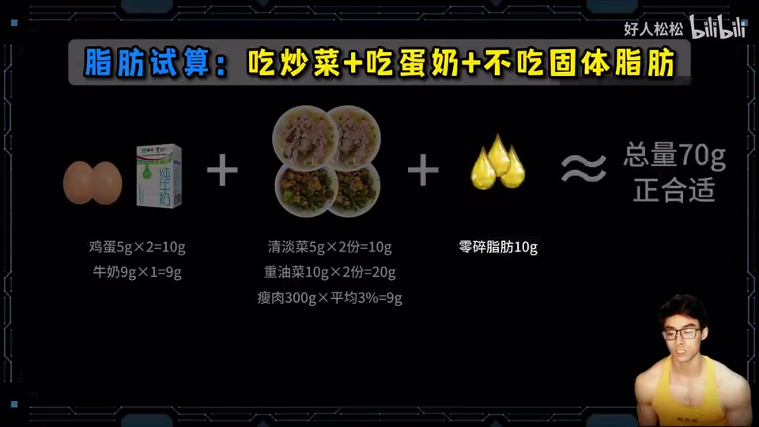

*图 40：吃炒菜 + 吃蛋奶 + 不吃固体脂肪，全天脂肪约 70 g。*

**不必刻意追求「优质脂肪」** [67:31]

- 网上很多讲解让大家买坚果、花生酱等富含不饱和脂肪酸的「优质脂肪」，言下之意是植物油、鸡蛋牛奶里的脂肪不优质。UP 主认为这是健身圈的谣言：
  1. 饱和、单不饱和、多不饱和脂肪酸各有不同的生理功能，**都是人体必需的**。中国营养学会（《中国居民膳食营养素参考摄入量》第四章《脂类》p.101）也指出，目前各国对三种脂肪酸摄入比例大多推荐 **1:1:1** 附近。三种脂肪酸就像维生素 A、B、C，没有优劣之分。
  2. 看具体食物的脂肪酸比例：植物油和坚果类似，都以不饱和脂肪酸为主；饱和脂肪较高的依次是乳制品、肥肉、鸡蛋，而且也不算特别高。按前面的方案正常吃炒菜、鸡蛋、牛奶，加上瘦肉里的微量肥肉，三种脂肪酸的比例**恰好比较均衡**。

| 食物 | 饱和 | 单不饱和 | 多不饱和 | 食物 | 饱和 | 单不饱和 | 多不饱和 |
|---|---|---|---|---|---|---|---|
| 菜籽油 | 8% | 65% | 27% | 巴旦木 | 8% | 68% | 25% |
| 葵花油 | 15% | 23% | 62% | 扁桃仁 | 8% | 70% | 22% |
| 玉米油 | 17% | 30% | 53% | 瓜子 | 12% | 18% | 70% |
| 大豆油 | 19% | 27% | 54% | 开心果 | 12% | 56% | 31% |
| 花生油 | 25% | 43% | 32% | 花生 | 21% | 38% | 41% |
| 羊肉（肥） | 44% | 45% | 11% | 纯牛奶 | 68% | 27% | 4% |
| 猪肉（肥） | 45% | 50% | 5% | 奶酪 | 68% | 27% | 4% |
| 牛肉（肥） | 51% | 45% | 5% | 酸奶 | 65% | 29% | 7% |
| 鸡肉（肥） | 53% | 41% | 6% | 蛋黄 | 32% | 56% | 12% |

- 不用相信「花生酱是优质脂肪、花生油不优质」这种说法。很多人连自己应该吃多少脂肪、实际吃了多少都不清楚，却去纠结三种脂肪酸比例、Omega-3/6/9 比例，就像连碳水量都不清楚却去挑 GI 一样。

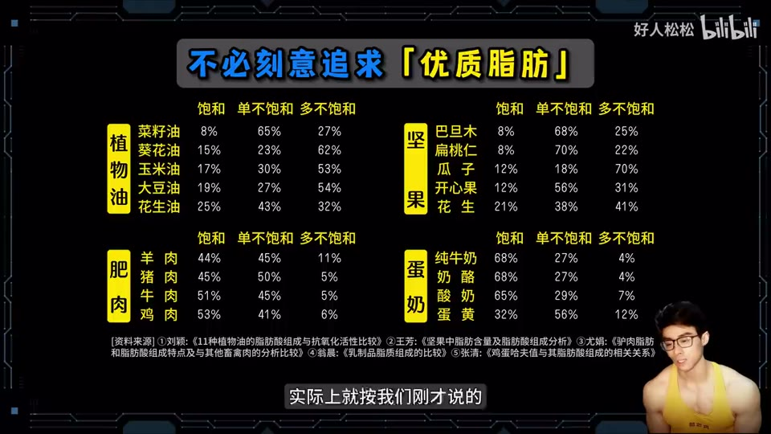

*图 41：植物油、坚果、肥肉、蛋奶的饱和 / 单不饱和 / 多不饱和脂肪酸比例。*

### 3.3 蛋白质的食物来源 [69:11]

| 项目 | 内容（画面整理） |
|---|---|
| 总量 | 力量训练者保证 1.5–2 g，爱吃肉可以 2–3 g |
| 来源 | [主要来源] 瘦肉、蛋白粉（不会附赠太多脂肪）；[辅助来源] 鸡蛋、牛奶、豆制品（会附赠很多脂肪） |
| 食堂 | 炒、卤、凉拌的瘦肉均可，无需水煮餐 |
| 外卖 | 跷脚牛肉、酸菜鱼、黄焖鸡、沙县、烤鸡、蒸鸡、窑鸡、鸡腿、炸鸡等 |
| 配餐 | 找蛋白质吃，碳水和脂肪遍地都是，不可能没有 |

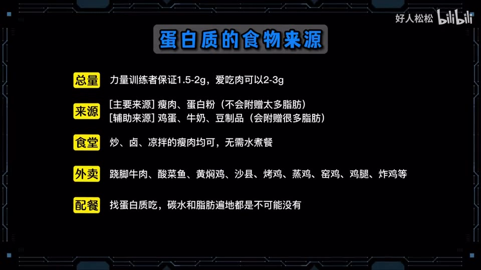

*图 42：蛋白质的总量、主要和辅助来源、食堂外卖怎么找（片尾无字幕版）。*

- **总量**：力量训练者基础摄入 1.5–2 g；爱吃肉的可以吃到 2–3 g，但这个量对长肌肉已经有所溢出，多出来的只是单纯提供热量。
- **主要来源：瘦肉和蛋白粉**，几乎是纯蛋白质，附带的碳水和脂肪很少。
  - 猪牛羊鸡鸭鱼虾等瘦肉，按第一节那组简化数据代入即可，不必分部位、分品种。
  - **乳清蛋白粉**从牛奶中提取，蛋白质率一般在 80% 以上，是很方便的来源。
- **辅助来源：鸡蛋、牛奶、豆制品** [69:57]。说它们是辅助，一是蛋白质其实不多：一个鸡蛋只有 6 g，一包牛奶只有约 9 g（口述为「十来克」，画面为 9 g），一整块 200 g 的豆腐也只有约 12 g；二是它们提供蛋白质的同时会**附赠差不多量的脂肪**，脂肪率和蛋白质率旗鼓相当。我们的配额里蛋白质需求远高于脂肪，所以把它们当主要蛋白来源，吃够蛋白质时脂肪也爆了（蛋清、脱脂奶除外）。
- **大众误区**：认为鸡蛋牛奶是高蛋白食物。UP 主举例：他所在学校推出的一种轻食餐，蛋白质来源是干烧鱼、炒鸡蛋、炒豆腐。干烧鱼算瘦肉但量很少，炒鸡蛋和炒豆腐蛋白质少、脂肪比蛋白质还多，整体蛋白质绝对不够，脂肪倒是挺够。
- **健身配餐的关键就是找蛋白质吃** [71:13]：任何食堂、饭馆、外卖一定有各种碳水和脂肪，但不一定有蛋白质。只要找到了蛋白质，再选合适量的碳水和脂肪，就一定能完成配餐。
  - 食堂：找瘦肉，炒肉、卤肉、凉拌肉都可以，不需要水煮。
  - 外卖：UP 主的经验是搜跷脚牛肉、酸菜鱼、黄焖鸡、沙县、烤鸡、蒸鸡、窑鸡、鸡腿、炸鸡等。禽肉原则上要去皮吃，这样吃的才是真正的瘦肉。
  - 有的同学点外卖只知道搜「健身餐」「轻食」，其实远没有这么局限：只要有瘦肉就一定能配好餐。

**不要担心植物蛋白** [72:09]

- 不同食物的蛋白质氨基酸构成不同，在各种评分方法（生物价法、氨基酸评分法等）里得分不同（画面来源：张泽生《食品营养学》第 3 版 pp.95–98；Understanding Nutrition 12th edition, appendix D-2）。植物蛋白整体得分比肉蛋低一些，于是有人说植物蛋白不好，不应计入蛋白质摄入。UP 主认为这是多虑：
  1. 评分方法都针对**单一食物**，假设你这辈子只吃这一种蛋白质来源。但现实中我们吃多种食物，**多种食物混合后能互相弥补对方的限制性氨基酸**，产生「低分 + 低分 = 高分」的互补效果。打个比方：只吃米饭、牛肉、植物油里的任意一种，碳蛋脂结构都很差，但没人说它们是劣质食物，因为组合起来吃就没问题。国外很多素食健身者靠多种植物蛋白和植物蛋白粉也练得很好。
  2. 每天吃进去的植物蛋白总量其实很少（主食和偶尔的豆制品里有一点），就算费心打折计算，也就少算个八克十克，而每天蛋白质的允许波动和计算误差都远不止这点，没必要剔除。
- 结论：**植物蛋白也应该计入蛋白质摄入量。**

### 3.4 配餐原则与实战场景 [74:14]

**总的配餐原则**

1. **先搞定蛋白质**：一般**每餐 20–50 g 蛋白质**，**优先用瘦肉**，没有瘦肉就用鸡蛋、牛奶、蛋白粉。
2. **脂肪不专门吃**：炒菜里的油、鸡蛋牛奶里的脂肪、瘦肉里的微量肥肉就够了，不需要额外单独吃脂肪。
3. **碳水看情况**：根据这一餐需要的碳水量安排。

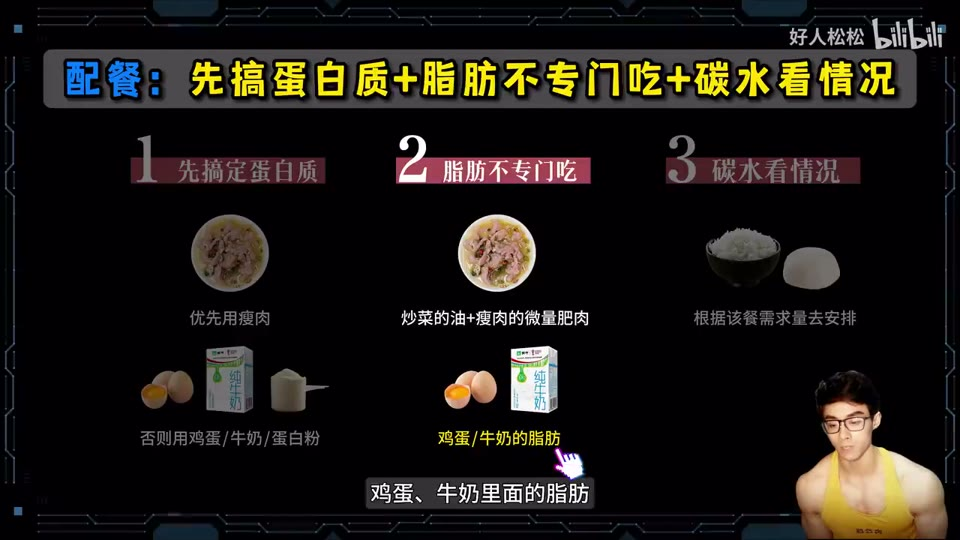

*图 43：配餐三步。*

**场景 1：食堂早饭** [74:38]

- 先搞定蛋白质：唯一的瘦肉是**去皮卤鸡腿**，来两个，约 30 g 蛋白质。
- 再补碳水：吃纯碳水，比如一个大馒头、一碗中等面条或两碗稀饭，约 50 g 碳水。这样吃脂肪很低，相当于把脂肪配额留给其他时候。
- 想这餐吃点脂肪也简单：把一个卤鸡腿换成鸡蛋或牛奶，或者把纯碳水换成肉包子、手抓饼这种带点脂肪的碳水，碳水和蛋白质大体不变，脂肪多一些。
- **食堂早饭没有瘦肉怎么办** [75:20]：退而求其次用鸡蛋或牛奶，比如两个鸡蛋 + 一包牛奶，凑够 20 来克蛋白质，但同时也有差不多 20 来克脂肪。所以接下来**必须选馒头、面条、稀饭这样的纯碳水**，最好别吃肉包子、手抓饼这类带脂肪的碳水，更不能吃油条、麻团、锅盔这样脂肪很多的糖油混合物。

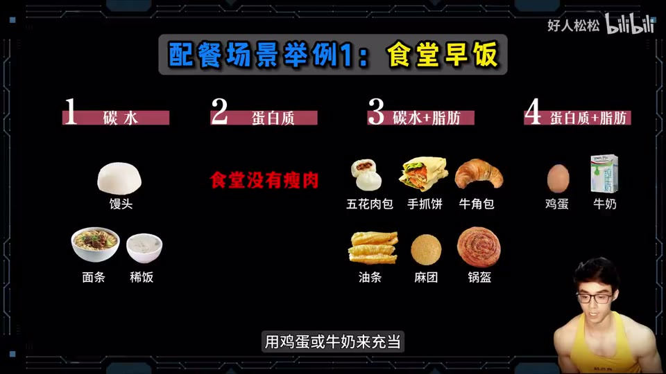

*图 44：食堂早饭的碳水、蛋白质、「碳水 + 脂肪」、「蛋白质 + 脂肪」选项。*

**场景 2：宿舍或家里的早饭** [75:56]

- 做一个简单的快速冲调早饭。碳水：燕麦片、燕麦麸、玉米粉、芝麻糊、藕粉等都行。
- 蛋白质：宿舍里没有瘦肉和鸡蛋，可以用**两包牛奶**或**一些蛋白粉**。
  - 区别一：牛奶在提供蛋白质的同时还提供差不多量的碳水和脂肪，所以前面的谷物碳水要少放一点。
  - 区别二：两包牛奶也有 20 来克脂肪，会占用当天的脂肪配额，蛋白粉则不会。
- 脂肪：可吃可不吃，不需要每餐分摊。

**场景 3：食堂的午饭晚饭** [76:33]

- 第一步还是先搞定蛋白质：卤牛肉、卤鸡腿、酸菜鱼、红烧鸡块乃至水煮肉片都算瘦肉，爱吃啥选啥，只要注意**瘦肉要吃到 100 来克**，这一餐才有二三十克蛋白质。
- 脂肪：炒菜里的油加上瘦肉里的微量脂肪，已经够了，不需要专门补。
- 碳水：因为脂肪已经够了，吃米饭、馒头这样的**纯碳水**即可，吃多少取决于这一餐需要的碳水量：练后餐就是全天最大一次碳水；其他餐碳水较少；减脂期的其他餐甚至可能无碳水。
- 蔬菜：要压制胰岛素就多吃、先吃；要升高胰岛素就少吃、晚吃。

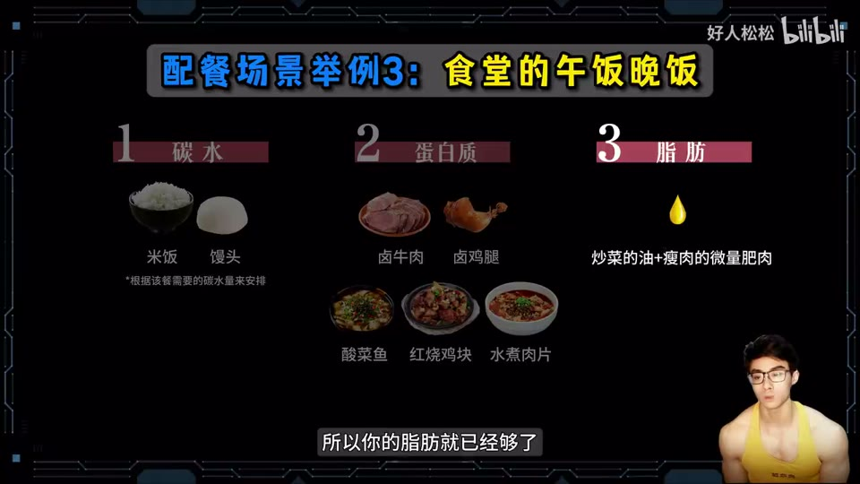

*图 45：食堂午晚饭的碳水、蛋白质、脂肪来源。*

**场景 4：在外聚餐饭局** [77:36]

- 餐桌上摆的也是碳蛋脂，像在食堂一样配餐就行。
- 先找蛋白质：炒牛肉、凉拌鸡、白灼虾、清蒸鱼等都是蛋白质，放开吃，瘦肉仍然要吃到 100 多克才有二三十克蛋白质。
- 脂肪不用单独补：菜里的油加上瘦肉里的微量肥肉就够了。
- 碳水按这一餐需要的量选，米饭、馒头、面条都有。
- **少吃不吃**：肥肉和糖油混合物，比如东坡肘子、红烧肉、回锅肉（五花肉）、酥油饼（糖油混合物），最多浅尝。

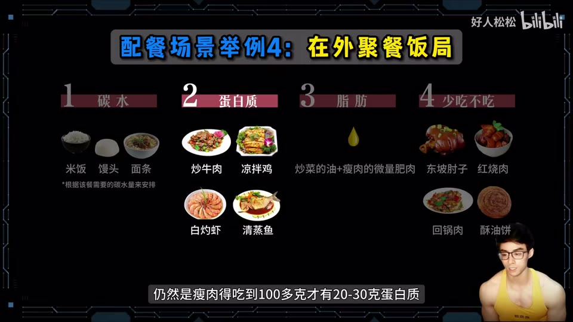

*图 46：聚餐时的碳水、蛋白质、脂肪来源，以及肘子、红烧肉、回锅肉、酥油饼等少吃不吃的菜。*

**场景 5：四川火锅** [78:36]

- 既不影响增肌，也不影响减脂。先搞定蛋白质：瘦牛肉、鱼片、毛肚、郡肝、黄喉等都是瘦肉性质的纯蛋白，放开吃，至少吃到 100 多克才能保证二三十克蛋白质。
- 脂肪：油碟（火锅蘸料）里的油已经很可观，稍微多一点但不算离谱，作为脂肪来源已经够了。所以肥肉（肥牛肉、午餐肉、炸酥肉）和糖油混合物（红糖糍粑）一定要少吃不吃，最多浅尝。
- 碳水：米饭、藕粉、小汤圆等，按这一餐需要的碳水量选。

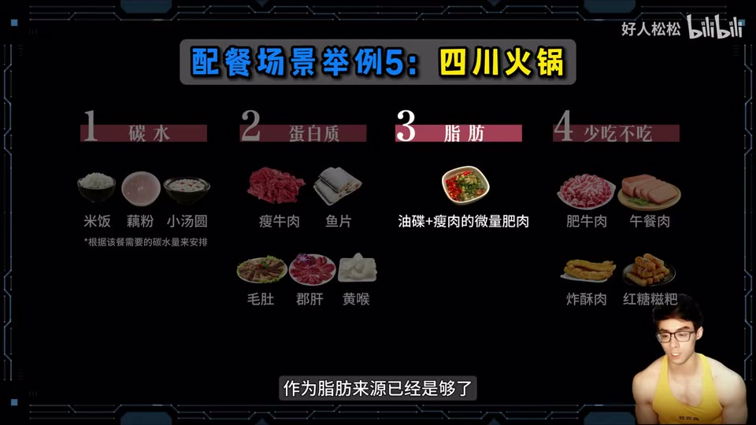

*图 47：火锅的瘦肉选择，以及肥牛肉、午餐肉、炸酥肉、红糖糍粑等少吃不吃的食物。*

**场景 6：肯德基 & 麦当劳** [79:42]

- 同样不影响增肌减脂。先找蛋白质：一块原味鸡加奥尔良堡里的鸡肉，肉量已有 100 多克，能保证二三十克蛋白质。
- 脂肪看配额：想少吃脂肪，就把原味鸡和烤鸡肉**去皮**，变成干净的纯瘦肉；不去皮的话 UP 主估计能吃进去约 30 g 脂肪，也不算太多。
- 碳水按这一餐需要选：汉堡的面包胚约有 30 g 碳水，还要加可以再来一个汉堡，或加土豆泥、可乐、冰淇淋、圣代。
- 少吃不吃：肥肉（如半肥半瘦的安格斯牛肉堡）和糖油混合物（如蛋挞）。吃一个安格斯牛肉堡再加三四个蛋挞，这一餐的脂肪肯定超过全天配额。

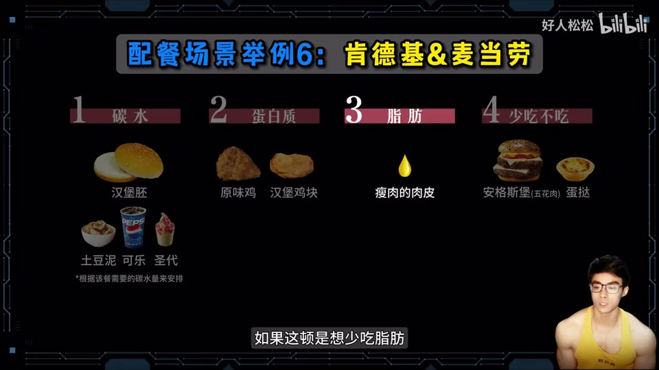

*图 48：快餐店的碳水、蛋白质、脂肪来源，以及安格斯牛肉堡（五花肉）、蛋挞等少吃不吃的食物。*

**配餐总结路数** [80:41]

1. 先搞定蛋白质：每餐一般要吃二三十克以上；吃瘦肉的话至少 100 多克；没有瘦肉就用鸡蛋、牛奶或蛋白粉。
2. 脂肪：炒菜里的油、鸡蛋牛奶的脂肪、瘦肉里的微量肥肉，加起来就差不多了。
3. 碳水：按这一餐需要的量，安排适量的纯碳水。
4. 肥肉和糖油混合物：少吃不吃，最多浅尝。

这样安排，无论吃食堂外卖还是在外聚餐，无论增肌还是减脂，都能完成合适的配餐。

---

## 4. 第四节：专题与常见错误 [81:39]

### 4.1 专题 1：增肌与减脂的饮食区别 [81:48]

| 维度 | 增肌 | 减脂 |
|---|---|---|
| 1. 摄入总量（男性，画面数字） | 碳水 4–4.5 g，蛋白质 1.5–2 g，脂肪 1 g | 碳水 3–3.5 g 起步，蛋白质 1.5–2 g，脂肪 0.8 g |
| 2. 日内分配（碳水） | 早饭 2 成 / 其他餐 2 成 / 练前 2 成 / 练后 4 成 | 当男性碳水 ≤ 2.5 g、女性碳水 ≤ 2 g 时，多牺牲其他餐、少牺牲练后餐，变成早饭 3 成 / 其他餐 0 成 / 练前 2 成 / 练后 5 成 |
| 3. 碳水饱腹感 | 低饱腹感碳水更多出现在增肌期 | 高饱腹感碳水更多出现在减脂期 |

画面注：女性和大体重者请看 13 min 的配额表；大体重者减脂时 2.5 g 碳水的绝对量已经很足，不用取消其他餐的碳水。这条注释的字很小，按截图辨认。

> 注：此页画面上的男性数字（增肌 4–4.5 g、减脂 3–3.5 g 起步）和 13:00 主表（增肌 3.5–4.5 g、减脂 2.5–3 g 初期）不完全一致，见第 1.5 节的说明（此处原视频未明确以哪版为准）。

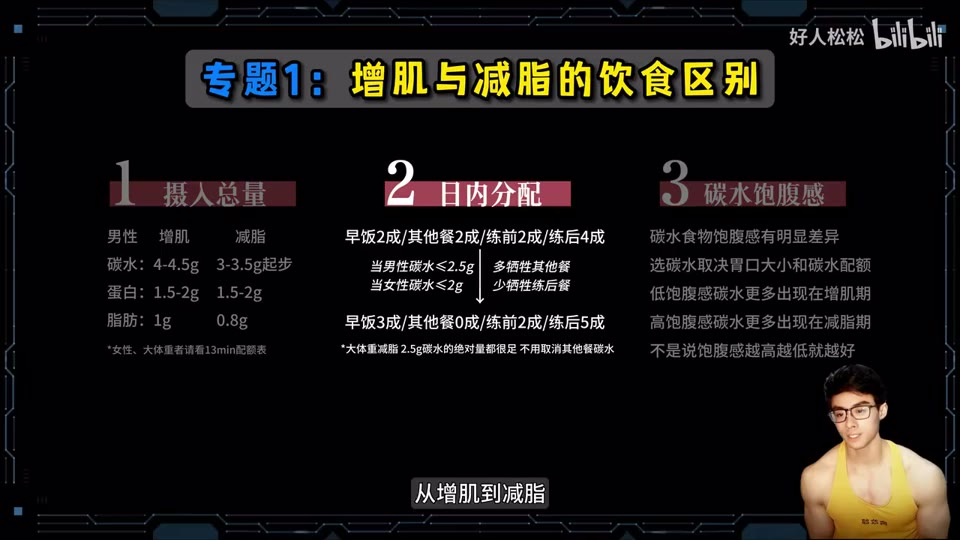

*图 49：增肌与减脂在摄入总量、日内分配、碳水饱腹感三个维度上的区别。*

- **摄入总量**：增肌远高于减脂，主要差在**碳水量**；脂肪摄入也有差别，但脂肪不容易算准，所以最好把握的是碳水的差别。
- **日内分配**：区别在于**其他餐占全天碳水的比例**。从增肌到减脂，碳水总量明显减少，减少的部分主要从其他餐扣，少扣练后餐。以晚饭前训练的人为例，增肌期和减脂前期的分配可以是 2224（早饭 2、午饭/其他餐 2、练前 2、练后 4）；减脂中后期其他餐的 20% 越来越少，变成 3025（早饭 3、其他餐 0、练前 2、练后 5）。这只是比例变化，早饭和练后餐的绝对量仍然减少了。
- **什么时候砍掉其他餐的碳水**：UP 主的个人经验是，一般体重的人，男性碳水降到 2.5 g、女性降到 2 g 时，就要基本少吃乃至不吃其他餐的碳水，保证练后餐。碳水总量已经很有限时还在其他餐吃一份扎实的碳水，实质上就是在抢练后餐的碳水。
- **增肌期能不能也只吃三次碳水？** 不行。碳水总量较大时，只吃三次很难完成增肌期的碳水任务，所以用 2224 的比例，让其他餐分担一部分。
- **碳水饱腹感的选择**：增肌期各餐碳水都比减脂期多，尤其练后餐，可以安排低饱腹感碳水。UP 主增肌期练后餐全吃米饭会吃不下，有时会用米糕、青团、面条、米线帮忙。减脂中后期碳水已经很低，他就不再吃低饱腹感碳水：早饭基本吃燕麦麸、燕麦片，午饭晚饭基本只吃米饭，这些都比较扛饿。

### 4.2 专题 2：饮料、水果等糖制品的管理 [84:57]

**什么是糖**：一般语境里指结构最简单的碳水。

| 糖 | 类型 | 组成 | GI | 来源 |
|---|---|---|---|---|
| 果糖 | 单糖 | — | 23（低） | 水果 |
| 葡萄糖 | 单糖 | — | 100（高） | 水果 + 食品添加 |
| 果葡糖浆（F55 型） | 单糖混合 | 果糖 55% + 葡萄糖 45% | 58（中） | 食品添加 |
| 蔗糖（白砂糖） | 双糖 | 葡萄糖 + 果糖 | 65（中） | 水果 + 食品添加 |
| 麦芽糖 | 双糖 | 葡萄糖 + 葡萄糖 | 100（高） | 食品添加 |

画面注：本页仅举例日常饮食里最常见的单双糖。

- 果糖 GI 很低（23）的原因：GI 测的是血糖，也就是血液里的葡萄糖。果糖不是葡萄糖，吃进去只有少部分会转化成葡萄糖，所以测出来的血糖不高。
- 果葡糖浆是果糖和葡萄糖的混合物，GI 介于两者之间。蔗糖的 GI 也介于两者之间，略高于果葡糖浆，因为它的葡萄糖比例更高一点。麦芽糖没有果糖拉低 GI，所以和葡萄糖一样很高。

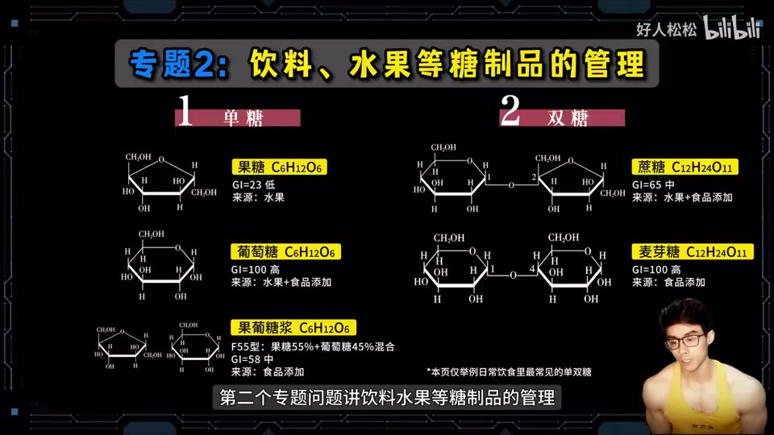

*图 50：果糖、葡萄糖、果葡糖浆、蔗糖、麦芽糖的 GI 与来源。*

**重点关注和果糖有关的三种糖：果糖、果葡糖浆、蔗糖** [86:00]

- **果糖摄入量的计算**：**果糖总量 ≈ 直接果糖 + 果葡糖浆 × 约一半 + 蔗糖 × 约一半**。
- 来源：直接果糖基本只能从水果里来；果葡糖浆来自食品饮料添加；蔗糖既在水果里，也广泛添加在食品饮料里。
- **限量：不要经常性地超过每日 30–50 g**。过量摄入的影响包括肥胖、脂肪肝、高尿酸等，UP 主建议以「果糖影响」为关键词去搜研究论文。

*图 51：果糖限量、来源计算方法和过量的影响。*

**试算：每天三五十克果糖上限意味着什么** [86:46]

| 食物 | 碳水量 | 碳水构成 | 果糖量 |
|---|---|---|---|
| 两根全熟香蕉 | 60 g | 果糖 20%、蔗糖 60%、葡萄糖 20% | 30 g（12 + 36 × 一半） |
| 一瓶可乐 | 50 g | 蔗糖 100% | 25 g |
| 一袋不大的牛肉干 | 40 g | 蔗糖 100%（调味用） | 20 g |

- 三样加起来果糖就有 **75 g**，一天吃完已经超标。

*图 52：香蕉、可乐、牛肉干的果糖量试算。*

**UP 主的态度** [87:31]

- **不要谈糖色变**：不必样样追求无糖，连调味料、面包里的几克蔗糖都怕，没有必要。
- **也不要认为糖就是碳水，只要碳水不超标就行**：比如有人问练后餐不吃主食，改吃可乐、冰棍、西瓜、香蕉行不行？不好。练后餐碳水是大几十上百克，全靠蔗糖制品和水果提供，果糖必然超标。这些东西可以吃、不排斥，但**不能把练后的全部碳水乃至全天的主要碳水都靠它们**。
- 特别是有人认为水果是能完全替代主食的健康食品，不吃主食改吃水果，这样太容易果糖超标。
- 实际上不可能仔细算果糖。UP 主的粗放建议：**把水果、糖饮料、高糖零食作为调节性食品，不要用来取代主食，不要作为碳水的主要来源。**

**和果糖无关的两种糖：葡萄糖、麦芽糖** [88:37]

- 它们和主食一样会全部分解为葡萄糖，只是比主食分解得更快，不存在蔗糖、果葡糖浆「强迫你摄入果糖」的问题。
- 而且它们在食品添加剂里用得少：配料表里常见的是白砂糖和果葡糖浆，葡萄糖、麦芽糖少多了，因为甜度较低、价格较贵。
- 唯一要注意的是**不要一口气吃大量葡萄糖或麦芽糖**。比如练后在蛋白粉里加葡萄糖替代一部分主食，**加二三十克就够了**，不要让练后的主要碳水都靠葡萄糖，否则瞬间大量快碳摄入，有人会恶心头晕，而且齁甜难吃。

**小结**：糖分两种，一种和果糖有关（果糖、果葡糖浆、蔗糖），需要限量；另一种和果糖无关（葡萄糖、麦芽糖）。

### 4.3 专题 3：健身补剂的选择 [89:42]

UP 主开宗明义：虽然他的橱窗也挂了补剂，但**把碳蛋脂管理好，比吃各种补剂重要得多**。

**第一推荐：乳清蛋白粉** [89:57]

| 项目 | 内容（画面整理） |
|---|---|
| 原料 | 牛奶乳清里的蛋白质，故名乳清蛋白 |
| 优点 | 方便易得，随时可吃，比瘦肉更方便；价格不贵，介于猪肉鸡肉与牛肉之间 |
| 鉴别 | 包装英文：乳清蛋白粉 whey，分离乳清蛋白粉 isolate/iso，增肌粉 mass/gain/gainer；营养成分：蛋白粉的蛋白质率 > 70%，增肌粉的蛋白质率 < 30% |
| 价格 | 价差主要影响溶解度和泡沫量，营养一样，口感不同，自行选择 |
| 套路 | 增肌粉用各种办法冒名为蛋白粉 |

- 不会附带太多脂肪的蛋白质只有两种：瘦肉和蛋白粉。瘦肉的缺点是有时不方便获取，蛋白粉随时随地掏出来就能吃。
- 按单位蛋白质的价格比，便宜的蛋白粉和猪肉鸡肉差不多，贵一点的也比牛肉便宜得多。口述这句的转写不清楚，以画面「介于猪肉鸡肉与牛肉之间」为准。
- 所以 UP 主认为蛋白粉与其说是补剂，不如说是一种**储备性食物**：吃得多吃得少、常吃偶尔吃，买着备用都不亏。
- **蛋白粉 vs 增肌粉**：增肌粉是少量蛋白粉加大量快碳混合成的。快碳极其便宜，所以增肌粉成本比蛋白粉低得多，市场价却只低一点，利润空间巨大，很多品牌都极力诱导新手买增肌粉。
- **怎么鉴别**：
  1. 看包装上的英文大字：乳清蛋白粉叫 **Whey**；去掉乳糖的分离乳清蛋白粉叫 **Isolate** 或 **ISO**，供乳糖不耐受者使用。这些都是蛋白粉。增肌粉叫 **Mass、Gain 或 Gainer**。
  2. 看营养成分表：蛋白粉的蛋白质率肯定高于 70%；增肌粉混了大量快碳，蛋白质率低于 30%。
- **品牌**：UP 主不公开推荐。贵的和便宜的主要差别是粉末工艺带来的溶解度和泡沫量，越贵越容易溶解、越不起泡，但喝下去的营养是一样的。
- **品牌套路** [91:51]：
  - 把增肌粉的电商商品名写成「蛋白粉」。UP 主演示在淘宝搜「蛋白粉」，前三个结果里有两个是 Mass、Gain 类增肌粉。
  - 更恶劣的是直接在外包装上把增肌粉印成「乳清蛋白营养粉」「复合乳清蛋白粉」等名字。画面上的两个例子：碳水率 68%、蛋白质率 21%；碳水率 69%、蛋白质率 23%，都是增肌粉。
  - 所以**不要看电商商品名，也不要看外包装上的中文名，要看英文名、看营养表**。

*图 53：乳清蛋白粉的原料、优点、鉴别方法、价格差异与套路。*

*图 54：外包装写「乳清蛋白营养粉」「复合乳清蛋白粉」，实际碳水率 68%–69%、蛋白质率 21%–23%，是增肌粉。*

**其他补剂：复合维生素矿物质片、肌酸、咖啡因、鱼油** [92:54]

UP 主不评价它们是否必要（说必要像带货，说不必要别人也能拿出研究证明有效），只讲要点，买不买看自己的经济能力：

| 补剂 | 功能 | 剂量 / 用法 | 提示 |
|---|---|---|---|
| 1. 复合维生素矿物质片 | 补充维生素、矿物质 | — | 原因：健身者水果蔬菜吃得较少；买便宜的，每天几毛钱即可 |
| 2. 肌酸 | 略微增加力量 | 摄入量稳定 3–5 g/日；任何时间摄入均可；减脂期不需要停用 | 小心碳水型「肌酸」 |
| 3. 咖啡因 | 略微增加力量和耐力 | 3–6 mg/kg 体重；力量练前 0.5–1 小时摄入；初次使用和晚训小心失眠 | 问清咖啡因含量，或用咖啡因片 |
| 4. 鱼油 | 略助抗炎、增肌、减脂等 | 鱼油吃的是 DHA + EPA；如果几乎不吃海鱼或坚果，DHA 和 EPA 各吃 1.5–2 g/日（画面写法） | 比价看 DHA + EPA 重量 / 价格 |

*图 55：复合维生素矿物质、肌酸、咖啡因、鱼油的功能、剂量与提示。*

- **复合维生素矿物质** [93:12]：健身者其实比普通人更容易缺。一方面水果吃得少（水果不能当基础性食物）；另一方面蔬菜也不容易吃多：国人早饭通常没有蔬菜，练后餐又要少吃蔬菜。所以不妨用复合维生素矿物质片补充。物料成本很低，买便宜的就行，UP 主自己吃的是每天几毛、不到一块钱的。
- **肌酸** [93:47]：能略微增加力量，例如有研究综述指出，补充肌酸能增加约 5% 的卧推力量和 8% 的深蹲力量。这种「buff」你不容易感觉到，因为日常力量波动都不止这个幅度。
  - 用法有冲击法和稳定摄入法。**稳定摄入法最简单：每天 3–5 g 一直吃**（Whisper 把这里转写成了「3-5 颗」，以画面「3–5 g/日」为准），练前、练后或其他时间吃都行，因为肌酸不是为单次训练服务的，而是在体内维持长期浓度。
  - **减脂期不需要停用**。只有比赛运动员赛前会停用，因为肌酸能储水，他们要脱水展示肌肉质感。一般人减脂是减脂不是减水，不用停。
  - **购买提示**：有的商家推出「肌酸能量粉」之类的东西。画面上的例子，营养表每 100 g 碳水 69.5 g、肌酸 17583 mg（约 17.6%），还特意用毫克表示让数字显得很大。这其实是「碳水里加了点肌酸」，却按肌酸的价格卖，美其名曰补充碳水提高运动表现。买肌酸不要默认都是纯肌酸直接比价，先搞清楚买的是肌酸还是碳水。
  - **顺便提醒**：补剂领域里碳水太便宜，直接说出来会露馅，所以常被包装成「能量」「营养」「复合」「矩阵」这类词，例如肌酸能量粉、蛋白营养粉、复合蛋白粉、矩阵蛋白粉。看到这些词，就要认真看营养表里加了多少碳水。

*图 56：所谓「肌酸能量粉」每 100 g 碳水 69.5 g、肌酸 17583 mg，本质是碳水。*

- **咖啡因** [95:32]：能略微增加力量和耐力。建议剂量**每公斤体重 3–6 mg**，**练前半小时到一小时**摄入。有人吃一点就影响睡眠，所以初次使用先小剂量试验，晚上训练一般不用。网上卖的「高因咖啡」数据往往不明确，要么问清客服咖啡因含量再按剂量自己算，要么直接买咖啡因片，每片含量固定，好算。
- **鱼油** [96:12]：宣传的功效很多，但还不是「A 类补剂」，也就是这些功能还没有足够的研究完全实锤；不过价格不贵，没用也无害，所以很畅销。
  - 鱼油里吃的是两种多不饱和脂肪酸：**DHA**（二十二碳六烯酸）和 **EPA**（二十碳五烯酸）。剂量取决于日常饮食里已经吃到多少：几乎不吃海鱼或坚果的话，每天可以吃 1.5–2 g 的 DHA 和 EPA。口述是「1.5 到 2 克的 DHA 和 EPA」，画面写的是「DHA 和 EPA 各吃 1.5–2 g/日」，是各自还是合计，原视频未明确。
  - 包装上会标明 DHA 和 EPA 的含量，自己算就知道吃多少。
  - **比价**：不要按颗数或重量比，要用 **DHA + EPA 的重量除以价格**，看一块钱能买到多少 DHA 和 EPA。浓度高低无所谓，无非多吃或少吃两颗。

**补剂小结** [97:12]：乳清蛋白粉买了肯定不亏，吃多吃少都不浪费，它是储备性食物而不是补剂；其他补剂看自己的情况。千万不要在碳蛋脂都没管清楚的情况下，以为买了补剂就能怎样。

### 4.4 专题 4：大众有误会的食物 [97:40]

| 食物 | 画面要点 |
|---|---|
| 1. 鸡蛋 | 性质：是蛋脂混合物，不是蛋白质；蛋清：碳水 0 g、蛋白质 3 g、脂肪 0 g；蛋黄：碳水 0 g、蛋白质 3 g、脂肪 5 g；全蛋：碳水 0 g、蛋白质 6 g、脂肪 5 g |
| 2. 牛奶 | 性质：是碳蛋脂混合物，不是蛋白质；全脂：碳水 12 g、蛋白质 9 g、脂肪 9 g；低脂：碳水 12 g、蛋白质 9 g、脂肪 3 g；脱脂：碳水 12 g、蛋白质 9 g、脂肪 0 g（每包） |
| 3. 粗粮 | 粗粮实测普遍是中高 GI；练后餐就是要吃高 GI 碳水；胰岛素影响因素远不止 GI；饱腹感选择是因人而异的 |

*图 57：鸡蛋、牛奶、粗粮的常见误会。*

- **鸡蛋** [97:43]：
  - 一个鸡蛋的蛋白质很少，蛋白加蛋黄只有 6 g。很多人早饭的蛋白质来源只有一个鸡蛋，根本不够。
  - 鸡蛋的蛋白质和脂肪相当，不像瘦肉那样蛋白质是脂肪的五六倍，所以全蛋不可能当蛋白质的主要来源，否则蛋白质吃够时脂肪也爆了。
  - 只吃蛋清可以排除脂肪，但相当于让鸡蛋的蛋白质价格翻倍；没有补贴的话，只吃蛋清的价格和吃牛肉差不多。
- **牛奶** [98:19]：
  - 一包牛奶的蛋白质只有约 9 g。比如早饭要吃 20 g 蛋白质，得两个全蛋加一包牛奶才凑齐。有人以为早饭一包牛奶蛋白质就充足了，这是错的。
  - 和鸡蛋一样，牛奶也不是纯蛋白质，而是碳蛋脂三者相当，不能当蛋白质的主要来源，否则脂肪会超标，除非你愿意喝没什么奶味的脱脂奶（UP 主说自己喝不下）。
- **粗粮** [98:51]：网上把红薯、糙米、燕麦片等定义为粗粮，强调 GI 更低、利于胰岛素稳定、抑制增脂，还更有饱腹感。UP 主指出几层误会：
  1. 粗粮其实普遍是**中高 GI** 碳水。虽然纤维素相对多，有助于降低 GI，但架不住高温、挤压等加工让淀粉充分糊化。煮红薯、烤红薯、煮糙米饭、速食燕麦片等，实测 GI 都和白米饭、白馒头同一档甚至更高。GI 稍低的煮土豆、煮玉米也低不了多少，和米饭馒头差别不大。真正的低 GI 碳水据他所知只有藕粉和粉条（GI 只有 30 多）。
  2. 增肌减脂的练后餐本来就要吃高 GI 碳水冲高胰岛素。一边给练后餐安排全天最大的碳水来提高胰岛素，一边又去找低 GI 碳水来降低胰岛素，自相矛盾。
  3. 胰岛素的影响因素除了 GI（正相关），还有碳水量、蛋白质量（正相关）和纤维素量（负相关）。压制胰岛素最现实的办法是管好这一餐的碳水量，再多吃、先吃蔬菜。连自己吃了多少碳水都不知道，挑 GI 没用。
  4. 饱腹感：碳水的饱腹感选择因人而异。很多人的问题是吃不下那么多碳水，再去吃粗粮就是自讨苦吃。一般只有在**减脂中后期**才考虑用一部分粗粮来扛饿。而且有些精粮，比如白米饭，饱腹感其实相当不错，未必比粗粮差。

### 4.5 专题 5：生活化、舒适化饮食 [100:54]

健身饮食一定要**舒服便捷**，才能可持续地吃一辈子。

**1. 正常吃带油的菜品** [101:08]

- 炒菜、凉拌菜等带油的菜照常吃。每天脂肪配额有大几十克（0.8–1 g/kg），完全容得下几个炒菜。一人份清淡菜计 5 g 油，重口菜计 10 g 油；能直接淌油的菜刮一下再吃。
- UP 主说自己一年 365 天都吃食堂外卖，体脂率长期稳定。一个人脂肪超标，**绝不可能是因为吃了炒菜没吃水煮**，而是吃了很多肥肉、糖油混合物等隐蔽的固体脂肪，回过头来却怪炒菜。生活里太多人把炒菜里那几克油都涮掉，转头却几十克脂肪的饼干蛋糕下肚。

**2. 勿怕精致碳水和甜口碳水** [101:57]

- 有人受养生博主影响，认为米饭、馒头、面条这样的精致碳水不能吃，加了点糖的甜口碳水（米糕、发糕、青团、糍粑、豆沙包、粘豆包、云片糕等）更不能吃。UP 主说这是唬人的。
- 它们都可以吃，**尤其练后餐理所应当能吃**。彼此之间不存在谁好谁坏，区别主要是**饱腹感**，按胃口和碳水配额选。
- 「里面加了蔗糖怎么办？」调味性质的加糖量并不多，甜口碳水食物的绝大部分碳水仍然是谷物淀粉，而不是蔗糖。这和碳水主要来自果糖、蔗糖的水果、糖饮料有本质区别。

精致碳水和甜口碳水举例（画面内容）：

| 类别 | 食物与碳水率 |
|---|---|
| 1. 米制品 | 米饭 25%，米花糖 79%，米粉/米浆 77%，炒米花 94% |
| 2. 糯米粉制品 | 豆沙青团 70%，豆沙汤圆（干）49%，云片糕/阜阳糕 80%，糖糍粑 51% |
| 3. 面粉制品 | 白面包 51%，馒头/花卷/糕类 47%，面条（熟）23%，辛拉面（干）65% |
| 4. 其他食品 | 速食燕麦片（干）61%，旺仔小馒头 89% |

*图 58：米制品、糯米粉制品、面粉制品等精致碳水及其碳水率，都可以吃。*

### 4.6 新手常见错误 1–3 [103:12]

**错误 1：食物决定论** [103:13]

- **是什么**：把健身饮食理解成「吃一批特定的健康食物就能增肌减脂」，比如红薯、燕麦、糙米饭、鸡蛋、酸奶、西兰花、零糖、零脂、零添加等。
- UP 主找了网上点赞收藏最多的所谓「健康饮食教程」，指出那些很会搞精致优雅配餐的人，恰恰搞不清碳蛋脂的总量和分配。图片里的碳水、蛋白质、脂肪都严重不足，可以自己算一算。这样错误的饮食却是全网最火、最多人模仿的教程，可见流毒之广。
- UP 主说自己也是受害者：刚开始健身时，练完自己做的练后餐是「鸡胸 + 草莓 + 蔬菜」，现在看就是「神经病饮食」，这样吃等于白练。那时网上灌输给他的就是「健身要吃健康食品」，碳蛋脂的总量和分配这些根本问题他反而一点不懂。
- **正确认识**：不管是所谓健康食品还是所谓不健康食品，**都只是碳蛋脂的来源**。本质上健身饮食和具体食物无关。新手常问「要吃蛋白粉吗」「减脂能吃米饭吗」「健身能吃某某食物吗」，这都是食物决定论的思想。
- 不是不让你关心食物，而是关心食物不是为了把食物分好坏，**而是关心它的碳蛋脂率**，目的是让碳蛋脂的总量和分配正确。UP 主的反问：如果吃特定食物就能增肌减脂，他直接开场叫大家吃红薯燕麦糙米饭鸡胸酸奶西兰花，一分钟就讲完了，何必做这么长的视频？

*图 59：UP 主新手期爱吃的「健康食物」练后餐（鸡胸 + 蔬菜 + 草莓），碳蛋脂严重不足。*

**错误 2：热量决定论** [105:24]

- **是什么**：网上很多讲饮食的内容（尤其面向女性的）张口闭口「这个食物高热量，那个食物低热量」，世界里只有热量。
- 问题一：**只管热量不管碳蛋脂**，是很粗糙的管理。同一热量由不同比例的碳蛋脂构成，效果差别很大。
- 问题二：就算只管热量，它们也只是「假装」在管。所谓管热量，是看 100 g 食物的大卡数，高的说不能吃，低的说能吃。但不知道食物重量，就不可能知道自己吃了多少热量。
  - 例：藕粉的热量（每 100 g）是土豆的四五倍，于是说藕粉不能吃、土豆能吃。其实藕粉是脱水的干粉所以热量高，冲三五十克就能吃饱；土豆却能轻松吃两三百克。谁的热量高，要乘上重量才知道。
  - 照这个逻辑，土豆晒干脱水后热量大增就不能吃了，藕粉冲水后热量大降反而能吃了，可见有多滑稽。
- **正确认识**：**健身饮食是定碳蛋脂，不是定热量**。定碳蛋脂效果好得多，而且定了碳蛋脂也就顺便定了热量，一举两得。

*图 60：网上流行的「超全食物热量对比表」只看每 100 g 大卡数来分「能吃 / 不能吃」。*

**错误 3：模糊地按感觉吃饭，没有建立碳蛋脂基线** [107:14]

- 新手一定要通过一段短期的称重和规划，建立起正确的碳蛋脂基线（参见第 1.9 节和图 20）。有了基线，就知道各餐吃多少主食、瘦肉、鸡蛋牛奶、零食合适，不再需要计算。
- 很多新手对饮食只知道一些模糊的话，比如「增肌要多吃，减脂要少吃，健身要多吃蛋白质」，这些是「正确的废话」：到底吃多少、这个量怎么在一天内分配，他并不知道。
- 本视频已经讲了摄入总量、日内分配、食物来源和配餐方法。自己实践一两周，建立正确的饮食基线，就能一劳永逸。
- 怎么做：查你的食物的碳蛋脂率，称几次你的食物重量（你那里一碗饭多重、一份菜有多少肉），不需要天天顿顿称，还能练出大概的目测能力。
- UP 主的比喻：每天舍得花一两个小时锻炼，却不愿意在短短一两周里每天花十分钟规划饮食，那才是丢了西瓜捡芝麻。

### 4.7 结尾：重点截图与回查索引 [108:26]

- UP 主做了一段推广：他在 B 站做「充电」粉丝学习社群（每月 5 元，内容为直播课和图文动态），支持者可以加入。
- **重点内容截图** [109:09]：片尾按顺序放出无字幕的重点页：摄入总量配额表 → 训练日分餐方案（按训练时间点做碳水集中）→ 四种进餐的说明 → 休息日分餐（不做碳水集中，各餐大概分摊，碳水总量自然降低）→ 碳水、蛋白质、脂肪的食物来源。UP 主称这几张图就是他对健身饮食的全部概括。本文的图 08、24、27、28、30、34、35、41 就取自这段片尾截图。
- **回查索引** [110:01]：因为视频知识点零碎，UP 主做了一页「关键词 + 视频时间点」的索引，方便快速定位。本文目录里的时间戳可以起同样的作用。
- 健身交流群的入群方式和个人联系方式在他主页的自我介绍里，疑问也可以发在评论区。
- 最后一页提示：他主页 2024 年 2 月 3 日的视频里有配套的饮食底表（Excel）可以下载，比本视频的实践性更强、更好上手。

---

## 要点速查（一页式）

**1. 核心逻辑**

| 层次 | 一句话 |
|---|---|
| 管什么 | 管碳蛋脂，不管具体食物，也不只管热量（定碳蛋脂 = 顺便定了热量） |
| 总量 | 按经验化配额（g/kg）试吃 2 周 → 看体重方向和速度 → 以 0.5 g 为一档增减**碳水** |
| 分配 | 训练日：练后餐吃全天最多的碳水；休息日：各餐均摊 |
| 配餐 | 先找蛋白质 → 脂肪不专门吃 → 碳水看本餐需要 → 肥肉、糖油混合物少吃不吃 |

**2. 经验化配额（训练日，g/kg 体重/日，主表版本）**

| | 碳水 | 蛋白质 | 脂肪 |
|---|---|---|---|
| 增肌 男 | 3.5–4.5 | 1.5–2 | 1 |
| 增肌 女 | 3–3.5 | 1.5 | 1 |
| 减脂 男 | 2.5–3（初期）→ 2–2.5（末期） | 1.5 | 0.8 |
| 减脂 女 | 2.5–3（初期）→ 2–2.5（末期） | 1.2–1.5 | 0.8 |
| 休息日 | 比训练日约降低 0.5 g；分餐页写：增肌 2.5–3、减脂 1.5–2 | 大体不变 | 大体不变 |
| BMI > 28 减脂起始 | 男 2.5 / 女 2.1 | 1.2 | 0.6 |
| BMI > 32 减脂起始 | 男 2.0 / 女 1.7 | 1.0 | 0.5 |

（另一版数字见第 1.5 节的说明。）

**3. 调整规则**

| 情况 | 2 周目标 | 太快 | 太慢 | 尺度 |
|---|---|---|---|---|
| 增肌 | 体重 +约 1% | 减碳水（防脏增肌） | 加碳水 | 约 0.5 g |
| 减脂 | 体重 −约 2% | 加碳水（防掉肌肉） | 减碳水 | 约 0.5 g |

- 蛋白质和脂肪可以略加，不能减。
- 减脂做碳水递减，**至少两周体重完全不动才降**；男 2.5 g、女 2 g 左右是能待很久的中间阶段。
- 体重变化后一般不重算；减脂掉 5–10 kg 后可以重算一次。

**4. 训练日四种餐**

| 餐 | 碳水 | 蛋白质 | 脂肪 | 蔬菜 | 时间 |
|---|---|---|---|---|---|
| 早饭 | 2 成 | 不严格 | 不严格 | — | — |
| 练前餐 | 2 成（中高 GI，方便携带） | 可吃可不吃 | 一般不吃 | — | 练前 10–30 min |
| 练后餐 | 4 成快碳（减脂后期 5 成） | 30–50 g | 20 g 内 | 少吃、不吃、后吃 | 最好练后 30 min 内 |
| 其他餐 | 2 成（减脂后期 → 0） | 不严格 | 不严格 | 多吃、先吃 | — |

- 比例：增肌 / 减脂前期 **2242** → 减脂中后期 **3052**（早饭 / 练前 / 练后 / 其他餐）。
- 晚饭后训练：晚饭当练前餐吃五六分饱，**练完必须吃最大的一顿碳水**。
- 四/五分化中肩膀、手臂单练日：练后餐碳水减约 1/3。

**5. 关键数字**

| 项目 | 数字 |
|---|---|
| 热量 | 碳水 / 蛋白质 / 脂肪 = 4 / 4 / 9 大卡/克 |
| 食物热效应 | 碳水 5%，蛋白质 30%，脂肪 5% |
| 糖原吸水 | 1 g 糖原 ≈ 3 g 水 |
| 主食碳水率 | 生米 75%，干饭 25–30%，稀饭 10–15%，生面 70%，熟面 23% |
| 瘦肉蛋白质率 | 生 20%，炒熟 25%，卤炖 30%，肉干 40%+ |
| 瘦肉脂肪率 | 精瘦 2%，一般瘦肉 5%，肥肉部分 90% |
| 炒菜用油 | 清淡 5 g / 一人份，重口 10 g / 一人份 |
| 鸡蛋 | 蛋白质 6 g、脂肪 5 g / 个 |
| 牛奶（全脂） | 碳水 12 g、蛋白质 9 g、脂肪 9 g / 包 |
| 抑制胰岛素的蔬菜量 | 约 100 g 蔬菜（约 2 g 纤维素） |
| 每餐蛋白质 | 20–50 g；瘦肉至少吃 100 多克 |
| 果糖上限 | 不要经常超过 30–50 g/日；果糖 ≈ 直接果糖 + ½ 果葡糖浆 + ½ 蔗糖 |
| 练后加葡萄糖 | 二三十克就够 |
| 一勺油 | 约 6 g 脂肪 |
| 肌酸 | 3–5 g/日，稳定摄入，减脂期不停 |
| 咖啡因 | 3–6 mg/kg，练前 0.5–1 h |
| 鱼油 | 少吃海鱼和坚果时，DHA 和 EPA 约 1.5–2 g/日 |

**6. 食物清单速记**

- **蛋白质主力**：瘦肉、乳清蛋白粉（Whey / Isolate / ISO，蛋白质率 > 70%）。**不要误买**：Mass / Gain / Gainer（蛋白质率 < 30%）。
- **蛋白质辅助**：鸡蛋、牛奶、豆制品（附赠很多脂肪）。
- **低 GI 碳水只有**：藕粉、粉条。大部分日常主食是高 GI。
- **少吃不吃**：煎炸类炒菜（宽油炒蛋等）；固体脂肪：肥肉（90%）、糖油混合物（15–40%）、坚果（40–70%）。
- **水果、糖饮料、高糖零食**：当调节性食品，不当主食，也不当练后主要碳水。
- **蔬菜**：大部分不计；薯类、土豆、芋头、山药、鲜豌豆、蒜薹等要计入。**水果都要计入。**
- **混合食物**（牛肉面、炒菜）：不用薄荷上的整份数据，拆成「主食 + 瘦肉 + 油」分别算。

---

## 初学者实践建议

以下内容只根据视频里的讲解归纳，没有加入视频以外的建议。

1. **先建立饮食基线（一两周）**：买个厨房秤，把常吃的食物（食堂一碗饭、一个馒头、一份菜里的瘦肉）称几次；用薄荷 App 或自建 Excel 表记录碳蛋脂。目标是心里有数，不是一辈子顿顿称。
2. **在薄荷里自定义摄入量**：按自己的体重和配额算出碳蛋脂克数，再按 4/4/9 换算成总热量填进去（例：65 kg 增肌，碳水 4 倍、蛋白质 2 倍、脂肪 1 倍 → 2145 大卡）。不用开会员。
3. **按配额试吃两周再判断**：可以天天称体重，但只看两周的变化。增肌约 +1%、减脂约 −2% 就不动；不对就只调碳水，每次约 0.5 g（70 kg 的人约等于训练日主食增减 100 多克米饭）。
4. **蛋白质先吃够**：力量训练者 1.5–2 g/kg；每餐 20–50 g，优先瘦肉（每餐 100 多克），没有瘦肉再用鸡蛋、牛奶、蛋白粉。别把一个鸡蛋或一包牛奶当成「早饭蛋白质够了」。
5. **把碳水跟着力量训练走**：
   - 练前 10–30 分钟（到了健身房再吃也行）吃点方便的碳水；
   - 练后最好 30 分钟内吃全天最大的一次碳水 + 30–50 g 蛋白质，脂肪控制在 20 g 内，蔬菜少吃或最后吃；赶时间就用便携快碳 + 蛋白粉；
   - 晚上训练的人，白天和晚饭浅吃碳水，大碳水留到练后。
6. **休息日和只做有氧的日子**：各餐碳蛋脂均摊，碳水自然降下来，多吃、先吃蔬菜。
7. **脂肪不用刻意算也能大体合适**：炒菜照常吃（清淡 5 g、重口 10 g 一人份），鸡蛋每天两三个、牛奶一两包；肥肉、糖油混合物（油条、蛋挞、糕点、饼干等）、坚果少吃不吃，不当饿了的主食。
8. **主食生熟别搞混，混合食物拆开算**：熟面按 23%、干饭按 25–30%；牛肉面、鱼香肉丝这类不要直接用 App 上的整份数据。
9. **水果和含糖饮料当调节性食品**：不要用来代替主食，也不要当练后的主要碳水。
10. **补剂排在碳蛋脂之后**：乳清蛋白粉可以当储备性食物买着备用；买的时候看英文名（Whey / Isolate）和营养表，避开 Mass / Gainer 和「能量、营养、复合、矩阵」之类的名字。
11. **避开三种错误**：不迷信「健康食物」（食物决定论），不只看每 100 g 的大卡（热量决定论），不靠「多吃 / 少吃 / 多吃蛋白质」这种模糊感觉吃饭。
12. **数字是参考，不是死规定**：UP 主反复强调这些都是大概数，「你是吃饭，不是造原子弹」，围绕正确的基线波动就行。

---

## 不确定与未明确之处汇总

| 位置 | 内容 |
|---|---|
| 1.3 食物热效应 [04:42] | 扣除食物热效应后碳蛋脂每克的「到手热量」具体数值，画面和口述都没有给出（此处原视频未明确） |
| 1.5 配额表 [12:18] / [25:15] / [81:57] | 视频里出现两版配额数字（主表：增肌男 3.5–4.5 g、减脂 2.5–3 g 初期；另一版：增肌男 4–5 g、女 3–4 g，减脂男 3–3.5 g 初期等），UP 主没有说明以哪版为准（此处原视频未明确）。本文以 13:00 讲解和片尾汇总版为准 |
| 1.5 休息日碳水 | 主表注释写「比力训日降低 0.5 g」，休息日分餐页写「增肌 2.5–3 g、减脂 1.5–2 g」，两种说法都照录 |
| 2.3 练后餐 | 胰岛素页写练后「全天 4–5 成碳水」，四种餐页写「约全天 4 成快碳」；减脂后期比例会升到 5 成 |
| 3.3 牛奶蛋白质 | 口述「一包牛奶十来克蛋白质」，画面和后文均为 9 g，本文用 9 g |
| 4.1 专题 1 注释 | 画面小字「大体重减脂 2.5 g 碳水的绝对量都很足，不用取消其他餐碳水」，按截图辨认，可能有个别字不准 |
| 4.3 蛋白粉价格 | 口述这句转写不清，以画面「价格介于猪肉鸡肉与牛肉之间」为准 |
| 4.3 肌酸剂量 | 转写为「3–5 颗」，画面为「3–5 g/日」，以画面为准 |
| 4.3 鱼油剂量 | 口述「1.5 到 2 克的 DHA 和 EPA」，画面「DHA 和 EPA 各吃 1.5–2 g/日」，是各自还是合计，原视频未明确 |
| 2.3 某团队饮食方案 | 口述提到某健身团队内部成员曝光的方案，转写里的团队名不清楚，本文不写具体名称 |
