# 03 健身新手的减肥减脂完全手册（学习笔记）

> **来源**
> - 视频：《健身新手的减肥减脂完全手册》（B 站标题：💪🏻B站版《健身新手的减肥减脂完全手册》™；合集内标为「减脂理论全解」）
> - UP 主：好人松松
> - 链接：https://www.bilibili.com/video/BV1AM411r7z3/
> - 时长：约 54:43
> - 章节：1.开场 [00:00]｜2.摄入总量 [03:05]｜3.日内分配 [15:24]｜4.食物来源 [25:49]｜5.有氧运动 [36:29]｜6.新手案例 [41:03]｜7.常见错误 [48:11]
> - 整理日期：2026-10-17
> - 整理方式：音频用 Whisper（large-v3-turbo）转写，再对照视频画面里的中文字幕和幻灯片校对；关键表格从截图里读出后整理成文字。本文是**个人学习用的归纳笔记**，正文按自己的话复述，不是逐字稿。具体细节以原视频为准。

## 总览

UP 主认为减脂是**方法问题**，和毅力、自律关系不大。方法可以归成三层递进的原理：①在热量平衡点的基础上制造 **10%–20% 的热量缺口**；②这份热量要按**特定的碳蛋脂比例**来吃；③**碳水按时间分配**，集中放在训后、早饭、训前，用来调控胰岛素，做到多掉脂、少掉肌肉。热量算不准，所以他主张直接按**经验化配额**开吃，再以**两周**为周期看体重、调碳水。有氧只是制造缺口的辅助手段，**先学会吃饭，再考虑有氧**。

## 目录

1. [减脂三原理 [00:45]](#1-减脂三原理-0045)
2. [摄入总量：热量怎么算、配额怎么定 [03:08]](#2-摄入总量热量怎么算配额怎么定-0308)
3. [日内分配：碳水的 timing [15:24]](#3-日内分配碳水的-timing-1524)
4. [食物来源：碳水、脂肪、蛋白质 [25:49]](#4-食物来源碳水脂肪蛋白质-2549)
5. [减脂期的运动与有氧 [36:33]](#5-减脂期的运动与有氧-3633)
6. [新手案例 [41:05]](#6-新手案例-4105)
7. [五个常见错误 [48:11]](#7-五个常见错误-4811)
8. [要点速查](#要点速查)
9. [初学者实践建议](#初学者实践建议)

---

## 1. 减脂三原理 [00:45]

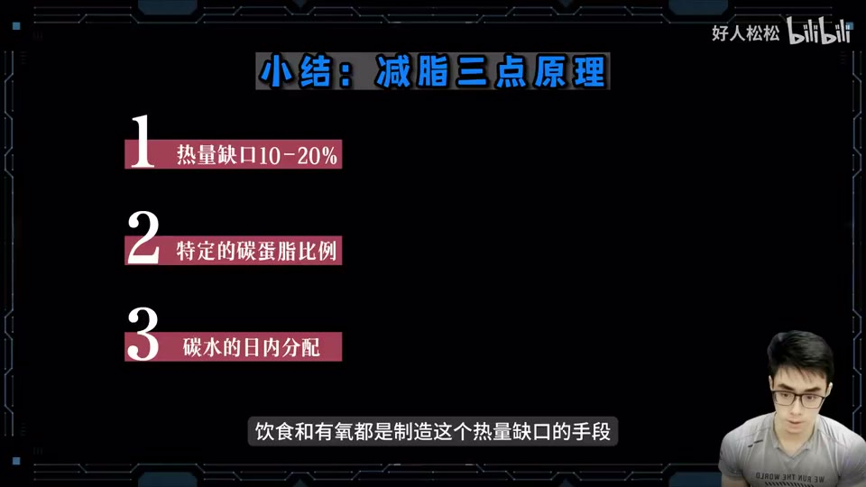

*图 1：减脂三原理（热量缺口 10–20% → 特定碳蛋脂比例 → 碳水日内分配），三者层层递进。*

**原理一：10%–20% 的热量缺口 [00:49]**
- 热量摄入来自食物；热量消耗以**基础代谢**为主、**活动消耗**为辅。两边相等时体重不变，这个点叫**热量平衡点**。
- 减脂时，摄入要比消耗少 10%–20%。缺口一定要有，但**不需要太大**。
- 缺口可以从饮食这边少吃一点来做，也可以靠多做有氧来做，或者两者都用。
- 减脂期**基础代谢提高不了**，能做的只是别让它过度下降。

**原理二：特定的碳蛋脂比例 [01:32]**
- 热量摄入 kcal = 碳水 × 4 + 蛋白质 × 4 + 脂肪 × 9（单位 g，按 4/4/9 计）。
- **碳蛋脂定了，热量就定了；但热量定了，碳蛋脂并没有定。** 同样的热量，配比不同，减脂效果也不同。

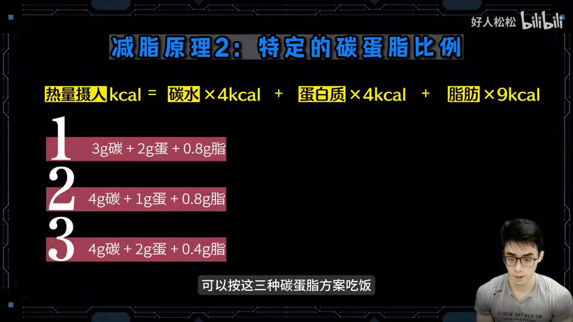

*图 2：三种热量相同的配比示范（单位 g/kg 体重）。UP 主认为方案 1 减脂效果最好。*

| 方案 | 碳水 | 蛋白质 | 脂肪 |
|---|---|---|---|
| 1（UP 主推荐） | 3 g/kg | 2 g/kg | 0.8 g/kg |
| 2 | 4 g/kg | 1 g/kg | 0.8 g/kg |
| 3 | 4 g/kg | 2 g/kg | 0.4 g/kg |

所以要先在平衡点上减掉 10%–20% 的热量，再按经验化的比例（不是随便什么比例）去组成这份热量。

**原理三：碳水的日内分配 [02:13]**
- 总热量和碳蛋脂配额都固定时，把碳水放在不同时间吃，可以人为调控胰岛素的升降，进而影响减脂效果。
- UP 主拿打游戏里的 timing 打比方：碳水也有 timing。对健身人群来说，这是减脂期**保护肌肉**的重要手段。

---

## 2. 摄入总量：热量怎么算、配额怎么定 [03:08]

### 2.1 食物热量的计算数值 [03:11]

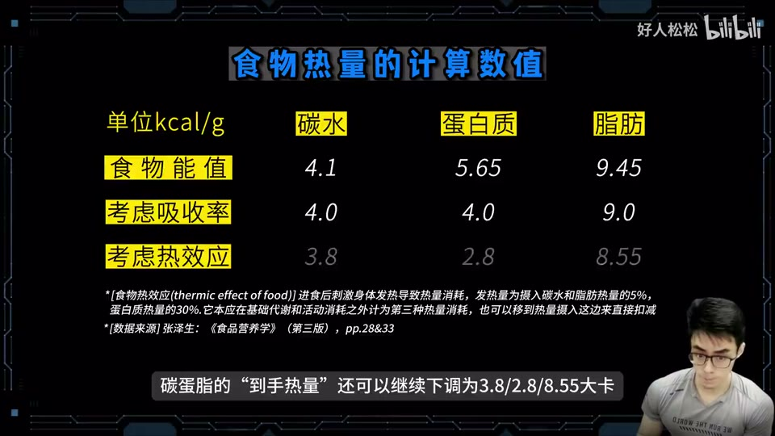

*图 3：每克碳水/蛋白质/脂肪在三种口径下的热量。*

| 单位 kcal/g | 碳水 | 蛋白质 | 脂肪 |
|---|---|---|---|
| 食物能值 | 4.1 | 5.65 | 9.45 |
| 考虑吸收率 | 4.0 | 4.0 | 9.0 |
| 考虑热效应 | 3.8 | 2.8 | 8.55 |

- 食物吃下去后**吸收不完全**（排泄物里会带走一部分），所以通常用 4/4/9。
- 再算上消化过程本身的产热（**食物热效应**），"到手热量"可以进一步降到 3.8/2.8/8.55。
- **两种口径都可以用**：热量的绝对值不重要，重要的是那 10%–20% 的缺口（或增肌期 10%–20% 的盈余）。两种口径乘上这个百分比后，差别不大。
- 记录工具有两种：UP 主在评论区放的**食物热量计算 Excel 表**（录入食物和份数，自动得出碳蛋脂和总热量），或者用**薄荷 App**，两者本质一样。[04:04]

### 2.2 热量消耗与热量平衡点 [04:25]

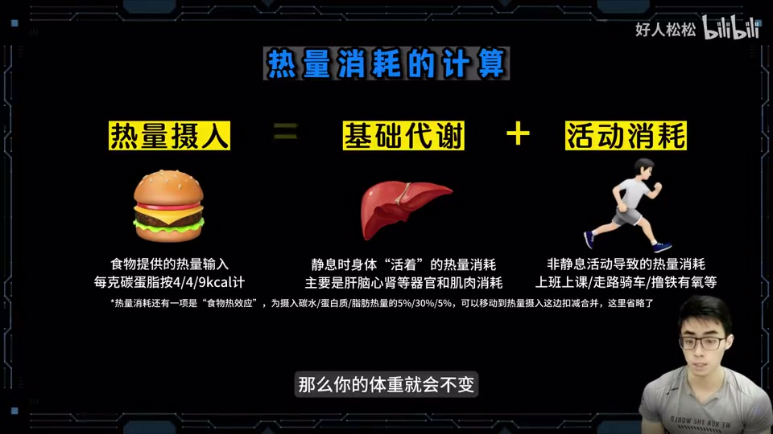

*图 4：热量摄入 = 基础代谢 + 活动消耗 时，体重不变。*

- **基础代谢**：完全静息时维持生命所需的能量，UP 主拿手机待机也耗电来打比方。
- **活动消耗**：上班上课、走路骑车、撸铁、有氧等一切身体活动的消耗。
- 减脂就是在**平衡点**的基础上少吃 10%–20%，逼身体分解脂肪来补这个差。常听到的"每天少吃 300–500 大卡"也对，因为多数人的平衡点在两三千大卡，10%–20% 正好是三五百大卡。[05:11]

### 2.3 为什么公式估算的意义有限 [05:30]

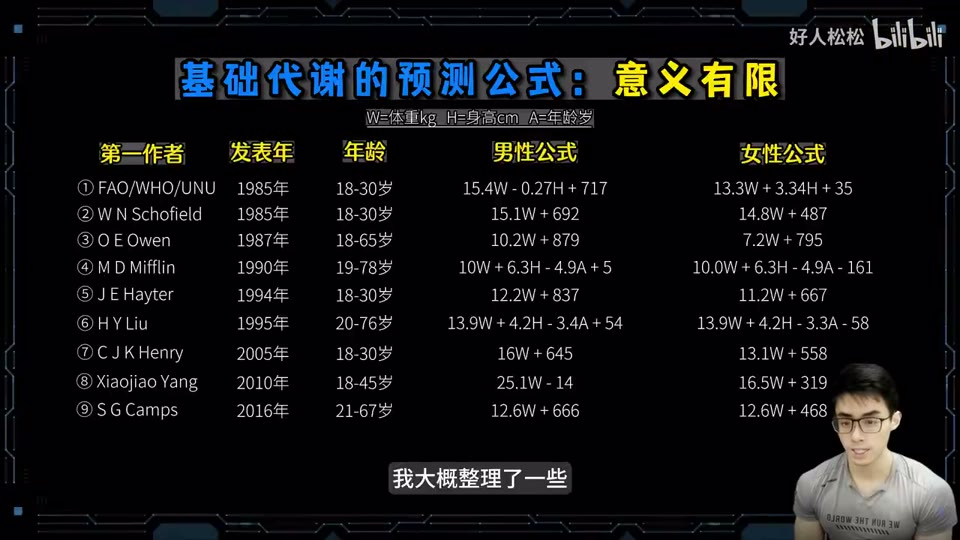

*图 5：UP 主整理的 9 个基础代谢预测公式（W = 体重 kg，H = 身高 cm，A = 年龄岁）。*

| 第一作者（年份，适用年龄） | 男性公式 | 女性公式 |
|---|---|---|
| FAO/WHO/UNU（1985，18–30） | 15.4W − 0.27H + 717 | 13.3W + 3.34H + 35 |
| W N Schofield（1985，18–30） | 15.1W + 692 | 14.8W + 487 |
| O E Owen（1987，18–65） | 10.2W + 879 | 7.2W + 795 |
| M D Mifflin（1990，19–78） | 10W + 6.3H − 4.9A + 5 | 10.0W + 6.3H − 4.9A − 161 |
| J E Hayter（1994，18–30） | 12.2W + 837 | 11.2W + 667 |
| H Y Liu（1995，20–76） | 13.9W + 4.2H − 3.4A + 54 | 13.9W + 4.2H − 3.3A − 58 |
| C J K Henry（2005，18–30） | 16W + 645 | 13.1W + 558 |
| Xiaojiao Yang（2010，18–45） | 25.1W − 14 | 16.5W + 319 |
| S G Camps（2016，21–67） | 12.6W + 666 | 12.6W + 468 |

**基础代谢公式的问题：**
- 体重是主要变量（个别公式加了身高、年龄，但影响不大）。
- 代入同一个人（视频示范的是男 70kg/175cm/20 岁、女 55kg/160cm/20 岁），不同公式的结果以最低值为基准，会高出百分之几到十几（具体每个结果画面是逐个动画出现的，截图里没有完整读出，**此处原视频未明确**）。
- 减脂本来只需要 10%–20% 的缺口，公式之间的偏差就可能有这么大，所以**参考价值有限**。

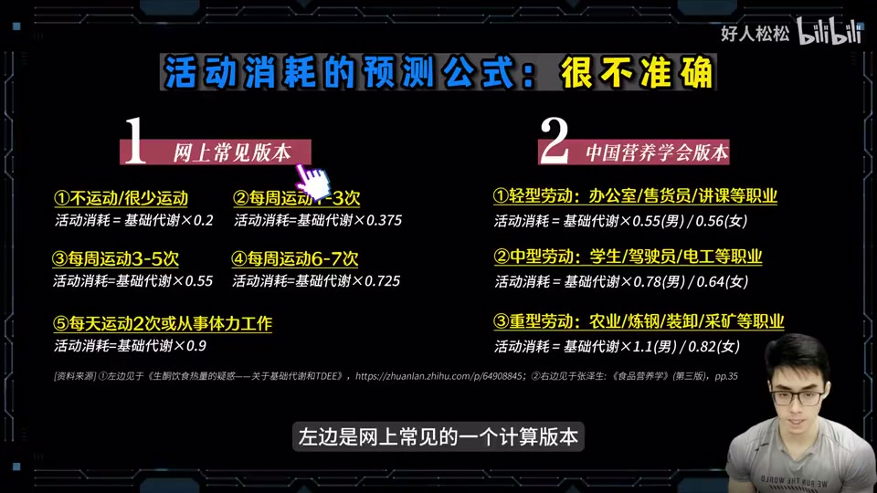

*图 6：活动消耗的两种常见估算口径，UP 主认为都很不准确。*

| 网上常见版本（按每周运动次数） | 活动消耗 = 基础代谢 × |
|---|---|
| 不运动/很少运动 | 0.2 |
| 每周运动 1–3 次 | 0.375 |
| 每周运动 3–5 次 | 0.55 |
| 每周运动 6–7 次 | 0.725 |
| 每天运动 2 次或从事体力工作 | 0.9 |

| 中国营养学会版本（按职业） | 活动消耗 = 基础代谢 × |
|---|---|
| 轻型劳动：办公室/售货员/讲课等 | 0.55（男）/ 0.56（女） |
| 中型劳动：学生/驾驶员/电工等 | 0.78（男）/ 0.64（女） |
| 重型劳动：农业/炼钢/装卸/采矿等 | 1.1（男）/ 0.82（女） |

**活动消耗公式的问题更大 [06:39]：**
- 全靠文字描述"对号入座"，主观性很强。
- 按次数分档的版本不区分运动类型、强度和时长。UP 主举例：每周撸铁 3 次算 0.375，改成每周 6 次、每次 10 分钟 HIIT 就算 0.725，平衡点一下子高出 35%，显然不合理；而且它完全不算上班上学这些职业活动。
- 按职业分档的版本也主观：同样是坐办公室，朝九晚五和"996"不能用一个系数；职业以外的个人运动也没算进去。
- 光活动消耗这一项的估计，就可能让平衡点变动几十个百分点（转写为"3%40%"，大概是"30%–40%"，**此处原视频未明确**），对 10%–20% 的目标来说太粗了。

**结论 [08:38]：** 既然算不准，就不要硬算，**直接按"经验化配额"试吃，再根据体重调整**。

### 2.4 经验化饮食配额与调整方法 [08:53]

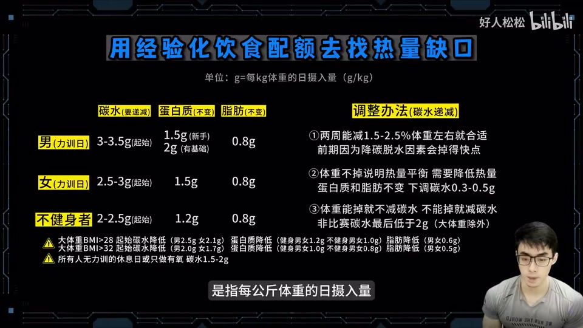

*图 7：减脂起始配额与碳水递减规则（单位：每 kg 体重的日摄入量 g/kg）。*

- 健身饮食里说"吃几克"，指的是**每公斤体重每天吃几克**。例：碳水 3 g/kg，70kg 的人就是每天 210g 碳水。[09:04]
- 很多讲解是按健身男性写的。同体重、同活动量的女性，平衡点大约低一成多，所以女性的碳水和蛋白质配额要低一些；不健身的人热量和蛋白质需求都更少，再往下调。

| 人群 | 碳水（要递减） | 蛋白质（不变） | 脂肪（不变） |
|---|---|---|---|
| 男（力训日） | 3–3.5 g/kg 起始 | 1.5 g/kg（新手）/ 2 g/kg（有基础） | 0.8 g/kg |
| 女（力训日） | 2.5–3 g/kg 起始 | 1.5 g/kg | 0.8 g/kg |
| 不健身者 | 2–2.5 g/kg 起始 | 1.2 g/kg | 0.8 g/kg |

画面上的补充说明（口头没有逐条念）：
- 大体重 BMI > 28：起始碳水降低（男 2.5g、女 2.1g）；蛋白质降低（健身男女 1.2g，不健身男女 1.0g）；脂肪降低（男女 0.6g）。
- 大体重 BMI > 32：起始碳水降低（男 2.0g、女 1.7g）；蛋白质降低（健身男女 1.0g，不健身男女 0.8g）；脂肪降低（男女 0.5g）。
- 所有人在没有力量训练的休息日、或者只做有氧的日子：碳水 1.5–2g。

**边吃边调（碳水递减法）[09:40]：**
1. 按起始配额先吃**两周**。
2. 两周体重掉 **1.5%–2.5%**（大约 2–3 斤或 3–4 斤）就合适。前期因为碳水突然降低、身体脱水，会掉得快一点，之后会变缓。
3. 体重完全不掉，说明这个配额就是你的平衡点：**蛋白质和脂肪不变，碳水下调 0.3–0.5 g/kg**。
4. 之后同理：**能掉就不减碳水，不掉再减 0.3–0.5g**。
5. 碳水不能一直减下去：非比赛型减脂，**最低不要低于 2 g/kg**（大体重除外）。再低可能影响上班上学的状态。

**常见疑问 [10:44]：** "我吃得比你说的减脂后期还少，体重腰围就是不掉"。UP 主的解释是：很可能吃得太少，**伤了基础代谢**，热量差反而没了（第 6、7 节会展开讲）。

### 2.5 为什么要看两周，而不是两三天 [11:02]

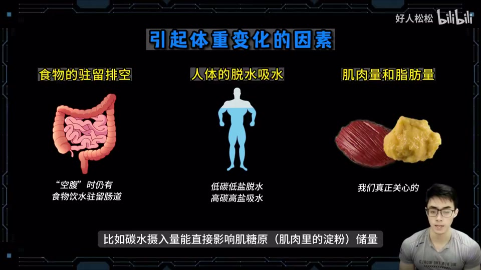

*图 8：体重变化的三个来源：食物驻留排空、人体脱水吸水、肌肉量和脂肪量。*

- **食物驻留排空**：平时说的"空腹"只是排掉了大肠里的一部分残渣，小肠里的东西还在。真正的空腹要像做肠镜那样禁食 12 小时、提前 6 小时喝泻药。所以每次称重相差半斤八两很正常。
- **脱水和吸水**：
  - 碳水影响**肌糖原**储量，**1g 肌糖原能锁住约 3g 水**，三五百克肌糖原的变化就能带来两三斤体重变化。
  - 钠摄入变化时，为了维持水钠平衡，身体会跟着吸水或排水。健美选手赛前停盐、大量喝水，两三天就能掉好几斤，就是这个原理。
  - 所以"低碳低盐几天掉几斤、恢复饮食几天又长回来"主要是水，不是脂肪。
- **肌肉和脂肪**：这才是真正关心的，但变化极其缓慢，和短期体重几乎无关。

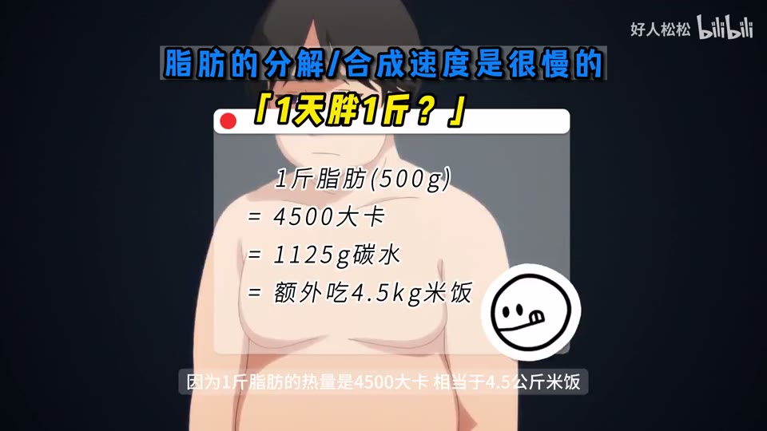

*图 9：1 斤脂肪（500g）≈ 4500 大卡 ≈ 1125g 碳水 ≈ 额外多吃 4.5kg 米饭。*

- "一天胖一斤"不可能是肌肉，也不可能是脂肪：要在平衡点之外额外再吃约 4.5kg 米饭的热量，才可能长出一斤脂肪。反过来，一天掉一斤也不是一天分解了一斤脂肪。

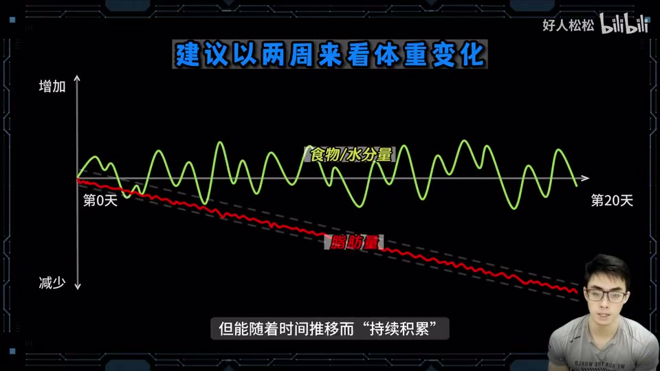

*图 10：红线是脂肪量（波动小，但随时间持续积累），绿线是食物和水分（波动大，但不会持续积累）。*

- 只比较两三天，绿线的波动会盖住红线的真实下降；隔十天半月再比，红线累积的下降量才能显出来。
- 所以用**两周**为周期来判断配额是否合适。

---

## 3. 日内分配：碳水的 timing [15:24]

### 3.1 通过管理碳水来管理胰岛素 [15:26]

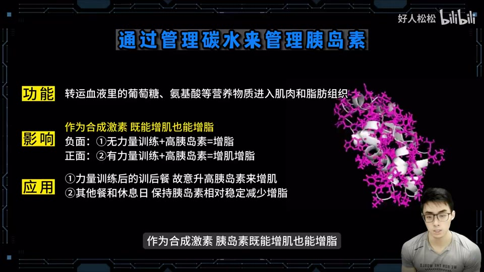

*图 11：胰岛素的功能、正负两面影响，以及对应的应用思路。*

- **功能**：把血液里的葡萄糖、氨基酸等营养转运进肌肉和脂肪组织，让它们进入合成状态。
- **两面性**（作为合成激素，既能增肌也能增脂）：
  - 负面：**没有力量训练 + 高胰岛素 → 增脂**。
  - 正面：**力量训练后（肌纤维已被破坏）+ 高胰岛素 → 增肌（同时也增脂）**。
- **应用**：①力量训练后的**训后餐故意升高胰岛素**，促进增肌；②其他餐和休息日**保持胰岛素相对稳定**，减少增脂。
- 碳水有三个主要的"投放时机"（转写在 [16:19]–[16:49] 有一段空白，**此处原视频未明确**，从后文看就是下面三个）。

### 3.2 投放时机 1：训后餐（最大一顿）[16:51]

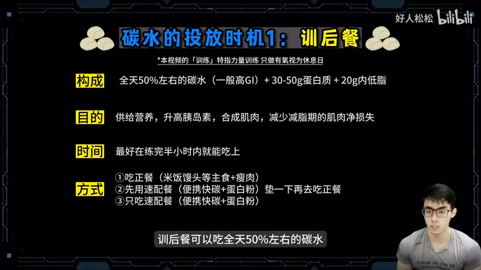

*图 12：训后餐的构成、目的、时间、方式（本视频的"训练"特指力量训练，只做有氧的日子视为休息日）。*

- **构成**：全天约 **50% 的碳水**（一般用高 GI 快碳）+ **30–50g 蛋白质** + **20g 以内的脂肪**。
- **理由**：
  - 碳水量大、用快碳，是为了把胰岛素拉高。
  - 蛋白质多，是为了给肌肉修复提供原料，同时进一步升高胰岛素。
  - 低脂**不是因为怕脂肪本身**，而是脂肪刺激胰岛素的能力远不如碳水。训后餐总热量一定时，少吃脂肪才能把热量让给碳水，让胰岛素更高。
- **时间**：最好在**练完半小时内**开始吃，不要拖很久。
- **方式**（三选一）：①能很快吃上正餐（米饭馒头等主食 + 瘦肉）就直接吃正餐；②先用"便携快碳 + 蛋白粉"垫一部分，再用正餐补齐；③赶时间就全部用"便携快碳 + 蛋白粉"解决。

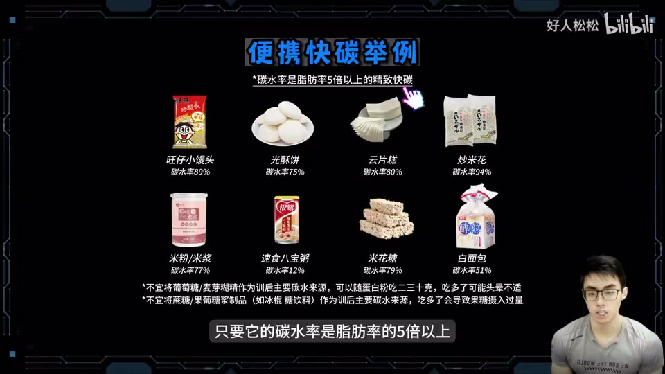

*图 13：便携快碳举例（碳水率是脂肪率 5 倍以上的精致碳水制品）。*

- **便携快碳的判断标准**：碳水率是脂肪率的 **5 倍以上**，并且用米、糯米、面粉等**精致碳水**做成。画面举例：旺仔小馒头、光酥饼、云片糕、炒米花、米粉/米浆、速食八宝粥、米花糖、白面包等。
- 画面还有两条提示：不宜用葡萄糖/麦芽糊精作为训后的主要碳水来源；也不宜把蔗糖/果糖类（如水果、糖饮）作为训后的主要碳水来源（截图小字较糊，大意如此）。
- UP 主还提到，网上流出过某职业健美运动员的饮食方案：训后大量吃快碳，同时注射外源胰岛素。他**不是让大家照抄碳水量，更不是让大家打胰岛素**，只是用来说明"力量训练后升高胰岛素"有多重要。[18:10]

### 3.3 投放时机 2：早饭 [18:41]

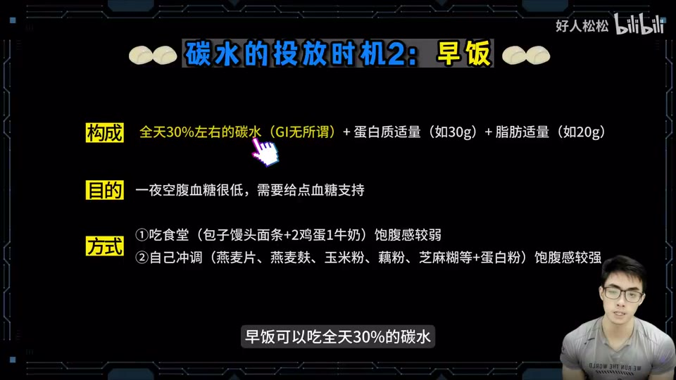

*图 14：早饭约占全天 30% 的碳水，GI 无所谓。*

- **构成**：全天约 **30% 的碳水**（GI 无所谓）+ 适量蛋白质（如 30g）+ 适量脂肪（如 20g），全天总量合规就行。
- **理由**：一夜空腹后血糖很低，需要一些碳水把血糖撑起来，**不要低血糖去上班上学**。
- **难点**：早饭里的蛋白质来源少。食堂的两个鸡蛋加一包牛奶大约 20g 蛋白质，但同时也有近 20g 脂肪，所以早饭的碳水**不能再来自油条、煎饼、麻团这类糖油混合物**，只能吃馒头、花卷、面条等纯碳水，否则一顿早饭就吃掉了全天大部分脂肪配额。
- **自己冲调**：碳水用燕麦片、燕麦麸、玉米粉、藕粉、芝麻糊等，蛋白质用蛋白粉。

### 3.4 投放时机 3：训前餐 [19:45]

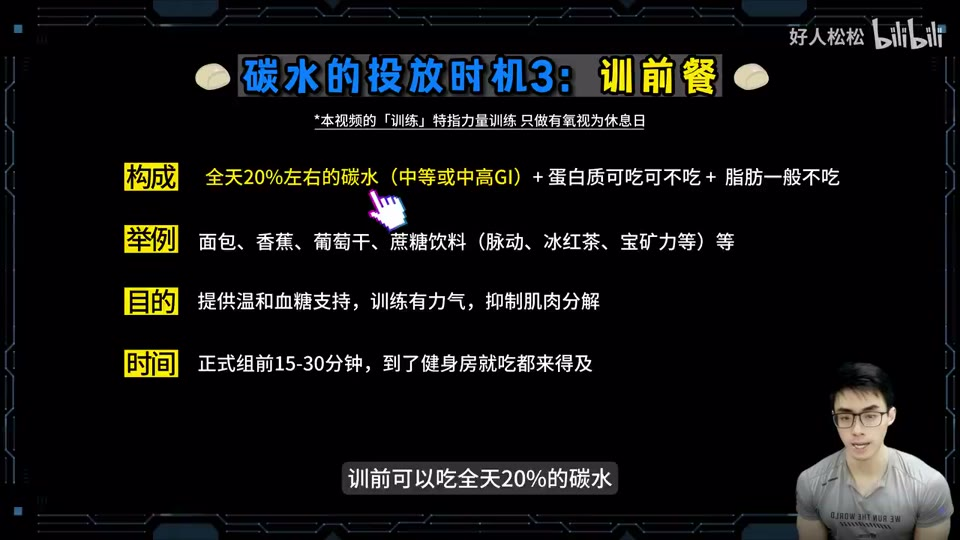

*图 15：训前约占全天 20% 的碳水（中等或中高 GI），蛋白质可吃可不吃，脂肪一般不吃。*

- **构成**：全天约 **20% 的碳水**（中等或中高 GI）+ 蛋白质可吃可不吃 + 脂肪一般不吃。
- **举例**：粗粮面包、香蕉、葡萄干、蔗糖饮料（画面举例有脉动、冰红茶、宝矿力等）。量也就几十克，垫垫肚子，不会撑到影响训练，也不会让血糖飙升。
- **目的**：温和地提供血糖支持，让训练有力气，同时抑制训练中的肌肉分解。UP 主认为这比吃支链氨基酸还划算。
- **时间**：正式训练前 15–30 分钟，**到了健身房再吃都来得及**。

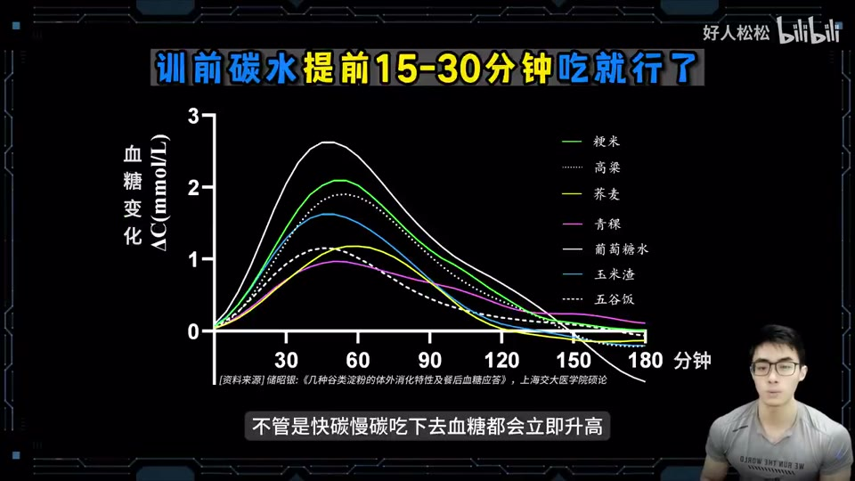

*图 16：不同碳水食物吃下去后的血糖曲线：不管快碳慢碳，血糖都会马上升高，大约半小时到一小时到达高点。*

- 到了健身房就吃，加上换衣服、热身的时间，训练中段正好赶上血糖高点。

### 3.5 其他餐 [20:39]

- 训后、早饭、训前之外的餐是"**其他餐**"：碳水**少吃乃至不吃**，主要靠蛋白质、脂肪和蔬菜吃饱。其他餐专门吃很多碳水，更可能是在增脂。
- 增肌期碳水总量多，其他餐还能吃一些；减脂期，尤其碳水低于 **2.5 g/kg** 以后，全天碳水会很紧张，要从其他餐省出碳水，**优先供给训后、早饭、训前**，尤其**不能"抢劫"训后餐的碳水**。
- 只有碳水的分配讲究。蛋白质和脂肪不太讲究，只要保证训后餐有 30–50g 蛋白质、脂肪在 20g 以内；其他时候集中或均匀都可以，**全天总量合规就行**。

### 3.6 按训练时间的四种分餐方案 [21:44]

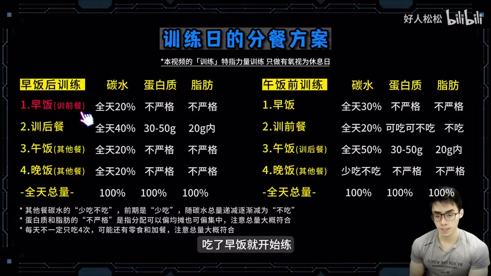

*图 17：早饭后训练、午饭前训练两种情况的分餐比例。*

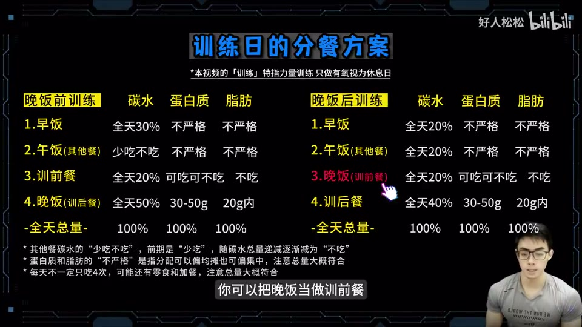

*图 18：晚饭前训练、晚饭后训练两种情况的分餐比例。*

下表中的百分比都是**占全天碳水的比例**；"不严格"指可以平均分，也可以集中吃，总量大致符合即可。

**早饭后训练**（早饭就是训前餐）

| 餐次 | 碳水 | 蛋白质 | 脂肪 |
|---|---|---|---|
| 1. 早饭（训前餐） | 20% | 不严格 | 不严格 |
| 2. 训后餐 | 40% | 30–50g | 20g 内 |
| 3. 午饭（其他餐） | 20% | 不严格 | 不严格 |
| 4. 晚饭（其他餐） | 20% | 不严格 | 不严格 |

**午饭前训练**（午饭就是训后餐）

| 餐次 | 碳水 | 蛋白质 | 脂肪 |
|---|---|---|---|
| 1. 早饭 | 30% | 不严格 | 不严格 |
| 2. 训前餐 | 20% | 可吃可不吃 | 不吃 |
| 3. 午饭（训后餐） | 50% | 30–50g | 20g 内 |
| 4. 晚饭（其他餐） | 少吃不吃 | 不严格 | 不严格 |

**晚饭前训练**（晚饭就是训后餐）

| 餐次 | 碳水 | 蛋白质 | 脂肪 |
|---|---|---|---|
| 1. 早饭 | 30% | 不严格 | 不严格 |
| 2. 午饭（其他餐） | 少吃不吃 | 不严格 | 不严格 |
| 3. 训前餐 | 20% | 可吃可不吃 | 不吃 |
| 4. 晚饭（训后餐） | 50% | 30–50g | 20g 内 |

**晚饭后训练**（晚饭就是训前餐，多数上班族属于这种）

| 餐次 | 碳水 | 蛋白质 | 脂肪 |
|---|---|---|---|
| 1. 早饭 | 20% | 不严格 | 不严格 |
| 2. 午饭（其他餐） | 20% | 不严格 | 不严格 |
| 3. 晚饭（训前餐） | 20% | 可吃可不吃 | 不吃 |
| 4. 训后餐 | 40% | 30–50g | 20g 内 |

画面注释：
- 其他餐碳水的"少吃不吃"，前期是"少吃"，随着碳水总量递减，逐渐变成"不吃"。
- 每天不一定只吃 4 次，可能还有零食和加餐，注意总量大概符合即可。

**要点：**
- 所有训前餐都只吃到**六七分饱**，吃太饱训练很不舒服。[22:01]
- 早饭后就训练、晚饭后才训练的人，UP 主在其他餐里留了一点碳水（各 20%），避免一天里有太长的无碳水时间。[24:30]
- 午饭前/晚饭前训练的人，其他餐理论上可以不吃碳水。实在不习惯可以匀一点，但**一定要少**，否则本质上就是在抢训后餐的碳水。
- **晚上训练者常见的"反向操作"**[23:31]：午饭晚饭米饭馒头大口吃，练完反而不敢吃碳水，理由是"白天吃过了，再吃会胖"。其实是白天把训后餐的碳水提前吃掉了。正确做法是午饭、晚饭碳水都别太多，**练完的训后餐才是全天最大的一顿**。
- 四种方案的**全天总量完全相同**，区别只是分配方式。

### 3.7 休息日怎么吃 [24:42]

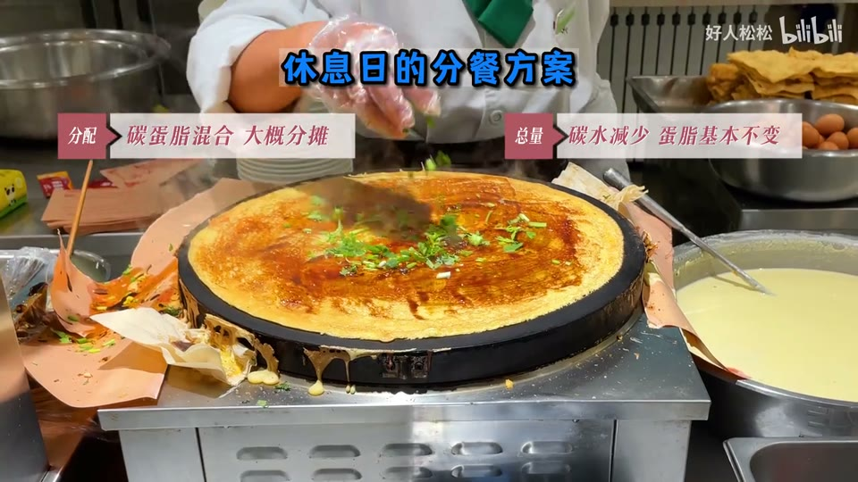

*图 19：休息日每餐碳蛋脂混合、大概平均分；碳水减少，蛋白质和脂肪基本不变。*

- 休息日没有力量训练，也就没有增肌窗口，**不要故意升高胰岛素**。
- 做法：每餐都是碳蛋脂混合，各餐大致平分；碳水总量减少一些，蛋白质和脂肪基本不变。
- 碳水的减少是**自然发生**的：休息日不吃训前那 20%，训后那 50% 的大份碳水也换成常规量，扣下来总量自然变少（配额表注明休息日碳水约 1.5–2 g/kg）。
- 只要进食就会分泌胰岛素，能做的只是让它**相对稳定、不要太高**。

---

## 4. 食物来源：碳水、脂肪、蛋白质 [25:49]

### 4.1 碳水：碳水率与 GI [25:51]

- 碳水食物有两个属性：**碳水率**（每 100g 食物里有多少克碳水）和**分解成葡萄糖的速度**，也就是常说的高/中/低 GI，或者快碳/慢碳。
- **GI 的测法**[26:24]：让受试者吃下含 **50g 碳水**的食物，比如 20% 浓度的葡萄糖水要喝 250g，碳水率 25% 的精米饭要吃 200g，然后测 **0–120 分钟**内血糖曲线下方的面积。把葡萄糖的面积记为 100，其他食物的面积是多少，GI 就是多少。例如精米饭曲线很陡，可能算出 80；五谷饭比较平缓，可能算出 40。

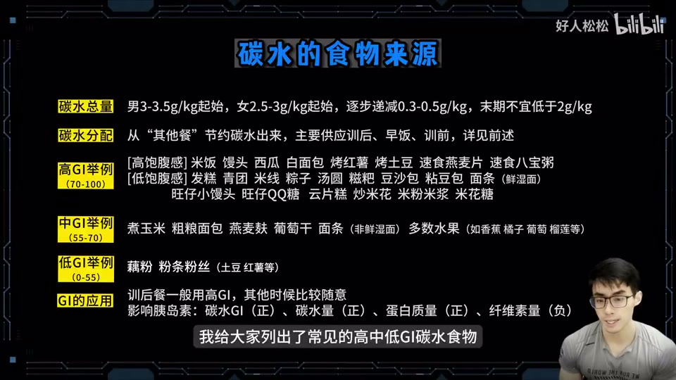

*图 20：碳水总量与分配的提要，以及高/中/低 GI 食物举例。*

| 分类 | 举例（画面列出） |
|---|---|
| 高 GI（70–100），高饱腹感 | 米饭、馒头、西瓜、白面包、烤红薯、烤土豆、速食燕麦片、速食八宝粥 |
| 高 GI（70–100），低饱腹感 | 发糕、青团、米线、粽子、汤圆、糍粑、豆沙包、粘豆包、面条（鲜湿面）、旺仔小馒头、旺仔 QQ 糖、云片糕、炒米花、米粉米浆、米花糖 |
| 中 GI（55–70） | 煮玉米、粗粮面包、燕麦麸、葡萄干、面条（非鲜湿面）、多数水果（如香蕉、橘子、葡萄、榴莲等） |
| 低 GI（0–55） | 藕粉、粉条粉丝（土豆、红薯等） |

- **应用**：训后餐一般吃高 GI，其他时候比较随意。
- **GI 不是唯一决定因素**[27:51]：影响胰岛素的还有碳水量（正相关）、蛋白质量（正相关）、纤维素量（负相关），甚至进食顺序。尤其是**碳水量**：一餐碳水够多，胰岛素就不会低。GI 值得关注，但它并不主宰胰岛素。

### 4.2 脂肪：吃够保底量，警惕"脂肪刺客" [28:25]

- **减脂期脂肪一定要吃够保底量**：脂肪是许多性激素的前体，也是脂溶性维生素 A/D/E/K 的吸收载体。吃太少可能导致性激素缺乏（男性睾酮下降、女性生理期紊乱），以及脂溶性维生素缺乏带来的各种症状。
- 饮食配额本身已经有缺口了，近乎零脂的饮食会让缺口过大，脂肪的生理功能也发挥不了，UP 主说这是"自我摧残"，对减脂有害无益。

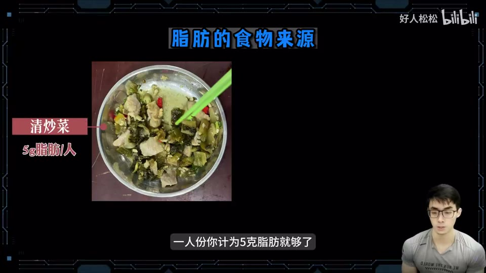

*图 21：轻炒的菜一人份按约 5g 脂肪计即可。*

**建议：炒菜油、鸡蛋、牛奶都正常吃，尤其不要放弃炒菜 [29:04]**
- 一筷子菜、一片肉表面能挂住的油有限，只要不喝油汤、不舔盘子，就吃不进多少油。真担心可以刮一下，或者过一下水。
- 估算：**轻炒一人份约 5g 脂肪**；**重油一人份约 10–15g 脂肪**。
- UP 主自己一直吃食堂炒菜，包括水煮肉片、凉拌鸡这类看起来油稍重的菜。

**两类要特别谨慎的"隐藏脂肪" [29:53]**
1. **往内部吸油的菜**：炒鸡蛋、炒茄子、炸蘑菇等。饭馆、食堂那种宽油炒蛋，**一个鸡蛋能吸 20–30g 油**；一个鸡蛋本身只有约 5g 蛋白质、6g 脂肪，吃一个炒蛋就多出 30g 左右脂肪，占掉全天脂肪配额的一大半。
2. **固体脂肪**：看不出有脂肪，所以容易觉得"没吃脂肪"。

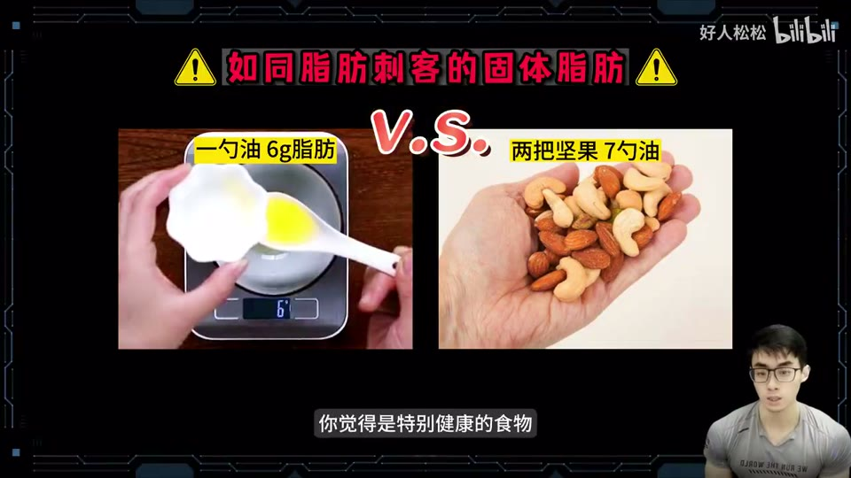

*图 22：一勺油 6g 脂肪，对比两把坚果约 7 勺油。*

| 食物（视频举例） | 脂肪 | 相当于几勺油（白瓷勺一勺 ≈ 6g） |
|---|---|---|
| 星巴克常规糕点 1 个 | 30 多克 | 约 6 勺 |
| 肯德基蛋挞 2 个 | 约 30g | 约 5 勺 |
| 油条 2 根 | 约 30g | 约 5 勺 |
| 坚果 2 把 | 40 多克 | 约 7 勺 |

- 这些不是不能吃，而是要**正确计入脂肪配额**。很多人对炒菜里那点油斤斤计较，吃固体脂肪却毫不在意，主次颠倒了。
- 要谨慎的清单：吸油的菜、肥肉、糖油混合物、坚果。

### 4.3 不必专门追求"优质脂肪" [32:22]

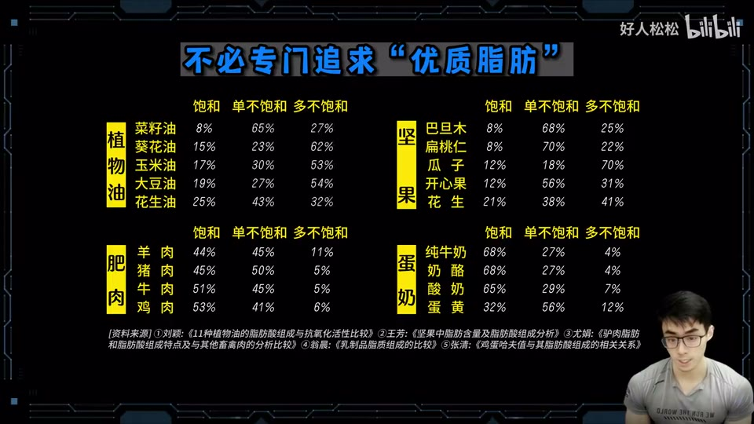

*图 23：常见植物油、坚果、肥肉、蛋奶的饱和/单不饱和/多不饱和脂肪酸比例。*

- 网上说减脂要吃坚果、花生酱这类"优质脂肪"，言下之意食用油等其他脂肪"不优质"。UP 主认为这个说法似是而非：
  - 饱和、单不饱和、多不饱和三种脂肪酸各有生理功能，都是人体需要的，**没有优劣之分**。包括中国营养学会在内，主要国家建议的三者比例大约是 **1:1:1**（画面引用《中国居民膳食营养素参考摄入量》第四章《脂类》）。
  - 常用植物油本来就以不饱和脂肪为主，这一点和坚果区别不大；肥肉和乳制品的饱和脂肪稍高，也就五六成左右。
  - 正常吃植物油、鸡蛋、乳制品，再加上瘦肉里少量的肥肉，三种脂肪酸就能凑出不错的比例。
- 坚果作为脂肪来源没问题，但谈不上独一无二的"优质脂肪"。先搞清楚"该吃多少脂肪、实际吃了多少"就很好了，不必去算脂肪酸比例这种细碎又不重要的事。

### 4.4 蛋白质：来源很窄，配餐先解决它 [34:02]

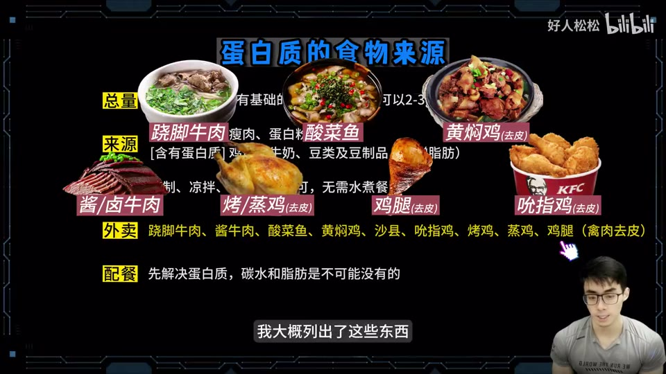

*图 24：外卖/餐馆里能吃到瘦肉的选项举例。*

- **推荐量**：新手至少 **1.5 g/kg**，肌肉量较好的人 **2 g/kg**；爱吃肉的话吃到 2–3 g/kg 也可以，UP 主说科研已反复证明 3 g/kg 以内不会伤肾。但超过 2 g/kg 的部分对维持肌肉来说是多余的，只是单纯提供热量。只要有缺口、体重在缓慢下降，多吃点蛋白质也没事。
- **纯蛋白质来源只有两种**：①猪牛羊、鸡鸭鱼虾等各种**瘦肉**；②**蛋白粉**。
- 鸡蛋、牛奶会附带差不多同等量的脂肪；豆类和豆制品也附带相当多的脂肪。所以都**不能当主要蛋白质来源**（蛋清、蛋清液、脱脂奶除外），否则蛋白质吃够时脂肪早就超了。
- **健身饮食最大的难点是找蛋白质吃**：食堂里尽量找瘦肉，炒的、凉拌的、卤的都可以，不必吃水煮。外卖举例：跷脚牛肉、酱牛肉、酸菜鱼、黄焖鸡、沙县、吮指鸡、烤鸡、蒸鸡、鸡腿（禽肉去皮）。
- **配餐思路**：一顿饭先解决蛋白质，蛋白质解决了，这一餐就配成了；碳水和脂肪到处都是，不可能缺。
- **植物蛋白要不要剔除？**[35:45] 用 Excel 或薄荷 App 记录时，主食和蔬菜里的植物蛋白会自动算进去，**不用特意剔除**。植物蛋白的必需氨基酸比例偏低，在生物价、氨基酸评分等评价方法里显得弱一些，但它在每天蛋白质里占比很低，就算打折计算也只差几克到十克，无所谓。

---

## 5. 减脂期的运动与有氧 [36:33]

- **力量训练**：和增肌期一样，**计划、配重、组数都继续维持**。按上面的饮食模式，缺口不大，又有训前训后的碳水支持，力量训练基本不受影响。

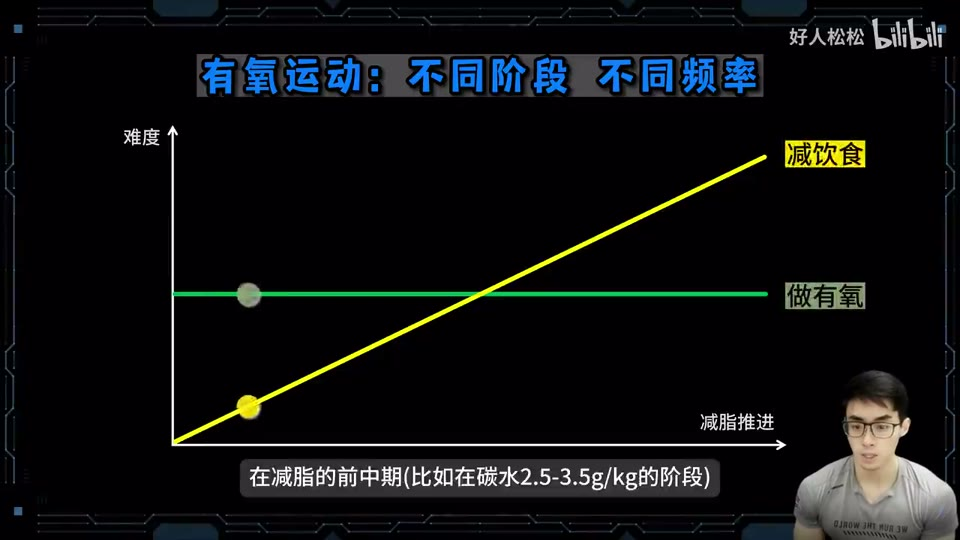

*图 25：随着减脂推进，继续靠减饮食制造缺口越来越难（黄线），做有氧的成本相对不变（绿线），后期做有氧更划算。*

- **有氧的定位**：有氧是**制造热量缺口的一种方式**。10%–20% 的缺口可以来自饮食，也可以来自有氧，或者两者都用。
  - 减脂前中期（碳水约 2.5–3.5 g/kg）：不太饿，用饮食做缺口很容易，花时间做有氧不太划算。
  - 减脂后期（碳水约 2–2.5 g/kg）：已经感觉吃得很少，继续靠饮食做缺口越来越难，这时加一些有氧比较划算。
  - 所以**先看饮食能不能让体重缓慢下降**，能就不必做有氧；后期不想再降碳水时，再增加有氧。

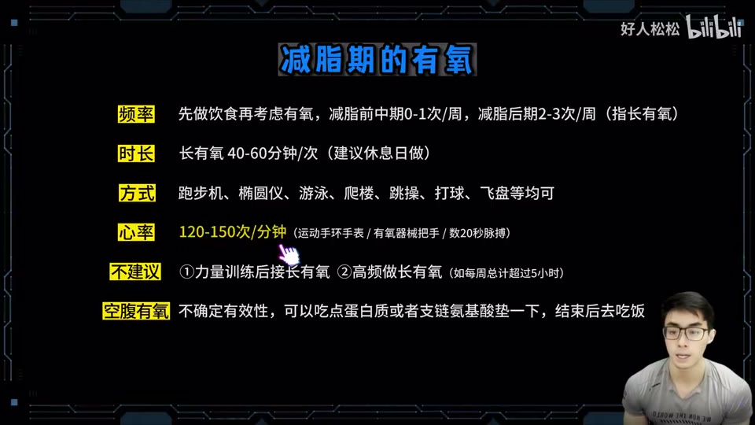

*图 26：减脂期有氧的频率、时长、方式、心率、不建议的做法和空腹有氧。*

| 项目 | 建议 |
|---|---|
| 频率 | 先做饮食，再考虑有氧；减脂前中期 0–1 次/周，减脂后期 2–3 次/周（指长有氧） |
| 时长 | 长有氧 40–60 分钟/次，循序渐进（建议在休息日做） |
| 方式 | 跑步机、椭圆仪、游泳、爬楼、跳操、打球、飞盘等都可以，选什么不重要 |
| 心率 | **120–150 次/分钟**（20–30 岁人群）；用运动手环手表、有氧器械握把，或数 20 秒脉搏来测 |
| 不建议 | ①力量训练后接长有氧；②高频做长有氧（如每周总计超过 5 小时） |
| 空腹有氧 | 有效性不确定；要做的话可以先吃点蛋白质或支链氨基酸垫一下，结束后就去吃饭 |

**细节与理由：**
- **长有氧 vs 短有氧**[38:03]：有人喜欢力量训练后做 20 分钟短有氧，也可以。不过有氧时间越长，脂肪供能比例越高，所以**理论上** 1 次 60 分钟的长有氧比 3 次 20 分钟更有效。UP 主特别说明这只是一种理论假设。
- **心率比方式重要**：心率越高，单位时间消耗越多，但能坚持的时间越短，要在两者之间取平衡。120–150 次/分钟既有不错的消耗效率，又能坚持 40–60 分钟不难受。通过调跑步机的速度、坡度来调节心率（平坡跑、陡坡慢走都可以）：心率太高就放缓，不够就做紧凑一点。
- **为什么不建议练完接长有氧**[39:27]：会推迟训后餐，错过增肌窗口，等于浪费了这次力量训练。时间实在不够、必须放在力量训练后，就做 20 分钟短有氧。UP 主觉得最方便的是**休息日单独做长有氧**。
- **为什么不建议高频长有氧**：饮食加有氧合起来做出 10%–20%（约 300–500 大卡）的缺口就够了。"吃得越少、动得越多就越减脂"是误区，会让缺口变得巨大（见第 6、7 节）。
- **空腹有氧**[40:20]：理论依据是起床后血糖和肌糖原较低，有氧时脂肪供能比例更高。它在健美运动员里比较流行，但不少研究认为是伪命题。UP 主认为做不做随意，属于不关键的细节；做完不要继续饿着。

---

## 6. 新手案例 [41:05]

**人物**：UP 主学校的一位男生，身高 175cm，大半年来一直 80kg，健身新手，晚上健身。

### 6.1 减脂前的饮食

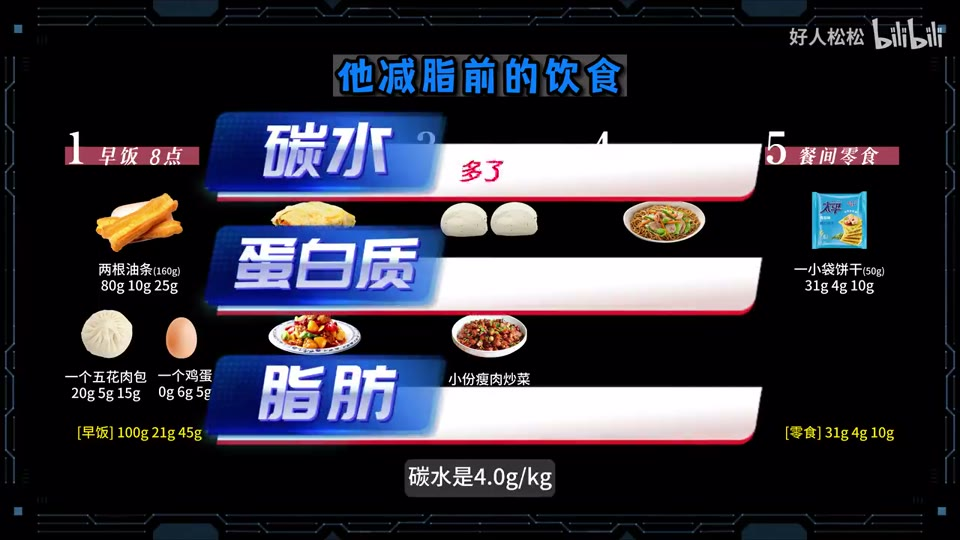

*图 27：减脂前一天的饮食（每样食物下面标的是碳/蛋/脂克数）。*

- 早饭：两根油条、一个五花肉包、一个鸡蛋（早饭合计约碳 100g / 蛋 21g / 脂 45g）。
- 午饭、晚饭：馒头、煎饼、瘦肉炒菜。夜宵：炒面。餐间零食：小雪糕、小饼干。
- **分析的方法**：不看食物"健不健康"，只看**碳蛋脂的总量和分配**对不对。
  - 碳水 **4.0 g/kg**：这是增肌期的配额，减脂应降到 3–3.5 g/kg 起始。
  - 蛋白质 **1.2 g/kg**：不够，新手至少保底 1.5 g/kg。
  - 脂肪 **1.3 g/kg**：减脂期应降到 0.8 g/kg 左右。
  - 分配：碳水分配随意；晚上练完觉得不饿就不吃，**没有训后餐**，错过了增肌机会，这是很大的错误；其他餐却在大吃碳水，主要起了增脂作用。

### 6.2 他自己理解的"健康减脂餐"

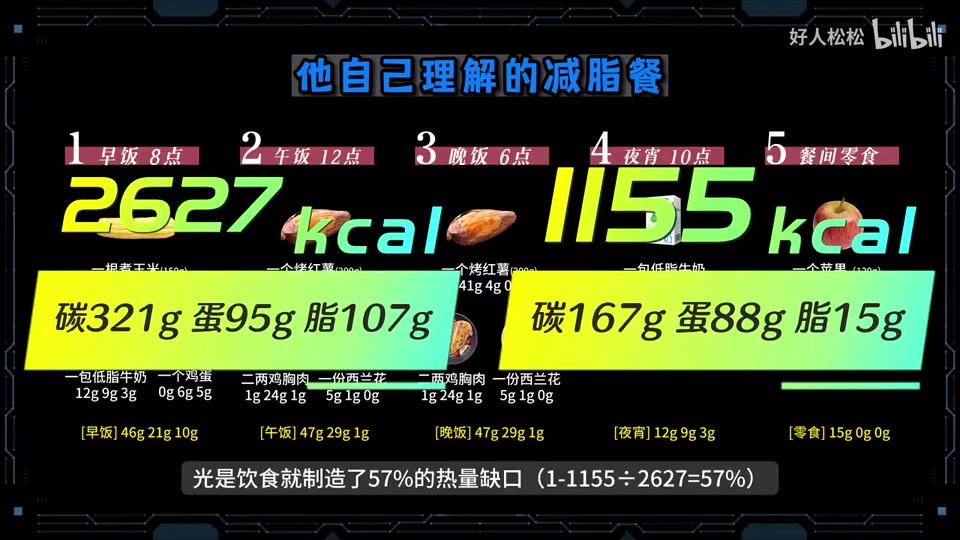

*图 28：换成"健康食品"后，总热量从 2627 kcal 降到 1155 kcal，光饮食就造成了 57% 的缺口（1 − 1155 ÷ 2627 ≈ 57%）。*

- 做法：用他认为健康的食物替换掉"不健康"的食物。馒头煎饼换成玉米、红薯、水果，瘦肉炒菜换成纯鸡胸肉，全脂牛奶换成低脂牛奶，饼干这类零食全部不吃。这种食谱在网上搜"减脂餐"随处可见。
- 计算结果：
  - 碳水 **2.1 g/kg**（总量 167g）：普通人减脂到最末期才会降到这么低。
  - 蛋白质 **1.1 g/kg**：还是不够。别看吃了几两鸡胸肉、鸡蛋、牛奶，要算出来才知道够不够。
  - 脂肪 **0.2 g/kg**：不吃炒菜、也不吃糖油混合物，离保底量差得很远。
  - 总热量：前后对比，**碳 321g / 蛋 95g / 脂 107g、2627 kcal → 碳 167g / 蛋 88g / 脂 15g、1155 kcal**，光饮食就造成了 **57%** 的缺口。再加上每周四五次有氧，缺口可能扩大到 **70% 以上**，远超需要的 20%。
- **后果**：
  1. 吃得少、难吃，又叠加高频有氧，**非常累**。
  2. **不能真正减脂**：只有开头一段时间掉得较快，这部分来自脂肪和肌肉的分解，也来自低碳低盐导致的脱水。之后缺口太大，触发身体的自我保护，**基础代谢明显下降**，热量差逐渐消失，结果是"吃得很少、动得很多，体重腰围就是不掉"。
  3. 接着他会以为是自己吃得还不够少、动得还不够多，进一步少吃多动，基础代谢被继续压低，陷入**恶性循环**。

### 6.3 调整后的减脂餐 [44:50]

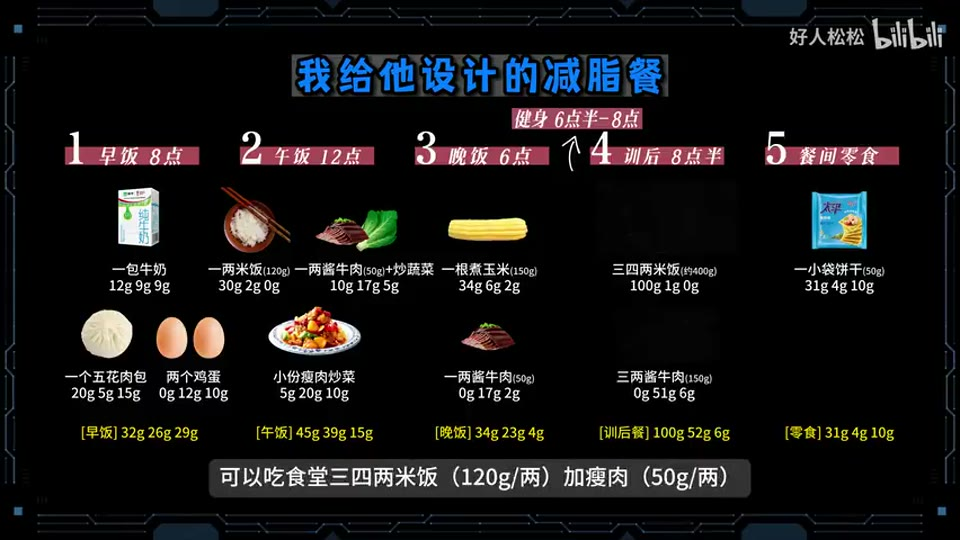

*图 29：调整后的一天（健身时间 6 点半到 8 点，训后餐 8 点半）。*

调整的思路就是**调整碳蛋脂的总量和分配**：

| 餐次 | 吃法 | 该餐碳/蛋/脂（画面） |
|---|---|---|
| 早饭 8 点 | 去掉油条（碳水和脂肪都占得多），保留一个五花肉包，加两个鸡蛋、一包牛奶 | 32g / 26g / 29g |
| 午饭 12 点（其他餐） | 主食只吃一两米饭，瘦肉炒菜照吃，加一两酱牛肉和一份炒蔬菜，用蛋白质和蔬菜吃饱 | 45g / 39g / 15g |
| 晚饭 6 点（训前餐） | 垫垫肚子就去练：一根煮玉米 + 一两酱牛肉（简单的话也可以吃粗粮面包、香蕉、葡萄干、蔗糖饮料等） | 34g / 23g / 4g |
| 训后 8 点半（训后餐） | 食堂三四两米饭（约 400g）+ 三两酱牛肉（150g）；吃不下或图方便，可换成便携快碳 + 蛋白粉；**练完半小时内开始吃** | 100g / 52g / 6g |
| 餐间零食 | 留配额给零食：最后加上一个小雪糕（上图截于动画中途，零食位置还显示原来的饼干；[46:42] 的对比画面显示已换成小雪糕） | 19g / 4g / 15g |

- 留一些配额给"垃圾食品"，是为了让饮食更舒服、更容易坚持。
- **调整前后对比**：碳水 **4.0 → 2.9 g/kg**，蛋白质 **1.2 → 1.8 g/kg**，脂肪 **1.3 → 0.9 g/kg**；总热量下调约 **500 大卡**，缺口约 **19%**。
- 这就是减脂饮食的三条：①有 10%–20%（约 300–500 大卡）的缺口；②热量按特定碳蛋脂比例来提供；③碳水的时机配合力量训练。

**关于"为什么只有 2.9g，没到 3–3.5g"**[47:14]：
- 视频里所有配额、比例都是**大概方向**，不是让你按克数精确吃饭。比如当前碳水配额是 3g，那么今天吃 2.7g、3g 还是 3.3g 都可以，整体稳定就行。
- 但**开始一种全新饮食模式时，一定要先算一算、规划一下**，不要凭感觉吃。经验不足的人凭感觉很不准，这位同学凭感觉设计的减脂餐就是例子。

---

## 7. 五个常见错误 [48:11]

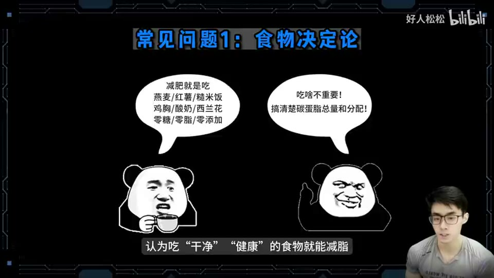

*图 30：常见问题 1，认为吃"干净""健康"的食物就能减脂。*

**错误 1：食物决定论 [48:17]**
- 以为吃燕麦、红薯、糙米饭、鸡胸、酸奶、西兰花，"零糖零脂零添加"就能减脂。
- 这些食物都没问题，米饭馒头也没问题，它们**都只是碳蛋脂的来源**。健身饮食的实质是**管理碳蛋脂的总量和分配**。总量和分配错了，健康食品也能组合出很糟的饮食（就像上面的案例）。
- 跳出食物决定论、开始关注碳蛋脂的总量和分配，UP 主认为这是健身入门的重要标志。

**错误 2：把减脂理解成无原则的"少吃多动" [49:16]**
- 对缺口的限度没概念，以为靠意志力越少吃、越多动就越减脂。其实在平衡点上减 10%–20%（一般人约 300–500 大卡）就够了，画面上的说法是缺口再大就可能伤害基础代谢。
- 很多人一决定减脂，就另起炉灶搞"干净饮食"，再叠加高频长有氧，不知不觉把缺口做得很大，还觉得自己很自律。
- "少吃多动"四个字本身没错，但太笼统：少吃多少热量、用什么比例的碳蛋脂、碳水在什么时机吃，都是有讲究的。

**错误 3：不吃或少吃训后餐 [50:24]**
- 减脂期并不是每一分钟都要让身体处于分解代谢。保持力量训练强度不变、训后餐吃大量碳水和蛋白质来拉高胰岛素，就是为了让身体进入合成代谢，用这个窗口做一点增肌，尽量抵消其他时段的肌肉流失。
- 练完吃得很少甚至不吃，等于完全放弃了增肌。
- 训后餐能这么充足，是因为**其他餐省出了碳水**：不是加碳水，只是调整了碳水的日内分配。

**错误 4：不注意饮食的舒适性和可持续性 [51:11]**
- 想长期保持较低体脂，伙食必须好吃。UP 主给了三条建议：
  1. **一般炒菜正常吃**，不必吃水煮；只需小心吸油的菜和固体脂肪。拒绝炒菜的话，食堂和外卖几乎没法吃了。
  2. **把有限的脂肪配额花在喜欢的食物上**：一包牛奶加两个鸡蛋约 20g 脂肪，一根梦龙雪糕约 15g 脂肪（口头数据）。喜欢哪个就吃哪个，做好配额管理就行。
  3. **利用训后餐吃精致碳水和甜口食品**：训后餐是全天碳水最多的一顿，一般吃快碳，米糕、发糕、青团、糍粑、豆沙包、粘豆包、云片糕等甜口糕点都可以当训后餐。

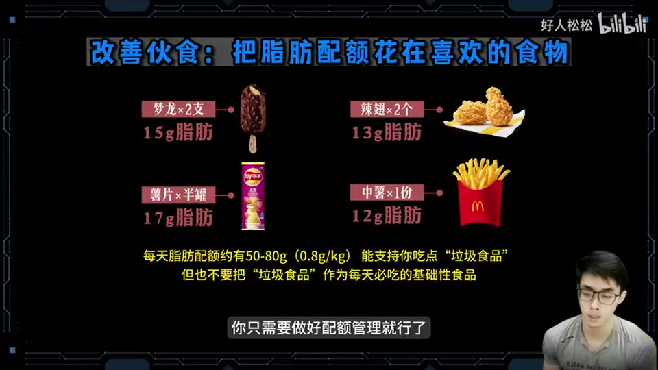

*图 31：画面举例：梦龙 ×2 支 15g、辣翅 ×2 个 13g、薯片 ×半罐 17g、中薯 ×1 份 12g 脂肪；每天脂肪配额约 50–80g（0.8 g/kg），能支持吃点"垃圾食品"，但不要把它当成每天必吃的基础食物。*

> 注：梦龙雪糕的脂肪量，口头说"一根 15g"，画面写的是"梦龙 ×2 支 15g 脂肪"，两者不一致（**此处原视频未明确**）。

**错误 5：心态太急、预期太高 [52:34]**
- 网上很多博主两三个月就有很好的减脂效果，或者只减几公斤就"爆血管"。那是因为他们定期减脂，**基础体脂率只有 10%–15%**，两三个月丢几公斤就能出效果。
- 普通人的基础体脂率高得多，要达到同样的效果，需要更长时间、丢更多体重。想一步到位，就要把减脂期拉长到**五六个月**；只想减两三个月的话，可以分两三次逐步减。
- 体脂率较高时，不可能两三个月丢几公斤就"肌肉拉丝"，**不要对自己期望过高**。

**结尾 [53:30]**：视频最后把几张核心幻灯片（饮食配额与碳水递减法、早饭/训前/训后/其他餐/休息日各餐说明、四种训练时间的分餐方案、有氧建议）重放了一遍，供截图保存，内容和上文对应各节相同。UP 主最后再次强调：**饮食比有氧更关键，先学会吃饭，再考虑有氧**；减脂首先是方法问题，学会方法才有用。

---

## 要点速查

**三原理**

| # | 原理 | 一句话 |
|---|---|---|
| 1 | 热量缺口 | 在平衡点基础上少 10%–20%（约 300–500 kcal），不要更大 |
| 2 | 碳蛋脂比例 | 热量 = 碳×4 + 蛋×4 + 脂×9；同样热量，配比不同效果不同 |
| 3 | 碳水日内分配 | 碳水集中在训后 > 早饭 > 训前，其他餐少吃或不吃 |

**起始配额（g/kg 体重/天）**

| 人群 | 碳水 | 蛋白质 | 脂肪 |
|---|---|---|---|
| 男（力训日） | 3–3.5 | 1.5（新手）/ 2（有基础） | 0.8 |
| 女（力训日） | 2.5–3 | 1.5 | 0.8 |
| 不健身者 | 2–2.5 | 1.2 | 0.8 |
| 休息日 / 只做有氧日 | 1.5–2 | 同上 | 同上 |

**调整规则**
- 每 2 周看一次体重：掉 1.5%–2.5% 就合适，不改。
- 不掉：蛋白质和脂肪不变，碳水 −0.3–0.5 g/kg。
- 碳水最低不低于 2 g/kg（非比赛减脂）。
- 别看两三天的体重：那主要是食物残留和水分（1g 肌糖原约锁 3g 水；钠也影响水分）。1 斤脂肪 ≈ 4500 kcal。

**各餐要点**

| 餐 | 碳水占全天 | 蛋白质 | 脂肪 | 时间/备注 |
|---|---|---|---|---|
| 训后餐 | ~50%（训练在早饭后或晚饭后时为 40%），高 GI 快碳 | 30–50g | ≤20g | 练完 30 分钟内；正餐，或便携快碳 + 蛋白粉 |
| 早饭 | ~30%（GI 无所谓；早饭后就练时是训前餐，20%） | 适量 | 适量 | 避开油条煎饼这类糖油混合物 |
| 训前餐 | ~20%，中/中高 GI | 可吃可不吃 | 一般不吃 | 训练前 15–30 分钟，六七分饱 |
| 其他餐 | 少吃→不吃 | 不严格 | 不严格 | 靠蛋白质、脂肪、蔬菜吃饱，不能抢训后餐的碳水 |
| 休息日 | 总量自然减少 | 基本不变 | 基本不变 | 每餐碳蛋脂混合，大致平分 |

**食物**
- 便携快碳：碳水率 ≥ 脂肪率 × 5 的精致米面制品。
- 脂肪：炒菜照吃（轻炒约 5g/份，重油约 10–15g/份）；警惕吸油的菜（宽油炒蛋一个蛋吸 20–30g 油）和固体脂肪（糕点、蛋挞、油条、坚果约 30–40g）。
- 不必追求"优质脂肪"，三种脂肪酸约 1:1:1，正常吃就能凑齐。
- 蛋白质：纯来源只有瘦肉和蛋白粉；蛋、奶、豆制品会附带脂肪；配餐先解决蛋白质；植物蛋白不用剔除。

**有氧**
- 先靠饮食；前中期 0–1 次/周，后期 2–3 次/周。
- 长有氧 40–60 分钟，心率 120–150 次/分钟，最好放在休息日。
- 不要练完接长有氧，不要高频长有氧（每周 > 5 小时）；空腹有氧随意。

**五个常见错误**：①食物决定论；②无原则的少吃多动；③不吃或少吃训后餐；④伙食难吃、不可持续；⑤心态太急、预期太高。

---

## 初学者实践建议

（只根据视频内容归纳）

1. **先算一次，再开吃**：按体重套起始配额（男性力训日：碳水 3–3.5、蛋白质 1.5、脂肪 0.8 g/kg），用 Excel 表或薄荷 App 把一天的饮食记录下来，看碳蛋脂和总热量。不要凭感觉设计"减脂餐"。
2. **两周一判断**：固定吃两周再看体重，掉 1.5%–2.5% 就保持；不掉只减碳水 0.3–0.5 g/kg，蛋白质和脂肪不动。碳水最低不低于 2 g/kg。不要被两三天的体重波动带着走。
3. **先确定自己属于哪种训练时间**，套对应的分餐方案：训后餐最大（练完 30 分钟内吃，碳水多、蛋白质 30–50g、脂肪 20g 内），训前吃一点快到中速的碳水，其他餐少吃碳水。休息日每餐混合、平均分。
4. **每餐先找蛋白质**：以瘦肉、蛋白粉为主，新手每天至少 1.5 g/kg；不要指望靠鸡蛋、牛奶、豆制品吃够蛋白质。
5. **炒菜照常吃，脂肪别太低**：吃够约 0.8 g/kg 的保底量；需要盯的是吸油菜、糕点、油条、坚果这类"脂肪刺客"。想吃零食就从脂肪配额里预留，做好记录。
6. **力量训练照旧**：计划、重量、组数维持增肌期的水平。有氧先不急着加，饮食能让体重缓慢下降就够了；后期需要时再在休息日加 40–60 分钟、心率 120–150 的长有氧。
7. **不要无原则地少吃多动**：缺口控制在 10%–20%，过大的缺口会压低基础代谢，反而减不下去。
8. **预期放长**：体脂较高的普通人，减脂要按五六个月来规划，或者分几次逐步减。
