# 04 生活化减脂：从理论到案例，就吃食堂外卖

## 来源

| 项目 | 内容 |
|---|---|
| 标题 | 【生活化减脂减肥】从理论到案例 就吃食堂外卖 |
| UP 主 | 好人松松（B 站） |
| 链接 | https://www.bilibili.com/video/BV1794y1a7y4/ |
| 时长 | 47:27 |
| 章节 | 视频没有平台章节。UP 主自己分成三节：① 网络教程错在哪里 [01:07]；② 减脂计划的制定流程 [11:48]；③ 个人计划实际演练 [28:44]；最后是推广 [45:47] |
| 整理日期 | 2026-10-17 |
| 整理方式 | 用 mlx-whisper（whisper-large-v3-turbo）转写音频，再对照视频画面里的中文字幕和图表校对；画面上才有的表格、数字都从截图里读出来整理。数字以画面为准。这是学习笔记，用自己的话归纳，不是逐字稿 |

## 总览

UP 主先拆了一个点赞收藏最多的"健康餐+高有氧"减脂教程。按碳蛋脂算，它一天只有约 454 大卡，结果是脱水和基础代谢受损，不是减脂，还伤身体。正确的方法分三步：① 按身高、体重、性别、是否力训，查表选出**碳水和蛋白质配额**（单位是每公斤体重每天几克）；② 把配额**分到各餐**；③ 用食物的碳水率/蛋白质率**换算成食物重量**。脂肪不用细算，靠"大众带油菜肴 + 早饭鸡蛋牛奶 + 不吃肥肉/糖油混合物/坚果"自然控制在约 50–60 g。配额表默认不做有氧，有氧只是"多吃一点"的可选工具：体重越大越不需要有氧，体重 <70 kg 的人建议每周做 2 小时有氧来加饭量。最后用两个真实案例（不力训的胖大哥、力训的健身搭子）完整演示了一遍。

## 目录

- [一、网络经典减肥教程错在哪里 [00:00]](#一网络经典减肥教程错在哪里-0000)
  - [1. 拆解"高级营养师"的一日三餐 [01:14]](#1-拆解高级营养师的一日三餐-0114)
  - [2. 后果一：根本不能减脂 [05:18]](#2-后果一根本不能减脂-0518)
  - [3. 后果二：危害健康，为什么不能只管热量 [08:05]](#3-后果二危害健康为什么不能只管热量-0805)
  - [4. 减肥失败的经典流程 [10:22]](#4-减肥失败的经典流程-1022)
- [二、减脂计划的制定流程 [11:48]](#二减脂计划的制定流程-1148)
  - [第 1 步：选碳蛋脂配额 [12:00]](#第-1-步选碳蛋脂配额-1200)
  - [有氧怎么算进配额 [19:13]](#有氧怎么算进配额-1913)
  - [第 2 步：分餐 [21:45]](#第-2-步分餐-2145)
  - [第 3 步：算食物量（碳水 / 蛋白质 / 脂肪）[23:06]](#第-3-步算食物量碳水--蛋白质--脂肪-2306)
- [三、个人计划实际演练 [28:44]](#三个人计划实际演练-2844)
  - [方案表的结构 [28:54]](#方案表的结构-2854)
  - [案例 1：不力训者 [29:55]](#案例-1不力训者-2955)
  - [案例 2：力训者 [38:05]](#案例-2力训者-3805)
  - [到底要不要做有氧 [42:07]](#到底要不要做有氧-4207)
- [四、结尾与推广 [45:26]](#四结尾与推广-4526)
- [要点速查](#要点速查)
- [初学者实践建议](#初学者实践建议)
- [不确定之处](#不确定之处)

---

## 一、网络经典减肥教程错在哪里 [00:00]

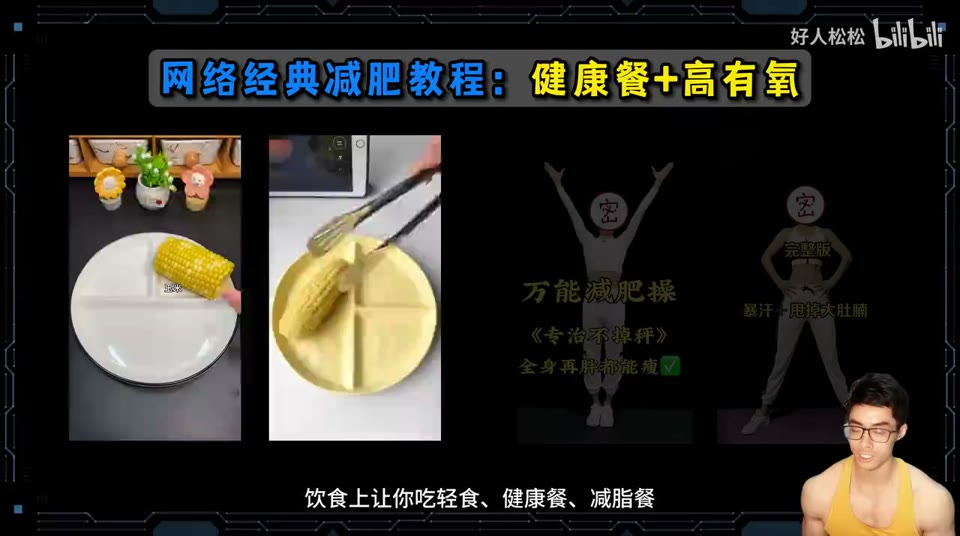

*图 1：开场：网上主流教程等于"健康餐 + 高有氧"。*

网上常见的减脂教程是这样教的：
- **饮食**：吃轻食、健康餐、减脂餐，比如红薯、燕麦、糙米饭、鸡胸、酸奶、西兰花，追求"零糖零脂零添加"。
- **运动**：一周七天有六天做"自律有氧"（男的跑步、女的跳操）。

UP 主的观点：这种教程**低效、无效，甚至害人**，恰恰是很多人全身心投入减肥却失败的原因。他提出的替代方案是**"生活化减脂"**：就在大众的生活模式里完成减脂和保持。比如他自己在学校，吃的就是食堂和外卖，米饭、馒头、鸡蛋、牛奶、瘦肉炒菜这些大众食物。他基本不做有氧，但体脂率一年 365 天都能大致保持住。不用在"自律减脂"和"放纵反弹"之间来回折腾。

视频的思路是"先破再立"：先讲什么是错的，再讲什么是对的。

### 1. 拆解"高级营养师"的一日三餐 [01:14]

UP 主找了一个点赞收藏最多的饮食教程当例子。博主自称"高级营养师"，饮食看起来干净、五颜六色、精致。UP 主的判断标准是：

> **看一个饮食对不对，不是看食物是不是干净健康，而是看食物背后的碳蛋脂。**

他逐餐估算：

**早餐 [02:01]**

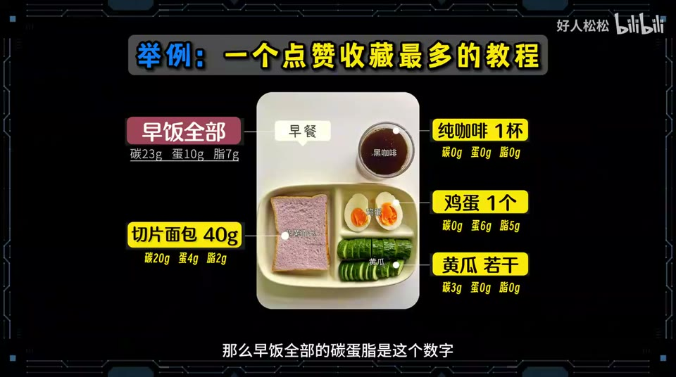

*图 2：早餐逐项估算：切片面包、鸡蛋、黄瓜、黑咖啡。*

| 食物 | 估算依据 | 碳水 / 蛋白质 / 脂肪 |
|---|---|---|
| 切片面包 40 g | 切片面包重量固定，约 40 g，碳水率 50% | 20 / 4 / 2 g |
| 鸡蛋 1 个（切成两半） | 一个鸡蛋：碳 0、蛋 6、脂 5 | 0 / 6 / 5 g |
| 黄瓜若干 | 碳水率只有 2.5%，本可忽略，姑且算 3 g | 3 / 0 / 0 g |
| 纯咖啡 1 杯 | 当作没有碳蛋脂的白水 | 0 / 0 / 0 |
| **早饭合计** | | **碳 23 / 蛋 10 / 脂 7 g** |

**午餐 [02:42]**

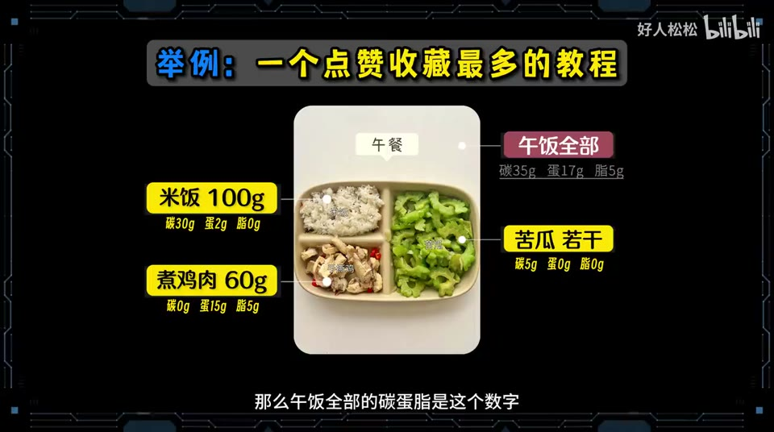

*图 3：午餐：米饭约 100 g、苦瓜、带骨水煮鸡肉。*

| 食物 | 估算依据 | 碳 / 蛋 / 脂 |
|---|---|---|
| 米饭约 100 g | 目测。软饭碳水率 25%，食堂外卖偏硬的米饭 30%，这里按 30% 算 | 30 / 2 / 0 g |
| 苦瓜若干 | 碳水率约 5%，算 5 g | 5 / 0 / 0 g |
| 煮鸡肉 60 g（净肉） | 带骨、略有皮，去骨净肉最多 60 g；熟肉蛋白率按 25% 算；净肉脂肪加一点鸡皮，算 5 g | 0 / 15 / 5 g |
| **午饭合计** | | **碳 35 / 蛋 17 / 脂 5 g** |

**晚餐 [03:33]**：只有碗底一点黄瓜片，算碳水 3 g、蛋白质 0、脂肪 0。

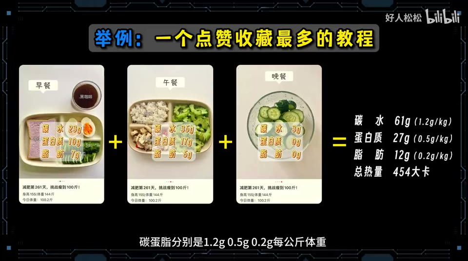

*图 4：三餐合计：碳水 61 g、蛋白质 27 g、脂肪 12 g，总热量 454 大卡。*

**全天合计**：碳水 61 g（1.2 g/kg）、蛋白质 27 g（0.5 g/kg）、脂肪 12 g（0.2 g/kg），**总热量 454 大卡**。这套饮食号称是给身高 155 cm、体重 50 kg 的人吃的。

**术语："吃几克"是什么意思 [03:59]**
饮食里说"吃几克"，指的是**每公斤体重的日摄入量**。比如 80 kg 的人"碳水吃 2 克"，就是每天吃碳水 160 g（画面补充：约等于 530 g 米饭）。

UP 主用自己的"减脂饮食底表"给同样身高体重的女性试算：不做有氧、热量缺口全靠饮食提供的话，应吃热量**接近这份教程的 3 倍**；如果做有氧，饮食量还要再增加。更离谱的是，这份教程还要求每天跳操一小时。UP 主强调这不是特意挑的极端例子，各平台搜"减脂餐/健康餐"出来的基本都是这类内容。

### 2. 后果一：根本不能减脂 [05:18]

**基础代谢受损**

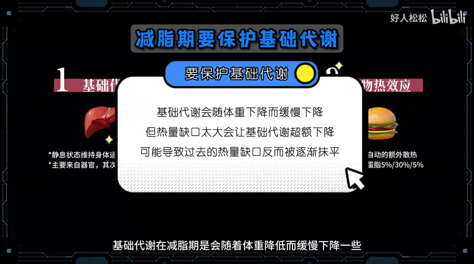

*图 5：人体热量消耗的三部分，以及为什么要保护基础代谢。*

- 人体热量消耗 = **基础代谢 + 活动消耗 + 食物热效应**。基础代谢是大头，占全部消耗的 **6–8 成**。
- 减脂期基础代谢会随体重下降而**缓慢**下降一些，这是正常的。
- 但热量缺口过大（像上面那样极端）时，基础代谢会**超额下降**，总消耗锐减，原来的热量缺口被逐渐**抹平**，体重就不掉了。

**那开头掉的几斤、十斤是什么？**掉的是脂肪、肌肉和**大量的水**。脱水有两个原因：

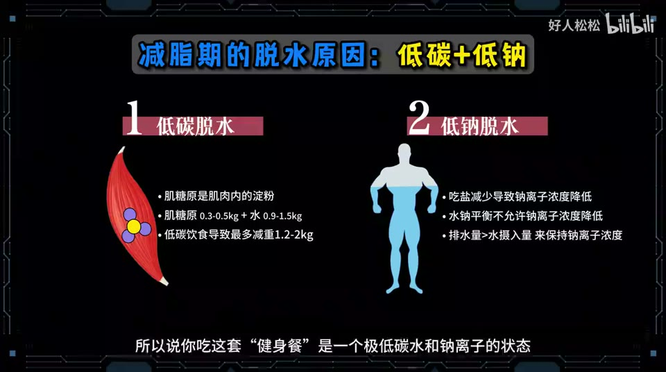

*图 6：低碳脱水 + 低钠脱水。*

1. **低碳脱水（肌糖原减少）**：肌糖原是肌肉里储存的"淀粉"，**1 g 肌糖原携带 3 g 水**。碳水吃得极低时，人体 0.3–0.5 kg 肌糖原会带着 0.9–1.5 kg 水一起消失，合计让体重掉 **1.2–2 kg**。
2. **低钠脱水**：从常规饮食改吃健康餐后，盐少了很多，钠离子浓度下降。身体有水钠平衡机制，为了维持钠浓度，会让汗液和尿液的排水量大于喝水量，体重就下降了。健美运动员赛前几天不吃盐，几天就能掉几公斤，就是这个原理。

结论：健康餐是"极低碳水 + 低钠"状态，体重锐减几公斤是必然的，但**这叫脱水，和减脂无关**。除此之外掉的那部分才是真实的肌肉和脂肪分解。

**"减脂平台期"其实是"脱水平台期" [07:39]**
很多人减了几公斤就"到平台期"，怎么少吃多动都不掉。UP 主说这往往不是减脂平台期，因为前面根本没减多少脂肪，只是脱水；脱水是有限度的（"你不可能脱成一个人肉干"），**脱到头了**体重自然就不动了。

### 3. 后果二：危害健康，为什么不能只管热量 [08:05]

碳水、蛋白质、脂肪各有生理功能，**没吃够保底量，功能就完成不了**：
- **碳水不够**：大脑难以集中精神，情绪容易暴躁。
- **蛋白质不够**：免疫系统机能下降（字幕/口播疑为"免疫系统"，此处原视频未明确），肌肉容易分解流失。
- **脂肪不够**：脂溶性维生素 A、D、E、K 吸收不了，引发一系列次生问题；还容易导致内分泌紊乱，比如性欲减退、女生生理期消失。

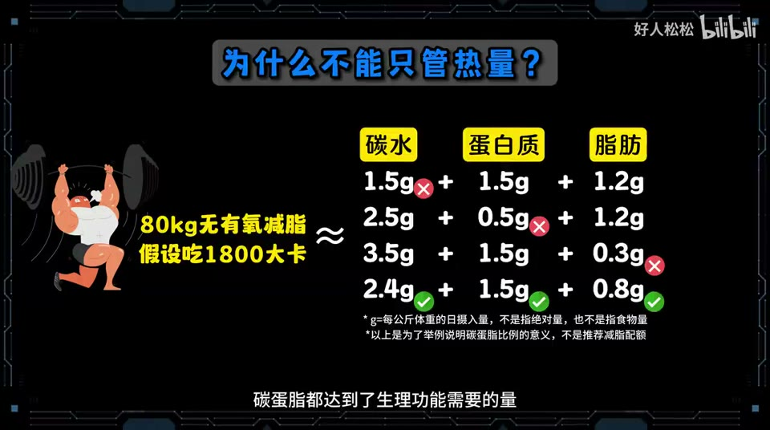

*图 7：同样 1800 大卡，碳蛋脂比例不同，只有最后一种是对的。*

**例子**：80 kg 的人无有氧减脂，假设吃 1800 大卡（单位都是 g/kg）：

| 方案 | 碳水 | 蛋白质 | 脂肪 | 判断 |
|---|---|---|---|---|
| ① | 1.5 ✗ | 1.5 | 1.2 | 碳水不够 |
| ② | 2.5 | 0.5 ✗ | 1.2 | 蛋白质不够 |
| ③ | 3.5 | 1.5 | 0.3 ✗ | 脂肪不够 |
| ④ | 2.4 ✓ | 1.5 ✓ | 0.8 ✓ | 都达到生理需求，正确 |

*画面注：以上只是为了说明碳蛋脂比例的意义，**不是推荐的减脂配额**。*

原理：总热量一定时，碳蛋脂之间可以互相调剂一些，但**有限度**，任何一项低于生理需求量就错了。UP 主举了中国营养学会的《中国居民膳食营养素参考摄入量》（DRIs）和《中国居民膳食指南（2022）》：专业版细讲三大营养素各吃多少，简易版讲主食、肉蛋、油脂各多少，道理一样，都是"既定热量必须由特定的碳蛋脂比例构成"。网上很多人只算热量、不管碳蛋脂，这是不行的。

### 4. 减肥失败的经典流程 [10:22]

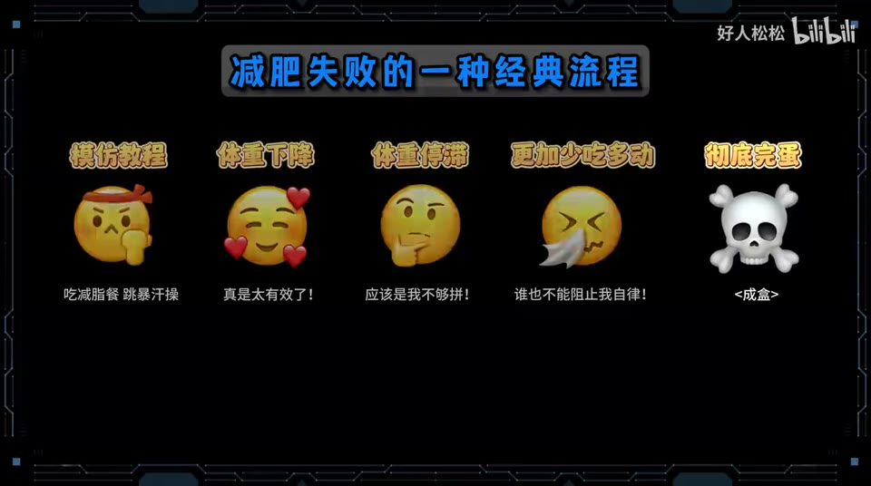

*图 8：模仿教程 → 体重下降 → 体重不掉 → 更少吃更多动 → 彻底完蛋。*

1. **模仿教程**：少吃多动。
2. **体重明显下降**：主要是脱水，其次是肌肉脂肪分解，于是得到一个**错误的正反馈**："有效！"
3. **体重不掉**：基础代谢受损抹平了缺口，脱水也到头了。
4. **加码**："一定是吃得还不够少、动得还不够多"，咬牙继续，晕倒了也要爬起来做有氧。
5. **彻底完蛋**：基础代谢和身体健康进一步受损。

UP 主说：**越认真、越"自律坚持"的人，越容易死在这条道上**；反而那些运动偷懒、饮食偷吃的人，无意中缩小了过大的热量缺口，也许还能减掉一点脂肪。

---

## 二、减脂计划的制定流程 [11:48]

做一份减脂方案分三步，**第 1 步最重要**。

### 第 1 步：选碳蛋脂配额 [12:00]

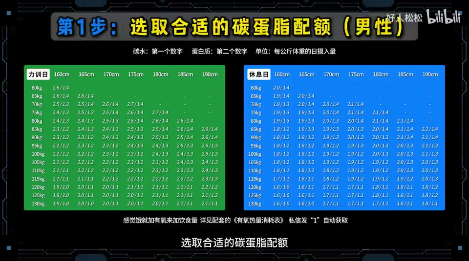

*图 9：男性（力训者）配额表：左边绿色是力训日，右边蓝色是休息日。完整数据见截图。*

**怎么查表**
- 行是**体重**，列是**身高**。左表是**力训日**，右表是**不做力训的休息日**。
- 每格两个数字：**第一个是碳水，第二个是蛋白质**，单位都是 g/kg/天。
- 身高体重找**就近**的格子。例：男，177 cm、83 kg → 就近取 175 cm、80 kg。
- 右上角空格：这些人太瘦，不需要减脂。左下角空格：不存在这么胖的人（比如 160 cm、140 kg），不用给数字。
- 表底注：感觉饿就加有氧来增加饮食量，详见配套的《有氧热量消耗表》。

**男性力训者配额摘录**（碳水/蛋白质，g/kg；完整表见截图）

| 体重 | 170 cm 力训日 | 175 cm 力训日 | 180 cm 力训日 | 170 cm 休息日 | 175 cm 休息日 | 180 cm 休息日 |
|---|---|---|---|---|---|---|
| 70 kg | 2.6/1.4 | 2.7/1.4 | – | 2.0/1.4 | 2.1/1.4 | – |
| 80 kg | 2.5/1.3 | 2.5/1.4 | 2.6/1.4 | 2.0/1.3 | 2.0/1.4 | 2.1/1.4 |
| 90 kg | 2.4/1.3 | 2.4/1.3 | 2.5/1.3 | 1.9/1.3 | 2.0/1.3 | 2.0/1.3 |
| 100 kg | 2.3/1.2 | 2.3/1.2 | 2.4/1.3 | 1.9/1.2 | 1.9/1.2 | 2.0/1.3 |

整张表的范围：力训日碳水约 1.9–2.7、休息日约 1.6–2.2；蛋白质约 1.0–1.4。

#### 为什么要按身高体重分这么多配额 [12:55]

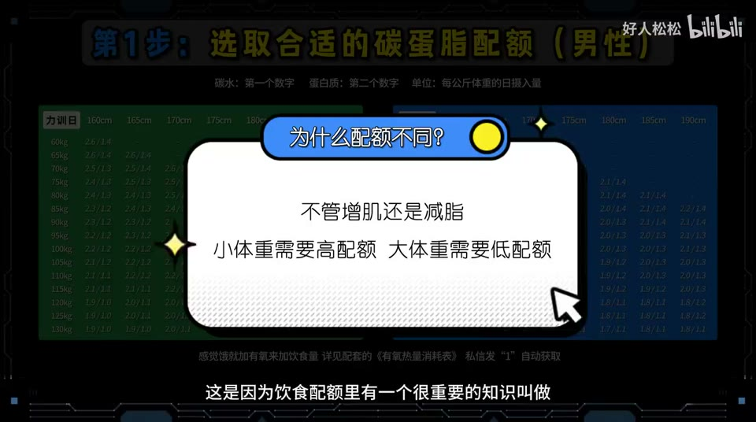

*图 10：核心知识点：不管增肌还是减脂，小体重需要高配额，大体重需要低配额。*

> **不管增肌还是减脂，小体重需要高配额，大体重需要低配额。**

推理过程：
1. 配额按"每公斤体重"设置，所以体重是别人的 2 倍，碳蛋脂的绝对量就是 2 倍。
2. 饮食热量按每克碳水/蛋白质/脂肪 **4 / 4 / 9 大卡**求和计算，所以饮食热量也是 2 倍。
3. 但体重 2 倍时，基础代谢和活动消耗**一定低于 2 倍**。
4. 记住一句话：**随着体重增加，基础代谢和活动消耗的绝对量更高，但单位体重的热量消耗会更低。**

**证据一：基础代谢 [13:53]**

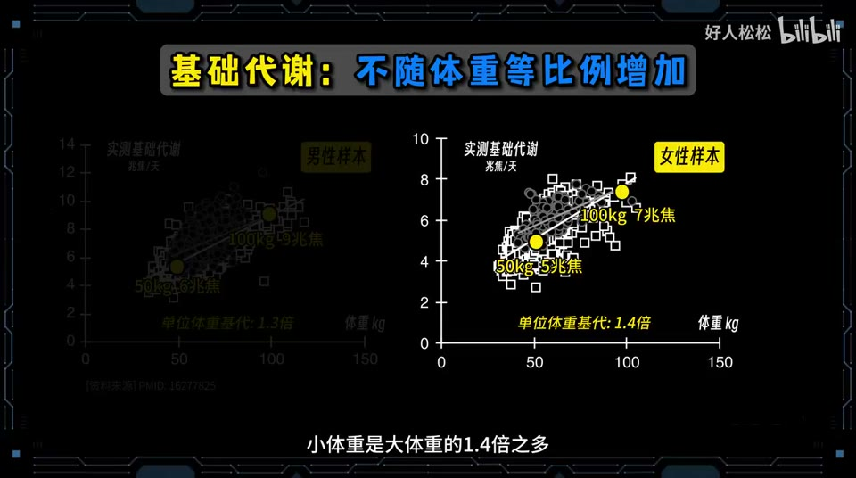

*图 11：实测基础代谢数据库：男性、女性样本，体重翻倍，基础代谢远不到翻倍。*

- 这是迄今科研界实测人体基础代谢的最大数据库（方块样本一万多人，圆圈样本三千多人），横轴体重、纵轴实测基础代谢，直线是按体重预测基础代谢的一次函数。
- 男性：50 kg 的基础代谢中位数约 6 兆焦；100 kg 如果翻倍应是 12 兆焦，实际约 9 兆焦。按单位体重算，**50 kg 是 100 kg 的 1.3 倍**。
- 女性：同样比较，小体重是大体重的 **1.4 倍**。
- 原因：基础代谢主要靠**器官**，其次靠**肌肉**，基本不靠**脂肪**。体重增加主要是脂肪多了，而脂肪对基础代谢的贡献很小。

**证据二：活动消耗 [15:26]**

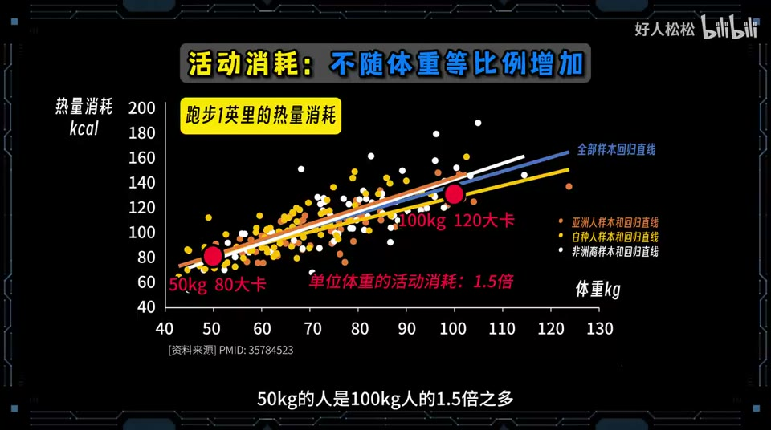

*图 12：跑步一英里的热量消耗：50 kg 约 80 大卡，100 kg 约 120 大卡。*

跑一英里：50 kg 约 80 大卡；100 kg 如果翻倍应是 160 大卡，实际约 120 大卡。按单位体重，**50 kg 的人是 100 kg 的 1.5 倍**。其他研究里不同体重做同一运动，也都是这个规律。

**所以大家用同一个配额是错的 [16:11]**

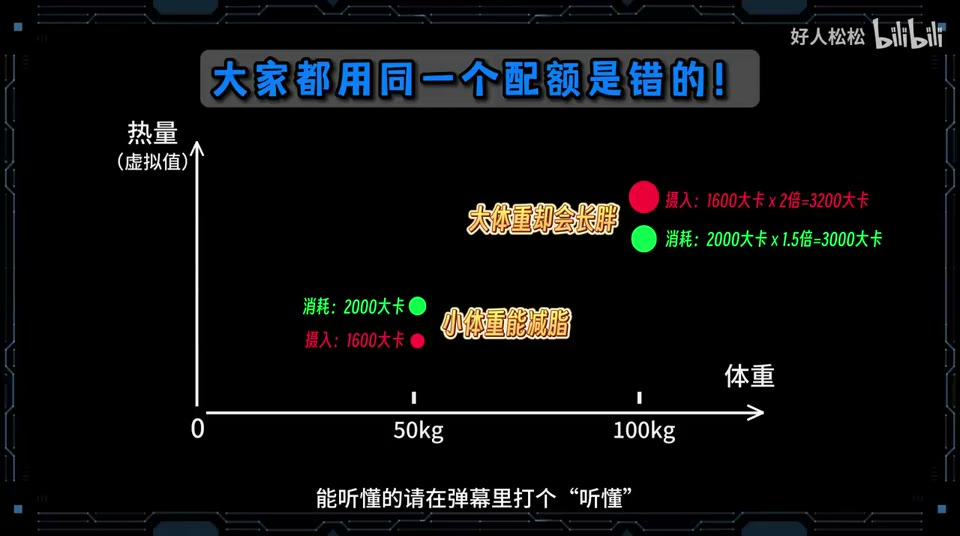

*图 13：同一配额：50 kg 的人有缺口能减脂，100 kg 的人摄入翻倍却超过消耗，反而长胖。*

图中假设：50 kg 消耗 2000 大卡，100 kg 只有它的 1.5 倍即 3000 大卡。给两人同一个配额：50 kg 吃 1600 大卡，能减脂；100 kg 摄入翻倍成 3200 大卡，超过消耗，反而长胖。**同一个配额，有人掉体重、有人不变、有人长体重。**

所以表格这样设计：
- **从上往下**（同身高、体重越大 = 越胖）→ 配额越低。
- **从左往右**（同体重、身高越高 = 越瘦）→ 配额越高。
- 每个数字 UP 主都试算过，凭经验觉得合适才填上（他称这是全网原创）。

#### 为什么表里只有碳水和蛋白质，没有脂肪 [17:32]
本来应该有脂肪：中等体重的人约 **0.8 g/kg**，大体重降低、小体重增加。但规定脂肪会让后面做分餐表更麻烦，所以脂肪用另一个简化办法把握（见第 3 步的脂肪部分）。

#### 力训日和休息日有什么不同 [17:56]

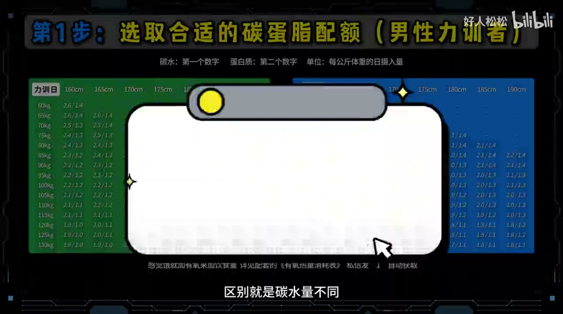

*图 14：只有碳水量不同：力训日碳水 > 休息日碳水。*

- **只有碳水量不同**。力训日需要一点**练前碳水**支撑训练，再吃一个较大的**练后碳水**做促进增肌的合成代谢，所以碳水总量多一些。
- 休息日没有练前碳水，练后大碳水也改成常规份额，所以碳水总量低一些。
- 蛋白质和脂肪不变，固定下来操作更简单，**只用改变主食量**，对新手最友好。

#### 男性无力训者 [18:32]

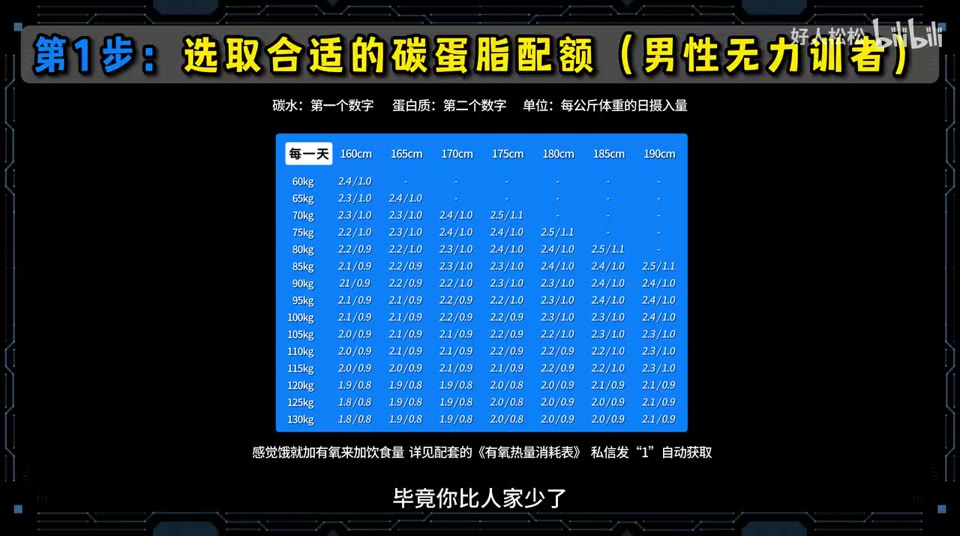

*图 15：男性无力训者：不分力训日/休息日，每天都一样。*

不做力训的男性用这张表，每天一样。总摄入会少一些（少了力训那小几百大卡的消耗）；蛋白质也稍低（不需要那么多蛋白质维持肌肉量）。UP 主提醒：他已经考虑到大家不方便吃那么多肉，**把蛋白质设计得够低了，不要再自行削减**。

摘录（碳水/蛋白质，g/kg）：

| 体重 | 170 cm | 175 cm | 180 cm |
|---|---|---|---|
| 70 kg | 2.4/1.0 | 2.5/1.1 | – |
| 80 kg | 2.3/1.0 | 2.4/1.0 | 2.4/1.0 |
| 90 kg | 2.2/1.0 | 2.3/1.0 | 2.3/1.0 |
| 100 kg | 2.2/0.9 | 2.2/0.9 | 2.3/1.0 |

### 有氧怎么算进配额 [19:13]

> **本视频的所有配额都是按"无有氧"设计的，即热量缺口全部由饮食提供。**（男女、力训与否都适用）

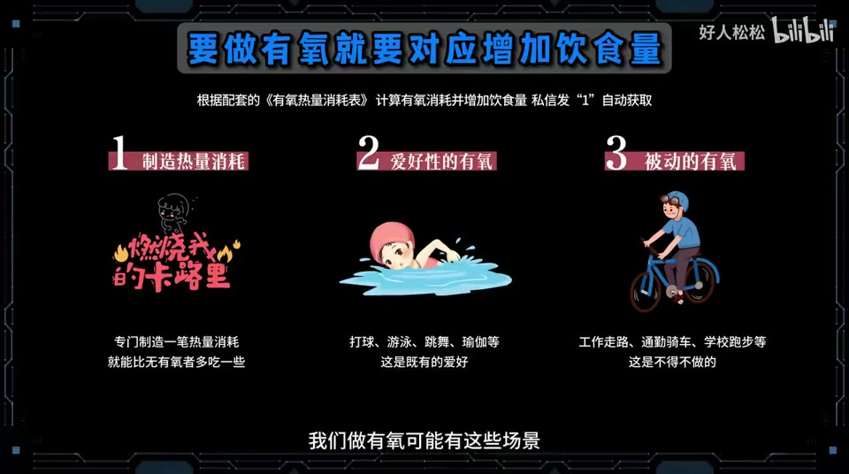

*图 16：三类有氧：专门制造热量消耗、爱好性的有氧、被动的有氧。*

做有氧的常见场景：
1. **专门制造热量消耗**：为了比无有氧者多吃一些。
2. **爱好性的有氧**：打球、游泳、跳舞、瑜伽等。
3. **被动的有氧**：工作要求每天走几千上万步，学校/单位要求每周跑步多少等。

只要做有氧，就用《有氧热量消耗表》算出消耗，换算成食物，**加到无有氧的配额上**。

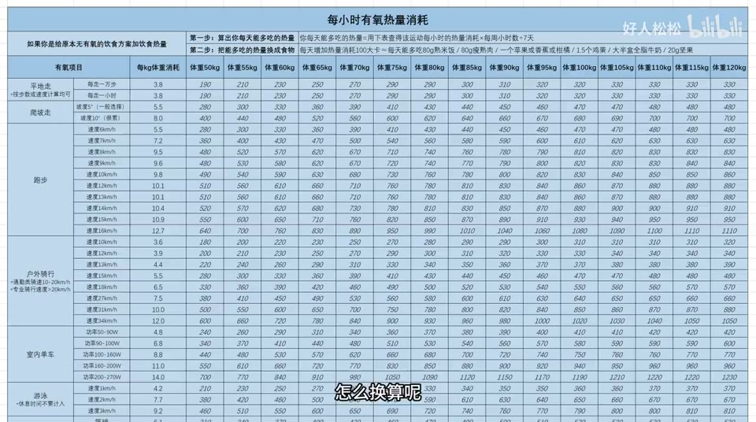

*图 17：《每小时有氧热量消耗》表：按运动项目、强度和体重查每小时消耗。*

表头写的换算方法（画面）：
- **第一步**：每天能多吃的热量 = 该运动每小时的热量消耗 × 每周小时数 ÷ 7 天。
- **第二步**：换成食物。每天增加 100 大卡 ≈ 80 g 熟米饭 / 80 g 熟瘦肉 / 一个苹果或香蕉或柑橘 / 1.5 个鸡蛋 / 大半盒全脂牛奶 / 20 g 坚果。

表中举例（每 kg 体重每小时消耗）：平地走（每小时或每一万步）3.8；坡度 5° 爬坡走 5.5；跑步 8 km/h 为 9.5；户外骑行 15 km/h 为 5.5；游泳 1 km/h 为 4.2。比如 70 kg 平地走 1 小时约 270 大卡。完整数据见截图。

**重要提醒 [20:28]**：不要理解成"做有氧就能减得更好"。在这个体系里，**热量缺口是预先设定好的**，可以全由饮食提供，也可以由有氧和饮食共同提供，**缺口大小一样**，做有氧的直接结果只是**能多吃一些**。

（推广：配额表、有氧热量消耗表、饮食底表等都打包在 UP 主的"健身 Excel 工具套表"里，私信发"1"或在主页置顶动态下载。）

#### 女性配额表 [21:09]

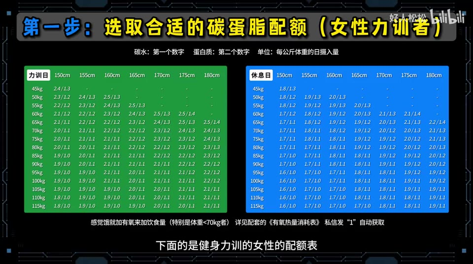

*图 18：女性力训者：左为力训日，右为休息日，区别同样只在碳水。*

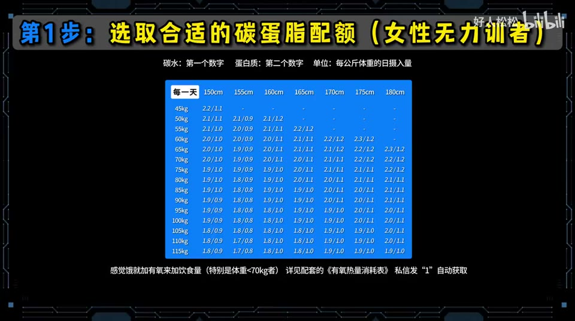

*图 19：女性无力训者：每天都是同一配额。表底注明"特别是体重<70kg者"感觉饿就加有氧。*

女性表摘录（碳水/蛋白质，g/kg）：

| 体重 | 160 cm 力训日 | 165 cm 力训日 | 160 cm 休息日 | 165 cm 休息日 | 160 cm 无力训 | 165 cm 无力训 |
|---|---|---|---|---|---|---|
| 50 kg | 2.5/1.3 | – | 2.0/1.3 | – | 2.1/1.2 | – |
| 60 kg | 2.3/1.2 | 2.4/1.3 | 1.9/1.2 | 2.0/1.3 | 2.0/1.1 | 2.1/1.1 |
| 70 kg | 2.2/1.2 | 2.2/1.2 | 1.8/1.2 | 1.9/1.2 | 2.0/1.1 | 2.0/1.1 |
| 80 kg | 2.1/1.1 | 2.2/1.2 | 1.8/1.1 | 1.9/1.2 | 1.9/1.0 | 2.0/1.1 |

这些仍然是**无有氧**的饮食量。UP 主提醒：**体重不到 70 kg 的女性，建议每周做 2 小时有氧来增加饮食量，否则大概率会觉得很饿。**

### 第 2 步：分餐 [21:45]

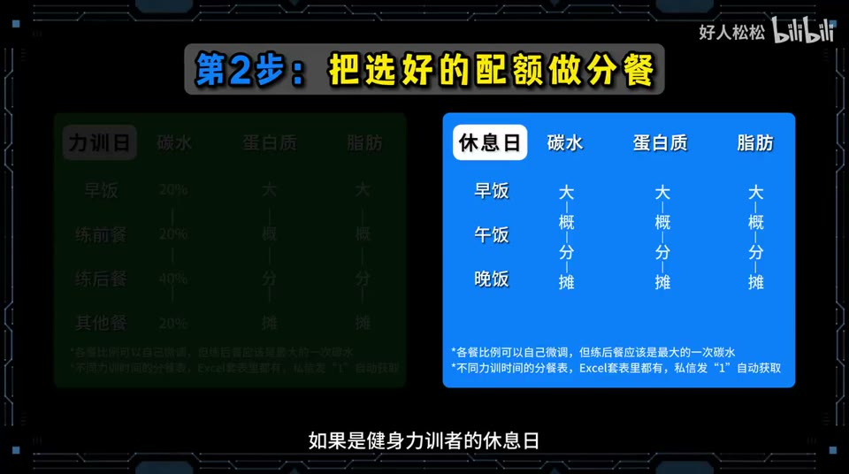

*图 20：力训日碳水按 2/2/4/2 分配，休息日和无力训者三餐大概分摊。*

**力训者的训练日**（要做碳水集中在练后）：

| 餐 | 碳水 | 蛋白质 | 脂肪 |
|---|---|---|---|
| 早饭 | 20% | 大概分摊 | 大概分摊 |
| 练前餐 | 20% | 大概分摊 | 大概分摊 |
| 练后餐 | **40%** | 大概分摊 | 大概分摊 |
| 其他餐 | 20% | 大概分摊 | 大概分摊 |

午饭、晚饭在哪？看你的训练时间，它们会和练前餐、练后餐或其他餐重叠。

**力训者的休息日 / 不力训的人**：碳蛋脂总量在三餐里**大概分摊**就行。

规则（画面注）：各餐比例可以自己微调，但**练后餐应该是全天最大的一次碳水**；不同训练时间的分餐表在 Excel 套表里都有。

**新手常问：只做有氧怎么分餐？[22:36]**
先记得用有氧热量消耗表加饮食量。做了有氧的那天，**按休息日的配额和分餐吃**就行，碳水总量比力训日低，也**不用做碳水集中**。打个比方：出门散步也是有氧，你不会想着散步前吃练前餐、散步后吃练后餐。到饭点就吃，没到就不吃。

### 第 3 步：算食物量（碳水 / 蛋白质 / 脂肪）[23:06]

#### 碳水

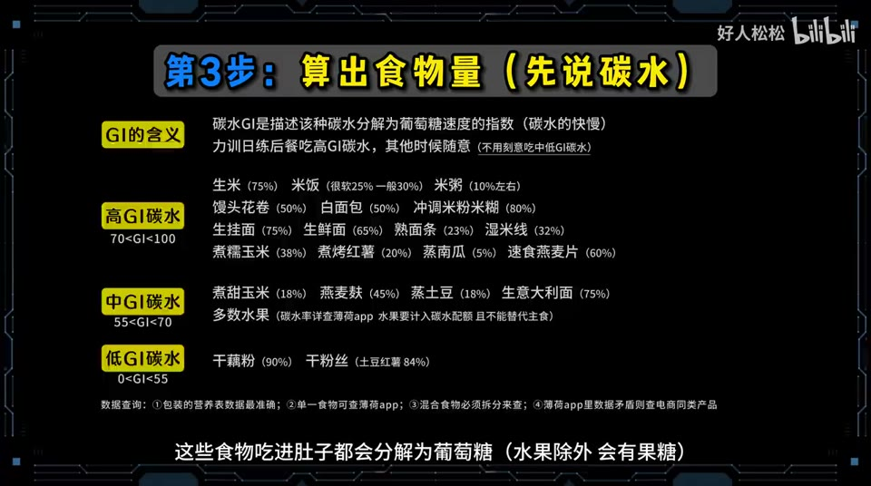

*图 21：常见碳水食物及其碳水率，按 GI 分组。*

**公式**：食物重量 = 本餐碳水克数 ÷ 该食物碳水率。
例：本餐要吃 60 g 碳水，米饭碳水率 30%，60 ÷ 30% = **200 g 米饭**。

画面列出的碳水率（括号内）：
- **高 GI（70<GI<100）**：生米（75%）、米饭（很软 25%，一般 30%）、米粥（10% 左右）、馒头花卷（50%）、白面包（50%）、冲调米粉米糊（80%）、生挂面（75%）、生鲜面（65%）、熟面条（23%）、湿米线（32%）、煮糯玉米（38%）、煮烤红薯（20%）、蒸南瓜（5%）、速食燕麦片（60%）。
- **中 GI（55<GI<70）**：煮甜玉米（18%）、燕麦麸（45%）、蒸土豆（18%）、生意大利面（75%）、多数水果（碳水率查薄荷 app；水果要计入碳水配额，且不能替代主食）。
- **低 GI（0<GI<55）**：干藕粉（90%）、干粉丝（土豆/红薯，84%）。

数据查询（画面）：① 包装的营养表数据最准；② 单一食物可查薄荷 app；③ 混合食物必须拆分来查；④ 薄荷 app 里数据矛盾时查电商同类产品。

**GI 和快碳慢碳 [23:23]**
GI 描述碳水分解为葡萄糖的速度，也就是"快碳慢碳"。理论上慢碳对胰岛素刺激更弱，有利于抑制增脂。但 UP 主说**吃啥都可以，不用刻意吃慢碳**（画面：力训日练后餐吃高 GI 碳水，其他时候随意）。理由：

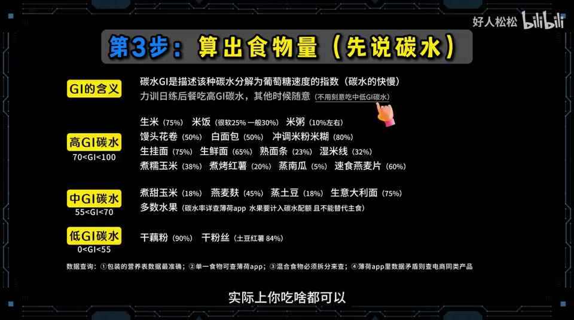

*图 22：生活里基本没有慢碳：除了藕粉、粉条，粗粮精粮都不慢。*

1. **便利性**：生活里基本找不到慢碳，除了藕粉、粉条，其他粗粮精粮都不慢，没必要为这点差别折腾。
2. **影响胰岛素的因素远不止 GI**：

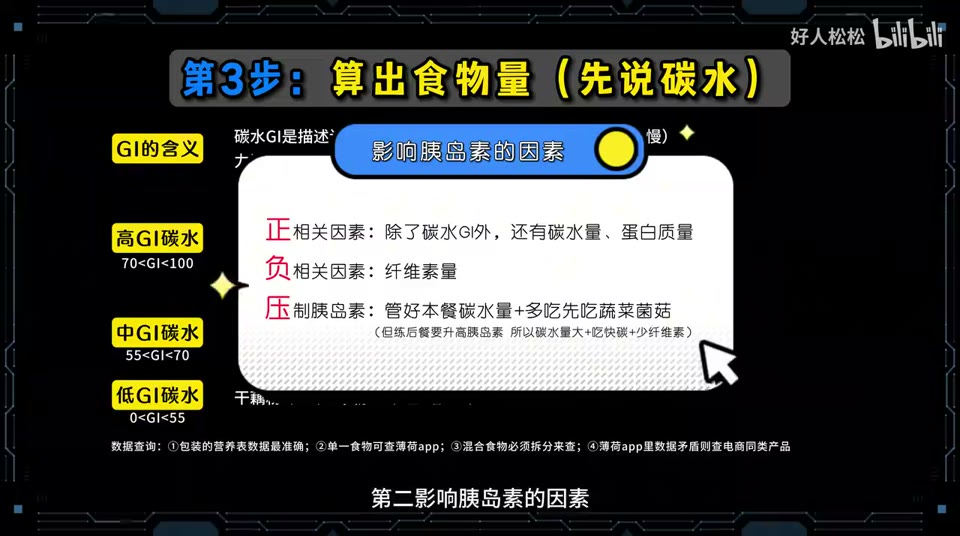

*图 23：正相关：GI、碳水量、蛋白质量；负相关：纤维素。*

- 正相关：碳水 GI、**本餐碳水量**、蛋白质量。
- 负相关：纤维素量。
- **压制胰岛素最简单的办法**：管好本餐的碳水量，再**多吃、先吃蔬菜菌菇**。几克纤维素就能有效减缓胃排空速度，减少胰岛素分泌。
- 例外（画面注）：练后餐反而要升高胰岛素，所以碳水量大、吃快碳、少吃纤维素。

#### 蛋白质 [24:24]

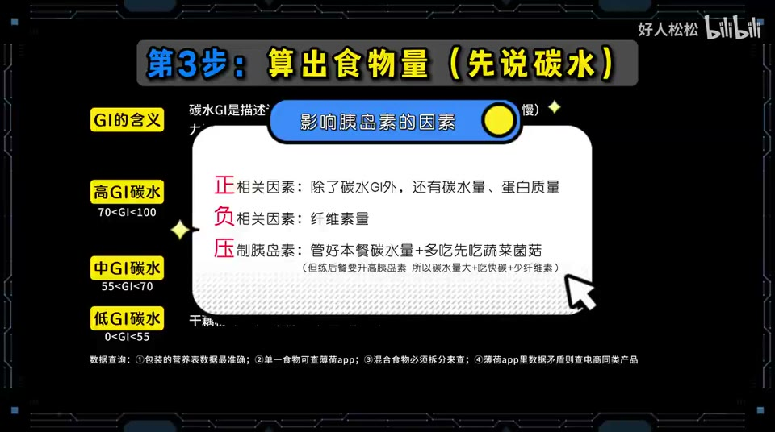

*图 24：主要来源：一切瘦肉、蛋白粉。*

**主要来源**
- **一切瘦肉**：猪牛羊鸡鸭鱼虾都行，只要是瘦的、没皮、没有白色/黄色脂肪层。蛋白质率（画面）：生肉 20%、炒熟 25%、卤炖 30%、肉干 40%+（不吃肥肉、不吃皮）。
- **蛋白粉**：从牛奶里提取，蛋白质率 75–90%。
- 瘦肉和蛋白粉基本没有碳水和脂肪，是纯粹的蛋白质。

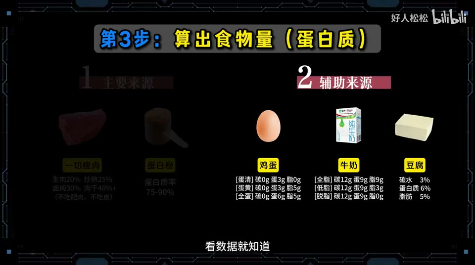

*图 25：辅助来源：鸡蛋、牛奶、豆腐都是混合物。*

**辅助来源**（不是典型的蛋白质食物）：
- **鸡蛋**是"蛋脂混合物"：蛋清 碳 0/蛋 3/脂 0 g；蛋黄 碳 0/蛋 3/脂 5 g；全蛋 碳 0/蛋 6/脂 5 g。
- **牛奶**是"碳蛋脂混合物"（每盒）：全脂 碳 12/蛋 9/脂 9 g；低脂 碳 12/蛋 9/脂 3 g；脱脂 碳 12/蛋 9/脂 0 g。
- **豆腐**：碳水 3%、蛋白质 6%、脂肪 5%。

为什么不能靠它们吃够蛋白质：配额里蛋白质需求远高于脂肪，如果靠鸡蛋、牛奶、豆制品吃够蛋白质，**脂肪早就爆了**。

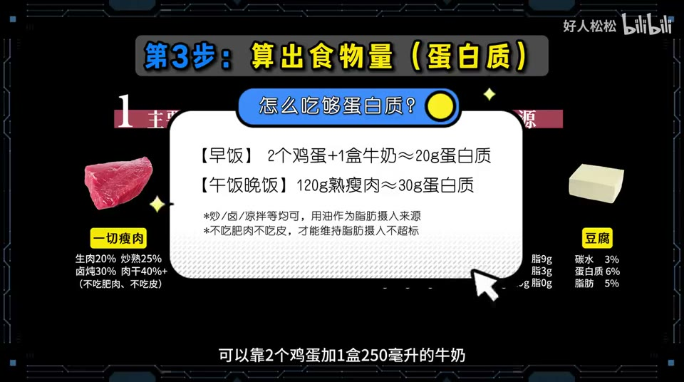

*图 26：早饭靠蛋奶，午晚饭靠瘦肉。*

**各餐怎么吃够蛋白质**
- **早饭**（一般没肉）：2 个鸡蛋 + 1 盒 250 ml 牛奶 ≈ **20 g 蛋白质**。
- **午饭/晚饭**：靠瘦肉，比如一餐 30 g 蛋白质 ≈ **120 g 熟瘦肉**。

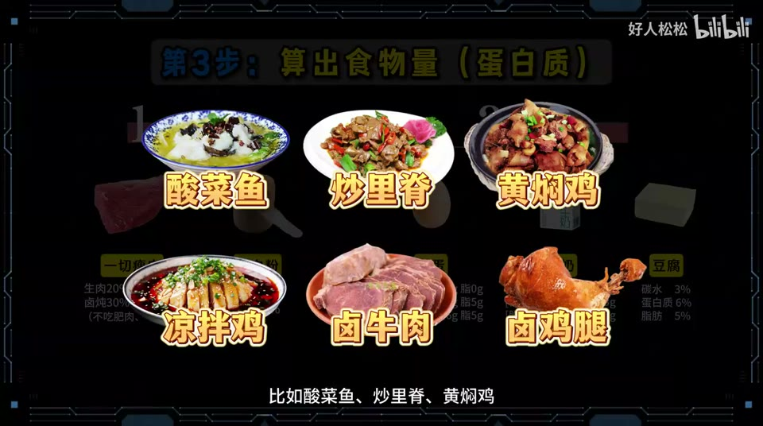

*图 27：酸菜鱼、炒里脊、黄焖鸡、凉拌鸡、卤牛肉、卤鸡腿等大众菜肴都可以。*

炒的、凉拌的、卤的都行。**带油没事**，因为本来就需要吃油来满足每天必要的脂肪摄入。只要记住：**肉得是瘦肉，不吃肥肉、不吃皮**，才能保证脂肪不超标。

#### 脂肪（简化把握）[25:59]

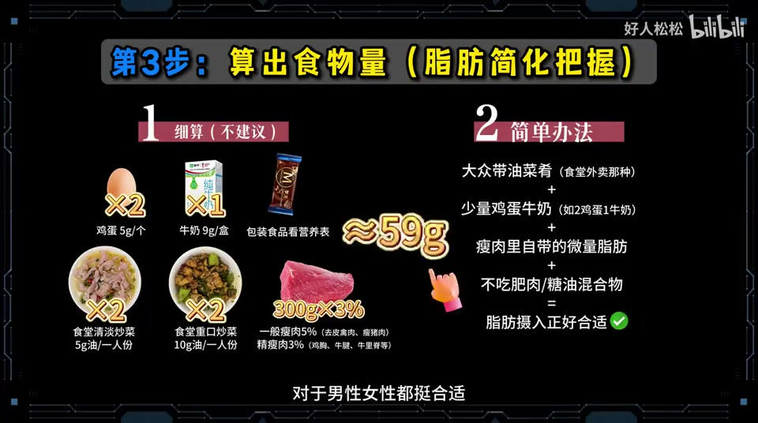

*图 28：左边是细算（不建议），右边是简单办法。*

本来脂肪约 0.8 g/kg（大体重降低、小体重增加），想细算可以用画面数据：鸡蛋 5 g/个、牛奶 9 g/盒、食堂清淡炒菜 5 g 油/一人份、食堂重口炒菜 10 g 油/一人份、一般瘦肉 5%（去皮禽肉、瘦猪肉）、精瘦肉 3%（鸡胸、牛腱、牛里脊等）、包装食品看营养表。但**不要求新手细算**。

**简单办法**：
> 大众带油菜肴（食堂外卖那种）+ 少量鸡蛋牛奶（如 2 鸡蛋 1 牛奶）+ 瘦肉里自带的微量脂肪 + 不吃肥肉/糖油混合物 = 脂肪摄入正好合适

例：早饭 2 个鸡蛋 + 1 盒牛奶，午饭晚饭在食堂吃 2 个清淡炒菜 + 2 个重口炒菜，加上全天约 300 g 瘦肉里的微量脂肪（按 3% 算），合计**不到 60 g（画面 ≈59 g）**，对男性女性都合适。对你的体重来说可能是 0.7、0.8 或 0.9 g/kg，**都无所谓**，都达到了生理必要量，不是必须卡在 0.8 才能减脂。

这种方案的好处：天天吃食堂外卖的大众菜肴，只要**主食和肉的量合规**，不用点轻食健康餐、不用吃水煮菜，宽容度很高，能"生活化"地完成减脂。

**唯一忌口：固体脂肪 [27:22]**

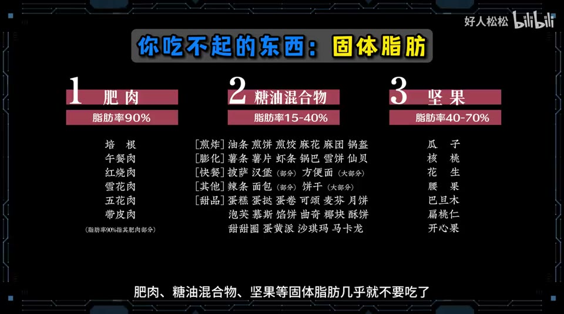

*图 29：肥肉、糖油混合物、坚果三类固体脂肪清单。*

| 类别 | 脂肪率 | 例子（画面） |
|---|---|---|
| 1 肥肉 | 90%（指其肥肉部分） | 培根、午餐肉、红烧肉、雪花肉、五花肉、带皮肉 |
| 2 糖油混合物 | 15–40% | [煎炸] 油条、煎饼、煎饺、麻花、麻团、锅盔；[膨化] 薯条、薯片、虾条、锅巴、雪饼、仙贝；[快餐] 披萨、汉堡（部分）、方便面（大部分）；[其他] 辣条、面包（部分）、饼干（大部分）；[甜品] 蛋糕、蛋挞、蛋卷、可颂、麦芬、月饼、泡芙、慕斯、馅饼、曲奇、椰块、酥饼、甜甜圈、蛋黄派、沙琪玛、马卡龙 |
| 3 坚果 | 40–70% | 瓜子、核桃、花生、腰果、巴旦木、扁桃仁、开心果 |

这些东西脂肪很高，而且以固体形式存在，看不到油，你就以为它没脂肪。一天脂肪配额只有 **50–60 g**，而：

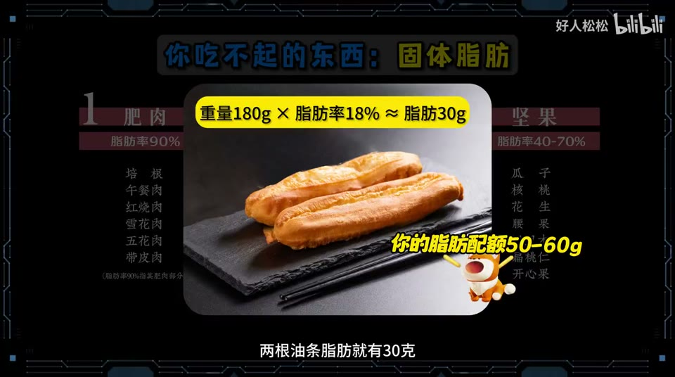

*图 30：例：两根油条（约 180 g × 脂肪率 18%）≈ 30 g 脂肪。*

- 一小块肥肉（约 33 g × 90%）≈ **30 g** 脂肪
- 两根油条（约 180 g × 18%）≈ **30 g**
- 两个肯德基蛋挞（约 200 g × 29%，画面数据）≈ **30 g**
- 一个星巴克麦芬（约 135 g × 29%）≈ **40 g**
- 两把坚果（约 60 g × 60%）≈ **40 g**，几口就吃完了

不是绝对不能吃，但日常吃会**奢侈地花掉全天大部分脂肪配额**，炒菜、鸡蛋、牛奶都没法吃了，方案就做不下去。UP 主吐槽：很多人对炒菜里的植物油斤斤计较，自己却靠饼干、锅巴、甜品、糕点、坚果这些零食填饱肚子，然后怪食堂外卖的油把他害了。

**总结**：天天吃食堂外卖已经很舒服了，唯一要忌口的就是**不能把肥肉、糖油混合物、坚果当作填饱肚子的日常食物**。

---

## 三、个人计划实际演练 [28:44]

### 方案表的结构 [28:54]

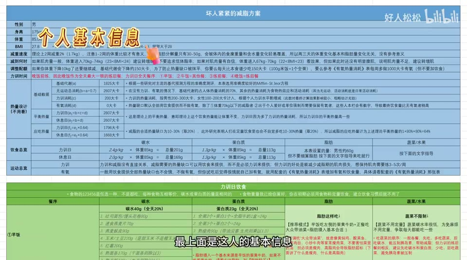

*图 31：方案表：最上面是个人基本信息和热量设计，下面是力训日（绿）和休息日（蓝）饮食表。*

方案表分几块：
1. **基本信息**：性别、身高、体重、BMI、力训情况等。
2. **饮食和运动的大概方案**。
3. **绿色表 = 力训日饮食**，**蓝色表 = 休息日饮食**：设计好各餐碳蛋脂分配，算好各餐食物重量。因为每人口味不同，每餐列出 1、2、3、4、5 几种**互相等价**的常见食物及重量，任选一种吃。
4. Excel 套表里还配了健身房/居家的三分化训练计划、有氧热量消耗表、减脂问答汇总。

画面中示例方案表（男，175 cm、85 kg、晚饭前练）里写的"热量设计"（标注"不用看"），UP 主口头没讲，从画面整理如下：

| 项目 | 数值 | 说明（画面） |
|---|---|---|
| 基础代谢 a | 1825 大卡 | 用 Mifflin-St Jeor 方程预测 |
| 无运动总消耗 b = a ÷ 0.7 | 2607 大卡 | 没有力训、有氧时，基础代谢约占总消耗的 70% |
| 力训消耗 c | 200 大卡 | 男性按 200–300、女性按 100–200 大卡计入 |
| 有氧消耗 d | 0 | 热量缺口默认全由饮食提供 |
| 平衡热量 e₁ = b + c + d / e₂ = b + d | 2807 / 2607 大卡 | 力训日 / 休息日 |
| 应吃热量 f = e × 0.64 | 1796 / 1668 大卡 | 减脂热量缺口取 20%，加上人们在定量饮食时也会不自觉多吃 10–30%（取 20%），所以应吃 = 平衡 × 80% × 80% = 64% |

同表其他画面信息：
- **饮食总览**：力训日碳水 2.4 g/kg、休息日 2.0 g/kg，蛋白质 1.3 g/kg；脂肪"本表设置的量：男性约 60 g，但不要细算"。
- **减重速度**：理论上 2 周减重 2%（此例约 1.7 kg）；1–2 周内的体重波动没有参考意义。
- **调整配额**：体重每下降 10 kg，基础代谢约下降 150 大卡，要每天比原来少吃约 150 大卡（如 100 g 米饭 + 1 个全蛋）。

### 案例 1：不力训者 [29:55]

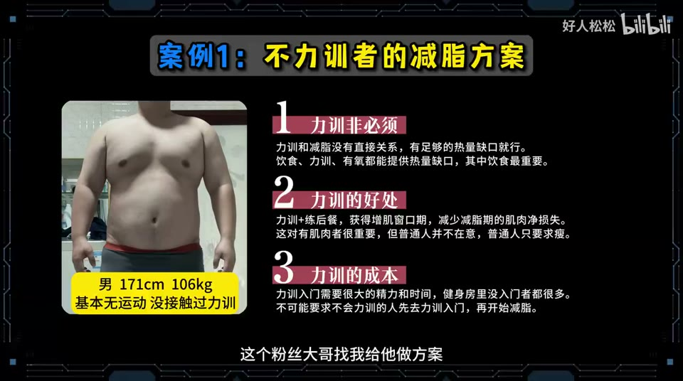

*图 32：男，171 cm，106 kg，基本无运动，没接触过力训。*

**为什么他可以不力训**（画面三点）：
1. **力训非必须**：力训和减脂没有直接关系，有足够的热量缺口就行。饮食、力训、有氧都能提供缺口，其中饮食最重要。
2. **力训的好处**：力训 + 练后餐能获得增肌窗口期，减少减脂期的肌肉净损失。这对有肌肉的人很重要，但普通人本来没啥肌肉，只要求瘦。
3. **力训的成本**：入门需要很大精力和时间，健身房里练两三年没入门的人多的是。不可能要求不会力训的人先办卡、买私教、练大半年再开始减脂，那是在折腾人。

**第 1 步：选配额**

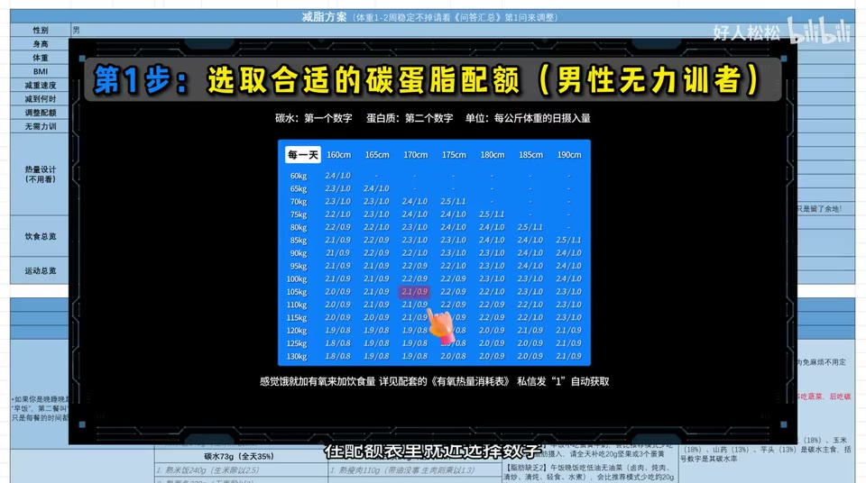

*图 33：男性无力训者表中就近选 170 cm、105 kg → 2.1/0.9。*

**第 2 步：分餐**

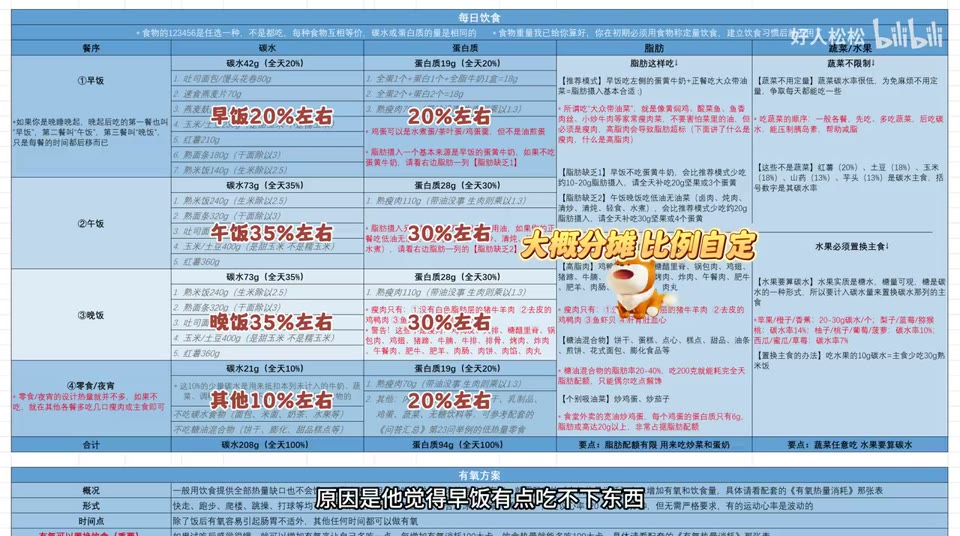

*图 34：他早饭吃不下，所以早饭比例略低，午晚饭略高。*

本来应该均摊到三餐，但他说早饭吃不下、上班后午晚饭要多吃才能吃饱，所以略微调整了比例：

| 餐 | 碳水 | 蛋白质 |
|---|---|---|
| 早饭 | 42 g（20%） | 19 g（20%） |
| 午饭 | 73 g（35%） | 28 g（30%） |
| 晚饭 | 73 g（35%） | 28 g（30%） |
| 零食/夜宵 | 21 g（10%） | 19 g（20%） |
| **合计** | **208 g** | **94 g** |

（口播说的是"早饭两成、午饭三成、晚饭三成"，与画面上的蛋白质列一致；碳水列以画面为准。）

**第 3 步：算食物量**

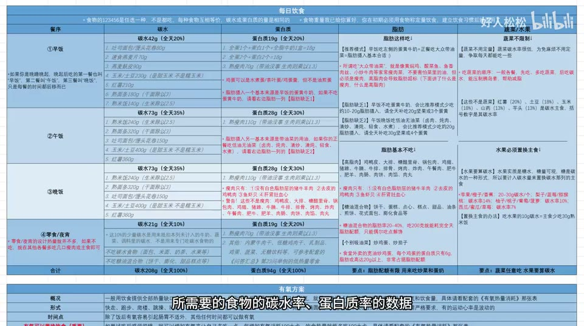

*图 35：每餐列出多种等价食物，任选其一。*

每餐的等价选项（画面）：
- **早饭碳水 42 g** 任选：吐司面包/馒头花卷 80 g；速食燕麦片 70 g；燕麦麸 90 g；玉米/土豆 230 g（是甜玉米，不是糯玉米）；红薯 210 g；熟面条 180 g；熟米饭 140 g。
- **早饭蛋白质 19 g** 任选：全蛋 1 个 + 蛋白 1 个 + 全脂牛奶 1 盒 ≈ 18 g；全蛋 2 个 + 蛋白 2 个 ≈ 18 g；熟瘦肉 70 g。鸡蛋可以是水煮蛋、茶叶蛋、鸡蛋羹，但不是油煎蛋。
- **午饭/晚饭碳水 73 g** 任选：熟米饭 240 g；熟面条 320 g；吐司面包/馒头花卷 150 g；玉米/土豆 400 g；红薯 360 g。
- **午饭/晚饭蛋白质 28 g**：熟瘦肉 110 g（带油没事）。
- **换算规则**：生米则除以 2.5，干面条则除以 3，生肉则乘以 1.3。
- **瘦肉只有**：① 没有白色脂肪层的猪牛羊肉；② 去皮的鸡鸭肉；③ 鱼虾贝；④ 肝肾肚血心。**这些不是瘦肉**：鸡鸭皮、大排、糖醋里脊、锅包肉、鸡翅、猪蹄、牛腩、牛排、排骨、烤肉、炸肉、午餐肉、肥牛、肥羊、肉肠、肉饼、肉馅、肉丸等。
- **蔬菜不限量**：碳水率很低，为免麻烦不用定量；吃菜顺序：先吃、多吃蔬菜，后吃碳水，能压制胰岛素。红薯（20%）、土豆（18%）、玉米（18%）、山药（13%）、芋头（13%）**不是蔬菜**，是碳水主食。
- **水果必须置换主食**：水果实质是糖水，糖量可观，要计入碳水。苹果/橙子/香蕉每个约 20–30 g 碳水；置换办法：吃水果的 10 g 碳水 = 主食少吃 30 g 熟米饭。

**食物的碳水率/蛋白质率速查页 [32:02]**

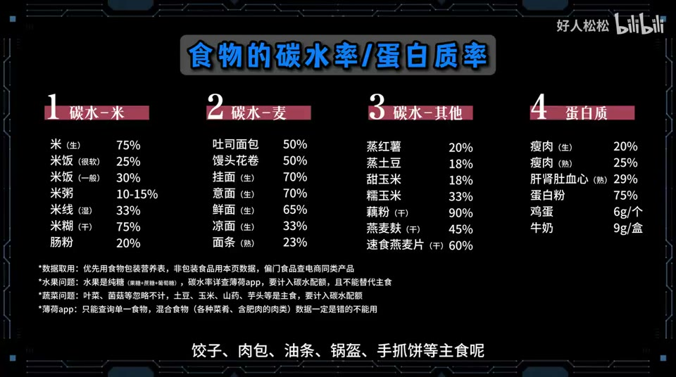

*图 36：把碳水、蛋白质克数换成食物克数时用的数据页。*

| 碳水-米 | | 碳水-麦 | | 碳水-其他 | | 蛋白质 | |
|---|---|---|---|---|---|---|---|
| 米（生） | 75% | 吐司面包 | 50% | 蒸红薯 | 20% | 瘦肉（生） | 20% |
| 米饭（很软） | 25% | 馒头花卷 | 50% | 蒸土豆 | 18% | 瘦肉（熟） | 25% |
| 米饭（一般） | 30% | 挂面（生） | 70% | 甜玉米 | 18% | 肝肾肚血心（熟） | 29% |
| 米粥 | 10–15% | 意面（生） | 70% | 糯玉米 | 33% | 蛋白粉 | 75% |
| 米线（湿） | 33% | 鲜面（生） | 65% | 藕粉（干） | 90% | 鸡蛋 | 6 g/个 |
| 米糊（干） | 75% | 凉面（生） | 33% | 燕麦麸（干） | 45% | 牛奶 | 9 g/盒 |
| 肠粉 | 20% | 面条（熟） | 23% | 速食燕麦片（干） | 60% | | |

画面注：优先用包装营养表；水果是纯糖（果糖+蔗糖+葡萄糖），要计入碳水配额且不能替代主食；叶菜、菌菇忽略不计，土豆、玉米、山药、芋头是主食；薄荷 app 只能查单一食物，混合食物（各种菜肴、含肥肉的肉类）的数据一定是错的。

**为什么主食里没有饺子、肉包、油条、锅盔、手抓饼？[32:12]**
它们提供碳水的同时也带很多脂肪。比如水饺、肉包，碳水和脂肪大约 **3 : 2**：吃 60 g 碳水就得跟着吃 40 g 脂肪，而全天脂肪配额才五六十克，"吃不起"。所以表里的主食都用**脂肪很少的纯碳水食物**。

**"减个肥还要称重吃饭？" [32:52]**
UP 主的回应：
- 新手对食物的碳蛋脂率和重量**完全没有概念**，只能用称重这个笨办法建立认知。
- 其实不麻烦：你那里一碗饭多重、一份菜多少肉，**称两次就知道**，不用天天称、顿顿称。做一阵子就能培养出目测能力，换个地方吃饭也能把握量，一劳永逸。
- 有些人愿意天天有氧、吃难吃的健康餐、甚至打减肥针吃减肥药，却不愿意初期称一下饭和肉，其实**这才是减脂里最重要的事**：能定食物重量 → 能定饮食配额 → 能顺利减脂。（画面注：减肥针/药需遵医嘱）

**脂肪列怎么写 [34:17]**

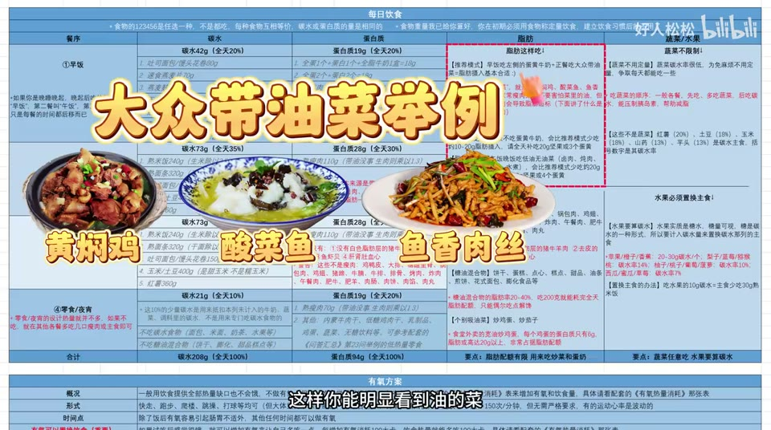

*图 37：推荐模式：正餐吃黄焖鸡、酸菜鱼、鱼香肉丝这类能明显看到油的大众菜。*

- **推荐模式**：正餐吃大众带油菜品（黄焖鸡、酸菜鱼、鱼香肉丝等能明显看到油的菜）+ 早饭的蛋黄、牛奶 → 脂肪正好合适。对上班族、学生党最友好：吃食堂外卖减脂，不用自己做饭。
- **脂肪缺乏 1**：早饭不吃蛋黄、牛奶，改吃无油瘦肉或蛋白粉 → 每天补吃 **20 g 坚果**（表格里另写"或 3 个蛋黄"）。
- **脂肪缺乏 2**：午晚饭吃低油/无油菜（卤肉、轻食、清炒、水煮等）→ 每天补吃 **30 g 坚果**（表格里另写"或 4 个蛋黄"）。

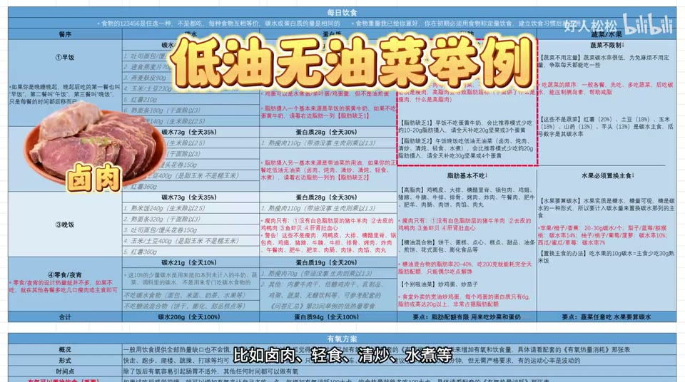

*图 38：低油无油菜：卤肉、轻食、清炒、水煮。*

为什么要补：脂肪太低会影响健康，也会让表里的热量缺口变得太大。同时，肥肉、糖油混合物这些基本不要吃（容易冲破脂肪配额）。原话："我让你天天吃大众炒菜已经够舒服了，你不能既要又要还要。"表格里还提醒了"个别吸油菜"：炒鸡蛋、炒茄子；食堂外卖的炒鸡蛋，每个鸡蛋的蛋白质只有 6 g，脂肪却可能高达 20 g 以上。

**零食/夜宵配额 [35:30]**

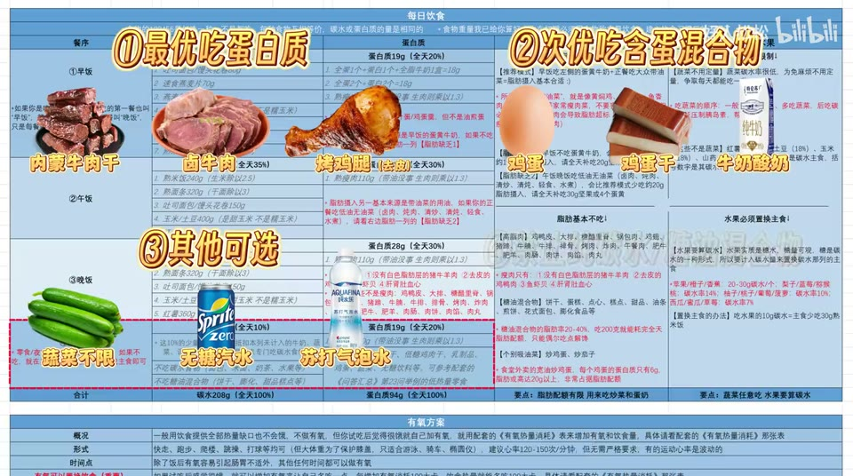

*图 39：最优吃蛋白质，次优吃含蛋混合物，蔬菜、无糖饮料随意，禁止用糖油混合物和纯碳水填肚子。*

三餐没把配额用完，碳水和蛋白质都留了一点给零食夜宵。减脂期睡前很容易饿，吃点东西垫一下是对的：
1. **最优吃蛋白质**：内蒙牛肉干、卤牛肉、烤鸡腿（去皮），带油没事，不是让你吃水煮鸡胸。
2. **次优吃含蛋白质的混合物**：鸡蛋、鸡蛋干、牛奶、酸奶等。
3. **其他可选**：蔬菜不限、无糖汽水、苏打气泡水等。
4. **禁止**靠糖油混合物和纯碳水填肚子：饼干、糕点、薯片、水果、面包、奶茶、米饭、面条等。这些刺激胰岛素、破坏脂肪配额，不要当零食夜宵。

不习惯吃夜宵也没问题，这点配额对总热量影响很小，或者在其他几顿多吃两口补偿也行。画面注：零食里那 10% 的少量碳水是用来抵扣没计入的牛奶、蔬菜、调料里的碳水，不是让你专门吃碳水食物。

**计算误差 [36:36]**
有一点误差，但无所谓：碳水只算了主食，蔬菜、牛奶里的碳水没算（加起来也就十多克）；蛋白质只算了肉、蛋、奶、蛋白粉，主食里的蛋白质没算（量很少，米饭几乎为零）。称重误差、营养数据取用误差、可接受的摄入量波动，都远大于这些没算的量。

**新手两个极端 [37:12]**：要么完全没有量的概念、凭感觉吃，量错得离谱；要么有了概念后对几克、十几克都纠结。原话："你是吃饭，不是造原子弹。"

（推广：问答汇总文档涵盖减脂体重不掉、水果怎么吃、外卖怎么吃、欺骗餐是否需要等问题，在 Excel 套表里。）

### 案例 2：力训者 [38:05]

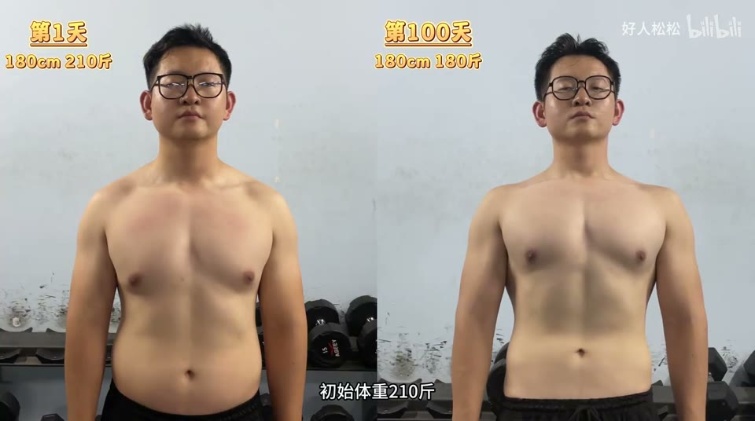

*图 40：UP 主的同学兼健身搭子：180 cm，初始 210 斤，第 100 天 180 斤。*

基本情况：身高 180 cm，初始体重 210 斤，现在 180 斤。三个多月按**每月掉体重 4%** 的一般速度减了 30 斤。UP 主估计他再减 30 斤左右才能到自己的体脂率。方案表上写的体重是 105.0 kg、BMI 32.4、晚饭前练。

**第 1 步：选配额**

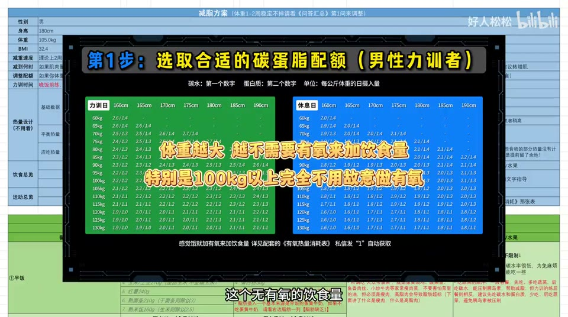

*图 41：男性力训者表；画面提示：体重越大，越不需要有氧来加饮食量，特别是 100 kg 以上完全不用故意做有氧。*

按 180 cm、105 kg 查男性力训者表：**力训日 2.3/1.2，休息日 1.9/1.2**。配额表默认无有氧，但这么大体重的人试一下就知道无有氧的饭量**不会饿**，所以不让他故意做有氧来加饭量。力训者要分力训日和休息日，所以有两个配额，对应绿色和蓝色两张饮食表。

**第 2 步：力训日分餐（绿表）[39:16]**

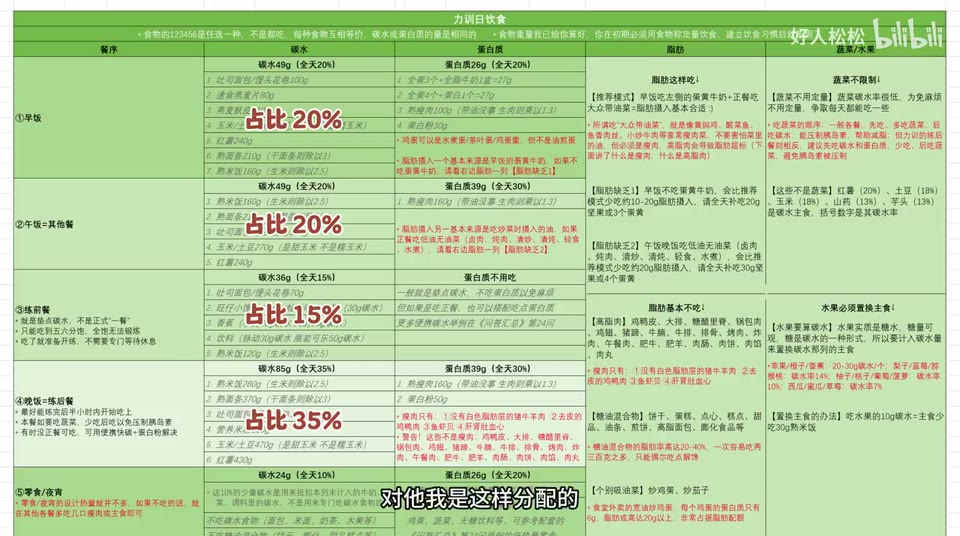

*图 42：晚饭前练，所以晚饭 = 练后餐，碳水占比最大。*

碳水日内分配参考前面说的 **2 : 2 : 2 : 4**，可以微调，但**练后餐占比最大，是全天碳水的 3–5 成**：肌肉多、练得猛、胃口好就多吃点，反之少吃点。他是**晚饭前训练**，所以晚饭 = 练后餐：

| 餐 | 碳水 | 蛋白质 | 备注（画面） |
|---|---|---|---|
| ① 早饭 | 49 g（20%） | 26 g（20%） | 全蛋 3 个 + 全脂牛奶 1 盒 ≈ 27 g 等 |
| ② 午饭 = 其他餐 | 49 g（20%） | 39 g（30%） | 熟瘦肉 160 g |
| ③ 练前餐 | 36 g（15%） | 不用吃 | 只是垫点碳水，不是正式一餐；吃到五六分饱，全饱无法锻炼；吃了就准备开练，不需要专门等待休息 |
| ④ 晚饭 = 练后餐 | 85 g（35%） | 39 g（30%） | 最好练完后半小时内开始吃；本餐要少吃蔬菜，免得压制胰岛素；有时没正餐可吃，可用便携快碳 + 蛋白粉解决 |
| ⑤ 零食/夜宵 | 24 g（10%） | 26 g（20%） | |

- **碳水为什么四餐加起来只有 9 成？**少的 1 成用来抵扣蔬菜、牛奶等没有记录的零碎碳水。
- **蛋白质为什么三餐加起来只有 8 成？**少的 2 成留给零食夜宵的蛋白质食物。早饭蛋白质少一点，是因为食堂早饭没瘦肉不好凑，不是故意少吃。
- 其他训练时间怎么分餐：Excel 套表里有从早到晚 7 种不同训练时间的饮食底表，照抄即可。

**脂肪**：用推荐模式，吃食堂外卖大众菜肴 + 早饭鸡蛋牛奶，此外不吃肥肉、糖油混合物、坚果。如果属于脂肪缺乏 1 或 2，就按表格写的量补坚果或蛋黄。UP 主还是更建议推荐模式："既方便又好吃，脂肪摄入又不多不少。"他自己就是常年吃食堂外卖，体脂率照样保持得住，这叫**生活化饮食**。

**休息日（蓝表）[41:07]**

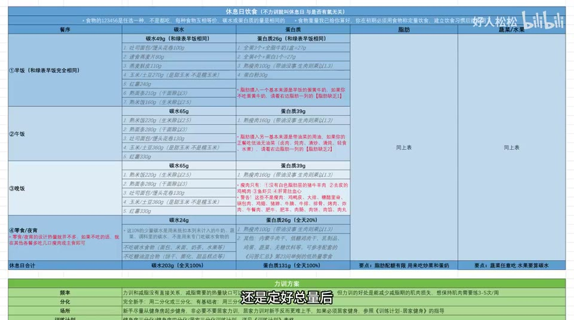

*图 43：休息日：早饭和力训日完全相同，午晚饭碳水各 65 g。*

做法和前面不力训者一样：定好总量后各餐大概分摊，早饭吃不下可以少一点。画面：早饭碳水 49 g / 蛋白质 26 g（和绿表相同）；午饭、晚饭各碳水 65 g / 蛋白质 39 g；零食夜宵碳水 24 g / 蛋白质 26 g；**合计碳水 203 g、蛋白质 131 g**。表头注：不力训就叫休息日，和是否做有氧无关。

**力训方案与有氧方案**：表里写了力训的频率、分化、组次、配重、训练计划等。老手不需要指导，但给新手建立一个训练框架。他目前体重约 105 kg，**保持原有的力量训练、没有做有氧**，全部热量缺口都由饮食提供。画面上的力训方案还写着：想保持肌肉量需要每周练 3–5 次；完全新手用二分化或三分化；新手尽量去健身房起步，非必要不要居家力训。有氧方案（画面）：形式可以是快走、跑步、爬楼、跳绳、打球等，但大体重为了保护膝盖，只适合游泳、骑车、椭圆仪；建议心率 120–150 次/分钟；除了饭后有氧容易引起肠胃不适，其他任何时间都可以做。

### 到底要不要做有氧 [42:07]

**为什么减脂里饮食比有氧重要得多**：既定的热量缺口要么全靠饮食提供（直接用本视频的配额表，不专门做有氧），要么由饮食和有氧共同提供（在配额表基础上用《有氧热量消耗表》加饮食量）。

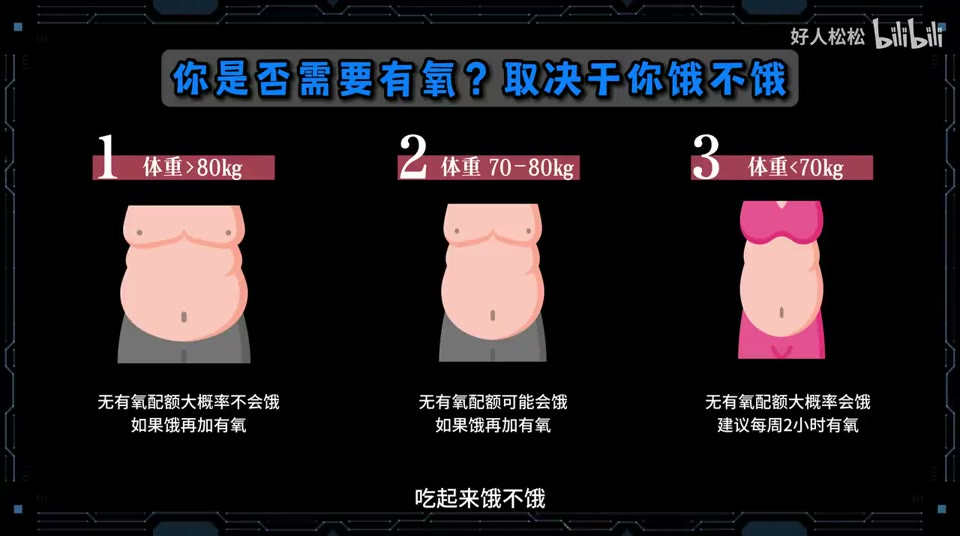

*图 44：按体重分三档：>80 kg、70–80 kg、<70 kg。*

| 体重 | 无有氧配额吃起来 | 建议 |
|---|---|---|
| **>80 kg** | 基础代谢高，大概率不会饿 | 一般不需要加有氧。先试吃几天，真觉得饿再加有氧、加饭量。**100 kg 以上的大胖子更是敦促少做或不做有氧**：不会饿，而且有氧对膝盖压力很大，基本只有游泳、单车、椭圆仪三种可选，跑步爬楼把膝盖搞坏的人太多了 |
| **70–80 kg** | "薛定谔的饿"，可能饿也可能不饿 | 先试无有氧的饭量，饿了再加有氧、同时加饮食量 |
| **<70 kg**（主要是女性） | 大概率会饿 | 建议在无有氧配额基础上，**每周总共做 2 小时有氧**来增加饮食量。很扛饿的话也可以先试试不做 |

这些划分是 UP 主的经验，不是必须如此：大体重里也有不扛饿的人，可以做有氧加饭量；小体重里也有很扛饿的人，可以试试无有氧。

> 有氧只是减脂里、在饮食之外又一个提供热量缺口的办法，**一个可选的工具而已，不用吹也不用黑**。

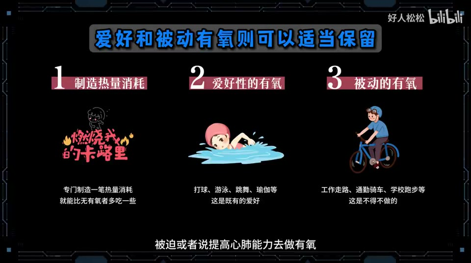

*图 45：出于爱好、被迫或提高心肺能力做的有氧，可以保留。*

**补充 [44:39]**：以上是从热量消耗角度谈有氧是否必要。如果你是出于爱好、被迫或者为了提高心肺能力做有氧（每周打球游泳、每天骑车通勤、学校规定每周跑步），可以保留。但**有氧要有上限**：如果按消耗表换算出来要加的饭量多到吃不下了，就应该减少有氧。而且对力训者来说，每周保持 3–5 次力训很费时间，基本不可能再做大量有氧。

---

## 四、结尾与推广 [45:26]

为什么叫"生活化"减脂：它和生活融为一体，吃的就是食堂外卖大众菜肴，不需要跑步跳操、爆汗燃脂，**只需要初期饮食定量**，唯一忌口的是**肥肉和糖油混合物**。

推广一句话带过：觉得自己做不来可以填置顶评论里的问卷，让 UP 主做个人方案；另外有 B 站充电学习社群（每月图文讲解、直播课、网盘资料包）。

---

## 要点速查

### 三步法总表

| 步骤 | 做什么 | 关键规则 |
|---|---|---|
| 1 选配额 | 按性别、身高、体重、是否力训查表，得到碳水/蛋白质（g/kg/天） | 小体重高配额，大体重低配额；力训日与休息日只差碳水；配额默认**无有氧** |
| 2 分餐 | 把全天总量分到各餐 | 力训日碳水 早 20% / 练前 20% / 练后 40% / 其他 20%，练后最大（3–5 成）；休息日、无力训者三餐大概分摊；只做有氧的那天按休息日吃 |
| 3 算食物 | 克数 ÷ 碳水率或蛋白质率 = 食物重量 | 例：60 g 碳水 ÷ 30% = 200 g 米饭；30 g 蛋白质 ≈ 120 g 熟瘦肉 |

### 关键数字

| 项目 | 数值 |
|---|---|
| 热量换算 | 碳水/蛋白质/脂肪 每克 4 / 4 / 9 大卡 |
| 基础代谢占比 | 全部消耗的 6–8 成 |
| 肌糖原携水 | 1 g 肌糖原带 3 g 水；低碳可脱水减重 1.2–2 kg |
| 脂肪参考 | 约 0.8 g/kg；简化法全天约 50–60 g |
| 早饭蛋白质 | 2 鸡蛋 + 1 盒 250 ml 牛奶 ≈ 20 g |
| 正餐蛋白质 | 120 g 熟瘦肉 ≈ 30 g |
| 米饭碳水率 | 软 25%，食堂外卖一般 30% |
| 换算 | 生米 ÷ 2.5 = 熟米饭量；干面 ÷ 3；熟肉 × 1.3 = 生肉量 |
| 有氧加餐 | 每天多吃 = 每小时消耗 × 每周小时数 ÷ 7；100 大卡 ≈ 80 g 熟米饭 / 80 g 熟瘦肉 / 1 个苹果 / 20 g 坚果 |
| 水果置换 | 水果 10 g 碳水 = 少吃 30 g 熟米饭 |
| 补脂肪 | 早饭不吃蛋黄牛奶：+20 g 坚果；正餐低油：+30 g 坚果 |
| 方案表应吃热量 | 平衡热量 × 80% × 80% = 64% |
| 减重速度 | 方案表：约 2 周减 2%；案例 2：每月约 4% |

### 吃什么 / 不吃什么

| 放心吃 | 少吃或不当日常 |
|---|---|
| 米饭、馒头、面条、吐司、红薯、土豆、玉米等纯碳水主食（定量） | 饺子、肉包、油条、锅盔、手抓饼（碳水:脂肪约 3:2） |
| 一切瘦肉：去皮禽肉、无白色脂肪层的猪牛羊、鱼虾贝、内脏（定量） | 肥肉、带皮肉、大排、排骨、肉丸、肉馅、午餐肉等 |
| 食堂外卖大众带油菜（黄焖鸡、酸菜鱼、鱼香肉丝…） | 糖油混合物：煎炸、膨化、甜品糕点、饼干、面包（部分） |
| 鸡蛋、牛奶（少量）；蔬菜菌菇不限，先吃 | 坚果当零食（除非用于补脂肪） |
| 夜宵：牛肉干、卤牛肉、去皮烤鸡腿、鸡蛋、牛奶酸奶、无糖饮料 | 夜宵：饼干、薯片、水果、面包、奶茶、米饭、面条 |

### 要不要有氧

| 体重 | 建议 |
|---|---|
| >80 kg | 一般不用，饿再加；100 kg+ 少做或不做，保护膝盖（只选游泳/单车/椭圆仪） |
| 70–80 kg | 先试不做，饿了再加 |
| <70 kg | 建议每周 2 小时有氧来加饭量 |

## 初学者实践建议

以下只根据视频内容归纳：

1. **先查表定配额**：按自己的性别、是否力训、身高体重，在对应配额表里找就近格子。力训者记下力训日、休息日两组数，不力训者记一组。数字乘以体重就是每天碳水和蛋白质的克数。
2. **按训练时间分餐**：练后那餐吃全天最多的碳水（3–5 成），早饭、练前、其他餐分剩下的；休息日三餐大概均摊。碳水只分约 9 成、蛋白质只分约 8 成，余量留给蔬菜牛奶里的零碎碳水和夜宵的蛋白质。
3. **初期称重建立"目测能力"**：把常吃的一碗饭、一份菜里的肉各称两次，就知道大概重量，之后不用顿顿称。也不要对几克、十几克纠结。
4. **早饭用蛋奶凑蛋白质，正餐用瘦肉凑**：2 个鸡蛋 + 1 盒牛奶 ≈ 20 g；120 g 熟瘦肉 ≈ 30 g。肉一定是瘦的、去皮的，带油的炒菜可以吃。
5. **脂肪不用算，只管三条忌口**：肥肉、糖油混合物、坚果不当日常填肚子的食物。如果早饭不吃蛋黄牛奶或正餐吃水煮清炒，要按表补坚果。
6. **饿不饿决定要不要有氧**：先按无有氧配额吃几天，饿了再用有氧热量消耗表加有氧、同时加饭量。做有氧那天按休息日吃，不用做练前练后安排。
7. **警惕"体重快速下降"的假象**：头几天掉的几斤多是水。如果靠极低碳水低盐的健康餐减重后停滞，那是"脱水平台期"，不要继续加码少吃多动。

## 不确定之处

- **[08:22] 蛋白质不足的后果**：转写为"脂肪系统容易机能下降"，按上下文应为"免疫系统"，此处原视频未明确，按"免疫系统"整理。
- **[03:22] 午餐鸡肉**：口播说熟肉蛋白率 25%、60 g 净肉 = 15 g 蛋白质；画面午饭合计蛋白质 17 g（含米饭的 2 g），已按画面整理。
- **[02:52] 午餐米饭约 100 g**：是 UP 主目测，不是称重。
- **[27:46] 蛋挞、麦芬的重量和脂肪率**：只出现在画面上。麦芬"135 g × 29% ≈ 40 g"能对上；蛋挞画面写"200 g × 29% ≈ 30 g"，按乘法应约 58 g，数字自相矛盾（可能是重量或脂肪率写错），以口播的"两个蛋挞约 30 g 脂肪"为准，此处原视频未明确。
- **[35:05] 脂肪缺乏 2 的补充量**：口播转写为"30 个坚果"，画面表格是"30 g 坚果或 4 个蛋黄"，按画面以克为单位。
- **案例 1 的配额与总量**：选的格子是 170 cm/105 kg → 2.1/0.9，但画面合计碳水 208 g、蛋白质 94 g，按 106 kg 换算应约为 223 g / 95 g。两者的换算关系此处原视频未明确，表中数字以画面为准。
- **案例 1 的分餐比例**：口播说"早饭两成、午饭三成、晚饭三成"，画面碳水列是 20%/35%/35%/10%，蛋白质列是 20%/30%/30%/20%，以画面为准。
- **示例方案表（175 cm/85 kg）的热量设计**：只出现在画面上（标注"不用看"），UP 主没有口头讲解；表里 2.4 g/kg × 85 kg 写作 201 g、2.0 g/kg × 85 kg 写作 169 g，与直接相乘略有出入，原样照录。
- **配额表只摘录了部分行列**：完整数值请看对应截图，或 UP 主免费提供的 Excel 套表。
- **[14:28] 基础代谢单位**：口播"兆焦"按画面纵轴单位（MJ/天）理解；图中的具体中位数是 UP 主的读图估计。
