# 05 减脂平台期 9 种原因：避坑自查

## 来源

- **视频标题**：减脂平台期9种原因⚡避坑自查
- **UP 主**：好人松松（本期是短视频，由 UP 主的弟弟出镜讲解，自称“坏人 X X”，名字听不清，见「不确定之处」）
- **链接**：https://www.bilibili.com/video/BV1ww4m1q7vU/
- **时长**：约 16:11（971 秒），发布于 2024-06-06
- **章节**：B 站上没有分章节；视频里有 9 张“问题 N”标题卡，本文按这些标题卡分节
- **整理日期**：2026-10-17
- **整理方式**：音频用 Whisper（mlx-whisper，whisper-large-v3-turbo）转成带时间戳的文字稿，再对照视频截图里的字幕和幻灯片校对。专有名词和数字一律以画面为准。只在画面上出现、口头没念的表格内容，是从截图里读出来整理的。

## 总览

这期视频要讲的是：减脂时体重**一两周**都不降，原因是什么。两三天不降不算，因为那主要是肠胃里食物多少和身体水分在变，跟脂肪关系不大。UP 主把常见原因归成 9 条，前 8 条都是“执行”出了问题：吃多少靠感觉、用 APP 记混合食物、无意中吃进太多脂肪、反过来脂肪吃太少、计划了有氧却没做、吃水果不换掉主食、在外吃饭乱吃、经常喝酒。第 9 条是几种少见的特殊情况：之前长期低碳节食、大体重的人瘦了 10kg 以上、维生素 D 缺乏或甲减。结论是：大多数人进入平台期，是因为没按饮食方案执行，不是方案本身有问题。如果确认自己执行没问题，体重还是一两周不动，那就扩大热量缺口：每天少吃 150 大卡，或每周多做 1000 大卡有氧。

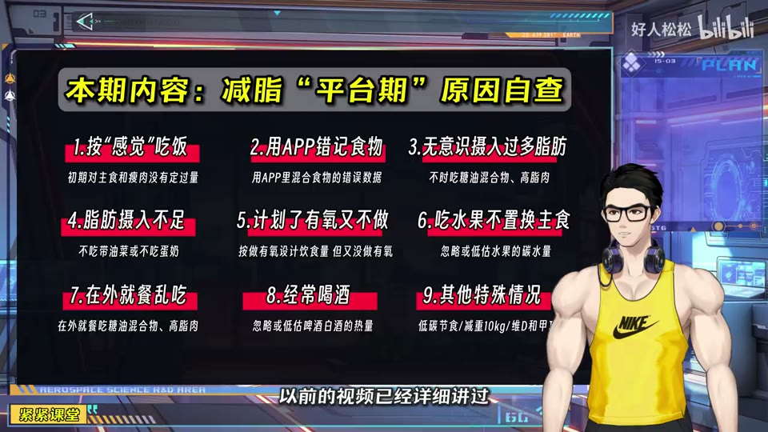

*图 1：开头的总览页，列出 9 种原因，每条下面有一句简述。*

## 目录

- [前提：什么才算“平台期”](#前提什么才算平台期-0025)
- [原因 1：新手按“感觉”吃饭](#原因-1新手按感觉吃饭-0046)
- [原因 2：用 APP（薄荷健康等）错记食物](#原因-2用-app薄荷健康等错记食物-0232)
- [原因 3：无意识摄入过多脂肪](#原因-3无意识摄入过多脂肪-0446)
- [原因 4：刻意“干净饮食”导致脂肪摄入不足](#原因-4刻意干净饮食导致脂肪摄入不足-0622)
- [原因 5：计划了有氧又不做](#原因-5计划了有氧又不做-0809)
- [原因 6：吃水果不置换主食](#原因-6吃水果不置换主食-0919)
- [原因 7：在外就餐乱吃](#原因-7在外就餐乱吃-1025)
- [原因 8：经常喝酒](#原因-8经常喝酒-1155)
- [原因 9：几类特殊情况](#原因-9几类特殊情况-1246)
- [结尾：平台期解决流程图](#结尾平台期解决流程图-1501)
- [要点速查](#要点速查)
- [初学者实践建议](#初学者实践建议)
- [不确定之处](#不确定之处)

---

## 开场 [00:00]

UP 主说，怎么减脂在以前的视频里已经详细讲过。观众可以在置顶评论里下载配套的“套表”，按自己的身高体重改数字，就能做出自己的饮食方案。画面上展示了几位粉丝的减脂前后对比，标题是“合理吃饭 减脂不难”，例如 106kg→82kg、81kg→72kg。这些粉丝先建立了正确的“饮食基建”，然后好好吃饭，体重就降下来了。尽管如此，还是有人常常进入体重稳定不降的“减脂平台期”，所以这期视频专门总结原因。

## 前提：什么才算“平台期” [00:25]

- 本期说的“体重不掉”，指的是**一两周**不降，不是两三天不降。
- 两三天内的体重波动，大部分来自**食物排空程度**和**身体吸水、脱水**，跟脂肪重量的变化几乎无关。
- 所以**体重上升不等于长脂肪，体重下降也不等于减了脂肪**。
- 先确认自己确实已经一两周不降，再对照下面 9 条，看自己犯了哪条。

---

## 原因 1：新手按“感觉”吃饭 [00:46]

**现象**：在建立饮食模式的初期，不给主食和瘦肉定量，全凭感觉吃。原因可能是偷懒、不重视、觉得称重丢面子等。

**为什么会这样**：
- UP 主的减脂教程为了简化，只要求把**碳水和蛋白质**定量，**脂肪不用算**。脂肪的来源固定为早饭的鸡蛋牛奶，加上午饭、晚饭的“大众带油炒菜”。
- 所以你只需要弄清楚**自己的一碗饭有多重、一份菜里有多少瘦肉**。称两次就知道了，不用天天称、顿顿称。
- 不定量的话，感觉和实际可能差很多。

**真实案例** [01:15]：有位用户一日三餐都在外面餐馆吃一份面条。先不说面条里几乎没有瘦肉、蛋白质不够，光碳水就超标：餐馆一碗面的碳水一般不会低于 100g。UP 主说，他自己只在增肌期的练后餐才吃这么多。这位用户不信，觉得自己只吃到八分饱。直到 UP 主让他打包回家称了一次才信。

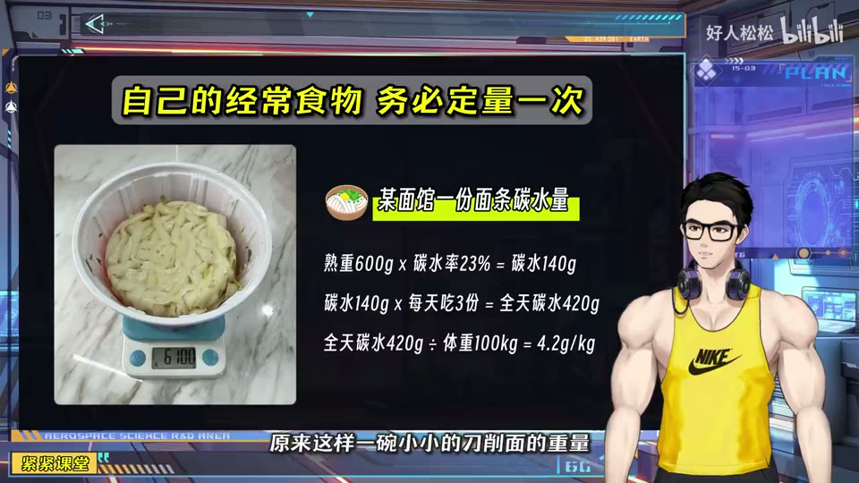

*图 2：称出一份刀削面熟重约 600g，碳水率 23%，一份碳水约 140g；一天吃 3 份就是 420g，按 100kg 体重算是 4.2g/kg。*

画面上的计算：

| 项目 | 数值 |
|---|---|
| 一份面熟重 | 600g（秤上显示约 610g） |
| 碳水率 | 23% |
| 一份碳水 | 约 140g |
| 每天 3 份 | 全天碳水 420g |
| 按体重 100kg 折算 | 4.2g/kg |

这个量已经是饮食表格给他设计的碳水量的**两倍**。

**怎么处理**：
- 不要用“吃到八分饱”“荤素搭配”“正常吃”这类模糊标准来判断吃了多少碳水。
- 不要看 UP 主直播时随便吃就跟着随便吃。他以前做过定量，所以知道自己每餐该吃多少主食、多少瘦肉。没经历过定量的人，“随便吃”和他的“随便吃”不是一回事。
- 自己食堂的一碗饭、一个馒头有多重，一份炒菜里有多少瘦肉，**自己称一次**。这些各地不统一，UP 主说他也答不上来。

**全国比较统一的“标准化”食物**（画面给出）：

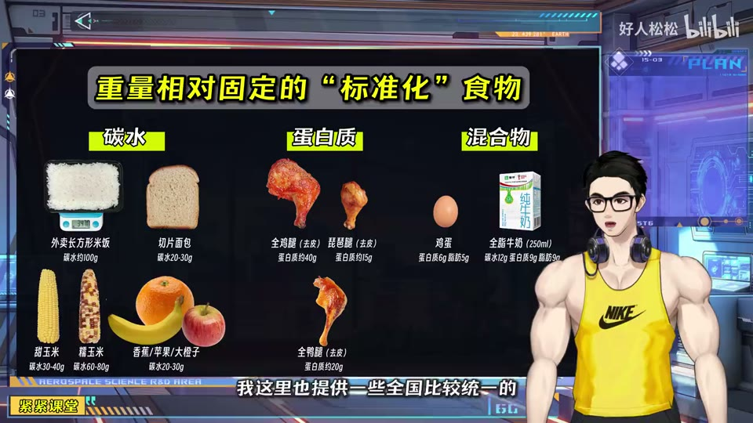

*图 3：几种重量相对固定的食物，以及各自的碳水、蛋白质、脂肪参考量。*

| 类别 | 食物 | 参考值 |
|---|---|---|
| 碳水 | 外卖长方形米饭（1 盒） | 碳水约 100g |
| 碳水 | 切片面包（1 片） | 碳水 20–30g |
| 碳水 | 甜玉米（1 根） | 碳水 30–40g |
| 碳水 | 糯玉米（1 根） | 碳水 60–80g |
| 碳水 | 香蕉 / 苹果 / 大橙子（1 个） | 碳水 20–30g |
| 蛋白质 | 全鸡腿（去皮） | 蛋白质约 40g |
| 蛋白质 | 琵琶腿（去皮） | 蛋白质约 15g |
| 蛋白质 | 全鸭腿（去皮） | 蛋白质约 20g |
| 混合物 | 鸡蛋（1 个） | 蛋白质 6g，脂肪 5g |
| 混合物 | 全脂牛奶（250ml） | 碳水 12g，蛋白质 9g，脂肪 9g |

---

## 原因 2：用 APP（薄荷健康等）错记食物 [02:32]

**现象**：用薄荷健康这类 APP 记录饮食，但 APP 显示的量和实际吃进去的差别很大。

**为什么会这样（UP 主给的原理）**：
- 薄荷 APP 里的食物碳蛋脂数据，来自中国疾控中心营养所出版的《中国食物成分表（标准版）》。这套书测定了一万多种**单一食物**的碳蛋脂比例。
- 注意是**单一食物**，不是几种单一食物一起烹饪成的**混合食物**。例如“土豆烧牛肉”是混合食物，而土豆、牛肉的红色瘦肉部分、牛肉的白色肥肉部分、植物油，这四样分别是单一食物。
- 这套工具书连很偏门的单一食物都测了，却不收混合食物，原因是：**混合食物的原料配比一变，整道菜的碳蛋脂比例就会大变**。这类数据本来就不应该存在。

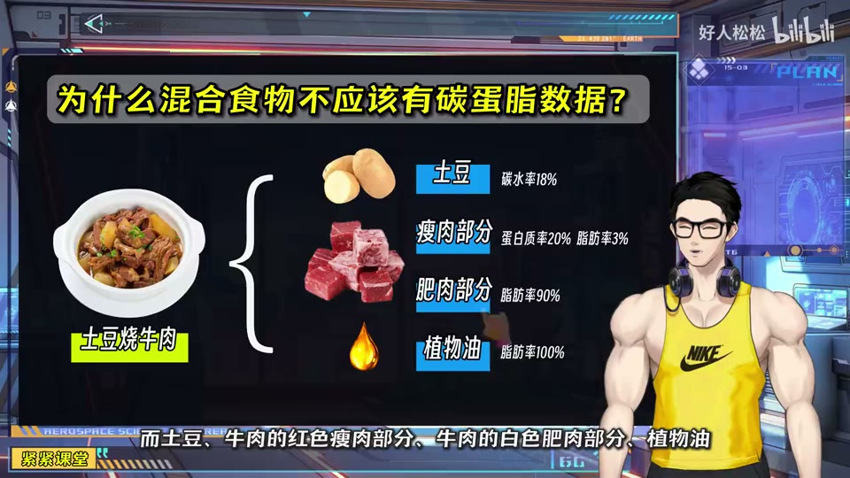

*图 4：土豆烧牛肉 = 土豆（碳水率 18%）+ 瘦肉部分（蛋白质率 20%、脂肪率 3%）+ 肥肉部分（脂肪率 90%）+ 植物油（脂肪率 100%）。*

**例子：两种“土豆烧牛肉”**（画面给出）：

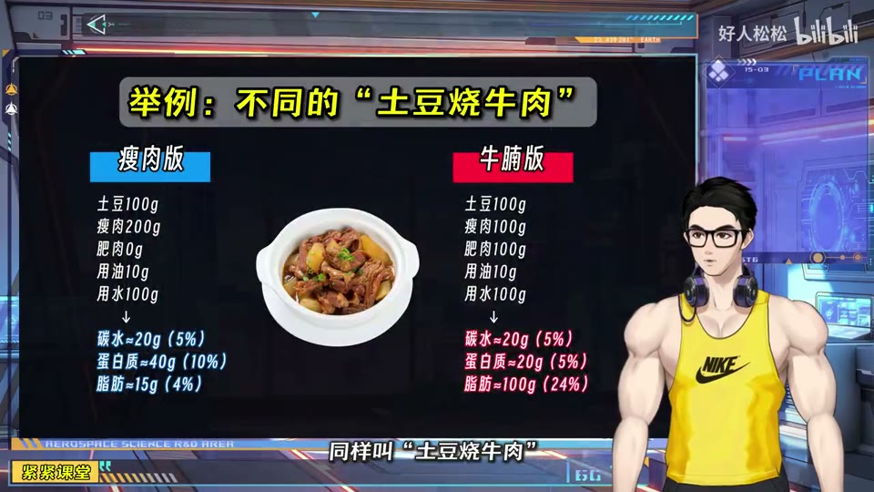

*图 5：同样叫“土豆烧牛肉”，瘦肉版和牛腩版的脂肪量相差好几倍。*

| | 瘦肉版 | 牛腩版 |
|---|---|---|
| 土豆 | 100g | 100g |
| 瘦肉 | 200g | 100g |
| 肥肉 | 0g | 100g |
| 用油 | 10g | 10g |
| 用水 | 100g | 100g |
| **碳水** | ≈20g（5%） | ≈20g（5%） |
| **蛋白质** | ≈40g（10%） | ≈20g（5%） |
| **脂肪** | ≈15g（4%） | ≈100g（24%） |

- 薄荷等 APP 为了让用户记录时“方便”，自己加了大量混合食物。UP 主的评价是“看似方便，实则害人”。
- 也不能说 APP 的数据是错的，因为它在下面附了一份配料表，意思是“这个数据只对应这种配料做出来的菜”。但普通用户很难理解这一层。

**例子：薄荷里的“牛肉面”** [03:51]：同样叫牛肉面，数据互相矛盾，碳水率从 6% 到 22% 不等。

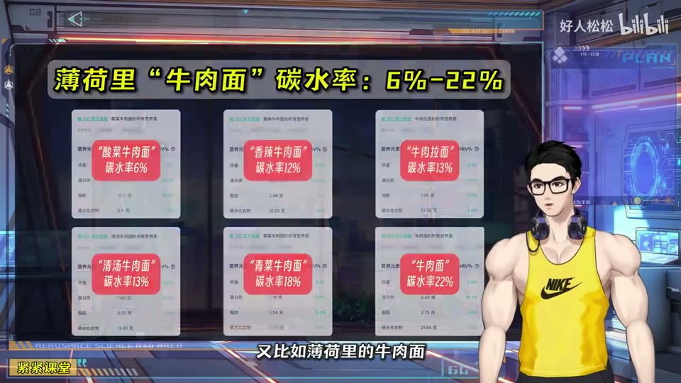

*图 6：薄荷 APP 里几种“牛肉面”的碳水率：酸菜牛肉面 6%、香辣牛肉面 12%、牛肉拉面 13%、清汤牛肉面 13%、青菜牛肉面 18%、牛肉面 22%。*

结果就是：天天往 APP 里录一堆混合食物，算出来的数字没有意义（UP 主的说法是“算了个寂寞”）。

**怎么处理：把混合食物拆成单一食物来算** [04:09]

一道炒菜拆成四部分：**瘦肉、肥肉、主食型“蔬菜”（如果有）、直接吃油**。叶子菜、菌菇这类典型意义上的蔬菜可以忽略不计。

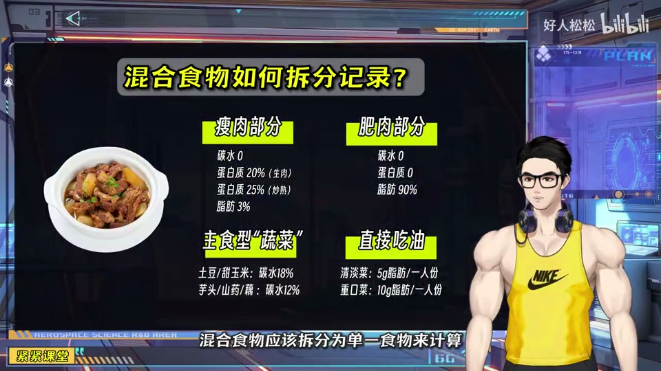

*图 7：混合食物拆分记录时，四部分各自的参考营养值。*

| 部分 | 参考值（画面给出） |
|---|---|
| 瘦肉部分 | 碳水 0；蛋白质 20%（生肉）/ 25%（炒熟）；脂肪 3% |
| 肥肉部分 | 碳水 0；蛋白质 0；脂肪 90% |
| 主食型“蔬菜” | 土豆 / 甜玉米：碳水 18%；芋头 / 山药 / 藕：碳水 12% |
| 直接吃油 | 清淡菜：5g 脂肪 / 一人份；重口菜：10g 脂肪 / 一人份 |

- **肥肉和瘦肉必须分开算**。肥肉的脂肪率是 90%，吃肥肉基本等于直接喝油，多一点肥肉，整道菜的脂肪量就会大涨。
- 所以 UP 主一直建议**只吃瘦肉**，这样肥肉就不用定量了。如果非要吃肥肉，就得自己定量，而且吃几口就会用掉全天的脂肪配额。

---

## 原因 3：无意识摄入过多脂肪 [04:46]

**现象**：脂肪本来不要求定量，只靠早饭的鸡蛋牛奶加午晚饭瘦肉炒菜里的油，总量就刚好。但有人隔三差五吃**高脂肉**或**糖油混合物**，脂肪就超标了。

**脂肪超标 1：吃高脂肉（区别于瘦肉）**

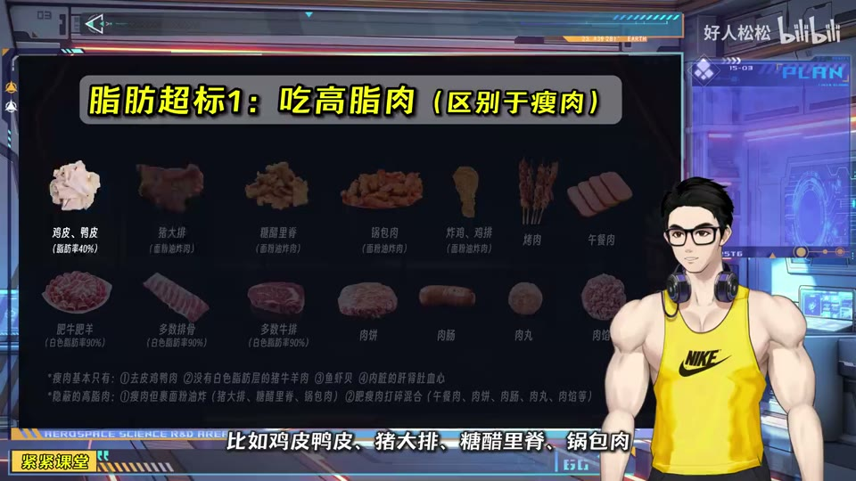

*图 8：常见的高脂肉，包括带皮禽肉、裹粉油炸肉、肥牛肥羊，以及肉饼、肉肠、肉丸、肉馅等打碎的肉。*

画面列出的高脂肉：
- 鸡皮、鸭皮（脂肪率 40%）
- 猪大排、糖醋里脊、锅包肉、炸鸡 / 鸡排（都是裹面粉油炸的肉）
- 烤肉、午餐肉
- 肥牛肥羊、多数排骨、多数牛排（白色脂肪率 90%）
- 肉饼、肉肠、肉丸、肉馅

画面底部的注释：
- 瘦肉基本只有四类：① 去皮鸡鸭肉；② 没有白色脂肪层的猪牛羊肉；③ 鱼虾贝；④ 内脏里的肝、肾、肚、血、心。
- 隐蔽的高脂肉有两类：① 本体是瘦肉，但裹了面粉去油炸（猪大排、糖醋里脊、锅包肉），跟炸鸡柳、炸鸡排是一回事，所以**不算瘦肉**；② 肥肉和瘦肉打碎混在一起（午餐肉、肉饼、肉肠、肉丸、肉馅等）。它们其实是五花肉，只是打碎后看不出白色脂肪层。例如牛肉汉堡的肉饼、麻辣烫里的肉丸、肉包子的肉馅。

**脂肪超标 2：吃糖油混合物（区别于碳水主食）**

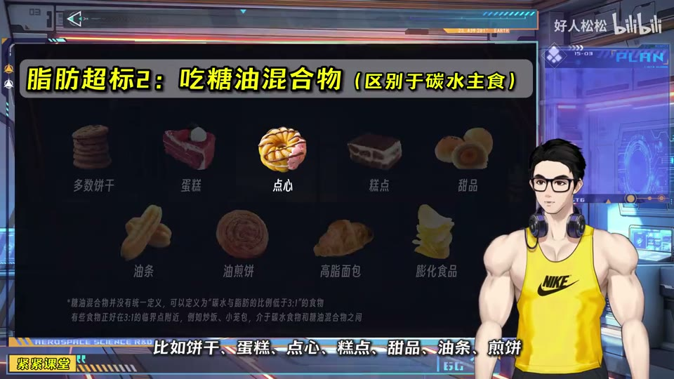

*图 9：常见的糖油混合物，包括饼干、蛋糕、点心、糕点、甜品、油条、油煎饼、高脂面包、膨化食品。*

- 画面列出：多数饼干、蛋糕、点心、糕点、甜品、油条、油煎饼、高脂面包、膨化食品。
- 画面注释：糖油混合物没有统一定义，可以定义为“**碳水与脂肪的比例低于 3:1**”的食物。有些食物正好在 3:1 的临界点附近，例如炒饭、小笼包，介于碳水食物和糖油混合物之间。
- 口头还提到“极个别非常吸油的菜”，例如**炒鸡蛋、炒茄子**。

**怎么处理**：
- 这些食物偶尔吃没关系。但如果把它们当作隔三差五就吃的**基础食物**，脂肪很难不超标。

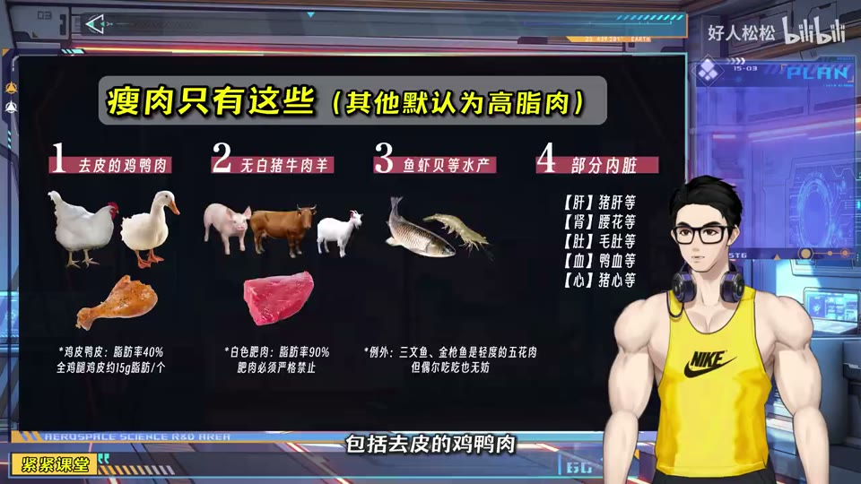

*图 10：瘦肉的完整清单，不在清单上的一律默认是高脂肉。*

**瘦肉只有这些（其他默认为高脂肉）** [06:02]：

| 类别 | 内容 | 画面注释 |
|---|---|---|
| 1 去皮的鸡鸭肉 | 鸡、鸭、去皮鸡腿 | 鸡皮鸭皮脂肪率 40%；一个全鸡腿的鸡皮约 15g 脂肪 |
| 2 无白猪牛肉羊 | 没有白色脂肪层的猪牛羊肉 | 白色肥肉脂肪率 90%，肥肉必须严格禁止 |
| 3 鱼虾贝等水产 | 鱼、虾、贝 | 例外：三文鱼、金枪鱼算“轻度的五花肉”，偶尔吃也无妨 |
| 4 部分内脏 | 【肝】猪肝等；【肾】腰花等；【肚】毛肚等；【血】鸭血等；【心】猪心等 | — |

UP 主还说，观众里有相当多的人分不清什么是瘦肉、什么不是。分不清就别想减脂了。

---

## 原因 4：刻意“干净饮食”导致脂肪摄入不足 [06:22]

**现象**：跟原因 3 正好相反。有人减脂走极端（UP 主称为“二极管化”）：胖的时候天天吃高脂肉和糖油混合物，决定减肥后把这些都禁掉，这一步是对的；但接着把大众带油炒菜、甚至鸡蛋牛奶也禁了，脂肪就吃不够了。

**正确的默认做法（“生活化减脂”的关键点）**：
- 每天留出 **50–60g 脂肪配额**，用于早饭的鸡蛋牛奶，加上午饭、晚饭大众带油炒菜里的油。
- 除此之外，不吃高脂肉和糖油混合物。这样脂肪摄入就刚好合适。

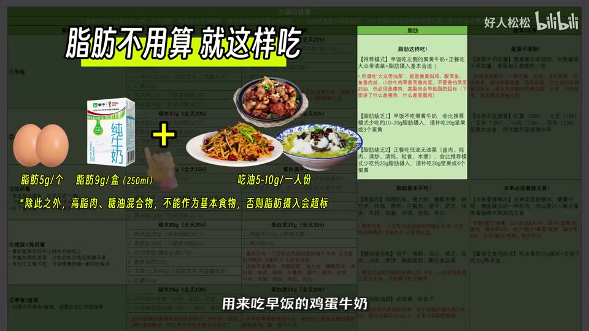

*图 11：默认的脂肪来源：鸡蛋每个约 5g 脂肪，纯牛奶每盒（250ml）约 9g，炒菜吃油每人份 5–10g；高脂肉和糖油混合物不能当基本食物，否则脂肪会超标。*

**为什么脂肪不能太少（UP 主给的原理）** [06:56]：
- 任何一本营养学教科书都有专门的大章节讲脂肪该吃多少，因为脂肪是**必需营养素**，意思是不吃就会出问题。
- 画面列出的脂肪生理功能：维持脂溶性维生素 A、D、E、K 的吸收；维持细胞膜结构；维持脑和神经组织的构成；维持性激素合成。

**怎么自查、怎么补** [07:20]：

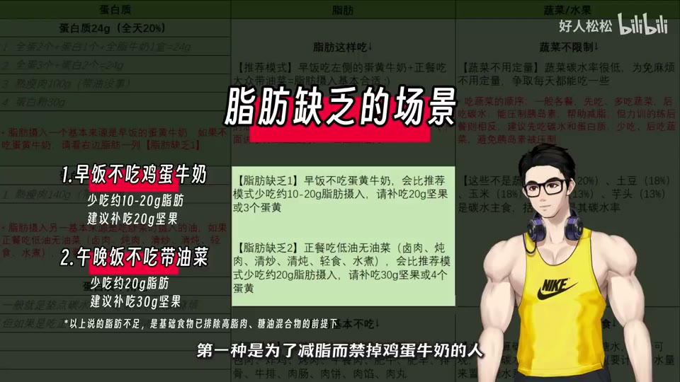

*图 12：饮食表格里预先写好的两种“脂肪缺乏”场景，以及各自的补充建议。*

| 场景 | 少吃的脂肪 | 建议补充（画面） |
|---|---|---|
| 1. 早饭不吃鸡蛋牛奶 | 约 10–20g | 补吃 20g 坚果（表格里另写：或 3 个蛋黄） |
| 2. 午晚饭不吃带油菜，专吃低油无油菜（卤肉、清炒、清炖、水煮、白灼、轻食等） | 约 20g | 补吃 30g 坚果（表格里另写：或 4 个蛋黄） |

- 画面注释：以上说的脂肪不足，前提是基础食物里已经排除了高脂肉和糖油混合物。
- 口头的说法是：第一种人每天要补 10–20g 脂肪，第二种人每天要补 20g 左右。如果一定要坚持这两种不太生活化的饮食习惯，就用**坚果或其他脂肪食物**补足。
- UP 主好人松松自己不额外补脂肪：早饭吃鸡蛋牛奶，午饭、晚饭在食堂吃带油的瘦肉炒菜（如黄焖鸡、酸菜鱼、小炒牛肉、鱼香肉丝等），这样脂肪已经够了。

---

## 原因 5：计划了有氧又不做 [08:09]

**原理：饮食和有氧是置换关系**
- 减脂需要的热量缺口，可以只靠饮食制造，也可以靠饮食加有氧一起制造。**减脂不是必须做有氧，也不是必须不做有氧。**
- 如果计划做有氧，设计饮食热量时“有氧”这一行就会有数字，算出来的“应吃热量”会比同条件下不做有氧的人**更多**。

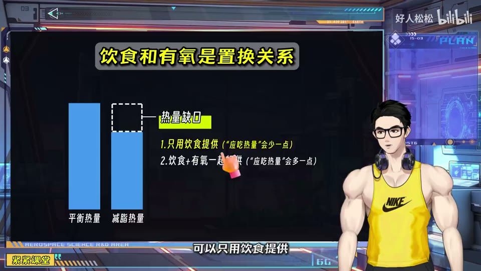

*图 13：平衡热量与减脂热量之间的差就是热量缺口。只用饮食制造缺口时，“应吃热量”会少一点；饮食加有氧一起制造时，“应吃热量”会多一点。*

**UP 主的建议**：
- 本来就不喜欢有氧、或者是被迫做有氧的人：**先算出不做有氧时的饮食量**，看够不够吃。
- 如果觉得太饿、不够吃，再用配套的“有氧热量消耗表”，选一些有氧项目加上去，就能比不做有氧时多吃一点。
- 这张表里的数字来自学界用**双标水法或间接测热法**，对不同体重、不同项目的有氧热量消耗所做的测定，算是比较可靠的（表里每个项目的具体数值此处原视频未明确，画面只是一闪而过）。

**问题出在哪**：有人做饮食规划时兴致勃勃地加上了有氧，按“做有氧”的饮食量来吃，实际却三天打鱼两天晒网，因为工作忙、事情多、偷懒等原因，有氧慢慢变成少做或不做。结果是吃得比不做有氧的人多，有氧却没做，**热量缺口就被抹平了**，体重停滞不前。

**怎么自查**：对照自己的饮食方案里是否算了有氧，再看实际有没有按计划做。

---

## 原因 6：吃水果不置换主食 [09:19]

**原理**：
- UP 主的说法是：**水果就是糖水**。一杯白水里加了些葡萄糖、果糖、蔗糖，就是水果，跟可乐、奶茶是一回事。
- 设计饮食量时，碳水配额已经全部分给了主食。所以要在主食之外**稳定地**吃水果，就得算出水果的碳水量，相应**少吃一部分主食**来置换。

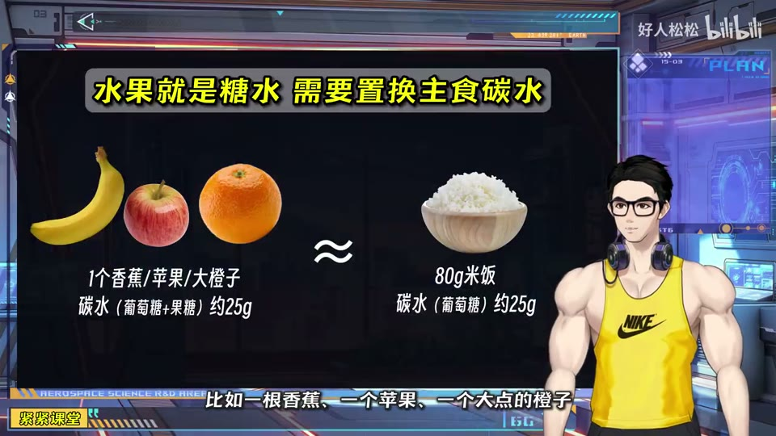

*图 14：1 个香蕉、苹果或大橙子的碳水（葡萄糖 + 果糖）约 25g，约等于 80g 米饭的碳水（葡萄糖）约 25g。*

**数字**：
- 一根香蕉、一个苹果或一个大点的橙子，大约 20 多克糖（画面写约 25g），相当于要少吃 **80g 米饭**。
- 这已经是很多女性减脂时一餐主食的一半。

**女性要特别注意**：女性体重普遍较低，基础代谢较低，算出来的应吃热量本来就不多。一个水果就可能相当于一餐主食的一半。每天吃一两个水果又不置换主食，热量缺口就容易被抹平。

**吃水果要适可而止** [10:06]：

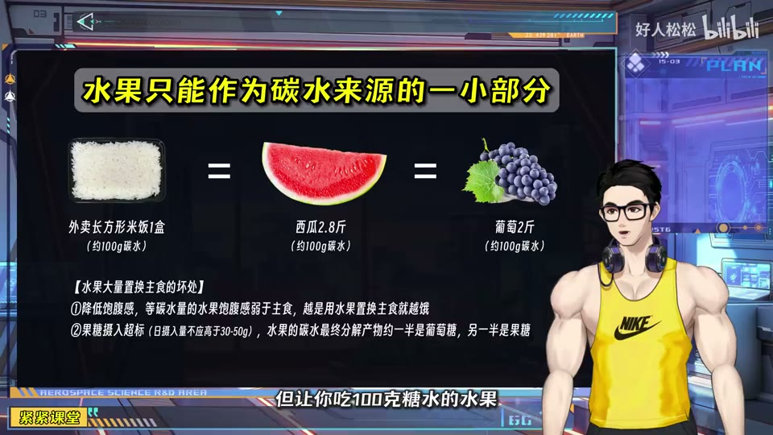

*图 15：外卖长方形米饭 1 盒、西瓜 2.8 斤、葡萄 2 斤，碳水都约 100g；下方列出用水果大量置换主食的两个坏处。*

- 用水果置换主食，一定会降低饱腹感。让你吃 100g 碳水的米饭不一定吃得下，但吃 100g 糖的水果（两斤多西瓜或葡萄）非常容易。糖水没有饱腹感，又好吃，人人都能一直吃下去。
- 画面列出的“水果大量置换主食的坏处”：
  1. **降低饱腹感**：同样碳水量的水果，饱腹感比主食弱，越是用水果置换主食就越饿。
  2. **果糖摄入超标**（每天摄入量不应高于 30–50g）：水果里的碳水最终分解产物大约一半是葡萄糖，一半是果糖。

---

## 原因 7：在外就餐乱吃 [10:25]

**原理**：在外吃饭本身不影响减脂。餐桌上的东西跟在家、在食堂吃的一样，不外乎这几类：**纯碳水主食、瘦肉、蔬菜、高脂肉、糖油混合物**。

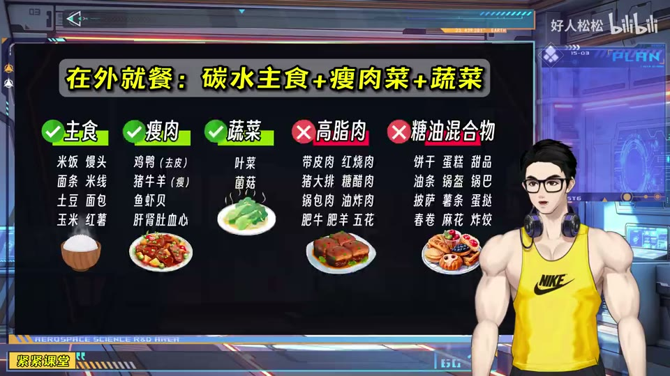

*图 16：在外就餐时，主食、瘦肉、蔬菜可以吃，高脂肉和糖油混合物不吃。*

| 可以吃 / 不吃 | 类别 | 画面列举 |
|---|---|---|
| ✓ | 主食 | 米饭、馒头、面条、米线、土豆、面包、玉米、红薯 |
| ✓ | 瘦肉 | 鸡鸭（去皮）、猪牛羊（瘦）、鱼虾贝、肝肾肚血心 |
| ✓ | 蔬菜 | 叶菜、菌菇 |
| ✗ | 高脂肉 | 带皮肉、红烧肉、猪大排、糖醋肉、锅包肉、油炸肉、肥牛、肥羊、五花 |
| ✗ | 糖油混合物 | 饼干、蛋糕、甜品、油条、锅盔、锅巴、披萨、薯条、蛋挞、春卷、麻花、炸饺 |

**怎么吃**：
- **碳水**：参考自己平时的主食量吃，不用称，大概就行。
- **瘦肉**：比较随意，多吃一些也无妨。
- **蔬菜**：更随意。
- **高脂肉和糖油混合物**：原则上少吃或不吃，非要吃就尝一下。

**例子：四川火锅** [10:56]

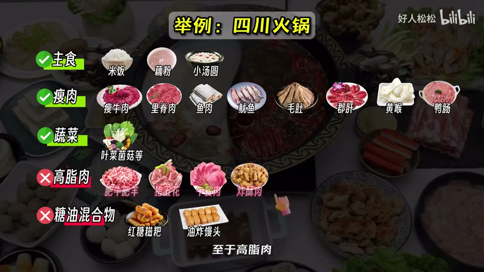

*图 17：四川火锅里各类食物的归类。*

| 类别 | 火锅里的选择（以画面为准） |
|---|---|
| ✓ 主食 | 米饭、藕粉、小汤圆 |
| ✓ 瘦肉 | 瘦牛肉、里脊肉、鱼肉、鱿鱼、毛肚、郡肝、黄喉、鸭肠 |
| ✓ 蔬菜 | 叶菜、菌菇等 |
| ✗ 高脂肉 | 肥牛肥羊、猪五花、午餐肉、炸酥肉 |
| ✗ 糖油混合物 | 红糖糍粑、油炸馒头 |

- 高脂肉和糖油混合物基本别吃，最多尝一点。
- 这样一整餐的脂肪主要来自蘸火锅带上的红油，跟在家吃炒菜本质上差不多。

**问题出在哪**：很多人一到外面吃饭就放开了：主食不选纯碳水，专挑糖油混合物；肉不选瘦肉，专挑高脂肉。这样一顿就能抹平好几天的热量缺口，“一周白干”。

**怎么处理**：建立可持续的饮食模式，即 **纯碳水主食 + 自己喜欢的瘦肉炒菜 + 自己喜欢的蔬菜**。菜里有油没关系，但一定要排除高脂肉和糖油混合物，最多尝一点点。

---

## 原因 8：经常喝酒 [11:55]

**原理**：酒精的热量是**每克 7 大卡**。

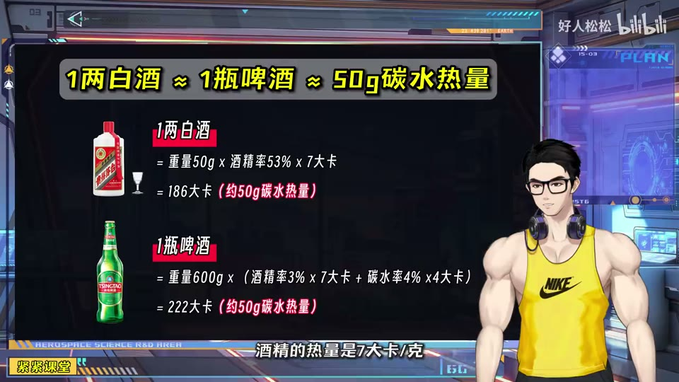

*图 18：白酒和啤酒的热量计算，各自约等于 50g 碳水的热量。*

| 酒 | 计算（画面） | 热量 |
|---|---|---|
| 1 两白酒 | 重量 50g × 酒精率 53% × 7 大卡 | 186 大卡（约 50g 碳水热量） |
| 1 瓶啤酒 | 重量 600g × （酒精率 3% × 7 大卡 + 碳水率 4% × 4 大卡） | 222 大卡（约 50g 碳水热量） |

口头的说法是：一两白酒大约相当于一瓶啤酒，大约 200 大卡，也就是 50g 碳水的热量。

**影响有多大**：一次喝 5 两白酒或 5 瓶啤酒，热量相当于 **250g 碳水**，已经超过一般人减脂期的全天碳水总量。就算那天一点碳水都不吃，也很难抵消，非常影响减脂。

**怎么处理**：
- 能不喝就别喝。
- 如果因为应酬必须定期喝，**不建议用主食去抵消**，因为那要砍掉很多主食。
- 可以**用有氧抵消**：例如每周喝 5 两白酒或 5 瓶啤酒，约 1000 大卡，一般体重的人当周额外做 **三四个小时有氧** 就能抵消。具体项目和时长参考配套表里的“有氧热量消耗表”。

---

## 原因 9：几类特殊情况 [12:46]

这几种情况很少有人碰到，这里只是提一下。

### 9.1 过去是低碳节食者 [12:50]

**现象**：如果你过去吃的碳水比 UP 主减脂视频建议的少得多，恢复到正常碳水量后，体重会先涨。

**原理**：恢复碳水后，**肌糖原**（肌肉里的淀粉）随之增加，而肌糖原会按 **1:3** 的比例吸水。所以前一两周体重涨 1kg 很正常。哪怕你的减脂方法是对的，体重也会表现为上升。

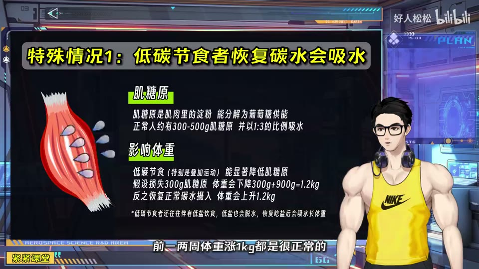

*图 19：肌糖原与体重的关系：低碳节食会让肌糖原明显下降，恢复正常碳水后体重会回升约 1.2kg。*

画面补充：
- 肌糖原是肌肉里的淀粉，能分解成葡萄糖供能。正常人大约有 **300–500g** 肌糖原，并按 1:3 的比例吸水。
- 低碳节食（特别是同时还在运动）会明显降低肌糖原。假设损失 300g 肌糖原，体重会下降 300g + 900g = 1.2kg；反过来恢复正常碳水后，体重会上升 1.2kg。
- 注释：低碳节食者往往还伴有低盐饮食。低盐也会导致脱水，恢复吃盐后会吸水、体重上涨。

**怎么处理**：别急，过了这一两周就好了。

### 9.2 大体重者体重明显下降后没有减少饮食量 [13:12]

**现象**：体重明显下降了，饮食量却没跟着调，热量缺口被抹平了。

**原理**：
- 基础代谢和体重强相关。减脂期体重下降，基础代谢也会正常地跟着下降。
- 画面引用的研究（文献标题为 *Relative changes in resting energy expenditure during weight loss: a systematic review*）：体重下降 10kg，基础代谢大约下降 **100–150 大卡**。
- 这和基础代谢预测公式的结果很接近。UP 主的表格用的是 **Mifflin-St Jeor 方程**，按这个公式算，体重下降 10kg，基础代谢大约下降 100 大卡。

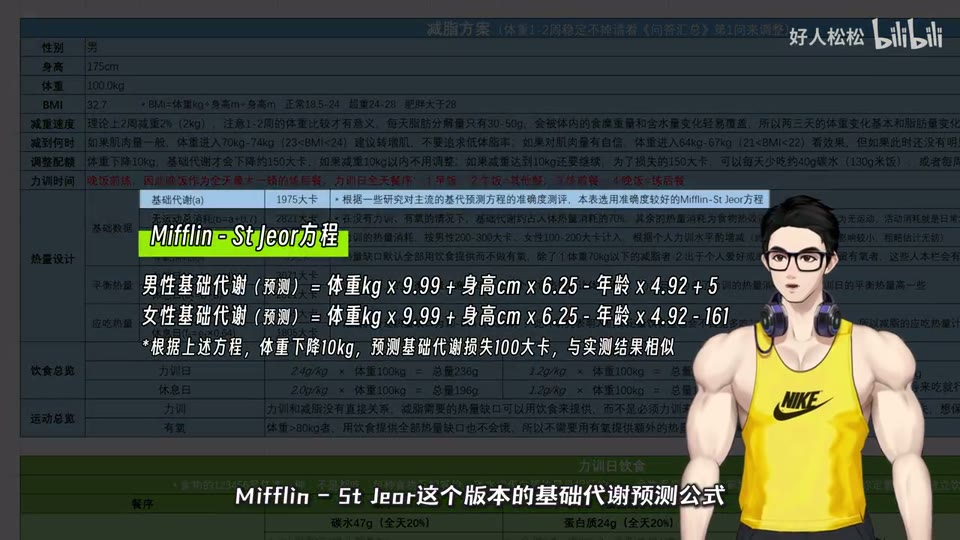

*图 20：减脂方案表格里用的 Mifflin-St Jeor 基础代谢预测公式。*

画面上的公式：
- 男性基础代谢（预测）= 体重 kg × 9.99 + 身高 cm × 6.25 − 年龄 × 4.92 + 5
- 女性基础代谢（预测）= 体重 kg × 9.99 + 身高 cm × 6.25 − 年龄 × 4.92 − 161
- 注释：按这个方程，体重下降 10kg，预测基础代谢减少 100 大卡，与实测结果相似。

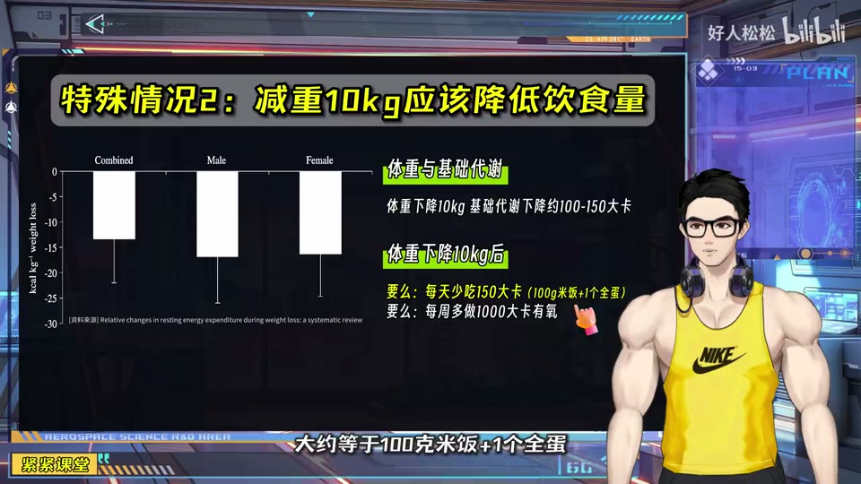

*图 21：体重下降 10kg 后的两种调整办法：每天少吃 150 大卡，或每周多做 1000 大卡有氧。*

**怎么处理**（体重下降 10kg 以后还要继续减时，为了保持原来的热量缺口，二选一，两种办法差不多等价）：
- **要么每天少吃 150 大卡**，大约等于 **100g 米饭 + 1 个全蛋**；
- **要么每周多做 1000 大卡有氧**（参考配套的“有氧热量消耗表”）。

如果只减了几公斤，就**不用调整**。体重降 10kg，基础代谢才少 100–150 大卡，真的不多，不用折腾。

### 9.3 有明显影响减脂的疾病而不自知 [14:15]

这种情况“非常非常非常罕见”。

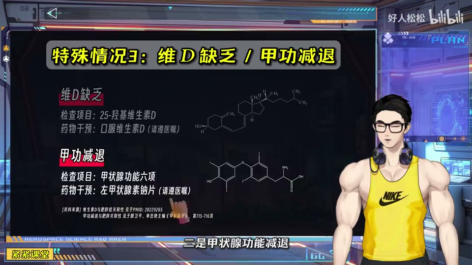

*图 22：两种可能影响减脂的疾病，以及对应的检查项目和药物干预。*

| 疾病 | 检查项目 | 药物干预（画面注明“请遵医嘱”） |
|---|---|---|
| 维生素 D 缺乏 | 25-羟基维生素 D | 口服维生素 D |
| 甲状腺功能减退 | 甲状腺功能六项 | 左甲状腺素钠片 |

画面标注的资料来源：维生素 D 与肥胖症的关联见 PMID: 28229265；甲减与肥胖的关联见滕卫平、单忠艳主编的《甲状腺学》第 715–716 页。

**怎么处理**：
- 每一两年应该做一次体检，这些都是很基础的体检项目。也可以单独去内分泌科或内科开单检查。
- 如果真有问题，遵医嘱吃药就能很好地纠正。

**UP 主特别强调**：这是减脂失败“极其极其罕见”的原因，99.9% 减不动的人都不是因为这个。很多人发现不了自己真正的问题，总归咎于“激素问题”“吸收问题”“体质问题”这类所谓客观原因，这是不对的。这里只是提一下，别把它当成自己减不下来的理由。

---

## 结尾：平台期解决流程图 [15:01]

UP 主总结：大部分人出现平台期，都是**没能执行设计好的饮食方案**，而不是方案本身有问题。

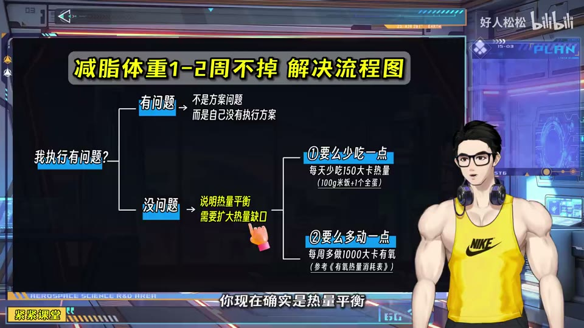

*图 23：先问“我执行有问题吗”。有问题就去改执行；没问题就扩大热量缺口，少吃一点或多动一点。*

流程（画面内容）：

1. **我执行有问题吗？**
   - **有问题** → 不是方案的问题，是自己没有执行方案，回头逐条改正上面的问题。
   - **没问题**（确认真的没有上述问题，体重还是一两周不降）→ 说明现在确实是热量平衡、没有热量缺口，需要**扩大热量缺口**：
     - ① **要么少吃一点**：每天少吃 150 大卡（100g 米饭 + 1 个全蛋）；
     - ② **要么多动一点**：每周多做 1000 大卡有氧（参考《有氧热量消耗表》）。
2. 调整后再执行一两周，看体重变化。

**推广（一句话带过）**：视频最后介绍了置顶评论里可下载的免费 Excel 套表，包含减脂 / 增肌饮食底表、常见问题问答、居家和健身房训练计划、各部位肌肉的关节动作等。简介里还有代做个人方案和每月 5 元的充电学习社群。出镜者说长视频由好人松松出镜，短视频由他出镜，欢迎在评论区留言想看的话题。

---

## 要点速查

| # | 原因 | 自查问题 | 处理 / 数字 |
|---|---|---|---|
| 0 | 先确认是不是平台期 | 是一两周不降，还是只是两三天不降？ | 两三天的波动主要是水分和肠胃内容物，不算平台期 |
| 1 | 按“感觉”吃饭 | 自己常吃的那碗饭、那份菜的瘦肉，称过没有？ | 常吃的食物至少称一次；不用“八分饱”判断；一碗餐馆面条碳水一般 ≥100g |
| 2 | 用 APP 错记食物 | 是不是在 APP 里直接录“土豆烧牛肉”“牛肉面”这类混合食物？ | 拆成瘦肉、肥肉、主食型蔬菜、直接吃油四部分分别算；叶菜菌菇忽略；肥瘦必须分开 |
| 3 | 无意识摄入过多脂肪 | 是否经常吃高脂肉（带皮、裹粉油炸、肥牛肥羊、肉饼肉丸肉馅）或糖油混合物？ | 不把它们当基础食物；瘦肉只认四类：去皮鸡鸭、无白猪牛羊、鱼虾贝、肝肾肚血心 |
| 4 | 脂肪摄入不足 | 是否连鸡蛋牛奶、带油炒菜也禁了？ | 每天 50–60g 脂肪配额；不吃蛋奶补约 20g 坚果，不吃带油菜补约 30g 坚果 |
| 5 | 计划了有氧又不做 | 饮食量是按“有氧”算的吗？实际做了吗？ | 不爱有氧的人先按无有氧算饮食量；算了有氧就要做到 |
| 6 | 吃水果不置换主食 | 每天在主食之外稳定地吃水果吗？ | 1 个香蕉 / 苹果 / 大橙子（约 25g 碳水）≈ 少吃 80g 米饭；水果只能占碳水的一小部分 |
| 7 | 在外就餐乱吃 | 在外是否专挑糖油混合物和高脂肉？ | 碳水主食 + 瘦肉菜 + 蔬菜；高脂肉、糖油混合物最多尝一点 |
| 8 | 经常喝酒 | 每周喝多少？ | 1 两白酒 ≈ 1 瓶啤酒 ≈ 50g 碳水热量（约 200 大卡）；必须喝时用有氧抵消，每周 1000 大卡约需额外三四小时有氧 |
| 9a | 曾经低碳节食 | 最近刚把碳水恢复到正常量吗？ | 前一两周涨约 1kg 是糖原吸水，正常，等一两周 |
| 9b | 大体重者已减 10kg | 体重已降 10kg 以上，但饮食没调整？ | 每天少吃 150 大卡（100g 米饭 + 1 全蛋），或每周多做 1000 大卡有氧；只减了几公斤不用调 |
| 9c | 维 D 缺乏 / 甲减 | 一两年内体检过吗？ | 查 25-羟基维生素 D、甲状腺功能六项，有问题遵医嘱；极其罕见，别拿来当借口 |
| — | 全都没问题仍不降 | — | 扩大热量缺口：每天 −150 大卡，或每周 +1000 大卡有氧，再执行一两周看效果 |

## 初学者实践建议

以下只根据视频内容归纳：

1. **先判断是不是真的停滞**：看一两周的体重趋势，不要因为两三天的波动着急。
2. **至少做一次定量**：把自己最常吃的主食（食堂一碗饭、一个馒头）和常吃炒菜里的瘦肉称一次，记下来。之后就可以凭这个“随便吃”。
3. **记录饮食时不要录混合食物**：按瘦肉、肥肉、主食型蔬菜、直接吃油四部分拆开记。叶菜和菌菇不用记。
4. **只吃瘦肉**，并按视频的四类清单辨认瘦肉。裹粉油炸的肉和打碎的肉（肉饼、肉丸、肉馅）不算瘦肉。
5. **脂肪按默认模式吃**：早饭鸡蛋牛奶 + 午晚饭带油的瘦肉炒菜，不要矫枉过正。如果实在不吃其中一项，用坚果补足。
6. **有氧是可选项**：先按不做有氧算饮食量，觉得太饿再加有氧换取多吃一些。一旦按有氧算了饮食量，就要真的去做。
7. **吃水果要从主食里扣**：一个香蕉、苹果或大橙子，大约换掉 80g 米饭。
8. **在外吃饭照样按“碳水主食 + 瘦肉菜 + 蔬菜”来选**。火锅可以参考视频里的例子。
9. **尽量不喝酒**。必须喝时，用当周额外的有氧去抵消，不要靠大幅砍主食。
10. **确认执行没问题、体重还是一两周不降**，再按流程图扩大热量缺口（每天 −150 大卡，或每周 +1000 大卡有氧）。

## 不确定之处

- **出镜者的名字**：开头和结尾，出镜者自称“好人松松的弟弟坏人 X X”。Whisper 两次分别识别为“景景”和“锦锦”，画面左下角栏目名疑似“紧紧课堂”，名字具体是哪两个字此处原视频未明确。
- **有氧热量消耗表的具体数值**：视频里只是一闪而过地展示了这张表（8:42 前后），各项目每小时的消耗数值此处原视频未明确，本文没有抄录。
- **饮食方案表格的详细内容**：视频多次一闪而过地展示了套表里的减脂方案表格（如 8:25、13:38），文字太小，除了已整理进正文的“脂肪缺乏 1 / 2”和 Mifflin-St Jeor 公式外，其余内容此处原视频未明确。
- **1 两白酒的热量**：口头说“大约两百大卡”，画面算出来是 186 大卡。本文按画面写 186 大卡，同时保留口头的近似说法。
- **9.2 节开头**：Whisper 在 13:21–13:26 之间漏了一句，大意应该是在引用研究：体重下降 10kg，基础代谢损失 100–150 大卡（与画面一致），但原句此处原视频未明确。
- **四川火锅的瘦肉清单**：这一段（约 11:07–11:13）Whisper 没转写出来，本文完全按画面列出。
- **原因 3 里的“炒鸡蛋、炒茄子”**：Whisper 识别为“极个别非常稀有的菜”，按上下文应为“非常吸油的菜”，属于推断。
