# 06 生活化减脂增肌：饮食方案与训练计划套表（文字版）

## 来源

- **视频标题**：【免费工具分享】生活化减脂增肌：✅饮食方案 ✅训练计划
- **UP 主**：好人松松（B 站）
- **链接**：https://www.bilibili.com/video/BV1zu4m1N76R/
- **时长**：约 41 分 42 秒
- **合集定位**：UP 主在合集里标为「必修：增肌减脂饮食底表」
- **视频章节**：
  - 0. 开场 `[00:00]`
  - 1. 热量设计 `[02:41]`
  - 2. 热量转为碳蛋脂 `[16:02]`
  - 3. 碳蛋脂日内分配 `[21:37]`
  - 4. 训练表格 `[37:01]`
- **整理日期**：2026-10-17
- **整理方式**：用 Whisper（large-v3-turbo）转写音频，再对照视频画面里的内嵌字幕和 Excel 截图逐条校对（转写里的同音错字，例如“碳氮值→碳蛋脂”“英吃热量→应吃热量”“增积→增肌”，都按画面改正）。数字、公式、表格默认值一律以画面为准。截图取自视频画面。

## 总览

这期视频是一个**工具教学**。UP 主做了一个共 **23 张表**的 Excel 套表，用来给“生活化”的增肌、减脂提供饮食方案和训练计划框架，并逐一讲解表格背后的设置逻辑。饮食部分的主线是：先用 Mifflin-St Jeor 公式估算**基础代谢**，再依次推出**无运动总消耗 → 平衡热量 → 应吃热量**，接着把应吃热量换算成按体重计的**碳水 / 蛋白质 / 脂肪配额**，最后按训练时间点把配额**分配到各餐**，并换算成具体的食物重量。训练部分是健身房三分化、四分化（两版）和居家三分化共 4 套训练计划，每个动作都标注了**关节活动**；另附一张“动作—关节活动—参与肌肉”的映射关系表。UP 主一再强调：不要拿了表就跑，要先听懂设置逻辑再用。视频里没有专门提到系列里的「饮食完全手册」「训练完全手册」和这份套表是什么关系（此处原视频未明确）；只在讲映射表时说，下一个长视频会用解剖软件把所有动作的关节活动讲一遍。

## 目录

1. [套表结构总览 [00:00]](#一套表结构总览-0000)
2. [方案表头：基本信息、BMI、增减重速度 [02:41]](#二方案表头基本信息bmi增减重速度-0241)
3. [热量设计：从基础代谢到应吃热量 [08:26]](#三热量设计从基础代谢到应吃热量-0826)
4. [增肌减脂要不要做有氧（有氧消耗一栏怎么填） [09:51]](#四增肌减脂要不要做有氧有氧消耗一栏怎么填-0951)
5. [平衡热量与应吃热量（含 ×0.8 打折） [14:12]](#五平衡热量与应吃热量含-08-打折-1412)
6. [应吃热量转为碳蛋脂配额 [16:02]](#六应吃热量转为碳蛋脂配额-1602)
7. [训练日（绿色表）的日内分配 [21:37]](#七训练日绿色表的日内分配-2137)
8. [把配额换算成食物重量 & 食物选择 [22:55]](#八把配额换算成食物重量--食物选择-2255)
9. [什么是瘦肉、脂肪怎么吃、脂肪缺乏 [25:44]](#九什么是瘦肉脂肪怎么吃脂肪缺乏-2544)
10. [默认不吃的食物、蔬菜和水果 [30:17]](#十默认不吃的食物蔬菜和水果-3017)
11. [休息日（蓝色表）的日内分配 [32:07]](#十一休息日蓝色表的日内分配-3207)
12. [两个“叠甲”：估算不准、为什么要定量饮食 [33:23]](#十二两个叠甲估算不准为什么要定量饮食-3323)
13. [问答汇总与执行后的调整 [35:03]](#十三问答汇总与执行后的调整-3503)
14. [训练表格：分化、肌群组合、关节活动 [37:01]](#十四训练表格分化肌群组合关节活动-3701)
15. [映射关系表（A 表 / B 表） [39:16]](#十五映射关系表a-表--b-表-3916)
16. [结尾与推广 [40:45]](#十六结尾与推广-4045)
17. [操作速查](#操作速查)
18. [初学者实践建议](#初学者实践建议)
19. [不确定之处](#不确定之处)

---

## 一、套表结构总览 [00:00]

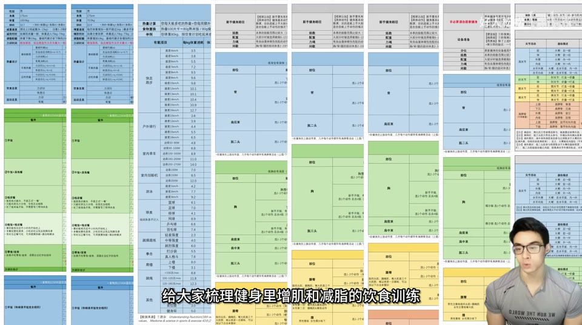

*图 1：开场展示 Excel 套表的全部工作表。*

UP 主先把整个套表快速过一遍。

**饮食类表格**

- **减脂饮食方案、增肌饮食方案**：每份方案都给出饮食总量、日内分配和各餐可选食物。
- **按训练时间点分版本**：训练时间不同，训练日的分餐顺序就不同，所以方案要分多个版本。画面写的是【减脂方案】8 个分餐版本、【增肌方案】7 个分餐版本：
  1. 早饭后练（早起版）
  2. 早饭后练（晚起版）
  3. 午饭前练
  4. 午饭后练
  5. 晚饭前练
  6. 晚饭后练
  7. 晚饭后更晚练
  8. 减脂另有“无力训者”版

  无力训者版就是不健身、不力训的普通人减脂用的。
- **《减脂问答汇总》《增肌问答汇总》**：收集的是 UP 主带用户执行方案时，大家问得最多、错得最多的问题。
- **《每小时有氧热量消耗》**：有氧和饮食是“互相置换”的关系。做了有氧就多一笔消耗，跟同条件下不做有氧的人比，就要对应多吃这么多热量。这张表用来试算该加多少饮食热量。

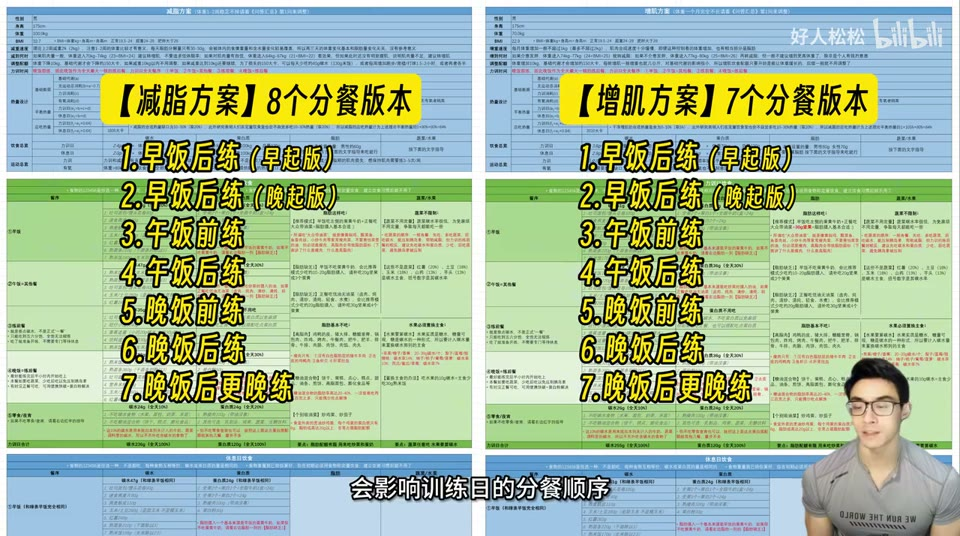

*图 2：按力训时间点划分的分餐版本清单。*

**训练类表格**

- 健身房三分化、健身房四分化（四分化可以单练肩膀，也可以单练手臂，所以有两个版本）、居家健身三分化，共 4 套训练计划。
- 每个动作除了写动作名、配重、组数，还写了它的**关节活动**，方便有基础的人从解剖层面认识动作。例如练背的引体、下拉，是“肩内收或肩伸 + 肘屈”的多关节动作。
- 《健身动作 / 关节活动 / 参与肌肉的映射关系》：每个动作包含特定的 1–3 个关节活动，每个关节活动又由特定的几块肌肉完成。A 表按关节活动查参与肌肉和动作举例，B 表按肌肉查它能做的关节活动和代表动作。

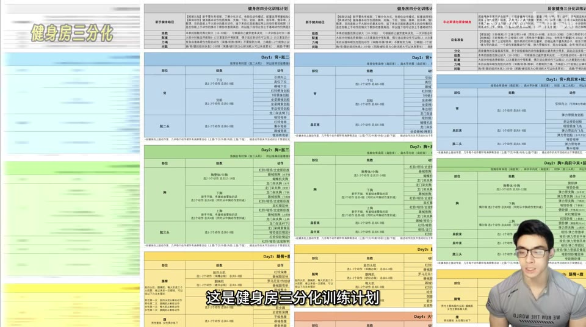

*图 3：4 套训练计划的工作表。*

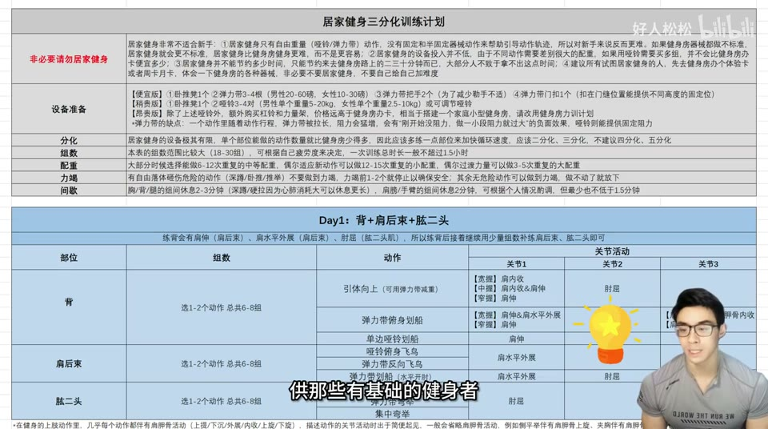

*图 4：居家三分化计划，上方是说明，下方是 Day1 的动作与关节活动。*

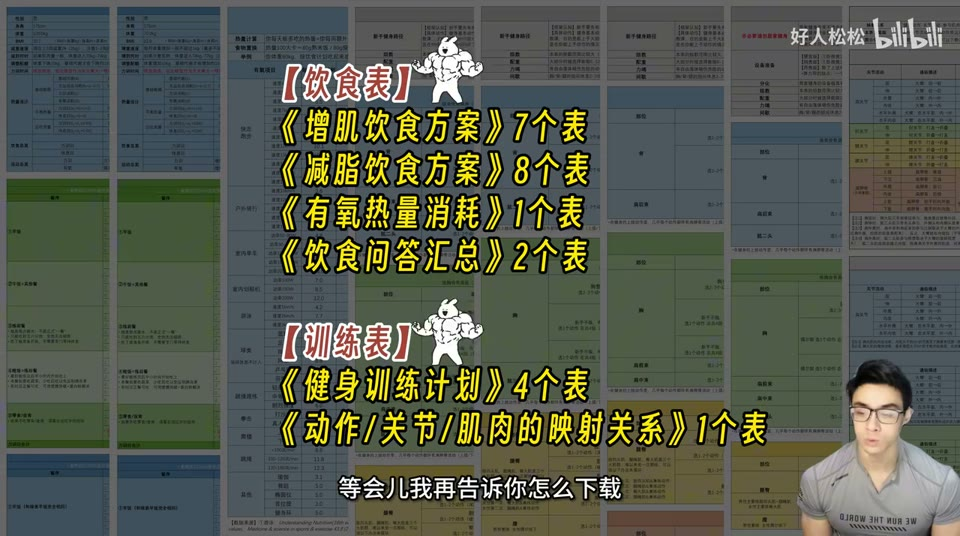

*图 5：画面上的清单。饮食表包括《增肌饮食方案》7 个表、《减脂饮食方案》8 个表、《有氧热量消耗》1 个表、《饮食问答汇总》2 个表；训练表包括《健身训练计划》4 个表、《动作/关节/肌肉的映射关系》1 个表。合计 23 张。*

> UP 主原话的意思是：不要直接拿着表格就跑，那样没用，要先看视频听懂这些表格的设置逻辑才能用好。

---

## 二、方案表头：基本信息、BMI、增减重速度 [02:41]

讲解用的是**晚饭前训练、练完把晚饭当练后餐**这个版本。左边减脂、右边增肌，其他训练时间点换用对应的表就行，道理一样。

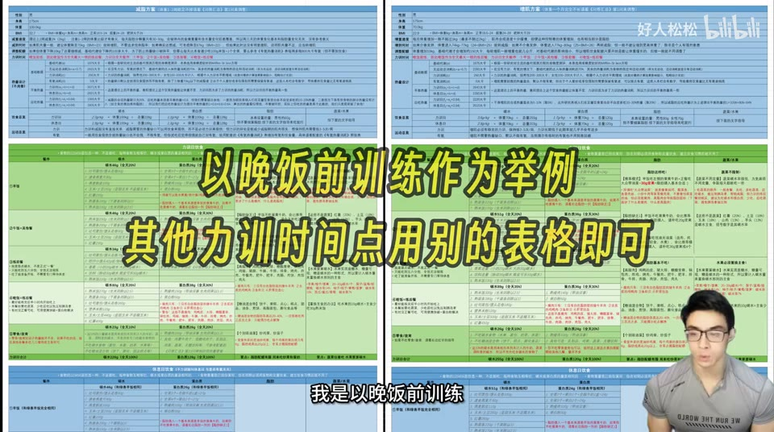

*图 6：“以晚饭前训练作为举例，其他力训时间点用别的表格即可”。*

### 2.1 性别、身高、体重 → BMI

先填性别、身高、体重，表格自动算出 BMI（BMI = 体重 kg ÷ 身高 m ÷ 身高 m）。表里同时注明：正常 18.5–24，超重 24–28，肥胖大于 28。

UP 主的观点：BMI 是反映肥胖程度最简便的指标。除了极少数肌肉量特别大的人会被误判为肥胖以外，对在座各位都有效，“你的肌肉量不可能大到能够扭曲 BMI”。

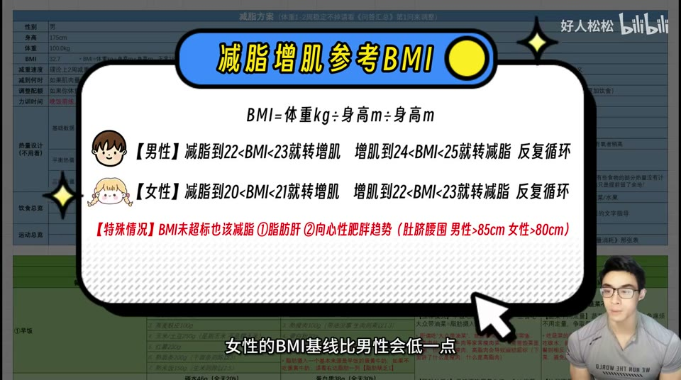

*图 7：减脂、增肌的参考 BMI 区间。*

| 性别 | 减脂到这个区间就转增肌 | 增肌到这个区间就转减脂 |
|---|---|---|
| 男性 | 22 < BMI < 23 | 24 < BMI < 25 |
| 女性 | 20 < BMI < 21 | 22 < BMI < 23 |

两个方向反复循环。女性对体重要求更高，所以基线比男性低一点。
**特殊情况**：BMI 没超标也该减脂的两种情况：① 脂肪肝；② 有向心性肥胖趋势（肚脐腰围男性 > 85 cm、女性 > 80 cm）。

**常见误区：肌肉量不够还硬减到低体脂。** UP 主拿自己和一位身高体重相近的粉丝对比：对方 BMI 22，但“还不够干”。原因是体重构成里肌肉太少、脂肪太多。这时应该去**增肌**，而不是继续减脂“减出腹肌”。腰腹是全身脂肪层最厚的地方，强行把那里减干净，胸、肩、背、手臂就更没脂肪了；皮下又没有足够的肌肉撑着，就会变成皮包骨，也就是 UP 主说的“骷髅兵”身材。结论是**体脂率要和肌肉量适配，低体脂率的前提是有足够的肌肉量**。减脂减到上表的 BMI 还没有“干”的效果，就该转去增肌储备肌肉。

### 2.2 减重速度（减脂表）

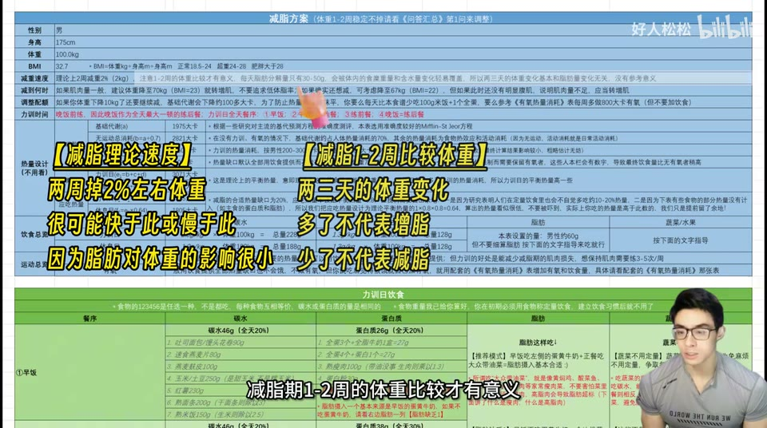

*图 8：减脂理论速度“两周掉 2% 左右体重”，以及“减脂 1–2 周比较体重”的提示。*

- 理论上合适的掉秤速度是**两周减重 2%**（表中 100 kg 例子写的是 2 kg），但实际很可能快于或慢于这个数。
- **1–2 周的体重比较才有意义，两三天的体重变化没有参考意义。**

UP 主解释，每天体重变化的影响因素按重要性排是这样的：

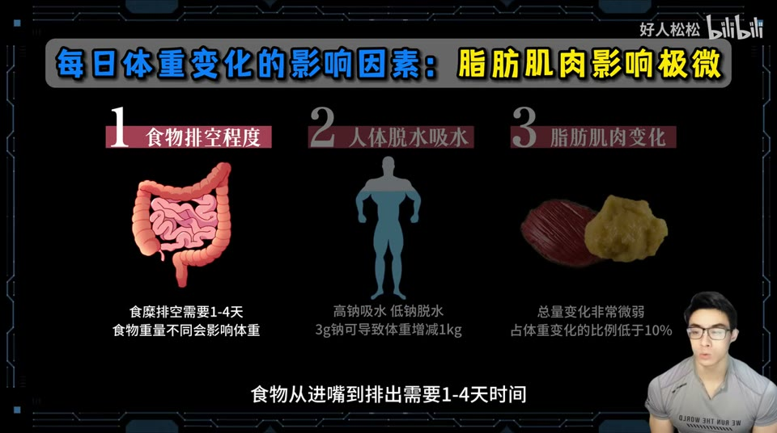

*图 9：每日体重变化的三个因素，“脂肪肌肉影响极微”。*

1. **食物排空程度**：食物从进嘴到排出要 1–4 天。所谓空腹称重其实并不空腹，一顿饭多三五百克就会影响体重。
2. **人体脱水吸水**：水钠平衡机制，盐吃得多身体就吸水来降低钠离子浓度，体重上涨；吃得少就脱水，体重下降。粗算一下，体液钠浓度按 130 多 mmol/L 计，今天多吸收 3 g 钠（约 130 mmol），就要吸约 1 升水去平衡，体重涨约 1 kg。
3. **脂肪和肌肉的变化**：在每日体重变化里占比非常小。减脂每天三五百大卡的缺口，就算全部来自脂肪（按每克 9 大卡），也只减 30–50 g；而体重每天波动不止三五百克，脂肪变化占比不到 10%。增肌的肌肉增量更小，每天连 10 g 都很难超过，占比不到 5%。

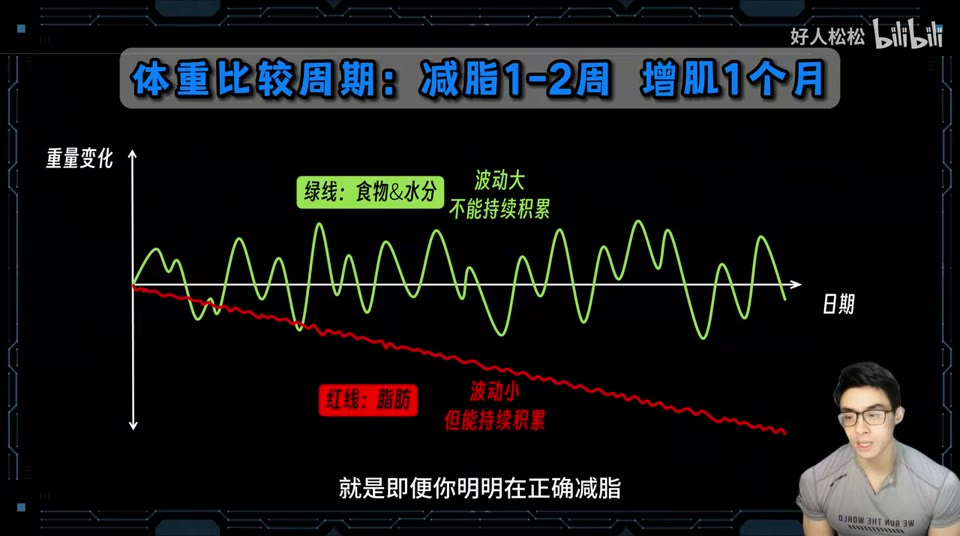

*图 10：绿线代表食物和水分，波动大但不能持续积累；红线代表脂肪或肌肉，波动小但能持续积累。标题写“体重比较周期：减脂 1–2 周，增肌 1 个月”。*

结论：
- 减脂期**可以天天称体重**，但只比较 1–2 周的变化。两三天的体重“多了不代表增脂，少了不代表减脂”（UP 主原话是为此纠结就是“和自己的屎尿较劲”）。正确的减脂体重曲线是“在波动中一路下跌”。
- 增肌期的肌肉增量完全会被绿线盖住，不可能从每日体重看出肌肉变化。

### 2.3 增重速度（增肌表）

- 男性每月体重增加一般**不超过 1 kg**（表中写“最多不超过 2 kg”），女性每月一般**不超过 0.5 kg**。即便控制在这个速度，增加的体重里也已经有相当一部分是脂肪。
- 误区：“先长胖才能增肌”“增肌一个月长 5 斤、8 斤”。UP 主认为这完全是胡说。快速长体重不算本事，**既要让体重长、又要长得慢才是本事**。

### 2.4 方案表头的完整字段（从截图读出）

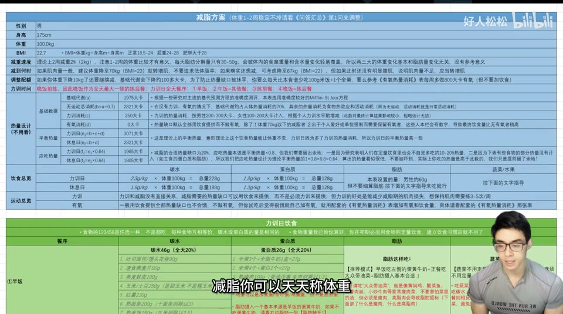

*图 11：减脂方案上半部分。示例为男性，175 cm，100 kg，BMI 32.7。*

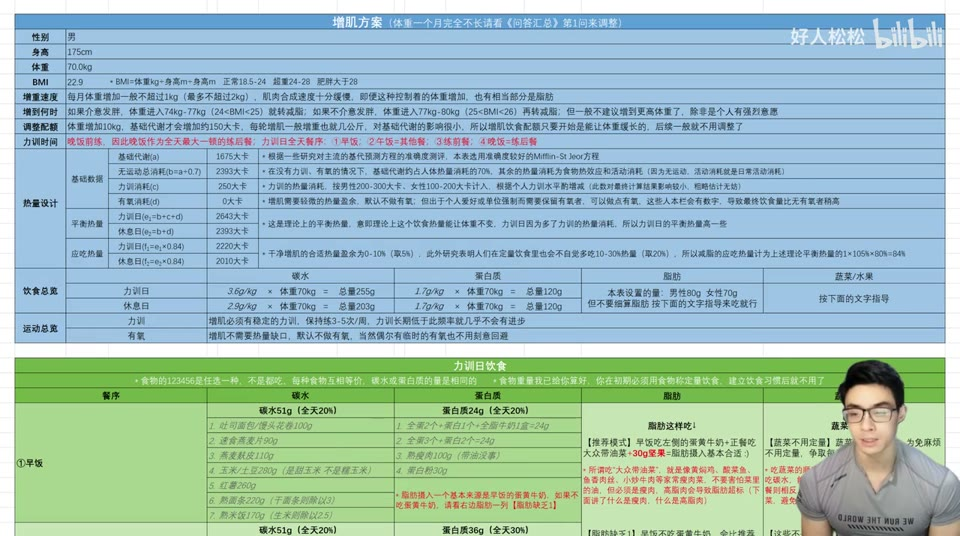

*图 12：增肌方案上半部分。示例为男性，175 cm，70 kg，BMI 22.86。*

表头各行（画面原文要点，口头没有逐条念）：

| 行 | 减脂方案（示例：男 175 cm / 100 kg） | 增肌方案（示例：男 175 cm / 70 kg） |
|---|---|---|
| 标题备注 | 体重 1–2 周稳定不掉请看《问答汇总》第 1 问来调整 | 体重一个月完全不长请看《问答汇总》第 1 问来调整 |
| 减重 / 增重速度 | 理论上 2 周减重 2%（2 kg）；只有 1–2 周的比较有意义；每天脂肪分解量只有 30–50 g，会被食糜重量和含水量变化覆盖 | 每月一般不超过 1 kg（最多不超过 2 kg）；肌肉合成很慢，即使控制住增速，也有相当部分是脂肪 |
| 减到 / 增到何时 | 肌肉量一般的，建议减到 70 kg（BMI = 23）就转增肌，不要追求低体脂率；确实还想减可考虑到 67 kg（BMI = 22）；但如果此时还没有明显腹肌，说明肌肉量不足，应当转增肌 | 不介意发胖的话，体重进入 74–77 kg（24 < BMI < 25）就转减脂；介意发胖的话进入 77–80 kg（25 < BMI < 26）再转；一般不建议增到更高，除非个人有强烈意愿 |
| 调整配额 | 体重下降 10 kg 后还要继续减的话，基础代谢约降 100 大卡。为防热量缺口被抹平，要么每天比食谱少吃 100 g 米饭 + 1 个全蛋，要么参考《有氧热量消耗》每周多做 800 大卡有氧（但不要加饮食） | 体重增加 10 kg 基础代谢约增 150 大卡；每轮增肌一般只增重几公斤，对基础代谢影响很小，所以配额只要开始时能让体重缓长，后面一般就不用调了 |
| 力训时间 | 晚饭前练，因此晚饭是全天最大的一顿练后餐；力训日全天餐序：① 早饭 ② 午饭 = 其他餐 ③ 练前餐 ④ 晚饭 = 练后餐 | 同左 |
| 运动总览·力训 | 力训和减脂没有直接关系，热量缺口可以只靠饮食；力训的好处是减少减脂期的肌肉损失，想保持肌肉需要每周练 3–5 次 | 增肌必须有稳定的力训，保持每周 3–5 次；长期低于这个频率几乎不会进步 |
| 运动总览·有氧 | 一般用饮食提供全部热量缺口也不会饿，就不做有氧；试吃后很饿再自己加有氧，用配套的《有氧热量消耗》表同时加有氧和饮食 | 增肌不需要热量缺口，默认不做有氧；偶尔临时有氧也不用刻意回避 |

### 2.5 力训时间与餐序 [08:12]

训练时间不同，全天最大的那顿练后餐就放在不同时间，餐序也就不同。所以 UP 主做了 7 种力训时间的分餐表，自己去找对应的那张就行。

---

## 三、热量设计：从基础代谢到应吃热量 [08:26]

UP 主说，饮食的碳蛋脂配额本质是**先设计热量、再分配**出来的。以前的视频直接发配额表，这次把背后的热量设计讲清楚。表里“热量设计”一栏标着“（不用看）”，意思是表格已经代算好，但他希望大家看懂原理，学会了就能自己做表。

### 3.1 基础代谢（a）

研究者提出的基础代谢预测公式很多，做法都是实测一批人的基础代谢、画散点图、拟合一次函数。样本不同，拟合出来的公式就不同。套表选用的是 **Mifflin-St Jeor 版**，UP 主说这个版本经其他论文验证，对大体重肥胖人群的预测更准一些。

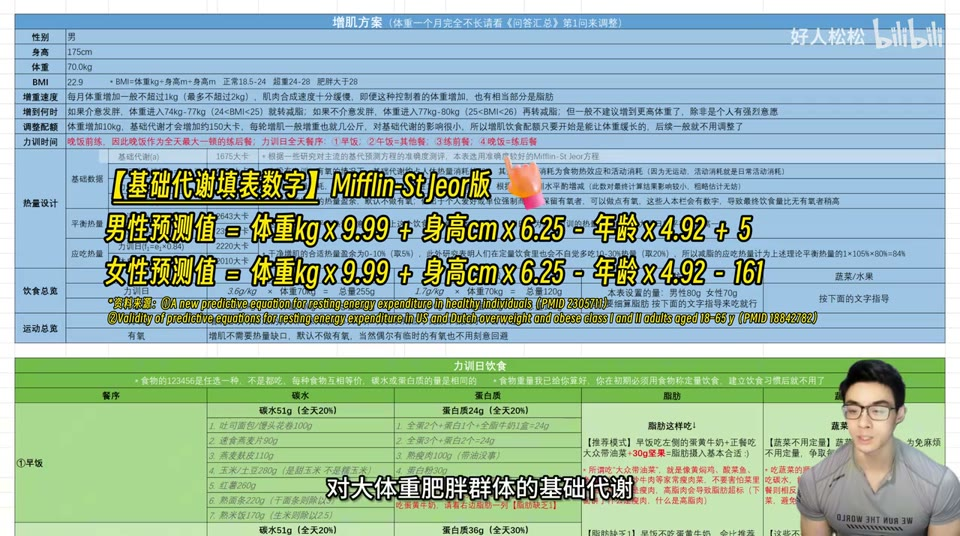

*图 13：【基础代谢填表数字】Mifflin-St Jeor 版公式，以及画面标注的两篇资料来源（PMID 2305711、PMID 18842782）。*

```
男性预测值 = 体重kg × 9.99 + 身高cm × 6.25 − 年龄 × 4.92 + 5
女性预测值 = 体重kg × 9.99 + 身高cm × 6.25 − 年龄 × 4.92 − 161
```

（中间插了一段推广：UP 主上一期出镜的减脂粉丝，几个月从 108 kg 左右减下来不少，画面写“肥胖用户 171 cm 108 kg → 82 kg”。没耐心的人可以找他代做方案，但他更希望大家自己学会。）

### 3.2 无运动总消耗（b = a ÷ 0.7）[09:27]

在没有力训、有氧等专门运动的情况下，基础代谢约占全身热量消耗的七成（其余是食物热效应和日常活动消耗），所以：

```
无运动总消耗 b = 基础代谢 a ÷ 0.7
```

### 3.3 力训消耗（c）[09:40]

一次力训 1–1.5 小时的消耗，UP 主建议按下面的数大概填。他承认不准，但对最终热量影响很小。

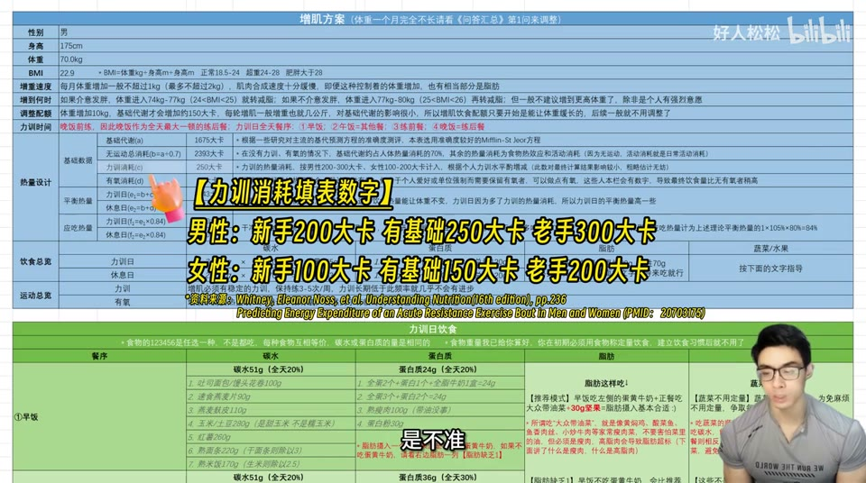

*图 14：【力训消耗填表数字】及资料来源（Understanding Nutrition 16th ed. p.236；PMID 20703175）。*

| 性别 | 新手 | 有基础 | 老手 |
|---|---|---|---|
| 男性 | 200 大卡 | 250 大卡 | 300 大卡 |
| 女性 | 100 大卡 | 150 大卡 | 200 大卡 |

（表中示例都填的 250 大卡。）

### 3.4 有氧消耗（d）

这一栏怎么填，取决于下一节“要不要做有氧”。不做就填 0；做的话用《有氧热量消耗》表算出**每周**的有氧消耗，再**除以 7** 平摊到每天，因为这一格是按每天算的。

---

## 四、增肌减脂要不要做有氧（有氧消耗一栏怎么填） [09:51]

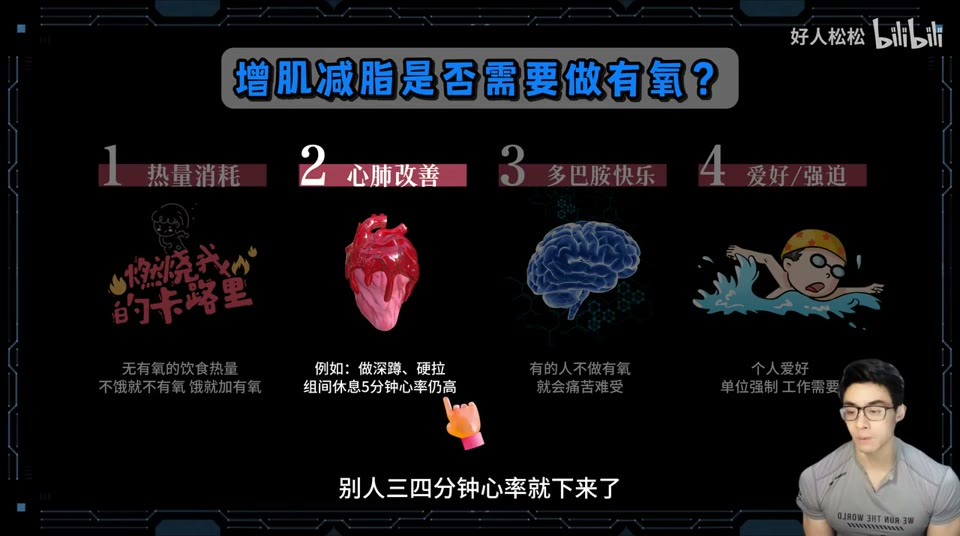

*图 15：做有氧的四个场景：热量消耗、心肺改善、多巴胺快乐、爱好/强迫。*

UP 主列出做有氧的四种场景：

1. **制造热量消耗**（下面重点讨论）。
2. **改善心肺能力**：简单检验办法是，大家都做一组深蹲，别人三四分钟心率就下来、能做下一组了，你要五分钟以上还在高心率，就可以考虑心肺偏弱，做点有氧。
3. **提供多巴胺快乐**：多数人把有氧当成宁愿不做的苦差事，但也有人不做就难受，这种人只能做。
4. **爱好性或被迫的有氧**：打球、瑜伽、街舞这些是爱好，当然保留；学校规定跑量（举例北大每学期强制跑 85 公里）、工作必须每天走几公里，属于被迫有氧。

**要不要专门用有氧制造热量消耗？** 判断依据很简单：**用无有氧的饮食热量吃起来饿不饿**。不饿就不加有氧，饿得扛不住就加点有氧让自己多吃点。

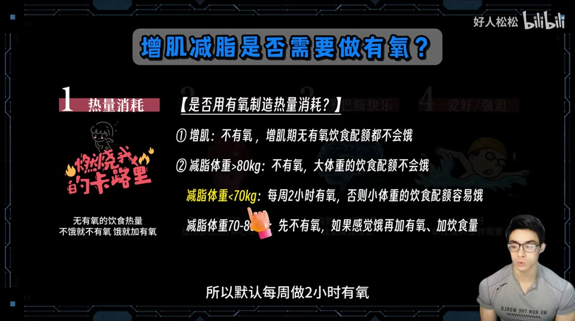

*图 16：UP 主按经验给出的默认建议。*

| 情况 | 默认做法 | 理由 |
|---|---|---|
| 增肌 | 不做有氧 | 增肌期无有氧的饮食配额都不会饿 |
| 减脂，体重 > 80 kg | 不做有氧 | 基础代谢高，算出来的应吃热量较高；表格已排除高脂肉、糖油混合物等高热量低饱腹的食物，一般不会饿 |
| 减脂，体重 < 70 kg | 每周 2 小时有氧，摊到每天多吃一点 | 基础代谢低，应吃热量少，大概率会有点饿 |
| 减脂，体重 70–80 kg | 先不做有氧，试吃后觉得饿再加有氧、加饮食量 | 介于两者之间 |

UP 主补充：这是连续变量。规律确实是体重越大、算出来的应吃热量越高、越不会饿、越不用有氧，但 70 kg / 80 kg 这两条分界线是他凭经验划的，扛饿和不扛饿的人可以灵活处理。

**重点提醒：体重越大越要远离有氧，否则会吃不下。** 他拿 100 kg 减脂者做例子：有氧消耗填 0 时，平均每天的碳水和蛋白质大约相当于米饭 720 g（长方形外卖饭盒两盒多）加瘦肉 480 g（接近一斤），不撑也不饿。如果他每天再爬楼一小时，会多消耗约 800 大卡（画面：8 大卡/kg 体重 × 100 kg = 800 大卡）。要维持原定的热量缺口，当天就得多吃 800 大卡，大约相当于再加 960 g 米饭。全天就要吃五盒多米饭外加接近一斤瘦肉，根本吃不下。所以找他做方案的问卷里会专门警告：**即便要保留有氧，也强烈建议每周低于 4 小时**，除非这个有氧非做不可。

**有氧热量消耗表** [13:41]

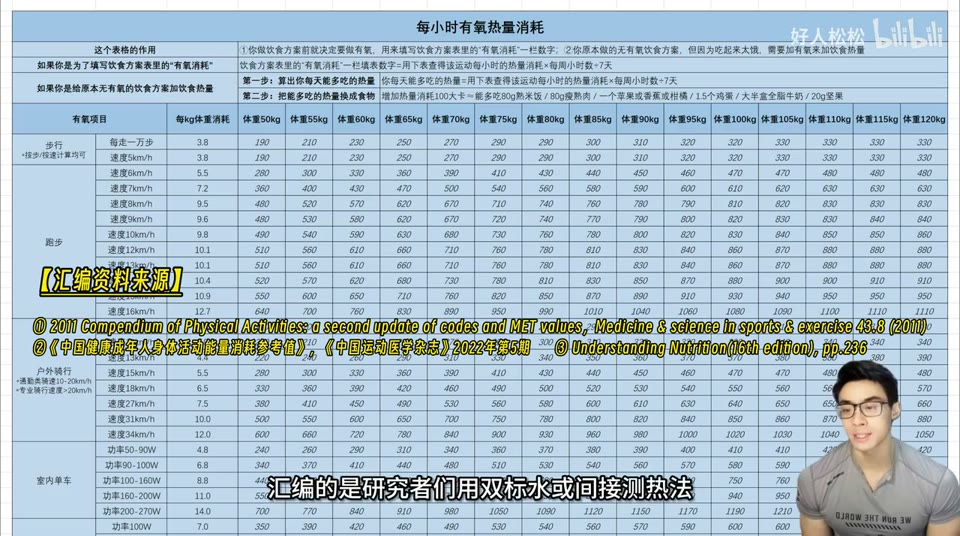

*图 17：《每小时有氧热量消耗》表。左列是有氧项目和每 kg 体重消耗，右侧按体重 50–120 kg 给出每小时消耗；画面标注了三份汇编资料来源。*

表头写明的用法（画面原文要点）：
- **作用**：① 做饮食方案前已决定要做有氧，用它填方案表里“有氧消耗”那一栏；② 原本做的是无有氧方案，但吃起来太饿，需要加有氧来加饮食热量。
- **如果是为了填“有氧消耗”**：有氧消耗一栏 = 用下表查得该运动每小时的热量消耗 × 每周小时数 ÷ 7 天。
- **如果是给无有氧方案加饮食热量**：第一步，每天能多吃的热量 = 该运动每小时消耗 × 每周小时数 ÷ 7 天；第二步，把能多吃的热量换成食物，**每增加 100 大卡消耗，约能多吃 80 g 熟米饭 / 80 g 瘦熟肉 / 一个苹果或香蕉或柑橘 / 1.5 个鸡蛋 / 大半盒全脂牛奶 / 20 g 坚果**。
- 举例数据：步行（每走一万步、速度 5 km/h）每 kg 体重 3.8 大卡/小时；跑步按速度 6–16 km/h 分档；户外骑行、室内单车按速度或功率分档（完整数值见截图）。
- 资料来源：① 2011 Compendium of Physical Activities；②《中国健康成年人身体活动能量消耗参考值》（《中国运动医学杂志》2022 年第 5 期）；③ Understanding Nutrition（16th edition）p.236。

UP 主的理由：这些汇编数据来自研究者用双标水法或间接测热法测得的不同运动消耗功率，可以说它不够准，但这已经是科研界做到最细的程度，总比随便写几个数好。

---

## 五、平衡热量与应吃热量（含 ×0.8 打折） [14:12]

### 5.1 平衡热量（e）

```
力训日平衡热量 e1 = b + c + d   （无运动总消耗 + 力训消耗 + 有氧消耗）
休息日平衡热量 e2 = b + d
```

如果每天吃的正好是平衡热量，摄入就等于支出，理论上体重不增不减。力训日的平衡热量高一点，是因为多了力训那笔消耗。

### 5.2 应吃热量（f）

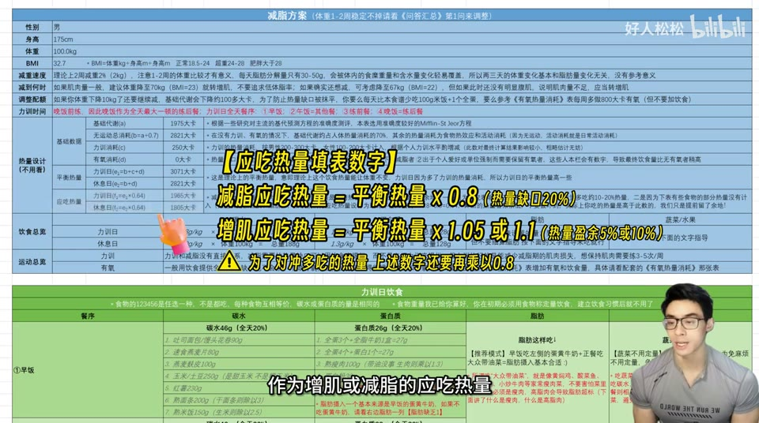

*图 18：【应吃热量填表数字】减脂 = 平衡热量 × 0.8（热量缺口 20%），增肌 = 平衡热量 × 1.05 或 1.1（盈余 5% 或 10%），“为了对冲多吃的热量，上述数字还要再乘以 0.8”。*

- **减脂**：在平衡热量基础上取 **20% 热量缺口**。
- **增肌**：取 **5% 热量盈余**，比较保守。怕体重不长也可以取 10%，但这样会“脏”一点（长的脂肪更多）。
- **再统一乘 0.8 打折**：很多研究表明，人在定量饮食里也会不自觉多吃。

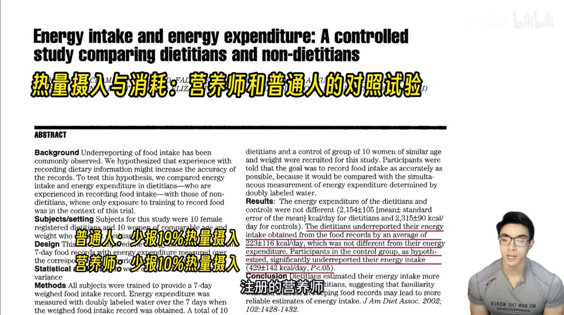

*图 19：营养师和普通人的对照试验。画面标注：普通人少报 19% 的热量摄入，营养师少报 10%。*

UP 主引用了一篇综述：各种定量饮食实验里，受试者自报的摄入普遍明显低于实际，这不是谁骗谁，而是人的习惯。一项实验把普通人和注册营养师分成两组，观察一周定量饮食：普通人少报约 19% 的食物热量，营养师也少报约 10%。所以套表**按大家会多吃 20% 来设计**，在应吃热量里额外乘 0.8。仔细想也确实该这样：表格规定的食物你肯定会吃，但表格之外一定还有别的，比如炒菜里的豆皮、千张等辅料，餐间零嘴，在外就餐也几乎不可能比表格吃得少。

合并后的系数（从截图读出）：

```
减脂：力训日 f1 = e1 × 0.64，休息日 f2 = e2 × 0.64   （1 × 0.8 × 0.8 = 0.64）
增肌：力训日 f1 = e1 × 0.84，休息日 f2 = e2 × 0.84   （1 × 105% × 80% = 84%）
```

**截图里的两个示例算到这一步的数值：**

| 项目 | 减脂示例（男 175 cm / 100 kg） | 增肌示例（男 175 cm / 70 kg） |
|---|---|---|
| 基础代谢 a | 1975 大卡 | 1675 大卡 |
| 无运动总消耗 b = a ÷ 0.7 | 2821 大卡 | 2393 大卡 |
| 力训消耗 c | 250 大卡 | 250 大卡 |
| 有氧消耗 d | 0 大卡 | 0 大卡 |
| 平衡热量·力训日 e1 = b + c + d | 3071 大卡 | 2643 大卡 |
| 平衡热量·休息日 e2 = b + d | 2821 大卡 | 2393 大卡 |
| 应吃热量·力训日 f1 | 1965 大卡（e1 × 0.64） | 2220 大卡（e1 × 0.84） |
| 应吃热量·休息日 f2 | 1805 大卡（e2 × 0.64） | 2010 大卡（e2 × 0.84） |

表里对 0.8 的注释还说明了另一个原因：下表有些食物的部分热量没有计入（例如全蛋的蛋白质和脂肪），所以“实际上你吃的热量是高于此数的，我们只是提前留了余地”。

---

## 六、应吃热量转为碳蛋脂配额 [16:02]

应吃热量按**碳水 4、蛋白质 4、脂肪 9 大卡/克**分配到三大营养素上。顺序是先分给脂肪，剩下的再分给碳水和蛋白质。

### 6.1 脂肪：只定全天大概总量

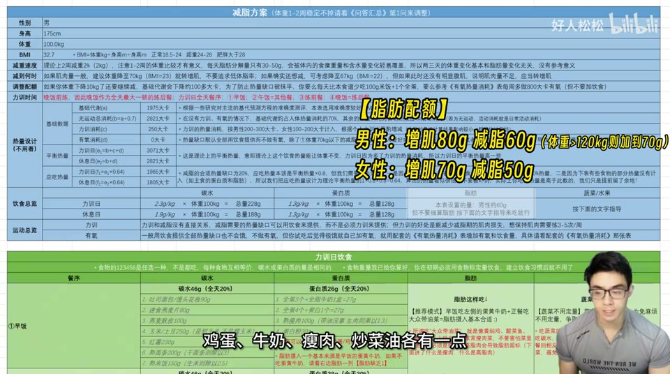

*图 20：【脂肪配额】男性增肌 80 g、减脂 60 g（体重 > 120 kg 加到 70 g）；女性增肌 70 g、减脂 50 g。*

| | 增肌 | 减脂 |
|---|---|---|
| 男性 | 80 g | 60 g（体重 > 120 kg 加到 70 g） |
| 女性 | 70 g | 50 g |

- 用一个**大概的绝对量**表示，**不规定各餐吃多少**，全天总量大概合适就行。这样能大大降低配餐难度。
- 理由：脂肪来源很分散，鸡蛋、牛奶、瘦肉、炒菜油各有一点，很难算。按“早饭鸡蛋牛奶 + 午饭晚饭炒菜油 + 瘦肉里的少量脂肪”这样生活化地吃，脂肪就大差不差是这个数，不需要每天计算（具体算账见第九节）。
- 这个量折合每 kg 体重是 0.7、0.8 还是 1.0 g 都无所谓。它既高于身体对脂肪的最低需求，又不会让总热量过高，因为总热量在前面已经定死，剩余的热量才分给碳水和蛋白质。

### 6.2 碳水和蛋白质：按体重查配额表

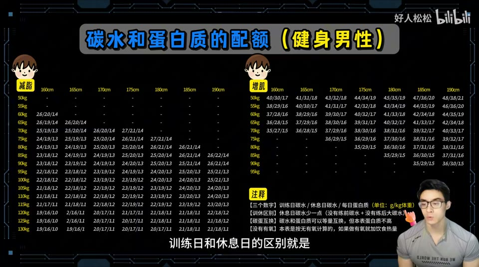

*图 21：健身男性配额表。左为减脂、右为增肌；行是体重 50–130 kg，列是身高 160–190 cm。*

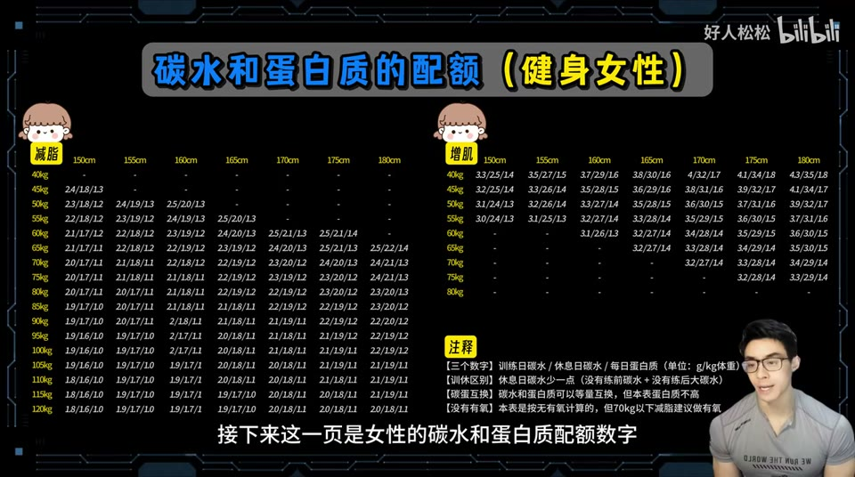

*图 22：健身女性配额表。行是体重 40–120 kg，列是身高 150–180 cm。*

**怎么读这张表**（画面“注释”原文要点）：
- **三个数字**：训练日碳水 / 休息日碳水 / 每日蛋白质，单位都是 g/kg 体重。
- **训休区别**：只有碳水不同，休息日碳水少一点，因为没有练前碳水和练后大碳水；蛋白质和脂肪训练日、休息日一样。UP 主强调，休息日碳水减少不是专门操作，是自然发生的。
- **碳蛋互换**：碳水和蛋白质都是每克 4 大卡，可以等量互换，比如碳水减 0.2 g、蛋白质加 0.2 g。但 UP 主做表时已经考虑到国人“喜欢吃碳水、讨厌吃蛋白质”，表里的蛋白质压得比较低。所以**可以减碳水加蛋白质，最好不要加碳水减蛋白质**。
- **没有有氧**：配额表按“有氧消耗 = 0”算。要做有氧，就用有氧热量消耗表在加有氧的同时加饮食热量，加的部分一般放在碳水上；加得多的话碳水和蛋白质一起加。女性表另注明“70 kg 以下减脂建议做有氧”，也就是基本上女性减脂一般建议做点有氧，全靠饮食制造缺口可能会饿。

**示例读数**（从截图读出）：
- 男性减脂，175 cm / 100 kg：`2.3/1.9/1.3`。对应减脂方案表里“力训日 2.3 g/kg × 100 kg = 228 g 碳水，休息日 1.9 g/kg = 188 g，蛋白质 1.3 g/kg = 128 g”（表中总量的个位数和直接相乘略有出入，以表为准）。
- 男性增肌，175 cm / 70 kg：`3.8/3.0/1.6`。增肌方案表里显示的是“力训日 3.6 g/kg × 70 kg = 255 g，休息日 2.9 g/kg = 203 g，蛋白质 1.7 g/kg = 120 g”，和配额表这一格不完全一致（见文末「不确定之处」）。
- 完整配额矩阵请看上面两张截图或套表原件。

UP 主还解释：有人以为“前面讲的是算应吃热量，怎么又变成给配额了”，其实不矛盾。这些配额就是**按上面算出的应吃热量分配到碳蛋脂上形成的数字**，他代算好了而已。

### 6.3 为什么大体重低配额、小体重高配额 [19:21]

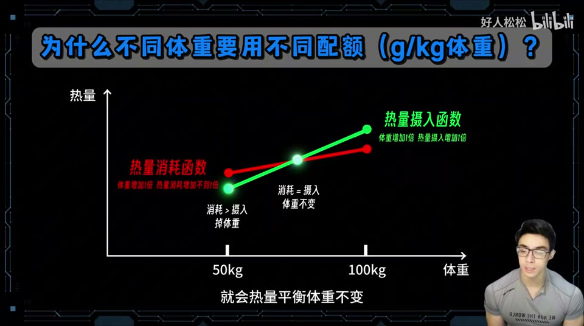

*图 23：热量消耗随体重增长的斜率小（红线），按 g/kg 配额的热量摄入随体重增长的斜率大（绿线）。两线相交处体重不变；小体重一侧摄入 < 消耗，会掉秤；大体重一侧摄入 > 消耗，会长体重。*

不管增肌还是减脂，配额表都呈现**大体重低配额、小体重高配额**。原因：基础代谢和活动消耗随体重变化的斜率比较小，体重翻倍，消耗不会翻倍；而在一个固定 g/kg 配额下，摄入随体重变化的斜率大，体重翻倍，摄入就翻倍。所以同一个配额，对小体重是热量亏损，对中等体重是平衡，对大体重是热量盈余。一言以蔽之，体重大主要是脂肪多，而这些脂肪不需要那么多热量去供应。按基础代谢和活动消耗算出应吃热量、再折成配额，就自然出现这个现象，比“一个配额走天下”更细致准确。

### 6.4 无力训者的减脂配额 [20:25]

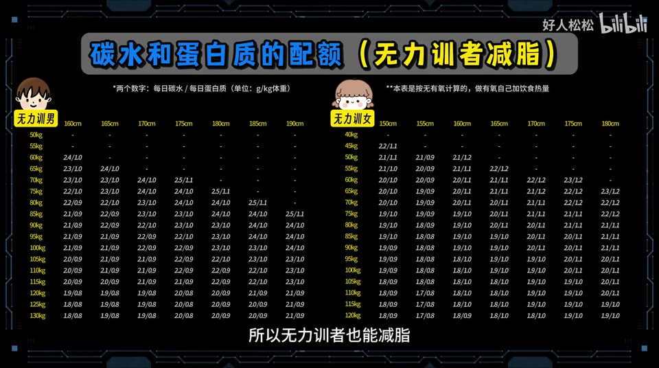

*图 24：无力训者减脂配额。两个数字是每日碳水 / 每日蛋白质（g/kg 体重），左男右女；“本表是按无有氧计算的，做有氧自己加饮食热量”。*

- 不力训的人不能增肌，但可以减脂。减脂只需要热量缺口，和是否力训无关。不然天下胖子都得先办卡买私教课、练大半年入门才能减脂，那显然不合理。
- 不分训练日和休息日，每天一样，只有两个数字。示例：无力训男 175 cm / 100 kg 为 `2.2/0.9`；无力训女 165 cm / 70 kg 为 `2.0/1.1`（从截图读出）。
- 和以前发过的版本相比，**蛋白质调低了一点，换成了碳水**。本来蛋白质高一点更扛饿，但实践发现这类人饮食习惯里本来就不怎么吃蛋白质，一下多吃会不习惯。个人想减碳水加蛋白质可以自己互换。

（插播：UP 主请观众投币、点赞、发弹幕，说长视频完播率低，需要观众反馈才能不被推流系统“干掉”。）

---

## 七、训练日（绿色表）的日内分配 [21:37]

绿色表是**健身力训日**的分餐。

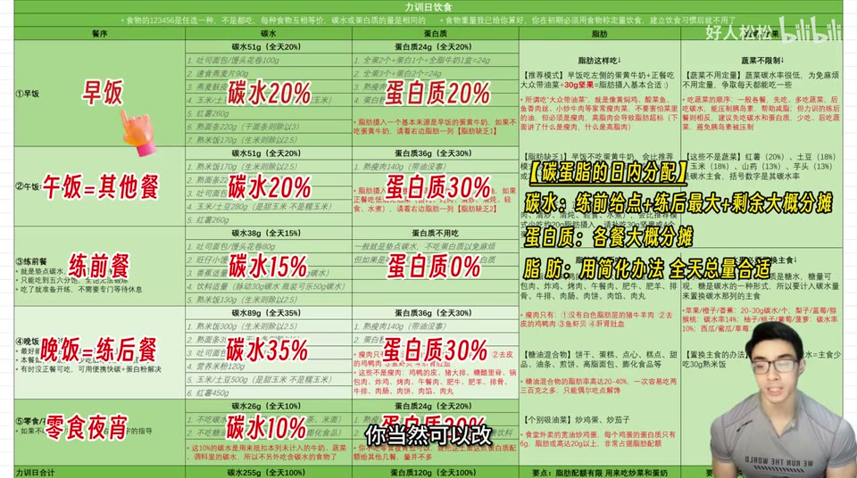

*图 25：力训日饮食（晚饭前练版）。左侧标出各餐占全天的碳水、蛋白质比例，右侧是【碳蛋脂的日内分配】原则。*

**原则**（画面原文）：
- **碳水**：练前给点 + 练后最大 + 剩余大概分摊（互相可以调剂）。
- **蛋白质**：各餐大概分摊（互相可以调剂）。
- **脂肪**：用简化办法，全天总量合适（不规定到各餐）。

**晚饭前练版本的分配比例**（以增肌 70 kg 示例的全天碳水 255 g、蛋白质 120 g 为例，数字从截图读出）：

| 餐序 | 碳水占比 | 碳水量 | 蛋白质占比 | 蛋白质量 |
|---|---|---|---|---|
| ① 早饭 | 20% | 51 g | 20% | 24 g |
| ② 午饭 = 其他餐 | 20% | 51 g | 30% | 36 g |
| ③ 练前餐 | 15% | 38 g | 0%（不用吃） | — |
| ④ 晚饭 = 练后餐 | 35% | 89 g | 30% | 36 g |
| ⑤ 零食 / 夜宵 | 10% | 26 g | 20% | 24 g |
| 力训日合计 | 100% | 255 g | 100% | 120 g |

表中各餐备注（截图原文要点）：
- **练前餐**：“就是垫点碳水，不是正式一餐”；只能吃到五六分饱，全饱无法锻炼；吃了就准备开练，不需要专门等待休息。蛋白质“一般就是垫点碳水，不吃蛋白质以免麻烦”。
- **练后餐**：最好能练完后半小时内开始吃上；本餐如果要吃蔬菜，少吃后吃以免压制胰岛素；有时没正餐可吃，可以用便携快碳 + 蛋白粉解决。
- **零食 / 夜宵**：这 10% 的碳水是用来抵扣本列没算到的牛奶、蔬菜、调料里的碳水，所以不另外吃含碳水的食物了。

**比例不是死的，可以按自己情况改：**
- 一般人早饭吃不下太多，上班后的午饭要多吃一点，所以早饭碳水比午饭低一点（此处原视频画面早饭、午饭碳水都是 20%，口头说的是“早饭比午饭低一点”，以表格为准）。
- 早饭蛋白质占比低，是因为国人早饭一般没有瘦肉，只靠鸡蛋牛奶很难凑够。
- 练后碳水给的是全天 35%，食欲好、练得猛的可以吃到 40%、50%。
- **总量最重要，日内分配不用那么机械。**
- 注意：建议**拨出 10% 的碳水配额（大约 10–20 克）**，用来抵扣没记录的牛奶、蔬菜、调料里的各种碳水。

---

## 八、把配额换算成食物重量 & 食物选择 [22:55]

各餐的碳水和蛋白质最后要换算成食物重量。表格每餐列了 1–7 种食物，**选一种吃即可，互相等价**（表头写：“食物的 123456 是任选一种，不是都吃，每种食物互相等价，碳水或蛋白质的量是相同的”；“食物重量我已给你算好，你在初期必须用食物称定量饮食，建立饮食习惯后就不用了”）。

### 8.1 换算公式与常用食物营养率

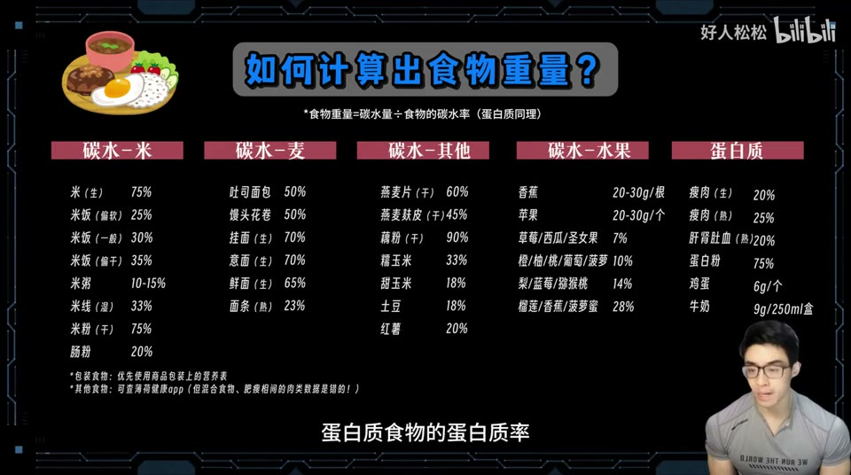

*图 26：如何计算出食物重量。食物重量 = 碳水量 ÷ 食物的碳水率（蛋白质同理）。*

```
食物重量 = 碳水量 ÷ 食物的碳水率   （蛋白质同理）
例：要吃碳水 50 g → 50 g ÷ 米饭碳水率 30% ≈ 米饭 170 g
```

画面上的营养率表（从截图读出）：

| 碳水·米 | 碳水率 | 碳水·麦 | 碳水率 | 碳水·其他 | 碳水率 | 碳水·水果 | 碳水 | 蛋白质 | 蛋白质率 |
|---|---|---|---|---|---|---|---|---|---|
| 米（生） | 75% | 吐司面包 | 50% | 燕麦片（干） | 60% | 香蕉 | 20–30 g/根 | 瘦肉（生） | 20% |
| 米饭（偏软） | 25% | 馒头花卷 | 50% | 燕麦麸皮（干） | 45% | 苹果 | 20–30 g/个 | 瘦肉（熟） | 25% |
| 米饭（一般） | 30% | 挂面（生） | 70% | 藕粉（干） | 90% | 草莓/西瓜/圣女果 | 7% | 肝肾肚血（熟） | 20% |
| 米饭（偏干） | 35% | 意面（生） | 70% | 糯玉米 | 33% | 橙/柚/桃/葡萄/菠萝 | 10% | 蛋白粉 | 75% |
| 米粥 | 10–15% | 鲜面（生） | 65% | 甜玉米 | 18% | 梨/蓝莓/猕猴桃 | 14% | 鸡蛋 | 6 g/个 |
| 米线（湿） | 33% | 面条（熟） | 23% | 土豆 | 18% | 榴莲/香蕉/菠萝蜜 | 28% | 牛奶 | 9 g/250 ml 盒 |
| 米粉（干） | 75% | | | 红薯 | 20% | | | | |
| 肠粉 | 20% | | | | | | | | |

表下备注：包装食物优先用商品包装上的营养表；其他食物可查薄荷健康 app（但混合食物、肥瘦相间的肉类数据是错的）。

表格里各餐的可选食物换算示例（增肌早饭碳水 51 g，从截图读出）：吐司面包 / 馒头花卷 100 g、速食燕麦片 90 g、燕麦麸皮 110 g、玉米 / 土豆 280 g（是甜玉米，不是糯玉米）、红薯 260 g、熟面条 220 g（干面条则除以 3）、熟米饭 170 g（生米则除以 2.5）。

### 8.2 为什么没有饺子、包子、油条这类主食 [23:20]

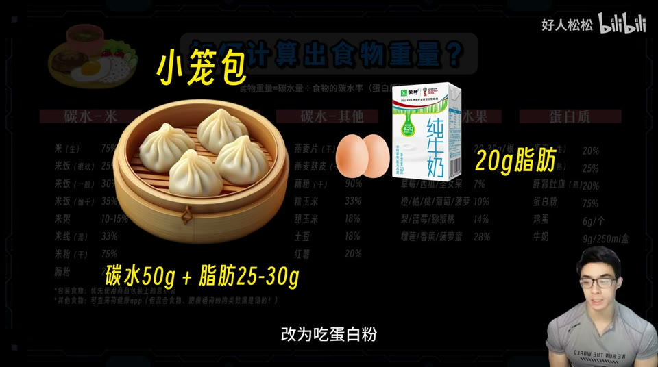

*图 27：同样 50 g 碳水，小笼包附带 25–30 g 脂肪，馒头基本 0 脂肪；改用蛋白粉代替鸡蛋牛奶可以省出约 20 g 脂肪。*

饺子、肉包、油条、锅盔、手抓饼不是纯碳水，提供碳水的同时还附带可观的脂肪。不是完全不能吃，但吃了，这一餐的脂肪就比吃纯碳水主食高出一大截，需要重新把握全天脂肪，新手算不来。例如早饭一定要吃小笼包，小笼包碳水和脂肪比例约 3 : 2，早饭吃 50 g 碳水就比吃馒头多出约 25 g 脂肪。那就得从全天脂肪里扣出来，比如早饭不吃两个鸡蛋一盒牛奶、改吃蛋白粉，省出 20 来克脂肪，小笼包就能吃了。UP 主自己能算账，新手不行，所以表里碳水一列**都用几乎不含脂肪的纯碳水**。

### 8.3 为什么蛋白质来源没有豆制品 [24:14]

蛋白质来源只列了瘦肉、鸡蛋、牛奶、蛋白粉，没有黄豆、豆腐、千张、腐竹。原因类似：黄豆及其制品提供蛋白质的同时还带可观的碳水和脂肪，用它们做主要蛋白质来源就要扣主食碳水和脂肪，新手算不来，所以不把豆类作为基础蛋白质来源。

### 8.4 主食的选择：看饱腹感 [24:44]

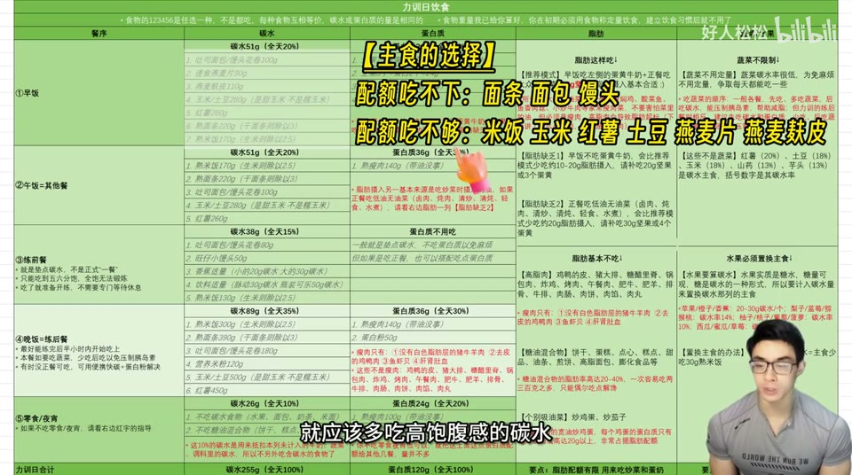

*图 28：【主食的选择】配额吃不下：面条、面包、馒头；配额吃不够：米饭、玉米、红薯、土豆、燕麦片、燕麦麸皮。*

各种主食吃下去都是一样的葡萄糖，但饱腹感不同：
- **配额吃不下**的人，多吃中低饱腹感的碳水（面条、面包、馒头）。
- **配额吃不够**（吃了还饿）的人，多吃高饱腹感的碳水（米饭、玉米、红薯、土豆、燕麦片、燕麦麸皮）。
- 例：面条饱腹感很低，减脂期一般“吃不起”，外面一碗面就是 80–160 g 级别的大碳水，要吃饱得花很大一笔碳水。反过来，增肌期有人吃不下练后餐的碳水，吃面条几口就能轻松吃进 100 g 级别的碳水。
- 主食饱腹感不是越高越好，也不是越低越好，看你吃不吃得饱。

### 8.5 早饭鸡蛋牛奶怎么凑蛋白质 [25:23]

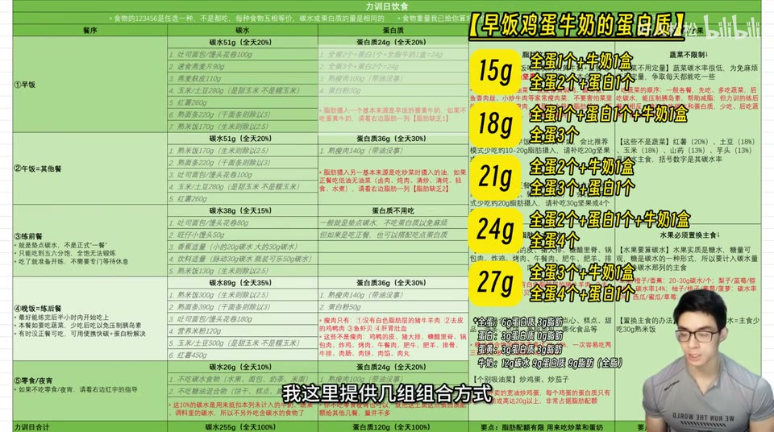

*图 29：【早饭鸡蛋牛奶的蛋白质】几种组合。*

很多人早饭只能吃鸡蛋牛奶，又算不来蛋白质。画面给出的组合：

| 早饭蛋白质 | 组合 A | 组合 B |
|---|---|---|
| 15 g | 全蛋 1 个 + 牛奶 1 盒 | 全蛋 2 个 + 蛋白 1 个 |
| 18 g | 全蛋 1 个 + 蛋白 1 个 + 牛奶 1 盒 | 全蛋 3 个 |
| 21 g | 全蛋 2 个 + 牛奶 1 盒 | 全蛋 3 个 + 蛋白 1 个 |
| 24 g | 全蛋 2 个 + 蛋白 1 个 + 牛奶 1 盒 | 全蛋 4 个 |
| 27 g | 全蛋 3 个 + 牛奶 1 盒 | 全蛋 4 个 + 蛋白 1 个 |

营养数据（画面）：全蛋 6 g 蛋白质、3 g 脂肪；蛋白 3 g 蛋白质、0 g 脂肪；蛋黄 3 g 蛋白质、3 g 脂肪；牛奶 12 g 碳水、9 g 蛋白质、9 g 脂肪（全脂）。

要点：**蛋黄一般最多吃 3–4 个**，蛋白质还不够就加蛋白，这样能把早饭鸡蛋牛奶的脂肪控制在 **20 g 左右**。否则早饭就把脂肪配额花掉太多，后面几顿会很紧张。

---

## 九、什么是瘦肉、脂肪怎么吃、脂肪缺乏 [25:44]

### 9.1 什么是瘦肉（表中红字备注）

UP 主说这本来是个“很弱智的问题”，但实践中大把人分不清，把肥肉当瘦肉吃，导致脂肪远超设计量，所以他加了红字警告。

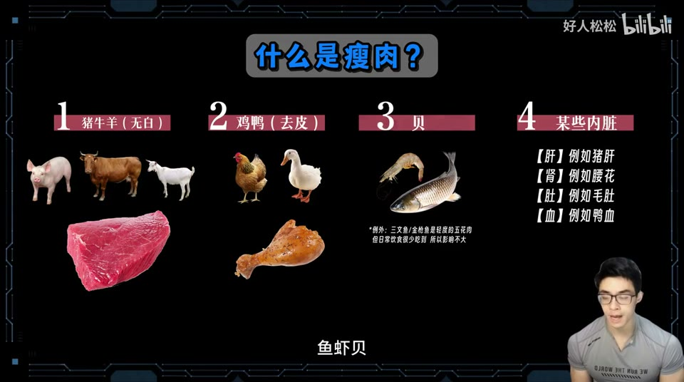

*图 30：瘦肉的四类：猪牛羊（无白）、鸡鸭（去皮）、鱼虾贝、某些内脏（肝、肾、肚、血）。*

**是瘦肉**：没有白色脂肪层的猪牛羊肉；去皮的鸡鸭肉；鱼虾贝；内脏里的肝、肾、肚、血。表中注明瘦肉脂肪率一般不超过 5%。

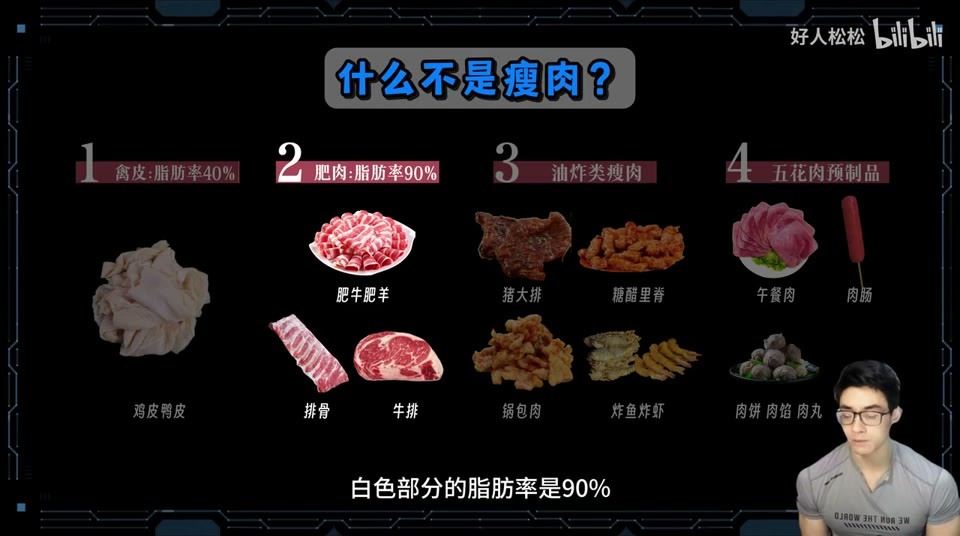

*图 31：不是瘦肉的四类：鸡鸭皮（脂肪率 40%）、肥肉（白色部分脂肪率 90%）、油炸裹粉类、五花肉预制品。*

**不是瘦肉**：
1. 鸡鸭皮：皮的脂肪率约 40%。
2. 肥牛、肥羊、排骨、牛排、烤肉：白色部分脂肪率约 90%。按白色脂肪层的占比可以粗算脂肪率。UP 主明确说，哪怕只有一成是白色脂肪层，偶尔吃没问题，但作为日常基本肉类每天吃两三百克，都会让全天脂肪配额压力很大。五花肉绝不可能作为基础食物。
3. 猪大排、糖醋里脊、锅包肉、炸鱼、炸虾：本体是瘦肉，但裹面粉油炸，就不算炒菜那种瘦肉了。很多来做方案的用户把这些当瘦肉。
4. 午餐肉、肉肠、肉饼、肉丸、肉馆、肉馅：都是半肥半瘦的五花肉打碎的，只是看不到白色脂肪层而已。哪怕是大家觉得最瘦的潮汕牛肉丸，看营养表的脂肪率也相当于“轻度的五花肉”。

### 9.2 脂肪这样吃：推荐模式 [27:32]

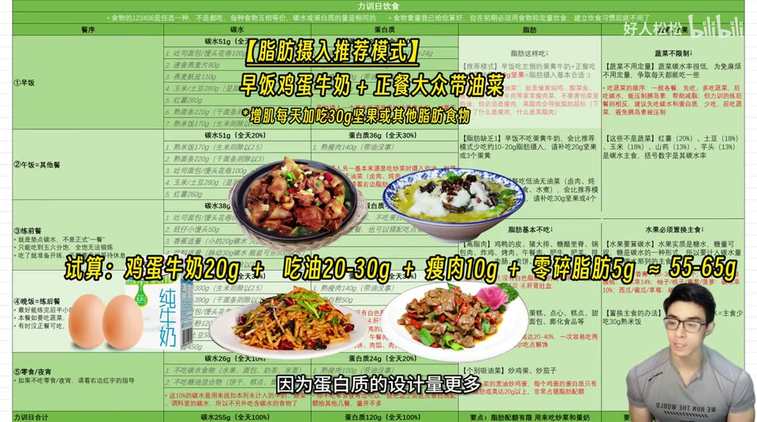

*图 32：【脂肪摄入推荐模式】早饭鸡蛋牛奶 + 正餐大众带油菜；增肌每天加吃 30 g 坚果或其他脂肪食物。试算：鸡蛋牛奶 20 g + 吃油 20–30 g + 瘦肉 10 g + 零碎脂肪 5 g ≈ 55–65 g。*

**推荐模式：早饭吃鸡蛋（含蛋黄）牛奶 + 正餐吃“大众带油菜”，脂肪摄入就基本合适。**
- “大众带油菜”指黄焖鸡、酸菜鱼、鱼香肉丝、小炒牛肉这类家常瘦肉菜。食堂外卖一人份，你能吃进去的油也就 5–10 g。
- 算一遍账：早饭鸡蛋牛奶约 20 g 脂肪；两顿正餐吃三四个炒菜，每个菜直接吃进的油按 5–10 g 算，共 20–30 g；全天瘦肉两百多克，脂肪率按最高 5% 算约 10 g；主食等其他食物的零碎脂肪最多算 5 g。合计约 **55–65 g**，和表格设计的 60 g 差不多。
- **隐性调节**：体重更大的人蛋白质设计量更多，早饭会多吃一两个蛋黄、各餐瘦肉更多，自然多吃一点脂肪；体重更小的人反之。所以并不是所有人都被固定成同一个脂肪量。
- **增肌**：增肌期饮食热量比减脂多，多出的部分分给脂肪，所以增肌期比减脂期多吃约 20 g 脂肪。办法是在减脂期的脂肪模式上**每天多吃 30 g 坚果**；不吃坚果吃别的脂肪也行。

### 9.3 脂肪缺乏 [29:08]

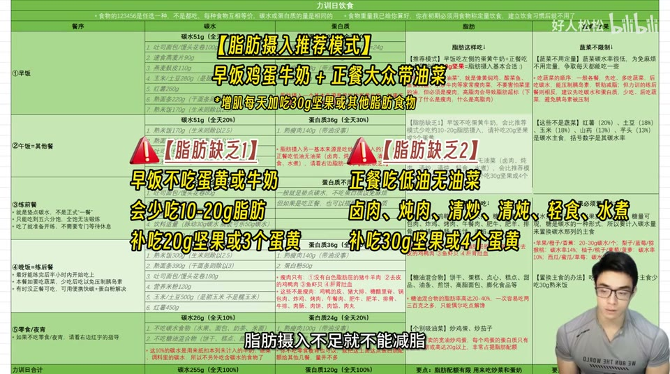

*图 33：【脂肪缺乏之 1】【脂肪缺乏之 2】。*

UP 主说这是让他很头疼的问题：很多人稀里糊涂地搞“干净、健康、自律”饮食，已经脂肪缺乏而不自知。不按上面的推荐模式吃，脂肪摄入量就变了：
- **脂肪缺乏之 1**：早饭不吃蛋黄牛奶，改吃蛋白粉或瘦肉，会少吃 10–20 g 脂肪。请自己找时间**补吃 20 g 坚果或 3 个蛋黄**。
- **脂肪缺乏之 2**：正餐不吃大众带油菜，而吃低油无油菜（卤肉、炖肉、清炒、清炖、轻食、水煮），几乎没有炒菜油，起码每天少吃 20 g 左右脂肪。请自己找时间**补吃 30 g 坚果或 4 个蛋黄**。UP 主自己很反对这种“非生活化”的吃法，但有人喜欢也没关系，补上就行。

再次提醒：**脂肪摄入不足就不能减脂，更不能增肌。** 有这两类饮食习惯的要额外补脂肪；没有的（比如 UP 主自己早饭吃两三个蛋黄、其他时候吃食堂外卖的大众带油菜）就不会缺，也不用专门补。

---

## 十、默认不吃的食物、蔬菜和水果 [30:17]

### 10.1 默认不吃的三类

- **高脂肉**：就是上面说的那些不是瘦肉的肉。
- **糖油混合物**：饼干、蛋糕、点心、糕点、甜品、油条、煎饼、高脂面包、膨化食品等。
- **个别吸油菜**：比如炒鸡蛋（画面还写有炒茄子）。

不是说绝对不能吃，但**绝对不能作为日常基本食物**，否则脂肪摄入必然“爆炸”。

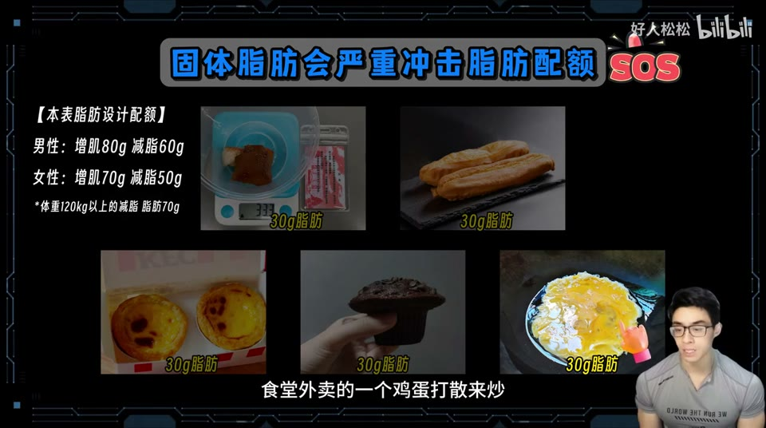

*图 34：固体脂肪会严重冲击脂肪配额。一小块肥肉、两根油条、两个蛋挞、一个小糕点、一份食堂炒鸡蛋，各约 30 g 脂肪。*

例子：一小块肥肉约 30 g 脂肪；早饭两根油条约 30 g；肯德基两个蛋挞约 30 g；星巴克一个小糕点看起来不多也约 30 g；食堂外卖一个鸡蛋打散宽油炒，约 30 多 g。每一样都会让全天脂肪配额少掉一半，再吃点炒菜、鸡蛋牛奶就超标了。

### 10.2 蔬菜和水果 [31:21]

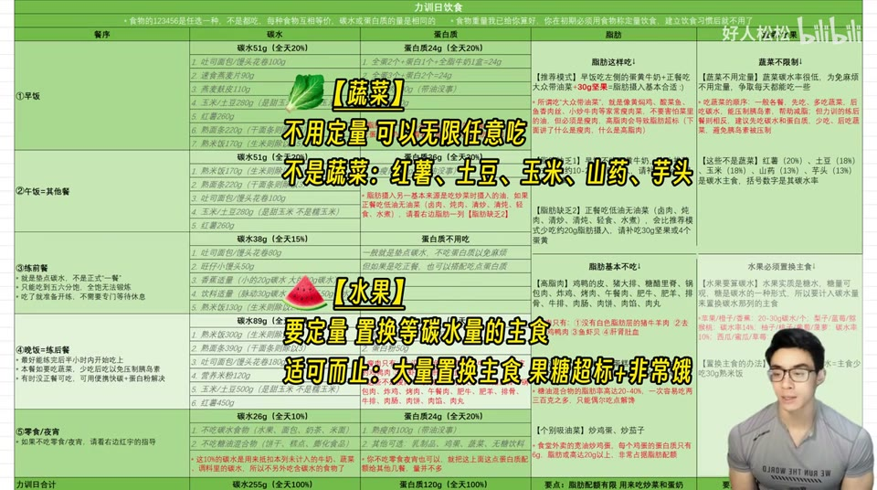

*图 35：【蔬菜】不用定量，可以无限任意吃；红薯、土豆、玉米、山药、芋头不是蔬菜。【水果】要置换等碳水量的主食，适可而止，大量置换主食会果糖超标、非常饿。*

- **蔬菜**：无限任意吃，不用算碳水，因为碳水一列已经留了抵扣量。注意**红薯、土豆、玉米、山药、芋头不是蔬菜，是主食碳水**。表中还提示吃蔬菜的顺序：一般是先吃、多吃蔬菜，后吃碳水，能压制胰岛素、帮助减脂；但力训的练后餐则相反，建议先吃碳水和蛋白质，少吃、后吃蔬菜，避免胰岛素被压制。
- **水果**：水果就是“糖水”，碳水量可观。要吃水果就算出它的碳水量，从主食里置换出等量碳水。例如水果吃 10 g 碳水，主食就少 10 g 碳水，约等于 30 g 米饭。减脂期水果一定要适可而止：主食能提供饱腹感，糖水的饱腹感“低得可怜”，大量用水果换主食既会果糖超标，也会非常饿。**水果只是调节品，不要当主要碳水来源。**

---

## 十一、休息日（蓝色表）的日内分配 [32:07]

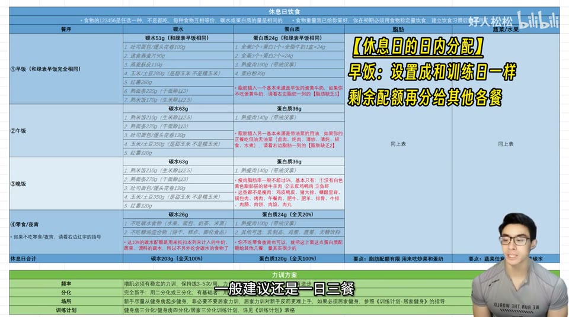

*图 36：【休息日的日内分配】早饭设置成和训练日一样，剩余配额再分给其他各餐。*

- 休息日碳水总量低一点，蛋白质和脂肪跟绿色训练日一样。
- 建议**早饭做成和力训日一模一样**，早饭就不用变，饮食又简单了一些。
- 剩下的配额大概分给其他各餐。以增肌示例为例（从截图读出）：早饭碳水 51 g、蛋白质 24 g（同绿表）；午饭碳水 63 g、蛋白质 36 g；晚饭碳水 63 g、蛋白质 36 g；零食 / 夜宵碳水 26 g、蛋白质 24 g；休息日合计碳水 203 g、蛋白质 120 g。
- **一般建议一日三餐**：符合大众饮食习惯，饥饿感、血糖、胰岛素都比较平滑稳定。
- 不建议一日两餐或一餐：把既定总量合并成一两餐，合并后那一餐会比力训日的练后餐还大。不力训却故意制造超高血糖和胰岛素，UP 主表示怀疑。但非要这样也行，**总量最重要，分餐其次**。

蓝表下方还有一段“力训方案”（截图原文要点）：
- **频率**：增肌必须有稳定的力训，保持每周 3–5 次。
- **分化**：完全新手用二分化或三分化（后半句画面被遮挡，原视频未明确）。
- **场所**：新手尽量从健身房起步，非必要不要居家力训，居家力训对新手反而更难上手。如果必须居家，参照《训练计划—居家健身》。
- **训练计划**：健身房三分化 / 健身房四分化 / 居家三分化训练计划，详见《训练计划》表格。

**其他训练时间点和无力训者**：别的力训时间就下载对应的表，里面绿色表的分餐顺序不同。不健身不力训的普通人减脂，没有力训日和休息日之分，每天一样，只有一张蓝色表。

---

## 十二、两个“叠甲”：估算不准、为什么要定量饮食 [33:23]

1. **“每个人的基础代谢和活动消耗估不准，所以这样设计没意义”**：UP 主承认，除非进实验室测几天，确实不准。但科研界前赴后继地研究预测公式、用双标水或间接测热法测运动消耗，就是为了“在不准里找出还凑合的准”。否则直接用随机数生成饮食量好了，可你又不会愿意吃随机数。
2. **“为什么要定量饮食，不能凭感觉吃吗”**：人人都觉得自己凭感觉吃是对的，那为什么那么多人减脂减不下去、增肌体重不长或长成胖子？因为很多人的自我感觉是错的，对食物的总量和营养率没有判断能力。所以 UP 主劝**新手初期必须通过定量饮食建立饮食基线**，建立后就不用一直定量了。这个过程只需要辛苦一两周，搞清楚自己一碗饭多重、一份菜有多少肉。否则饮食方案就只剩一句“适量饮食、荤素搭配、合理饮食、不断调整”，这种空话你肯定不会接受。UP 主自己早就不定量了，那是因为以前做过，已经能目测碳蛋脂。他的原话是“现在的机械是为了以后的灵活”。

---

## 十三、问答汇总与执行后的调整 [35:03]

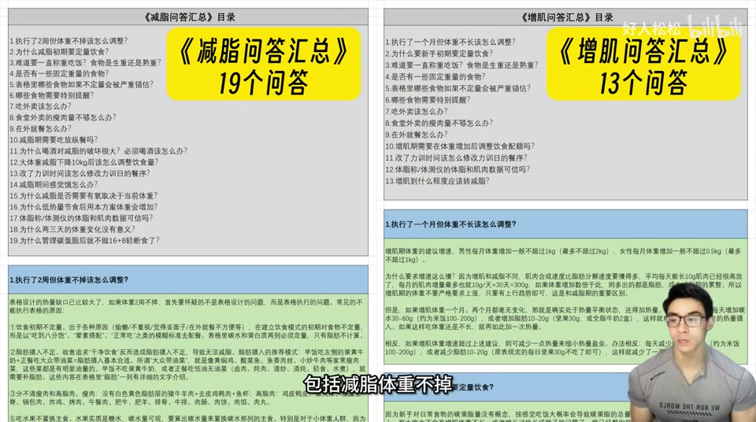

*图 37：《减脂问答汇总》19 个问答、《增肌问答汇总》13 个问答的目录。*

问答汇总包括：减脂体重不掉、增肌体重不长怎么调整，吃外卖怎么办，在外就餐怎么办，喝酒怎么对冲，体重增减多少后要调整配额等。视频里不逐条讲，UP 主建议花点时间浏览一遍（他说已精简到只有几千字）。

目录（从截图读出）：
- **减脂 19 问**：1. 执行了 2 周但体重不掉该怎么调整？2. 为什么减脂初期要定量饮食？3. 难道要一直称重吃饭？食物是生重还是熟重？4. 是否有一些固定重量的食物？5. 表格里哪些食物如果不定量会被严重错估？6. 哪些食物需要特别提醒？7. 吃外卖该怎么办？8. 食堂外卖的瘦肉量不够怎么办？9. 在外就餐怎么办？10. 减脂期需要吃放纵餐吗？11. 为什么喝酒对减脂的破坏很大？必须喝酒该怎么办？12. 大体重减脂下降 10 kg 后该怎么调整饮食量？13. 改了力训时间该怎么修改力训日的餐序？14. 减脂期间感觉饿怎么办？15. 为什么减脂是否需要有氧取决于当前体重？16. 为什么低热量节食后用本方案体重会增加？17. 体脂秤 / 体测仪的体脂和肌肉数据可信吗？18. 为什么两三天的体重变化没有意义？19. 为什么管理碳蛋脂后就不做 16+8 轻断食了？
- **增肌 13 问**：1. 执行了一个月但体重不长该怎么调整？2. 为什么要新手初期要定量饮食？3. 难道要一直称重吃饭？食物是生重还是熟重？4. 是否有一些固定重量的食物？5. 表格里哪些食物如果不定量会被严重错估？6. 哪些食物需要特别提醒？7. 吃外卖该怎么办？8. 食堂外卖的瘦肉量不够怎么办？9. 在外就餐怎么办？10. 增肌期需要在体重增加后调整饮食配额吗？11. 改了力训时间该怎么修改力训日的餐序？12. 体脂秤 / 体测仪的体脂和肌肉数据可信吗？13. 增肌到什么程度应该转减脂？

### 最重要的问题：怎么调整

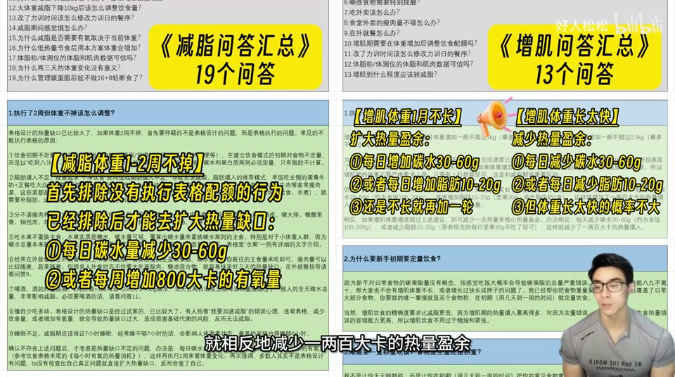

*图 38：【减脂体重 1–2 周不掉】【增肌体重 1 月不长】【增肌体重长太快】三种情况的调整方法。*

| 情况 | 先做什么 | 再怎么调 |
|---|---|---|
| 减脂 1–2 周体重不掉 | **先排查有没有实际上没执行表格配额的行为**（问答第 1 问列了常见原因） | 确认没有后才扩大热量缺口（约 100–200 大卡）：① 每日碳水减少 30–60 g，或 ② 每周增加 800 大卡的有氧量；再执行两周看体重 |
| 增肌一个月体重不长 | — | 扩大热量盈余（约 100–200 大卡）：① 每日增加碳水 30–60 g，或 ② 每日增加脂肪 10–20 g；③ 还是不长就再加一轮 |
| 增肌体重长太快 | — | 减少热量盈余：① 每日减少碳水 30–60 g，或 ② 每日减少脂肪 10–20 g；但 UP 主说这种情况概率不大，因为表格的盈余设计得很保守 |

问答第 1 问里列出的“没执行表格”的常见原因（截图原文要点，口头没有逐条念）：① 饮食初期不定量，用“八分饱”“荤素搭配”“正常吃”之类模糊标准配餐；② 脂肪摄入不足（故意追求“干净饮食”）；③ 分不清瘦肉和高脂肉；⑤ 吃水果不置换主食；⑥ 经常在外就餐；⑦ 喝酒；⑧ 擅自减少饮食、增加有氧，制造过大缺口；⑨ 睡眠不足（每天少于 7 小时）。（第④条画面被遮挡，原视频未明确。）

**为什么有人需要调整？** 因为热量设计里的基础代谢和活动消耗是预估的，可能有偏离。但不用担心，减脂的缺口和增肌的盈余都有容纳度：不是说缺口必须正好 20% 才能减脂，实际是 15% 或 25% 都能减。增肌同理。实在不行就按上面的方法调一下。

**有氧热量消耗表**再提一次：要做有氧，就参考这张表填“有氧消耗”那一栏，结果是你会比同条件下不做有氧的人吃得多一些。

---

## 十四、训练表格：分化、肌群组合、关节活动 [37:01]

训练表格是 4 套训练计划：健身房三分化、健身房四分化（单练肩膀版 / 单练手臂版）、居家三分化。

### 14.1 分化问题

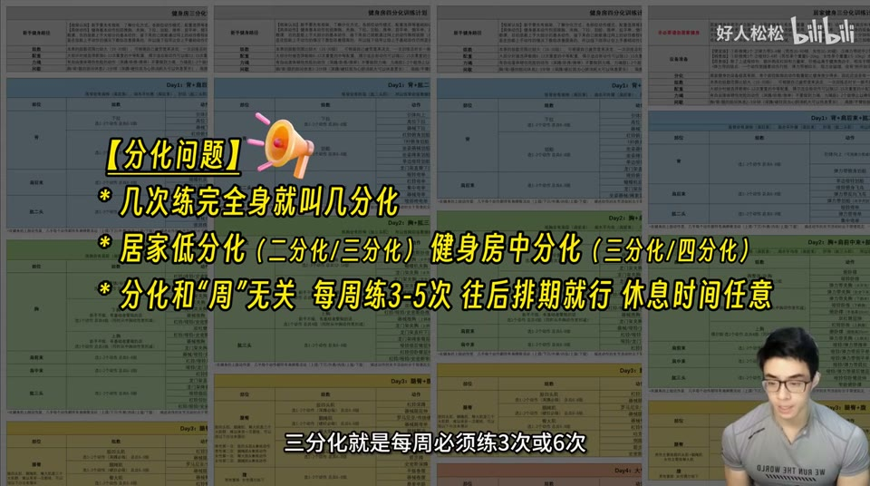

*图 39：【分化问题】几次练完全身就叫几分化；居家低分化（二分化 / 三分化），健身房中分化（三分化 / 四分化）；分化和“周”无关，每周练 3–5 次，往后排期就行，休息时间任意。*

- **几次训练练完全身，就叫几分化。**
- 居家健身可用的动作少、配重不方便，只能低分化、加快循环，应该用二分化或三分化，不要用四分化、五分化。表里写的是居家三分化。
- **分化和你一周练几次毫无关系。** 有人以为三分化就必须每周练 3 次或 6 次、四分化就必须每周练 4 次、必须取整倍数，UP 主说不知道是谁教的。力训一般要保证**每周 3–5 次**才比较有效，不管几分化，都像排值班表一样一直往后排就行。
- **休息时间是任意的**，想休就休、有事就休，不是一个循环结束了才能休息。

### 14.2 大小肌群怎么组合

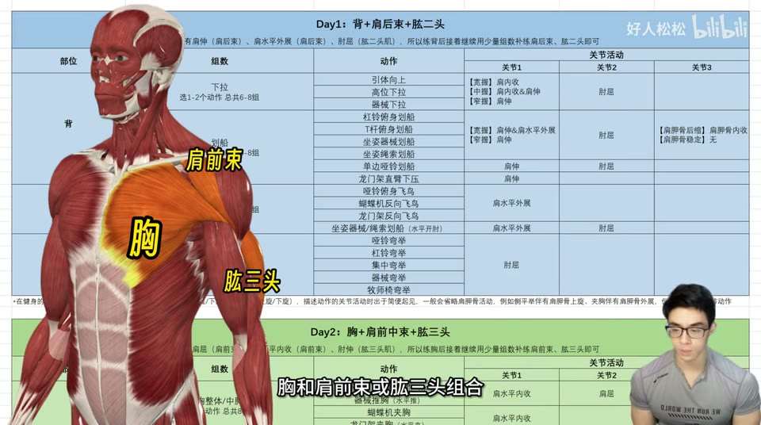

*图 40：胸和肩前束或肱三头组合，背和肩后束或肱二头组合。*

表里的组合方式：**胸 + 肩前束 / 肱三头**，**背 + 肩后束 / 肱二头**。原因是它们有共同的关节活动，练大肌群时其实已经顺便在练这些小肌群，之后再补几组小肌群就行，能提高效率、节约总组数。

### 14.3 每个动作后面写的关节活动

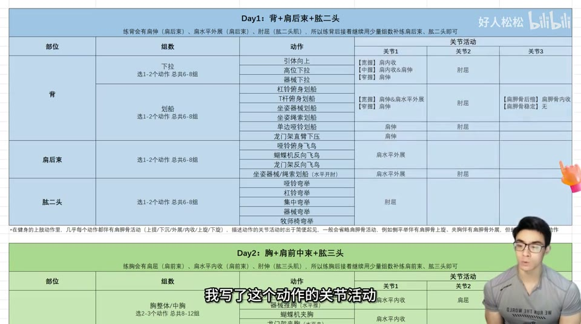

*图 41：健身房三分化 Day1 的动作表，列出部位、组数、动作，以及关节 1/2/3 的关节活动。*

Day1 表格内容（从截图读出）：
- 表头说明：练背会有肩伸（肩后束）、肩水平外展（肩后束）、肘屈（肱二头肌），所以练背后接着用少量组数补练肩后束、肱二头即可。
- **背·下拉**（选 1–2 个动作，总共 6–8 组）：引体向上、高位下拉、器械下拉。关节活动：【宽握】肩内收 /【中握】肩内收 & 肩伸 /【窄握】肩伸；关节 2：肘屈。
- **背·划船**（选 1–2 个动作，总共 6–8 组）：杠铃俯身划船、T 杆俯身划船、坐姿器械划船、坐姿绳索划船。关节活动：【宽握】肩伸 & 肩水平外展 /【窄握】肩伸；肘屈；关节 3：【肩胛骨后缩】肩胛骨内收 /【肩胛骨稳定】无。单边哑铃划船：肩伸 + 肘屈。龙门架直臂下压：肩伸。
- **肩后束**（选 1–2 个动作，总共 6–8 组）：哑铃俯身飞鸟、蝴蝶机反向飞鸟、龙门架反向飞鸟（肩水平外展）；坐姿器械 / 绳索划船（水平开肘）：肩水平外展 + 肘屈。
- **肱二头**（选 1–2 个动作，总共 6–8 组）：哑铃弯举、杠铃弯举、集中弯举、器械弯举、牧师椅弯举（肘屈）。
- 表下注：上肢动作里几乎每个动作都伴有肩胛骨活动（上提 / 下沉 / 外展 / 内收 / 上旋 / 下旋），为简便起见描述时一般省略。
- Day2：胸 + 肩前中束 + 肱三头（练胸会有肩屈（肩前束）、肩水平内收（肩前束）、肘伸（肱三头肌），所以练胸后接着用少量组数补练肩前束、肱三头）。胸整体 / 中胸选 2–3 个动作，总共 8–12 组；器械推胸（水平推）：肩水平内收 + 肘伸；蝴蝶机夹胸：肩水平内收。更多行在截图之外（此处原视频未展示完整）。

**关节活动说明这个动作的实质是做什么，也能据此判断它练什么肌肉。** UP 主举例：

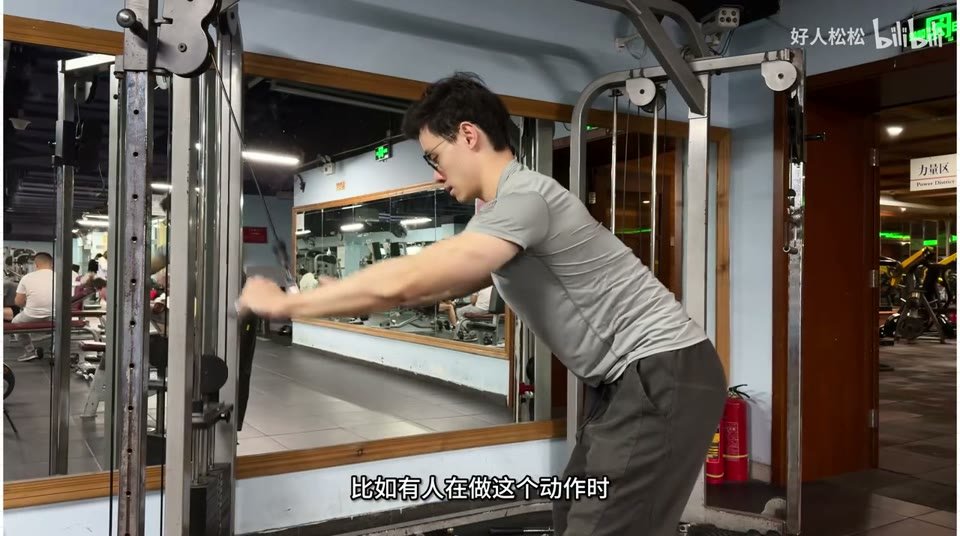

*图 42：龙门架直臂下压。关节活动只有“肩关节伸”。*

**龙门架直臂下压**的关节活动只有肩关节伸，除此之外偷偷做别的关节活动就是错的：
- 错误地压手腕，做腕关节伸，练的是腕伸肌群；
- 错误地让手肘从屈变直，做肘关节伸，练的是肱三头肌；
- 错误地挺髋，做髋关节伸，练的是腘绳肌和臀大肌。

**做错动作的实质，就是不知道这个动作该做什么关节活动，稀里糊涂地去做别的关节活动，让很多不相干的肌肉参与进来帮忙。** 所以健身有点基础后，一定要知道**肩、肘、髋、膝四大关节一共十来种关节活动**。

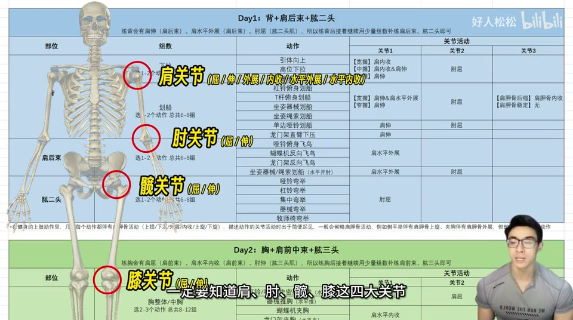

*图 43：肩关节、肘关节、髋关节、膝关节，“一定要知道肩、肘、髋、膝这四大关节”。*

---

## 十五、映射关系表（A 表 / B 表） [39:16]

想进一步深入的人，可以看《健身动作 / 关节活动 / 参与肌肉的映射关系》表。所谓映射关系，就是每个健身动作包含特定的 1–3 个关节活动，每个关节活动又是特定的几块肌肉参与，“就像函数的映射关系一样精确而死板”。

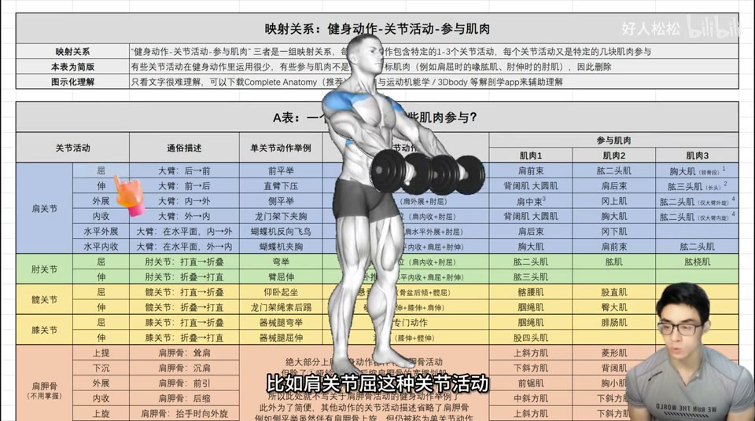

*图 44：A 表“一个关节活动有哪些肌肉参与”。按关节分组，列出关节活动、通俗描述、单关节动作举例、参与肌肉（肌肉 1/2/3）。*

- **A 表：一个关节活动有哪些肌肉参与。** 例：肩关节屈，动作举例前平举，由肩前束、肱二头肌、胸大肌锁骨段这三块肌肉收缩实现，“没有别的可能”。

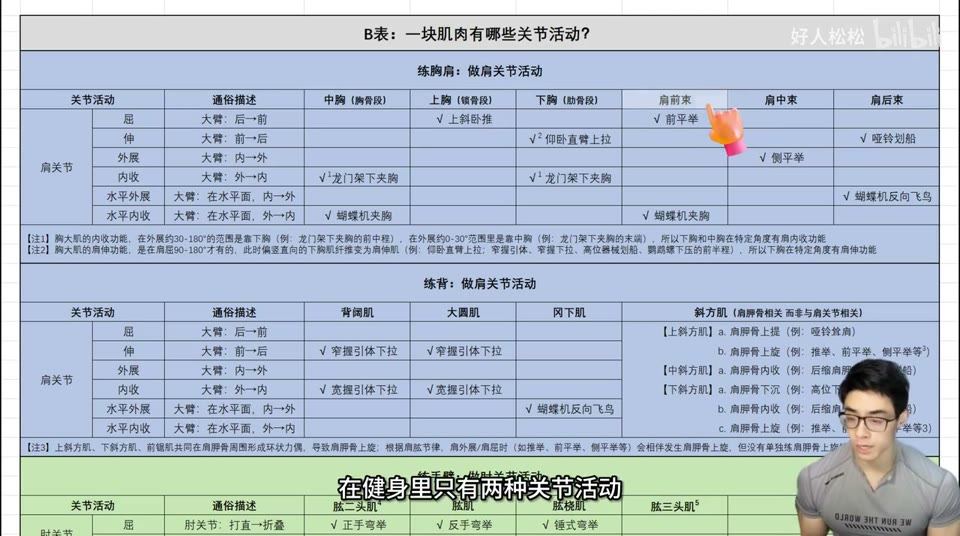

*图 45：B 表“一块肌肉有哪些关节活动”。按肌肉列出它能做的关节活动和代表动作。*

- **B 表：一块肌肉有哪些关节活动。** 例：肩前束在健身里只有两种关节活动，肩关节屈（如前平举）和肩关节水平内收（如蝴蝶机夹胸），此外没有别的。

UP 主理解光看表格和文字会太抽象，说下一个长视频争取用解剖软件结合动作教学讲一遍所有健身动作的关节活动和参与肌肉的映射关系（画面角标写“这组视频已更新，详见 25 年元旦视频”）。他的观点是：不要觉得健身动作有几十上百种、每个都要背动作要点 1234567，“万变不离其宗”，它们的实质就是十来种关节活动在玩组合游戏，要从这个高度看待动作。

---

## 十六、结尾与推广 [40:45]

UP 主推广了自己的充电粉丝学习社群（直播课 + 图文动态，包月 5 元）。**这套 Excel 表格的下载地址在视频的置顶评论里**（视频简介为空，画面上没有直接显示链接）。

---

## 操作速查

### 使用步骤清单

1. **选对版本**：按自己的力训时间点选分餐版本（早饭后练早起版 / 晚起版、午饭前、午饭后、晚饭前、晚饭后、晚饭后更晚）；不力训的人减脂用“无力训者”版。
2. **填基本信息**：性别、身高、体重 → 看 BMI，对照参考区间决定当前该增肌还是减脂。
3. **热量设计**（表格代算，理解原理即可）：
   - 基础代谢 a：Mifflin-St Jeor；
   - 无运动总消耗 b = a ÷ 0.7；
   - 力训消耗 c：按新手 / 有基础 / 老手填；
   - 有氧消耗 d：不做填 0，做的话查《有氧热量消耗》，每周量 ÷ 7；
   - 平衡热量：力训日 e1 = b + c + d，休息日 e2 = b + d；
   - 应吃热量：减脂 ×0.8 × 0.8 = ×0.64；增肌 ×1.05 × 0.8 = ×0.84。
4. **定碳蛋脂**：脂肪按固定总量；碳水 / 蛋白质按身高体重查配额表（训练日碳水 / 休息日碳水 / 每日蛋白质，g/kg）。
5. **日内分配**：训练日碳水“练前给点、练后最大、其余分摊”，蛋白质各餐分摊，脂肪只管全天总量；休息日早饭和训练日一样，其余分到三餐。
6. **换算食物**：食物重量 = 碳水（或蛋白质）量 ÷ 营养率；每餐 1–7 种食物任选一种。
7. **按推荐模式吃脂肪**：早饭鸡蛋牛奶（蛋黄最多 3–4 个）+ 正餐大众带油菜；增肌加 30 g 坚果；不吃蛋黄牛奶补 20 g 坚果或 3 个蛋黄，不吃带油菜补 30 g 坚果或 4 个蛋黄。
8. **初期用食物称定量一两周**，建立饮食基线。
9. **称重与比较**：减脂可以天天称，但看 1–2 周的变化；增肌看 1 个月的变化。
10. **调整**：先排查执行问题，再按每日碳水 ±30–60 g（或脂肪 ±10–20 g、或每周 +800 大卡有氧）调整，再执行两周或一个月观察。
11. **训练**：选一套分化计划，每周 3–5 次，往后排期；按标注的关节活动做动作。

### 关键参数表

| 参数 | 数值 |
|---|---|
| 基础代谢公式（男） | 体重 kg × 9.99 + 身高 cm × 6.25 − 年龄 × 4.92 + 5 |
| 基础代谢公式（女） | 体重 kg × 9.99 + 身高 cm × 6.25 − 年龄 × 4.92 − 161 |
| 无运动总消耗 | 基础代谢 ÷ 0.7 |
| 力训消耗（男） | 新手 200 / 有基础 250 / 老手 300 大卡 |
| 力训消耗（女） | 新手 100 / 有基础 150 / 老手 200 大卡 |
| 减脂热量缺口 | 20%，再 ×0.8 → 平衡热量 × 0.64 |
| 增肌热量盈余 | 5%（可 10%），再 ×0.8 → 平衡热量 × 0.84 |
| 能量系数 | 碳水 4、蛋白质 4、脂肪 9 大卡/克 |
| 脂肪配额 | 男：增肌 80 g / 减脂 60 g（>120 kg 为 70 g）；女：增肌 70 g / 减脂 50 g |
| 减脂速度 | 理论上两周减 2% 体重；看 1–2 周的比较 |
| 增肌速度 | 男 ≤ 1 kg/月，女 ≤ 0.5 kg/月；看 1 个月的比较 |
| BMI 转换点（男） | 减到 22–23 转增肌；增到 24–25 转减脂 |
| BMI 转换点（女） | 减到 20–21 转增肌；增到 22–23 转减脂 |
| 有氧默认 | 增肌不做；减脂 > 80 kg 不做；< 70 kg 每周 2 小时；70–80 kg 先不做、饿再加；保留有氧也建议每周 < 4 小时 |
| 训练日分配（晚饭前练） | 碳水：早 20% / 午 20% / 练前 15% / 练后 35% / 零食 10%；蛋白质：早 20% / 午 30% / 练前 0% / 练后 30% / 零食 20% |
| 碳水预留 | 拨出约 10% 碳水（约 10–20 g）抵扣牛奶、蔬菜、调料里的碳水 |
| 早饭鸡蛋牛奶脂肪 | 控制在约 20 g（蛋黄最多 3–4 个） |
| 水果置换 | 水果 10 g 碳水 = 主食少 10 g 碳水 ≈ 30 g 米饭 |
| 调整幅度 | 碳水 ±30–60 g/天，或脂肪 ±10–20 g/天，或减脂每周 +800 大卡有氧 |
| 训练频率 | 每周 3–5 次，与分化数无关 |

---

## 初学者实践建议

以下只根据视频内容归纳。

1. **先听懂逻辑再用表**：UP 主反复强调，拿着表不懂设置逻辑是用不好的。至少要明白“热量先定死 → 再分碳蛋脂 → 再分到各餐 → 再换成食物”这条主线。
2. **新手先定量一两周**：用食物称照表吃，搞清楚自己一碗饭多重、一份菜多少肉。这是为以后不用定量打基础，“现在的机械是为了以后的灵活”。
3. **只用表里的纯碳水主食和基础蛋白质来源**：新手先别把饺子、包子、油条、手抓饼和豆制品当主力，因为它们附带的脂肪或碳水新手算不清。
4. **分清瘦肉**：裹粉油炸的肉、肉丸肉肠午餐肉、带白色脂肪层的肉和禽皮都不算瘦肉。
5. **别缺脂肪**：按“早饭蛋黄牛奶 + 正餐大众带油菜”来吃；如果习惯吃蛋白粉早饭或无油菜，就按表补坚果或蛋黄。
6. **看趋势不看单日**：减脂看 1–2 周、增肌看 1 个月的体重变化，不要为两三天的波动纠结。
7. **体重不动先查执行，再调配额**：先对照问答第 1 问排查，确认按表执行了，再按 30–60 g 碳水的幅度微调。
8. **有氧按需做**：增肌和大体重减脂默认不做；小体重减脂可以每周做两小时左右，并用有氧表把多消耗的热量吃回来。
9. **训练按分化往后排**：每周练 3–5 次，不必凑整倍数，想休就休。
10. **有基础后学关节活动**：从肩、肘、髋、膝的十来种关节活动去理解动作，避免用不相干的关节代偿。

---

## 不确定之处

- **与「饮食完全手册」「训练完全手册」的关系**：视频里没有提到这两期，套表和它们的关系此处原视频未明确。
- **增肌示例的配额读数不一致**：增肌方案截图写的是 70 kg 男性“力训日 3.6 g/kg、休息日 2.9 g/kg、蛋白质 1.7 g/kg”，但健身男性配额表在 175 cm / 70 kg 一格读出来是 `3.8/3.0/1.6`。可能是示例表和配额表版本不同，也可能是截图读数误差，以套表原件为准。
- **减脂示例总量的尾数**：减脂方案里“2.3 g/kg × 100 kg = 总量 228 g”等数字和直接相乘略有出入，可能是 g/kg 显示时四舍五入了，以原表为准。
- **早饭与午饭碳水比例**：口头说“早饭比午饭低一点”，但晚饭前练版本截图里早饭、午饭碳水都是 20%（51 g），以表格为准。
- **问答第 1 问第④条、蓝表“分化”一行后半句**：画面被遮挡，原视频未明确。
- **力训方案的配重**：开场说训练计划包含“配重”信息，但截图只看到组数和动作，配重列没有清楚展示（此处原视频未明确）。
- **四分化两个版本的具体分法**：只说“可以单练肩膀，也可以单练手臂”，各天的具体安排没有展示（此处原视频未明确）。
- **下载地址**：口头说在置顶评论里，置顶评论内容没有抓取，视频简介为空。
- **转写校对**：Whisper 的同音错字（如“国神肌 → 腘绳肌”“攻三头 → 肱三头”“肝肾毒血 → 肝肾肚血”“小农包 → 小笼包”“B 站的骨架 → B 站的股价”）已按画面字幕和上下文改正；少数口头细节以字面理解为准。
