# 《健身解剖完全手册》第1集：关节活动

## 来源

- **视频标题**：B站版《健身解剖完全手册》™（第1集：关节活动）
- **UP 主**：好人松松
- **链接**：https://www.bilibili.com/video/BV1mM6JY6Ei9/
- **时长**：约 51:37
- **视频章节**：0.前言 [00:00] / 1.肩 [05:30] / 2.肘 [24:36] / 3.髋 [28:00] / 4.膝 [31:12] / 5.踝 [35:06] / 6.肩胛骨 [37:06] / 7.答题&充电社群 [41:57]
- **整理日期**：2026-10-17
- **整理方式**：音频用 Whisper（large-v3-turbo）转写成文字稿，再对照视频画面里的内嵌字幕和图表逐段校对（转写中的同音错字，如「屎状面 / 宽关节 / 国神肌 / 肩前竖」，已按画面改为「矢状面 / 髋关节 / 腘绳肌 / 肩前束」）；只出现在画面上、口头没念的表格和图注，已从截图中读出并整理成文字。截图取自 720p 视频。

## 总览

这一集是解剖系列课程的总导论，核心观点是：**健身动作、关节活动、参与肌肉之间是一一映射的关系**。几十上百种健身动作，本质上只是全身十来种关节活动的组合。只要搞清楚每个动作做的是哪种关节活动、每种关节活动由哪些肌肉完成，就能自己推出“这个动作练哪儿、怎么做对、怎么做错”。

视频先给出两张总结表（A 表：关节活动→肌肉；B 表：肌肉→关节活动），再按 **肩 → 肘 → 髋 → 膝 → 踝 → 肩胛骨** 的顺序逐个讲。每种关节活动都讲三件事：**① 它是什么运动；② 对应哪些健身动作；③ 由哪些肌肉完成**。最后是 5 道随堂测试题。

贯穿全片的一条规则：**判断一个动作做的是什么关节活动，要看它“克服阻力”的那个阶段**（UP 主强调了很多遍）。

## 目录

- [0. 前言与两张总结表 [00:00]](#0-前言与两张总结表-0000)
- [1. 关节与解剖面 [05:29]](#1-关节与解剖面-0529)
- [2. 肩关节 [06:56]](#2-肩关节-0656)
  - [2.1 肩屈 [07:20]](#21-肩屈-0720)
  - [2.2 肩伸 [10:39]](#22-肩伸-1039)
  - [2.3 肩内收 [13:03]](#23-肩内收-1303)
  - [2.4 肩外展 [16:27]](#24-肩外展-1627)
  - [2.5 肩水平外展 [17:33]](#25-肩水平外展-1733)
  - [2.6 肩水平内收 [20:56]](#26-肩水平内收-2056)
- [3. 肘关节 [24:35]](#3-肘关节-2435)
- [4. 髋关节 [27:58]](#4-髋关节-2758)
- [5. 膝关节 [31:11]](#5-膝关节-3111)
- [6. 踝关节 [35:05]](#6-踝关节-3505)
- [7. 肩胛胸壁关节（肩胛骨的运动） [37:06]](#7-肩胛胸壁关节肩胛骨的运动-3706)
- [8. 随堂测试与答案 [41:55]](#8-随堂测试与答案-4155)
- [9. 片尾：充电社群与下集预告 [48:32]](#9-片尾充电社群与下集预告-4832)
- [要点速查](#要点速查)
- [初学者练习建议](#初学者练习建议)

---

## 0. 前言与两张总结表 [00:00]

### 系列定位 [00:00]

- 这是 UP 主「新手健身框架」系列的第四集（前三集是减脂、训练、饮食）。第四集讲基础解剖，同时它本身又是一门独立课程：**《骨肌解剖与健身运用》**（UP 主戏称“中关村文理学院”的网课），一共 7 集，每集约一小时，**每半个月发一集**。底稿约十万字，全部视频合计约七小时。
- 7 集的安排（画面）：第1集 关节活动、第2集 胸、第3集 肩、第4集 背、第5集 臂&腹、第6集 臀&腿、第7集 专题。
- 核心思路：别去一个个死记动作要点，健身动作“实质就是全身十来种关节活动的组合游戏”，从这个角度理解，健身就简单多了。

### 配套资料与工具 [01:24]

- **Excel 工具套表**：饮食模块（减脂增肌饮食方案底表）、训练模块（健身房和居家三分化训练计划表）、拉伸模块，以及这次新加的**基础解剖模块**（本集核心信息已整理进去）。获取方式：关注后私信发“1”自动回复，或看视频置顶评论链接。
- 动作演示由 UP 主的一位朋友拍摄（“他肌肉更大、体脂更低”）。
- 引用了多本运动解剖、肌骨解剖教材的插图。UP 主劝大家**先看完视频再考虑买书**（“买书如山倒，看书如抽丝”）。
- 3D 演示用的是 Elsevier 的 **Complete Anatomy** 软件（账号约 300 元/年，UP 主在套表里提供了自己的账号供试用），并强调这不是广告。

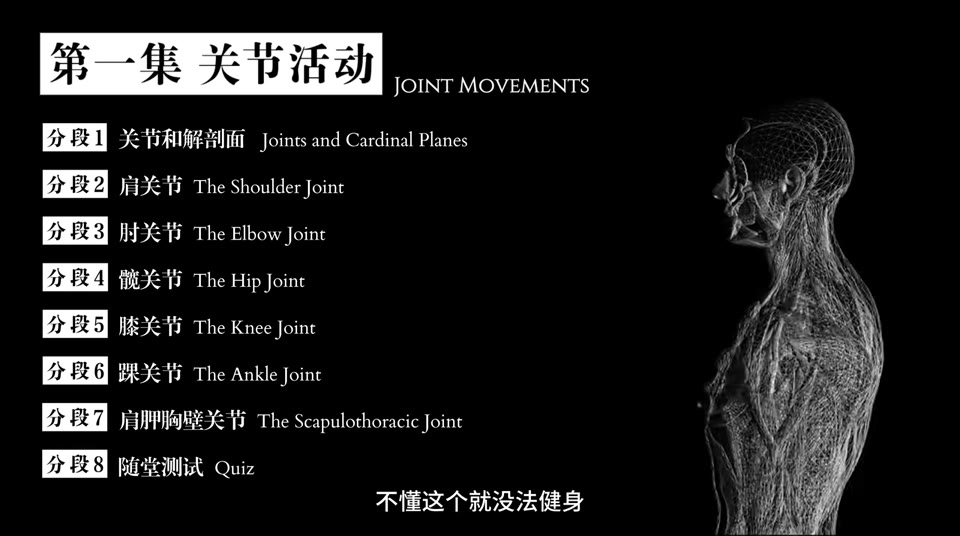

*图 1：第一集目录：关节和解剖面、肩、肘、髋、膝、踝、肩胛胸壁关节、随堂测试。*

### A 表：关节活动的肌肉 [03:09]

以**关节活动为中心**：每个关节活动由哪些肌肉完成。例：肩屈的代表动作是前平举，参与肌肉是肩前束，以及靠近肩前束的上胸和肱二头肌。

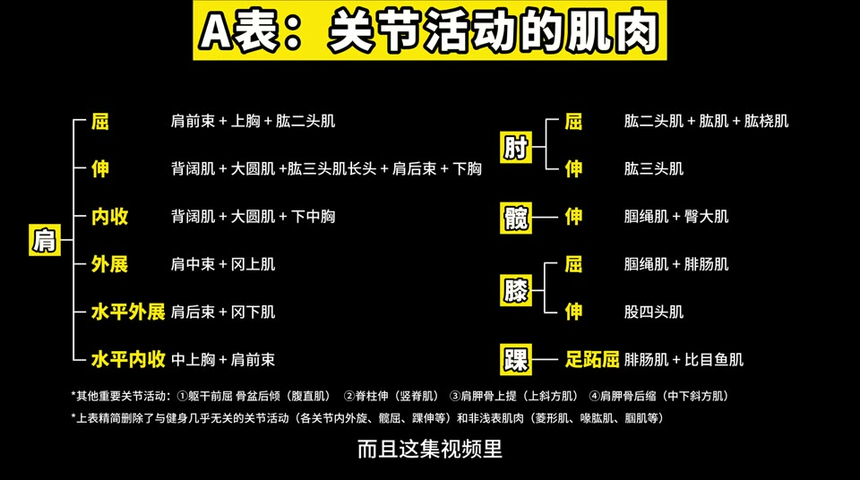

*图 2：A 表：以关节活动为中心，列出每种关节活动的参与肌肉。*

| 关节 | 关节活动 | 参与肌肉 |
|---|---|---|
| 肩 | 屈 | 肩前束 + 上胸 + 肱二头肌 |
| 肩 | 伸 | 背阔肌 + 大圆肌 + 肱三头肌长头 + 肩后束 + 下胸 |
| 肩 | 内收 | 背阔肌 + 大圆肌 + 下中胸 |
| 肩 | 外展 | 肩中束 + 冈上肌 |
| 肩 | 水平外展 | 肩后束 + 冈下肌 |
| 肩 | 水平内收 | 中上胸 + 肩前束 |
| 肘 | 屈 | 肱二头肌 + 肱肌 + 肱桡肌 |
| 肘 | 伸 | 肱三头肌 |
| 髋 | 伸 | 腘绳肌 + 臀大肌 |
| 膝 | 屈 | 腘绳肌 + 腓肠肌 |
| 膝 | 伸 | 股四头肌 |
| 踝 | 足跖屈 | 腓肠肌 + 比目鱼肌 |

表下脚注（画面文字）：
- 其他重要关节活动：① 躯干前屈、骨盆后倾（腹直肌）；② 脊柱伸（竖脊肌）；③ 肩胛骨上提（上斜方肌）；④ 肩胛骨后缩（中下斜方肌）。
- 上表精简删除了与健身几乎无关的关节活动（各关节内外旋、髋屈、踝伸等）和非浅表肌肉（菱形肌、喙肱肌、腘肌等）。

### B 表：肌肉的关节活动 [03:26]

以**肌肉为中心**：每块肌肉能做哪些关节活动。例：肩前束只有两种关节活动——肩屈（代表动作前平举）和肩水平内收（代表动作蝴蝶机夹胸）。

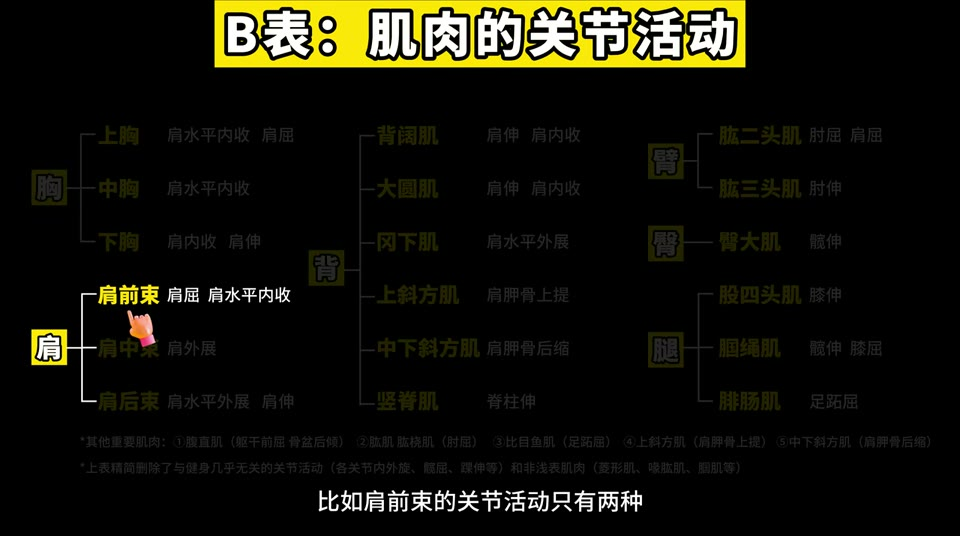

*图 3：B 表：以肌肉为中心，列出每块肌肉的关节活动（画面正高亮“肩前束：肩屈、肩水平内收”）。*

| 部位 | 肌肉 | 关节活动 |
|---|---|---|
| 胸 | 上胸 | 肩水平内收、肩屈 |
| 胸 | 中胸 | 肩水平内收 |
| 胸 | 下胸 | 肩内收、肩伸 |
| 肩 | 肩前束 | 肩屈、肩水平内收 |
| 肩 | 肩中束 | 肩外展 |
| 肩 | 肩后束 | 肩水平外展、肩伸 |
| 背 | 背阔肌 | 肩伸、肩内收 |
| 背 | 大圆肌 | 肩伸、肩内收 |
| 背 | 冈下肌 | 肩水平外展 |
| 背 | 上斜方肌 | 肩胛骨上提 |
| 背 | 中下斜方肌 | 肩胛骨后缩 |
| 背 | 竖脊肌 | 脊柱伸 |
| 臂 | 肱二头肌 | 肘屈、肩屈 |
| 臂 | 肱三头肌 | 肘伸 |
| 臀 | 臀大肌 | 髋伸 |
| 腿 | 股四头肌 | 膝伸 |
| 腿 | 腘绳肌 | 髋伸、膝屈 |
| 腿 | 腓肠肌 | 足跖屈 |

脚注（画面文字）：其他重要肌肉：① 腹直肌（躯干前屈、骨盆后倾）；② 肱肌、肱桡肌（肘屈）；③ 比目鱼肌（足跖屈）；④ 上斜方肌（肩胛骨上提）；⑤ 中下斜方肌（肩胛骨后缩）。另有一条补充：**肩前束的第 3 种关节活动是“大臂外旋位的肩外展”**，这是非解剖位的特殊情况，详见本课第 3 集（练肩）。

### 按部位的总结图（主 / 次关节活动 + 动作举例） [03:40]

UP 主又把 B 表按部位画成了图，每块肌肉标出 **[主]** 主要关节活动、**[次]** 次要关节活动，括号里是动作举例。主次的含义在第 5 题讲解里有说明（见第 8 节）：**次要关节活动是“确实参与，但贡献比例不够大”，专门练这块肌肉时最好选它的主要关节活动。**

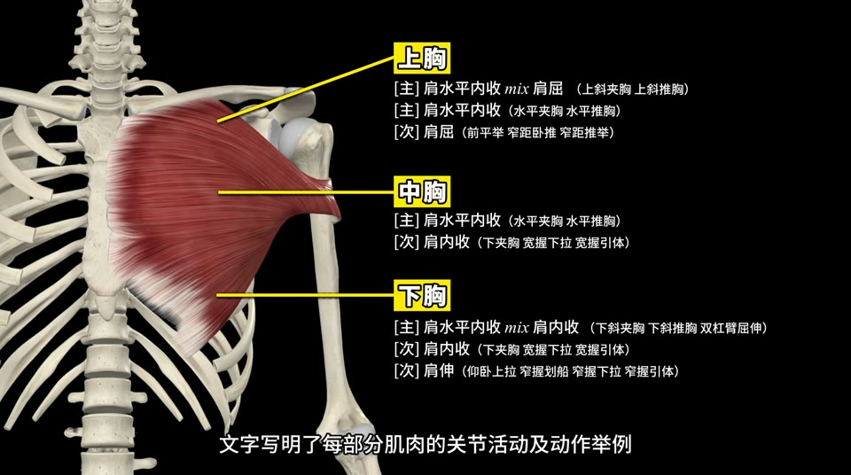

*图 4：练胸总结图：上、中、下胸各自的主次关节活动和动作举例。*

**胸**
- 上胸：[主] 肩水平内收 *mix* 肩屈（上斜夹胸、上斜推胸）；[主] 肩水平内收（水平夹胸、水平推胸）；[次] 肩屈（前平举、窄距卧推、窄距推举）
- 中胸：[主] 肩水平内收（水平夹胸、水平推胸）；[次] 肩内收（下夹胸、宽握下拉、宽握引体）
- 下胸：[主] 肩水平内收 *mix* 肩内收（下斜夹胸、下斜推胸、双杠臂屈伸）；[次] 肩内收（下夹胸、宽握下拉、宽握引体）；[次] 肩伸（仰卧上拉、窄握划船、窄握下拉、窄握引体）

**“mix”是什么意思** [03:49]：指两种关节活动**复合**形成的轨迹。例如上斜夹胸，大臂既不是水平往内、也不是垂直往上，而是“肩水平内收 mix 肩屈”。两者比例不同，决定了大臂是轻微斜上还是严重斜上：
- 肩水平内收比例较多 → 大臂轻微斜上运动
- 肩屈比例较多 → 大臂严重斜上运动

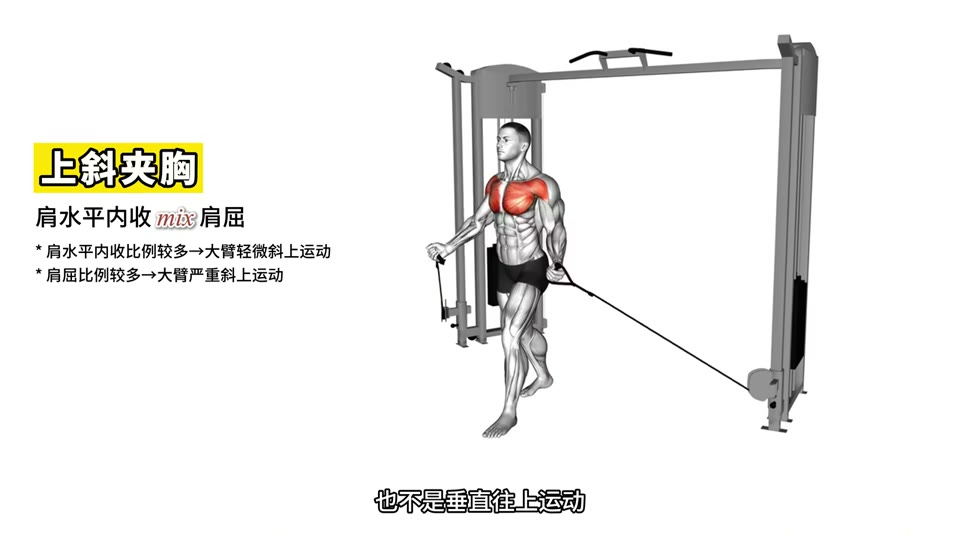

*图 5：“mix”的例子：上斜夹胸的大臂轨迹是肩水平内收和肩屈的复合。*

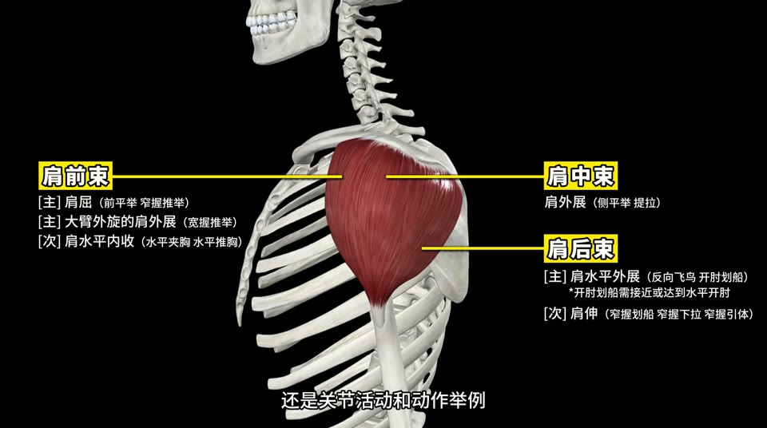

*图 6：练肩总结图：肩前、中、后束的关节活动。*

**肩**
- 肩前束：[主] 肩屈（前平举、窄握推举）；[主] 大臂外旋的肩外展（宽握推举）；[次] 肩水平内收（水平夹胸、水平推胸）
- 肩中束：肩外展（侧平举、提拉）
- 肩后束：[主] 肩水平外展（反向飞鸟、开肘划船；*开肘划船需接近或达到水平开肘）；[次] 肩伸（窄握划船、窄握下拉、窄握引体）

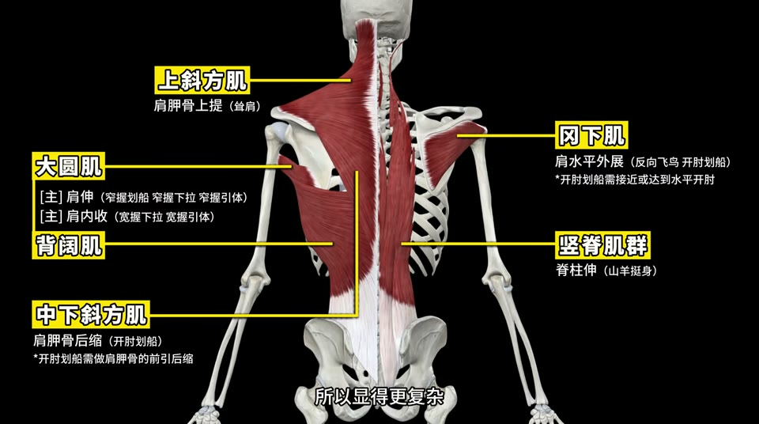

*图 7：练背总结图：背部肌肉较多，所以显得更复杂。*

**背**
- 上斜方肌：肩胛骨上提（耸肩）
- 大圆肌 / 背阔肌：[主] 肩伸（窄握划船、窄握下拉、窄握引体）；[主] 肩内收（宽握下拉、宽握引体）
- 冈下肌：肩水平外展（反向飞鸟、开肘划船；*开肘划船需接近或达到水平开肘）
- 竖脊肌群：脊柱伸（山羊挺身）
- 中下斜方肌：肩胛骨后缩（开肘划船；*开肘划船需做肩胛骨的前引后缩）

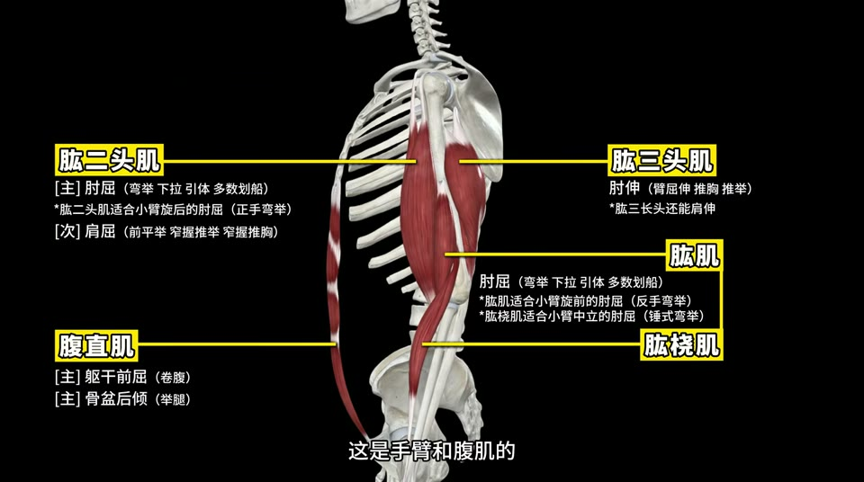

*图 8：手臂和腹肌总结图。*

**手臂与腹**
- 肱二头肌：[主] 肘屈（弯举、下拉、引体、多数划船；*肱二头肌适合小臂旋后的肘屈，即正手弯举）；[次] 肩屈（前平举、窄握推举、窄握推胸）
- 肱肌：肘屈（同上；*肱肌适合小臂旋前的肘屈，即反手弯举）
- 肱桡肌：肘屈（*适合小臂中立的肘屈，即锤式弯举）
- 肱三头肌：肘伸（臂屈伸、推胸、推举；*肱三头长头还能肩伸）
- 腹直肌：[主] 躯干前屈（卷腹）；[主] 骨盆后倾（举腿）

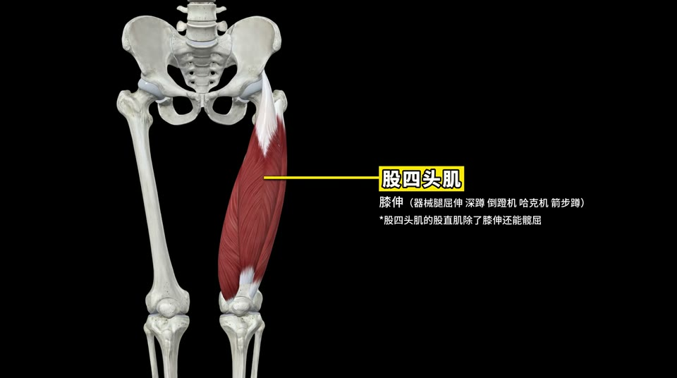

*图 9：大腿前侧：股四头肌。*

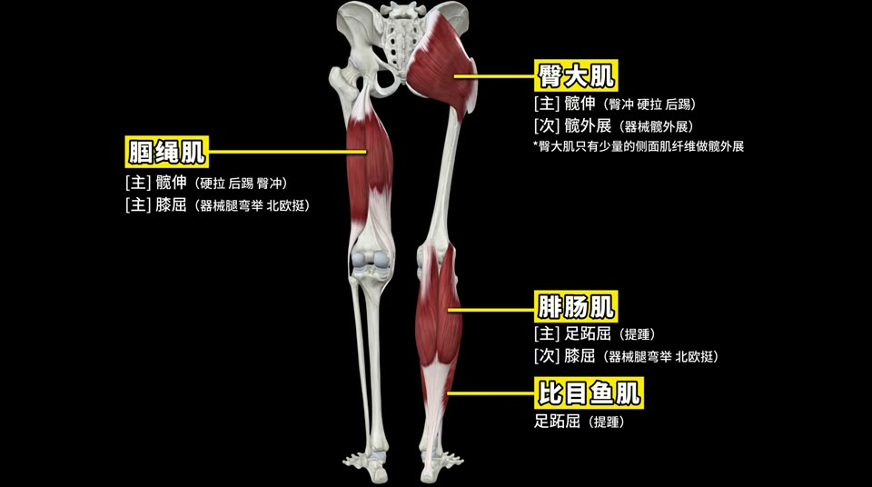

*图 10：大腿后侧、臀和小腿总结图。*

**臀腿**
- 股四头肌：膝伸（器械腿屈伸、深蹲、倒蹬机、哈克机、箭步蹲；*股四头肌的股直肌除了膝伸还能髋屈）
- 臀大肌：[主] 髋伸（臀冲、硬拉、后踢）；[次] 髋外展（器械髋外展；*臀大肌只有少量的侧面肌纤维做髋外展）
- 腘绳肌：[主] 髋伸（硬拉、后踢、臀冲）；[主] 膝屈（器械腿弯举、北欧挺）
- 腓肠肌：[主] 足跖屈（提踵）；[次] 膝屈（器械腿弯举、北欧挺）
- 比目鱼肌：足跖屈（提踵）

UP 主说这两张总结表是“一切的总纲，万变不离其宗”，并提醒不用截图做笔记，套表里都整理好了。本集的任务是讲清楚健身里一共十来个关节活动分别是什么，这是“根本性的前置知识”。

---

## 1. 关节与解剖面 [05:29]

**健身涉及 6 个关节**：肩关节、肘关节、髋关节、膝关节、踝关节，以及**肩胛胸壁关节**（俗称肩胛骨的运动）。

**与健身相关的运动面有 3 个**，每个面上的运动名称不同：

| 运动面 | 方位 | 该面上的运动 | 本集讲不讲 |
|---|---|---|---|
| 矢状面 | 身体前后的面 | **屈 / 伸** | 讲（最普遍）。肩、肘、髋、膝、踝都能屈伸，但**髋屈和踝伸**在健身里几乎没有对应动作，省略 |
| 冠状面 | 身体左右的面 | **内收 / 外展** | 只有肩和髋能内收外展；健身里几乎没有髋内收外展的动作，所以**只讲肩** |
| 水平面 | 身体水平的面 | **内旋 / 外旋** | 肩、髋、膝能内外旋，但和健身动作“几乎无关”，**全都不讲** |
| 水平面（仅肩） | — | **水平内收 / 水平外展** | 只有肩关节能做，健身里非常重要，**讲** |

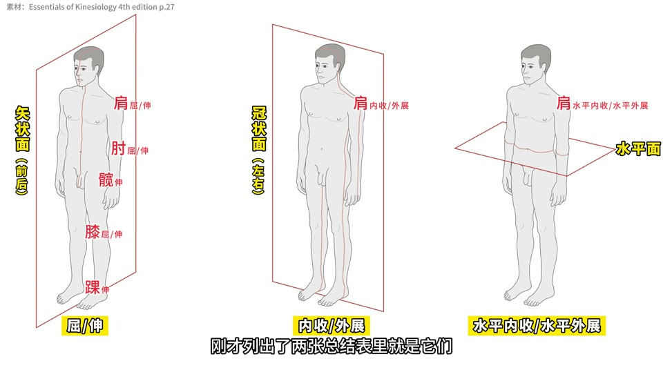

*图 11：矢状面（屈/伸）、冠状面（内收/外展）、水平面（肩的水平内收/水平外展）：删减后本集要讲的关节活动。*

删减之后剩下的，就是两张总结表里列的那些关节活动。UP 主说大量删减是为了让内容更简单，否则更学不会。

---

## 2. 肩关节 [06:56]

**定义**：肩关节运动是**大臂相对于躯干**的运动。相对运动既可以是躯干不动大臂动，也可以是大臂不动躯干动；现实里躯干基本不动，所以**大臂在动就叫肩关节运动**（UP 主说这句话要“给学渣说三遍”）。

肩关节在三个面各有一对相反的活动，共 **6 种**：屈/伸（矢状面）、内收/外展（冠状面）、水平内收/水平外展（水平面）。肩关节是最复杂的一个。

**每个关节活动的讲法**（UP 主在 [12:31] 说明）：① 含义，也就是怎么运动；② 对应的健身动作，和健身对上；③ 参与的肌肉，和肌肉对上（如“肩屈三肌”“肩伸五肌”）。

**图示约定**：视频统一用**红色圆点**表示肌肉的起止点，**黄色线**表示肌肉收缩的拉力线。

### 2.1 肩屈 [07:20]

**是什么**：大臂在矢状面**从后往前**运动，叫肩关节屈，简称肩屈。生活中的例子：太极拳的“起势”。拿着哑铃做就是前平举。（UP 主还开玩笑提醒，在德国千万别做单手肩屈，那是纳粹敬礼手势，摆拍是违法的。）

**健身动作**：
- 单关节：**前平举**（肩屈）
- 多关节：**窄距卧推**、**窄距推举**（肩屈 + 肘伸）

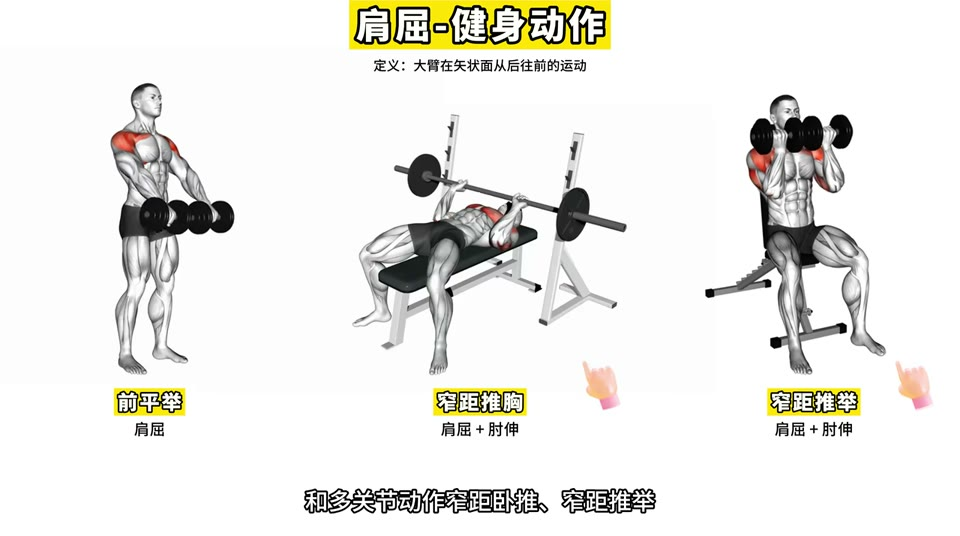

*图 12：肩屈的健身动作：前平举（肩屈）、窄距推胸（肩屈 + 肘伸）、窄距推举（肩屈 + 肘伸）。*

**关键前置知识：判断关节活动看“克服阻力的阶段”** [08:07]
- 任何健身动作都是一来一去的。比如前平举，抬起的过程是肩屈，下落的过程是肩伸。
- 下落时配重反而在**加速和帮助**大臂下落，所以不算。
- 因此要以**克服阻力的阶段**（抬起阶段）来判断。UP 主把这句话重复了三遍：**判断关节活动是看克服阻力的阶段。**

**常见误区：推类动作并不都是肩屈** [08:44]
- 推类动作里**只有窄推才是肩屈**。
- **宽握推举**：大臂在冠状面运动，叫“大臂外旋位的肩外展”（+ 肘伸），和矢状面的肩屈无关。
- **宽握推胸**：大臂接近在水平面运动，好比水平夹胸，叫**肩水平内收**（+ 肘伸），也和肩屈无关。
- **窄握推胸**：大臂在矢状面运动，才是肩屈。
- 结论：推胸动作里带多少肩屈，**取决于握距宽窄导致的开肘大小**。

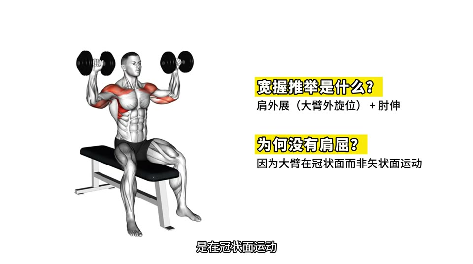

*图 13：宽握推举 = 肩外展（大臂外旋位）+ 肘伸；没有肩屈，因为大臂在冠状面而不是矢状面运动。*

**参与肌肉：肩屈三肌** [09:21]
1. **肩前束**：最主要的贡献者，拉力线最接近矢状面。
2. **上胸**：位于肩前束旁边，也能贡献肩屈，但拉力线的垂直分力不如肩前束有优势，参与效率较弱。
3. **肱二头肌**：拉力线也很符合矢状面，但它是**双关节肌**。按一种叫“节俭法则”（law of parsimony）的机制，身体为了节约能量会**延后募集双关节肌**，所以肱二头肌对肩屈的贡献其实不大。
   - 画面上的解释（引自一本英文运动学教材的“Special Focus 6.5 Law of Parsimony”一栏，整理者转述）：当单关节肌和双关节肌都能完成某个关节活动时，身体会**优先募集单关节肌**，因为双关节肌收缩时要在两个关节处都有拮抗肌来抵消多余的动作，更费力。只有遇到单关节肌应付不了的大力矩时，双关节肌才会被充分募集。

画面上标的起止点：肩前束起于锁骨外 1/3，止于肱骨三角肌粗隆；上胸起于锁骨内 1/2，止于肱骨大结节嵴；肱二头肌起于肩胛骨喙突（短头）和盂上结节（长头），止于桡骨粗隆。

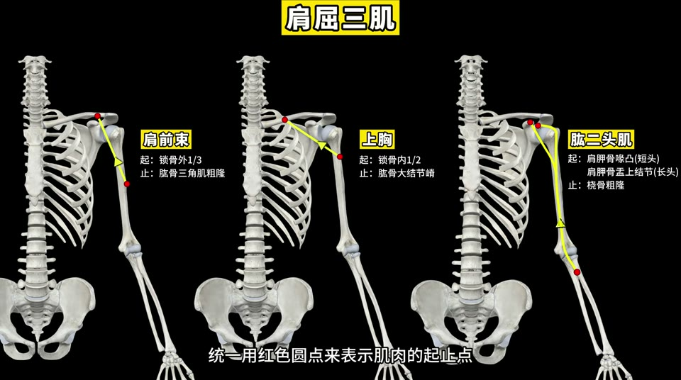

*图 14：肩屈三肌：肩前束、上胸、肱二头肌（红点是起止点，黄线是拉力线）。*

**解剖软件的普遍 Bug** [10:08]：软件演示肩屈时会把**整个胸大肌**都标亮，这是错的。只有上胸能贡献肩屈；中胸与之无关；下胸在肩屈时反而是被拉长，不是缩短。各种解剖软件都有这个 Bug：一块肌肉只有一部分肌纤维参与时，软件会把整块肌肉都显示出来。UP 主认为这种情况应该把肌肉拆成几个部分来建模。

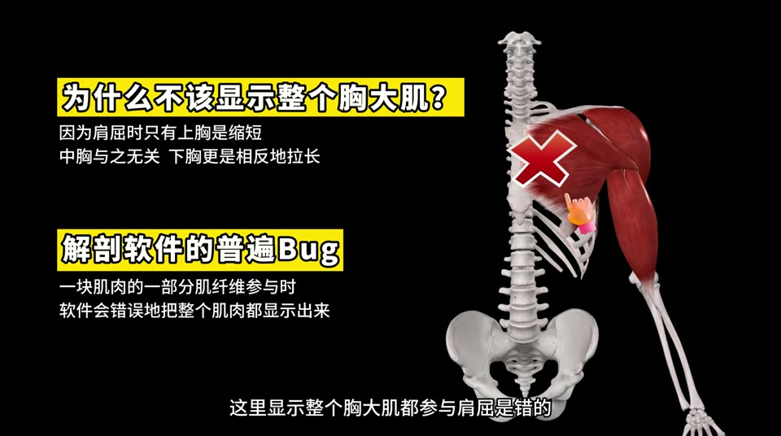

*图 15：为什么不该显示整个胸大肌：肩屈时只有上胸缩短，中胸无关，下胸反而被拉长。*

### 2.2 肩伸 [10:39]

**是什么**：和肩屈相反，大臂在矢状面**从前往后**运动，叫肩关节伸，简称肩伸。例子：自由泳划水、划船、攀爬（大臂克服水阻或自重从前往后）。

**健身动作**：
- 单关节：**仰卧上拉**、**直臂划船**（直臂下压）
- 多关节（肩伸 + 肘屈）：各种**窄握的划船、下拉、引体**（如哑铃俯身划船、窄握划船、窄握下拉、窄握引体）
- 共同点：克服阻力时，大臂都在矢状面从前往后运动。
- 如果改成**宽握**，大臂就不在矢状面运动了，变成了别的关节活动（后面讲）。

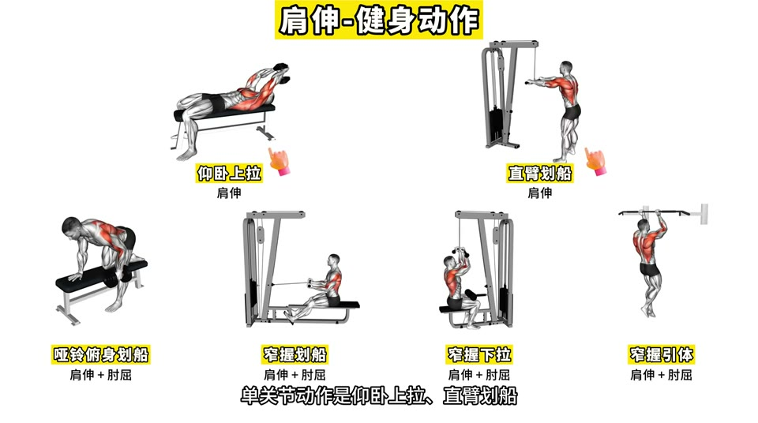

*图 16：肩伸动作：仰卧上拉、直臂划船（单关节）；哑铃俯身划船、窄握划船、窄握下拉、窄握引体（肩伸 + 肘屈）。*

**参与肌肉：肩伸五肌** [11:28]
背阔肌、大圆肌、肩后束、肱三头肌长头、**下胸（特别是胸外沿）**。这五块肌肉的拉力线都能把大臂从前往后拉。

- 刻板印象是“只有长在背面的肌肉才能把大臂往后拉”，但实际上**正面的下胸（特别是胸外沿）也是肩伸肌**。
- 中胸、上胸不可能把大臂往下拉（画面：中胸收缩是往内拉肱骨，上胸收缩是往上拉肱骨）。
- 同样是解剖软件的 Bug：这里不应该显示整块胸大肌，只应该显示下胸。

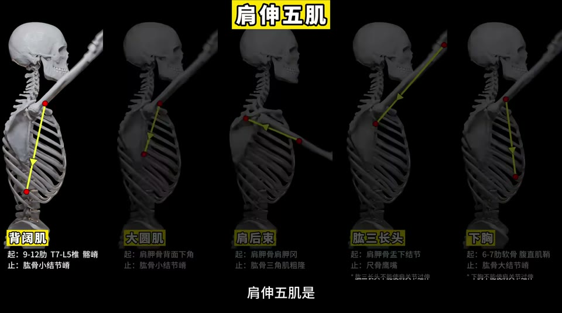

*图 17：肩伸五肌：背阔肌、大圆肌、肩后束、肱三头肌长头、下胸。*

### 2.3 肩内收 [13:03]

**是什么**：大臂在冠状面**从外往内**运动（例子是广播体操的第一个动作）。判断时**只看大臂，别看小臂**。

**健身动作**：
- 单关节：**龙门架下夹胸**
- 多关节（肩内收 + 肘屈）：**宽握高位下拉**、**宽握引体向上**
- 下拉、引体类动作：宽握时大臂在冠状面做肩内收；窄握时大臂在矢状面做肩伸。

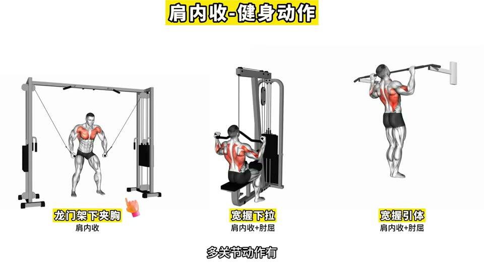

*图 18：肩内收动作：龙门架下夹胸（单关节）、宽握下拉、宽握引体（肩内收 + 肘屈）。*

**握距不宽不窄的下拉/引体怎么算？** [14:04] 大臂的轨迹介于矢状面和冠状面之间，相当于肩伸和肩内收按一定比例复合，记作“**肩伸 mix 肩内收**”（肘关节是肘屈）。

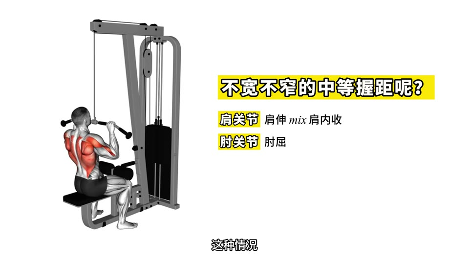

*图 19：中等握距下拉：肩关节是肩伸 mix 肩内收，肘关节是肘屈。*

**参与肌肉：肩内收三肌** [14:30]
- 背面：**背阔肌、大圆肌**（大家都知道）。
- 正面：**胸大肌**也参与，具体是哪部分要看大臂外展的程度：
  - 大臂**外展很大**时做肩内收（如宽握下拉、宽握引体）→ **下胸（特别是胸外沿）更有利**；
  - 大臂**外展很小**时继续做肩内收 → **中胸更有利**（此时中胸和肱骨接近垂直，力臂更大）。
- 所以教材通常写成“胸大肌的胸肋部参与肩内收”，也就是起于胸骨的中胸和起于肋骨的下胸。软件里肩内收会显示整块胸大肌，但正确的应该只有下胸，最多加上中胸，**不包括上胸**。

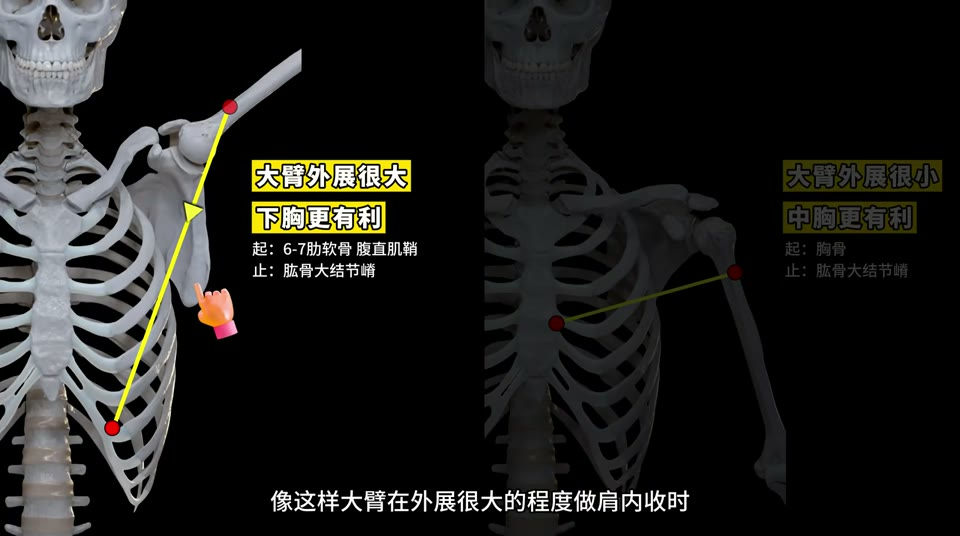

*图 20：大臂外展很大时，下胸（胸外沿）对肩内收更有利；外展很小时中胸更有利。*

**前后对称的肩内收肌**：前面的下胸往下拉大臂，后面的大圆肌、背阔肌也往下拉大臂，它们是一对前后对称的肌肉。

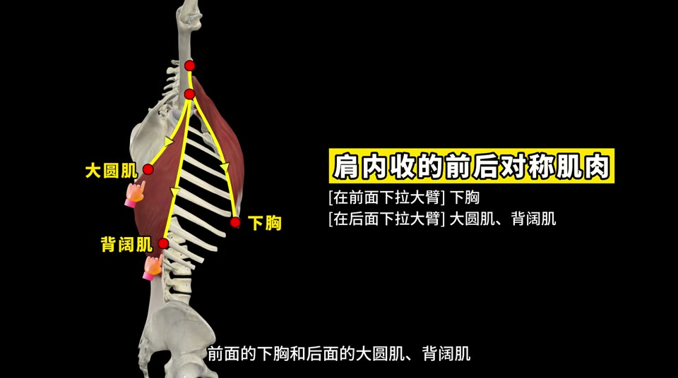

*图 21：肩内收的前后对称肌肉：在前面下拉大臂的是下胸，在后面下拉大臂的是大圆肌、背阔肌。*

**冷知识：下胸会在练背日被练到** [15:53]
- 背阔肌、大圆肌的关节活动是肩伸和肩内收，而这恰好也是下胸（特别是胸外沿）的关节活动。
- 所以无论用什么动作练背阔肌和大圆肌，都必然有下胸参与。**下胸训练有相当一部分是在练背日完成的。**

### 2.4 肩外展 [16:27]

**是什么**：和肩内收相反，大臂在冠状面**从内往外**运动。

**健身动作**：
- 单关节：**侧平举**（只有肩外展）
- 多关节：**提拉**（肩外展 + 肘屈）
- 没有别的了，所以 UP 主说**肩中束只有两个训练动作：侧平举和提拉**。

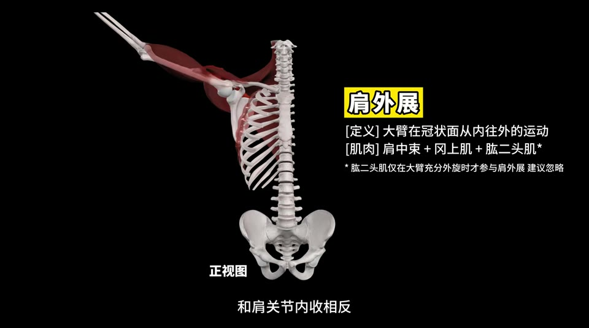

*图 22：肩外展：大臂在冠状面从内往外运动；肌肉是肩中束 + 冈上肌（+ 肱二头肌，建议忽略）。*

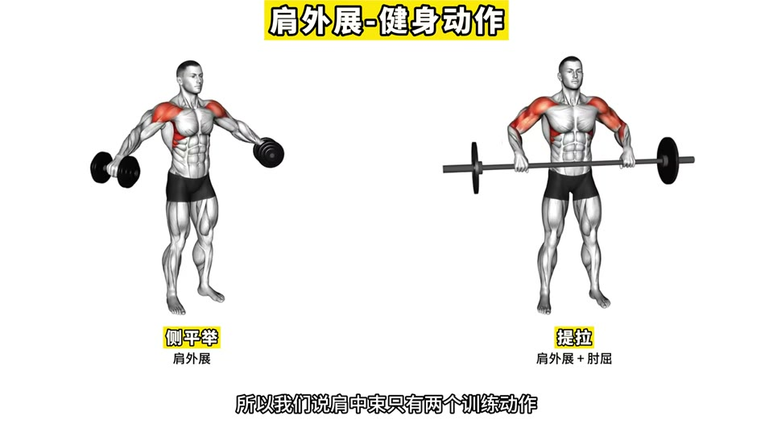

*图 23：侧平举（肩外展）和提拉（肩外展 + 肘屈）。*

**为什么提拉的配重明显比侧平举大？** [16:45]
1. **力臂更小**：哪怕宽握，提拉的力臂也小得多。肌肉能对抗的力矩是恒定的，力矩 = 力臂 × 配重，力臂小了，配重就能更大。
2. **关节活动更多**：提拉是多关节动作，还有肘屈的肌肉帮忙，配重也能更大。

**参与肌肉：肩外展二肌** [17:07]
- **肩中束**、**冈上肌**：两者都正好在肩外展的运动面上，很好理解。
- 冈上肌不是健身的目标肌肉（“没人会比谁的冈上肌更肥大”），可以不管。
- 另外，在大臂**充分外旋**的角度，肱二头肌也会参与肩外展，但这是特殊情况，UP 主建议**直接忽略**，以免越学越糊涂。

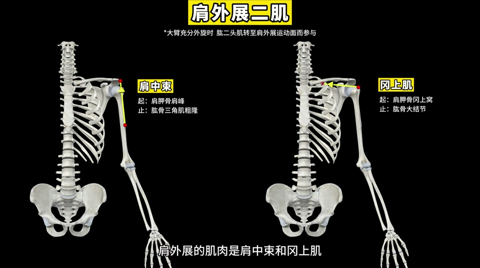

*图 24：肩外展二肌：肩中束、冈上肌。*

### 2.5 肩水平外展 [17:33]

**先分清“水平”二字**：用蝴蝶机（夹胸机），反着做就是肩水平外展，正着做就是肩水平内收。**水平外展/水平内收**和**外展/内收**一定要区分开：有没有“水平”二字，对应的动作和肌肉完全不同，千万不要混淆。

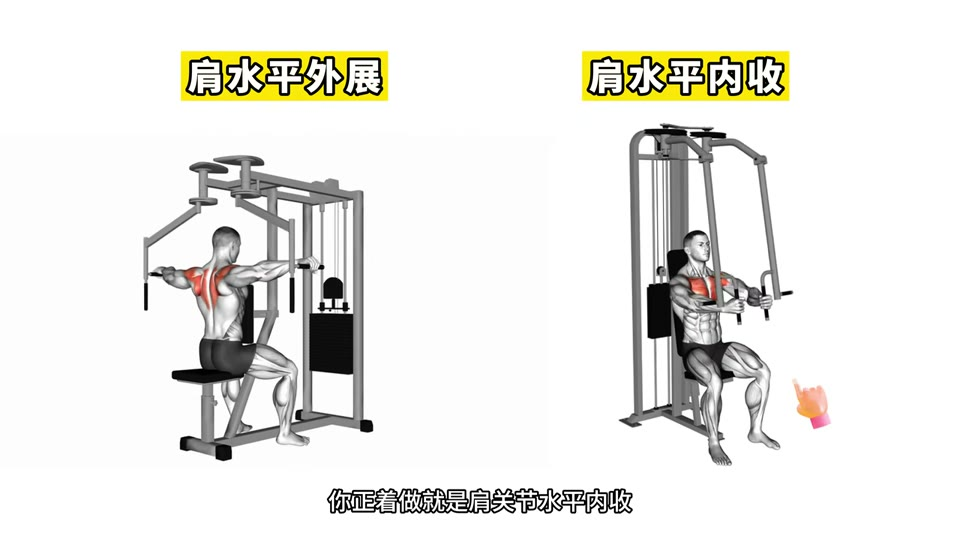

*图 25：同一台蝴蝶机：反向做是肩水平外展，正向做是肩水平内收。*

**是什么**：大臂在**水平面从内往外**运动。日常生活中不多见，但在球场上很多（视频用了篮球场上的肘击画面举例）。

**健身动作**：
- 单关节：**反向飞鸟**类（可用蝴蝶机、龙门架、哑铃等各种阻力）
- 多关节：**开肘划船**类（肩水平外展 + 肘屈），也就是开肘很大、**接近水平位开肘**的划船
- 为什么必须开肘很大？因为只有这样，大臂相对于躯干才是在水平面运动，才算肩水平外展。
- 动作名称不重要：有人叫“面拉”，有人叫“海豹划船”。UP 主尽量把同一类关节活动的动作用同一个大类名称来称呼。

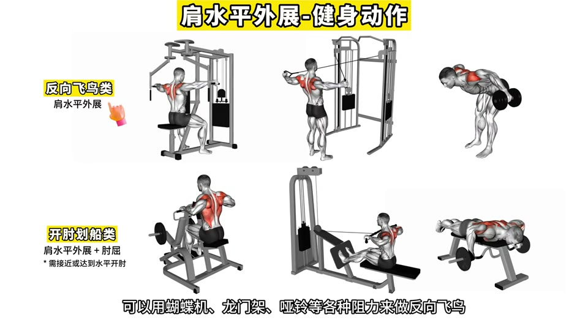

*图 26：上排：反向飞鸟类（肩水平外展）；下排：开肘划船类（肩水平外展 + 肘屈，需接近或达到水平开肘）。*

**为什么开肘划船的配重远大于反向飞鸟？** [18:51]
1. 力臂不同：下排动作力臂更小。
2. 关节活动不同：下排动作的关节活动更多，参与的肌肉也更多。

**通用规律（画面字卡）**：
> 肌肉能对抗的力矩是恒定的 / 力臂越小，配重就能越大 / 关节活动越多，配重就能越大

当你发现练同一个部位，某类动作配重小、某类动作配重大，并不是肌肉力量忽大忽小，而是**力臂大小不同**或**关节活动数量不同**造成的。

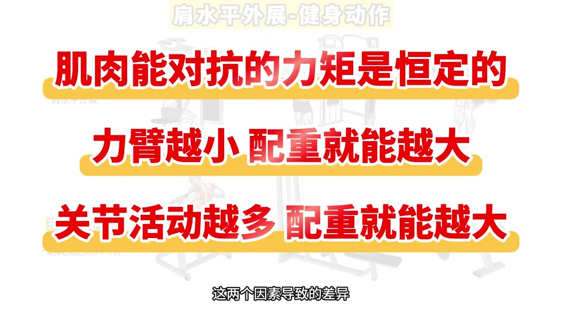

*图 27：配重差异的两个原因：力臂大小、关节活动数量。*

**参与肌肉：肩水平外展二肌** [19:32]
1. **肩后束**：大臂在水平位时，肩后束收缩能拉动大臂做水平外展。
2. **冈下肌**：准确说是冈下肌的**上部肌纤维**。解剖图里冈下肌整体比较水平，但抬手后肩胛骨会**上旋**，长在肩胛骨上的冈下肌走向随之明显改变，下部肌纤维变得很不水平，和肩水平外展的关系就弱了。

**主要靠肩后束，而不是冈下肌**，原因有两个：
- 肩后束的拉力线更水平，更接近肩水平外展的运动面；
- 肩后束的**力臂大得多**。力臂 = 力的方向到关节点的垂线距离（俯视图里的红线）。冈下肌长在非常接近肱骨头的位置，力臂小得多。即使两块肌肉收缩能产生相同的拉力，肩后束因为力臂大，实际作用于肱骨的力矩也要大得多。

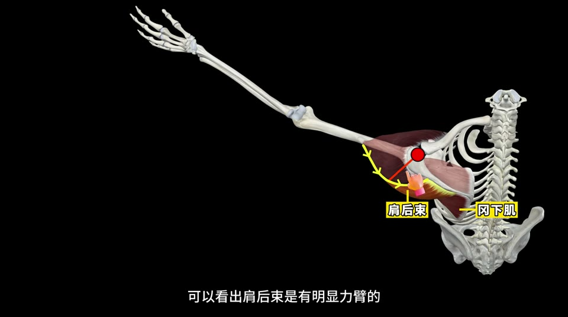

*图 28：俯视图：黄线是拉力线，红点是关节点；肩后束有明显的力臂，冈下肌的力臂很小。*

### 2.6 肩水平内收 [20:56]

**是什么**：和肩水平外展相反，大臂在**水平面从外往内**运动。UP 主举的例子：国外的扇耳光比赛（对方的脸和你大臂差不多高时，扇耳光就是典型的肩水平内收，靠胸大肌和肩前束发力），以及张开双臂的拥抱——“与其用来扇别人耳光，不如用来拥抱你爱的人……抱不了人你就抱铁”。

**健身动作**：
- 单关节：**水平向的**蝴蝶机、龙门架、哑铃夹胸（水平夹胸类）
- 多关节：各种**足够开肘**的推胸动作（开肘推胸类，肩水平内收 + 肘伸）

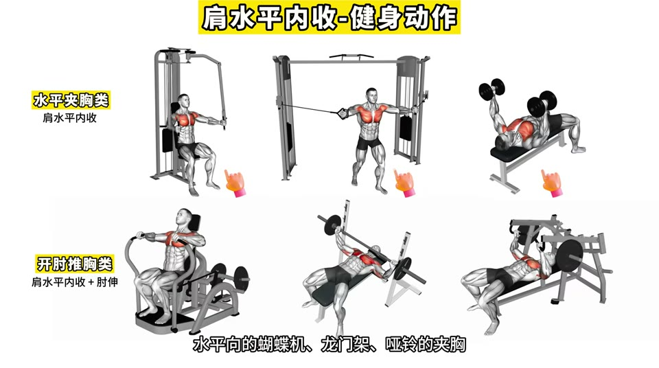

*图 29：水平夹胸类（肩水平内收）和开肘推胸类（肩水平内收 + 肘伸）。*

**注意限定词** [21:48]：
- 夹胸必须是**水平向**的才是纯肩水平内收。
  - 斜上夹胸 = 肩水平内收 + 肩屈的混合
  - 斜下夹胸 = 肩水平内收 + 肩内收的混合
  - 所以大臂相对躯干是斜上或斜下运动，而不是水平运动。
- 推胸必须**足够开肘**才是肩水平内收。开肘较小的推胸 =（肩水平内收 *mix* 肩屈）+ 肘伸，大臂是斜上运动。

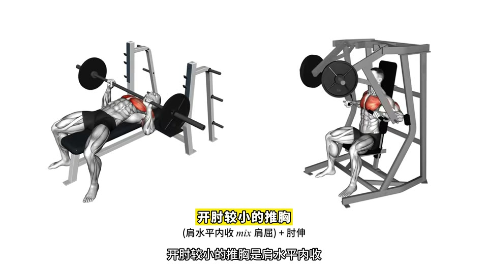

*图 30：开肘较小的推胸：（肩水平内收 mix 肩屈）+ 肘伸。*

**参与肌肉：肩水平内收二肌** [22:21]
1. **胸大肌**：上、中、下胸里，肌纤维接近水平向的是**上胸和中胸**，这是“最佳肌纤维”。越往下，肌纤维走向越不水平，收缩时是把肱骨往斜下拉，水平分力越来越少（图中用浅黄色表示）。
   - 刻板印象“水平的推胸、夹胸对下胸也不错”是错的：下胸特别是胸外沿太竖直了，对水平内收的分力远不如中胸和上胸。
2. **肩前束**：此时比较接近水平向，有不错的水平分力。这是肩前束在肩屈之外的第二个关节活动。也解释了“练胸会顺带练到肩前束”：绝大部分练胸动作都要做肩水平内收。

**贡献比较**：
- [优势] 肩前束、上胸、中胸（水平分力较好）
- [弱势] 下胸（含胸外沿，水平分力太少）

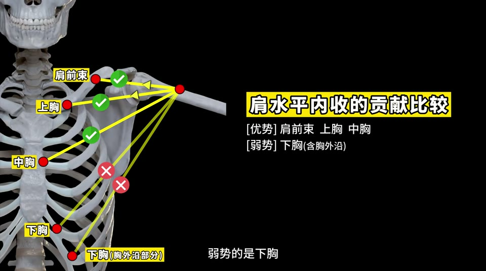

*图 31：肩水平内收：肩前束、上胸、中胸是优势肌纤维（绿勾），下胸和胸外沿是弱势（红叉）。*

**自测方法** [23:39]：徒手做单边的水平夹胸，用另一只手摸胸肌：肩前束和上胸最硬，中胸也还好，下胸比较软，胸外沿更软。（UP 主补充：体脂率得比较低才摸得出来。）

**新手只做水平推胸/夹胸，下胸怎么办？** [23:57] 不用担心。前面讲过，练背日的大部分动作（肩伸、肩内收）都在练下胸，下胸不会太弱。

**肩关节小结** [24:16]：矢状面、冠状面、水平面各有一对相反的关节活动，共 6 种。肩关节最复杂，后面几个关节简单得多。

---

## 3. 肘关节 [24:35]

**是什么**：肘关节活动是**大臂和小臂之间**的相对运动，**只能在矢状面**进行（要在冠状面或水平面动，“就会咔嚓掰断”）。只有屈和伸。

### 肘屈

**定义**：肘关节从**打直变为折叠**。

**健身动作**：
- 单关节：各种**弯举**
- 多关节：练背里各种**划船、下拉**（肩关节活动 + 肘屈），以及练肩中束的**提拉**

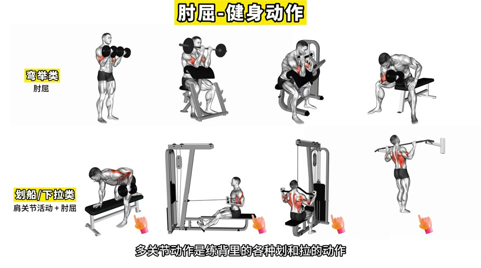

*图 32：肘屈动作：弯举类（单关节）；划船、下拉类（肩关节活动 + 肘屈）。*

**“代偿”的正确理解** [25:02]：练背的绝大部分动作都有肘屈，所以肘屈肌发力**完全是应该的，不叫代偿**。代偿是指你做了这个动作里**不该有的关节活动**，引入了别的肌肉参与。

**参与肌肉：肘屈三肌** [25:14]
- **肱二头肌、肱肌、肱桡肌**。它们跨越肘关节，收缩时能拉起小臂，让肘关节从打直变为折叠。
- 肱二头肌还跨越了肩关节，所以当肘关节固定时，它的收缩能做肩屈（前面讲肩屈时提过）。

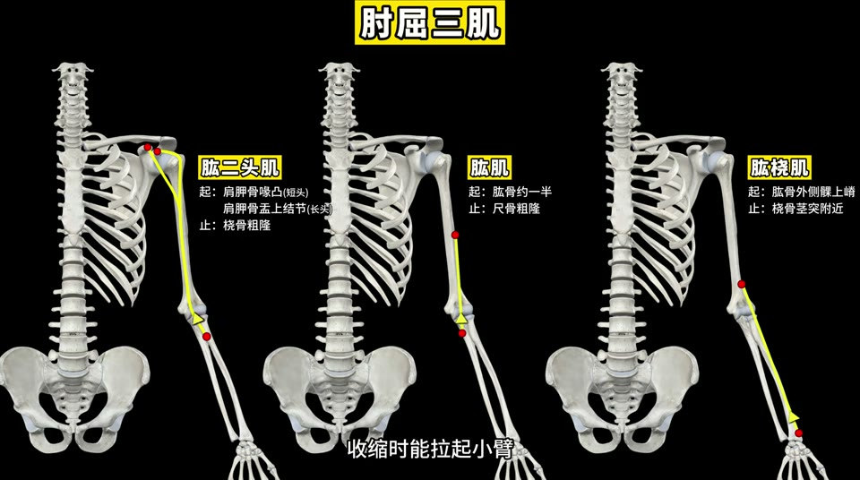

*图 33：肘屈三肌：肱二头肌、肱肌、肱桡肌。*

**关节活动和肌肉是交织关系**：一个关节活动有多块肌肉参与，一块肌肉也可能有多个关节活动。所以本集（总论）按关节活动讲，后面的章节按肌肉讲，两个层面都讲一遍才能理清楚。

### 肘伸

**定义**：肘关节从**折叠变为打直**（把小臂放下去）。

关于译名 [25:58]：屈就是弯折，伸就是打直，“大丈夫能屈能伸”就是这个意思。UP 主查到 1929 年协和医学院出版的《解剖学大意》里已经有“肌肉分为屈肌、伸肌、外展肌、内收肌等”的说法，说明百年前中国最早一批解剖学教材就这样翻译了。

**健身动作**：
- 单关节：各式**臂屈伸**（克服阻力时肘关节从折叠变为打直）
- 多关节：**推胸、推举**等，和握距宽窄无关，**无论怎么做都包含肘伸**

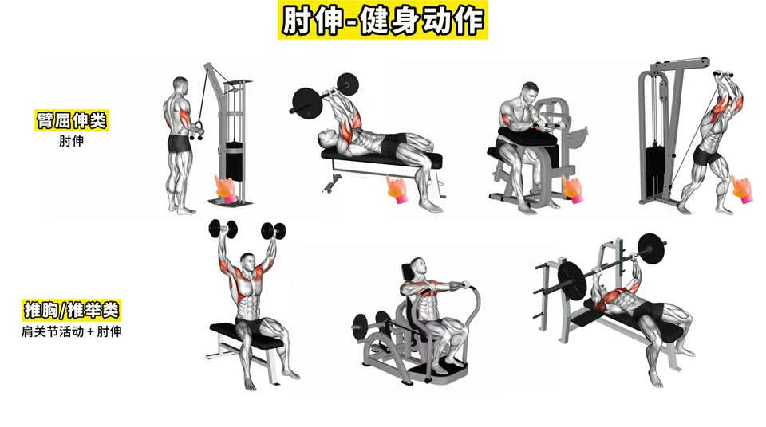

*图 34：肘伸动作：臂屈伸类（单关节）；推胸、推举类（肩关节活动 + 肘伸）。*

**为什么三分化里“胸 + 肩前束 + 肱三头”放在同一天练** [26:44]
- 训练顺序：推胸 → 推举 → 臂屈伸。
- 推胸的**肩水平内收**能练到肩前束 → 之后可以减少推举的组数。
- 推胸和推举的**肘伸**能练到肱三头 → 之后可以减少臂屈伸的组数。
- 这样环环相扣，减少了整个训练的总组数，节约训练时间。

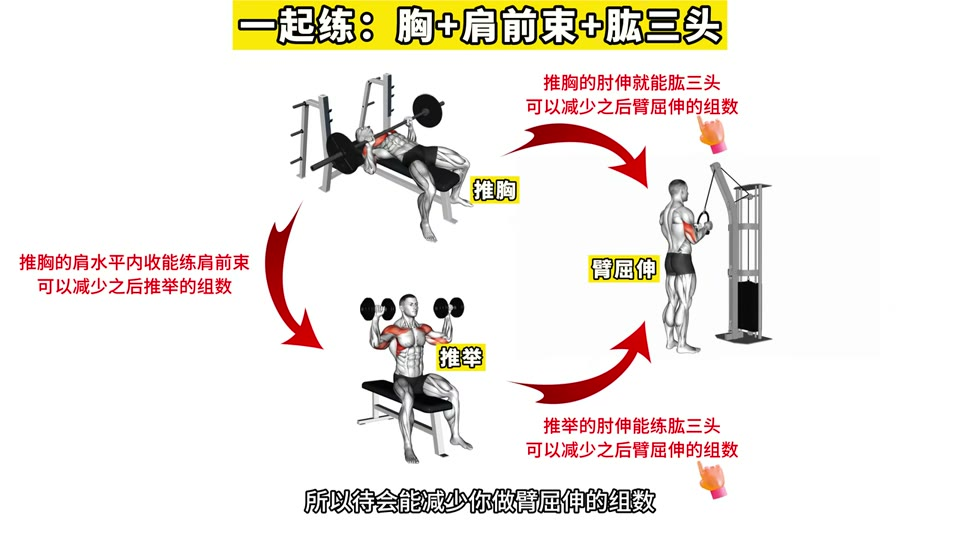

*图 35：推胸 → 推举 → 臂屈伸：前面的动作已经练到后面的目标肌，可以减少后面动作的组数。*

**参与肌肉：肘伸一肌——肱三头肌** [27:13]
- **外侧头**：只跨越肘关节，只能做肘伸。
- **长头**：长在肩胛骨上（不像外侧头长在肱骨上），跨越肘和肩两个关节，除了肘伸，也是**肩伸五肌**之一。
- **内侧头**：埋在外侧头和长头下面，只跨越肘关节，只能做肘伸。本集不讲这类深层肌肉——“健身的人很肤浅，我们只关心浅表肌肉如何肌肥大”。
- 三个头都跨越了肘关节，都能肘伸。

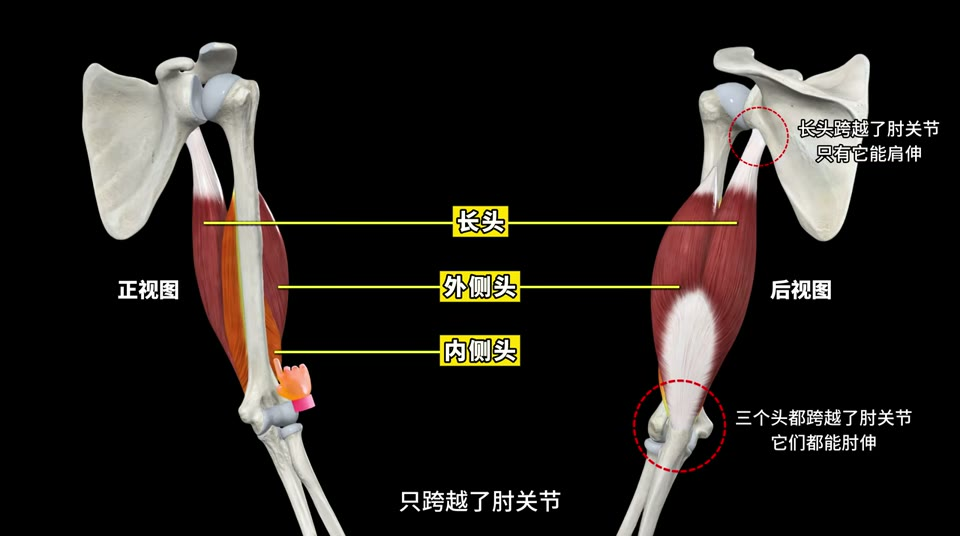

*图 36：肱三头肌：长头、外侧头、内侧头；长头还跨越了肩关节，所以能肩伸。*

---

## 4. 髋关节 [27:58]

**是什么**：髋关节运动是**大腿相对于躯干**的运动。髋关节和肩关节一样是球窝关节，很灵活，但健身动作里用得上的**只有矢状面的髋伸**。

### 髋伸

**定义**：大腿相对于躯干**从前往后**运动，叫髋关节伸，简称伸髋或髋伸（画面字卡：“髋伸：大腿与躯干夹角变大”）。

**相对运动的两种形式** [28:26]：
- **后踢**：躯干不动、大腿在动，大腿相对躯干从前往后 → 髋伸。
- **直腿硬拉**：大腿不动、躯干在动，大腿相对躯干仍然是从前往后 → 也是髋伸。
- UP 主承认这有点抽象，理解不了就暂停想一想。（生活里的伸髋动作很少，视频用了一段舞蹈画面举例，说那是“小幅度的伸髋”，幅度加大就是健身房里的伸髋动作。）

**健身动作**：
- 单关节：**后踢**
- 多关节：**硬拉**（髋伸 + 膝伸）、**臀冲**（髋伸 + 膝伸，轻微）等
- **深蹲也有髋伸**，只是髋伸的幅度和力臂比其他几个动作小，所以和它们区分开；后面讲臀腿时会具体分析。

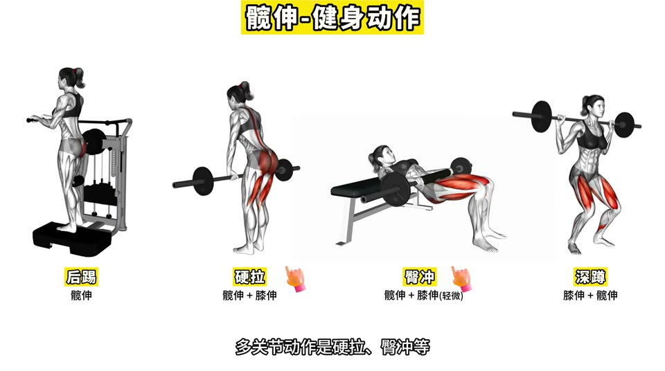

*图 37：髋伸动作：后踢（髋伸）、硬拉（髋伸 + 膝伸）、臀冲（髋伸 + 膝伸轻微）、深蹲（膝伸 + 髋伸）。*

**参与肌肉：髋伸二肌** [29:33]
1. **臀大肌**：跨越髋关节。中后部肌纤维有前后走向，收缩能拉动大腿从前往后运动，也就是髋伸；最前部的肌纤维没有什么前后关系，和伸髋关系不大，更有利于**髋外展**（把大腿往外抬），所以图中用浅黄色表示它对伸髋的贡献很弱。
2. **腘绳肌**：从外往内是**股二头肌、半腱肌、半膜肌**的合称。它们是跨越髋关节和膝关节的**双关节肌**（股二头肌短头除外）。当膝关节固定时（想象大小腿是一根整体的骨头），腘绳肌收缩就能拉动大腿从前往后，也就是髋伸。

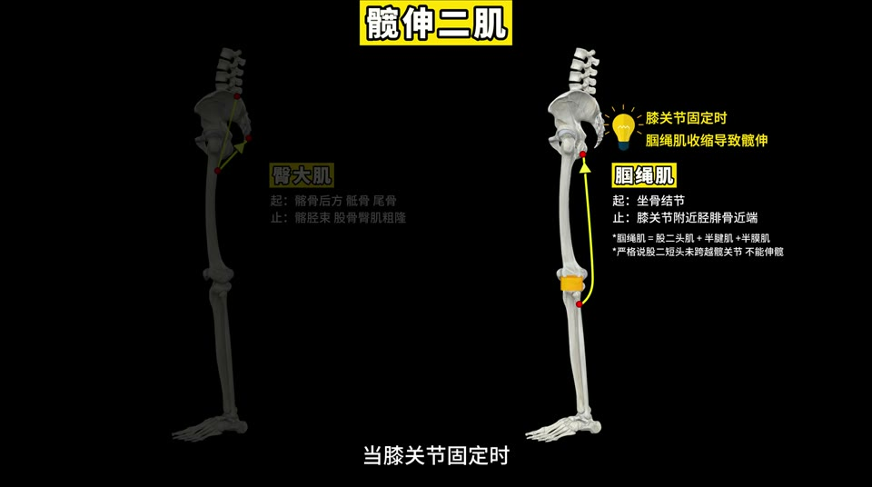

*图 38：髋伸二肌中的腘绳肌：膝关节固定时，腘绳肌收缩导致髋伸。*

**为什么不讲“屈髋”？** [30:24]
有人会问：深蹲、硬拉不是常说“屈髋”吗？UP 主的回答是，这就是前置知识没听懂：
- 健身动作都是一来一去的，有伸必有屈，有屈必有伸；
- 但动作做什么关节活动，要**以克服阻力的阶段来判断**；
- 硬拉的克服阻力阶段是**拉起**，此时大腿相对躯干从前往后，是**髋伸**；
- 硬拉的下落阶段才是屈髋，这时阻力是在帮你屈髋，不是在阻止你屈髋；
- 所以**硬拉是伸髋运动，不是屈髋运动**。

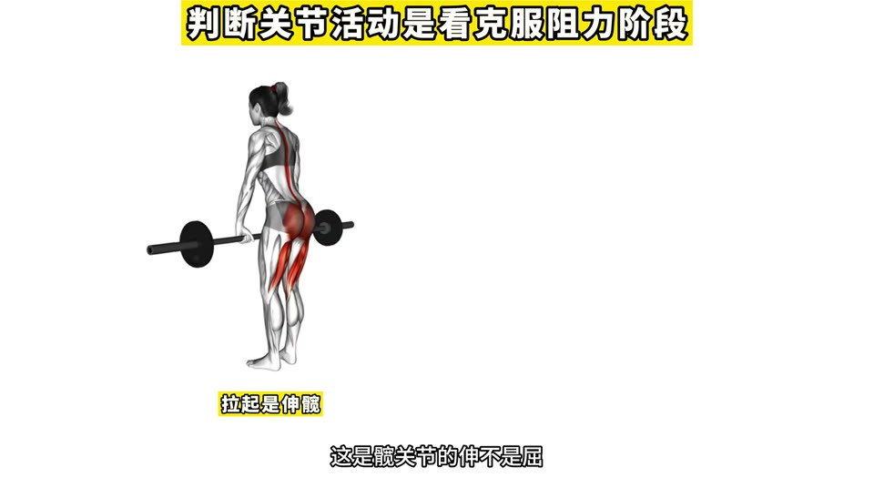

*图 39：硬拉：拉起阶段是伸髋（克服阻力），下落阶段才是屈髋。*

---

## 5. 膝关节 [31:11]

**是什么**：膝关节活动是**大腿和小腿之间**的关系，只需要掌握屈和伸。大腿骨叫股骨，小腿骨叫胫骨和腓骨。
- 膝关节从打直变为折叠 → **屈膝 / 膝屈**（电视剧里的“跪下”）
- 膝关节从折叠变为打直 → **伸膝 / 膝伸**（“平身”之后站起来）

### 膝屈

**健身动作**：健身里的膝屈动作**只有器械腿弯举**（俯卧位、坐姿位）。克服阻力阶段，膝关节从打直变为折叠，所以是屈膝。
- 另一个动作是**北欧挺**：它的力臂是身体重心到膝关节的距离，比器械腿弯举更大，配重是自重也很大，两者相乘后要克服的力矩超大，UP 主说“**99.9% 的人一个都做不了**”。

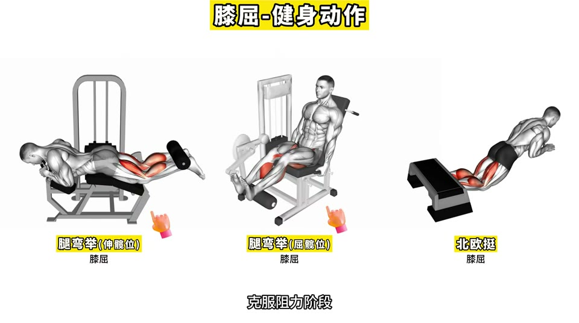

*图 40：膝屈动作：腿弯举（俯卧位、坐姿位）和北欧挺。*

**参与肌肉：膝屈二肌** [32:25]
- **大腿后侧的腘绳肌**和**小腿后侧的腓肠肌**。两者都是双关节肌，各自在两个关节都能干活，所以新手容易搞不清：
  - 腘绳肌：**髋关节固定时**收缩 → 膝屈；**膝关节固定时**收缩 → 髋伸（髋关节部分讲过）。
  - 腓肠肌：**踝关节固定时**收缩 → 膝屈；**膝关节固定时**收缩 → 踝关节屈，也就是足跖屈（踝关节部分再讲）。

### 膝伸

**定义**：膝关节从折叠变为打直。从蹲着到站起来，是生活里最熟悉的伸膝动作。

**健身动作**：
- 单关节：**腿屈伸**，一般用固定器械做。
- 多关节：各种**蹲类动作**。深蹲、箭步蹲是自由的蹲类动作；倒蹬机、哈克机等是模拟自由蹲的固定器械蹲类动作。
- **一般的硬拉也有膝伸**，只是膝伸的行程和力臂更小，所以和蹲类动作区分开；后面讲臀腿时会具体分析。

**“屈伸”和“弯举”怎么区分？** [33:27] 新手常把腿屈伸和腿弯举搞混，类比手臂就好记：
- 把关节**打直**的动作叫“**屈伸**”：臂屈伸（肘伸）、腿屈伸（膝伸）；
- 把关节**折叠**的动作叫“**弯举**”：手臂弯举（肘屈）、腿弯举（膝屈）。

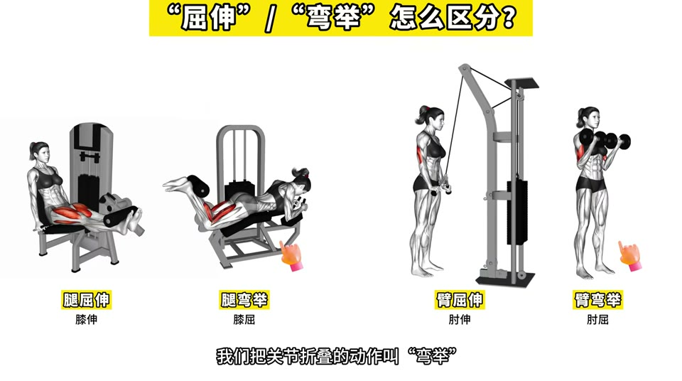

*图 41：腿屈伸 = 膝伸，腿弯举 = 膝屈；臂屈伸 = 肘伸，臂弯举 = 肘屈。*

**参与肌肉：膝伸一肌——股四头肌** [34:15]
- 顾名思义是四块肌肉：浅表从内到外是**股内侧肌、股直肌、股外侧肌**；股直肌下面还埋着一块深层肌肉**股中间肌**（被股直肌覆盖，看不见）。
- 它们跨越膝关节，长在膝盖下方，所以能拉动小腿做膝伸。
- **股直肌特殊**：它还长在骨盆上，跨越了髋关节，所以除了膝伸还能**屈髋**。

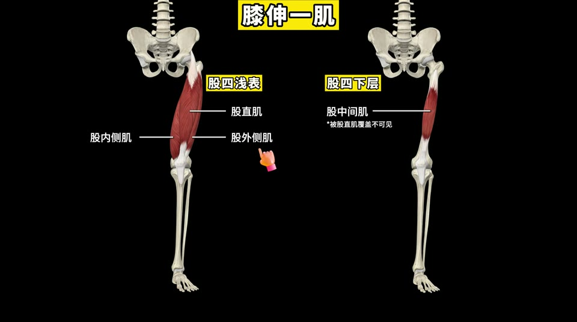

*图 42：膝伸一肌：股四头肌（浅表：股内侧肌、股直肌、股外侧肌；深层：股中间肌）。*

**膝关节小结**：只有屈和伸。屈膝靠大腿后侧的腘绳肌和小腿后侧的腓肠肌；伸膝靠大腿前侧的股四头肌。

---

## 6. 踝关节 [35:05]

**是什么**：踝关节运动是**小腿和足**之间的关系。

**绷脚尖算屈还是伸？** [35:10]
- 看足背和小腿的关系：角度变大，像是“伸”；
- 看足底和小腿的关系：角度变小，像是“屈”；
- **解剖学上规定以足底这边来看**，所以绷脚尖叫**踝关节的屈**。
- 这很容易混淆，连专家都经常说反：画面里引用的一本教材（《肌肉测试与功能：姿势与疼痛》）提到，查了 48 位学者的论著，有 12 位把踝关节的屈和伸说反了。

**术语：足跖屈与足背屈** [35:42]
- 为了说清“足”到底指足背还是足底，学界造了两个词。“跖”就是足底的文雅说法。
- **足跖屈**：足底去靠近小腿做屈，也就是**绷脚尖**；
- **足背屈**：足背去靠近小腿做屈，也就是**勾脚尖**。
- 健身里**没有克服阻力做足背屈的动作**，所以只用记住：像跳芭蕾那样绷脚尖就是足跖屈。

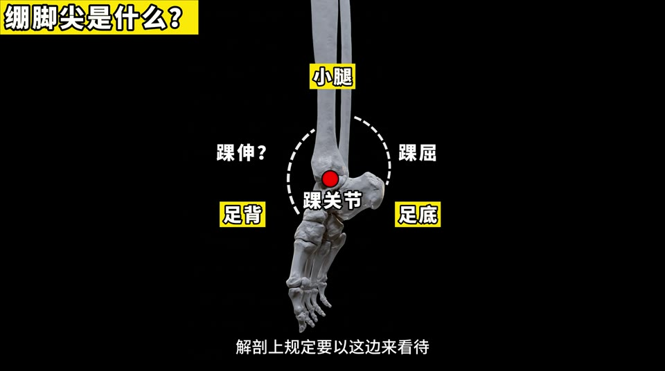

*图 43：绷脚尖：解剖上以足底一侧来判断，所以叫踝屈，也就是足跖屈。*

**参与肌肉：足跖屈（踝屈）二肌** [36:19]
1. **腓肠肌**：双关节肌，两个起止点分别在膝关节以上和踝关节以下。
   - 膝关节固定时：腓肠肌和比目鱼肌一起做**足跖屈**；
   - 踝关节固定时：腓肠肌和腘绳肌一起做**膝屈**（器械腿弯举）。
2. **比目鱼肌**：位于腓肠肌下一层，只跨越踝关节的单关节肌，只做足跖屈，和膝关节运动无关。

**踝关节小结**：只用掌握**足跖屈**这一个关节活动（代表动作：提踵）。

---

## 7. 肩胛胸壁关节（肩胛骨的运动） [37:06]

肩、肘、髋、膝、踝讲完后，还剩**肩胛胸壁关节**，俗称肩胛骨的运动。肩胛骨的运动至少有 **3 组共 6 种**：

| 组 | 运动 | 白话 | 主要肌肉（画面表格） |
|---|---|---|---|
| 第一组 | **上提** | 耸肩 | 上斜方肌、肩胛提肌、菱形肌 |
| 第一组 | **下沉** | 沉肩 | 下斜方肌、胸小肌（*背阔肌有极少肌纤维附着于肩胛骨下角，能轻微帮助下沉） |
| 第二组 | **前引（外展）** | 肩胛骨往外走；主要出现在**推胸**动作里 | 前锯肌、胸小肌 |
| 第二组 | **后缩（内收）** | 肩胛骨往内夹；主要出现在以练中下斜方肌为目的的**开肘划船**里 | 中下斜方肌、菱形肌 |
| 第三组 | **上旋** | 伴随**抬手**发生 | 上斜方肌、下斜方肌、前锯肌 |
| 第三组 | **下旋** | 伴随**落手**发生 | 菱形肌、肩胛提肌、胸小肌 |

（表中肌肉是画面上的图表内容，UP 主口头说“参与肌肉我直接列表写出来，就不挨个讲了”。图表素材标注来自 *Essentials of Kinesiology* 第 4 版第 56 页。）

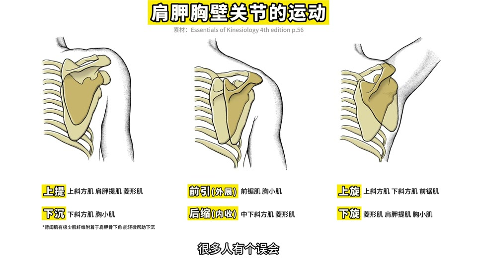

*图 44：肩胛骨的三组运动：上提/下沉、前引/后缩、上旋/下旋，以及各自的参与肌肉。*

### 上旋 / 下旋的特殊之处 [38:00]

- 肩胛骨的上旋、下旋**只能发生在抬手、落手的运动里**，是**伴随大臂起落**才发生的：
  - **上旋**发生在抬手时，无论往前、往外还是任何角度抬手都会发生；
  - **下旋**发生在相反的落手时，无论从哪个方向落手。
- **机制**：大臂抬起时，如果肩胛骨不跟着上旋，肱骨头就会撞到肩胛骨的肩峰，把两者之间的软组织碾压掉，这叫“**肩峰下撞击**”。所以大臂抬起时肩胛骨必须上旋，才能保持肩峰下方原有的空隙（空隙里是冈上肌肌腱等软组织）。大臂落下时，肩胛骨下旋恢复原始状态。
- 所以上旋/下旋和别的关节活动不一样，**不是你主动去做的，而是被动跟随大臂起落发生的**。大臂不动时，你可以主动做上提/下沉、前引/后缩，但不能做上旋/下旋。

**实拍：高位下拉** [39:23]：通过三角形的冈下肌定位肩胛骨的位置。高位下拉的**放回阶段是抬手**，肩胛骨上旋；**下拉阶段是落手**，肩胛骨下旋。UP 主留了个问题让观众在弹幕回答：高位下拉的肩胛骨活动算上旋还是下旋？他没有直接公布答案，只提示“判断关节活动是以克服阻力的阶段来判断的”。（按这条规则推断，克服阻力的是下拉阶段，也就是**下旋**；这是整理者按视频规则推出的结论，原视频未明确给出答案。）

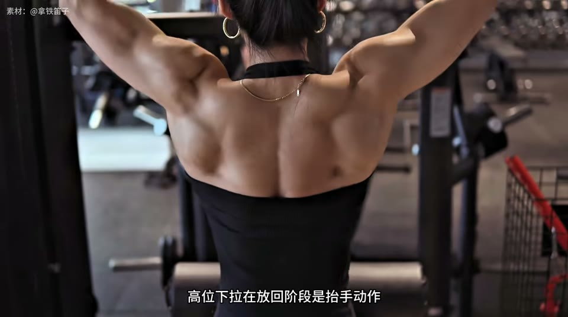

*图 45：高位下拉：放回阶段是抬手（肩胛骨上旋），下拉阶段是落手（肩胛骨下旋）。*

### 误区：背部肌肉都靠肩胛骨运动来练？ [40:07]

**不对。** 背上的浅表肌肉有背阔肌、大圆肌、冈下肌、斜方肌、竖脊肌（见前面的练背总结图）：
- **只有斜方肌**的训练是靠肩胛骨运动来练的：
  - 上斜方肌 → 肩胛骨上提（耸肩）；
  - 中下斜方肌 → 开肘划船里的肩胛骨后缩。
- 背部其他肌肉和肩胛骨运动**无关**，因为肩胛骨做这些运动时根本不需要它们收缩，自然也练不到它们。

### 健身动作的关节活动会“省略表述”肩胛骨运动 [40:39]

- 侧平举、前平举在克服阻力阶段会抬手，必然伴随肩胛骨上旋。但我们仍然说侧平举是“肩外展的单关节动作”、前平举是“肩屈的单关节动作”，相当于省略了肩胛骨运动，否则就得叫多关节动作了。
- 同理，高位下拉和引体在克服阻力阶段会落手，必然伴随肩胛骨下旋，表述时也省略了。
- UP 主说这是“提前防御叠甲”：以后讲具体动作时不会再列出肩胛骨的上旋/下旋。

---

## 8. 随堂测试与答案 [41:55]

本集的所有内容都围绕开头那两张总结表展开（A 表以关节活动为中心，B 表以肌肉为中心）。每集末尾都有几道题做随堂检测，UP 主请大家在弹幕里作答，不要抄别人的。

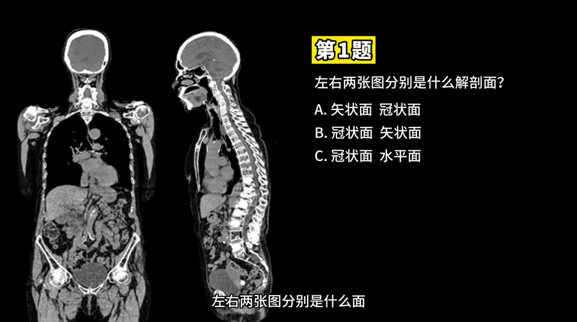

*图 46：第 1 题：CT 影像的两张图分别是什么解剖面？*

| 题号 | 题目 | 选项 | 答案与解析 |
|---|---|---|---|
| 1 | 做 CT、核磁、X 光等影像检查时，会按不同解剖面成像。左右两张图分别是什么面？ | A. 矢状面、冠状面 B. 冠状面、矢状面 C. 冠状面、水平面 | **B**。左边是身体左右的面（冠状面），右边是身体前后的面（矢状面）。 |
| 2 | 一个健身动作的关节活动应以什么阶段判断？（以器械腿弯举为例） | A. 克服阻力的向心阶段（这是屈膝） B. 阻力回归原位的离心阶段（这是伸膝） C. 两个阶段都是（既屈膝也伸膝） | **A**。克服阻力 = 肌肉缩短 = **向心收缩**；防止阻力自由归位 = 肌肉被拉长 = **离心收缩**。关节活动以向心阶段来判断。 |
| 3 | 健身里说的肩关节运动是指？ | A. 肩膀这里的运动 B. 肩胛骨的运动 C. 大臂的运动 | **C**。狭义的肩关节运动是大臂相对于躯干的运动，别望文生义。 |
| 4 | 半开肘划船的大臂关节活动，是肩伸和什么的复合？ | A. 肩伸 mix 肩屈 B. 肩伸 mix 肩外展 C. 肩伸 mix 肩水平外展 | **C**。从两个极端想：完全不开肘划船 = 肩伸；完全开肘到水平位划船 = 肩水平外展。中间的开肘程度就是两者的复合，**开肘越小越接近肩伸，开肘越大越接近肩水平外展**。 |
| 5 | 一本人民体育出版社的老运动解剖学教材在练胸页里写“引体向上也是练胸动作”，这种说法对吗？ | A. 对，上胸能参与肩伸/肩内收 B. 对，下胸能参与肩伸/肩内收 C. 错，上中下胸都不参与，不要迷信教材 | **B**。引体窄握是肩伸，宽握是肩内收，中等握距是两者按比例复合。肩伸五肌里有下胸，肩内收三肌里也有下胸，所以无论怎么握，引体都有下胸参与，“引体能练胸”特指练下胸。 |

**第 5 题的延伸：主要关节活动 vs 次要关节活动** [46:38]
- 对下胸来说，引体这类肩伸、肩内收动作属于**次要关节活动**：它确实参与，但贡献比例不够大，能练到，但专门练下胸时最好别用这类动作。
- **主要关节活动**是指这块肌肉在里面的贡献足够大，没有太多别的肌肉“和它抢生意”，练它就应该用主要关节活动。
- 原则：不是说肌肉有某种关节活动就一定要用它去练，而是**选贡献比例更高的那个关节活动**作为训练动作。（下胸的 [主] 是“肩水平内收 mix 肩内收”：下斜夹胸、下斜推胸、双杠臂屈伸。）
- 为什么以前的《训练完全手册》只说引体练背、不说引体练胸？因为那个视频面向非常小白的观众，目的是先搭一个最基本的架子，引入太细的知识会更混乱；这门课叫解剖课，所以讲得更全面细节（UP 主自称“因材施教”）。

UP 主希望全班平均能答对 4 题（8 分）。他还在弹幕里征集意见，问后面六集要不要保留随堂测试。

---

## 9. 片尾：充电社群与下集预告 [48:32]

- **充电学习社群**（5 元/月）：每月在 B 站充电动态发 5 篇训练与营养学讲解；每月一次直播课（会剪辑后打包发）；充电粉丝群（在每条充电动态的置顶评论扫码入群）；每月 1 号把上月所有资料和直播剪辑打包到网盘，私信发给充电粉丝。之所以用网盘而不是充电视频，是因为 B 站规定发充电视频最低要 12 元/月档。
- **代做增肌减脂饮食训练方案**：方案模板已在 Excel 套表里开源，可以看配套讲解视频自己做；需要 UP 主代做的，按视频置顶评论里的链接填写问卷。
- **下集预告**（半个月后发，讲练胸）：前半部分讲胸的解剖（胸大肌的起止点、分部、肌腱对胸型的影响、胸大肌的四种关节活动、四类健身动作），相当于练胸导论；后半部分逐个点评练胸动作（夹胸、卧推、双杠臂屈伸等），包括每个动作正确和错误的关节活动、侧重胸的哪部分、变式做法、利弊等。

---

## 要点速查

### 一句话规则

1. **判断关节活动看克服阻力的阶段**（向心收缩阶段），不看下放阶段。
2. **肩关节运动 = 大臂相对于躯干的运动**；判断时只看大臂，别看小臂。
3. **有没有“水平”二字，动作和肌肉完全不同**：内收/外展（冠状面）≠ 水平内收/水平外展（水平面）。
4. **mix = 两种关节活动的复合轨迹**，比例决定大臂的倾斜程度。
5. **配重差异的原因**：肌肉能对抗的力矩恒定；力臂越小配重越大；关节活动越多配重越大。
6. **主要 vs 次要关节活动**：专门练某块肌肉时，选它贡献比例高的那个关节活动。
7. **代偿** = 做了动作里不该有的关节活动；练背时肘屈肌发力不算代偿。
8. **解剖软件 Bug**：一块肌肉只有一部分参与时，软件会把整块都标亮（比如胸大肌）。

### 关节活动 × 动作 × 肌肉 总表

| 关节活动 | 运动面 / 方向 | 单关节动作 | 多关节动作 | 参与肌肉 |
|---|---|---|---|---|
| 肩屈 | 矢状面，大臂从后往前 | 前平举 | 窄距卧推、窄距推举（+肘伸） | 肩前束（主力）、上胸、肱二头肌（贡献小） |
| 肩伸 | 矢状面，大臂从前往后 | 仰卧上拉、直臂划船 | 窄握划船/下拉/引体（+肘屈） | 背阔肌、大圆肌、肩后束、肱三头长头、下胸（胸外沿） |
| 肩内收 | 冠状面，大臂从外往内 | 龙门架下夹胸 | 宽握下拉、宽握引体（+肘屈） | 背阔肌、大圆肌、下胸（外展大时）/中胸（外展小时） |
| 肩外展 | 冠状面，大臂从内往外 | 侧平举 | 提拉（+肘屈） | 肩中束、冈上肌（肱二头肌忽略） |
| 肩水平外展 | 水平面，大臂从内往外 | 反向飞鸟 | 开肘划船（接近水平开肘，+肘屈） | 肩后束（主力）、冈下肌上部 |
| 肩水平内收 | 水平面，大臂从外往内 | 水平夹胸（蝴蝶机/龙门架/哑铃） | 足够开肘的推胸（+肘伸） | 上胸、中胸、肩前束（下胸弱势） |
| 肘屈 | 矢状面，打直→折叠 | 各种弯举 | 划船、下拉、引体、提拉 | 肱二头肌、肱肌、肱桡肌 |
| 肘伸 | 矢状面，折叠→打直 | 各种臂屈伸 | 推胸、推举（不论握距） | 肱三头肌（长头还能肩伸） |
| 髋伸 | 矢状面，大腿相对躯干从前往后 | 后踢 | 硬拉、臀冲、深蹲（幅度小） | 臀大肌（中后部）、腘绳肌 |
| 膝屈 | 打直→折叠 | 器械腿弯举、北欧挺 | — | 腘绳肌、腓肠肌 |
| 膝伸 | 折叠→打直 | 腿屈伸 | 深蹲、箭步蹲、倒蹬机、哈克机（硬拉有少量） | 股四头肌（股直肌还能屈髋） |
| 足跖屈 | 绷脚尖 | 提踵 | — | 腓肠肌、比目鱼肌 |
| 肩胛骨上提 | 耸肩 | 耸肩 | — | 上斜方肌等 |
| 肩胛骨后缩 | 肩胛骨往内夹 | — | 开肘划船 | 中下斜方肌、菱形肌 |

### 握距 / 开肘 → 关节活动

| 动作 | 窄 / 不开肘 | 中等 | 宽 / 充分开肘 |
|---|---|---|---|
| 下拉、引体 | 肩伸 | 肩伸 mix 肩内收 | 肩内收 |
| 划船 | 肩伸 | 肩伸 mix 肩水平外展 | 肩水平外展 |
| 推胸 | 肩屈 | 肩水平内收 mix 肩屈 | 肩水平内收 |
| 推举 | 肩屈 | — | 大臂外旋位的肩外展 |
| 夹胸方向 | 斜上 = 水平内收 + 肩屈 | 水平 = 肩水平内收 | 斜下 = 水平内收 + 肩内收 |

### 双关节肌速记

| 肌肉 | 一端关节固定时 | 另一端关节固定时 |
|---|---|---|
| 肱二头肌 | 肘屈 | 肩屈（贡献小） |
| 肱三头肌长头 | 肘伸 | 肩伸 |
| 腘绳肌 | 髋固定 → 膝屈 | 膝固定 → 髋伸 |
| 腓肠肌 | 踝固定 → 膝屈 | 膝固定 → 足跖屈 |
| 股直肌 | 膝伸 | 屈髋 |

---

## 初学者练习建议

（以下只是对视频内容的归纳，没有加入视频以外的建议。）

1. **先背熟两张总表**：A 表（关节活动→肌肉）和 B 表（肌肉→关节活动）是 UP 主所说的“总纲”。看到任何新动作，先问它在克服阻力阶段做了哪些关节活动，再从表里查出练到哪些肌肉。
2. **用“克服阻力阶段”分析每个动作**：比如硬拉是伸髋、器械腿弯举是屈膝、高位下拉是下拉阶段在发力。
3. **控制握距和开肘，就是控制练到哪里**：
   - 想多练胸（上、中胸）和肩前束，用水平夹胸、足够开肘的推胸（肩水平内收）；
   - 推胸开肘较小时会混入肩屈；
   - 划船想练肩后束和冈下肌，要接近水平开肘（肩水平外展）；想练背阔肌和大圆肌，用窄握（肩伸）或宽握下拉/引体（肩内收）。
4. **肩中束只有两个训练动作**：侧平举和提拉。提拉配重大是因为力臂小、关节活动多，不是肩中束力气变大了。
5. **下胸不用单独着急**：新手只做水平推胸、夹胸时下胸参与不多，但练背日的肩伸、肩内收动作会练到下胸。专门练下胸用它的主要关节活动（下斜夹胸、下斜推胸、双杠臂屈伸）。
6. **推日可按“推胸 → 推举 → 臂屈伸”排序**：前面的动作已经练到肩前束和肱三头，后面的动作可以少做几组，节省时间。
7. **练背时肘屈发力是正常的**，不是代偿。真正要避免的是在动作里加入不该有的关节活动。
8. **自我检查**：做单边徒手水平夹胸，用另一只手摸胸肌的软硬，体会肩水平内收时哪部分在用力（体脂较低时才摸得出来）。
9. **做一遍随堂测试**（第 8 节五道题），答错的回头看对应章节。
