# 《健身解剖完全手册》第2集：练胸

## 来源与整理说明

| 项目 | 内容 |
|---|---|
| 视频标题 | 💪🏻B站版《健身解剖完全手册》™（第2集：练胸） |
| UP 主 | 好人松松 |
| 链接 | https://www.bilibili.com/video/BV1YgcdeqE7y/ |
| 时长 | 约 64 分 47 秒 |
| 视频章节 | 0.前言 [00:00] · 1.解剖 [03:20] · 2.关节活动 [13:56] · 3.四类动作 [26:09] · 4.好东西 [36:14] · 5.蝴蝶机夹胸 [38:08] · 6.龙门架夹胸 [45:10] · 7.卧推 [48:38] · 8.双杠臂屈伸 [52:57] · 9.答题！！ [58:02] |
| 整理日期 | 2026-10-17 |
| 整理方式 | 音频用 Whisper（large-v3-turbo）转写，再对照视频画面内嵌字幕和图表校对术语（Whisper 原文错字较多，如「狐狸肌」=蝴蝶机、「公二投机」=肱二头肌、「肩前竖」=肩前束、「力弊」=力臂）。画面上出现、口头没念全的表格和卡片，按截图整理成文字。下面是按视频结构写的学习笔记，不是逐字稿。 |

## 总览

这一集只讲一块肌肉：胸大肌。前半段是导论：先讲解剖，按起点把胸大肌分成上胸、中胸、下胸，并说明「胸外沿」其实是下胸最边上的那一条；再讲胸大肌的 4 种关节活动（肩水平内收、肩内收、肩屈、肩伸），以及每种活动主要靠哪部分肌纤维完成。全集最核心的一条结论是：**一个练胸动作练胸的哪里，只看「大臂相对于躯干」往哪个方向运动**。斜上对应上胸，水平对应中胸和上胸，轻微斜下对应中胸偏下，严重斜下对应下胸。后半段用这条结论逐个点评蝴蝶机夹胸、龙门架夹胸、卧推（平板 / 上斜 / 下斜）和双杠臂屈伸，中间穿插讲了「力臂 / 力矩」和三种力臂类型。片尾是 5 道随堂测验。

## 目录

- [0. 前言与课程框架 [00:00]](#0-前言与课程框架-0000)
- [1. 胸大肌解剖 [03:19]](#1-胸大肌解剖-0319)
- [2. 胸大肌的四种关节活动 [13:57]](#2-胸大肌的四种关节活动-1357)
- [3. 四类练胸动作：看大臂相对于躯干怎么动 [26:09]](#3-四类练胸动作看大臂相对于躯干怎么动-2609)
- [4. 课间：「好东西」 [36:13]](#4-课间好东西-3613)
- [5. 蝴蝶机夹胸 [38:04]](#5-蝴蝶机夹胸-3804)
- [6. 龙门架夹胸 [45:08]](#6-龙门架夹胸-4508)
- [7. 卧推（推胸类动作） [48:36]](#7-卧推推胸类动作-4836)
- [8. 双杠臂屈伸 [52:56]](#8-双杠臂屈伸-5256)
- [9. 随堂测验与答案 [58:02]](#9-随堂测验与答案-5802)
- [要点速查](#要点速查)
- [初学者练习建议（据视频归纳）](#初学者练习建议据视频归纳)

---

## 0. 前言与课程框架 [00:00]

- 这套网课叫「骨肌解剖与健身运用」，共 7 集，是 UP 主「B站版健身新手完全手册」大系列里的第四部分。本集是第 2 集，讲练胸。
- 整门课有两张总表：
  - **A 表「关节活动的参与肌肉」**：一个动作练哪些肌肉。第 1 集（导论）已经讲完。
  - **B 表「肌肉的关节活动」**：一块肌肉可以用哪些动作来练。从第 2 集开始，每集讲透一个部位。

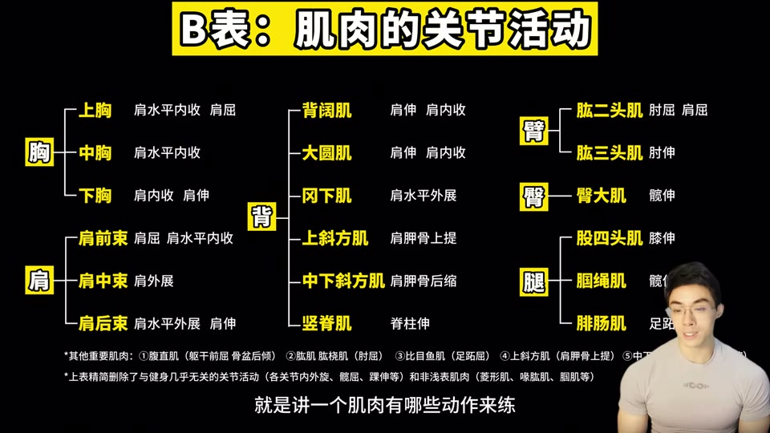

*图 1：B 表总览。胸部一栏：上胸 = 肩水平内收、肩屈；中胸 = 肩水平内收；下胸 = 肩内收、肩伸。*

B 表中和胸相关的部分（从截图读出）：

| 部位 | 关节活动 |
|---|---|
| 上胸 | 肩水平内收、肩屈 |
| 中胸 | 肩水平内收 |
| 下胸 | 肩内收、肩伸 |
| 肩前束（作对照） | 肩屈、肩水平内收 |

- 总结图的高清原图都收在 UP 主的「健身 Excel 工具套表」里，获取方式是关注后私信发「1」，或者去主页置顶动态下载。套表里还有饮食方案底表、三 / 四分化训练计划、拉伸图谱、Complete Anatomy 教程等。
- 本集大纲：胸大肌概况 → 关节活动 → 四类动作 → 蝴蝶机夹胸 → 龙门架夹胸 → 卧推 → 双杠臂屈伸 → 随堂测试。每集结尾有 5 道选择题。

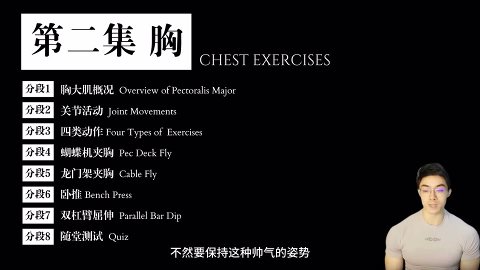

*图 2：本集 8 个分段（Overview / Joint Movements / Four Types of Exercises / Pec Deck Fly / Cable Fly / Bench Press / Parallel Bar Dip / Quiz）。*

---

## 1. 胸大肌解剖 [03:19]

### 1.1 练胸只练胸大肌

- 练胸练的就是**胸大肌**。**胸小肌**在它下面一层，是块小肌肉，和练胸无关。（有人以为「练发达了的胸小肌就叫胸大肌」，UP 主把这当笑话讲。）

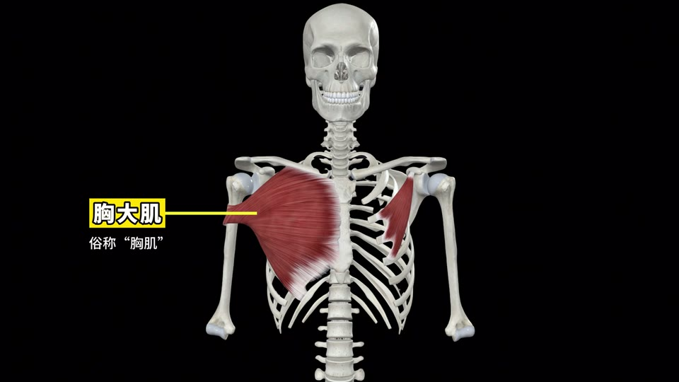

*图 3：胸大肌（俗称「胸肌」）；胸小肌在胸大肌下层，图中不可见。*

### 1.2 女生要不要练胸 [03:33]

- 胸大肌和乳房是两回事。乳腺长在胸大肌很靠下的位置，不在正中。
- 女性的体脂率基本不可能露出胸大肌轮廓，但也不建议完全不练，否则可能和它的拮抗肌强弱失衡，影响体态。
- UP 主在 Excel 训练计划里给女性写的注意事项（从截图读出）：

| 项目 | 建议 |
|---|---|
| 分化方式 | 女性不太需要练胸大肌：每两轮三分化 / 四分化里，拿一轮跳过练胸日，相当于练胸频率减半 |
| 配重选择 | 稍轻，以能做 10–15 次重复（10–15RM）的配重为主（理由：女性骨骼、韧带、肌腱稍脆弱于男性） |
| 组间间歇 | 稍短：大肌群 2 分钟，小肌群 1.5 分钟 |

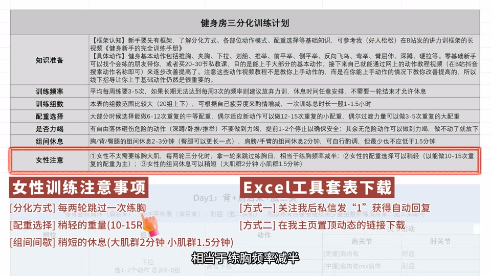

*图 4：健身房三分化训练计划里的「女性注意」三条。*

- UP 主的态度是：健身里男女差别其实不重要，他讲的东西不分男女。

### 1.3 上胸、中胸、下胸：按起点划分 [05:42]

健身圈把胸大肌按**起点**分成三部分：

| 部分 | 起点 | 止点 | 肌纤维走向 |
|---|---|---|---|
| 上胸 | 锁骨内 1/2（锁骨段） | 肱骨大结节嵴 | 斜上 |
| 中胸 | 胸骨，或胸骨旁的第 1–5 肋软骨 | 肱骨大结节嵴 | 比较水平，开始往斜下发展 |
| 下胸 | 第 6–7 肋软骨，以及腹直肌鞘 | 肱骨大结节嵴 | 斜下到偏竖直 |

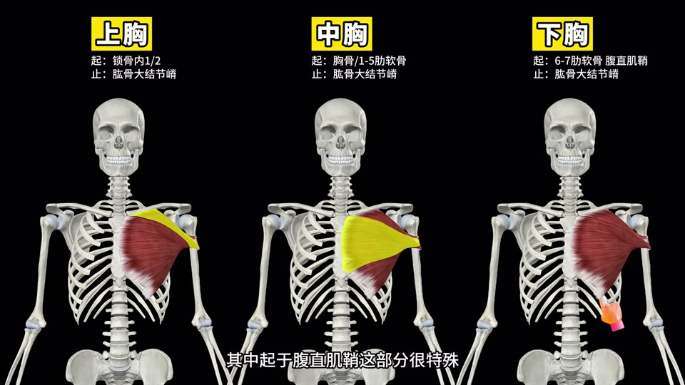

*图 5：三张骨骼图分别标出上胸（起：锁骨内 1/2）、中胸（起：胸骨 / 1–5 肋软骨）、下胸（起：6–7 肋软骨、腹直肌鞘），止点都在肱骨大结节嵴。*

**下胸比较复杂：**

- 下胸的一部分起于第 6、7 肋软骨。在 Complete Anatomy 软件里单独显示胸大肌时，这里的起点看起来是悬空的，旁边还显示了与胸大肌无关的第 6、7 肋骨。UP 主解释说，这是因为软件没有肋软骨素材，就调出相邻的肋骨来代替，属于软件显示的 bug。
- 下胸另一部分起于**腹直肌鞘**，不附着在骨头上。它在体表表现为一个**突然冒出去的折角**。解剖上叫**胸大肌的腹部**（pars abdominalis，指胸大肌最下面这部分肌纤维起于腹直肌鞘，不是指「肚子」），也就是健身圈说的**胸外沿**。

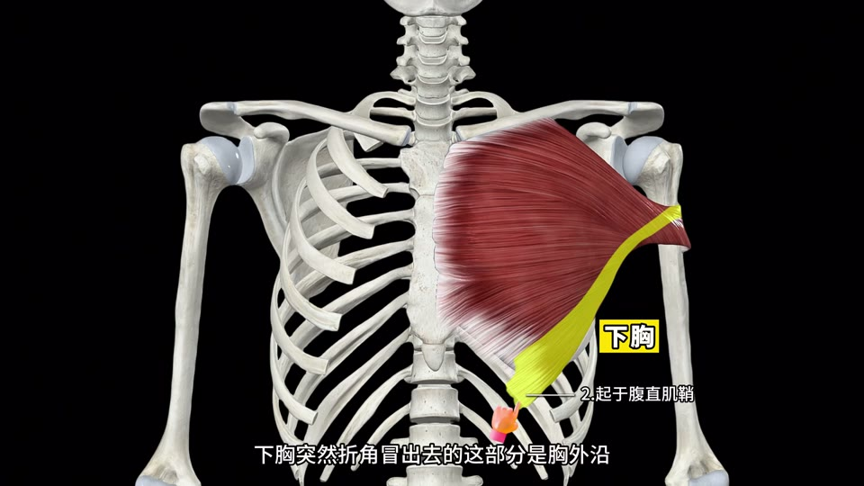

*图 6：下胸最下面那一条起于腹直肌鞘，突然折角冒出去，就是胸外沿。*

> 重点：**胸外沿是下胸的一部分**（下胸最极限的那一条），所以不要把「胸外沿」和上 / 中 / 下胸并列，它们不是并列关系。

- 运动员收缩胸大肌时，胸外沿那一条会立刻分离出来，识别标志就是那个折角。你自己也有胸大肌腹部，怎么摆造型都看不到这个折角，只是因为脂肪层太厚盖住了。

### 1.4 止点与「起点 / 止点」的定义

- 胸大肌三部分的止点相同，都在**肱骨上端约 1/5 处**（肱骨大结节嵴）。
- UP 主的约定：肌肉两端里**靠近身体中轴线的一端叫起点，远离中轴线的一端叫止点**。这只是形式上的人为规定，说反了也没关系。
- 胸大肌、三角肌、背阔肌、大圆肌、冈下肌等都**长在大臂（肱骨）上**，所以练这些部位的动作**清一色是动大臂的动作，也就是肩关节动作**。

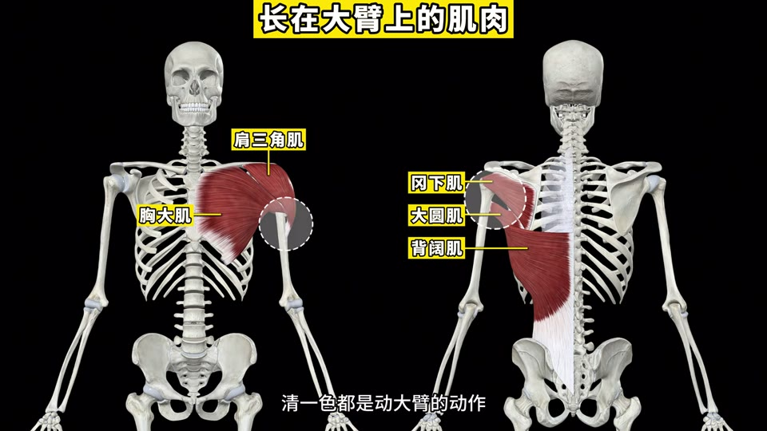

*图 7：正面的胸大肌、三角肌，背面的冈下肌、大圆肌、背阔肌，都止于肱骨。*

### 1.5 肌腱长短决定胸型，和怎么练无关 [09:56]

- 肌肉中间红色的部分叫**肌腹**，能随增肌变厚。两端连骨头的白色致密结缔组织叫**肌腱**，**不能增厚**。
- **胸中缝宽窄**：取决于胸骨段肌纤维白色肌腱的长短。UP 主对比了两位遗体捐赠者：肌腱短的人，增肌后胸中缝窄；肌腱长的人，增肌后胸中缝宽。如果只是靠内侧的肌腹不够厚，增肌就能练厚；如果是正中间没有厚度的胸中缝本身宽，那是肌腱，无解。
- **下胸开口**：胸骨下端开始肌腱会变长。这里的肌腱越长，开口越大，俗称「八字胸 / 漏斗胸」；肌腱很短的人几乎没有开口，近乎直角转折，叫「方胸」，在比赛里算优势形态。两者都由基因决定，和怎么练胸无关。（UP 主开玩笑说，八字胸目前「最好的改善办法」是拍照时拿手机挡住开口。）
- UP 主顺带提醒：解剖素材里的人应当尊称为「大体」或「遗体捐赠者」。

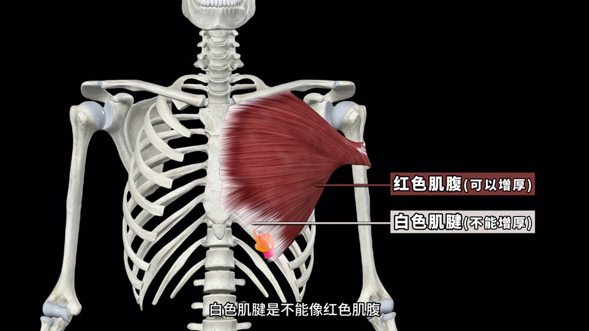

*图 8：红色肌腹可以增厚，白色肌腱不能增厚。*

### 1.6 真人复习：上胸与肩前束之间的凹陷 [12:21]

- 胸大肌由多片肌肉层叠而成，所以隔着皮肤能隐约看到一块块的分离。
- 上胸起于锁骨内 1/2，**肩前束起于锁骨外 1/3**。1/2 + 1/3 = 5/6，剩下中间约 **1/6 的锁骨上没有肌肉附着**，于是这里形成凹陷，把肩前束和上胸分开。
- 中胸是胸大肌的主体肌纤维。下胸起于第 6、7 肋软骨和腹直肌鞘；最下面的折角就是胸外沿。

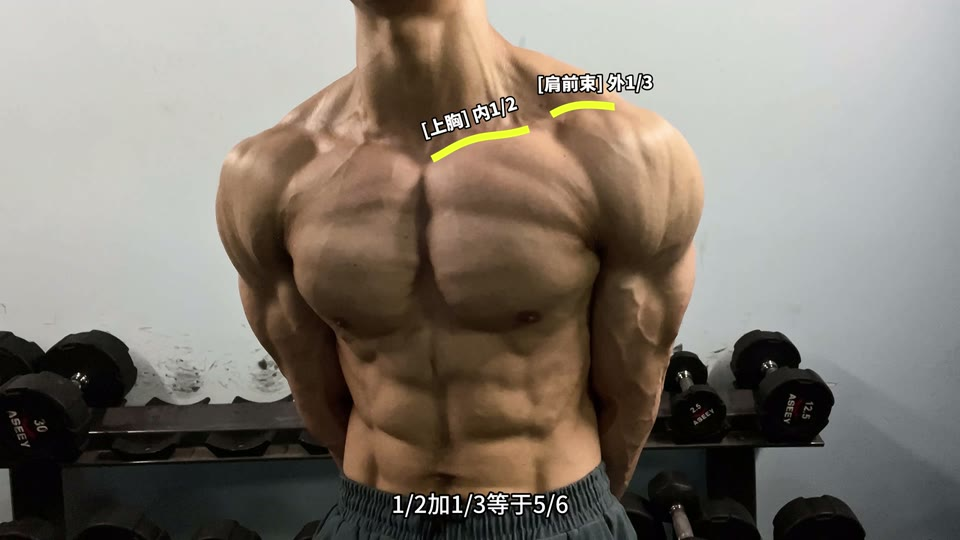

*图 9：UP 主本人示范：黄线标出上胸和肩前束在锁骨上的起点，中间约 1/6 没有肌肉，所以有一道凹陷。*

---

## 2. 胸大肌的四种关节活动 [13:57]

解剖软件和教材给胸大肌列了 4 种关节活动：**肩水平内收、肩内收、肩屈、肩伸**（肩伸是肩屈的反向）。下面逐个分析由哪部分肌纤维负责。

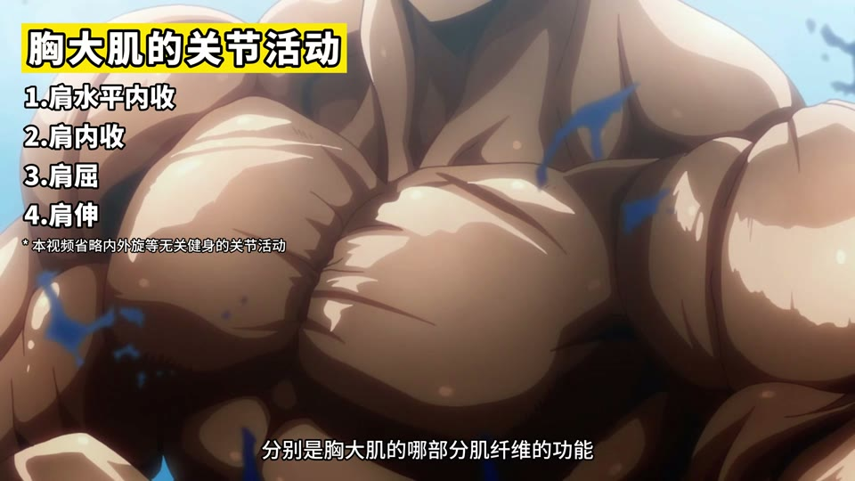

*图 10：1. 肩水平内收　2. 肩内收　3. 肩屈　4. 肩伸（本视频省略了内旋等与健身无关的关节活动）。*

### 2.1 关节活动 1：肩水平内收（最重要）[14:13]

- **定义**：大臂在水平面从外往内运动。
- **代表动作**：开肘很大、近乎水平开肘的推胸和夹胸（水平夹胸类：蝴蝶机夹胸、龙门架水平夹胸、哑铃飞鸟；水平推胸类：器械坐推、平板卧推等）。

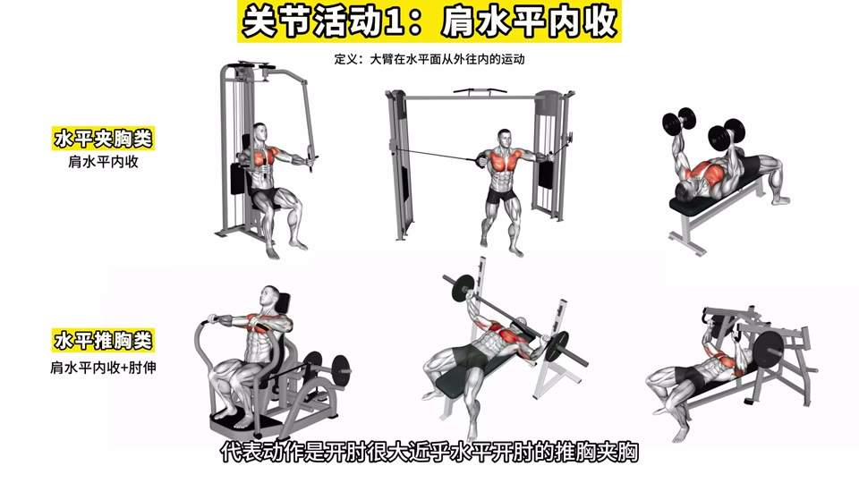

*图 11：上排是水平夹胸类（肩水平内收），下排是水平推胸类（肩水平内收 + 肘伸）。*

**「黄线」的读法（全片通用）：**视频里的黄色线表示**和大臂运动方向匹配的最佳肌纤维**。训练部位以它为中心，走向越接近它的肌纤维越能练到，越不同的越练不到。

**标准的肩水平内收练的是上胸：**

- 开肘很大时，胸大肌在大臂上的止点比较高。这时大臂水平往内运动，最匹配的肌纤维在**很上面的上胸**。
- 中胸和上胸走向比较接近，也能练到；越往下胸，水平分力越少，越和这类动作无关。
- 所以**练上胸不一定要用上斜动作**。在肩关节能承受的前提下，大开肘的推胸 / 夹胸就是典型的上胸动作。

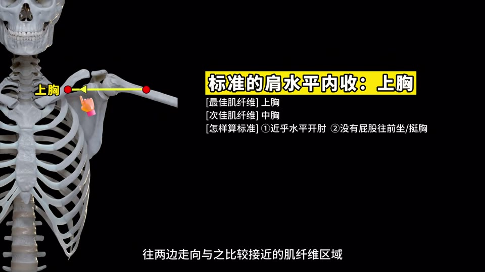

*图 12：标准的肩水平内收：最佳肌纤维是上胸，次佳是中胸。「怎样算标准」：① 近乎水平开肘；② 没有屁股往前坐 / 挺胸。*

**「理论上」 vs 实践中：两个让训练部位下移的习惯 [15:37]**

1. **习惯 1：开肘较小。**开肘越小，胸大肌止点越低，水平方向的拉力线越低，最佳肌纤维从上胸下移到中胸。
2. **习惯 2：「人造下斜板」。**坐姿动作里**屁股往前坐**，或者任何动作里**挺胸**，都会让躯干下斜化。这样大臂相对于躯干就不再是水平运动，而是斜下运动，最佳肌纤维进一步下移到中胸。挺胸特别厉害的人甚至能练到下胸。

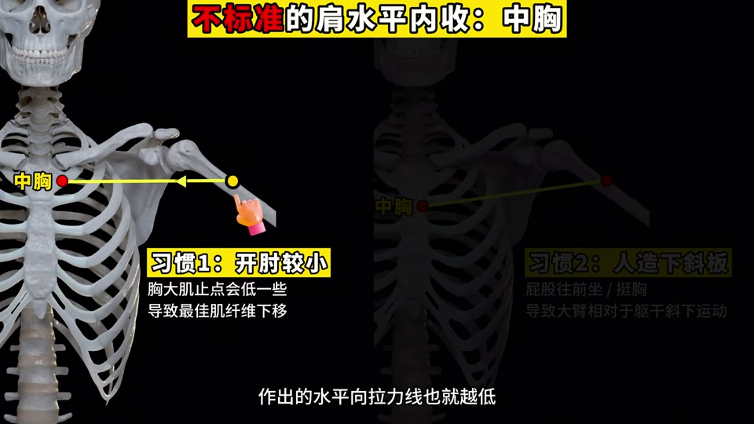

*图 13：习惯 1：开肘较小，胸大肌止点低一些，最佳肌纤维下移。*

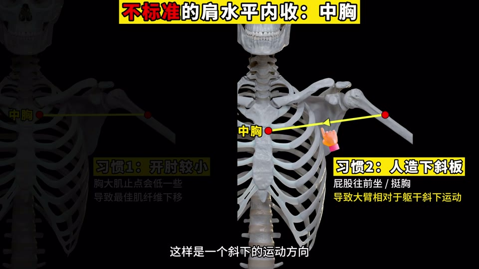

*图 14：习惯 2：屁股往前坐 / 挺胸，大臂相对于躯干变成斜下运动。*

**素材分析：一个「名义上的水平夹胸」其实在练下胸 [16:56]**

- 素材里的人做蝴蝶机夹胸时：① 屁股离开靠背往前坐了一段，躯干从垂直地面变成下斜；② 用力挺胸，挺到肋骨外翻。
- 结果他的胸大肌不是垂直于地面，而是和地面成大约 **四五十度**，相当于坐在四五十度的下斜凳上做水平夹胸。
- 表面上大臂在做水平夹胸，但**大臂相对于躯干（胸大肌）是往斜下夹**。处在大臂运动面上的是**下胸**，关节活动变成了「肩水平内收 mix 大比例的肩内收」，相当于下斜夹胸。

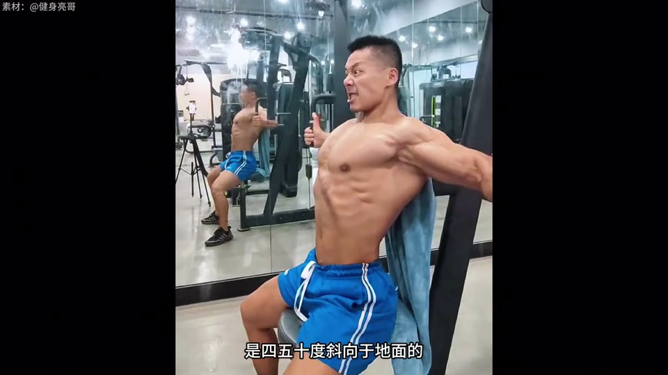

*图 15：屁股前坐加挺胸，胸大肌斜向地面约四五十度，实际成了下胸动作。*

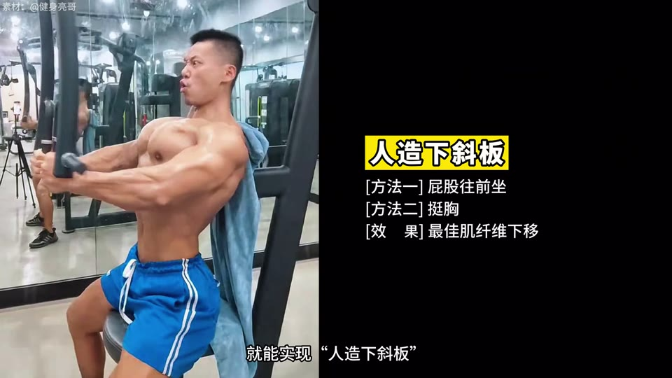

*图 16：人造下斜板：方法一屁股往前坐，方法二挺胸，效果是最佳肌纤维下移。*

> UP 主让大家牢记这段素材，后面会反复用到：**屁股往前坐或挺胸，就能「人造下斜板」，改变原来的关节活动，让训练部位下移。**

**小结：**标准的肩水平内收是上胸动作。只要没有「开肘小」和「人造下斜板」这两个习惯，水平推胸、水平夹胸就能练上胸。有这两个习惯，最佳肌纤维会从上胸下移到中胸，挺胸极端的人甚至练到下胸。

### 2.2 关节活动 2：肩内收 [19:38]

- **定义**：大臂在冠状面从外往内运动。
- **代表动作**：龙门架下夹胸、宽握下拉、宽握引体。背面由背阔肌、大圆肌拉动，正面由胸大肌拉动。
- **哪部分在干活？**
  - 大臂外展很大时（动作前半段），最竖直的**胸外沿**是最佳肌纤维，因为它的垂直分力大。
  - 大臂外展不大时（后半段），最佳肌纤维从胸外沿逐渐移到**中胸偏下**。
  - 所以**肩内收 = 下胸 + 中胸的功能**。解剖教材的说法是「胸大肌胸肋部的功能」，胸肋部就是起于胸骨的中胸，加上起于第 6–7 肋软骨的下胸，意思一致。
- 下夹胸做的是肩内收全程；宽握下拉 / 宽握引体做的是肩内收前半程，所以都能练到下胸，特别是胸外沿。

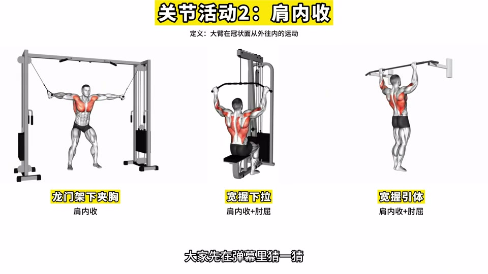

*图 17：肩内收：龙门架下夹胸（肩内收）、宽握下拉（肩内收 + 肘屈）、宽握引体（肩内收 + 肘屈）。*

### 2.3 关节活动 3：肩屈 [21:28]

- **定义**：大臂在矢状面从后往前运动。
- **代表动作**：前平举、窄握推举、窄握卧推。
- **哪部分在干活**：只有**上胸**收缩才有利于把肱骨往上拉，中胸、下胸无关。
- 但上胸对肩屈的贡献**不如肩前束**，因为肩前束更接近矢状面的竖直方向。所以这些动作与其说练上胸，不如说练肩前束。

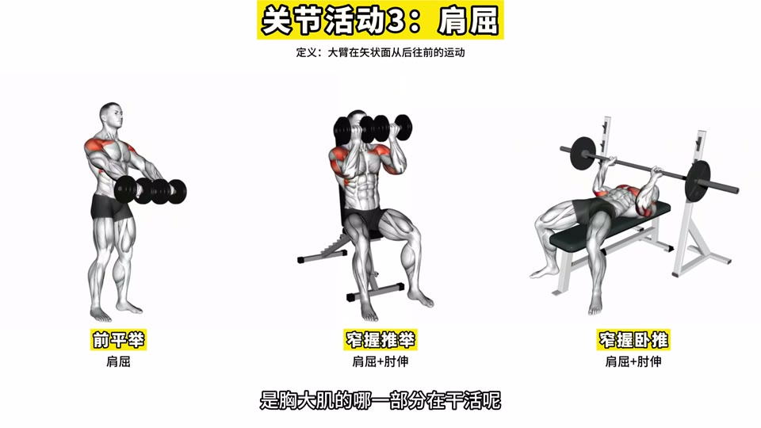

*图 18：肩屈：前平举（肩屈）、窄握推举（肩屈 + 肘伸）、窄握卧推（肩屈 + 肘伸）。*

> UP 主反复强调的原则：**一块肌肉（或某部分肌纤维）有某种关节活动，不等于我们就要用这个关节活动来练它**，因为它在里面的贡献比例可能不够大。所以总结图里分了「主 / 次」。

胸大肌各部分的主要 / 次要关节活动（从截图读出）：

| 部分 | 主 / 次 | 关节活动 | 对应动作 |
|---|---|---|---|
| 上胸 | 主 | 肩水平内收 mix 肩屈 | 上斜夹胸、上斜推胸 |
| 上胸 | 主 | 肩水平内收 | 水平夹胸、水平推胸 |
| 上胸 | 次 | 肩屈 | 前平举、窄距卧推、窄距推举 |
| 中胸 | 主 | 肩水平内收 | 水平夹胸、水平推胸 |
| 中胸 | 次 | 肩内收 | 下夹胸、宽握下拉、宽握引体 |
| 下胸 | 主 | 肩水平内收 mix 肩内收 | 下斜夹胸、下斜推胸、双杠臂屈伸 |
| 下胸 | 次 | 肩内收 | 下夹胸、宽握下拉、宽握引体 |
| 下胸 | 次 | 肩伸 | 仰卧上拉、窄握划船、窄握下拉、窄握引体 |

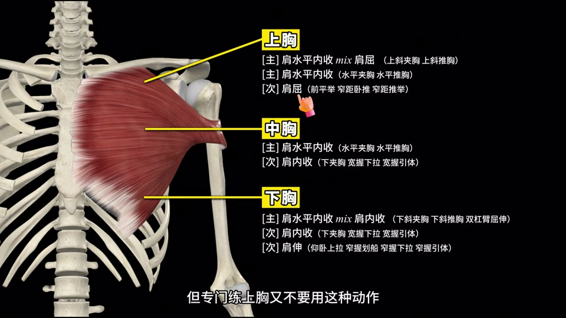

*图 19：每部分胸大肌的「主 / 次」关节活动和对应动作。专门练上胸应该用两种「主」：上斜推 / 夹，或大开肘的水平推 / 夹。*

### 2.4 关节活动 4：肩伸 [23:38]

- **定义**：大臂在矢状面从前往后运动，是肩屈的反向。
- **代表动作**（很多在练背动作里）：仰卧上拉、直臂划船、哑铃划船、窄握划船、窄握下拉、窄握引体。
- **哪部分在干活**：偏竖直的**下胸**，特别是最竖直的**胸外沿**，适合在矢状面把肱骨往下拉。所以**下胸是「肩伸五肌」之一**。
- 「肩伸五肌」（从截图读出）：正面是下胸（特别是胸外沿）；背面是背阔肌、大圆肌、肱三头肌长头、肩后束。
- UP 主引用教材说明这不是他编的。他提到一本人民体育出版社的运动解剖学科普读物，书中胸大肌那一页把引体向上列为练胸动作：宽握引体是肩内收，窄握是肩伸，两者都是下胸的关节活动，所以引体、下拉类动作无论怎么握都能练到下胸。
- 但如果专门练下胸和胸外沿，**一般不选这类动作**，因为肩伸的参与肌肉太多，下胸贡献太小。

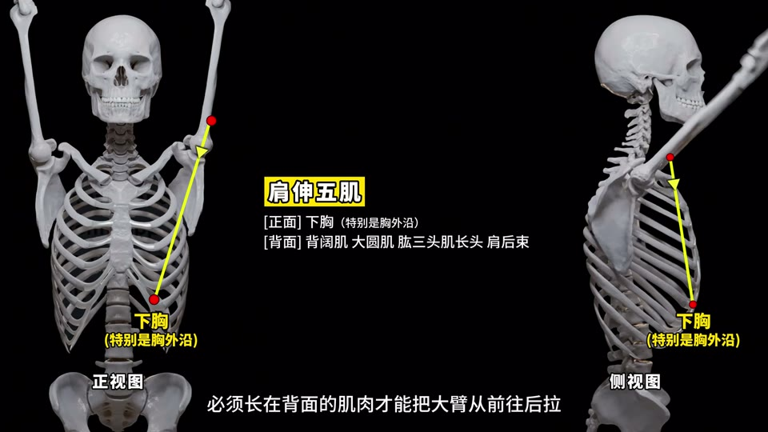

*图 20：肩伸五肌：正面是下胸（特别是胸外沿），背面是背阔肌、大圆肌、肱三头肌长头、肩后束。*

### 2.5 四种关节活动小结

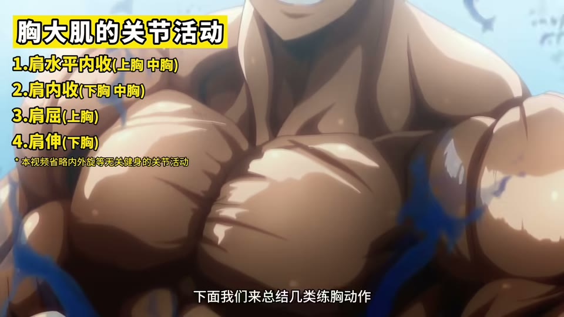

*图 21：1. 肩水平内收（上胸、中胸）　2. 肩内收（下胸、中胸）　3. 肩屈（上胸）　4. 肩伸（下胸）。*

---

## 3. 四类练胸动作：看大臂相对于躯干怎么动 [26:09]

这一节是「从理论转向实践」的重点。判断方法：**看动作的起始位和结束位，肘和肩的连线相对于躯干怎样移动**。大臂既往内又往上，就是斜上；只往内，就是水平；往内又往下，就是斜下。最佳肌纤维就是那个运动方向，以它为中心的附近区域是侧重训练部位。

### 第一类：大臂相对于躯干斜上运动 → 侧重上胸

- 例：上斜夹胸（龙门架 / 哑铃）、上斜推胸（器械 / 杠铃）。
- 分析：结束位的肘肩连线比起始位更高，说明大臂相对躯干在上移；同时又在往内移，合起来就是斜上，匹配的是上胸肌纤维。

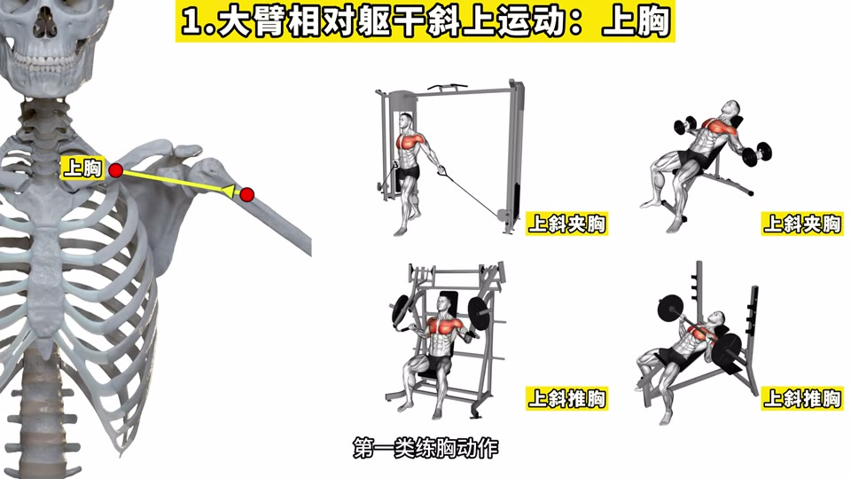

*图 22：第一类：上斜夹胸、上斜推胸。*

### 第二类：大臂相对于躯干水平运动 → 侧重中胸、上胸

- 就是前面详细讲的肩水平内收：近乎水平开肘时落在上胸；开肘小一些落到中胸；再加人造下斜板，就完全落入中胸。

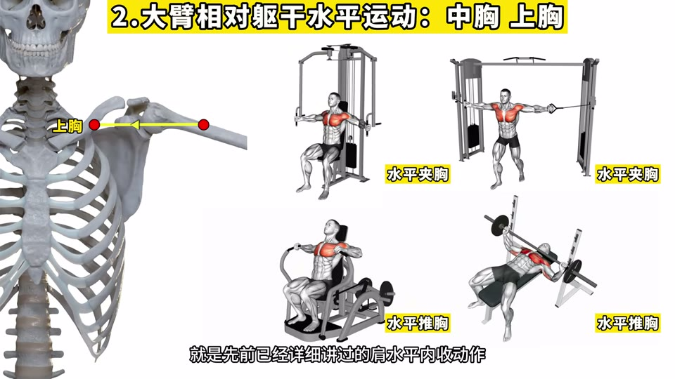

*图 23：第二类：水平夹胸、水平推胸。图中标注了「如果近乎水平开肘」落在上胸。*

### 第三类：大臂相对于躯干轻微斜下运动 → 侧重中胸偏下（还没真正进入下胸）

- 例：下夹胸（轻度）、轻微下斜坐推、下斜卧推。
- **为什么一般的下斜卧推只练到中胸偏下？**一般下斜凳只有 **15° 左右**（UP 主建议自己拿手机量角器测一下），朝天花板推时，大臂相对躯干只是轻微斜下，最佳肌纤维到不了下胸。要像图中白线那样**严重斜下**，才落入下胸。
- 有人提议把凳子调成下斜 60° 再卧推。UP 主说**不可行**：这近乎倒立卧推，大脑会严重充血，人也会往下滑，根本推不了。所以下斜卧推受凳子角度所限，**不是真正的下胸动作**。

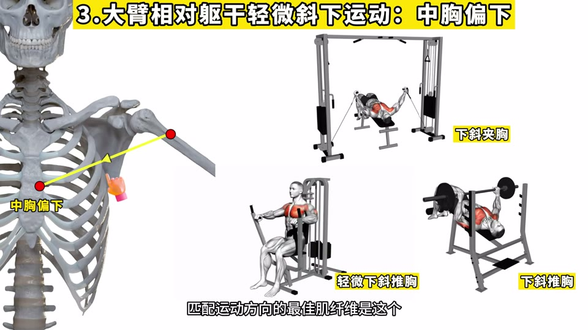

*图 24：第三类：轻微斜下，最佳肌纤维在中胸偏下。*

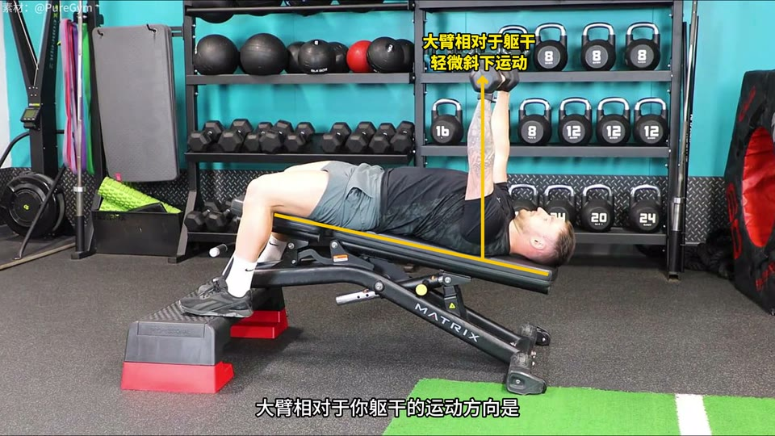

*图 25：一般下斜卧推凳约 15°，大臂相对躯干只是轻微斜下（黄线）；白线才是严重斜下。*

### 第四类：大臂相对于躯干严重斜下运动 → 侧重下胸（含胸外沿）

真正针对下胸和胸外沿的动作：

1. **足够下斜的绳索夹胸**：龙门架把手高度可以随意调，能做任意角度的斜下运动，把手越高越斜下。
2. **足够下斜的器械推胸**：有些坐推机的推出方向看起来没那么斜下，但**靠背后仰约三四十度**，所以大臂相对躯干其实是严重斜下。UP 主强调要看「大臂与躯干的相对关系」：改变大臂方向，或改变躯干角度，都能改变这个关系。
3. **双杠臂屈伸。**

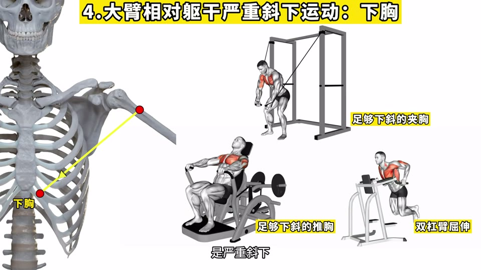

*图 26：第四类：足够下斜的夹胸、足够下斜的推胸、双杠臂屈伸。*

**坐推机怎样「下斜化」改造：**如果器械本身是水平或轻微下斜的，可以用人造下斜板：① 屁股往前坐，自己造出一个后仰的靠背；② 更挺胸，胸椎一挺，躯干明显下斜化。这样水平坐推机也能改造成严重下斜的坐推。

**为什么双杠臂屈伸是大臂相对躯干的斜下运动？[31:44]**

- UP 主的「笨办法」：先接受一台充分下斜的坐姿推胸机是大臂相对躯干斜下运动。把它推出的阻力方向画出来，再把整个动作**旋转约 90°**，就变成了双杠臂屈伸：阻力是自重，垂直向下，身体半趴着。
- 坐推是躯干不动、大臂动，所以好判断；双杠臂屈伸是躯干和大臂一起动，新手不容易看出来。等以后自己能做双杠臂屈伸时，观察自己大臂相对躯干怎么动，就能理解了。

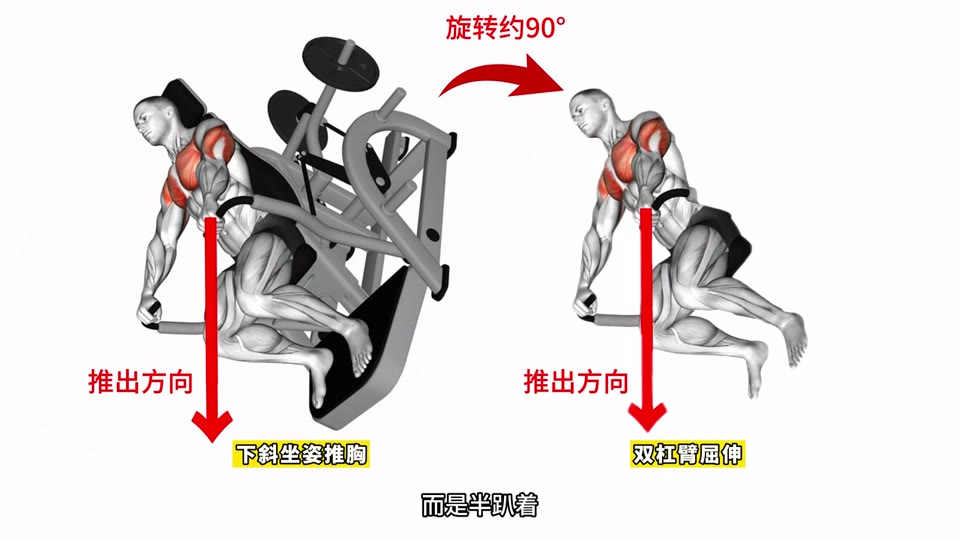

*图 27：把下斜坐姿推胸旋转约 90°，就是双杠臂屈伸（图中红色箭头为推出方向）。*

### 四类动作总结

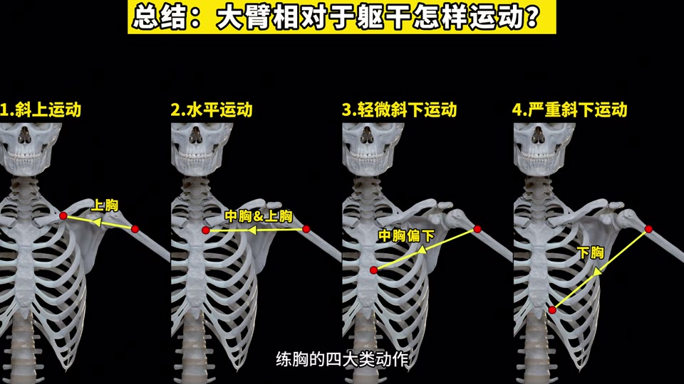

*图 28：1. 斜上运动（上胸）　2. 水平运动（中胸和上胸）　3. 轻微斜下（中胸偏下）　4. 严重斜下（下胸）。*

| 大臂相对躯干的运动 | 侧重部位 | 典型动作 |
|---|---|---|
| 斜上 | 上胸 | 上斜夹胸、上斜推胸 / 卧推 |
| 水平 | 中胸、上胸（开肘越大越偏上胸） | 水平夹胸、平板卧推、水平坐推 |
| 轻微斜下 | 中胸偏下 | 一般下斜卧推、轻微下斜坐推 |
| 严重斜下 | 下胸、胸外沿 | 足够下斜的绳索夹胸、足够下斜的器械推胸、双杠臂屈伸 |

**不同器械的角度自由度 [33:51]：**

- **绳索夹胸**：自由度最高，斜上、水平、斜下都能调。
- **坐姿推胸机**：每台设计角度不同。判断它的性质不能只看推出方向，**还要看靠背后仰的程度**。健身房没有足够下斜的坐推机，就用「屁股往前坐 + 挺胸」改造。
- **卧推**：角度自由度低。下斜凳一般只有十多度，最多二三十度，所以**下斜卧推一般落在中胸偏下，不能针对下胸和胸外沿**。

- 导论结尾，UP 主给胸大肌念了一首打油诗《咏胸大肌》，大意是：大臂运动是关键，分斜上、水平、斜下；胸大肌关节活动多，屈、伸、内收都有它。

---

## 4. 课间：「好东西」 [36:13]

这一章是 UP 主的推广内容：B 站每月 5 元的充电学习社群（每月 5 篇训练 / 营养讲解、每月一次直播课、粉丝群、每月 1 号打包资料），以及填主页置顶问卷可以定制减脂增肌方案。和训练知识无关，这里不展开。

---

## 5. 蝴蝶机夹胸 [38:04]

从最容易理解的单关节动作开始讲。

**动作卡（从截图读出）：**

| 项目 | 内容 |
|---|---|
| 动作名称 | 蝴蝶机夹胸 |
| 关节活动 | 肩水平内收（上胸、中胸 + 肩前束） |
| 肱二发力 | 保持等长收缩来阻止肘伸 |
| 错误做法 | 肘屈、肩胛骨前引 |
| 开肘程度 | 开肘越小，胸大肌止点越低，训练部位越偏下 |
| 人造下斜 | a. 屁股往前坐　b. 挺胸 |
| 力臂特点 | 全程不变 |

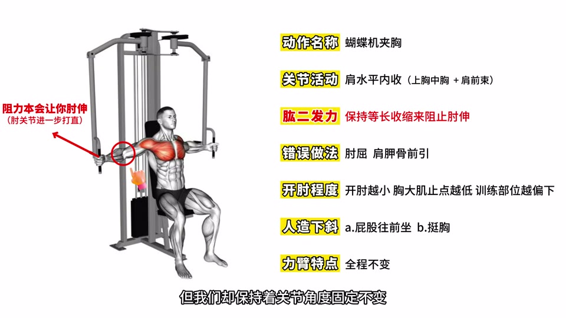

*图 29：蝴蝶机夹胸的 7 项要点。图中红字：阻力本来会让你肘伸（肘关节进一步打直）。*

### 怎么做 / 是什么

- 克服阻力阶段，大臂在水平面从外往内运动，就是肩水平内收。查导论的总结表可知它练**胸大肌（特别是中上胸）和肩前束**。

### 为什么肱二头肌会感觉紧绷

- 向外的阻力本来会把肘关节进一步拉直（肘伸），而我们保持肘角不变，这是**肱二头肌在做等长收缩**，阻止肘伸。等长收缩不算关节活动，所以不写进关节活动里。

### 常见错误

1. **夹的同时屈肘（引入肘屈）。**原因是心里的目标是「把两只手合拢」，屈肘能让双手更容易靠拢，相当于请肘屈肌三兄弟（肱二头肌、肱肌、肱桡肌）来帮忙。
2. **肩胛骨前引。**动作中肩胛骨离开靠背往前跑，越做不动越明显，也是为了让双手再靠拢一点点。

> 出现别的关节活动，说明**配重太大**，目标肌肉克服不了力矩，只好拉帮结派。解决办法是**减重**（UP 主原话「不要装」）。

### 开肘角度与训练部位

- 所有推胸、夹胸动作都一样：开肘角度大，胸大肌止点偏上，最佳肌纤维更可能是上胸；开肘角度小，止点偏下，更可能是中胸。

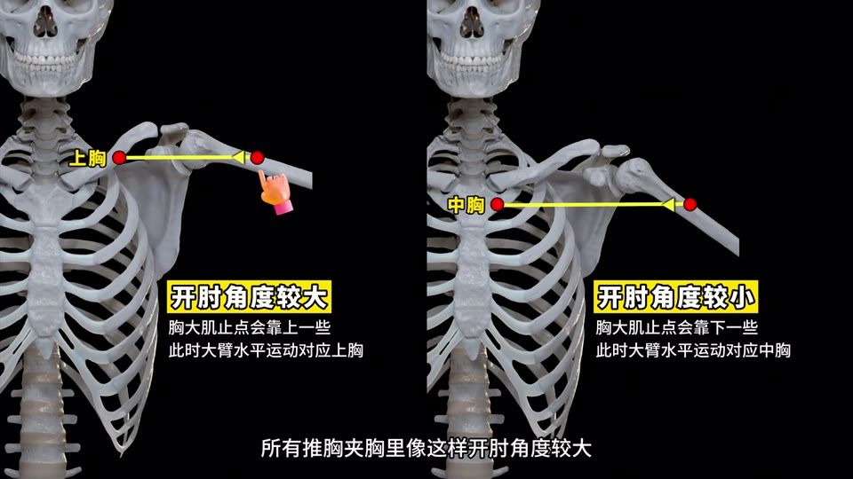

*图 30：开肘角度大：止点高，大臂水平运动对应上胸；开肘角度小：止点低，对应中胸。*

### 想用蝴蝶机练中胸偏下乃至下胸

1. 开肘小一点，让止点下移。
2. 更重要的是**人造下斜板**：屁股往前坐（UP 主说下斜卧推凳才十多度，往前一坐，躯干马上就成了 20–30° 的下斜），再叠加挺胸，胸大肌就进一步下斜化。这时所谓的水平夹胸，大臂相对胸大肌已经是往斜下夹，运动面上的肌纤维是下胸、胸外沿。

### 力臂、力矩与蝴蝶机的「恒定力臂」 [41:34]

**三个必须背下来的概念**（UP 主说「要考的」）：

- **支点**：动作里的转动点（某个关节点）。
- **力臂**：**力的方向到关节点的垂线距离**。
- **真正重量 = 力矩 = 配重 × 力臂**。健身里真正的重量不是哑铃、杠铃本身的重量。

例子是哑铃弯举：小臂水平时，力臂约等于小臂长（图中约 40 cm），力矩最大，是全程最重的时刻；继续弯举，力臂变小（约 30 cm），力矩随之变小。

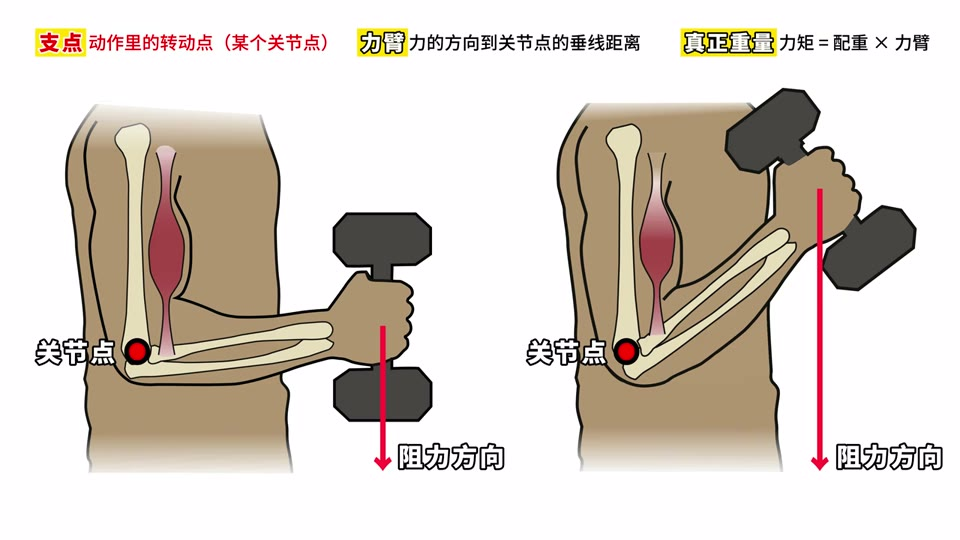

*图 31：支点 = 关节点；力臂 = 力的方向到关节点的垂线距离；真正重量（力矩）= 配重 × 力臂。*

- **蝴蝶机**是钢线绕在圆弧（圆盘）上的器械，阻力方向随动作实时变化，始终在运动方向的正后方，所以力臂恒定，约等于大臂加小臂的总长。全程力矩恒定，难度变化不大。
- **反例：哑铃飞鸟。**关节活动和蝴蝶机夹胸完全一样，都是肩水平内收，但力臂变化极大：顶端阻力在肩关节正上方，力臂约为 0，几乎没重量；底端力臂接近大臂加小臂的总长，非常吃力。配重选重了，让后半程合适，前半程就完全做不了。这叫**单调性力臂**（力臂在动作中一直单调增或减）。

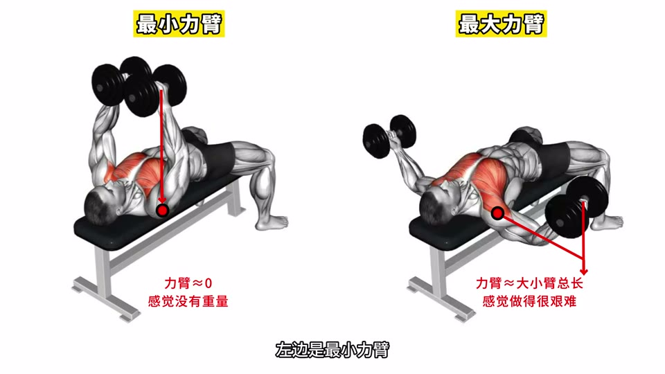

*图 32：左：力臂约为 0，感觉没有重量；右：力臂约等于大小臂总长，感觉很艰难。*

- 同属「恒定力臂」的器械还有：器械侧平举（练肩中束）、器械弯举（练肘屈肌）、器械腿屈伸（练股四头肌）、器械腿弯举（练腘绳肌）等。关键是必须有**钢线环绕圆盘的弧形轨迹**；不是所有固定器械都这样。

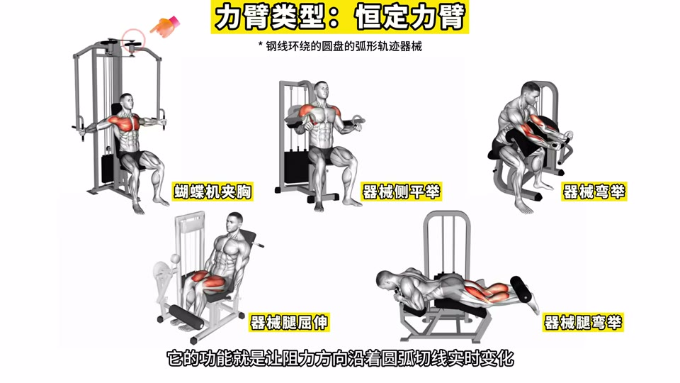

*图 33：钢线环绕圆盘的弧形轨迹器械：蝴蝶机夹胸、器械侧平举、器械弯举、器械腿屈伸、器械腿弯举。*

- 哑铃杠铃的单调性力臂「在有些时候是一种劣势」，UP 主说视频最后会有力臂专题总结（本集正片里没有展开，见下一节的三种力臂表）。

---

## 6. 龙门架夹胸 [45:08]

**动作卡（从截图读出）：**

| 项目 | 内容 |
|---|---|
| 动作名称 | 龙门架夹胸 |
| 关节活动 | 水平夹胸：肩水平内收；下斜夹胸：肩水平内收 mix 肩内收；上斜夹胸：肩水平内收 mix 肩屈 |
| 常见错误 | 肘屈、肘伸 |
| 力臂特点 | 力臂「小-大-小」变化，动作难度相对均匀 |

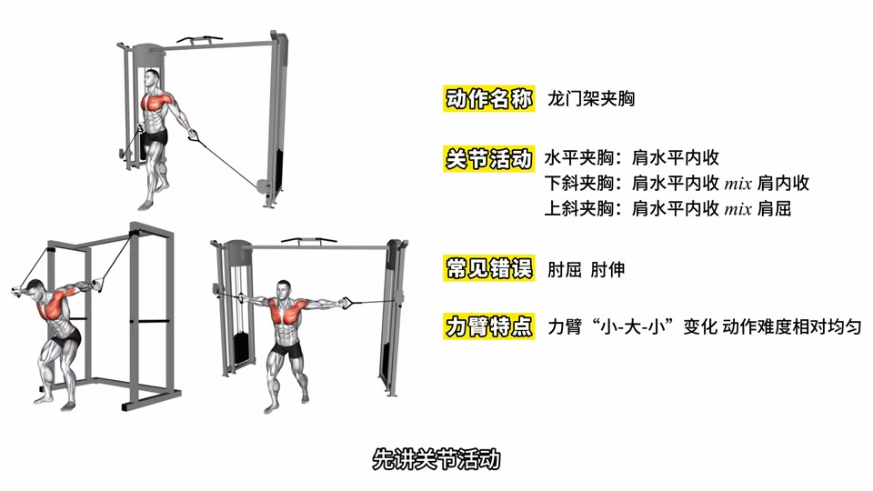

*图 34：龙门架夹胸：三种角度的关节活动、常见错误和力臂特点。*

### 把手高度决定练哪里

| 把手高度 | 大臂相对躯干 | 最佳肌纤维 | 说明 |
|---|---|---|---|
| 与胸齐平 | 水平（肩水平内收） | 中上胸附近（开肘足够大时） | — |
| 较高 | 严重斜下 | 下胸 | 肩水平内收成分大减，肩内收成分大增；也可以选轻微斜下，那就只到中胸偏下 |
| 特高（下夹胸） | 过渡到完全的肩内收 | 前半段练下胸，特别是胸外沿；后半段上移到中胸 | 想练下胸 / 胸外沿，必须做**大臂充分外展的前半段** |
| 较低 | 斜上 | 上胸、肩前束 | 肩屈成分增加，和上斜推胸是一回事（推胸只是多了个肘伸） |
| 特别低 | 非常严重的斜上 | 肩前束 | 近似前平举。目的是练胸就不要这么夸张 |

> 通用道理：**看大臂相对于躯干在什么方向运动，最佳肌纤维就是那个方向。**

### 常见错误关节活动

1. **引入肘屈**：原因同蝴蝶机，想让双手靠拢，又不知道正确的关节活动是什么，于是请肘屈肌帮忙。
2. **引入肘伸**：把夹胸做成了推胸，请肱三头肌帮忙。如果目的就是顺便练肱三头肌，这样做也不一定算错，但它就不叫夹胸了。**只要有肘伸就叫推胸**（龙门架推胸 = 肩水平内收 + 肘伸）。

### 力臂「小-大-小」

- 站在龙门架前夹胸：起始时手臂与阻力方向成钝角，力臂较小（图中约 30 cm）；中段成直角，力臂最大，约为大小臂总长（约 70 cm）；结束时成锐角，力臂又变小（约 30 cm）。
- 所以龙门架和钢线绕圆盘的器械相似，动作过程中难度比较均匀。反例仍是单调性力臂的哑铃飞鸟。

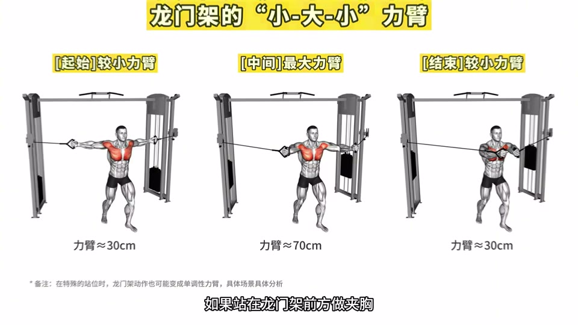

*图 35：起始、结束时力臂较小（约 30 cm），中间力臂最大（约 70 cm）。*

### 健身动作的三种力臂

| 类型 | 特点 | 代表 |
|---|---|---|
| 1. 恒定力臂 | 力臂恒定不变 | 钢线环绕圆盘的器械（如蝴蝶机） |
| 2. 小-大-小力臂 | 力臂以「小-大-小」变化 | 龙门架钢线动作 |
| 3. 单调性力臂 | 力臂一直递增或递减 | 哑铃杠铃的自由动作（画面注：但哑铃杠铃动作并非全部都是如此） |

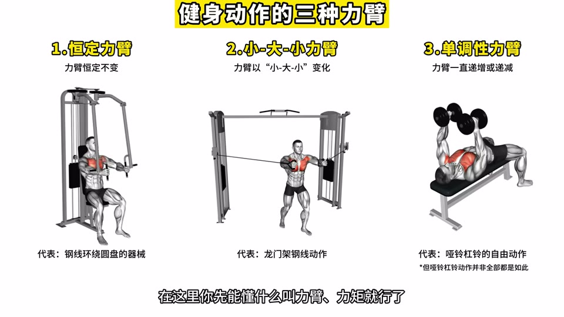

*图 36：三种力臂类型及代表器械。*

---

## 7. 卧推（推胸类动作） [48:36]

- 推胸动作的关节活动都一样（肩关节活动 + 肘伸），只是把身体旋转了不同角度：**器械推胸是坐着推，卧推是躺着推，双杠臂屈伸和俯卧撑是趴着推。**

### 卧推的关节活动

- **肘关节**：无论哪种卧推，推起阶段肘都从折叠变成打直，是**肘伸，练肱三头肌**。
- **肩关节**（大臂怎么动）：
  - **开肘很大的卧推**：肩关节几乎只有肩水平内收，几乎没有肩屈，是纯水平运动，最佳肌纤维落在**上胸**，所以它是上胸动作。
  - 实践中大多数人**开肘较小**：大臂既往内（肩水平内收）也往上（肩屈。判断方法是看肘肩连线相对躯干在上移），合起来是轻微斜上，最佳肌纤维就没那么偏上胸了，大约在上胸、中胸交界附近。
  - 很多人还会**挺胸**，让躯干下斜化，肩屈成分基本消失，最佳肌纤维脱离上胸，落到中胸。
- 结论：**大开肘、不刻意挺胸**的平板卧推是上胸动作；更常见的开肘较小加挺胸，让平板卧推有点下斜化，主要练中胸。所以「平板卧推主要练中胸」的常见说法也对。

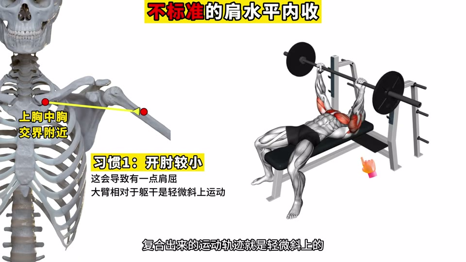

*图 37：卧推里的习惯 1「开肘较小」：带一点肩屈，大臂相对躯干轻微斜上，最佳肌纤维在上胸中胸交界附近。（之后的习惯 2「挺胸」会进一步让它落入中胸。）*

### 上斜卧推

- 和平板一样朝天花板推，但上斜凳改变了躯干角度，所以大臂相对躯干是**斜上运动**，最佳肌纤维非常偏上胸，甚至到肩前束。
- 如果习惯挺胸，相当于上斜没那么斜，运动方向收回一些，但仍然练上胸。
- **角度不用死记 20°、30° 还是 40°**：凳子角度越大，最佳肌纤维越靠上，直至肩前束；角度越小越靠下，甚至只是刚进入上胸。

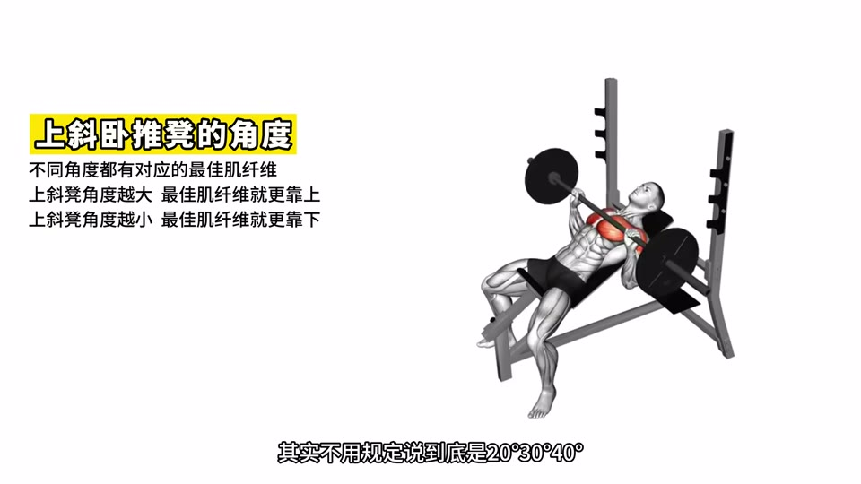

*图 38：不同角度各有对应的最佳肌纤维：角度越大越靠上，越小越靠下。*

- **关于肌电研究**：画面引用了一篇比较 5 种卧推凳倾角下胸大肌、三角肌前束、肱三头肌肌电的论文（画面标注 PMID 33049982），图中的问题是「上斜卧推凳 30° 时上胸的肌电最活跃？」。UP 主的看法：这类结论很依赖电极贴在上胸的哪个位置。贴得靠下一点，可能测出 20° 最活跃；贴得靠上一点，可能测出 40° 最活跃。再加上每个人挺胸程度、屁股前后坐的程度不同，实际角度也会变。应该理解的是**角度不同，大臂斜上 / 斜下的程度不同，各有各的最佳肌纤维**，不存在唯一最好的角度。

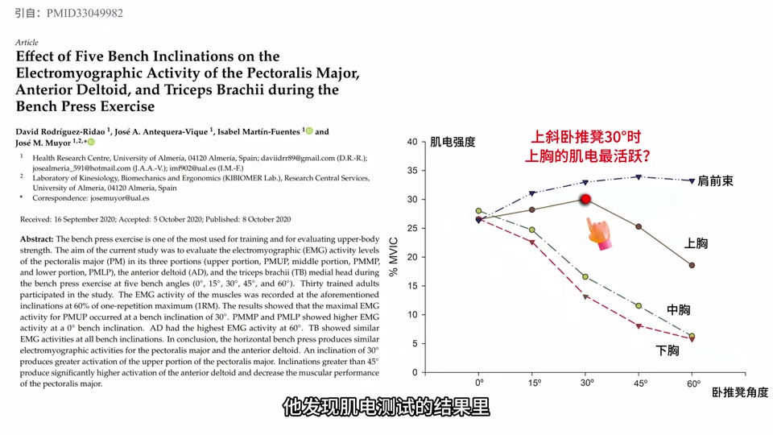

*图 39：论文图：横轴是卧推凳角度（0°–60°），纵轴是肌电强度（%MVIC），曲线分别为肩前束、上胸、中胸、下胸。*

- 能改变上斜凳实际角度的因素（画面列出）：1. 挺胸（相当于让上斜凳角度变小）；2. 屁股往前坐（同样让上斜角度变小）。

### 下斜卧推

- 下斜凳改变了躯干角度，大臂相对躯干是**轻微斜下**，最佳肌纤维在**中胸偏下**。
- 和刻板印象不同，**下斜卧推并不是针对下胸和胸外沿的动作**，因为下斜凳一般只有十多度，最夸张也就二三十度，大臂相对躯干的斜下只是轻微的。真正练下胸要靠「严重斜下」的动作（见第 3 节第四类）。

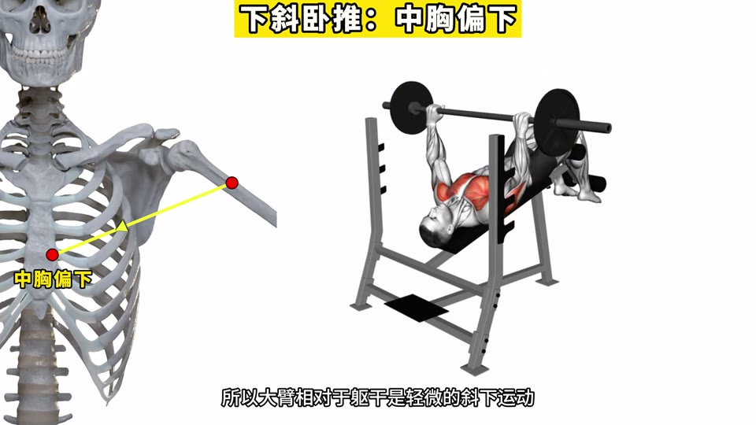

*图 40：下斜卧推：大臂相对躯干轻微斜下，最佳肌纤维在中胸偏下。*

---

## 8. 双杠臂屈伸 [52:56]

UP 主称之为「练了两三年才可以去做的高难动作」。

**动作卡（从截图读出）：**

| 项目 | 内容 |
|---|---|
| 动作名称 | 双杠臂屈伸 |
| 关节活动 | （肩水平内收 mix 肩内收）+ 肩屈 + 肘伸 |
| 前趴程度 | 完全平趴：趋于肩水平内收（练中胸）；完全直立：趋于肩内收（练下胸，但背阔、大圆参与）；建议角度：前趴 30–60°（练下胸最佳角度） |
| 常见错误 | 握距未超过肩宽，在矢状面运动 |

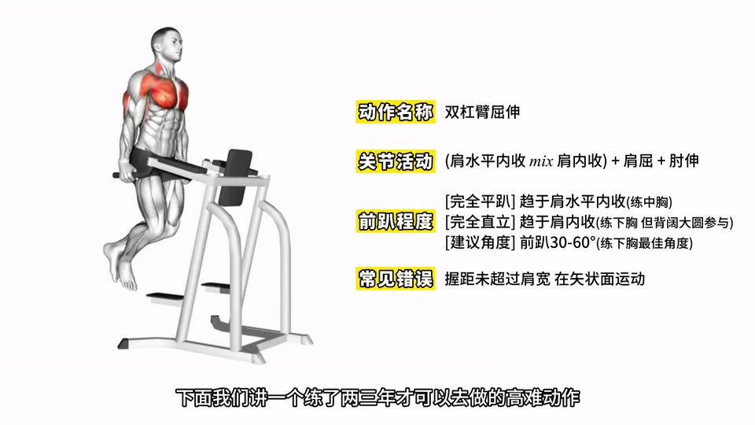

*图 41：双杠臂屈伸：关节活动、前趴程度、常见错误。*

### 前趴程度决定练哪里

| 姿势 | 大臂相对躯干 | 侧重 |
|---|---|---|
| 1. 平趴（完全趴平） | 水平运动，相当于把平板卧推旋转 180° | 中胸 |
| 2. 深趴 | 轻微斜下，相当于下斜卧推 | 中胸偏下 |
| 3. 浅趴（典型做法） | 严重斜下，比下斜卧推更厉害 | 下胸 |
| 4. 直立 | 过渡到冠状面的肩内收 | 下胸（特别是胸外沿），但背阔肌、大圆肌也来帮忙，胸的贡献较低，一般不这样做 |

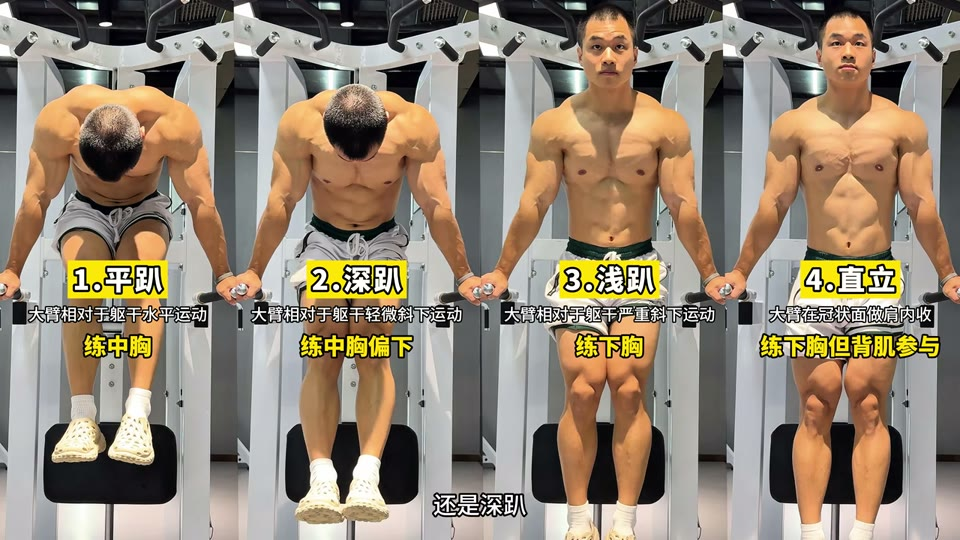

*图 42：平趴练中胸，深趴练中胸偏下，浅趴练下胸，直立练下胸但背肌参与。*

- 结论：只要**握距大于肩宽**，让大臂能从外往内运动，无论平趴、深趴、浅趴还是直立都能练胸，只是越来越偏下胸。**并不是网上说的「必须趴得很深才练到胸」**。想练下胸，前趴 **30–60°** 就够了；趴得很深乃至平趴也可以，只是更偏向练中胸。

### 什么时候双杠臂屈伸「真的不太练胸」：常见错误

- **握距没有明显大于肩宽**时，大臂基本不会从外往内运动，而是近乎在矢状面运动。这时关节活动只有**肘伸 + 小幅度的肩屈**：肘伸练肱三头肌，小幅肩屈练肩前束和靠近肩前束的上胸。这实际相当于**窄距卧推**，和一般说的「双杠臂屈伸练下胸」是两码事。
- **双杠臂屈伸练胸第一铁律：握距必须大于肩宽**，选一个和你做其他推胸动作差不多的握距即可。

**网上的「减重版」教学对不对？[55:50]**

- 有教学让人撑在引体向上辅助器（减重凳）上模拟双杠臂屈伸练下胸。UP 主认为**不对**：这种减重凳一般不比肩宽，握距太窄，大臂只能在矢状面运动，没有从外往内的运动。
- 一定要用这个办法练下胸，就得把双肘往两边打开，让大臂从外往内运动；但握距太窄，肘关节会很别扭。
- UP 主的建议：**做不了双杠臂屈伸就别做了**。新手不用执着，它的平替是：
  1. **下斜的绳索夹胸**（把手越高越斜下）；
  2. **下斜的器械推胸**（不够下斜就屁股往前坐或更挺胸，也就是人造下斜板）。

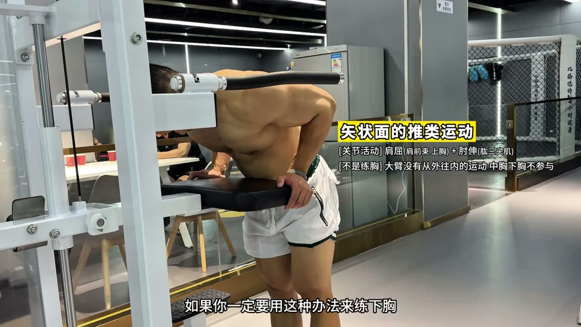

*图 43：画面标注「矢状面的推胸运动」：握距不超过肩宽，大臂没有从外往内的运动，不能有效练胸。*

### 补充：前锯肌 [57:17]

- 所有推胸动作推起时肩胛骨都会有一点前引；双杠臂屈伸背后没有靠背限制，**肩胛骨前引更明显**。
- 肩胛骨前引由**前锯肌**负责，所以双杠臂屈伸是练胸动作里**最能练到前锯肌**的。
- 前锯肌在正面形成俗称的「鲨鱼肌」；在背面与大圆肌、背阔肌叠加，增厚上背，有的人背阔肌被「切割」成上下两部分，就是前锯肌在下层形成的线条（练背那集再展开）。
- 画面信息：前锯肌起点为肋骨 1–9，止点为肩胛骨内缘，关节活动为肩胛骨前引、肩胛骨上旋。

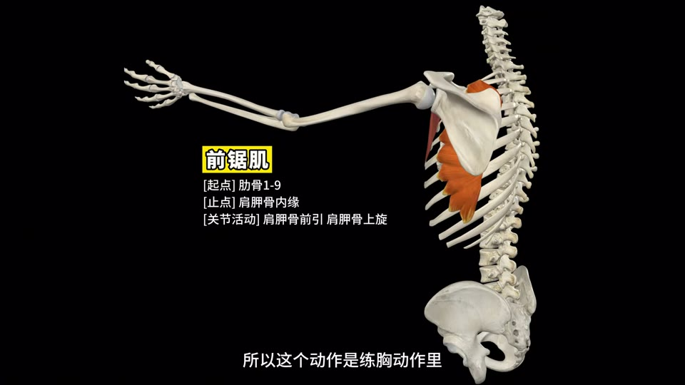

*图 44：前锯肌：起于第 1–9 肋，止于肩胛骨内缘；负责肩胛骨前引和上旋。*

---

## 9. 随堂测验与答案 [58:02]

| 题号 | 题目 | 答案 | 解析（UP 主讲解要点） |
|---|---|---|---|
| 1 | 以身体中轴线为依据，靠近中轴线的一端叫起点，远离的一端叫止点。胸大肌的止点长在哪里？A 胸腔　B 肩胛骨　C 大臂肱骨 | **C** | 胸大肌、三角肌，以及背面的背阔肌、大圆肌、冈下肌都长在肱骨上，所以练它们都靠肩关节运动（动大臂）。 |
| 2 | 体脂率真正降下来后才能看到胸外沿。胸外沿属于胸大肌哪部分？A 中胸　B 下胸　C 上段属中胸、下段属下胸 | **B** | 胸外沿是下胸的极限部分，起于腹直肌鞘，是一个突出的折角，解剖上叫胸大肌的腹部。它和上 / 中 / 下胸不是并列关系。 |
| 3 | 《甄嬛传》里翠果（站着）掌嘴（跪着的）甄嬛时，大臂运动方向和锻炼的肌肉是？A 斜上，练上胸　B 水平，练中胸　C 斜下，练中胸偏下乃至下胸 | **C** | 因为对方跪着，大臂是往斜下打，最佳肌纤维是中胸偏下乃至下胸，相当于龙门架斜下夹胸。第 1 集导论里那个「掌嘴比赛」是站着在水平面做内收，对应上胸和肩前束，相当于水平夹胸。 |
| 4 | 自由泳克服水阻阶段，大臂在矢状面从前往后做肩伸，能练到胸吗？A 练不到，肩伸是练背的　B 能，上胸收缩拉动大臂做肩伸　C 能，下胸收缩拉动大臂做肩伸 | **C** | 下胸，特别是胸外沿这类竖直的肌纤维，能把大臂往下拉。自由泳、蝶泳做肩伸，蛙泳做肩内收，都是下胸的关节活动，所以游泳运动员的下胸和胸外沿一般不错；但游泳里没有大臂往上或斜上抬的动作，上胸往往显薄。 |
| 5 | 常规俯卧撑握距大于肩宽；「钻石俯卧撑」双手距离窄到不超过肩宽，大臂在躯干两边保持矢状面运动。这对胸大肌的影响是？A 增强发力　B 抑制发力　C 无明显影响 | **B** | 握距收窄就取消了大臂从外往内的运动，抑制胸大肌参与，把受力让给肱三头肌。反过来，推胸要练胸，大臂必须从外往内运动（水平、斜上、斜下往内都行），所以所有推胸动作握距都要大于肩宽。 |

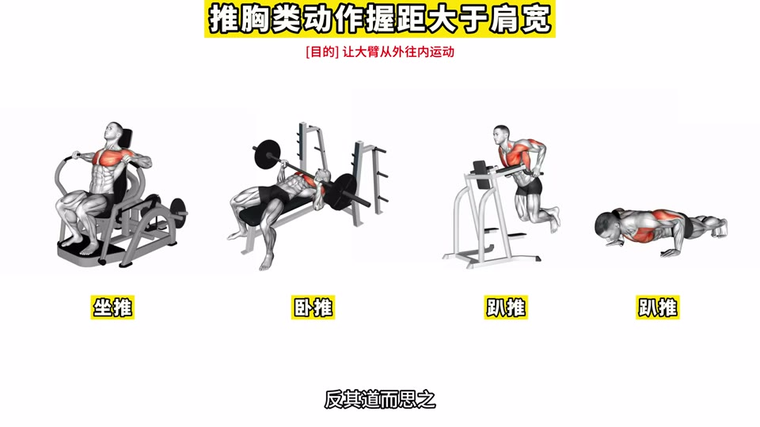

*图 45：坐推、卧推、趴推（双杠）、俯卧撑：握距都要大于肩宽，目的是让大臂从外往内运动。*

- 片尾预告：下一集（第 3 集）讲肩膀，仍然先导论再点评动作，春节后上线。

---

## 要点速查

### 解剖一页纸

| 知识点 | 要点 |
|---|---|
| 练胸练什么 | 只练胸大肌；胸小肌在下层，和练胸无关 |
| 上胸 | 起于锁骨内 1/2，肌纤维斜上 |
| 中胸 | 起于胸骨或第 1–5 肋软骨，胸大肌主体，肌纤维近水平 |
| 下胸 | 起于第 6–7 肋软骨和腹直肌鞘，肌纤维斜下到偏竖直 |
| 胸外沿 | 下胸最下面、起于腹直肌鞘的折角（胸大肌腹部）；**属于下胸，不与上中下胸并列** |
| 止点 | 三部分共同止于肱骨上端约 1/5 处（肱骨大结节嵴），所以练胸都是动大臂 |
| 上胸与肩前束之间的凹陷 | 上胸占锁骨内 1/2，肩前束占外 1/3，中间约 1/6 无肌肉 |
| 胸中缝宽窄、八字胸 / 方胸 | 由不能增厚的白色肌腱长短决定，基因决定，和怎么练无关 |

### 关节活动一页纸

| 关节活动 | 定义 | 负责部位 | 典型动作 | 专门练胸时 |
|---|---|---|---|---|
| 肩水平内收 | 大臂在水平面从外往内 | 上胸（大开肘）→ 中胸（开肘小 / 人造下斜板） | 水平夹胸、平板推胸 | **主要手段** |
| 肩内收 | 大臂在冠状面从外往内 | 下胸（前半段，含胸外沿）+ 中胸（后半段） | 下夹胸、宽握下拉 / 引体 | 下夹胸的前半段可用 |
| 肩屈 | 大臂在矢状面从后往前 | 上胸（贡献不如肩前束） | 前平举、窄握推举 / 卧推 | 次要，不专门用来练上胸 |
| 肩伸 | 大臂在矢状面从前往后 | 下胸（特别是胸外沿），是肩伸五肌之一 | 仰卧上拉、窄握划船 / 下拉 / 引体 | 次要，参与肌太多 |

### 一句话判定法

> **看大臂相对于躯干往哪个方向动：斜上练上胸，水平练中上胸，轻微斜下练中胸偏下，严重斜下练下胸 / 胸外沿。**

### 让训练部位「下移」的方法

- 开肘小一点，止点下移。
- 人造下斜板：① 屁股往前坐；② 挺胸。
- 反过来，想用水平动作练上胸，就要近乎水平开肘、不往前坐、不刻意挺胸。

### 动作速查

| 动作 | 关节活动 | 主要练哪 | 关键细节 / 常见错误 | 力臂类型 |
|---|---|---|---|---|
| 蝴蝶机夹胸 | 肩水平内收 | 中上胸 + 肩前束 | 错误：屈肘、肩胛骨前引（配重太大，应减重）；开肘越小越偏下；可人造下斜练下胸 | 恒定 |
| 龙门架夹胸 | 水平 / 下斜 / 上斜，各自 mix 不同成分 | 取决于把手高度 | 把手高练下胸，低练上胸，特别低就成了练肩前束；下夹胸要做前半段；错误：屈肘、伸肘（伸肘就成了推胸） | 小-大-小 |
| 平板卧推 | 肩水平内收 (+肩屈) + 肘伸 | 大开肘不挺胸：上胸；常见做法：中胸 | 开肘较小带肩屈，挺胸则下斜化 | — |
| 上斜卧推 | 斜上 + 肘伸 | 上胸，角度大到一定程度练到肩前束 | 不存在唯一最佳角度；挺胸、前坐会减小实际角度 | — |
| 下斜卧推 | 轻微斜下 + 肘伸 | 中胸偏下（**不是**下胸动作） | 下斜凳一般十几度，最多二三十度；调到 60° 不可行 | — |
| 双杠臂屈伸 | (肩水平内收 mix 肩内收) + 肩屈 + 肘伸 | 前趴 30–60° 练下胸最佳 | 铁律：握距 > 肩宽；窄握就成了窄距卧推，练三头和肩前束；最能练前锯肌 | — |

### 三种力臂

- 真正重量 = 力矩 = 配重 × 力臂；力臂 = 力的方向到关节点的垂线距离。
- 恒定（钢线绕圆盘器械）、小-大-小（龙门架）、单调性（哑铃飞鸟等自由重量）。

---

## 初学者练习建议（据视频归纳）

> 以下只根据本集视频内容归纳，不加视频以外的建议。

1. **先理解原理再选动作**：判断一个练胸动作练哪里，只看大臂相对于躯干的运动方向，不用死记动作清单。
2. **练上胸不一定要上斜**：上斜推 / 夹可以；在肩关节能承受的前提下，近乎水平开肘、不往前坐、不刻意挺胸的水平推 / 夹也是上胸动作。上斜凳角度没有唯一最佳值。
3. **练下胸要找「严重斜下」的动作**：下斜卧推只到中胸偏下。视频推荐足够下斜的绳索夹胸（把手调高）、足够下斜的器械推胸（不够斜就屁股往前坐 + 挺胸），以及双杠臂屈伸。
4. **新手不用执着双杠臂屈伸**：UP 主说它是练了两三年才适合做的高难动作，也不推荐窄握距的减重凳版本。平替是下斜绳索夹胸和下斜器械推胸。真要做，握距必须大于肩宽，前趴 30–60°。
5. **所有推胸动作握距都要大于肩宽**，保证大臂有从外往内的运动，否则胸大肌参与被抑制（例如钻石俯卧撑），变成练肱三头肌。
6. **夹胸时出现屈肘、肩胛骨前引（或伸肘）**，说明配重太大，应当减重，不要「借力」。
7. **认识器械的力臂特点**：蝴蝶机（恒定）和龙门架（小-大-小）全程难度比较均匀；哑铃飞鸟这类单调性力臂动作前后难度差别很大，选配重时要考虑。
8. **胸型里由肌腱决定的部分**（胸中缝宽窄、八字胸 / 方胸）练不出来，不用为此焦虑。
9. **女性**：UP 主的训练表建议练胸频率减半（每两轮分化跳过一次练胸日），配重以 10–15RM 为主，组间休息大肌群 2 分钟、小肌群 1.5 分钟。

---

### 不确定 / 未明确处

- 「坐推机靠背后仰三四十度」「蝴蝶机素材里胸大肌与地面约四五十度」都是 UP 主的口头估计，原视频没有给出精确测量（此处原视频未明确）。
- 第 5 节提到「视频最后面会有一个力臂专题总结」，但本集正片结尾没有这个专题，可能指系列里的其他视频（此处原视频未明确）。
