# 《健身解剖完全手册》第3集：练肩

## 来源

- **视频标题**：💪🏻B站版《健身解剖完全手册》™（第3集：练肩）
- **UP 主**：好人松松
- **链接**：https://www.bilibili.com/video/BV167LAzaE14/
- **时长**：约 65 分 55 秒
- **视频章节**：0.开场 [00:00]｜1.解剖 [02:50]｜2.练前束 [14:35]｜3.练中束 [28:51]｜4.肩峰下撞击 [45:05]｜5.练后束 [47:54]｜6.答题！ [56:44]
- **整理日期**：2026-10-17
- **整理方式**：B 站字幕接口不可用，音频用 Whisper（large-v3-turbo）转写成带时间戳的文字稿，再对照视频画面里的内嵌字幕和图表校对术语（如「肩前竖」改为「肩前束」、「港上肌」改为「冈上肌」）。画面上出现、口头没有念的表格和要点卡也整理成了文字。截图都取自原视频。

## 总览

这一集讲三角肌（肩）：先讲解剖（起止点、为什么是「8 束」、肌腱怎样影响外形），再讲前、中、后三束各自的**关节活动**，然后每一束各讲一个单关节动作和一个多关节动作：前束练前平举、推举，中束练侧平举、提拉，后束练反向飞鸟、开肘划船。整集反复用三个工具分析动作：**运动面上是哪块肌肉**（大臂内外旋会让三角肌整体前翻或后翻）、**力臂与力矩**（真正的重量是力矩，不是配重），以及**能上重量的三种原因**（力臂小、关节活动多、器械省力杠杆）。中间单独有一节讲肩峰下撞击怎么自测、怎么预防。结尾是 5 道随堂测试题。

## 目录

- [0. 开场与系列说明 [00:00]](#0-开场与系列说明-0000)
- [1. 三角肌解剖 [02:49]](#1-三角肌解剖-0249)
- [2. 三角肌的关节活动 [06:26]](#2-三角肌的关节活动-0626)
- [3. 练肩前束：前平举 [14:36]](#3-练肩前束前平举-1436)
- [4. 为什么有的动作能上重量：力臂、关节活动、省力杠杆 [18:34]](#4-为什么有的动作能上重量力臂关节活动省力杠杆-1834)
- [5. 练肩前束：推举 [23:30]](#5-练肩前束推举-2330)
- [6. 练肩中束：侧平举 [28:56]](#6-练肩中束侧平举-2856)
- [7. 练肩中束：提拉 [43:31]](#7-练肩中束提拉-4331)
- [8. 肩峰下撞击 [45:02]](#8-肩峰下撞击-4502)
- [9. 练肩后束：反向飞鸟 [47:52]](#9-练肩后束反向飞鸟-4752)
- [10. 练肩后束：开肘划船 [54:02]](#10-练肩后束开肘划船-5402)
- [11. 总结：前中后束各两个动作 [56:42]](#11-总结前中后束各两个动作-5642)
- [12. 随堂测试 5 题与答案 [57:28]](#12-随堂测试-5-题与答案-5728)
- [要点速查](#要点速查)
- [初学者练习建议](#初学者练习建议)

---

## 0. 开场与系列说明 [00:00]

- 这一集属于「B站版健身新手完全手册」大系列里的解剖部分，按部位一共 7 集。每集先讲肌肉解剖原理，再讲健身怎么用，最后出 5 道选择题，观众发弹幕作答。（解剖部分的正式名称，Whisper 听成「古肌解剖与健身运用」，此处原视频未明确。）
- 整个系列的总纲是 **A、B 两张表**：
  - **A 表「关节活动的肌肉」**：一个动作（关节活动）练到哪些肌肉。系列第 1 集已经全部讲过，是总导论，没看过的人建议先补。
  - **B 表「肌肉的关节活动」**：一块肌肉可以用哪些动作来练。第 2–6 集每集讲透一个部位，本集讲肩。
- UP 主说这些总结图的高清原图都打包在他免费的「健身 Excel 工具套表」里（还有饮食方案底表、三四分化训练计划、拉伸图谱、Complete Anatomy 教程等），关注后私信发「1」或在主页置顶动态下载。

## 1. 三角肌解剖 [02:49]

### 1.1 三束与起点 [02:49]

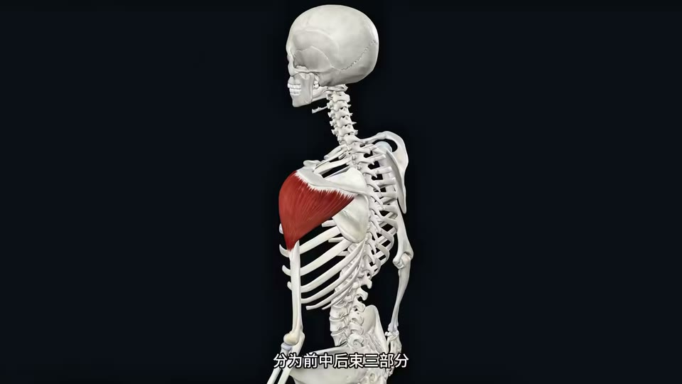

*图 1：肩膀的肌肉学名叫三角肌，按功能分为前、中、后三束。*

从俯视图看，锁骨和肩胛骨上面这一圈骨头上长着这些肌肉：

| 肌肉 | 起点 |
|---|---|
| 上胸 | 锁骨内 1/2 |
| 肩前束 | 锁骨外 1/3 |
| 肩中束 | 肩胛骨外侧的**肩峰** |
| 肩后束 | 肩胛骨后侧（肩胛冈） |

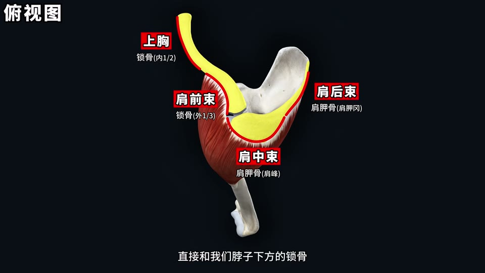

*图 2：俯视图：上胸起于锁骨内 1/2，肩前束起于锁骨外 1/3，肩中束起于肩峰，肩后束起于肩胛骨后侧。*

- 很多人以为肩胛骨只是后背的骨头，其实它的**肩峰**一直伸到和锁骨相接的位置。摸一下自己肩膀侧面那个明显的骨性凸起，那里就是肩峰。
- 锁骨中间那一段（内 1/2 和外 1/3 之间）没有长这两块肌肉，表面是凹下去的，所以上胸和肩前束在视觉上能分开。肩中束从肩峰长出来，造成肩膀向外突出的视觉效果。

### 1.2 三角肌其实是「8 束」 [03:40]

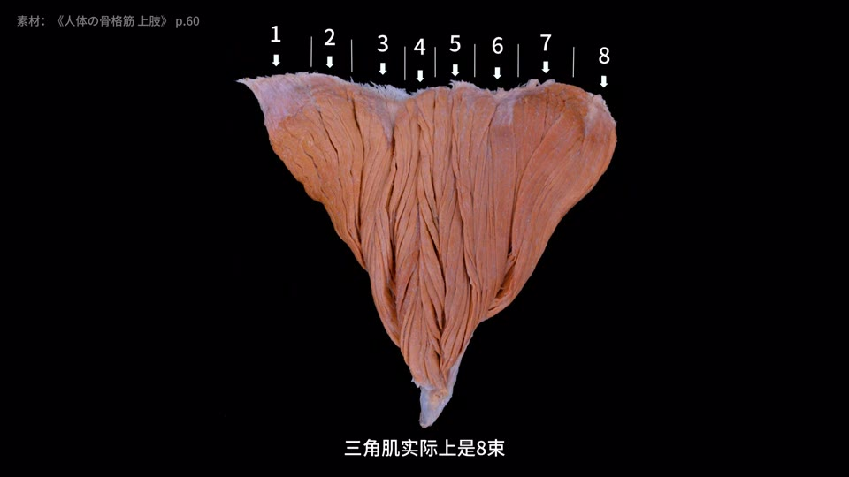

*图 3：大体解剖显示三角肌实际上由 8 束组成。*

- 前、中、后三束是**按功能人为划分**的。大体解剖显示三角肌其实有 8 束，所以体脂低的时候，三角肌看起来不是 3 块，而是好多块（UP 主开玩笑说这叫「多角肌」）。
- 三角肌所有肌纤维**共同止于肱骨大约一半的位置**（三角肌粗隆），比胸大肌、背阔肌、大圆肌的止点都低。UP 主举了一个截肢的例子：截肢位置在大臂中段，胸大肌、背阔肌、大圆肌的肌腱高于截肢位置，能保留，三角肌的肌腱低于截肢位置，保留不了，所以他的胸背发育正常，肩却练不起来。
- **结论**：这些肌肉都长在大臂上，所以练三角肌和练胸大肌、背阔肌一样，一定是靠**肩关节运动（大臂的运动）**来练。

### 1.3 「缺失的肌肉」其实是肌腱 [05:34]

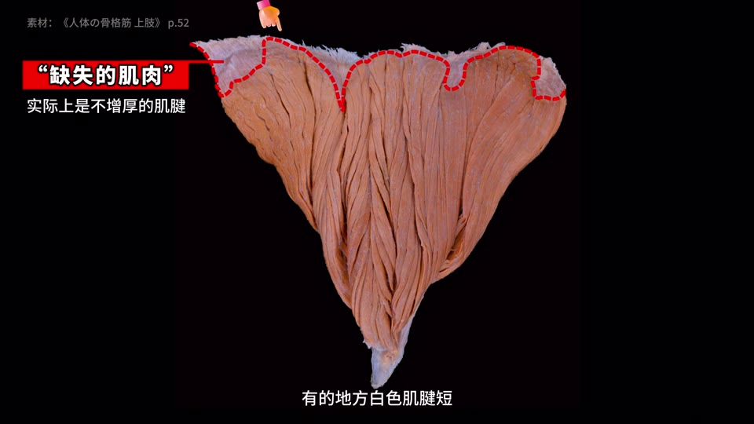

*图 4：三角肌非圆弧形的白色肌腱。肌腱长的地方在肌肥大后不会变厚，看起来就像「缺了一块肌肉」。*

- 实拍照片里有些人肩上有曲折的走线，会以为是「缺失的肌肉」，问怎么练才能补齐。**其实那是不能增厚的肌腱，是天生的，和怎么练没关系**，道理和胸大肌肌腱影响胸型开口一样。
- 三角肌的白色肌腱有的地方长、有的地方短。肌腱突然变长的部分在肌肥大后不跟着变厚，就显得那里像是缺了一块肌肉。UP 主还展示了一幅 200 多年前的欧洲手绘解剖图，那时已经准确画出了三角肌非圆弧形的肌腱。

## 2. 三角肌的关节活动 [06:26]

这是本集的重点。每束肌肉的关节活动分「主要」和「次要」：**主要**指这束肌肉在这个关节活动里贡献比例高，**次要**指它虽然参与，但贡献比例不高，专门练它时不会选这类动作。

### 2.1 肩前束主要关节活动 1：肩屈 [06:35]

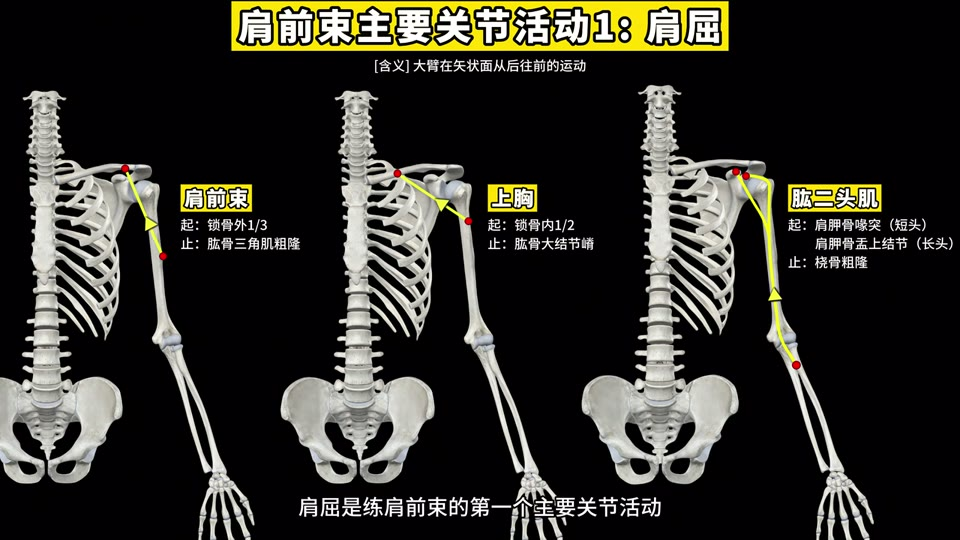

*图 5：肩屈：大臂在矢状面从后往前运动。参与的有肩前束、上胸、肱二头肌。*

- **肩屈**：肩前束收缩，拉动大臂在**矢状面从后往前**运动。
- 代表动作：前平举、窄握推举、窄握卧推等。
- 为什么肩前束是老大：
  - 上胸的拉力线没那么贴合肩屈的矢状面，参与程度不如肩前束。
  - 肱二头肌的拉力线虽然很贴合，但它是**双关节肌**，身体出于节约能量会让它「主动不足」（Whisper 听成「裂后目击」，此处原视频未明确具体术语），所以实际参与不多。练二头也不会用肩屈动作来练。

### 2.2 肩前束主要关节活动 2：大臂外旋位的肩外展 [07:33]

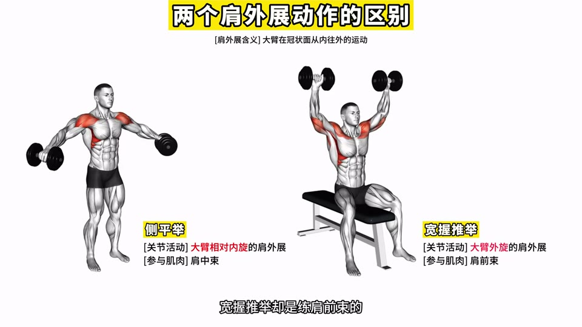

*图 6：侧平举是「大臂相对内旋位」的肩外展，练肩中束；宽握推举是「大臂外旋位」的肩外展，练肩前束。*

- **关键词是「大臂外旋位」**。侧平举这种肩外展练的是肩中束，因为此时大臂相对内旋，在肩外展运动面（冠状面）上的是肩中束。
- 宽握推举虽然也是肩外展，但大臂往后转了一些，变成外旋位。这时转到肩外展运动面上的变成了**肩前束**，肩中束反而被转到了身体背面。
- 抬手时大臂真的会外旋吗？会，尤其肩外展超过 90° 以后外旋特别明显。原因是**不外旋就抬不上去**：你强迫大臂保持不外旋，肩外展大约只能到 90°（UP 主请大家自己试试）。
- 所以：
  - 0–90° 的肩外展（就是侧平举）：运动面上是肩中束，练肩中束。
  - 超过 90° 的肩外展（就是宽握推举）：大臂明显外旋，三角肌整体**后翻**，甚至能从背面看到肩前束。这时运动面上的是肩前束，练肩前束。
- 补充：严格说肩中束最前部仍勉强在冠状面上，所以说宽握推举也能练到肩中束前部也行，「这不是对错问题」。
- 这个关节活动不是在解剖学标准姿势下，所以解剖教材和软件里不会讲，是 UP 主因为健身需要**额外补充**的。

### 2.3 肩前束次要关节活动：肩水平内收 [10:47]

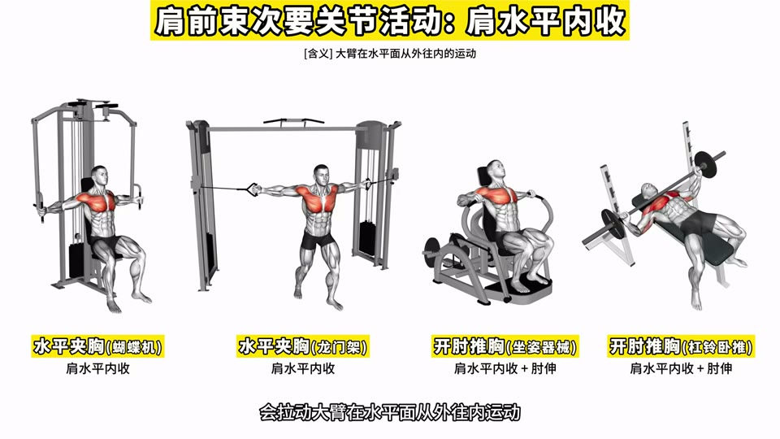

*图 7：肩水平内收：大臂在水平面从外往内运动。代表动作是练胸的水平夹胸和水平推胸。*

- 大臂摆成接近水平位，中胸、上胸、肩前束收缩，拉动大臂在**水平面从外往内**运动。
- 代表动作：水平夹胸（蝴蝶机、龙门架）、开肘推胸。
- 为什么是次要：三者的拉力线都比较水平，但胸大肌的肌纤维数量明显比肩前束多，所以肩前束在这里不算老大。**专门练肩前束时不用推胸、夹胸**，虽然这些动作确实能练到它。

### 2.4 肩中束关节活动：肩外展 [11:45]

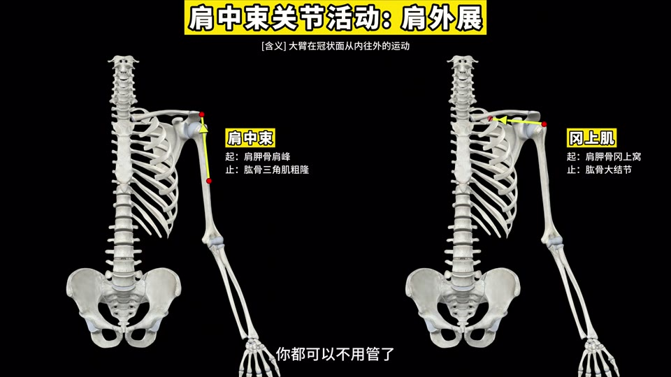

*图 8：肩中束只有一个关节活动：拉动大臂在冠状面做肩外展。*

- 只有一个：肩中束收缩，拉动大臂在**冠状面**做**肩外展**。代表动作：侧平举、提拉。
- 冈上肌也参与，但它不是健身里的目标肌肉，记不住也没关系。肱二头肌只有在大臂非常外旋时才转到肩外展运动面上，姿势很少见，而且因为双关节肌贡献也不大，可以不管。
- 记住：**常规的肩外展就是肩中束的活**。

### 2.5 肩后束主要关节活动：肩水平外展 [12:21]

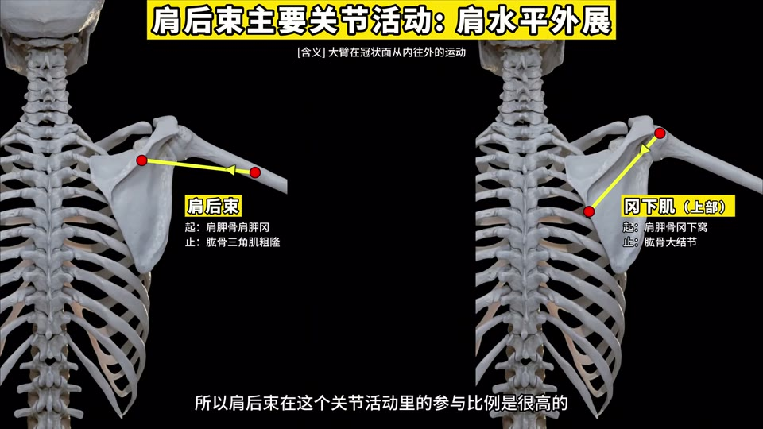

*图 9：肩后束的主要关节活动是肩水平外展，只有肩后束和冈下肌上部参与。*

- **肩水平外展**：大臂在**水平面从内往外**运动。代表动作：各种反向飞鸟、接近水平开肘的开肘划船。
- 为什么是主要：这个动作里只有**肩后束和冈下肌上部**两块肌肉参与，其中肩后束的拉力线更水平、力臂更大，所以参与比例很高。

### 2.6 肩后束次要关节活动：肩伸 [13:05]

- **肩伸**：大臂在**矢状面从前往后**运动。代表动作：练背的各种窄握下拉和窄握划船。
- 为什么是次要：「肩伸五肌」干活的人太多，肩后束出力就少。**专门练肩后束时不用肩伸动作**。

### 2.7 总结表与《咏三角肌》 [13:41]

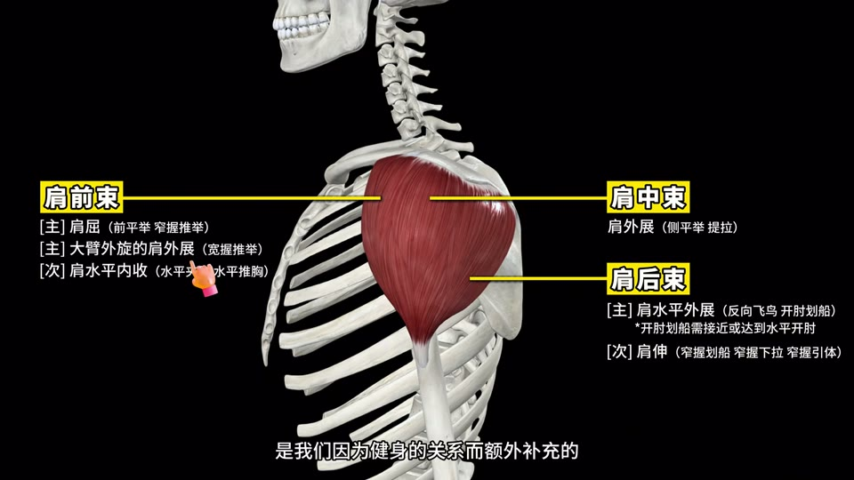

*图 10：三角肌三束的关节活动总结。最特殊的是肩前束的「大臂外旋的肩外展」。*

| 部位 | 关节活动 | 代表动作 |
|---|---|---|
| 肩前束 | [主] 肩屈 | 前平举、窄握推举 |
| 肩前束 | [主] 大臂外旋的肩外展 | 宽握推举 |
| 肩前束 | [次] 肩水平内收 | 水平夹胸、水平推胸 |
| 肩中束 | 肩外展 | 侧平举、提拉 |
| 肩后束 | [主] 肩水平外展 | 反向飞鸟、开肘划船（开肘划船需接近或达到水平开肘） |
| 肩后束 | [次] 肩伸 | 窄握划船、窄握下拉、窄握引体 |

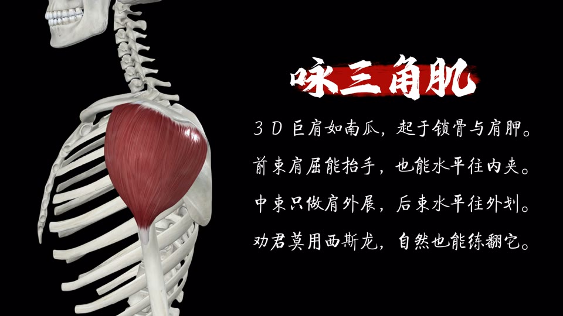

*图 11：UP 主每讲完一块肌肉都配一首打油诗，这次是《咏三角肌》。*

UP 主照例用一首四句的打油诗收尾，诗的内容（见截图）就是把上表压缩成口诀：三角肌起于锁骨和肩胛骨，前束管肩屈和水平内收，中束只做肩外展，后束管水平外展。最后一句调侃：不用类固醇（诗里写作「西斯龙」）也能把它练好。

## 3. 练肩前束：前平举 [14:36]

练肩前束只有两个动作：**单关节动作是前平举，多关节动作是推举**。

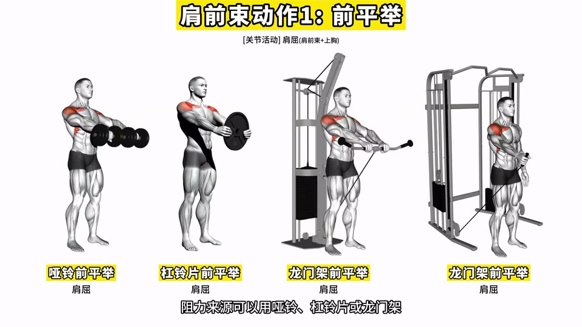

*图 12：前平举可以用哑铃、杠铃片或龙门架做，关节活动都是肩屈。*

### 3.1 基本信息

- **关节活动**：克服阻力阶段，大臂在**矢状面从后往前**运动，就是**肩屈**。
- **阻力来源**：哑铃、杠铃片、龙门架。
- **练的肌肉**：主要是肩前束，次要是靠近肩前束的上胸，再次要是肱二头肌。
- **常见错误关节活动**：UP 主说前平举他想不到有什么典型的错误关节活动，所以不讲。

### 3.2 大臂内外旋对前平举的影响 [15:14]

握法名称：掌心朝向自己叫**反手**，掌心朝内叫**锤式**，掌心朝下叫**正手**。三种握法的本质区别是**大臂内外旋角度不同**，导致肩中束不同程度地参与。

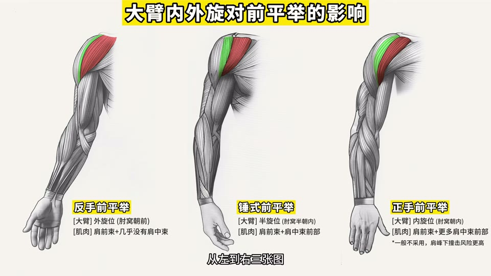

*图 13：三种握法的前平举：红色是肩前束，绿色是转到矢状面上来的肩中束纤维。*

| 握法 | 大臂位置 | 肘窝朝向 | 练的部位 | 备注 |
|---|---|---|---|---|
| 反手前平举 | 外旋位 | 朝前 | 肩前束，几乎没有肩中束 | 比较孤立地练肩前束，就是一般说的「前平举是肩前束动作」 |
| 锤式前平举 | 半旋位（介于内外旋之间） | 半朝内 | 肩前束 + 肩中束前部 | 三角肌整体前翻一些 |
| 正手前平举 | 内旋位 | 朝内 | 肩前束 + 更多肩中束前部 | **一般不采用**：大臂内旋会让肩峰下空隙更小，更容易肩峰下撞击 |

- 逻辑：从反手到正手，大臂逐渐内旋，三角肌整体往前翻，越来越多肩中束纤维转到矢状面上参与肩屈。所以「前平举是肩前束动作」**也不绝对**，前平举是有可能练到肩中束前部的。
- UP 主引用了畅销教材《基础肌动学》：书里写肩中束的关节活动时，除了肩外展还写了肩屈，理由是肩关节内旋时肩中束的拉力线会跑到转动轴前方。这种写法很小众但有道理，和上面三张图是一回事。

## 4. 为什么有的动作能上重量：力臂、关节活动、省力杠杆 [18:34]

以「前平举和推举相比上不了重量」为例，UP 主讲了一个通用问题：**练同一块肌肉的两个动作，为什么一个能上重量、另一个不能？**

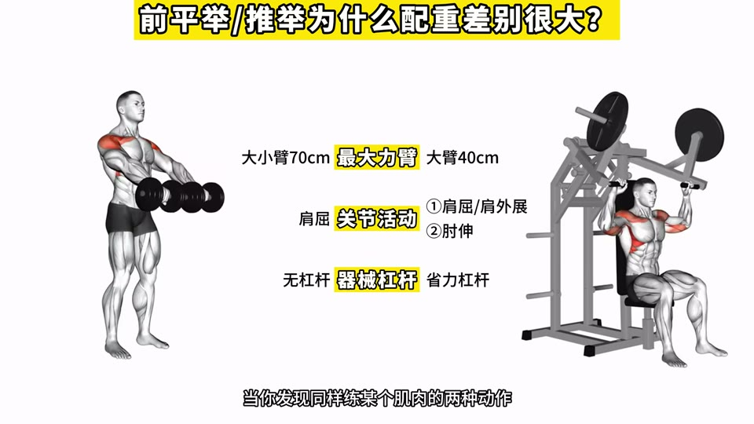

*图 14：前平举和推举配重差异的三个原因：最大力臂、关节活动数量、器械杠杆。*

三个原因：

1. **力臂不同**：前平举的最大力臂约等于大小臂总长（约 70 cm），推举的最大力臂最多是大臂长度（约 40 cm），差不多小了一半。健身里**真正的重量不是配重而是力矩**，**力矩 = 力臂 × 配重**。所以前平举只要推举一半左右的配重，就能给肩关节同样大的力矩。
2. **关节活动数量不同**：前平举只有肩屈，是单关节动作；推举在肩屈或肩外展之外还有**肘伸**，多了肱三头肌帮忙，「拉帮结派」配重当然更大。
3. **固定器械的省力杠杆**：找到器械的转动点（支点），画出阻力方向和动力方向，力的方向到支点的垂线距离就是力臂。

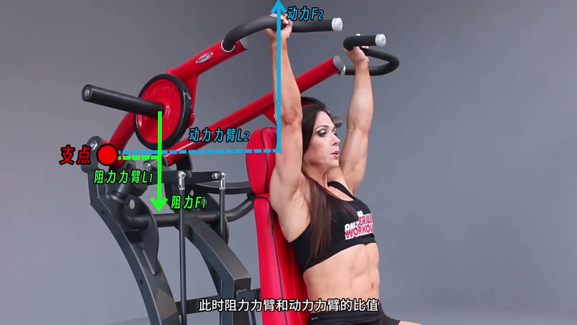

*图 15：分析器械杠杆：支点、阻力力臂 L1、动力力臂 L2。*

- UP 主分析的第一台器械推举：动力力臂约是阻力力臂的 2 倍，省一半力，挂 40 kg 到手上只有 20 kg。
- 另一台器械：阻力力臂和动力力臂约 1:4，是超级省力杠杆，挂 40 kg 到手上只剩约 10 kg。
- 所以同一个动作用固定器械做时可能「显得能上重量」，程度取决于器械设计的杠杆有多省力。

**延伸练习（练胸）**：龙门架夹胸配重最小，自由卧推较大，杠杆器械推胸更大。不是胸大肌换个动作就变强了，而是：卧推比夹胸力臂更小、关节活动更多；器械卧推比自由卧推多了省力杠杆。你的胸大肌能克服的力矩是一定的，「你又不是宝可梦」，不会突然进化。

**UP 主的结论**：「能上重量的动作就是好动作，上不了重量的就是坏动作」是错误说法。初中物理就讲过力臂和杠杆，健身里真正的重量是力矩，不是配重。

> [21:53–23:29] 课间是 UP 主的充电社群和定制方案广告，与训练内容无关，此处略过。

## 5. 练肩前束：推举 [23:30]

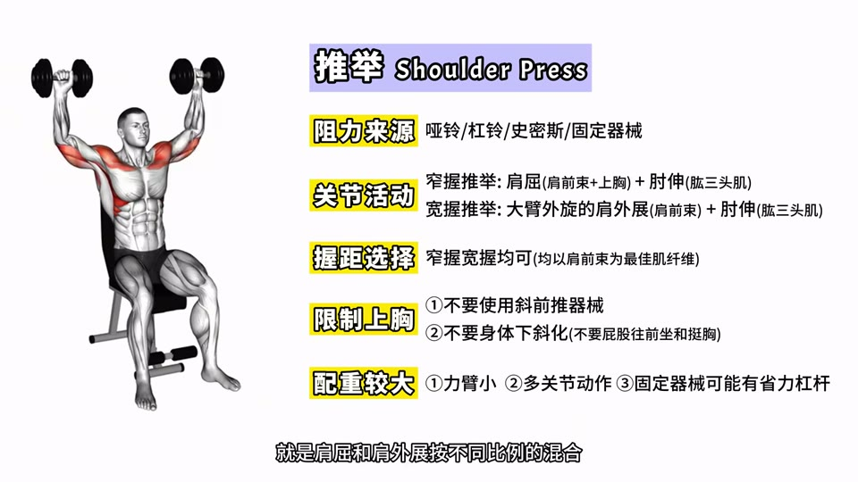

*图 16：推举要点卡（画面内容整理见下）。*

画面要点卡整理：

| 项目 | 内容 |
|---|---|
| 阻力来源 | 哑铃 / 杠铃 / 史密斯 / 固定器械 |
| 关节活动 | 窄握推举：肩屈（肩前束 + 上胸）+ 肘伸（肱三头肌） 宽握推举：大臂外旋的肩外展（肩前束）+ 肘伸（肱三头肌） |
| 握距选择 | 窄握、宽握都可以（都以肩前束为最佳肌纤维） |
| 限制上胸 | ① 不要使用斜前推器械 ② 不要让身体下斜化（不要屁股往前坐和挺胸） |
| 配重较大 | ① 力臂小 ② 多关节动作 ③ 固定器械可能有省力杠杆 |

### 5.1 关节活动与握距 [23:40]

- 克服阻力阶段都有**肘伸**（练肱三头肌），这个容易识别。肩关节活动取决于握距：
  - 非常窄握：**肩屈**。
  - 非常宽握：**大臂外旋的肩外展**。
  - 两者之间：肩屈和肩外展按不同比例混合。
- **握距不重要**：最窄和最宽两个极端都以肩前束为最佳肌纤维，按「连续变量」的思路，中间的握距也都可以，不用纠结。

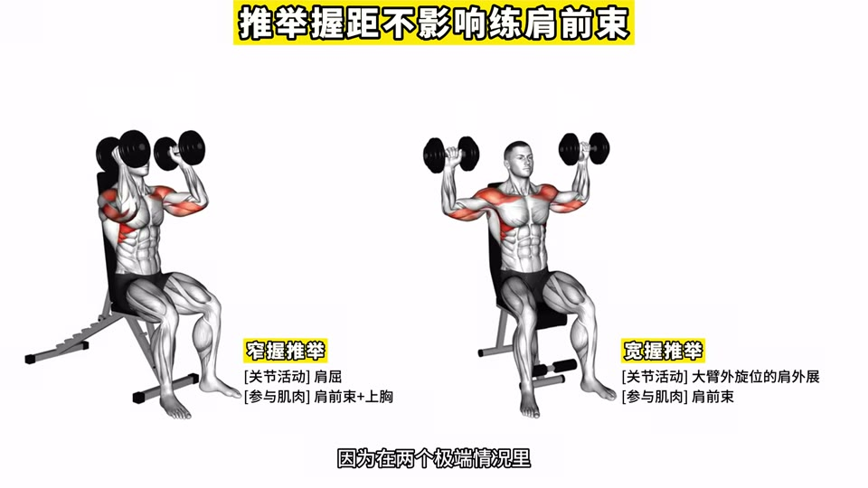

*图 17：窄握推举（肩屈，肩前束 + 上胸）和宽握推举（大臂外旋位的肩外展，肩前束）都练肩前束。*

### 5.2 如何限制上胸参与 [24:20]

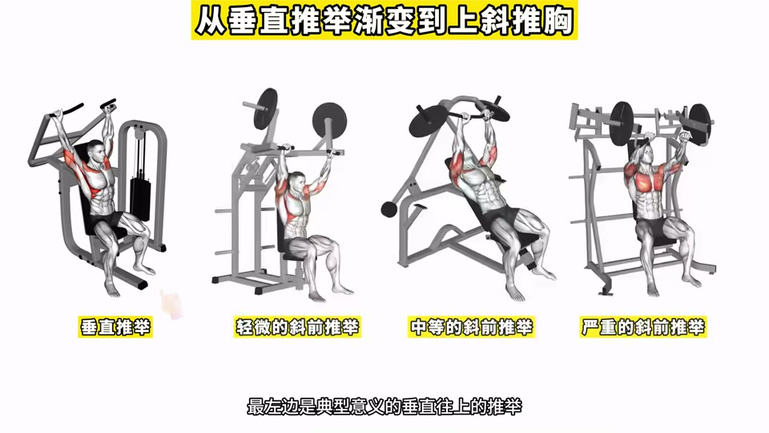

*图 18：从左到右：垂直推举、轻微斜前推举、中等斜前推举、严重斜前推举。往前推的成分越多，越像上斜推胸。*

- 推举轨迹里**往前推的成分越多，上胸参与比例越高**。纯粹往天花板推时，肩外展运动面上的是肩前束，胸大肌垂直于地面在身体前面，不在这个运动面上，贡献很少。一旦往前推，大臂开始向水平面运动过渡，对应的肌纤维就落到上胸。
- 更直观的想法：最右边那台严重斜前推的器械，已经很接近**上斜推胸**了。推举越做成斜前推，就越像上斜推胸，肩前束参与越少，上胸参与越多。

**「人造下斜板」**：就算器械是垂直的，甚至用哑铃、杠铃自由推举，也会被两个习惯变相做成斜前推：

1. **屁股往前坐**，躯干不再垂直地面，而是下斜化。
2. **用力挺胸**，肋骨都外翻了，胸大肌变成下斜。

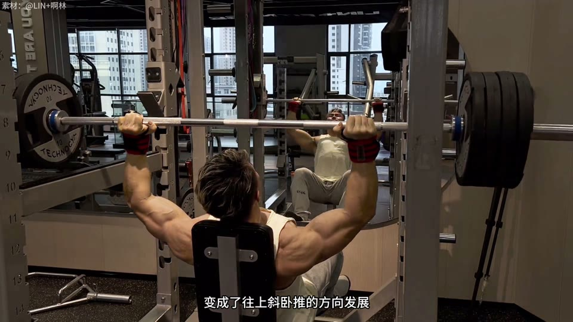

*图 19：垂直的凳子上屁股前坐、挺胸，理论上的垂直推举就变成了往上斜卧推的方向发展。*

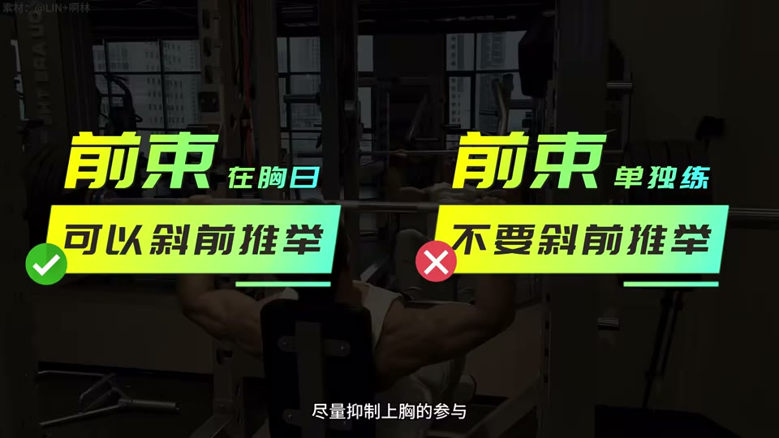

*图 20：前束在胸日练：可以斜前推举。前束单独练：不要斜前推举。*

- 这样做**不是错**，但会增加上胸参与、降低肩前束本该有的比例。
  - 如果肩前束是在**练胸日**一起练，斜前推举无所谓，本来就是练胸。
  - 如果肩是**单独一天**练，就不要斜前推，老老实实回到垂直推举，尽量抑制上胸。
- 做法：① 不选轨迹设计成斜前推的推举器械；② 在垂直凳上不要屁股前坐，不要故意挺胸。
- 「垂直推时感觉力量变小怎么办？」这是正常的：不让上胸帮忙，力量当然小一些。斜前推力量更大，恰恰说明用了别的肌肉。UP 主举了一个号称「挑战最大重量推举」的视频，屁股前坐加严重挺胸，「这就是上斜推胸」，力量大是因为上胸乃至中胸在帮忙。

### 5.3 推举为什么比前平举能上重量 [28:27]

原因同第 4 节：力臂更小、关节活动更多、器械推举还可能有省力杠杆，而不是肩前束在推举里更厉害了。

## 6. 练肩中束：侧平举 [28:56]

练肩中束：**单关节动作是侧平举，多关节动作是提拉**。

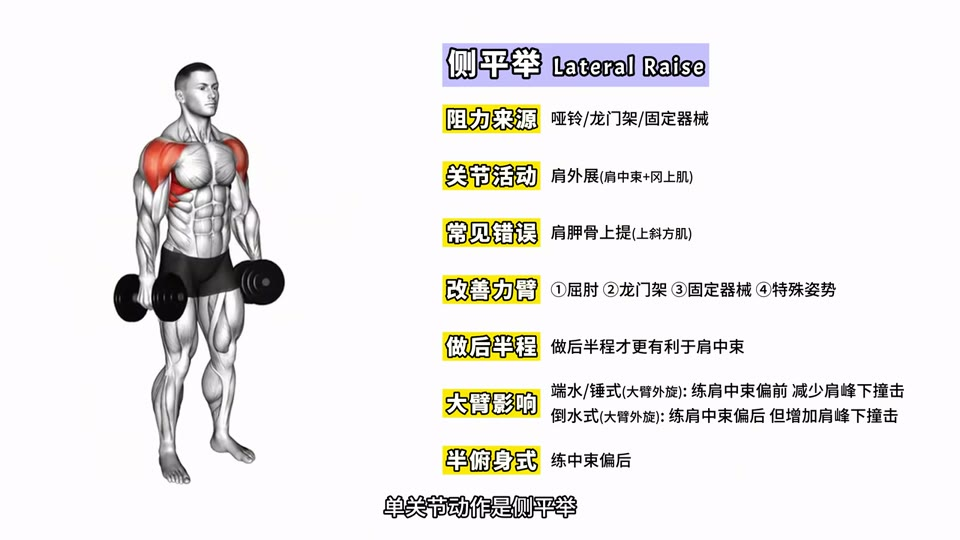

*图 21：侧平举要点卡（内容整理见下）。*

| 项目 | 内容 |
|---|---|
| 阻力来源 | 哑铃 / 龙门架 / 固定器械 |
| 关节活动 | 肩外展（肩中束 + 冈上肌） |
| 常见错误 | 肩胛骨上提（上斜方肌） |
| 改善力臂 | ① 屈肘 ② 龙门架 ③ 固定器械 ④ 特殊姿势 |
| 做后半程 | 做后半程才更有利于肩中束 |
| 大臂影响 | 端水 / 锤式（大臂外旋）：练肩中束偏前，减少肩峰下撞击 倒水式（大臂内旋）：练肩中束偏后，但增加肩峰下撞击 |
| 半俯身式 | 练中束偏后 |

### 6.1 关节活动与常见错误：耸肩 [29:02]

- **关节活动**：肩关节外展。主要参与肌肉是肩中束、冈上肌。肱二头肌在特殊姿势下也能参与，不用管。
- **最常见的错误关节活动**：**肩胛骨上提**，就是一边肩外展一边**耸肩**。这是上斜方肌的关节活动，所以很多人做完侧平举觉得上斜方肌特别酸。
- 为什么会不自觉耸肩：你的运动目标是「让哑铃上移」，耸肩能让哑铃多升两三厘米，就这两三厘米身体也不放过。

### 6.2 正确的侧平举也一定有上斜方肌收缩 [29:41]

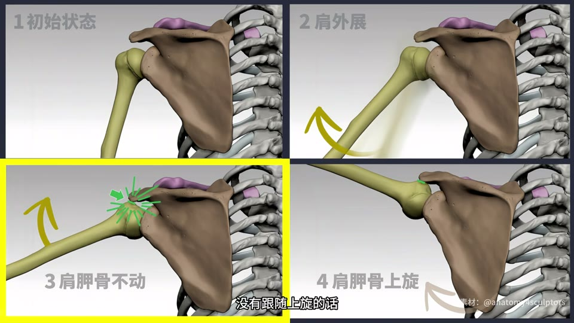

*图 22：初始状态；图 2 肩外展；图 3 肩胛骨不动，肱骨头撞上肩峰；图 4 肩胛骨上旋，肩峰跟着抬高。*

- 肩外展时肱骨头会上升。如果肩胛骨不动（图 3），肱骨头就会碰到肩峰，碾压两者之间的冈上肌肌腱等软组织，这叫**肩峰下撞击**。
- 肩胛骨跟随**上旋**（图 4）时肩峰也抬高，「你肱骨头抬高，我肩峰也抬高」。UP 主比喻成「备胎追女生」：看着马上就碰到了，其实一辈子也追不上。
- 这个机制适用于侧平举、前平举、推举等**任何需要抬手的动作**。

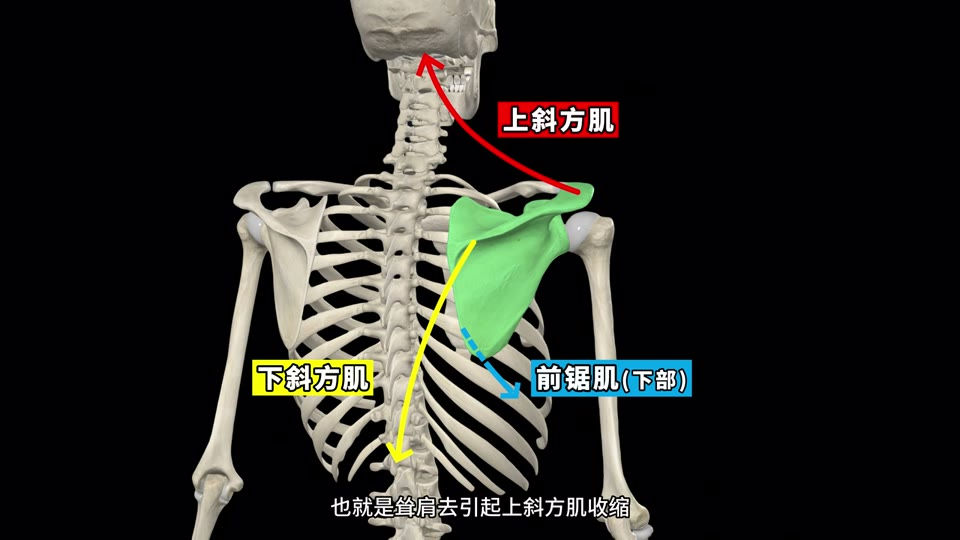

*图 23：让肩胛骨上旋的肌肉有上斜方肌、下斜方肌、前锯肌（下部），上斜方肌就是其中之一。*

- 所以**正确的侧平举里也必然有上斜方肌收缩**；要是它不收缩，肩峰下的软组织「早就被碾成肉泥了」。要避免的是**因为耸肩（肩胛骨上提）**而引起的上斜方肌收缩，而不是禁止上斜方肌收缩。

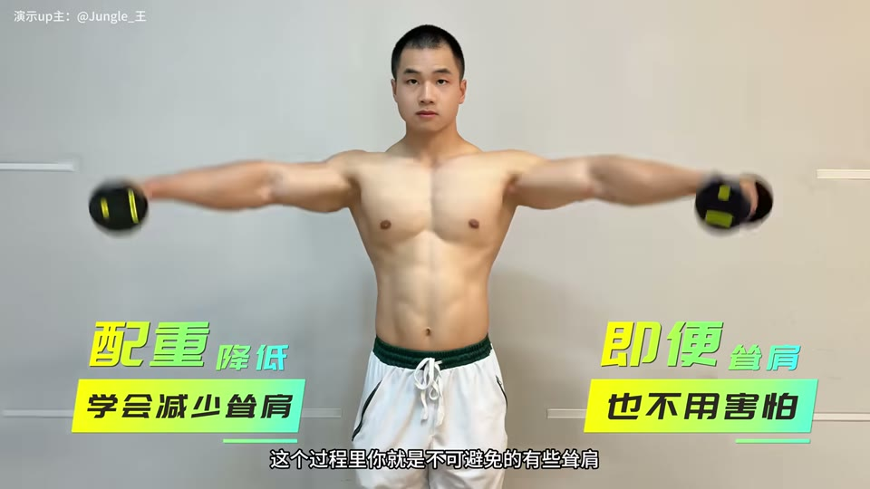

*图 24：配重降低，学会减少耸肩；即便耸了肩，也不用害怕。*

- 退一步说，就算耸肩练到了上斜方肌也没什么：现实里 99% 的人问题是上斜方肌**不够**发达，而不是太发达。
- 对新手：一方面要知道用**较轻的配重**去学会减少耸肩；另一方面这需要一个过程，过程中免不了有些耸肩，那就算了，「问题也不大」。

### 6.3 哑铃侧平举的力臂剧变，以及四种均匀化办法 [31:33]

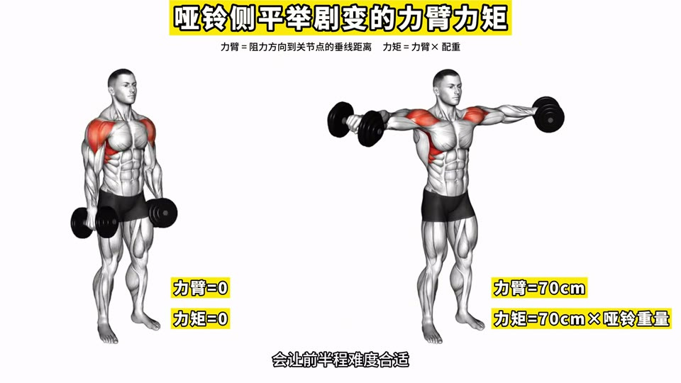

*图 25：哑铃侧平举：起始时力臂 0、力矩 0；外展到水平时力臂约 70 cm，力矩 = 70 cm × 哑铃重量。*

- 动作起始时力臂为 0、力矩为 0；外展到水平位时力臂最大，约等于大小臂总长（约 70 cm），力矩也最大。
- 力臂和力矩剧变导致**难度剧变**：哑铃轻，后半程难度合适，前半程就等于没难度；哑铃重，前半程合适，后半程根本做不了。

**让力臂均匀化的办法**：

1. **屈肘**：屈肘后最大力臂几乎减半（直肘 0–70 cm，屈肘 0–40 cm 即大臂长度），前后半程的难度差就没那么大。所有「哑铃握在手上、大小臂作为整体」的动作（哑铃前平举、哑铃俯身飞鸟、哑铃夹胸等）都可以用屈肘来减小最大力臂。

   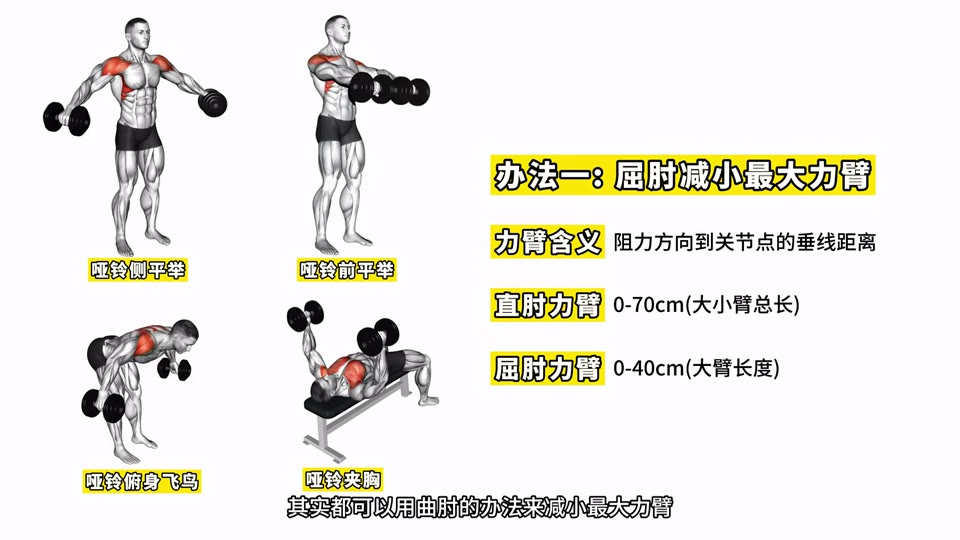
   *办法一：屈肘减小最大力臂。直肘力臂 0–70 cm，屈肘力臂 0–40 cm。*

2. **钢线绕圆盘的固定器械**：阻力方向是圆弧轨迹的切线，力臂**全程不变**，约为大臂长度（约 40 cm）。前半程没有哑铃那么轻松，后半程也没有哑铃那么困难，难度比较均匀。
3. **龙门架**：「小-大-小」力臂。起始时阻力不像哑铃那样垂直地面，一开始就有不小的力臂；钢线垂直手臂时力臂最大，约为大小臂总长；之后变小但不为零（约 50–70 cm 的有限变化）。难度比较均匀。

   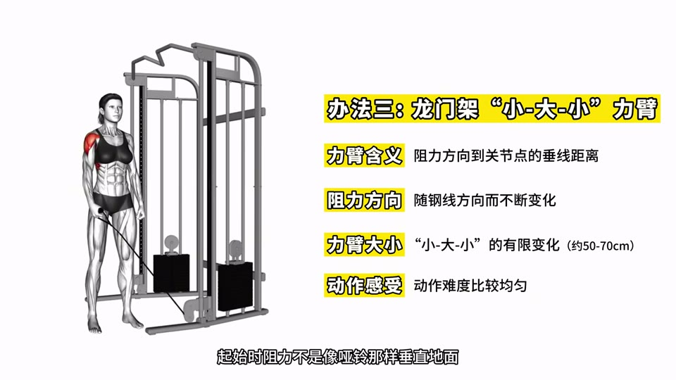
   *办法三：龙门架的力臂随钢线方向变化，呈「小-大-小」，动作难度比较均匀。*

   **所谓「肩中束测谎仪」**：网上把龙门架侧平举叫测谎仪，因为一开始就做不动，必须用很轻的配重。其实只是力臂问题：起始时龙门架的力臂约 50 cm（按大小臂总长 70 cm 估算），哑铃起始力臂约 5 cm，是哑铃的 **10 倍**。力臂大，配重就必须小，因为肌肉能克服的力矩是一定的。

   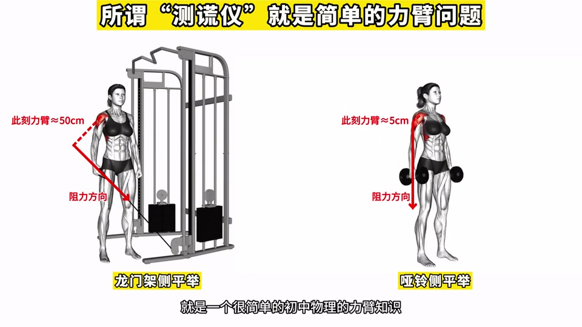
   *同一时刻：龙门架侧平举力臂约 50 cm，哑铃侧平举力臂约 5 cm。*

4. **改变身体姿势**（比较偏门）：比如侧卧在斜凳上做哑铃侧平举，虽然还是哑铃，但力臂变化会小很多。UP 主强调「不是让你们这么做」，只是带大家分析原理；可以自己画阻力方向到关节点的垂线，看起始、中间、结束时的力臂分别是多少（画面标注约 50 cm、70 cm、50 cm）。

### 6.4 划重点：侧平举至少要做到后半程 [34:30]

- 健身房里大部分人做侧平举用较大配重，只外展三四十度。再往上力臂急剧变大，真正的重量（力矩）太大扛不住，只能做小力臂的前半程。**这样做不对**。
- 原因：侧平举的两块肩外展肌，**肩中束的贡献比例从小变大，冈上肌从大变小**。有的肌动学教材写：冈上肌负责启动肩外展，三角肌在肩外展后期起主要作用。

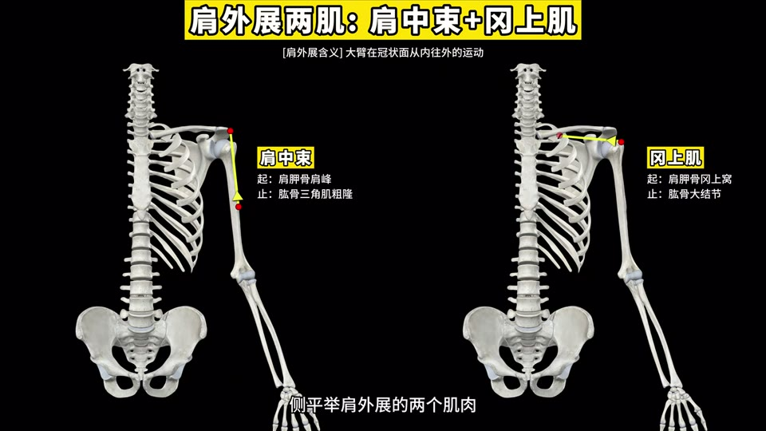

*图 26：侧平举肩外展的两块肌肉：肩中束和冈上肌。*

**前置知识：肌肉的力臂在动作过程中是变化的** [35:31]

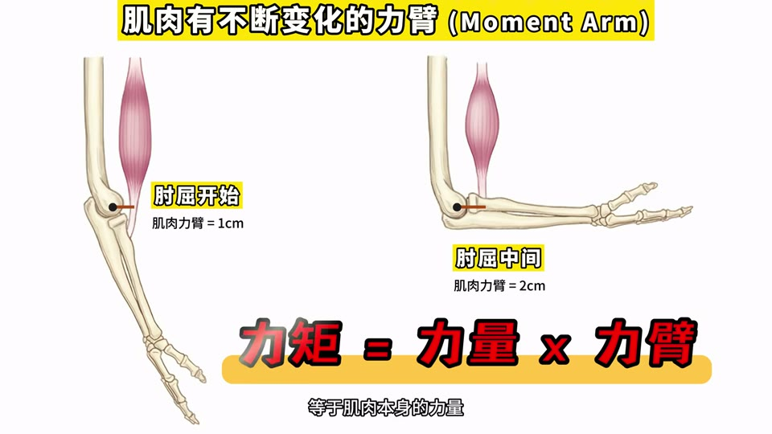

*图 27：以肘屈为例：刚开始屈肘时肌肉力臂约 1 cm，屈肘中间约 2 cm。力矩 = 力量 × 力臂。*

- 以肘屈为例：刚开始屈肘时，肌肉力臂（肌肉拉力方向到关节点的垂线距离）约 1 cm，屈肘中间约 2 cm。肌肉产生的力矩 = 肌肉本身的力量 × 肌肉力臂，所以后者能克服更大的外部阻力。
- 打个比方：如果你基因突变，肌腱止点长得离关节更远，力臂就更大，小肌肉也能弯举大重量。这和肌肉本身无关，是力臂长短带来的力量变化。

**肩中束和冈上肌在侧平举里的力臂变化** [36:26]

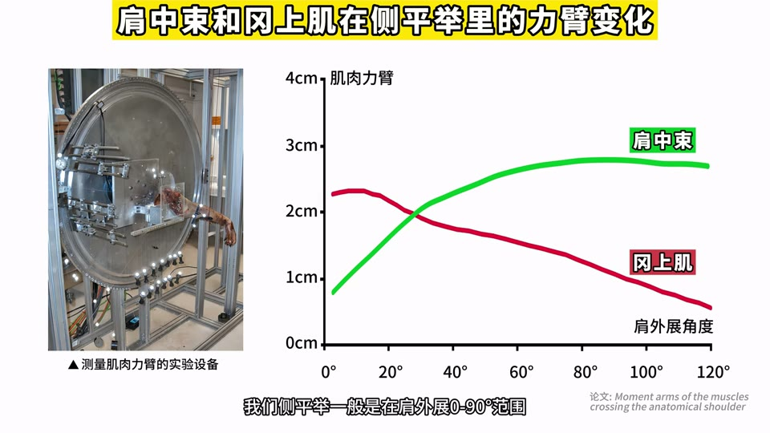

*图 28：实验数据：肩外展 0–90° 内，肩中束力臂从约 1 cm 增至约 3 cm，冈上肌力臂从 2 cm 多降到 1 cm 多。*

- 研究者把肩关节标本放在实验设备上，带动大臂做各种关节活动，同时用高精度动作捕捉仪器测量所有肩部肌肉的力臂变化。
- 侧平举一般在肩外展 0–90° 范围内：
  - **肩中束**力臂约从 1 cm 增到约 3 cm，理论上力矩增至 3 倍。
  - **冈上肌**力臂约从 2 cm 多降到 1 cm 多，理论上力矩减半左右。
- 所以侧平举**越往后，肩中束贡献越大；冈上肌越往后贡献越小**。练肩中束要做**后半程**。
- 但哑铃侧平举后半程力臂和力矩骤增，所以得用比较轻的重量才能做到后半程。反过来，用大重量只做前半程，那就「只练冈上肌」，不是练肩中束。UP 主说这又是「能上重量的动作就是好动作」的一个错误案例，太多人在健身房都是这么练的。

### 6.5 延伸：肌肉力矩 = 肌肉力臂 × 肌肉力量 [38:02]

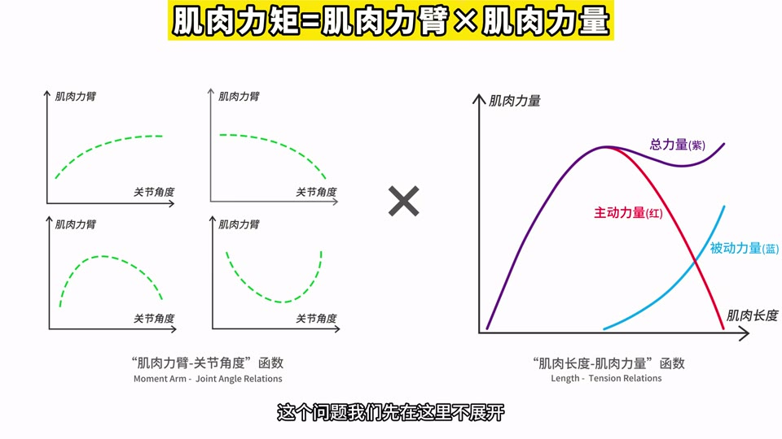

*图 29：左图：「肌肉力臂-关节角度」函数，因肌而异；右图：「肌肉长度-肌肉力量」函数，各肌肉大体相同。*

一块肌肉能产生多大力矩由两个因素决定：

1. **肌肉力臂-关节角度函数**（左图）：每块肌肉在关节活动不同角度的力臂时刻在变，可能是增函数（如肩中束）、减函数（如冈上肌；Whisper 听成「港下肌」，按上下文应为冈上肌）、先增后减、先减后增等，**因肌而异，没有共同规律**。
2. **肌肉长度-肌肉力量函数**（右图）：
   - 红线是**主动力量**：长度适中时最大，更短或更长都会变小。
   - 蓝线是**被动力量**：只在比适中长度更长时才产生，拉得越长越大，直到拉断。
   - 紫线是**总力量** = 主动 + 被动。这个函数所有肌肉大体都是这个形状。
- **肌肉力矩 = 左图的力臂 × 右图的力量**。理想的健身动作，阻力矩应尽量匹配肌肉力矩：肌肉力矩小时阻力矩小，肌肉力矩大时阻力矩也大。这个话题 UP 主说留到系列第 7 集用小专题展开。

### 6.6 大臂内外旋对侧平举的影响 [40:07]

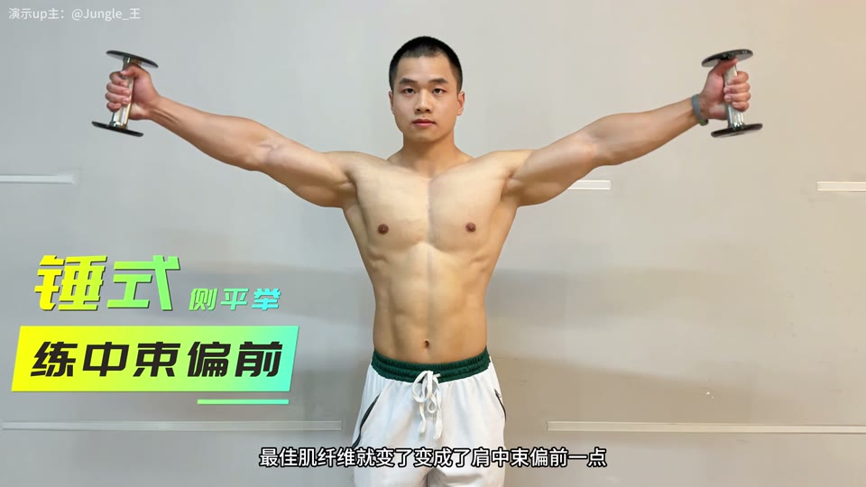

*图 30：锤式侧平举（大臂更外旋）：练中束偏前。*

- 一般的侧平举是手背朝上。改成大臂更外旋的**锤式**，甚至进一步外旋的**端水式**，三角肌整体**后翻**，肩前束后部转到肩外展运动面上，最佳肌纤维变成**肩中束偏前**。另一个好处是**减少肩峰下撞击风险**，尤其提倡肩峰下撞击患者使用。
- 反过来，大臂内旋的**倒水式**侧平举，三角肌整体前翻，肩后束前部翻到运动面上，最佳肌纤维变成**肩中束偏后**。但**一般不要做**，因为会增加肩峰下撞击风险。UP 主说不是这样做就一定会受伤，但他有几十万粉丝，即便只有 1% 的人受伤也是几千人，「我的人设可是好人松松」。

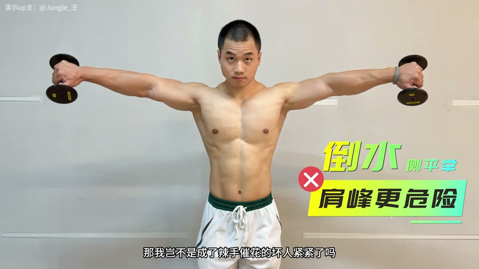

*图 31：倒水式侧平举（大臂内旋）：练中束偏后，但肩峰下撞击风险更高。*

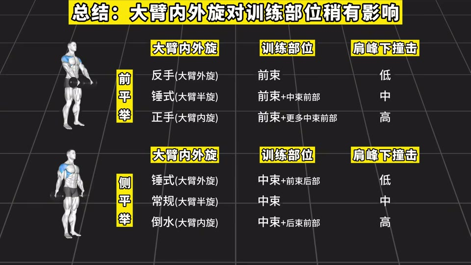

*图 32：大臂内外旋对前平举、侧平举训练部位和肩峰下撞击风险的影响。*

**总结表（画面内容）**：

| 动作 | 握法（大臂内外旋） | 训练部位 | 肩峰下撞击风险 |
|---|---|---|---|
| 前平举 | 反手（大臂外旋） | 前束 | 低 |
| 前平举 | 锤式（大臂半旋） | 前束 + 中束前部 | 中 |
| 前平举 | 正手（大臂内旋） | 前束 + 更多中束前部 | 高 |
| 侧平举 | 锤式（大臂外旋） | 中束 + 前束后部 | 低 |
| 侧平举 | 常规（大臂半旋） | 中束 | 中 |
| 侧平举 | 倒水（大臂内旋） | 中束 + 后束前部 | 高 |

逻辑是：大臂内外旋让三角肌整体往前或往后翻一点，**运动面没变，但运动面上的肌肉变了**，最佳肌纤维随之改变，训练部位就稍有变化。

### 6.7 半俯身侧平举：训练部位后移 [41:57]

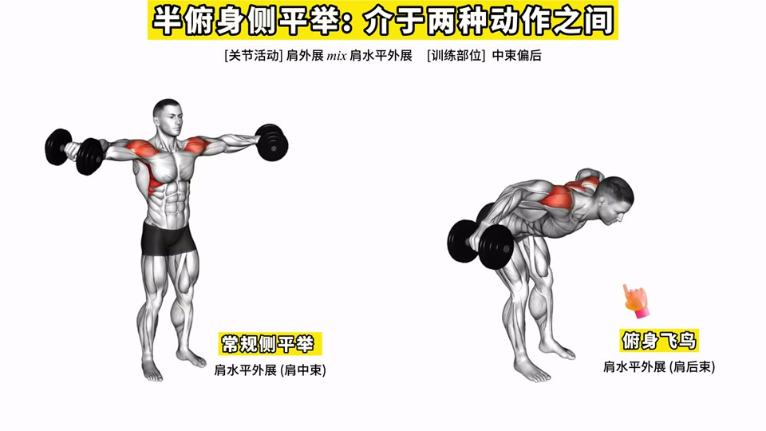

*图 33：常规侧平举是肩外展（肩中束），俯身飞鸟是肩水平外展（肩后束），半俯身侧平举介于两者之间，练中束偏后。*

- 用推到极端的方式想：不前倾的常规侧平举是肩外展，练肩中束；完全俯身的侧平举变成了另一个动作「俯身飞鸟」，是肩水平外展，练肩后束。
- 所以在常规侧平举基础上前倾一些，关节活动就是**肩外展和肩水平外展的复合**，最佳肌纤维介于肩中束和肩后束之间。**前倾越多越接近俯身飞鸟，越偏后束**。
- 想在中束、后束之间主动调节最佳肌纤维，最简单的办法就是**改变躯干前倾的程度**。想照顾「中束偏后」（或叫「后束偏前」），就用半俯身侧平举，**不要用倒水式**，后者虽然也偏后，但增加肩峰下撞击风险。

## 7. 练肩中束：提拉 [43:31]

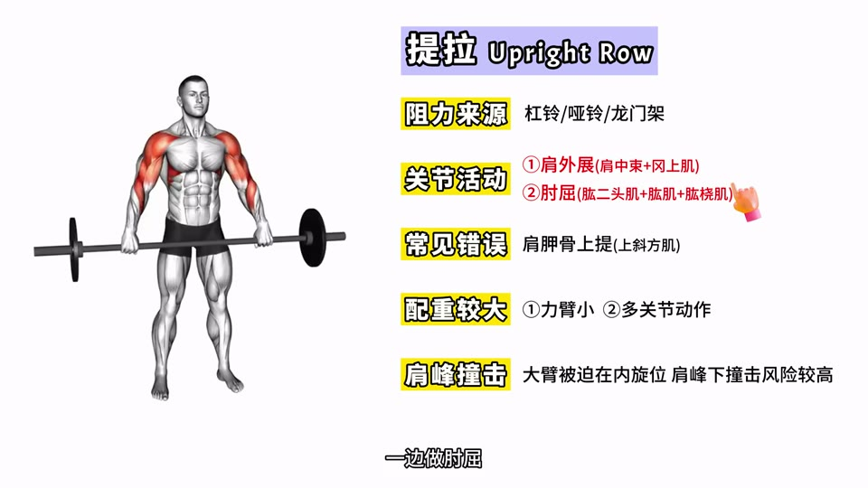

*图 34：提拉（Upright Row）要点卡（内容整理见下）。*

| 项目 | 内容 |
|---|---|
| 阻力来源 | 杠铃 / 哑铃 / 龙门架 |
| 关节活动 | ① 肩外展（肩中束 + 冈上肌）② 肘屈（肱二头肌 + 肱肌 + 肱桡肌） |
| 常见错误 | 肩胛骨上提（上斜方肌） |
| 配重较大 | ① 力臂小 ② 多关节动作 |
| 肩峰撞击 | 大臂被迫在内旋位，肩峰下撞击风险较高（这一条只出现在画面上，口头没有展开） |

- **关节活动**：克服阻力阶段一边肩外展、一边肘屈，「说白了就是侧平举和弯举一起做」。
- **常见错误**：和侧平举一样，用耸肩（肩胛骨上提）帮负重到达目标位置。
- **为什么提拉比侧平举能上重量**：UP 主说同样程度的肩外展，他哑铃侧平举一共 20 kg，杠铃提拉能做 40 kg 以上。原因是：① 力臂更小（最大力臂从大小臂 70 cm 变成大臂 40 cm）；② 多了肘屈，有「肘屈肌三兄弟」肱二头肌、肱肌、肱桡肌帮忙。（提拉不用器械，所以没有省力杠杆这一条。）这同样不是「能上重量就是好动作」。

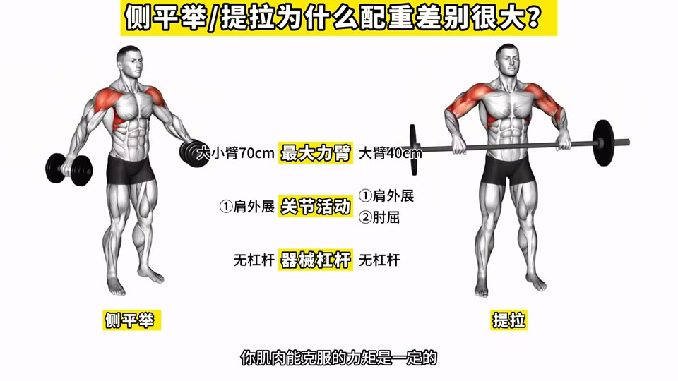

*图 35：侧平举对比提拉：最大力臂 70 cm vs 40 cm，关节活动多了肘屈，两者都没有器械杠杆。*

## 8. 肩峰下撞击 [45:02]

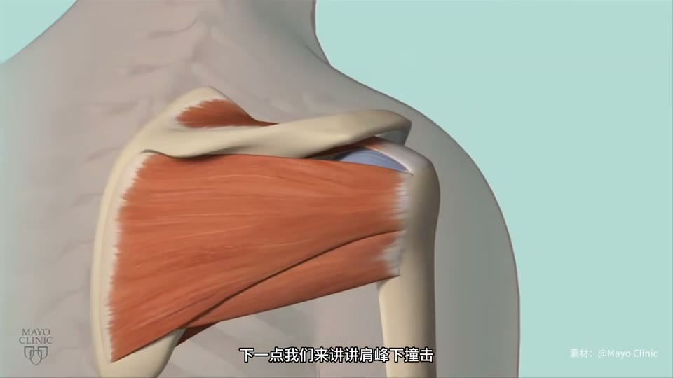

*图 36：肩胛骨的肩峰和肱骨头之间有个空隙，里面有冈上肌肌腱等软组织。*

### 8.1 是什么、怎么自测

- 肩峰和肱骨头之间有个空隙，里面有冈上肌肌腱等软组织。抬手时肱骨头上升，肩胛骨必须跟随上旋来抬高肩峰，否则空隙太小，挤压软组织就会疼痛，这叫**肩峰下撞击**。
- 如果在前平举、推举、侧平举、提拉等抬手动作里感觉肩膀前上方那个点附近疼，就可以初步怀疑。
- **简单自测：霍金斯试验**：把大臂抬到水平位，然后做**大臂内旋**，看是否引发疼痛或声响。阳性的话去医院做影像学检查确诊。

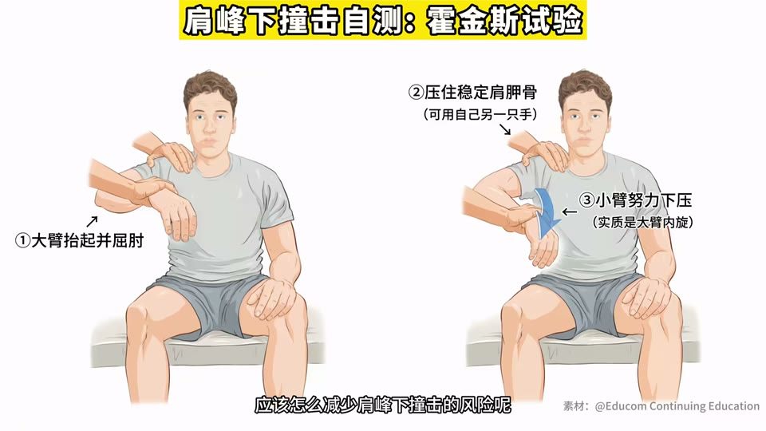

*图 37：霍金斯试验：① 大臂抬起并屈肘；② 压住稳定肩胛骨（可以用自己另一只手）；③ 小臂努力下压（实质是大臂内旋）。*

### 8.2 练肩时降低风险的三个建议 [45:56]

UP 主说明自己不懂运动康复，下面是转述专家的建议：

1. **保持大臂外旋**：肱骨头不是规则的圆球，大臂外旋后它和肩峰之间的空隙会大一些。对照前面的总结表：**大家一律不用大臂内旋的做法；普通人可以用大臂半旋或外旋；有肩峰下撞击的人必须用大臂外旋式**。
2. **保持大臂在肩胛面**：在**肩胛面**而不是解剖学标准的冠状面做肩外展。肩胛面就是冠状面往前移约 30°，顺着肩胛骨倾斜的方向。在冠状面做肩外展时，肱骨头最凸处（大结节）对着肩峰下较小的空间；在肩胛面做时，正好对着肩峰下**最大的空间**。准确说这已经不是标准意义的肩外展，而是「七成肩外展和三成肩屈的混合」。（UP 主这里引用了《基础肌动学》里预防肩峰撞击的说明页，本文不转录书中原文。）

   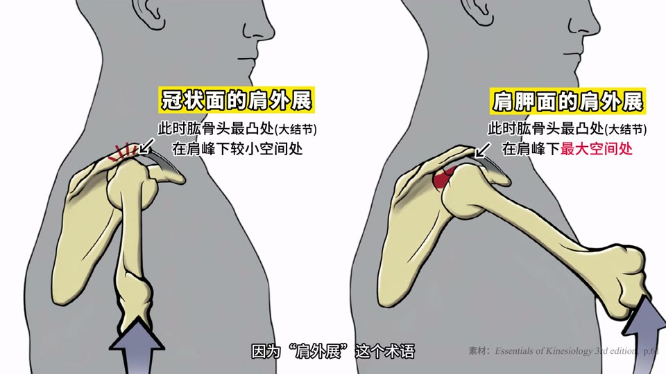
   *冠状面肩外展时肱骨头最凸处对着肩峰下较小空间；肩胛面肩外展时对着肩峰下最大空间。*

3. **大臂抬高不超过 60° 就落下**：根据肩外展角度和肩峰下空隙的函数图，肩外展 **70–100°**（红色区）空隙最少，平均不到 **3 mm**。所以肩峰下撞击患者做侧平举，建议在 **0–60°**（绿色区）范围内做。这和前面「侧平举要做后半程才利于肩中束」是矛盾的，但有伤病时「肯定要以活下去为第一目标」。

   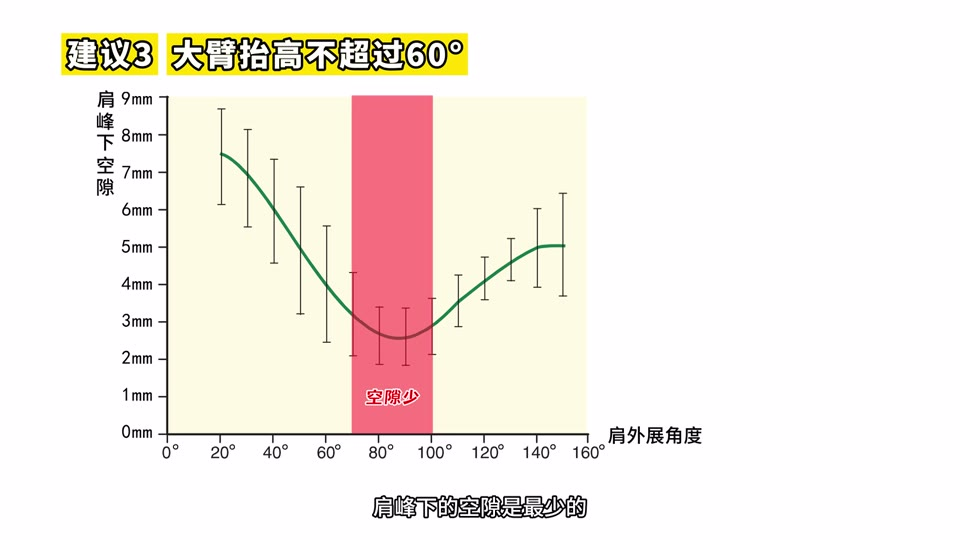
   *肩峰下空隙随肩外展角度变化：70–100° 空隙最少，建议患者在 0–60° 范围内做。*

## 9. 练肩后束：反向飞鸟 [47:52]

练肩后束也是两个动作：**单关节动作是反向飞鸟，多关节动作是肩水平外展的开肘划船**。

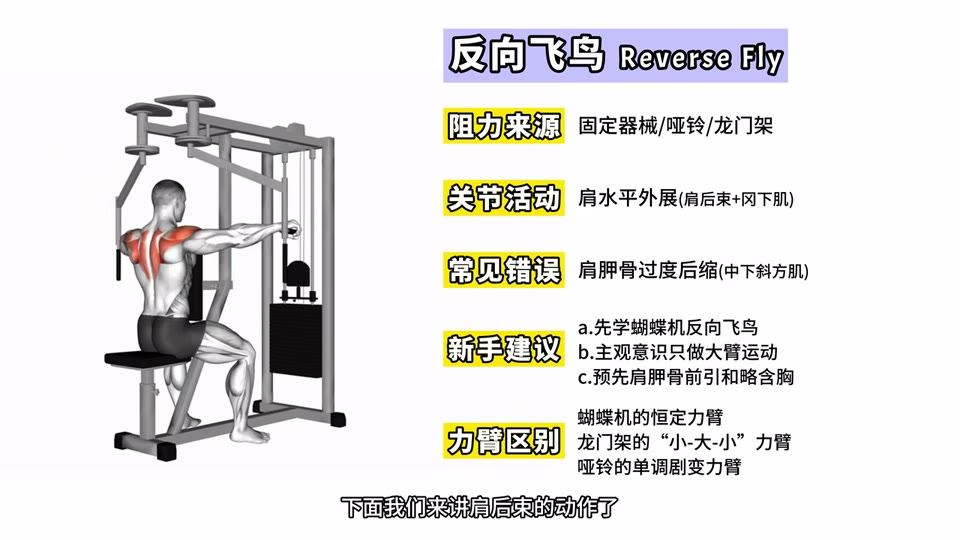

*图 38：反向飞鸟（Reverse Fly）要点卡（内容整理见下）。*

| 项目 | 内容 |
|---|---|
| 阻力来源 | 固定器械 / 哑铃 / 龙门架 |
| 关节活动 | 肩水平外展（肩后束 + 冈下肌） |
| 常见错误 | 肩胛骨过度后缩（中下斜方肌） |
| 新手建议 | a. 先学蝴蝶机反向飞鸟 b. 主观意识只做大臂运动 c. 预先肩胛骨前引和略含胸 |
| 力臂区别 | 蝴蝶机的恒定力臂；龙门架的「小-大-小」力臂；哑铃的单调剧变力臂 |

### 9.1 关节活动与器械设置 [48:07]

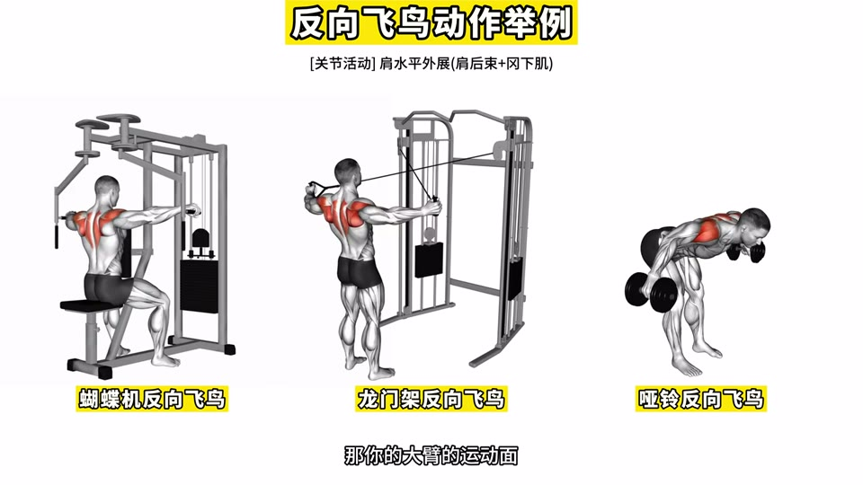

*图 39：蝴蝶机反向飞鸟、龙门架反向飞鸟、哑铃反向飞鸟。*

- 「反向飞鸟」是一类做**肩关节水平外展**动作的统称，蝴蝶机、龙门架、哑铃都能做。
- 克服阻力阶段大臂在**水平面从内往外**运动。参与肌肉是**肩后束和冈下肌**（特别是冈下肌上部）。
- 既然是肩水平外展，**大臂的运动面就应该大致和肩膀平齐**。蝴蝶机凳子的高度、龙门架滑轮的高度、俯身飞鸟时手臂对着躯干的位置，都按「能做出肩水平外展」来调。

### 9.2 常见错误：肩胛骨过度后缩 [48:50]

- 错误表现：一边肩水平外展，一边**故意**把肩胛骨往后缩、往后夹。
- 先澄清：**肩胛骨不该纹丝不动**。教材写明，大臂水平外展时肩胛骨必然跟随**后缩**；反过来大臂水平内收（推胸、夹胸）时，肩胛骨跟随外展（前移）。所以要区分「正常的跟随性前移/后缩」和「新手那种过度的前移/后缩」。

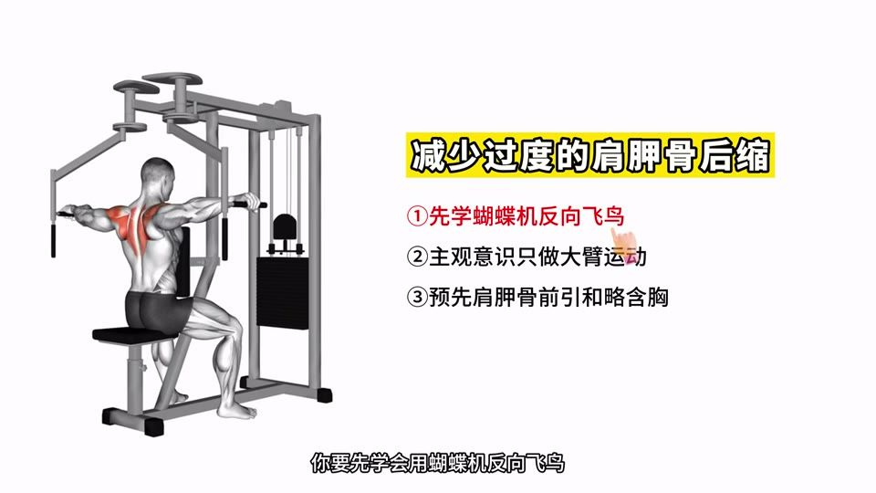

*图 40：减少过度肩胛骨后缩的三个办法。*

**克服过度后缩的三个建议**：

1. **先学蝴蝶机反向飞鸟**，不要从哑铃俯身飞鸟开始。蝴蝶机是恒定力臂器械，要克服的力矩不会剧变，比较简单。哑铃俯身飞鸟力臂剧变，后半程力矩陡增时，很容易不自觉地用肩胛骨后缩把哑铃再抬高一点点。
2. **主观意识只做大臂运动**：做蝴蝶机反向飞鸟时告诉自己「背面是稳定的，现在只做大臂的运动」，想象自己「已经截肢到只剩大臂了，连背都不存在了」。
3. **预先肩胛骨前引、略含胸**：如果还是控制不住，可以先故意做一点肩胛骨前引，把头靠上去定好，略含胸，保持这个姿势，在肩胛骨稍微前移的状态下做大臂水平外展。

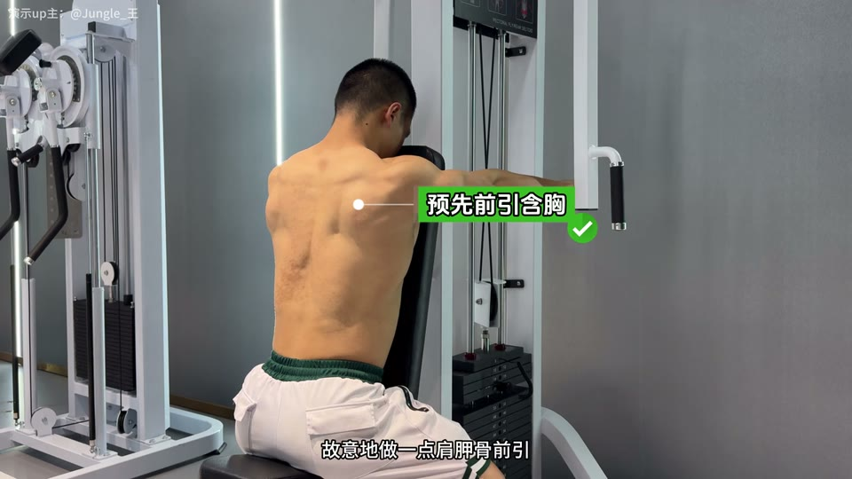

*图 41：实拍：在蝴蝶机上预先做一点肩胛骨前引、略含胸。*

### 9.3 反向飞鸟的三种力臂 [50:42]

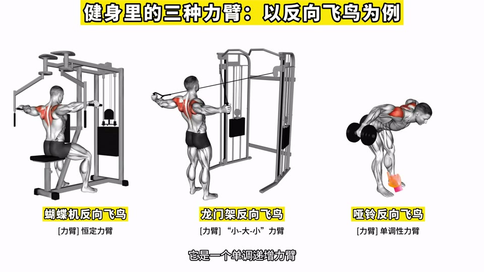

*图 42：蝴蝶机：恒定力臂；龙门架：「小-大-小」力臂；哑铃：单调性力臂。*

| 类型 | 例子 | 力臂特点 | 动作感受 |
|---|---|---|---|
| 恒定力臂 | 钢线绕圆盘的固定器械（蝴蝶机） | 全程不变（具体长度 Whisper 听成「大脚壁的总长」，可能是「大小臂的总长」，此处原视频未明确） | 难度相对均匀 |
| 「小-大-小」力臂 | 龙门架钢线 | 钢线和手臂垂直时最大，约为大小臂总长，前后都小一些 | 难度比较均匀 |
| 单调性力臂 | 哑铃、杠铃等自由重量 | 只增不减或只减不增，变化大。这里是单调递增：起始 0，末端最大，约为大小臂总长 | 配重重，前半程合适后半程做不了；配重轻，后半程合适前半程没重量 |

- 难度剧变的本质是**阻力矩的变化远大于肌肉力矩的变化**。肌肉力矩（力臂函数 × 力量函数）虽然也在变，但阻力矩如果剧烈变化，就不可能和它匹配。
- UP 主画了一张**假设**的示意图：蝴蝶机的恒定阻力矩、龙门架「小-大-小」的阻力矩，和肌肉力矩在每一处差别都不太大，所以难度均匀；哑铃反向飞鸟的阻力矩从 0 涨到超大，所以前半程特别简单、后半程特别难。
- 结论：**阻力矩的设计最好能基本适配肌肉力矩的变化**，这是评价一个健身动作好坏的重要指标（系列第 7 集再展开）。

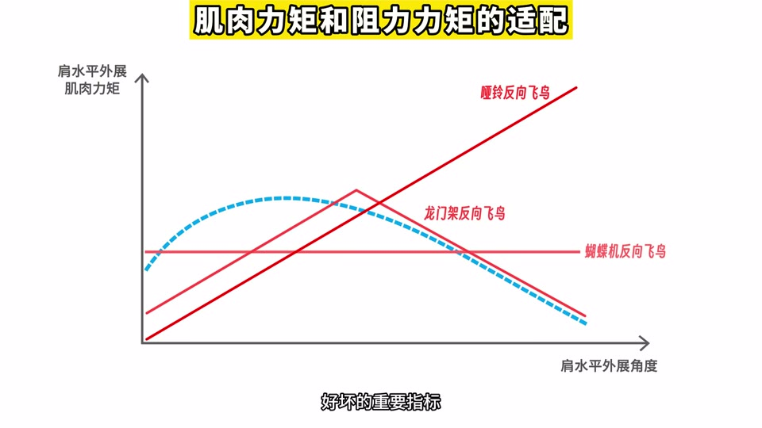

*图 43：假设的肌肉力矩曲线（蓝色虚线）与三种反向飞鸟阻力矩的对比。*

### 9.4 大臂内外旋对反向飞鸟的影响 [53:06]

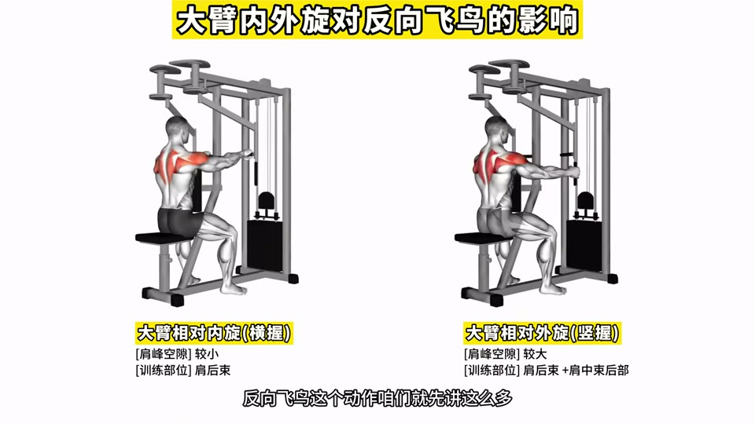

*图 44：蝴蝶机反向飞鸟：横握（大臂相对内旋）肩峰空隙较小，练肩后束；竖握（大臂相对外旋）肩峰空隙较大，练肩后束 + 肩中束后部。*

| 握法 | 大臂位置 | 肩峰空隙 | 训练部位 |
|---|---|---|---|
| 横握 | 相对内旋 | 较小 | 肩后束 |
| 竖握 | 相对外旋 | 较大 | 肩后束 + 肩中束后部 |

- **练肩的通用法则**：不管前平举、侧平举还是反向飞鸟，**大臂外旋位时肩峰下空隙更大**。肩峰下撞击患者这些动作都建议用大臂外旋位做。
- 大臂外旋让三角肌整体后翻，所以竖握的做法不再是纯粹的肩后束动作，会有肩中束后部参与。

## 10. 练肩后束：开肘划船 [54:02]

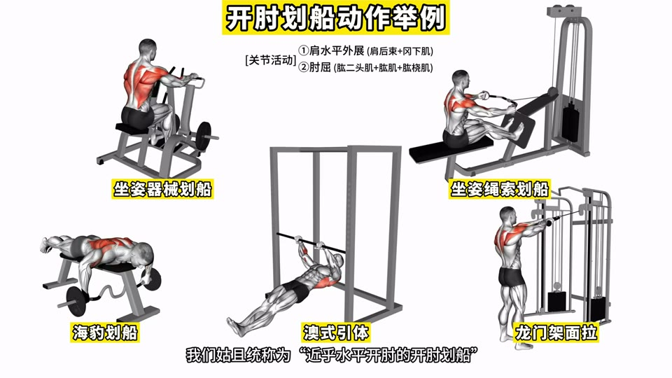

*图 45：坐姿器械划船、坐姿绳索划船、海豹划船、澳式引体、龙门架面拉，都可以归为「近乎水平开肘的开肘划船」。*

### 10.1 是什么

- 包括坐姿器械划船、坐姿绳索划船、海豹划船、澳式引体、龙门架面拉等，统称「**近乎水平开肘的开肘划船**」。
- 关节活动都一样：对抗阻力阶段一边做大臂在水平面从内往外运动（**肩水平外展**），一边做**肘屈**。其实就是反向飞鸟加了一个弯举。

### 10.2 常见错误 1：过度的肩胛骨后缩 [54:49]

- 和反向飞鸟一样，忍不住用肩胛骨后缩帮忙。要主观告诉自己「背是不动的，大臂以下已经截肢，背都不存在了」。
- 「为什么网上有的教学反而强调划船要后缩肩胛骨？」因为**目的不同**：肩胛骨后缩是**中下斜方肌**的关节活动。
  - 只练肩后束：**不要**故意后缩肩胛骨（后缩不是肩后束的关节活动）。
  - 同时练中下斜方肌：**要**故意后缩肩胛骨。

### 10.3 常见错误 2：半开肘甚至夹肘 [55:31]

*图 46：左：大开肘划船，接近肩水平外展（正确）；右：半开肘划船，肩水平外展混入了肩伸（错误）。*

- 表现：没做成标准的肩水平外展，混入太多**肩伸**，变成半开肘而不是水平开肘。
- 「肩伸里不是也有肩后束吗？」不行。肩后束的**主要**关节活动是肩水平外展，肩伸只是**次要**的：肩伸有五块肌肉，干活的人太多，肩后束贡献比例太低。所以用开肘划船练肩后束，**一定要开肘到接近水平**，不是保守的半开肘，更不是夹肘。

### 10.4 怎么安排 [56:22]

- **单独一天练肩时一般不用这个动作**，因为它多少会练到背和二头。
- 如果肩后束和背一起练，可以把它作为练背动作的收尾，再接一个反向飞鸟，就把肩后束练完了。

## 11. 总结：前中后束各两个动作 [56:42]

*图 47：本集总结：第一排是单关节动作，第二排是多关节动作。*

| 部位 | 单关节动作 | 多关节动作 |
|---|---|---|
| 肩前束 | **前平举** 阻力：哑铃 / 杠铃 / 杠铃片 / 龙门架 关节：肩屈 | **推举** 阻力：哑铃 / 杠铃 / 史密斯 / 固定器械 关节：窄握 = 肩屈 + 肘伸；宽握 = 大臂外旋位的肩外展 + 肘伸（画面写作「肘屈」，按讲解应为肘伸） |
| 肩中束 | **侧平举** 阻力：哑铃 / 龙门架 / 固定器械 关节：肩外展 | **提拉** 阻力：杠铃 / 哑铃 / 龙门架 关节：肩外展 + 肘屈 |
| 肩后束 | **反向飞鸟** 阻力：蝴蝶机 / 哑铃 / 龙门架 / 固定器械 关节：肩水平外展 | **开肘划船** 阻力：固定器械 / 龙门架 / 杠铃 / 哑铃 关节：肩水平外展 + 肘屈 |

- 每个「动作」准确说都是**一类动作**，换不同阻力来源（哑铃、杠铃、龙门架、固定器械）就派生出一个个具体动作。
- 有意思的是，第一排三个单关节动作名义上分属前、中、后束，**其实不是截然分开的，而是有过渡关系**：大臂内外旋一些，三角肌就整体往前或往后翻一些，动作的运动面没变，但运动面上的肌肉变了。

## 12. 随堂测试 5 题与答案 [57:28]

题目在 [57:41–61:07]，答案讲解在 [61:08–65:21]。

**第 1 题** [57:41]：窄握推举是矢状面运动。和它以**同样关节活动**来练肩的类似动作是？ A. 侧平举 B. 宽握推举 C. 前平举

- **答案：C**。窄握推举是肩屈 + 肘伸，肩屈的首要肌肉是肩前束；同样用肩屈练肩前束的是前平举。窄握推举 = 前平举 + 臂屈伸两个单关节动作一起做。A 侧平举是肩外展练肩中束，关节活动和肌肉都不对；B 宽握推举虽然也练肩前束，但关节活动是大臂外旋位的肩外展，不是肩屈。

**第 2 题** [58:02]：一个极度肩外展的动作，大臂在冠状面高高抬起，这时肩外展运动面上的肌肉是三角肌哪部分？ A. 肩前束 B. 肩中束 C. 肩后束

*图 48：第 2 题：极度肩外展时，在肩外展运动面上的是肩前束。*

- **答案：A**。随着肩外展大臂不断抬高，大臂会逐渐外旋；极度肩外展时大臂极度外旋，三角肌整体后翻，肩中束反而到了背面，运动面上的是肩前束。这就是为什么宽握推举作为肩外展动作，练的却是肩前束。

**第 3 题** [58:37]：两种行程的侧平举：上图「半程侧平举」哑铃 20 kg、最大力臂 35 cm；下图「全程侧平举」哑铃 10 kg、最大力臂 70 cm。力矩相同，练肩中束应该用哪种？ A. 上图配重较大的（网上说大重量才能更好增肌） B. 下图力臂较大的 C. 力矩相同，没有区别

*图 49：第 3 题：半程侧平举（20 kg、35 cm）对比全程侧平举（10 kg、70 cm），选 B。*

- **答案：B**。力矩虽然相同，但肩外展中肩中束和冈上肌在不同阶段的贡献不同：肩中束在前半程贡献较少，后半程才逐渐增大。所以除了少数肩峰下撞击患者，用侧平举练肩中束都应该做到比较后半程。这时力臂骤增，配重就只能比较轻。

**第 4 题** [59:20]：用划船类动作练肩后束，应该用哪种划船？ A. 不开肘的划船 B. 半开肘的划船 C. 大开肘的划船

*图 50：第 4 题：A 不开肘、B 半开肘、C 大开肘，选 C。*

- **答案：C**。接近或达到水平开肘时大臂做肩水平外展，只有肩后束和冈下肌上部两块肌肉参与，而且肩后束的拉力线和力臂更有优势，这才是肩后束的主要功能。其他划船是混合了肩伸乃至纯肩伸，肩伸五块肌肉干活的人太多，肩后束贡献不高。

**第 5 题（多选）** [59:49]：网上有人分享一个「练后束」动作，说它好是因为能上重量，视频里确实用了很重的哑铃。和一般的哑铃俯身飞鸟相比，它能上重量的原因是？ A. 力臂变短 B. 增加了肘屈 C. 肩水平外展混入了肩伸 D. 利用了省力杠杆装置

*图 51：第 5 题：选 A、B、C，不选 D。*

- **答案：A、B、C**。
  - A：力臂是阻力方向到关节点的垂线距离，最大力臂从大小臂总长缩短到只有大臂长度，力臂变小，配重就能增大。
  - B：明显增加了肘屈，引入了肘屈三肌帮忙。
  - C：哑铃俯身飞鸟是接近水平开肘的肩水平外展（肩后束和冈下肌参与；Whisper 听成「肩中术」，按上下文应为肩后束）；这个动作只是小幅开肘，是肩伸和肩水平外展大约「七三开」的混合，参与肌肉向力量更大的肩伸肌（背阔肌、大圆肌等）发展。有评论说「这样练背的感觉比后束还大」，因为它其实接近肩伸划船，与其说练后束不如说练背。
  - D 不选：杠杆装置只出现在固定器械里（大多是省力杠杆，也有少数费力杠杆），哑铃、杠铃的自由动作没有杠杆装置。
- 总之，换个动作能上重量，要从**力臂、关节活动和参与肌肉、省力杠杆**三个因素去分析，不要以为换个动作肌肉就进化出更大力量了。

**预告** [65:30]：下一集讲最难的背部。难在背上肌肉太多，各有各的关节活动，容易分不清。仍按解剖导论、动作分析、随堂考试的顺序讲。

---

## 要点速查

**三角肌三束 · 关节活动 · 动作**

| 部位 | 起点 | 主要关节活动 | 次要关节活动 | 单关节动作 | 多关节动作 |
|---|---|---|---|---|---|
| 肩前束 | 锁骨外 1/3 | 肩屈；大臂外旋位的肩外展 | 肩水平内收 | 前平举 | 推举（窄握/宽握都行） |
| 肩中束 | 肩峰 | 肩外展 | — | 侧平举 | 提拉 |
| 肩后束 | 肩胛骨后侧 | 肩水平外展 | 肩伸 | 反向飞鸟 | 开肘划船（接近水平开肘） |

止点：三束共同止于肱骨大约一半处，所以练三角肌靠大臂运动。

**动作要点与常见错误**

| 动作 | 关键做法 | 常见错误 |
|---|---|---|
| 前平举 | 优先反手或锤式；正手一般不用（肩峰下撞击风险高） | 视频没讲典型错误关节活动 |
| 推举 | 握距随意；单独练肩时坚持垂直推 | 选斜前推器械；屁股前坐 + 挺胸（人造下斜板），上胸代偿 |
| 侧平举 | 至少做到后半程；配重要轻；锤式或端水式更安全 | 大重量只做前三四十度（只练冈上肌）；耸肩；倒水式 |
| 提拉 | 侧平举 + 弯举 | 耸肩；大臂被迫内旋，肩峰下撞击风险较高 |
| 反向飞鸟 | 运动面与肩齐平；新手先学蝴蝶机；只动大臂；可预先前引略含胸 | 肩胛骨过度后缩 |
| 开肘划船 | 开肘接近水平；只练后束时不故意后缩肩胛骨 | 过度后缩；半开肘或夹肘（混入肩伸） |

**几个关键数字（视频中给出）**

| 项目 | 数值 |
|---|---|
| 最大力臂：大小臂总长 / 大臂长度 | 约 70 cm / 约 40 cm |
| 侧平举中肩中束力臂（0→90°） | 约 1 cm → 3 cm（增函数） |
| 侧平举中冈上肌力臂（0→90°） | 2 cm 多 → 1 cm 多（减函数） |
| 龙门架 vs 哑铃侧平举起始力臂 | 约 50 cm vs 约 5 cm（约 10 倍） |
| 肩峰下空隙最小的肩外展角度 | 70–100°，平均不到 3 mm |
| 肩峰下撞击患者侧平举建议范围 | 0–60° |
| 肩胛面相对冠状面 | 向前约 30° |

**三个通用分析工具**

1. **看运动面上是哪块肌肉**：大臂外旋，三角肌后翻；大臂内旋，三角肌前翻。运动面不变，最佳肌纤维会变。
2. **真正的重量是力矩**：力矩 = 力臂 × 配重；肌肉力矩 = 肌肉力臂 × 肌肉力量。好动作的阻力矩应尽量匹配肌肉力矩。
3. **换动作能上重量的三种原因**：① 力臂更小 ② 关节活动更多（多了帮忙的肌肉）③ 固定器械的省力杠杆。不是肌肉变强了。

**肩峰下撞击**：自测用霍金斯试验（大臂抬至水平后内旋）。预防三条：保持大臂外旋、在肩胛面做、患者抬臂不超过 60°。通用法则：大臂外旋位时肩峰下空隙更大。

## 初学者练习建议

以下只根据视频内容归纳：

1. **按「前中后束各两个动作」组织练肩**：前束用前平举、推举；中束用侧平举、提拉；后束用反向飞鸟、开肘划船（后者更适合放在练背日的末尾，再接反向飞鸟）。
2. **侧平举用轻重量、做到后半程**：别用大哑铃只抬三四十度。屈肘、龙门架或固定器械可以让难度更均匀。
3. **耸肩先别焦虑**：用较轻配重慢慢学会减少耸肩；学的过程中有些耸肩问题不大，上斜方肌在侧平举里本来就要参与。
4. **握法优先选大臂外旋或半旋**：前平举用反手或锤式，侧平举用常规或锤式（端水式），尽量不用正手前平举和倒水式侧平举。
5. **单独练肩日的推举做成垂直推**：不选斜前推器械，坐在垂直凳上不往前坐、不刻意挺胸；觉得力量变小是正常的。
6. **反向飞鸟先从蝴蝶机学起**：凳子高度调到大臂运动面与肩齐平；心里只想着动大臂；控制不住后缩时，先略含胸、肩胛骨稍前引再做。
7. **用划船练后束时开肘要接近水平**，不要半开肘或夹肘；只练后束时不刻意夹肩胛骨。
8. **抬手时某个点疼就先自查**：可以做霍金斯试验，阳性去医院检查。有问题时用大臂外旋位、在肩胛面做、侧平举只抬到 60° 左右。
9. **不迷信「能上重量就是好动作」**：遇到配重差别大的两个动作，用力臂、关节活动、省力杠杆三点分析。
