# 《健身解剖完全手册》第4集：练背（文字版）

## 来源

- **视频标题**：💪🏻B站版《健身解剖完全手册》™（第4集：练背）
- **UP 主**：好人松松
- **链接**：https://www.bilibili.com/video/BV1jEnuz9ESc/
- **时长**：约 94 分钟（94:11）
- **视频章节**：开场 [00:00] / 背阔肌&大圆肌 [03:36] / 充电社群 [30:17] / 冈下肌&小圆肌 [32:10] / 斜方肌&菱形肌 [43:56] / 竖脊肌 [59:05] / 四个专题 [66:36] / 考试 [86:29]
- **整理日期**：2026-10-17
- **整理方式**：音频用 Whisper（large-v3-turbo）转写成文字稿，再对照视频画面（内嵌字幕、解剖图、文字卡片、表格）校对术语；只出现在画面上、口头没念的内容（肌肉卡片、计划表、考试题）从截图里读出来整理。时间戳取自文字稿，可能和视频有几秒误差。

## 总览

这一集讲背部的 7 块（组）肌肉：背阔肌、大圆肌、冈下肌、小圆肌、斜方肌、菱形肌、竖脊肌。每块肌肉都按同一顺序讲：先讲解剖（起止点、实拍图里怎么认），再讲它的关节活动和对应的健身动作。核心思路是「肌肉走向要和关节活动的运动面吻合，才有利于发力」，用这个原则推出：宽握下拉/引体（肩内收）对背阔肌、大圆肌各部分都练得差不多；窄握下拉/划船（肩伸）侧重外背阔；开肘划船侧重上背阔和大圆肌；大开肘、故意后缩肩胛骨的划船练中下斜方肌；耸肩练上斜方肌。冈下肌和小圆肌力臂太小，健身里没有专门练它们的动作。最后四个专题讲均衡练背计划、握法怎么选、划船的三要素、小臂酸痛的原因和缓解办法，结尾有 5 道考试题。

## 目录

1. [开场与本集总纲 [00:00]](#1-开场与本集总纲-0000)
2. [背阔肌的解剖 [03:34]](#2-背阔肌的解剖-0334)
3. [大圆肌，以及背阔肌/大圆肌的三个关节活动 [14:43]](#3-大圆肌以及背阔肌大圆肌的三个关节活动-1443)
4. [充电社群（推广）[30:15]](#4-充电社群推广-3015)
5. [冈下肌 [32:12]](#5-冈下肌-3212)
6. [小圆肌 [38:53]](#6-小圆肌-3853)
7. [斜方肌 [44:01]](#7-斜方肌-4401)
8. [菱形肌 [57:26]](#8-菱形肌-5726)
9. [竖脊肌 [59:04]](#9-竖脊肌-5904)
10. [咏背肌（口诀）[65:52]](#10-咏背肌口诀-6552)
11. [专题一：背部复习与均衡练背计划 [66:42]](#11-专题一背部复习与均衡练背计划-6642)
12. [专题二：引体/下拉的握法怎么选 [73:14]](#12-专题二引体下拉的握法怎么选-7314)
13. [专题三：划船的关节活动内核 [78:26]](#13-专题三划船的关节活动内核-7826)
14. [专题四：练背时小臂酸痛的原因和缓解 [81:21]](#14-专题四练背时小臂酸痛的原因和缓解-8121)
15. [考试：5 道题与答案 [86:35]](#15-考试5-道题与答案-8635)
16. [要点速查](#要点速查)
17. [初学者练习建议](#初学者练习建议)
18. [不确定之处](#不确定之处)

---

## 1. 开场与本集总纲 [00:00]

- 这套网课一共 7 集，按部位讲，第 4 集讲练背。UP 主说这是「最复杂也最长的一集」。每集结尾有 5 道选择题，观众发弹幕答题。
- **系列总纲是 A、B 两张总结表**：
  - **A 表「关节活动的肌肉」**：一个关节活动由哪些肌肉完成，第 1 集已经全部讲过（第 1 集是总导论，UP 主强调没看过一定要补）。
  - **B 表「肌肉的关节活动」**：一块肌肉有哪些关节活动、用什么动作练。每个部位的 B 表再转成一张图示，本集讲的就是「背」这一张。
- 4K 原图、饮食方案底表、三/四分化训练计划、拉伸图谱、Complete Anatomy 教程等打包在 UP 主的「健身 Excel 工具套表」里（关注后私信发「1」或看主页置顶动态领取）。

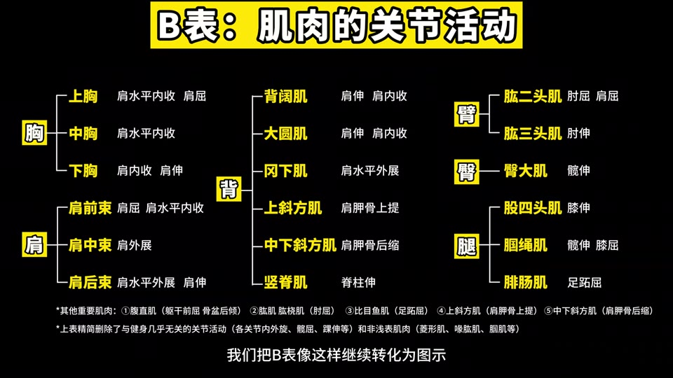

*图 1：B 表里「背」这一栏：背阔肌（肩伸、肩内收）、大圆肌（肩伸、肩内收）、冈下肌（肩水平外展）、上斜方肌（肩胛骨上提）、中下斜方肌（肩胛骨后缩）、竖脊肌（脊柱伸）。*

**为什么背最复杂** [02:36]：要讲的肌肉多，而且背阔肌、斜方肌自己的肌纤维走向变化很大，不同肌纤维对应不同的关节活动，所以要拆成几部分分开讨论。

**本集总纲图** [02:59]（画面文字整理）：

| 肌肉 | 关节活动（括号内为对应动作） |
|---|---|
| 菱形肌 | 肩胛骨后缩（大开肘划船） |
| 冈下肌 | ① 肩水平外展（反向飞鸟、大开肘划船）② 维持肱骨头稳定 |
| 小圆肌 | 维持肱骨头稳定 |
| 竖脊肌 | 脊柱伸（山羊挺身） |
| 斜方肌 | [上斜方] 肩胛骨上提（耸肩）；[中斜方] 肩胛骨后缩（大开肘划船）；[下斜方] 肩胛骨后缩（大开肘划船） |
| 大圆肌 / 背阔肌 | ① 肩内收（宽握下拉、宽握引体）② 肩伸（窄握下拉、窄握引体）③ 肩伸 mix 肩水平外展（开肘划船） |

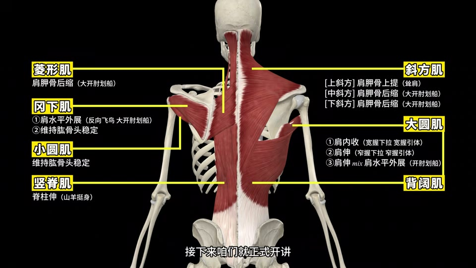

*图 2：本集总纲图。讲解顺序：每块肌肉先讲解剖，再讲关节活动和健身动作。*

---

## 2. 背阔肌的解剖 [03:34]

### 2.1 起止点

- **止点**：大臂肱骨（画面标注：肱骨结节间沟）。所以背阔肌收缩拉动大臂，也就是**肩关节运动**。
- 名词提醒：肌肉远离躯干的一端叫**止点**，靠近躯干的一端叫**起点**。UP 主说记反了也没关系，知道它从哪长到哪就行。
- **起点有三处**（画面标注）：
  1. **起点 1：第 9–12 肋**（最外侧的肌束）。外沿的肌束竖直往下，末端并没有长到骨盆上，而是到最下面四根肋骨就结束了。UP 主称这是个「冷知识」：不是知识本身冷门，而是大家看解剖教材和软件时没留心。
  2. **起点 2：脊柱的胸腰骶椎**（通过胸腰筋膜连接）。这是背阔肌的主体。白色部分是三层胸腰筋膜里最外的浅层，属于腱膜型筋膜，实质上是背阔肌起于胸腰骶椎那部分肌束的肌腱。
  3. **起点 3：骨盆髂嵴**。有的人有一组肌束不经过胸腰筋膜、直接长在髂嵴上。
- 实拍图里背阔肌外沿看起来整个长到了骨盆上，实际应该这样分：黄色是起于肋骨的肌束，蓝色是起于髂嵴的肌束。外沿主要长在肋骨上，到最下面没有肋骨的地方才长到骨盆上。

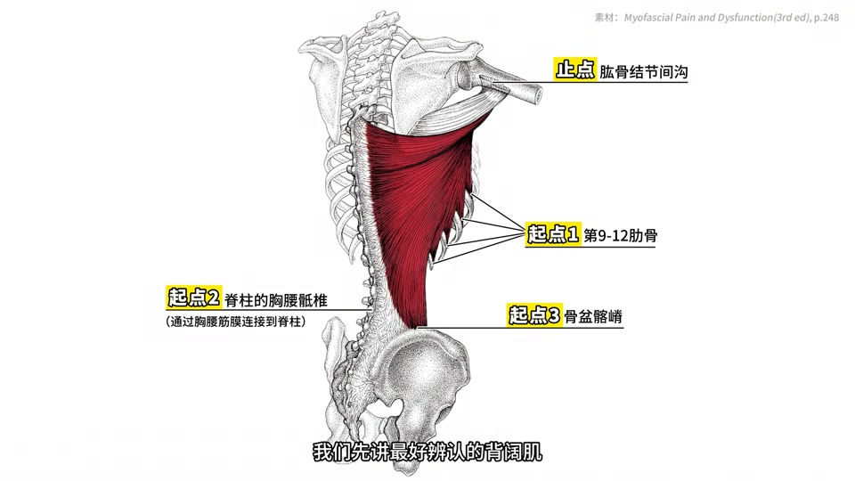

*图 3：背阔肌的一个止点、三个起点。素材出自 Myofascial Pain and Dysfunction (3rd ed)。*

### 2.2 「圣诞树」的实质 [05:21]

- 肌肥大是**肌腹**变粗，**肌腱不会肥大**。背阔肌通过胸腰筋膜连到胸腰骶椎的那段是肌腱，所以这里会形成一个凹陷区域，俗称「**圣诞树**」。
- UP 主的观点：网上教「如何练出圣诞树」的视频让人迷惑。那就是肌腱，没法练；肌腹够厚、体脂率够低，圣诞树自然就出现了。

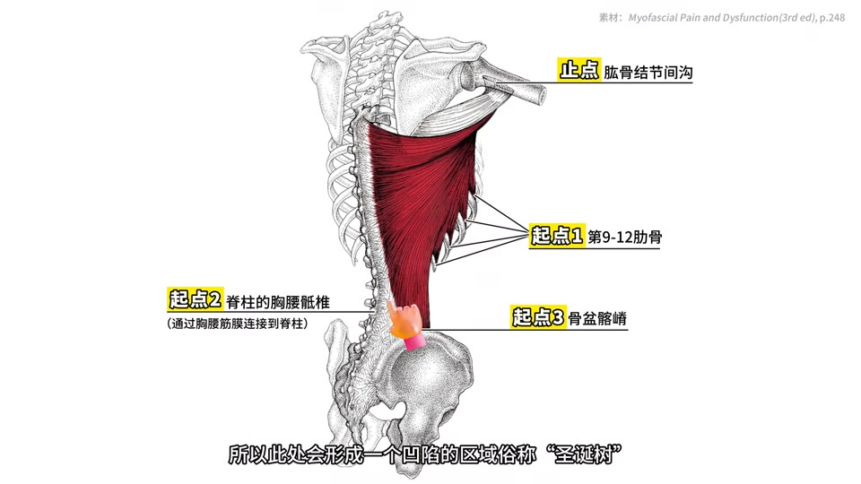

*图 4：胸腰筋膜那段是不增厚的肌腱，所以形成凹陷的「圣诞树」。*

### 2.3 背阔肌外沿的一条「隐约分界线」[05:43]

- UP 主引用一本 1899 年（距今 126 年）美国出版的黑白解剖书插图：大块背阔肌肌束经胸腰筋膜连到胸腰骶椎，跟骨盆没关系；旁边单独的一条肌束才直接长在骨盆上（具体书名原视频未明确，画面未截到）。
- 因为是两组肌束，实拍图里在背阔肌外沿往内一点能看到一条隐约的分界线：线往内是经胸腰筋膜连到胸腰骶椎的肌束，线往外是直接长在髂嵴上的肌束。
- 也有人胸腰筋膜在骨盆处很宽，没有单独起于髂嵴的肌束，即使体脂很低也看不到这条线。UP 主觉得没有分界线背阔反而更完整。
- 注意：你身上看不到这条线，更可能是体脂率太高，不一定是解剖原因。

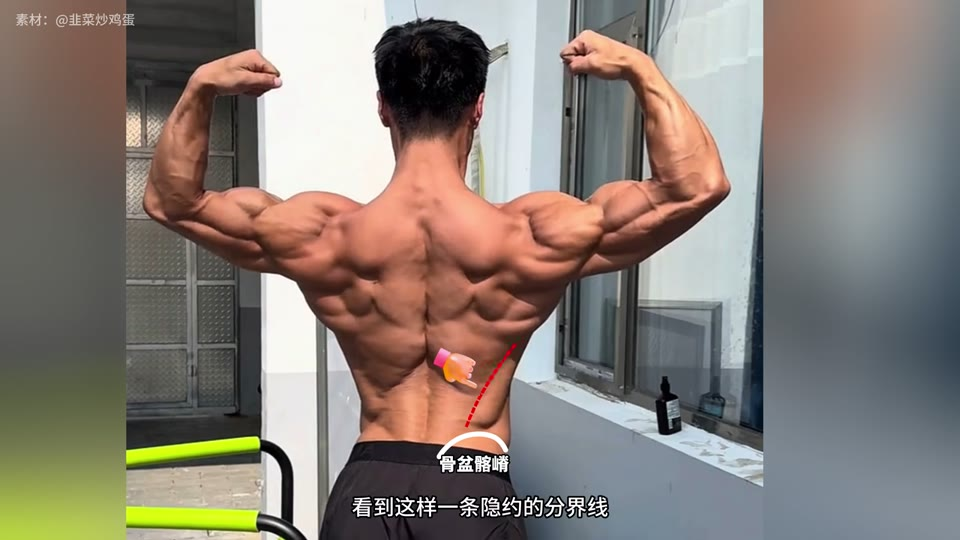

*图 5：分界线往外是直接起于髂嵴的肌束，往内是经胸腰筋膜的肌束。*

### 2.4 背阔肌与肩胛骨：抬手时出现的分界线 [07:27]

- UP 主先打招呼：解剖是训练的前置知识，知道肌肉怎么长才能讲怎么练，所以请大家忍一下。
- **上背阔和肩胛骨下角有重叠**，背阔肌在这里有附着。
- 抬手时肩胛骨跟着上旋，会把附着在肩胛骨下角的那部分上背阔肌束拉得更长更薄，跟下面的肌束形成一条深刻的分界线。教材作者特意把这条线画得很深。
- 落手时肩胛骨下旋归位，不再拉扯这部分肌束，这条线就消失了。
- **常见误判**：很多人以为抬手时那条明显的线是背阔肌上缘，错了。那条不太清晰的线才是背阔肌上缘。

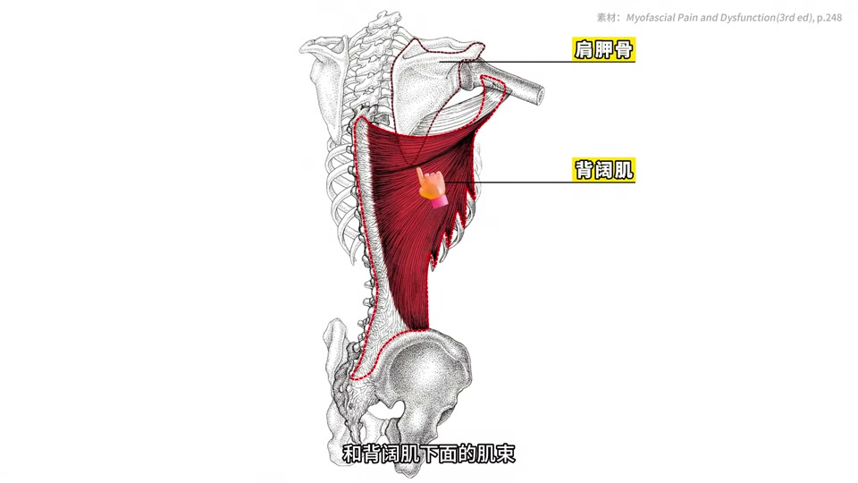

*图 6：红色虚线是背阔肌、黑色虚线是肩胛骨。上背阔擦过肩胛骨下角，抬手时会被拉出一条分界线。*

### 2.5 背阔肌与大圆肌：包裹叠加 [08:57]

- 大圆肌起于肩胛骨下角。**背阔肌包裹着大圆肌的下部**，两者一起连向大臂肱骨。这里第一层是背阔肌，第二层是大圆肌。
- 很多人以为两者是独立分开的。实拍图里黄色是大圆肌，蓝色是背阔肌，蓝黄叠加的绿色部分就是背阔肌包着大圆肌下部的地方。UP 主说不讲清楚肩胛骨、背阔肌、大圆肌三者的关系，实拍图里连肌肉都认不清（「不要怪我水时长」）。

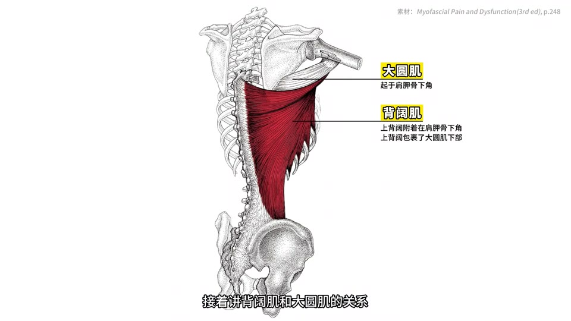

*图 7：画面标注：大圆肌起于肩胛骨下角；背阔肌上部附着在肩胛骨下角，包裹大圆肌下部。*

### 2.6 肌纤维走向：上背阔 vs 外背阔 [09:50]

- 背阔肌的肌束走向差别很大：**上背阔接近水平向**，**外背阔接近竖直向**。这为后面「不同部位适合不同动作」埋下伏笔。
- 分割一块肌肉一定要**顺着肌纤维去划分**。同一走向的肌纤维适应的动作相同，才能放在一起讨论。

### 2.7 背阔肌外沿形态：「腰长」和「腰短」[10:16]

- 左图下背竖直，俗称「**腰长**」（腹外斜肌暴露多）；右图下背外抛，俗称「**腰短**」（腹外斜肌暴露少）。
- 左边的人背阔肌在骨盆上的起点更靠内，单看背阔肌非常倒三角，但腹外斜肌竖直的外沿露得长，所以外沿上段外抛、下段竖直。
- 右边的人背阔肌在骨盆上的起点更靠外，单看背阔肌不如左边倒三角，但腹外斜肌露得短，外沿上下段都外抛，甚至叫「背阔肌直接躺在屁股上」。
- **反直觉的结论**：背阔肌本身更倒三角的人，背反而看起来没那么倒三角；反之亦然。原因是我们看背时会**把腹外斜肌当成下背外沿**。那段其实是腹外斜肌的外沿。

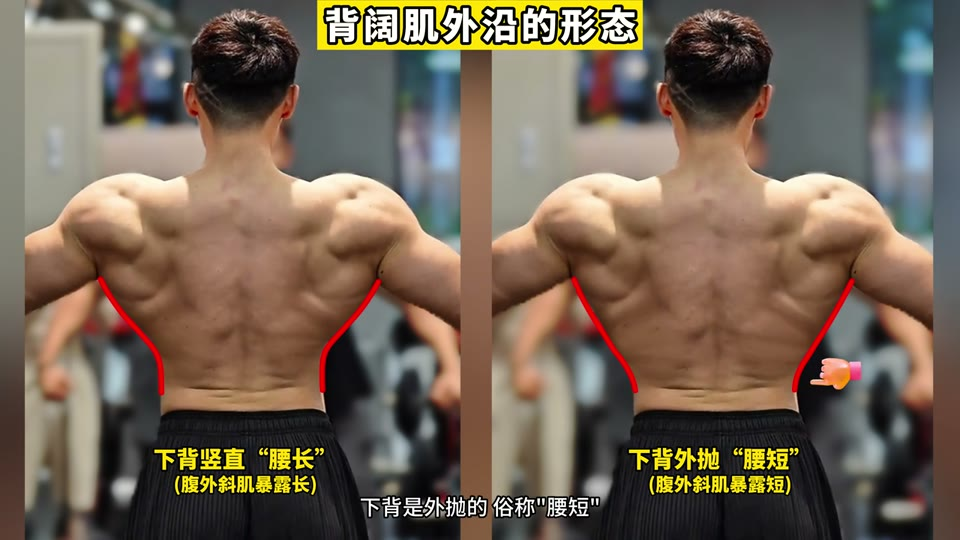

*图 8：左：下背竖直「腰长」（腹外斜肌暴露长）；右：下背外抛「腰短」（腹外斜肌暴露短）。*

### 2.8 背阔肌内部另一条线：前锯肌下缘 [11:30]

- 背阔肌内部除了肌腱/肌腹分界（圣诞树），还有一条迷惑性的线：**背阔肌下层的前锯肌的下缘**。
- 示意图上分三区：只有背阔肌一层；背阔肌 + 下层前锯肌两层；背阔肌包着大圆肌，再下面还有前锯肌，共三层。所以背外沿捏起来上厚下薄，因为从上到下分别是三层、两层、一层肌肉。
- 前锯肌超出背阔肌覆盖的部分在正面肉眼可见，锯齿状，像子弹头、鲨鱼鳃，俗称「子弹肌」「鲨鱼肌」。
- 实拍例子：一位被称为「中国背王」的选手（姓名原视频未明确），UP 主认为他真正「断档强」的是前锯肌，动作全程这条线都清晰可见。
- **前锯肌主体其实在背面**，它把悬空的肩胛骨「粘」到躯干上；正面看到的只是它在肋骨上超出背阔肌覆盖的一点点。UP 主说有人坚持说前锯肌是正面肌肉，他「就要骂人了」。
- 吊诡之处：练前锯肌是在**练胸日**做推类动作、伴随肩胛骨前伸时练到的，但它的肌肥大效果却呈现在背部，所以**练胸日对背部也有贡献**。
- UP 主评论过一段视频「前锯肌也太厚了，肩胛骨不做上旋都能看得到」，意思是：落手时肩胛骨下旋，作为上旋肌的前锯肌被拉长变薄，背阔肌则缩短变厚。上层厚、下层薄时下层本不容易看到，能看到就说明他的前锯肌相当厚。

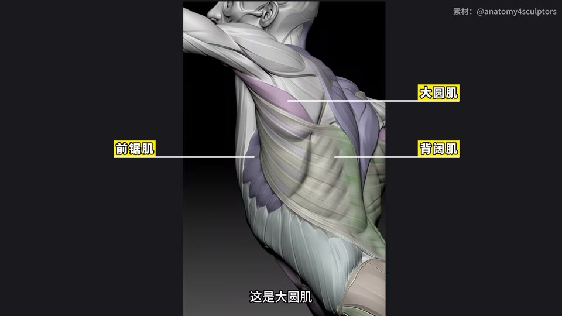

*图 9：示意图：前锯肌在背阔肌之下，它的下缘会在背阔肌内部形成一条线；背外沿上部是三层肌肉叠加。*

---

## 3. 大圆肌，以及背阔肌/大圆肌的三个关节活动 [14:43]

### 3.1 大圆肌的解剖

- **起于肩胛骨下角，止于大臂肱骨前方**，止点和背阔肌几乎挨着。所以大圆肌收缩也是拉动大臂，也就是肩关节运动。
- 第二次强调：上背阔擦过肩胛骨下角，包着大圆肌一起走向肱骨前方。
- 背阔肌、大圆肌在健身里的关节活动是一样的，所以**大圆肌又称「小背阔肌」**，下面合并讲。解剖教材里写的是**肩内收**和**肩伸**。

### 3.2 关节活动 1：肩内收，「雨露均沾」[15:16]

- **肩内收**：大臂在**冠状面**从外往内运动。对应动作：各种**宽握的下拉、引体**。参与肌肉是背面的背阔肌、大圆肌和正面的胸大肌（第 1 集讲过）。
- 起始位到结束位（下拉、引体）的过程中，背阔肌、大圆肌**几乎所有肌纤维都在冠状面**，都符合肩内收的运动面，谈不上对谁特别有利或不利。UP 主概括为「**肩内收主打一个雨露均沾**」。

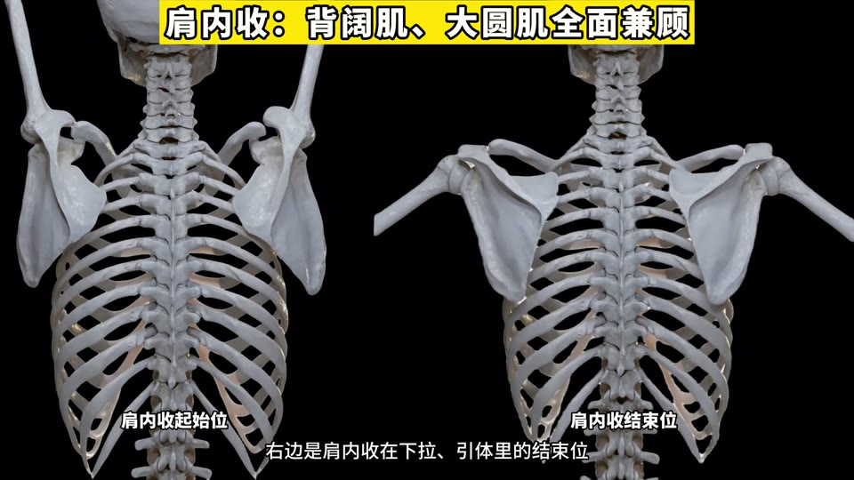

*图 10：肩内收的起始位和结束位：背阔肌、大圆肌所有肌纤维都基本在冠状面。*

**延伸细节：躯干略后倾更好** [16:04]

- 有人做宽握下拉时躯干略后倾，做宽握引体时脚往前放（相当于躯干也略后倾）。UP 主说**这种做法有道理**。
- 原因：从侧面看，背阔肌、大圆肌的走向不是垂直地面的，而是有斜度，因为它们的起止点有前后关系。
- 优化办法：躯干略后倾，**让大臂和下腰大致在同一个垂直面上**，再去做垂直的下拉和引体。这样背阔肌能完全吻合运动面，大圆肌虽未完全吻合但也更好。
- 画面文字：[标准肩内收] 背阔肌/大圆肌没有完全吻合运动面；[问题的实质] 背阔肌/大圆肌的起止点有前后关系；[优化的办法] 躯干略后倾，让大臂和下腰在一个面。
- **基本分析原则**：**肌肉走向越是和运动面吻合，就越有利于它的发力。**

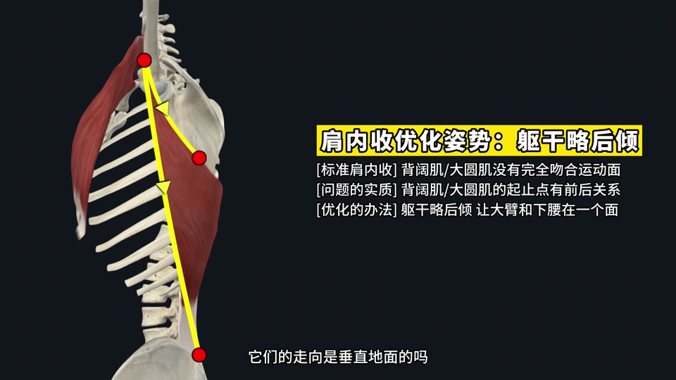

*图 11：侧视图：背阔肌、大圆肌的走向不垂直于地面，躯干略后倾能让它们更吻合运动面。*

### 3.3 关节活动 2：肩伸，「各有侧重」[17:27]

- **肩伸**：大臂在**矢状面**从前往后运动。对应动作：各种**窄握的下拉、引体、划船**。
- **肩伸五肌**（画面文字）：

| 肌肉 | 起点 | 止点 | 备注 |
|---|---|---|---|
| 背阔肌 | 9–12 肋、T7–L5 椎、髂嵴 | 肱骨结节间沟 | 本节重点 |
| 大圆肌 | 肩胛骨背面下角 | 肱骨小结节嵴 | 本节重点 |
| 肩后束 | 肩胛骨肩胛冈 | 肱骨三角肌粗隆 | |
| 肱三长头 | 肩胛骨盂下结节 | 尺骨鹰嘴 | 肱三长头不能使肩关节过伸 |
| 下胸 | 6–7 肋软骨、腹直肌鞘 | 肱骨大结节嵴 | 下胸不能使肩关节过伸 |

- 后三个（肩后束、肱三长头、下胸）大家不太熟。UP 主建议：兄弟做窄握下拉时，去摸他这三个部位，看会不会收缩变硬。

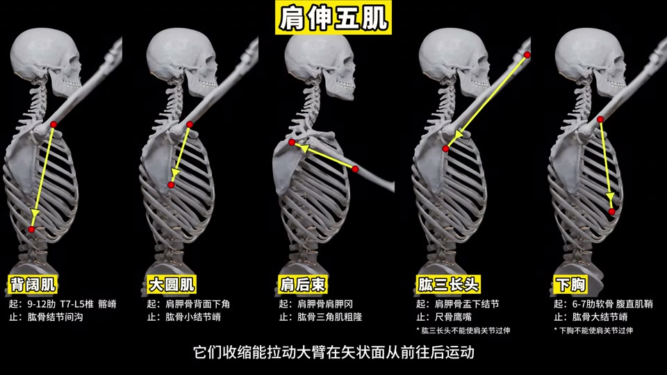

*图 12：肩伸五肌的拉力线和起止点。*

**结论：肩伸对外背阔全程有利，对上背阔不利** [18:25]

- 外背阔起于骨盆和肋骨、长到大臂前方，非常接近肩伸的矢状面，一收缩就把大臂往后拉。
- 上背阔起于后背的胸腰椎，要在后背**绕一圈、拐个弯**才连到大臂前方，所以不在矢状面上，不适合肩伸。
- **解剖的基本原理**：一块肌肉要参与某个关节活动，它的走向必须和该关节活动的运动面吻合（「好好体会这句话」）。

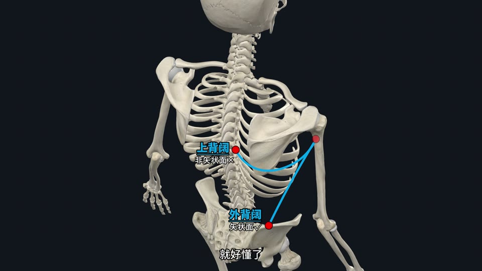

*图 13：半侧面视角更容易看出上背阔要从后背绕一圈才连到大臂前方。*

**中等握距侧重背阔哪一块？** [19:56]（画面表格整理）

| 动作 | 关节活动 | 部位 | 原因 |
|---|---|---|---|
| 窄握下拉 | 肩伸 | 外背阔 >> 上背阔 | 外背阔在大臂运动面；上背阔「绕弯」，不在大臂运动面 |
| 中握下拉 | 肩伸 mix 肩内收 | 外背阔 > 上背阔 | 外背阔在大臂运动面；上背阔「绕弯」程度减轻但没完全解除 |
| 宽握下拉 | 肩内收 | 外背阔 = 上背阔 | 外背阔在大臂运动面；上背阔也在大臂运动面 |

- 中等握距是引体和下拉里**最常做**的模式，大臂运动面介于矢状面和冠状面之间。
- 外背阔的特点：**大臂在任何角度，外背阔都在大臂的运动面上，「它永远不吃亏」**。
- UP 主建议自己比划一下这种大臂介于矢状面和冠状面之间的动作，体会大臂运动面和外背阔、上背阔走向的关系。

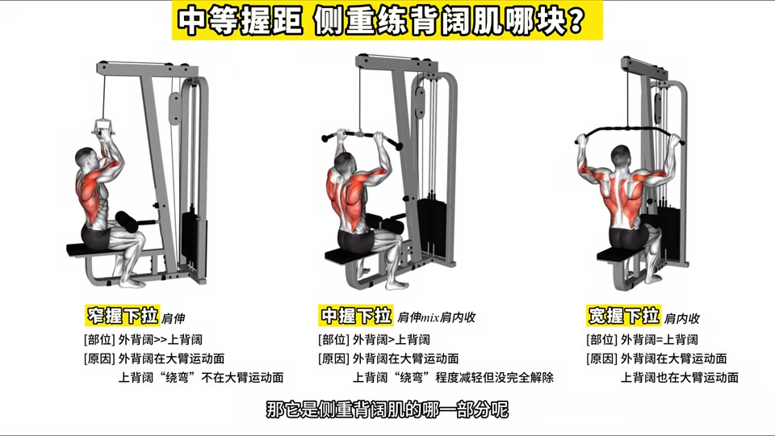

*图 14：三种握距的下拉：窄握 外背阔>>上背阔，中握 外背阔>上背阔，宽握 外背阔=上背阔。*

**大圆肌：肩伸的前半程有利** [21:50]

- 大圆肌起于肩胛骨下角，而肩胛骨会跟着大臂位置变化，所以大圆肌有时在肩伸的矢状面上，有时又脱离。
- 大臂在矢状面高高抬起时，肩胛骨**前伸**到身体外侧，大圆肌变成接近矢状面的肌肉，**很适合肩伸**。
- 肩伸后半程，大臂落下、肩胛骨后缩归位，大圆肌又逐渐脱离矢状面，变成半斜向肌肉，肩伸对它就不太有利了。
- **结论：肩伸前半程有利于大圆肌，后半程逐渐不利。**
- 重要澄清：这里说的「不利于」（后半程不利于大圆肌、全程不利于上背阔），都是指**贡献相对更少，不是完全不参与**。

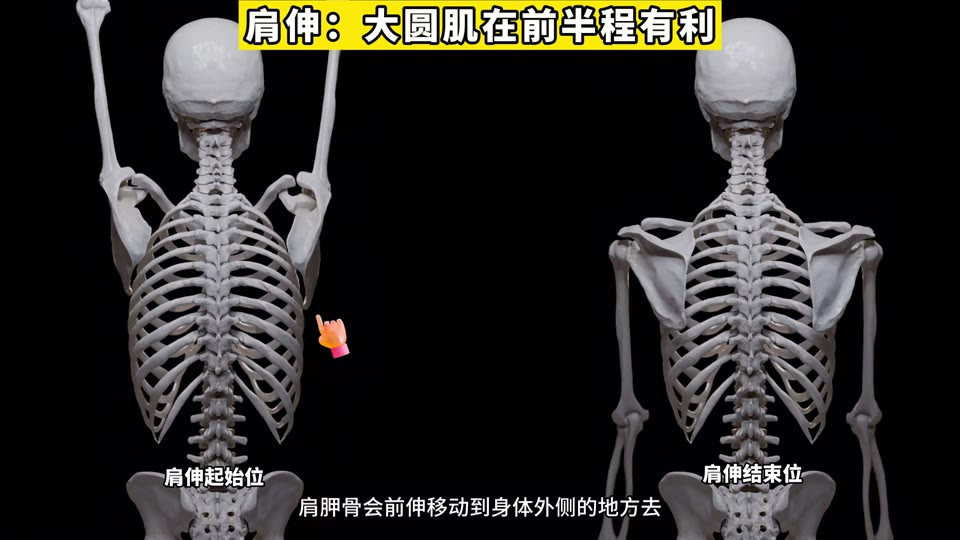

*图 15：左边大臂高举时肩胛骨前伸，大圆肌接近矢状面；右边大臂落下后肩胛骨归位，大圆肌脱离矢状面。*

**练习：六个肩伸动作里哪些对大圆肌更有利？** [24:02]

画面上的六个动作：仰卧上拉（肩伸）、直臂划船（肩伸）、哑铃俯身划船（肩伸+肘屈）、窄握划船（肩伸+肘屈）、窄握下拉（肩伸+肘屈）、窄握引体（肩伸+肘屈）。

- 答案：**A、B、E、F 四个动作**包含肩伸的前半程，有利于大圆肌；**C、D 两个**（哑铃俯身划船、窄握划船）只做肩伸后半程，不利于大圆肌。
- 只做后半程的动作既不利于大圆肌也不利于上背阔，结果是**最大化地有利于外背阔**。
- 概括：肩伸「**前半程有利于大圆肌，全程有利于外背阔，全程不利于上背阔**」。

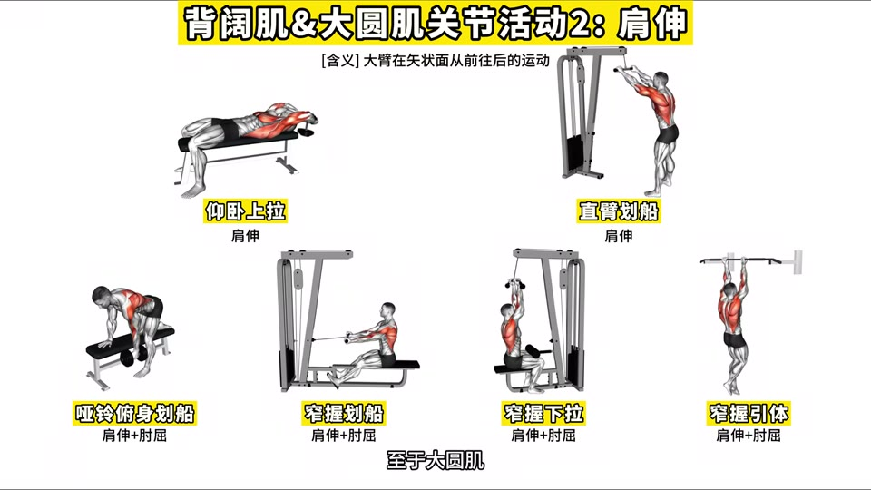

*图 16：肩伸动作：仰卧上拉、直臂划船、哑铃俯身划船、窄握划船、窄握下拉、窄握引体。*

**小问题：划船时大臂能后伸超过躯干两侧吗？** [25:00]

- 有人说大臂到躯干两侧时肩伸肌就最短了，再往后伸是错的。UP 主说**这不是错的，肩伸可以超过躯干两侧**。
- 大臂在躯干两侧时：背阔肌、大圆肌、肩后束三者起止点仍有前后关系，收缩**还能把大臂继续往后拉**（「仍能肩伸的三肌」）。
- 肱三长头的起止点几乎在一条竖直线上，没有前后关系，拉不动了；下胸的起止点是**反向**的前后关系，收缩反而把大臂往前拉（「不能肩伸的两肌」）。
- 所以大臂过了躯干两侧后继续后伸会越来越困难，原因之一是「肩伸五肌变成了肩伸三肌」，干活的肌肉变少了。

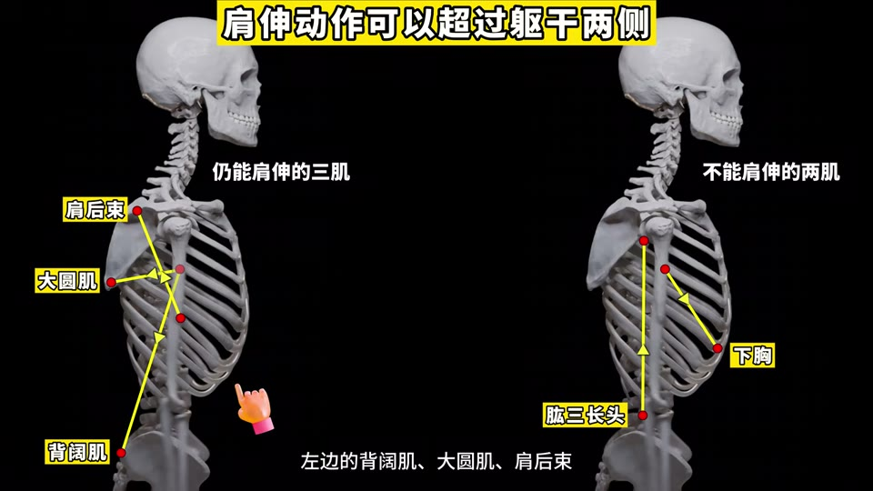

*图 17：大臂在躯干两侧时，背阔肌、大圆肌、肩后束还能继续后拉；肱三长头和下胸不能。*

### 3.4 关节活动 3：肩伸 mix 肩水平外展（开肘划船）[26:35]

- 解剖教材不讲这种非解剖面的关节活动，是 UP 主为了解释划船动作额外补充的。
- 完全不开肘的划船是**肩伸**；完全水平开肘的划船是**肩水平外展**；**半开肘的划船**是两者按一定比例复合。
- **「中间法」分析**：
  - 不开肘划船（后半程的肩伸）有利于**外背阔**；
  - 水平开肘划船（肩水平外展）有利于水平向的肌纤维，即**肩后束**（第 1 集和第 3 集练肩讲过）；
  - 半开肘划船的开肘角度在两者之间，有利的肌纤维也在两者之间，是那些**有斜度**的肌纤维。开肘大一些，偏向偏水平的**大圆肌、上背阔**；开肘小一些，偏向偏竖直的那部分背阔肌纤维。

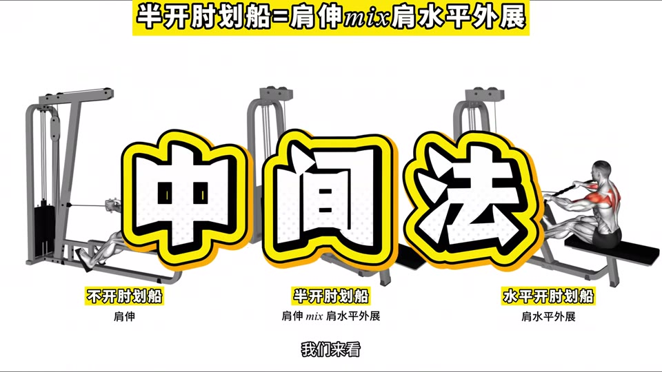

*图 18：不开肘划船（肩伸）、半开肘划船（肩伸 mix 肩水平外展）、水平开肘划船（肩水平外展）。*

### 3.5 背阔肌/大圆肌关节活动总结（黄色亮暗图）[28:03]

| 关节活动 | 典型动作 | 大圆肌 | 上背阔 | 外背阔 |
|---|---|---|---|---|
| 肩内收 | 宽握引体/下拉 | ✓ | ✓ | ✓（均匀但不特别亮，「雨露均沾，七七八八都能练到」） |
| 肩伸 | 窄握引体/下拉/划船 | ✓/✗（前半程有利、后半程不利） | ✗ | ✓（亮黄） |
| 肩伸 mix 肩水平外展 | 开肘划船 | ✓ | ✓ | ✗（越往外背阔越竖直，渐变成浅黄） |

- 用法：要强化**外背阔**，首选**肩伸**动作；要强化**上背阔**，多练**开肘划船**；想全面兼顾，就用**肩内收**动作。UP 主说这组图可以存下来。

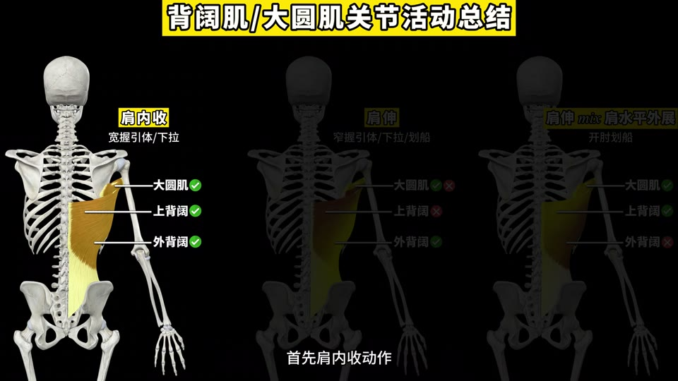

*图 19：三个关节活动分别对大圆肌、上背阔、外背阔的利弊（图中依次高亮）。*

### 3.6 怎么把背练宽、练厚 [29:24]

- **练宽**：指大圆肌和外背阔的肌肥大。可以选雨露均沾的肩内收动作（如宽握引体、下拉），也可以选更侧重大圆肌和外背阔的**全程肩伸**动作（UP 主举例「高位划船类」的动作）。
- **练厚**：不需要侧重什么动作。任何部位的肌纤维肌肥大都是朝四周长的，都会让所在部位变厚。大圆肌、外背阔肥大除了让背变宽也会让那里变厚；上背阔或斜方肌肥大虽不让背变宽，也能让所在位置变厚。所以「背上所有肌肉都肌肥大了，背就厚了」。

---

## 4. 充电社群（推广）[30:15]

课间推广：B 站每月 5 元的充电学习社群（每月训练/营养图文、直播课及回放、粉丝群、每月打包资料），以及按问卷定制减脂/增肌方案（约三天电邮回复）。此处略过。

---

## 5. 冈下肌 [32:12]

### 5.1 解剖与识别

- 大圆肌继续往内是**冈下肌**，长在肩胛骨的肩胛冈之下，所以叫冈下肌。它也止于大臂肱骨，所以能带动大臂运动。有人叫它「背的眼睛」，UP 主觉得有点抽象。
- 冈下肌由**两组肌束**组成，所以有些人冈下肌内部有「半条线」把它分成上下两部分。这是背部肌肉识别的**常见干扰项**：很多人误判为两块肌肉，上面说是冈下肌，下面乱说成小圆肌，这是错的。小圆肌其实几乎看不到（见下一节）。

### 5.2 用冈下肌定位肩胛骨（「神器」）[33:03]

冈下肌几乎刚好覆盖肩胛骨背面，找到冈下肌轮廓就确定了肩胛冈和肩胛骨内缘的位置。在它基础上往下、往外扩一点就是肩胛骨背面轮廓。超出的部分要留给大圆肌起点（长到肱骨前方）和小圆肌起点（长到肱骨后方）。

画面步骤：

1. **Step 1**：辨认出三角形的冈下肌，把冈下肌轮廓往下、往外画一点。
2. **Step 2**：找到肩膀最外侧的点**肩峰**（肩胛骨最外的点），把肩峰和冈下窝连起来，大致就画出肩胛骨了。

- 例图里肩胛骨是**上旋**状态，因为大臂抬起、肱骨头升高，肩胛骨必须跟着上旋，避免和肱骨头撞击。

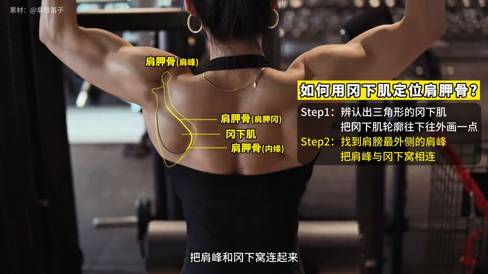

*图 20：用「冈下肌 + 肩峰」两个标志定位肩胛骨。*

### 5.3 冈下肌的关节活动：力臂太小，会被「劣后募集」[34:12]

- 冈下肌长在**非常接近肱骨头**的位置，先天决定了它对肩关节的**力臂**非常小，拉动大臂的能力很弱。
- **对比冈下肌和肩后束**（肩水平外展的示意图）：杠杆的支点是肩关节（肱骨头和关节盂的衔接点）。冈下肌从肩胛骨下方长到离肱骨头非常近的地方；肩后束从肩胛冈长到大臂中段。凭朴素直觉也知道肩后束收缩更容易拉动大臂。
- **力臂**是力的方向到关节点的垂线距离。冈下肌的力臂很短，肩后束的很长；同样拉力下冈下肌的拉动能力弱得多。
- 力学公式（画面）：**力矩 T = 力量 F × 力臂 r**。冈下肌、小圆肌长在肱骨头附近，力臂很小，力矩就很小，这类「低效拉动」的肌肉会被**劣后募集**：让它们收缩要耗能，产生的力矩却微弱，性价比太低。
- 例子：三块肌肉都能让大臂在冠状面做肩内收，身体会把有限的能量分配给**大圆肌**，因为它的力臂大得多。UP 主原话：「只有神经错乱的人才会让冈下肌或小圆肌去收缩来拉动大臂做肩内收……你能把我拉过去算我输。」

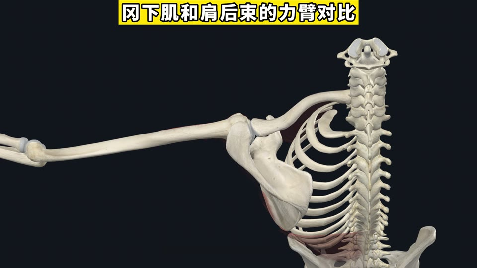

*图 21：肩水平外展示意：冈下肌长在肱骨头附近，力臂短；肩后束长到大臂中段，力臂长。*

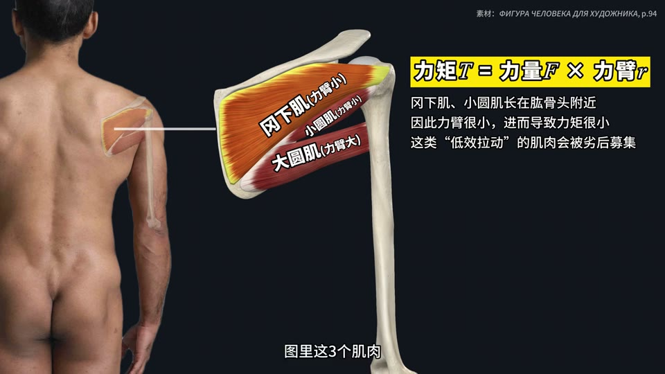

*图 22：画面文字：冈下肌、小圆肌长在肱骨头附近，因此力臂很小，进而导致力矩很小，这类「低效拉动」的肌肉会被劣后募集。*

### 5.4 肩袖四肌的真正功能 [36:56]

画面文字整理：

- **[肩袖四肌]** 冈下肌 + 小圆肌 + 冈上肌 + 肩胛下肌
- **[共同特点]** 离肱骨头很近，导致力臂和力矩很小
- **[主要功能]** 控制肱骨头对准关节盂，而非拉动肱骨运动

说明：

- 它们像四个精密的机械手臂，精准控制肱骨头对准关节盂、不跑出去。拉动肱骨运动是胸大肌、三角肌、大圆肌、背阔肌等长得更靠下、力臂更大的肌肉的工作。
- 所以很多解剖教材**只承认冈下肌有「肩外旋」（shoulder lateral rotation）功能**。
- 为什么旋转不受力臂限制：就像双手搓一根棍子，作用力放在棍子上中下任何位置都能让它旋转。说「肌肉长在关节点附近力矩很弱」，指的是骨头的**杠杆运动**，不是**旋转运动**。
- 也有教材「给冈下肌留了点面子」，承认它和肩后束一起做肩水平外展。这个系列的总结表也这样写了，但第 1 集就提醒过：冈下肌力臂小、会被劣后募集，肩后束才是主要的。
- **结论：健身里没有专门练冈下肌的动作。** 它最大的功能是作为肩袖四肌之一稳定肱骨头，而不是拉动大臂大范围摆动。

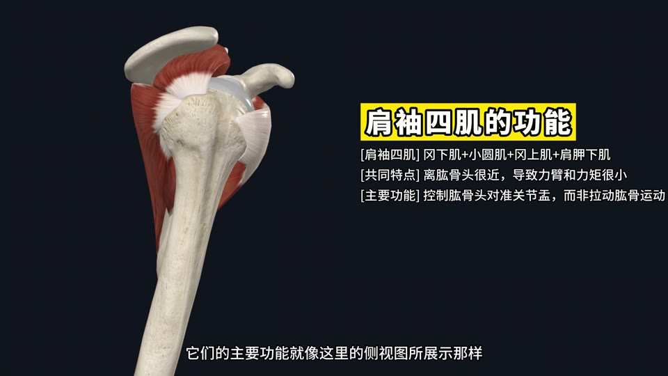

*图 23：肩袖四肌：离肱骨头很近、力臂小，主要负责让肱骨头对准关节盂。*

---

## 6. 小圆肌 [38:53]

- 小圆肌是冈下肌的「难兄难弟」，同样长得非常接近肱骨头、产生的力矩很弱。
- UP 主反对「练大小圆」的说法：好像小圆肌对背部视觉效果很重要、能专门练大，这是不对的。

**小圆肌卡片**（画面文字）：[起点] 肩胛骨外缘中段；[止点] 肱骨大结节；[功能] ① 肩外旋 ② 稳定肱骨头。*小圆肌、冈下肌的走向与功能是相同的。

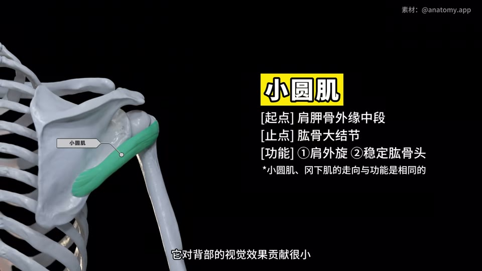

*图 24：小圆肌卡片：功能是肩外旋和稳定肱骨头。*

### 6.1 第一点：小圆肌几乎看不到

- 解剖软件里看，小圆肌在大圆肌上方，起于肩胛骨外侧、止于肱骨后方，似乎应该是很明显的肌肉块。但任何实拍图里，哪怕背部很发达、体脂很低，也找不到单独的小圆肌。
- 医用/美术解剖教材会提醒美术生千万别「画蛇添足」画小圆肌，原话是小圆肌几乎看不到，画出来反而错。另一本教材标注了所有浅表肌肉（冈下肌、大圆肌、肩后束），唯独不标小圆肌。
- **原因一：被三角肌覆盖**。同一具大体，拆掉三角肌时能看到小圆肌有一点体积；保留三角肌时，三角肌（特别是肩后束）几乎完全盖住小圆肌，只露出一丢丢起点。小圆肌本质上是「第二层肌肉」，不是浅表肌肉。
- **原因二（更重要）**：小圆肌和冈下肌**肌纤维走向完全一致，且有共同的肌筋膜包裹**，视觉上无法分开。新鲜大体图上它俩之间只有一条很不起眼的线，那是撕开的肌筋膜。就算没有肩后束覆盖，也看不出单独的小圆肌。
- 实拍图里如果一定要指出小圆肌，应定位在「我们认为的冈下肌」的边缘那一点点，它会被当成冈下肌的一部分；再往上就被肩后束盖住了。

### 6.2 第二点：力臂很小，被劣后募集

- 和冈下肌一样，长在非常接近肱骨头的位置，对肩关节的力臂很短，力矩很小，对拉动大臂做大范围运动的贡献很弱。比如肩内收时，背阔肌、大圆肌、胸大肌止点离肱骨头远，力臂大；小圆肌力臂很小，人体会劣后募集它。
- UP 主的比喻：你只有两个硬币看健身视频，肯定优先投给收获知识多的视频（「投给我」），劣后投给别人，就是这个道理。
- 大部分解剖软件和教材**只承认小圆肌有肩外旋功能**。
- 结论：UP 主「没法教你怎么去专门练小圆肌，因为它的使命就不是肌肥大」，希望观众「成为互联网上第一批不说大小圆的人」。

---

## 7. 斜方肌 [44:01]

按肌纤维走向，人为把斜方肌分为**上、中、下三束**。

### 7.1 上斜方肌的解剖

- 从**锁骨外 1/3** 长到**颈后**（截止到颈后凸起的第 7 颈椎）。锁骨在身体正面，所以后视图看不到它在锁骨上的附着，要看侧视图。上斜方肌和肩前束共用锁骨外 1/3，从侧面绕到颈后，俗称「脖子」。拉力方向是**斜上**的。
- 所谓「高耸的斜方肌连到头皮」，指的就是上斜方肌的外缘线。
- 画面卡片：[起点] 枕骨、上项线（截止到第 7 颈椎）；[止点] 锁骨外 1/3（通过上提锁骨来带动肩胛骨）；[功能] ① 肩胛骨上提（上斜方肌 + 菱形肌 + 肩胛提肌）② 肩胛骨上旋（上斜方肌 + 下斜方肌 + 前锯肌）。

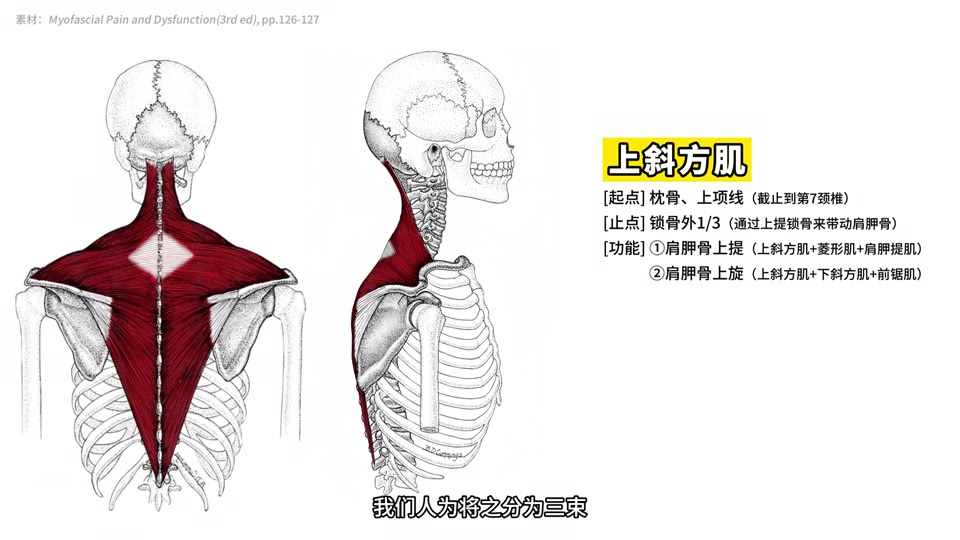

*图 25：上斜方肌：止于锁骨外 1/3，通过上提锁骨带动肩胛骨。*

### 7.2 中斜方肌的解剖

- 锁骨结束后进入肩胛骨。中斜方肌从**肩胛骨的肩峰、肩胛冈**长到**第 7 颈椎以下**的位置，拉力方向**接近水平向内**。
- **第 7 颈椎**是颈后一个巨大的骨性突起，再胖的人都摸得到，这里就是**中、上斜方肌的分界点**。
- 画面卡片：[起点] C7–T3 椎（开始于第 7 颈椎）；[止点] 肩胛骨的肩峰和肩胛冈；[功能] ① 肩胛骨后缩（中斜方肌 + 下斜方肌 + 菱形肌）。
- **小测验：深蹲时杠铃扛在斜方肌哪一部分？** 答：扛在第 7 颈椎突点之下、肩胛冈之上，所以是**中斜方肌**。有人说扛在上斜方肌，那得把杠铃扛到第 7 颈椎之上，这是错的。

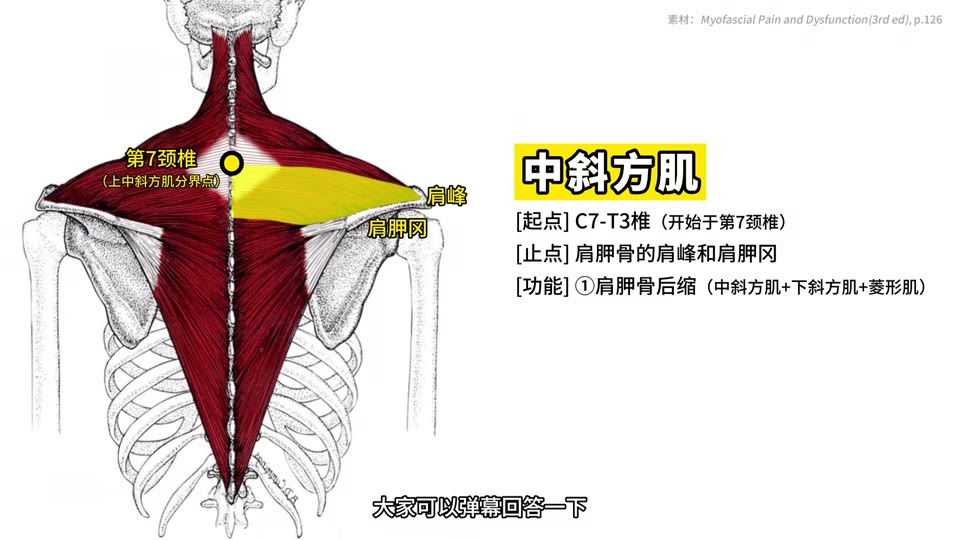

*图 26：黄色区域是中斜方肌：从第 7 颈椎开始，止于肩峰和肩胛冈。*

### 7.3 下斜方肌的解剖

- 从**肩胛冈内侧**长到**胸椎**。特别注意：下斜方肌覆盖肩胛骨内侧角的那个**三角区是不增厚的肌腱**，下斜方肌就靠它附着到肩胛骨上。
- 斜方肌还有一处肌腱：第 7 颈椎附近的**菱形区**。肌腹能增厚、肌腱不会，所以要默认**肌腱是凹陷区域**。
- 实拍图里斜方肌在肩胛骨内侧角处有个「意外的转角」，就是因为那里是下斜方肌的肌腱，没有厚度，容易误认为斜方肌缺了一块，其实没有缺。
- 画面卡片：[起点] T4–T12 椎；[止点] 肩胛骨内侧角（此处是凹陷的肌腱）；[功能] ① 肩胛骨下沉（下斜方肌 + 背阔肌 + 胸小肌）② 肩胛骨后缩（中斜方肌 + 下斜方肌 + 菱形肌）③ 肩胛骨上旋（上斜方肌 + 下斜方肌 + 前锯肌）。（画面上第三条序号印成了「②」，按内容应为③。）

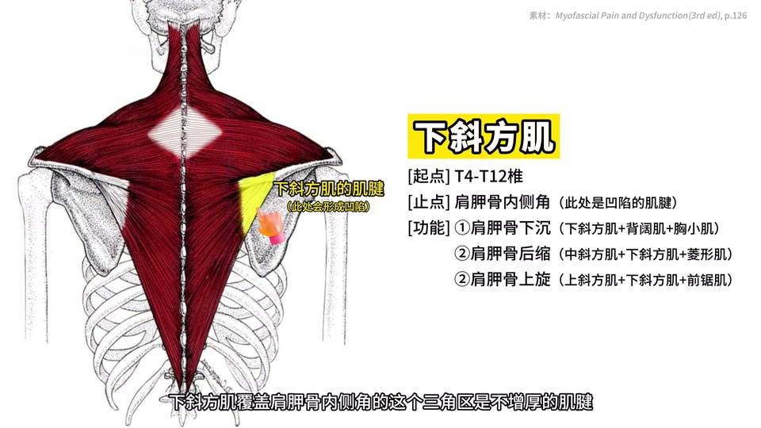

*图 27：黄色三角区是下斜方肌的肌腱，此处会形成凹陷。*

**实拍复习** [45:49]：用肩峰和三角形的冈下肌定位肩胛骨轮廓。上斜方肌从锁骨外 1/3（前面看不到）到颈后第 7 颈椎，即「脖子」，斜上拉力；中斜方肌从肩峰、肩胛冈到胸椎，是扛杠铃的地方，水平拉力；下斜方肌从肩胛冈内侧角到胸椎，内侧那块小三角是不增厚的肌腱。算上这块肌腱，斜方肌才是一个完整的三角形。

### 7.4 上斜方肌的关节活动 [46:41]

**① 肩胛骨上提 → 负重耸肩**

- 上斜方肌起于身体正面的锁骨，往上往后绕到颈后，**根本不长在肩胛骨上**，收缩的效果是拉动**锁骨上提**。
- 为什么解剖书说它导致肩胛骨上提？因为锁骨和肩胛骨通过**肩锁关节**连接，总是同时上提、下沉（可以摸着自己的锁骨和肩胛冈验证）。
- 对应训练动作：各种**负重耸肩**。中斜方肌虽然长在肩胛冈上，但它的肌纤维是水平向的，不能把肩胛骨往上提。
- 例子：美国有人坚持只练单边耸肩，结果形成了单边的上斜方肌肥大。这像一个控制变量实验，证明了「**练上斜方肌就是靠耸肩**」。

**侧平举里的耸肩** [48:10]

- 练肩中束的侧平举、提拉，本该用**肩外展**让配重上升。但很多人用了过大的重量，超出肩外展肌的能力，就会引入耸肩来帮配重上移。
- 对比正常侧平举（肩外展）和耸肩式侧平举（肩外展 + 肩胛骨上提），锁骨上提程度完全不同。锁骨剧烈上提就是上斜方肌收缩导致的。
- 侧平举本应是肩外展的单关节动作，但多数人做成了「肩外展 + 锁骨上提 + 肩胛骨上提」的双关节运动。UP 主说「也不能说有错」，如果你确实想在侧平举里兼练上斜方肌的话。

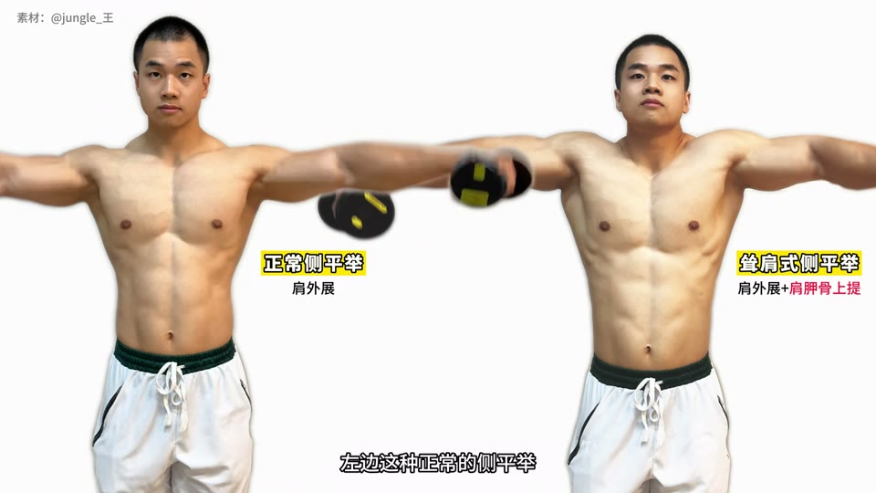

*图 28：左：正常侧平举（肩外展）；右：耸肩式侧平举（肩外展 + 肩胛骨上提）。*

**② 肩胛骨上旋，但不能用来练肌肥大** [49:00]

- 肩胛骨上旋是**跟随抬手动作**发生的，让肩峰和肱骨头保持原有空隙、不撞上。**肩胛骨上旋三肌**：上斜方肌、下斜方肌、前锯肌（下部）。它们收缩形成「转盘式」效果让肩胛骨上旋。
- 但**没法用肩胛骨上旋来练这三块肌肉的肌肥大**，因为此时它们**不对抗健身里的外在阻力**。比如侧平举：外在阻力加在肱骨上，不在肩胛骨上；费劲的是让肱骨抬起的肩外展肌，不是肩胛骨上旋肌。
- 比喻（画面：拉车的人与旁边的人）：左边的人在拉重物，相当于侧平举里的肱骨；右边的人挨得很近，相当于肱骨上方的肩胛骨。左边的人快撞上时，右边的人挪一步让位，这个过程中右边的人不负重、不费力。否则侧平举、前平举、推举这些抬手动作肩胛骨都明显上旋，都成了上旋三肌的肌肥大动作了。
- 结论：肩胛骨上旋确实是上斜方肌的第二个关节活动，但**练它的肌肥大用的是第一个关节活动：肩胛骨上提**。

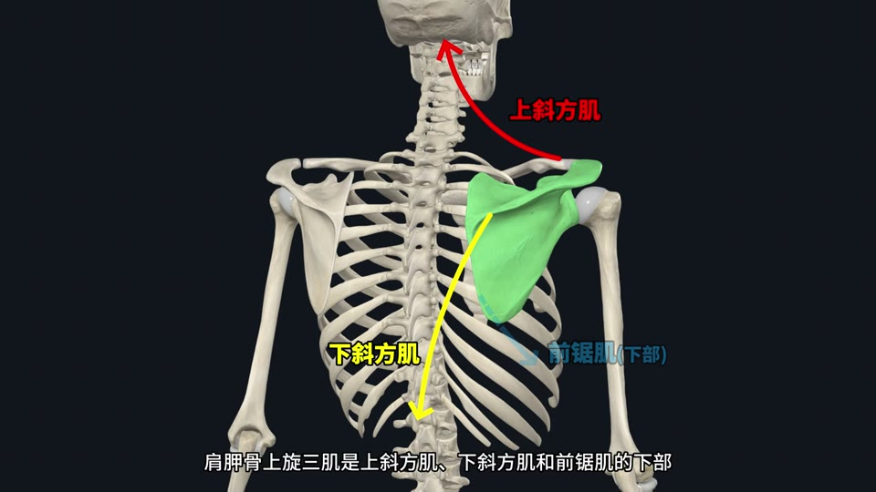

*图 29：肩胛骨上旋三肌形成转盘式效果，但它们不抗阻，不能靠上旋来练肌肥大。*

### 7.5 中斜方肌的关节活动：肩胛骨后缩 [50:23]

- 中斜方肌走向**水平向内**，关节活动是拉动**肩胛骨后缩**、靠近脊柱。
- 对应动作：**故意后缩肩胛骨的大开肘划船**。要点不在于划船，而在于**故意后缩肩胛骨**。画面列举：器械开肘划船、钢线开肘划船、澳式引体、海豹划船。
- 常见疑问：开肘划船到底要不要关注肩胛骨？有博主说要故意做前伸后缩，有人说肩胛骨要稳定。UP 主说**其实都对**，取决于你的开肘划船是单纯练背阔肌、大圆肌，还是要兼练中下斜方肌。
- UP 主的建议：**一般都兼做肩胛骨的前伸后缩**，花相同时间多一个关节活动，多练点肌肉。

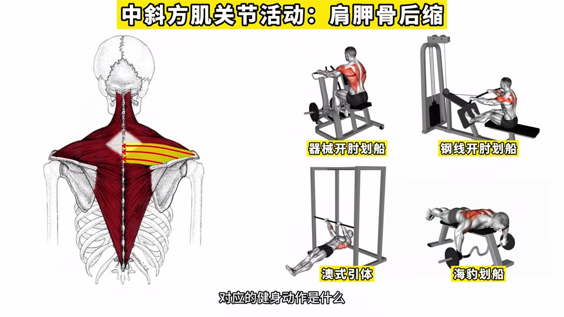

*图 30：对应动作：器械开肘划船、钢线开肘划船、澳式引体、海豹划船。*

### 7.6 下斜方肌的关节活动 [51:02]

**① 肩胛骨下沉**：下斜方肌走向斜下，和上斜方肌相反，让肩胛骨下沉。比如引体、下拉的克服阻力阶段，肩胛骨除了下旋还有下沉；也有专门只做肩胛骨下沉的训练，有人热身时用来激活下斜方肌。但这些都**谈不上是专门练下斜方肌的肌肥大动作**。

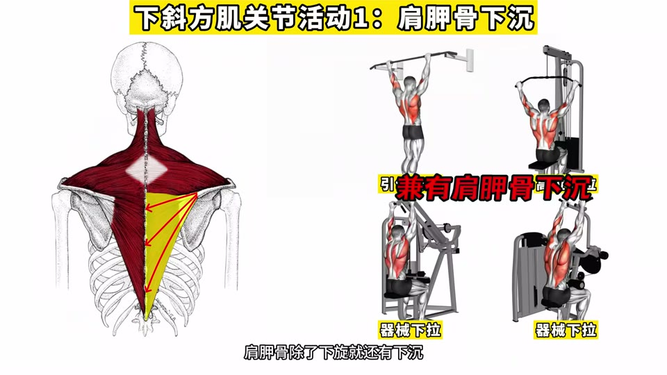

*图 31：引体、器械下拉的克服阻力阶段兼有肩胛骨下沉。*

**② 肩胛骨后缩（健身里练下斜方肌用这个）**

- 肩胛骨后缩由三块肌肉完成：**中斜方肌**（水平向，专门做后缩）、**下斜方肌**（斜下拉力）、下一层的**菱形肌**（斜上拉力）。下斜方肌和菱形肌的合力是水平往内的，正好用来后缩肩胛骨。
- 画面公式：**中斜方肌 +（下斜方肌 + 菱形肌）**，括号表示这两块要同时收缩形成水平向内的合力。

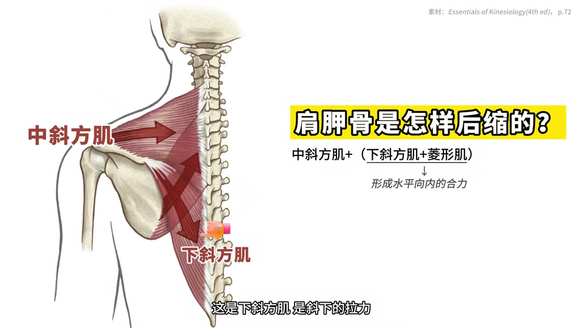

*图 32：下斜方肌斜下、菱形肌斜上，两者合力水平向内，加上中斜方肌共同后缩肩胛骨。*

**开肘角度：练中下斜方肌要开肘 60–90°** [51:58]

- 练中下斜方肌的开肘划船，应该**开肘 60–90°，相当大才行**，这样水平拉过来时对准的运动面才是中斜方肌的拉力线，以及下斜方肌与菱形肌合力的拉力线。
- 但这么大开肘，对大圆肌和上背阔来说开肘太大、拉力线太高，最佳肌纤维会偏向更水平的**肩后束、冈下肌**。
- 如果**半开肘 45°**，对中下斜方肌、菱形肌来说对准的运动面太低，但更适合**大圆肌、上背阔**。
- 画面：**大开肘划船 60–90°**：肩后束/冈下肌 + 中下斜方肌；**开肘划船 45°**：大圆肌/上背阔。
- 所以本视频里，练中下斜方肌的叫「**大开肘划船**」，练上背阔的叫「**开肘划船**」，言下之意是中下斜方肌需要更大的开肘。

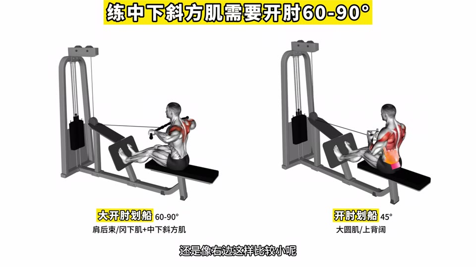

*图 33：左：大开肘划船 60–90°（肩后束/冈下肌 + 中下斜方肌）；右：开肘划船 45°（大圆肌/上背阔）。*

**延伸：拉动方向不垂直于躯干时** [53:01]

- 有些划船的拉动方向是**斜上**指向躯干的（如画面上的俯身杠铃划船），这时不是单纯的肩胛骨后缩，而是**肩胛骨后缩 + 肩胛骨上提**的复合，训练部位变成**中上斜方肌**。画面注：不是所有划船都是标准的肩胛骨后缩。
- 反过来，一般下拉动作肩胛骨没有后缩，但**后仰很厉害的下拉**会有后缩，拉动方向是**斜下**指向躯干的，这时是**肩胛骨后缩 + 肩胛骨下沉**的复合，训练部位在中下斜方肌里**更强调下斜方肌**。
- 提醒：拉动方向**垂直于躯干**才是标准的肩胛骨后缩；不垂直时，肩胛骨后缩会复合下沉或上提，要会识别。

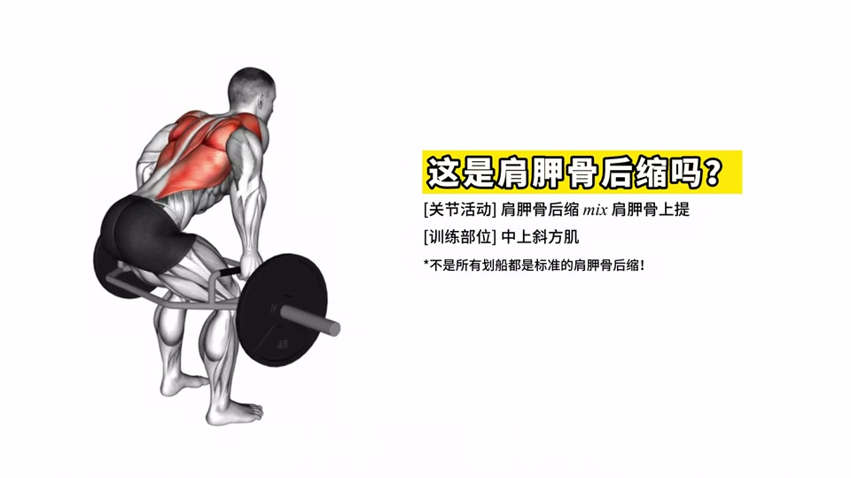

*图 34：画面文字：[关节活动] 肩胛骨后缩 mix 肩胛骨上提；[训练部位] 中上斜方肌。*

**备选动作：蝴蝶机反向飞鸟** [54:04]

划船之外，也可以用蝴蝶机反向飞鸟练中下斜方肌，逻辑一样：第一，开肘要大，60–90°，才能适应中下斜方肌、菱形肌的高度；第二，要做**故意的肩胛骨后缩**，而不是像（练肩后束的）反向飞鸟那样强调保持肩胛骨稳定。这个动作其实就是「取消了肘屈的划船」，有些人觉得体验更好。

**③ 肩胛骨上旋**：同上斜方肌，健身里不用上旋来练这三块肌肉的肌肥大，因为外在阻力加在肱骨上，肩胛骨只是跟着肱骨抬起而退让。

### 7.7 为什么上斜方肌容易有发力感，中下斜方肌不容易？[54:54]

- 常见抱怨：耸肩、侧平举动不动就觉得脖子酸，中下斜方肌的肩胛骨后缩动作却不容易找到发力感。
- 原因和**肌梭密度**有关。肌梭是肌肉里的感受器，你之所以能感受到一块肌肉在发力，是肌梭告诉神经系统的。谁的肌梭密度高，谁就被更强烈地感受到。
- UP 主引用论文《斜方肌各亚部的肌构筑肌梭分布研究及其临床意义》（中国临床解剖学杂志，2010 年第 28 卷第 1 期）：斜方肌是一块肌梭分布很不均匀的肌肉。画面表格的肌梭密度（个/cm³）：上斜方肌（降部）**39.05 ± 5.08**，中斜方肌（水平部）**24.48 ± 6.50**，下斜方肌（升部）**21.68 ± 6.64**。UP 主口头说上斜方肌比中下斜方肌密集「6 到 9 成」（按表中数字算约高 6–8 成）。
- 论文结论：降部（上斜方肌）肌梭密度显著高于其他两部，提示上斜方肌有更强的感觉反馈能力。
- 要建立的认识：**肌肉发力感的强弱，很大程度取决于这块肌肉天然的肌梭密度。**

### 7.8 「没感受到肌肉，肌肉就没收缩？」[55:56]

- 新手练背常说「我没有背阔、大圆的发力感，是不是没练到背」，甚至有博主恐吓说「你是用二头在拉的」。UP 主说每次看到这种言论「就有一种手伸不进屏幕的无力感」。
- 画面文字：练背克服阻力做肩内收/肩伸，就是背阔肌、大圆肌等收缩导致的，和肱二头肌毫无关系（它没有这个功能）。
- 基本常识：**只要发生了那个关节活动，就必然是对应的肌肉在收缩**；对应肌肉不收缩，就根本没法发生那个关节活动。这和你是否感受得到那块肌肉没有关系。
- 比喻：老板说「我没感受到你的努力，你就是没努力」，这不对。有的员工默默干活老板感受不到，有的人干一点活就去老板那大吹特吹。不能以老板的主观感受判断员工是否干活，也不能以「我感受到肌肉没有」判断肌肉是否干活。

---

## 8. 菱形肌 [57:26]

- 从**肩胛骨内侧缘**以斜上走向长到**胸椎**，拉力线斜上，形状是菱形，所以叫菱形肌。
- 画面卡片：[起点] 肩胛骨内缘；[止点] C7–T5 椎；[功能] ① 肩胛骨上提（上斜方肌 + 菱形肌 + 肩胛提肌）② 肩胛骨后缩（中斜方肌 + 下斜方肌 + 菱形肌）③ 肩胛骨下旋（肩胛提肌 + 菱形肌 + 胸小肌）。
- 去掉斜方肌时能看到菱形肌全貌；保留斜方肌时它大部分被盖住，只露一小点。实拍图里只有在**抬手展背**、肩胛骨充分上旋时才能看到：先找冈下肌定位肩胛骨内侧缘，菱形肌就长在那里，肩胛骨上旋把它往外拉出来一些，露出面积大一点才看得见。

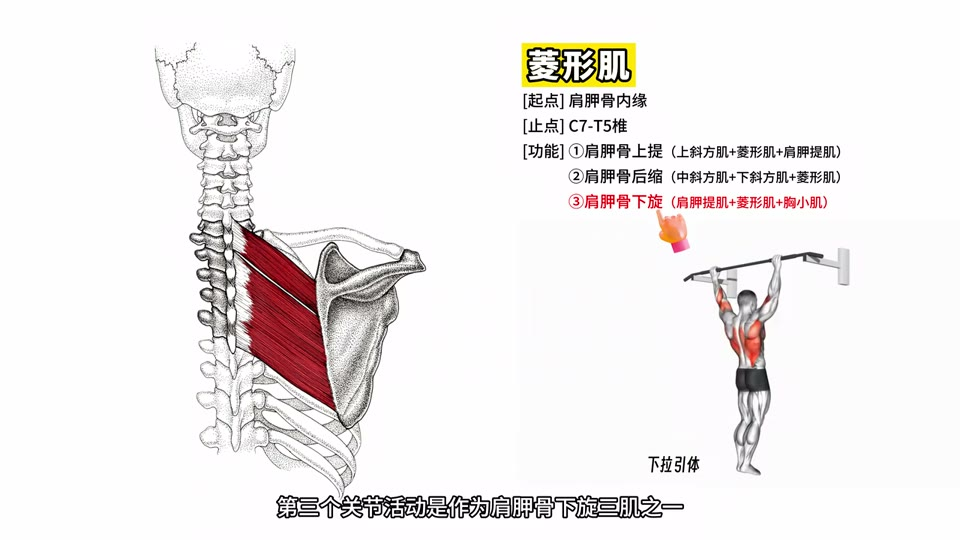

*图 35：菱形肌：起于肩胛骨内缘，止于 C7–T5 椎；第三个功能是肩胛骨下旋（画面以下拉、引体为例）。*

**关节活动**：

1. 和上斜方肌一起参与**肩胛骨上提**，即耸肩。
2. 和下斜方肌形成水平往内的合力，叠加中斜方肌的水平拉力线，让**肩胛骨后缩**。
3. 作为**肩胛骨下旋三肌**之一。但肩胛骨下旋不能用来练菱形肌，逻辑和上旋一样：肩胛骨本身不负重，只是跟着肱骨移动。比如高位下拉时，肩内收肌抗阻让大臂落下，肩胛骨跟随下旋归位，保持肩峰和肱骨头之间的合适距离。抗阻的是肩内收肌，不是肩胛骨下旋肌（还是拉车那张图：左边的人在抗阻，右边的人只是跟随）。

**一言以蔽之**：菱形肌不是浅表肌肉，如果一定要练，就是两个动作：**耸肩**和**肩胛骨后缩的划船**。

---

## 9. 竖脊肌 [59:04]

### 9.1 解剖

- 竖脊肌群在脊柱两侧从上到下，从颈后枕骨长到骨盆，跨越头、颈、背、腰，是一组超长的**肌肉群**，不是一块肌肉，常省略「群」字简称竖脊肌。画面分三组：[内] 棘肌、[中] 最长肌、[外] 髂肋肌。
- **它不是下背肌肉**，最高处都到脑袋了。说竖脊肌是下背肌肉「只会暴露你的基础知识有问题」。
- 但竖脊肌确实只有在下背腰部才容易看出轮廓，原因有两个：
  1. **从上到下越来越厚实粗壮**。横截面图（从下往上看）：胸椎段（T8）竖脊肌横截面积较小；腰椎段脊柱更粗，竖脊肌横截面积更大。
  2. **从上到下越来越浅表**。竖脊肌在不同区段被菱形肌或背阔肌覆盖，再被一层斜方肌覆盖。覆盖最薄的地方是白色的**背阔肌腱膜**（胸腰筋膜浅层），别处都是厚厚的肌腹覆盖，甚至不止一层。掀开这层筋膜就是竖脊肌，它在这里约等于浅表肌肉。

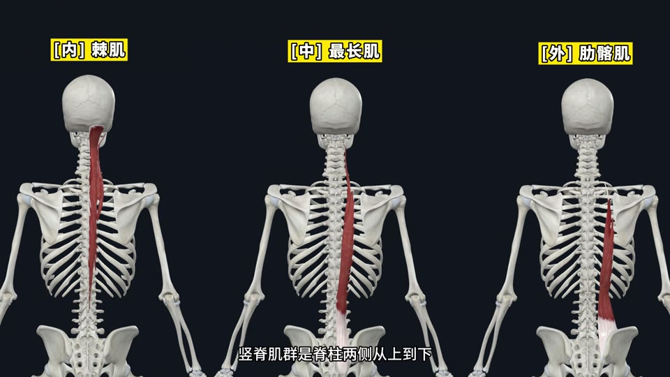

*图 36：竖脊肌群从内到外分三组：棘肌、最长肌、髂肋肌。*

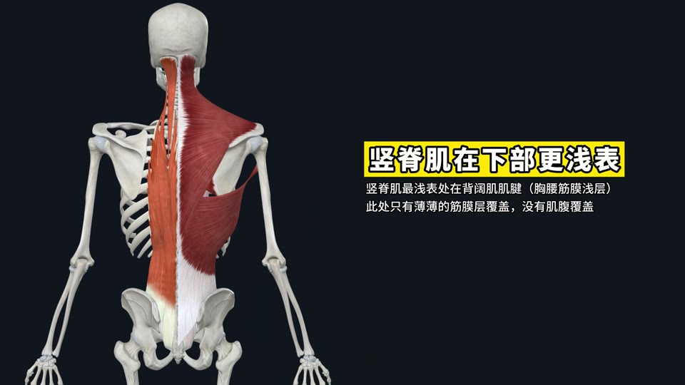

*图 37：画面文字：竖脊肌最浅表处在背阔肌肌腱（胸腰筋膜浅层），此处只有薄薄的筋膜层覆盖，没有肌腹覆盖。*

- 实拍图：脊柱旁边凸起反光的就是竖脊肌（凸起才会反光），标注为竖脊肌（最长肌）：① 此处竖脊肌最粗壮 ② 此处竖脊肌最浅表。往上进入背阔肌肌腹、再往上还有斜方肌、菱形肌的肌腹，竖脊肌就被彻底盖住了。所以很多人误以为竖脊肌是下背肌肉。你这里看不到竖脊肌，是因为还有厚厚的脂肪层，那是另一码事。
- 竖脊肌更强的人：抬手后背阔肌拉长变薄，让下面的竖脊肌充分暴露。一般人只能看到腰部凸起的最长肌；有的人在背阔肌肌腹位置也能看到凸起，那是竖脊肌外侧的**髂肋肌**，比外侧背阔肌明显更厚，因为下面叠了髂肋肌。这种「内扣外鼓」的效果很少见，除非髂肋肌非常强大。

### 9.2 关节活动：脊柱伸 [62:38]

- 竖脊肌收缩导致**脊柱伸**：脊柱从弯变直，乃至反弓。
- 名字由来：「竖」是动词，使……竖起来；「脊」是脊柱。竖脊肌就是使脊柱竖起来的肌肉。日语干脆翻译成「脊柱起立肌」，让坍塌的脊柱起立。
- 游泳的例子：脊柱往后反弓（**脊柱伸**）时竖脊肌收缩隆起，特别明显；脊柱往前弯曲（**脊柱屈**）时竖脊肌拉长变薄，就不明显了。

### 9.3 对应动作：山羊挺身 [63:59]

- 画面文字：[关节活动 1] 脊柱伸（竖脊肌）；[关节活动 2] 髋伸（臀大肌 + 腘绳肌）；[动作要点] 让背从弯变直乃至反弓。
- 这是一个**脊柱伸 + 骨盆后倾**的双关节动作：
  - 脊柱：克服阻力阶段脊柱从弯变直，这叫脊柱伸，练竖脊肌。**要点是让背从弯变直**。UP 主说很多人做的时候背全程都是直的，「他就是没搞明白这个动作的关节活动到底是啥」。
  - 髋关节：克服阻力阶段大腿不动、骨盆动，大腿和骨盆夹角变大，这叫**骨盆后倾**，属于髋伸的远固定方式，由前侧的腹直肌或后侧的臀大肌、腘绳肌收缩拉动。远固定、近固定比较难懂，后续视频还会讲，这里听不懂就算了。
- **提醒（腰痛）**：有人腰痛就觉得应该去练竖脊肌、做山羊挺身，这是错的。腰痛有一万种原因，是世界级医学难题，**不要自我诊断、自我治疗**，觉得腰痛就去练竖脊肌可能越练越糟。

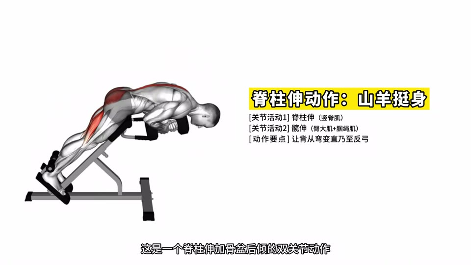

*图 38：山羊挺身是脊柱伸 + 骨盆后倾（髋伸）的双关节动作，要点是让背从弯变直乃至反弓。*

### 9.4 竖脊肌的等长收缩 [64:58]

- 一般健身里专门练竖脊肌（专门做山羊挺身）很少，没多少人觉得竖脊肌越大越帅。
- 在很多**俯身动作**里会以**等长收缩**的形式顺便练到竖脊肌，例如**硬拉、杠铃划船、T 杆划船**。这些动作里背部保持刚性，看似没有脊柱屈伸，但负重本身会让你弯腰，你却没有弯腰，是因为竖脊肌在等长收缩（长度不变），阻止了弯腰。所以这些动作客观上也能练到竖脊肌，让它产生延迟性酸痛。
- 只是**等长收缩不如山羊挺身那种向心、离心收缩对肌肥大的效果好**。

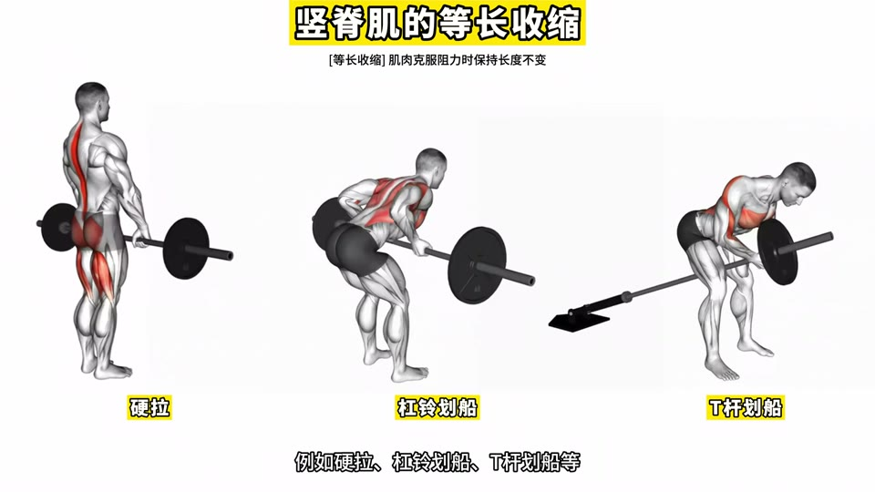

*图 39：画面文字：[等长收缩] 肌肉克服阻力时保持长度不变。*

---

## 10. 咏背肌（口诀）[65:52]

UP 主写了一首八句的《咏背肌》作为本集的记忆口诀（最后一句是玩笑）。下面是每句对应的要点，开头两句照引原话：

- 「背阔大圆好兄弟，关节活动没差异。」背阔肌、大圆肌的关节活动相同。
- 肩内收雨露均沾，肩伸对外沿更有利。
- 上斜方提肩胛，负重耸肩就合适。
- 中下斜方缩肩胛，开肘划船是妙计。
- 菱形肌在第二层，展背时才露出一点点。
- 冈下肌和小圆肌力臂太小，「遭嫌弃」（被劣后募集）。
- 竖脊肌群又多又长，挺直身板靠它。

---

## 11. 专题一：背部复习与均衡练背计划 [66:42]

### 11.1 背阔肌/大圆肌复习

UP 主强调：**不要去记具体动作的名称，而要学会识别关节活动，这才是统领全局的。**

1. **冠状面的肩内收**（各种宽握引体、下拉）：雨露均沾，背阔、大圆各部位都能七七八八练到。
2. **矢状面的肩伸**（各种窄握下拉、引体、划船）：有利于始终在矢状面的外背阔；如果包含肩伸前半程（例如「高位划船」类动作），还有利于大圆肌；全程都不利于上背阔。
3. **肩伸 + 肩水平外展复合的开肘划船**：有利于介于两者之间的部位，即上背阔和大圆肌。开肘特别小就过渡到外背阔，开肘特别大就过渡到肩后束。要从「连续变量」的角度理解。

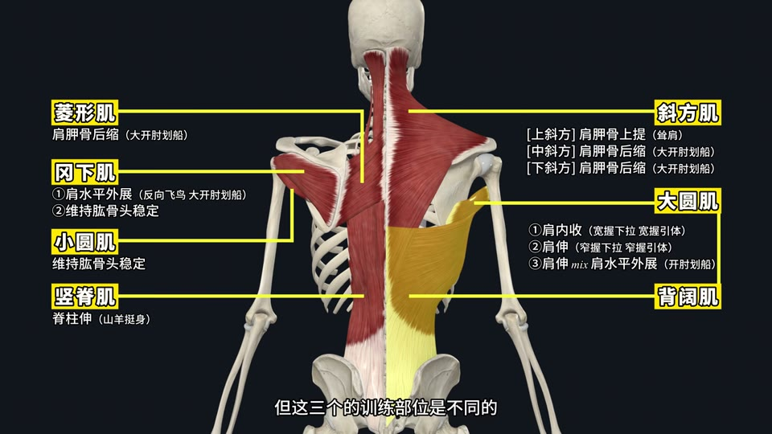

*图 40：复习图：背阔肌、大圆肌有三个关节活动，但训练部位各不相同。*

**背阔肌实拍图里的干扰线**（复习）：

| 干扰线 | 实质 |
|---|---|
| 圣诞树 | 背阔肌通过胸腰筋膜形成的肌腱与肌腹分界 |
| 抬手展背时出现的线 | 肩胛骨上旋，拉扯附着在肩胛骨下角的背阔肌纤维 |
| 外沿往内的竖线 | 背阔肌起于髂嵴的肌束和起于胸腰筋膜的肌束的分界 |
| 斜下走向的线（前锯肌发达的人） | 背阔肌下层的前锯肌下缘 |

很多人以为有一条线就该分成上下两块肌肉，结果把一块背阔肌「大卸八块」去辨认。

**其他肌肉复习**：

- 冈下肌：体脂低时可见上下两部分，是同一块肌肉。和肩后束一起做肩水平外展，但力臂小、被劣后募集，贡献比例不大。
- 小圆肌：实拍图里和冈下肌融为一体，看不到。同样力臂小、被劣后募集。二者主要功能是作为肩袖四肌之一让肱骨头对准关节盂，**不要考虑用什么动作去专门练这两块肌肉**。
- 斜方肌：UP 主更正，图示里斜方肌在肩胛冈内侧角的三角形附着是不增厚的肌腱，应涂成白色。上斜方肌做肩胛骨上提，动作是**耸肩**（侧平举、提拉里重量过大时也会用上斜方肌帮忙）；中斜方肌、下斜方肌和菱形肌一起做肩胛骨后缩，动作是**故意后缩肩胛骨的大开肘划船**。其他关节活动没有对应的肌肥大动作，所以斜方肌「关节活动很多，但健身动作就俩」。
- 竖脊肌：脊柱伸，动作是山羊挺身，要点是背部从弯变直；更多时候在硬拉、杠铃划船、T 杆划船等俯身动作里做等长收缩。

### 11.2 均衡练背计划 [70:51]

应观众要求每集给一个训练计划（画面表格整理）：

| 关节活动 | 训练部位 | 容量 | 动作举例（自选一个） |
|---|---|---|---|
| 肩内收 | 背阔肌/大圆肌兼顾 | 1 个动作 × 4 组（8–15RM） | a. 宽握引体　b. 宽握下拉 |
| 肩伸 | 外背阔 | 1 个动作 × 4 组（8–15RM） | a. 窄握引体　b. 窄握下拉　c. 直臂划船　d. 窄握器械划船　e. 窄握 T 杆划船　f. 哑铃俯身划船 |
| 肩伸 mix 肩水平外展 | 上背阔/大圆肌/中下斜方肌（*肩胛骨要故意做前伸后缩） | 1 个动作 × 4 组（8–15RM） | a. 器械开肘划船　b. 钢线开肘划船　c. 杠铃俯身划船　d. 宽握 T 杆划船　e. 俯身海豹划船 |

**注意事项**（画面 Notes）：

1. 可以增补一个**补弱动作**，增至 4 个动作 × 每个 4 组 = 合计 16 组。
2. 动作顺序无所谓，但如果还要练肩后束，开肘划船类动作放在最后。
3. 上斜方肌（耸肩）和竖脊肌（山羊挺身）基本不故意练，有意者可以自己加组单练。

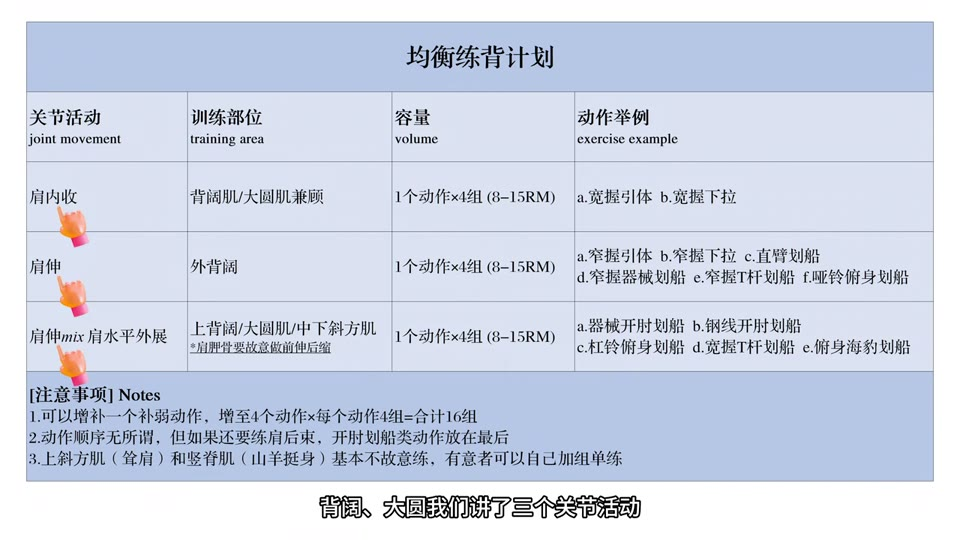

*图 41：均衡练背计划：三个关节活动各选一个动作，每个 4 组，8–15RM。*

讲解补充：

- 「肩内收是好好先生」，兼顾背阔、大圆各部位；肩伸侧重外背阔；开肘划船侧重上背阔、大圆肌，同时**故意做肩胛骨前伸后缩**就能顺便练中下斜方肌。所以这是「均衡版」。
- **补弱举例**：UP 主自己背外沿（大圆肌、外背阔）还行，上背阔和中下斜方肌不行，所以他该增补一个开肘划船类动作。你自己按每个动作对应的部位挑。
- **顺序**：如果练背日还要练肩后束（三分化，或不单独练肩的四分化），就把开肘划船放到练背最后，因为开肘划船（特别是开肘比较大的）本身「姑且算是肩后束动作」，接着做肩后束的单关节动作**反向飞鸟**，就把肩后束动作连到一起了。
- **为什么上斜方肌、竖脊肌基本不用故意练**：健美式训练里专门练它俩的频率很低。上斜方肌往往在侧平举等肩外展动作里兼练了；竖脊肌在硬拉等俯身动作里通过等长收缩兼练了。

---

## 12. 专题二：引体/下拉的握法怎么选 [73:14]

### 12.1 前置知识：小臂可旋转的角度

- 以大小臂成「锤式关系」（大拇指正好朝上）为 0°：
  - 小臂**旋后**（俗称**外旋**）能做到约 **85°**；
  - 小臂**旋前**（俗称**内旋**）能做到约 **75°**。
- 超出一点（比如 5°）就会觉得拧巴别扭，超出更多就根本做不了。下面一律用「外旋/内旋」代替旋后/旋前。

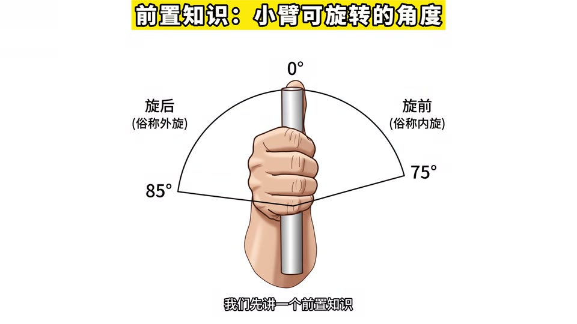

*图 42：以锤式握为 0°，小臂外旋约 85°、内旋约 75°。*

### 12.2 宽握（肩内收）：可以正握/对握，不能反握

- 宽握引体、下拉是为了做肩内收，身体要和杆子面相当靠近，握距显著大于肩宽，这样大臂才能在冠状面运动。
- **正握**：大小臂是锤式关系（小臂旋转 0°），生理结构允许。
- **对握**：要在锤式关系基础上把小臂**外旋约 90°**（严格说不到 90°）。
- **反握**：要在正握基础上外旋 **180°**，早超过生理极限，做不到（「除非你是外星人」）。

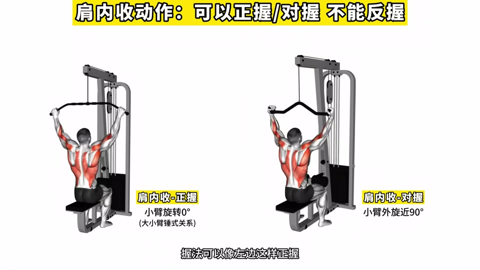

*图 43：肩内收正握：小臂旋转 0°（锤式关系）；肩内收对握：小臂外旋近 90°。*

**对握把手为什么做成斜的** [75:05]：

- 这类宽对握把手故意做成有点斜度，分正反两边（上下两种握法）用。**正确的用法**让小臂外旋**小于 90°**，回收了一些，留出余地。因为外旋到 85° 以后就开始别扭，这个设计让所有人都能舒服地对握。
- 很多新手反着用，等于把设计者留的余地反向利用，让小臂外旋**超过 90°**，所以觉得别扭。

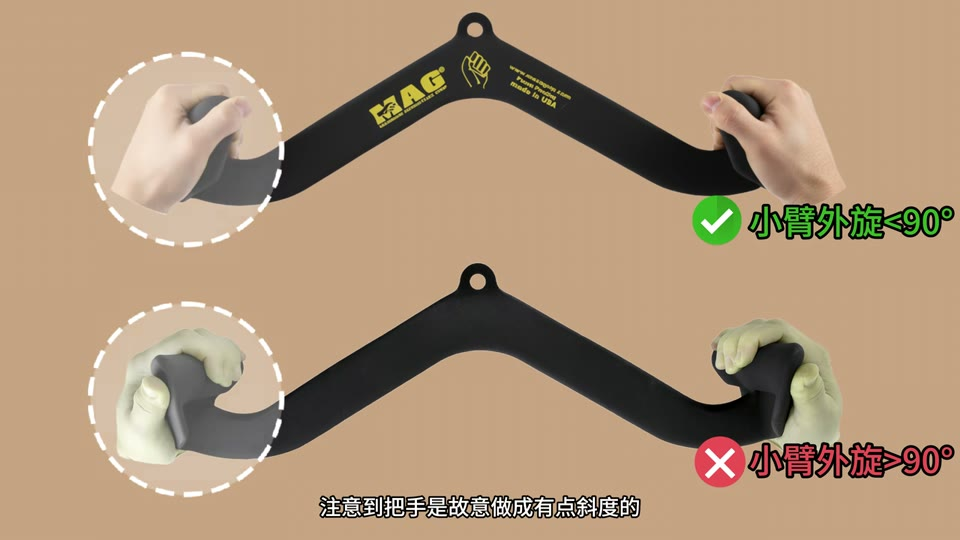

*图 44：斜把手的设计：上面的用法对（小臂外旋 <90°），下面反着用（>90°）。*

### 12.3 窄握（肩伸）：可以对握/反握，不能正握

- 窄握引体、下拉是为了做肩伸，身体和杆子面不能像肩内收那样紧贴，要留出足够距离，让大臂有在矢状面运动的空间。
- **对握**：大小臂锤式关系，生理允许，最舒服。
- **反握**：在锤式关系基础上小臂外旋 90°，已经超过舒服的 85°，勉强能做但有点别扭。暂停比划一下就知道对握比反握舒服。
- **正握**：要在对握基础上再内旋 90°，而内旋最大约 75°，超过太多，真做不了。

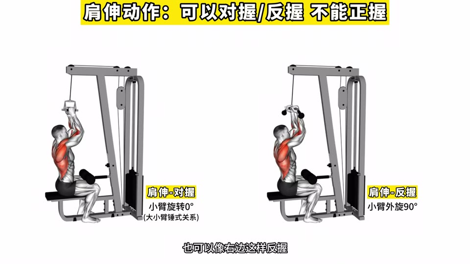

*图 45：肩伸对握：小臂旋转 0°（锤式关系）；肩伸反握：小臂外旋 90°。*

### 12.4 总结

- 握法怎么选由小臂允许的旋前、旋后（内旋、外旋）程度决定。所以**选择很简单：握着舒服就是对的，不舒服就是错的**。
- **正握、对握、反握对背部肌肉没有任何影响**。小臂旋转是蓝色的**桡骨**绕着白色的**尺骨**转（桡尺关节运动），没有任何背部肌肉长在桡骨上，「你小臂转出花来」也不会影响背部肌肉的拉长缩短。

---

## 13. 专题三：划船的关节活动内核 [78:26]

划船看似花样很多：开肘有大有小，握距有宽有窄，拉动方向有往胸口以上拉的、有往腹部拉的。很多新手以为排列组合有 N 种划船。UP 主说不是：**开肘大小、握距宽窄、拉动方向这三个因素是一一对应的，由动作的关节活动决定，不能自由排列组合。**

| 划船类型 | 关节活动 | 开肘 | 握距 | 拉动方向 | 练的肌肉 | 画面举例 |
|---|---|---|---|---|---|---|
| 肩伸划船 | 大臂在矢状面从前往后 | 接近不开肘 | 不超过肩宽（窄握） | 腹部（大臂在躯干两侧时肘关节一线对着腹部） | 肩伸五肌（背阔肌 + 大圆肌 + 肩后束 + 肱三长头 + 下胸），对背来说侧重外背阔 | 哑铃俯身划船、器械窄握划船、钢线窄握划船（肩伸 + 肘屈） |
| 肩水平外展划船 | 大臂在水平面从内往外 | 接近或达到水平开肘 | 明显超过肩宽（非常宽） | 胸口以上 | 肩后束 | 钢线宽握划船、海豹划船、澳式引体（肩水平外展 + 肘屈） |
| 半开肘划船 | 肩伸 mix 肩水平外展 | 中等 | 中等（大于肩宽但不很大） | 低于胸口、高于腹部（胸腹之间） | 大圆肌、上背阔一带 | 杠铃俯身划船、器械中握划船（肩伸 mix 肩水平外展 + 肘屈） |

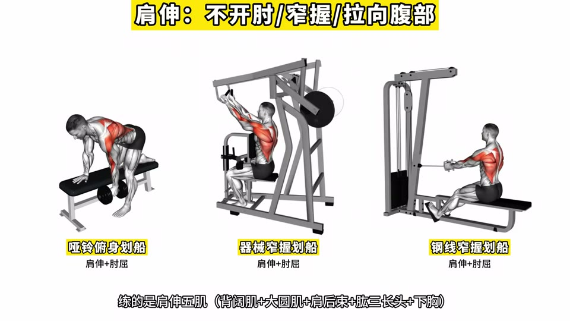

*图 46：肩伸划船：哑铃俯身划船、器械窄握划船、钢线窄握划船。*

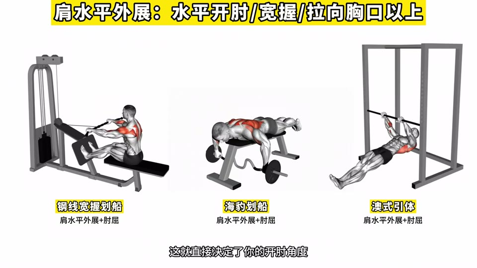

*图 47：肩水平外展划船：钢线宽握划船、海豹划船、澳式引体。*

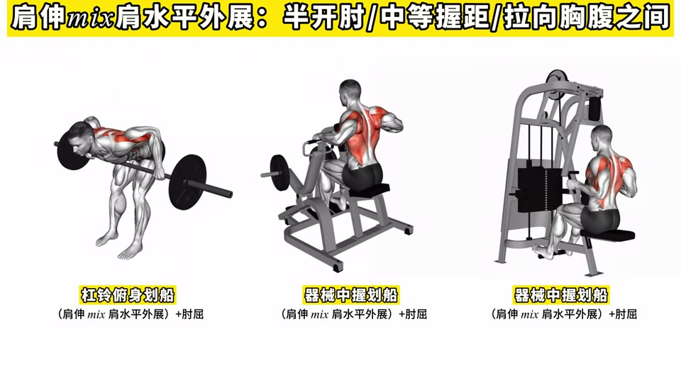

*图 48：半开肘划船：杠铃俯身划船、器械中握划船。*

**为什么坐姿划船器械座椅要调高度** [80:32]：健身房里有些坐姿系列划船器械可以选宽窄握距、调座位高度，目的是让你自由选择做哪种划船。器械的拉动轨迹是固定的，你没法想往身体哪里拉就往哪里拉，所以要调座位适应轨迹：

- 做**肩伸划船**要拉向腹部这种低位置，**座位要调高**；
- 做**肩水平外展划船**要拉向胸口以上的高位置，**座位要调低**。

---

## 14. 专题四：练背时小臂酸痛的原因和缓解 [81:21]

做引体、下拉、划船时小臂会酸痛，原因有三点。

### 14.1 原因一：肱桡肌收缩（因为练背有肘屈，特别是锤式肘屈）

- 这些动作都包含**肘屈**。肘屈肌三兄弟：肱二头肌、肱肌、肱桡肌。
- **肱桡肌**主体在小臂正面外侧，是小臂最大的一块肌肉，**最适合锤式肘屈**，因为此时它旋转到更接近肘屈的矢状面，有利于发力。
- 练背里的肘屈多数是锤式的：所有正握的肩内收动作、对握的肩伸动作、正握的开肘划船（可以自己比划一下）。
- 画面文字：练背多数动作有肘屈，除了直臂划船/「鹦鹉螺」（应是指 Nautilus 类直臂器械，原视频未明确）。
- 所以练背时**小臂正面偏外侧的酸痛就是肱桡肌**。

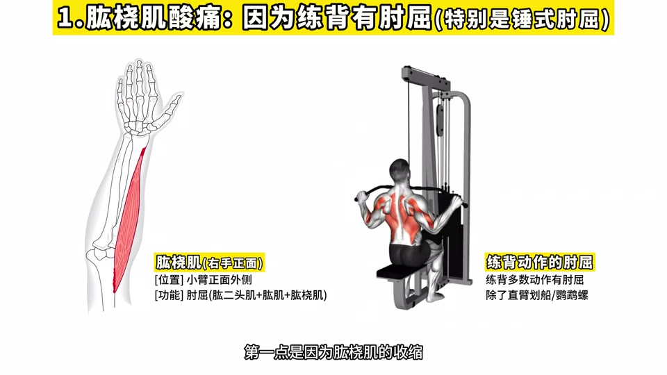

*图 49：肱桡肌：位于小臂正面外侧，功能是肘屈（肱二头肌 + 肱肌 + 肱桡肌）。*

### 14.2 原因二：指屈肌收缩（因为练背要紧紧抓杆）

- 练背动作（特别是引体、下拉）要手掌紧紧抓杆来制造摩擦力，抓不紧就会脱手。这种紧握动作叫**指关节屈**（指屈）。
- **指屈三肌**：指浅屈肌、指深屈肌、拇长屈肌，主体覆盖在小臂正面，跨越指关节和腕关节，功能是指屈 + 腕屈。腕关节固定时，指屈肌收缩导致指屈，抓杆的巨大摩擦力就靠它们剧烈收缩。
- 所以**小臂正面的酸痛就是指屈肌**。

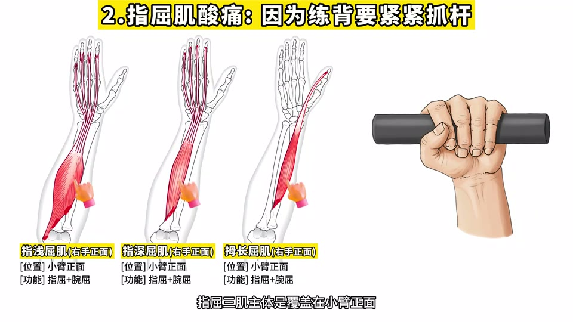

*图 50：指浅屈肌、指深屈肌、拇长屈肌：位于小臂正面，功能是指屈 + 腕屈。*

### 14.3 原因三：腕伸肌收缩

- 指屈肌既跨指关节也跨腕关节，收缩时既导致指屈也导致腕屈。但紧握时你并没有腕屈，因为**小臂背面的腕伸肌同时收缩，阻止了腕屈**。
- 全身的多关节肌都有这个特点：要让多关节肌只影响 A 关节、不影响 B 关节，就需要 B 关节的拮抗肌同时收缩来阻止。
- 所以练背时**小臂背面的腕伸肌也会酸痛**。
- 小实验：右手用力抓握或握拳，左手摸小臂，会发现正面的指屈肌和背面的腕伸肌同时收缩变硬，只有正面外侧的肱桡肌没变化，因为它只和肘屈有关。

*图 51：画面文字：指屈肌收缩导致指屈和腕屈，需要腕伸肌来阻止腕屈；腕伸肌收缩阻止腕屈。*

### 14.4 缓解办法 [84:50]

**办法一：把锤式肘屈改成正手肘屈（作用不大）**

- 肘屈没法取消，所以肱桡肌酸痛不能根治，只能把肱桡肌发力最多的锤式肘屈改成发力较少的正手肘屈：
  - 肩内收动作改用**对握**；
  - 肩伸动作改用**反握**；
  - 开肘划船改用**对握**（画面注：接近正手肘屈）。

*图 52：肩内收对握、肩伸反握、开肘划船对握，都把锤式肘屈改成正手肘屈。*

**办法二：用助力带（最重要）**

- 指屈肌和腕伸肌的酸痛根源都是指屈，只要不让自己狠狠指屈、不紧紧抓杆，两者就都解决了。
- 原理：防止脱手需要一个和阻力相等的摩擦力。**摩擦力 f = 摩擦系数 μ × 压力 N**。紧握杆是通过指屈增加手对杆的压力 N 来获得足够的摩擦力。
- 助力带是橡胶或牛皮做的，**增加了摩擦系数 μ**，要提供相同的摩擦力，需要的压力 N 就小很多，你就不用紧紧握杆，指屈肌不用剧烈收缩，负责拮抗它的腕伸肌也不用剧烈收缩。
- UP 主总结：缓解小臂酸痛**最重要的是用助力带**，其次是改握法（还开玩笑说「这里不插入一个助力带广告真是可惜了」）。

*图 53：阻力 = 摩擦力；助力带增大摩擦系数 μ，于是不需要那么大的握力（压力 N）。*

---

## 15. 考试：5 道题与答案 [86:35]

UP 主说前几集全班平均分高达 9 分（满分 10 分），所以这集提高了难度。

### 第 1 题（辨认肌肉）

一个背部肌肉解剖的教学帖，很多人点赞收藏，但有多处错误。比如斜方肌的划分：凸起的第 7 颈椎和肩峰连线以下应是**中斜方肌**，而不是原帖标的上斜方肌；原帖标为「小圆肌」的位置实际是大圆肌。问：原帖标注为「大圆肌」的位置（闪烁红点）是什么肌肉？

- A. 冈下肌
- B. 小圆肌
- C. 第一层是背阔肌，第二层是大圆肌

*图 54：第 1 题的题图：一张标注有误的背部肌肉教学图。*

**答案：C**。思路：先找三角形的冈下肌，往下往外扩一点，结合肩峰勾勒出肩胛骨。蓝色是背阔肌（上部被下斜方肌覆盖，有一部分是擦过肩胛骨下角的上背阔肌纤维）；黄色是大圆肌，起于肩胛骨下角。大圆肌下部和背阔肌重叠（绿色部分），所以这里比上下都厚，是两层肌肉叠加。

### 第 2 题

宽握高位下拉，关节活动是肩内收，侧重练哪一部分？

- A. 侧重练大圆肌
- B. 侧重练上背阔
- C. 侧重练外背阔
- D. 大圆肌和背阔肌各角度肌纤维都比较兼顾

**答案：D**。肩内收时大圆肌、背阔肌所有肌纤维基本都在冠状面，是雨露均沾、最兼顾的动作，没有谁在拉力线上有明显优劣势。

### 第 3 题

肩伸动作做全程和后半程的都常见，但仰卧上拉这种只做肩伸**前半程**的动作不多。以下肩伸肌它都能练到，但相对比较的话，相对不利于谁？

- A. 相对不利于大圆肌
- B. 相对不利于上背阔
- C. 相对不利于外背阔
- D. 相对不利于下胸

**答案：B**。肩伸前半程肩胛骨明显前伸，大圆肌变成矢状面肌肉，适合肩伸，所以不选 A。外背阔在肩伸全程始终是矢状面肌肉；上背阔绕着后背连到脊柱上，不在肩伸的运动面上，所以选 B。下胸和外背阔一样是矢状面肌肉，是很好的肩伸肌。

### 第 4 题

硬拉是一个髋伸动作，髋伸两肌是臀大肌和腘绳肌，所以说硬拉是臀腿日练的。但也有人坚持说硬拉能练到背，这是因为：

- A. 硬拉时背阔肌和大圆肌收缩，让大臂在矢状面从前往后做了肩伸
- B. 硬拉时竖脊肌等长收缩，让本来会弯曲的脊柱保持了刚性没有弯曲
- C. 硬拉时中下斜方肌和菱形肌收缩，让肩胛骨不断后缩

**答案：B**。这么大的负重下，脊柱（特别是腰椎段）本应明显弯曲，但你保持了背部刚性，这是竖脊肌等长收缩对抗巨大阻力的结果，所以竖脊肌完全可能有即时的疲劳酸痛或次日的延迟酸痛。

- C 不对：硬拉时肩胛骨并没有不断后缩，除非是一种专门做肩胛骨后缩的特殊半程硬拉。
- A 很有迷惑性：硬拉在克服阻力阶段大臂确实在矢状面从前往后运动，是肩伸。但**阻力方向永远垂直向下**，阻力在肩关节正下方，对肩关节的力臂约为零，肩伸肌没有对抗力矩，所以不选 A。假如阻力方向变成向前，对肩关节的力臂就很大，就能练背阔、大圆等肩伸肌了，类似直臂划船。

*图 55：画面文字：阻力方向在肩关节正下方，对肩关节的力臂力矩为零。*

### 第 5 题（多选）

很多人听说「得肩胛骨者得天下」，就误以为背部大部分肌肉都是通过肩胛骨运动练出来的。实际上健身里通过肩胛骨运动去练肌肥大的动作很少，具体包括哪些？

- A. 用肩胛骨上提练上斜方肌，例如耸肩
- B. 用肩胛骨后缩练中下斜方肌，例如大开肘的划船
- C. 用肩胛骨上旋练上斜方肌和下斜方肌，例如推举
- D. 用肩胛骨下旋练菱形肌，例如下夹胸

*图 56：第 5 题的四个选项配图。*

**答案：A、B**。肩胛骨的上旋、下旋是跟随大臂起落发生的（「你大臂动一下，我肩胛骨就跟着挪一下」），抗阻的是让大臂起落的肩关节肌肉，不是肩胛骨上旋/下旋肌。否则就会荒谬地得出「推举是斜方肌肌肥大动作」「下夹胸是菱形肌肌肥大动作」的结论。UP 主说这题是送分题。

**结尾** [93:44]：下一集（第 5 集）扫尾讲还没讲的大臂、小臂和腹部，仍然先讲肌肉解剖再讲健身动作。

---

## 要点速查

### 背部肌肉 → 关节活动 → 练法

| 肌肉 | 关节活动（健身里用得上的） | 怎么练 | 关键点 |
|---|---|---|---|
| 背阔肌 + 大圆肌 | ① 肩内收（冠状面） | 宽握引体、宽握下拉 | 雨露均沾；躯干略后倾、大臂与下腰在一个垂直面更好 |
| | ② 肩伸（矢状面） | 窄握引体/下拉、窄握划船、直臂划船、仰卧上拉 | 外背阔全程有利；大圆肌前半程有利；上背阔全程相对不利 |
| | ③ 肩伸 mix 肩水平外展 | 开肘划船（约 45°） | 侧重上背阔、大圆肌 |
| 冈下肌、小圆肌 | 肩外旋、稳定肱骨头（肩袖） | 无专门练法 | 力臂太小，拉动大臂时被劣后募集；小圆肌实拍几乎看不到 |
| 上斜方肌 | 肩胛骨上提 | 负重耸肩 | 止于锁骨外 1/3，靠上提锁骨带动肩胛骨；侧平举重量过大会引入耸肩 |
| 中斜方肌 | 肩胛骨后缩 | 故意后缩肩胛骨的大开肘划船（60–90°） | 第 7 颈椎是中/上斜方分界；深蹲杠铃扛在中斜方肌 |
| 下斜方肌 | 肩胛骨后缩（与菱形肌合力）；下沉 | 同上；下沉类动作谈不上肌肥大动作 | 肩胛骨内侧角三角区是不增厚的肌腱 |
| 菱形肌 | 肩胛骨上提、后缩 | 耸肩、肩胛骨后缩的划船 | 第二层肌肉，抬手展背才露出一点 |
| 竖脊肌 | 脊柱伸；俯身动作中等长收缩 | 山羊挺身（背从弯变直）；硬拉、杠铃/T 杆划船顺带练 | 不是「下背肌肉」，只是下部最厚最浅表；腰痛不要自行练它 |

### 核心原理

- **肌肉走向越吻合运动面，越有利于发力。**
- **力矩 = 力量 × 力臂**：长在关节附近的肌肉（肩袖）力臂小，拉动骨头的杠杆运动时被劣后募集；旋转运动不受此限。
- **肩胛骨上旋/下旋不抗阻**，不能用来练肌肥大；能用肩胛骨运动练肌肥大的只有**上提**（耸肩）和**后缩**（大开肘划船）。
- **有关节活动就一定有对应肌肉收缩**，与发力感无关；发力感强弱很大程度取决于肌梭密度（上斜方肌最高）。
- 肌腱不肥大，肌腱区会表现为凹陷（圣诞树、斜方肌菱形区和内侧角三角区）。

### 握法与划船

| 握距/关节活动 | 可用握法 | 不可用 |
|---|---|---|
| 宽握（肩内收） | 正握、对握（斜把手别反着用） | 反握（需外旋 180°） |
| 窄握（肩伸） | 对握（最舒服）、反握（略别扭） | 正握（需再内旋 90°） |

- 握法对背部肌肉**没有影响**，握着舒服就是对的。
- 划船：开肘、握距、拉动方向一一对应。不开肘/窄握/拉向腹部 = 肩伸；水平开肘/宽握/拉向胸口以上 = 肩水平外展；中间 = 混合。坐姿器械做肩伸划船时座位调高，做水平外展划船时座位调低。

### 均衡练背计划（一次练背课）

- 肩内收 1 个动作 × 4 组 + 肩伸 1 个动作 × 4 组 + 开肘划船 1 个动作 × 4 组（故意做肩胛骨前伸后缩），每组 8–15RM，共 12 组。
- 可加 1 个补弱动作到 16 组；要练肩后束就把开肘划船放最后、接反向飞鸟；耸肩和山羊挺身基本不故意练。

### 小臂酸痛

| 酸痛位置 | 肌肉 | 原因 | 缓解 |
|---|---|---|---|
| 小臂正面外侧 | 肱桡肌 | 肘屈，尤其锤式肘屈 | 改握法：肩内收对握、肩伸反握、开肘划船对握（作用不大） |
| 小臂正面 | 指屈肌 | 紧紧抓杆（指屈） | 用助力带（增大摩擦系数 μ） |
| 小臂背面 | 腕伸肌 | 拮抗指屈肌造成的腕屈 | 用助力带 |

---

## 初学者练习建议

以下只根据视频内容归纳：

1. **按关节活动选动作，不要死记动作名**。每次练背覆盖三类：宽握下拉/引体（肩内收）、窄握下拉/划船（肩伸）、开肘划船（肩伸 mix 肩水平外展）。每个动作 4 组，8–15RM，这就是 UP 主给的均衡练背计划。
2. **宽握下拉可以躯干略后倾**，让大臂和下腰大致在同一垂直面上再往下拉。
3. **做开肘划船时故意做肩胛骨前伸、后缩**，花同样时间顺便练到中下斜方肌。想重点练中下斜方肌，开肘要大到 60–90°，拉动方向垂直于躯干。
4. **握法以舒服为准**：宽握用正握或对握，窄握用对握或反握。用斜度对握把手时注意别反着握。
5. **划船时大臂后伸超过躯干两侧不算错**，只是会越来越费力。
6. **不要因为「没有背的发力感」就怀疑自己没练到背**。只要大臂在做肩内收/肩伸，背阔肌、大圆肌就在工作；上斜方肌发力感强、中下斜方肌发力感弱是天生的肌梭密度差异。
7. **侧平举时如果明显耸肩**，说明重量超过了肩外展肌的能力，上斜方肌在帮忙（除非你本来就想顺带练它）。
8. **小臂先酸、握不住时用助力带**，这是 UP 主认为最有效的办法。
9. **山羊挺身要让背从弯变直**，不是全程直背。耸肩和山羊挺身基本不用专门练。
10. **腰痛不要自己诊断后去练竖脊肌。**
11. 如果还没看过本系列第 1 集（总导论，讲各关节活动的含义），UP 主强烈建议先补。

---

## 不确定之处

- **1899 年美国解剖书**：UP 主只说是 1899 年美国出版的解剖书插图，具体书名原视频未明确（画面可能有出处小字，截图未截到）。
- **「中国背王」**：UP 主未说选手姓名（此处原视频未明确）。
- **肌梭密度「6 到 9 成」**：Whisper 转写为「密集 6 到 9 成之多」，按画面表格（39.05 vs 24.48、21.68 个/cm³）计算约高 60%–80%，口头数字可能是听写误差或 UP 主约数。
- **上斜方肌起止点**：画面卡片写「[起点] 枕骨、上项线；[止点] 锁骨外 1/3」，口头说「从锁骨外三分之一长到颈后」，两种说法方向相反但指同一条肌肉（UP 主在开场也说过起止点说反了没关系）。
- **下斜方肌卡片的序号**：画面功能列表第三条也印成「②」，本文按内容记为③。
- **「高位划船」**：UP 主说包含肩伸前半程、有利于大圆肌的例子是「高位划船」类动作，所指具体器械原视频未明确（可能指拉动起点较高的划船/下拉器械）。
- **「鹦鹉螺」**：画面写练背多数动作有肘屈「除了直臂划船/鹦鹉螺」，「鹦鹉螺」可能指 Nautilus 品牌的直臂类器械，原视频未明确。
- **六个肩伸动作的字母顺序**：本文按 UP 主答案（ABEF 有利、CD 不利于大圆肌）对应画面中「仰卧上拉、直臂划船、哑铃俯身划船、窄握划船、窄握下拉、窄握引体」，画面上未显示字母标号，对应关系是按排列顺序推断的。
- **第 4 题选项 A 的「背阔肌」**：Whisper 原文为「背锅肌」，按上下文更正为背阔肌。
- **咏背肌全文**：只引用了开头两句，其余为要点归纳，不是逐字原文。
- **时间戳**：取自 Whisper 文字稿，与视频实际时间可能有几秒误差；章节起点取自 B 站章节数据。
