# 《健身解剖完全手册》第5集：练手臂 & 腹肌（文字版）

## 来源

- **视频标题**：【新】💪🏻B站版《健身解剖完全手册》™（第5集：练手臂&腹肌）
- **UP 主**：好人松松
- **链接**：https://www.bilibili.com/video/BV1X1Lj66ENe/
- **时长**：约 84 分 17 秒
- **视频章节**：引言 [00:00] · 肘屈肌 [02:44] · 弯举 [20:13] · 好东西（课间推广）[30:34] · 肘伸肌&臂屈伸 [32:26] · 关节角度-肌群力矩 [41:47] · 小臂 [47:05] · 腹部 [57:47] · 考试！[78:24]
- **整理日期**：2026-10-17
- **整理方式**：音频用 Whisper（mlx-whisper，large-v3-turbo，中文）转写成带时间戳的文字稿；同音错字（如「公二头」→肱二头、「饶骨/持骨」→桡骨/尺骨、「走曲」→肘屈、「复制机」→腹直肌、「菊腿」→举腿）对照视频截图里的内嵌字幕和画面文字做了校对。只出现在画面上的表格、肌肉卡片、测验题都是从截图里读出来整理的。截图取自 720p 视频，按讲解内容挑的时间点。

## 总览

本集是系列第 5 集，讲完上半身还没讲的**大臂、小臂和腹部**。内容按「先讲解剖，再讲动作」排：肘屈三肌（肱二头肌、肱肌、肱桡肌）→ 弯举的几个研究问题 → 肘伸肌（肱三头肌）与臂屈伸 → 「关节角度—肌群力矩」关系以及它怎样影响动作难度和器械设计 → 小臂肌肉按功能分成 5 组 → 腹部四肌的层次、腹直肌分块、卷腹与举腿、腹外斜肌。UP 主反复强调两件事：一是**用关节活动来理解动作**（比如卷腹是脊柱屈，举腿是骨盆后倾）；二是**别迷信单篇论文**，要看有没有一致的结论。最后有 5 道测验题。

## 目录

- [0. 引言：A 表、B 表与本集定位 [00:00]](#0-引言a-表b-表与本集定位-0000)
- [1. 小臂的两根骨头：大桡小尺 [02:49]](#1-小臂的两根骨头大桡小尺-0249)
- [2. 肘屈三肌之一：肱二头肌 [04:07]](#2-肘屈三肌之一肱二头肌-0407)
- [3. 肘屈三肌之二：肱肌 [13:05]](#3-肘屈三肌之二肱肌-1305)
- [4. 肘屈三肌之三：肱桡肌 [16:58]](#4-肘屈三肌之三肱桡肌-1658)
- [5. 弯举：四个研究问题 [20:13]](#5-弯举四个研究问题-2013)
- [6. 课间推广 [30:38]](#6-课间推广-3038)
- [7. 肘伸肌：肱三头肌 [32:30]](#7-肘伸肌肱三头肌-3230)
- [8. 臂屈伸：两个问题 [38:25]](#8-臂屈伸两个问题-3825)
- [9. 关节角度—肌群力矩 [41:46]](#9-关节角度肌群力矩-4146)
- [10. 小臂：五组肌肉 [47:10]](#10-小臂五组肌肉-4710)
- [11. 腹部四肌的层次关系 [57:48]](#11-腹部四肌的层次关系-5748)
- [12. 腹直肌的分块 [61:15]](#12-腹直肌的分块-6115)
- [13. 腹直肌的关节活动①：脊柱屈与卷腹 [66:06]](#13-腹直肌的关节活动脊柱屈与卷腹-6606)
- [14. 腹直肌的关节活动②：骨盆后倾与举腿 [70:21]](#14-腹直肌的关节活动骨盆后倾与举腿-7021)
- [15. 能分上腹、下腹练吗？[73:44]](#15-能分上腹下腹练吗7344)
- [16. 腹外斜肌 [75:24]](#16-腹外斜肌-7524)
- [17. 考试 [78:28]](#17-考试-7828)
- [要点速查](#要点速查)
- [初学者练习建议（只基于视频内容）](#初学者练习建议只基于视频内容)
- [不确定之处](#不确定之处)

---

## 0. 引言：A 表、B 表与本集定位 [00:00]

- 这门网课一共 **7 集**，按身体部位讲；第 5 集讲上半身剩下的**大小臂和腹部**。每集结尾留 5 道选择题，观众用弹幕作答。
- 课程总纲是两张总结表：
  - **A 表「关节活动的肌肉」**：一个动作练哪些肌肉（第 1 集已经全部讲完，是整个系列的总导论，没看过要补）。
  - **B 表「肌肉的关节活动」**：一块肌肉靠哪些动作来练。B 表又转化成了按部位的图示，手臂和腹部的那两张图就是本集的「究极浓缩」。
- 推广一句带过：这些高清总结图和其他工具（饮食方案底表、三/四分化训练计划、拉伸图谱、解剖软件教程）都在 UP 主免费的「健身 Excel 工具套表」里，关注后私信发「1」或者到主页置顶动态里下载。

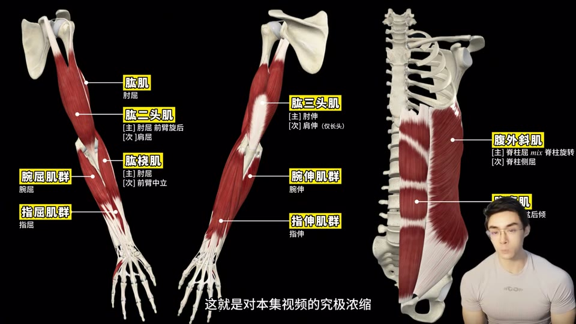

*图 1：B 表转化来的手臂、腹部图示，标着各肌肉的主/次要关节活动。*

---

## 1. 小臂的两根骨头：大桡小尺 [02:49]

- 大臂一根骨头：**肱骨**。小臂两根：**桡骨**和**尺骨**。
- 常见口诀「**内尺外桡**」只在**手心朝前（小臂旋后位）**时成立；手背朝前时，桡骨已经绕着尺骨转过去，变成「内桡外尺」，口诀就失效了。
- UP 主推荐的口诀是「**大桡小尺**」：不管手掌和小臂怎么转，**大拇指那一侧永远是桡骨，小拇指那一侧永远是尺骨**。
- 原理：**手掌长在桡骨上**。桡骨像扇柄，手掌像扇面，扇柄一转扇面跟着转，所以大拇指和桡骨「形影不离」。

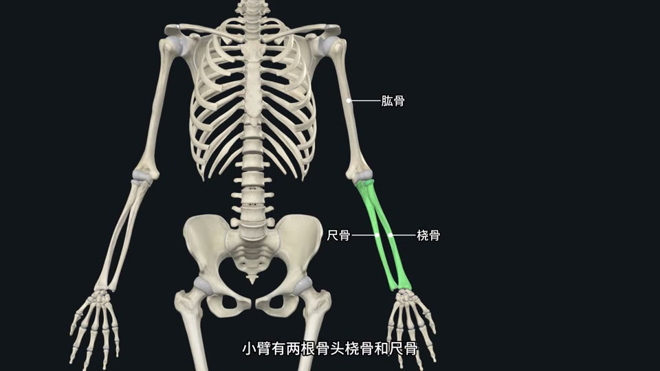

*图 2：大臂是肱骨，小臂有桡骨、尺骨两根。*

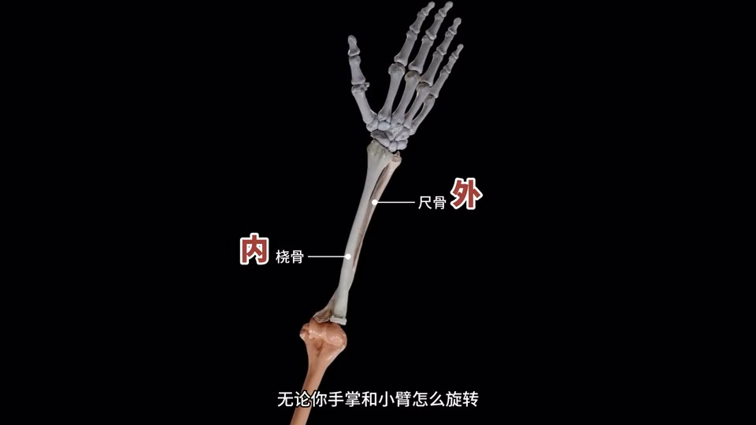

*图 3：「无论你手掌和小臂怎么旋转」，大拇指都跟着桡骨走。*

---

## 2. 肘屈三肌之一：肱二头肌 [04:07]

**肘屈三肌**是肱二头肌、肱肌、肱桡肌。弯举这类肘屈动作就是它们收缩完成的。这个排序是按力矩贡献排的（数据见第 3 节）。

### 2.1 起止点 [04:13]

| | 短头（内侧） | 长头（外侧） |
|---|---|---|
| 起 | 肩胛骨**喙突** | 肩胛骨**盂上结节** |
| 止 | 桡骨粗隆 | 桡骨粗隆 |
| 功能 | 主：肘屈、小臂旋后；次：肩屈 | 同左 |

- 两个头往下合并成一个肌腹，止于小臂**桡骨**。
- **重点**：肱二头肌在肱骨上**没有任何附着**，它「起于肩胛骨，起于肩胛骨，起于肩胛骨」，止于桡骨。很多人以为它长在肱骨上，这是误会。
- 起点、止点的叫法：靠近躯干中轴线的叫起点，远离的叫止点。UP 主说叫法反过来也无所谓，知道它从哪长到哪就行。

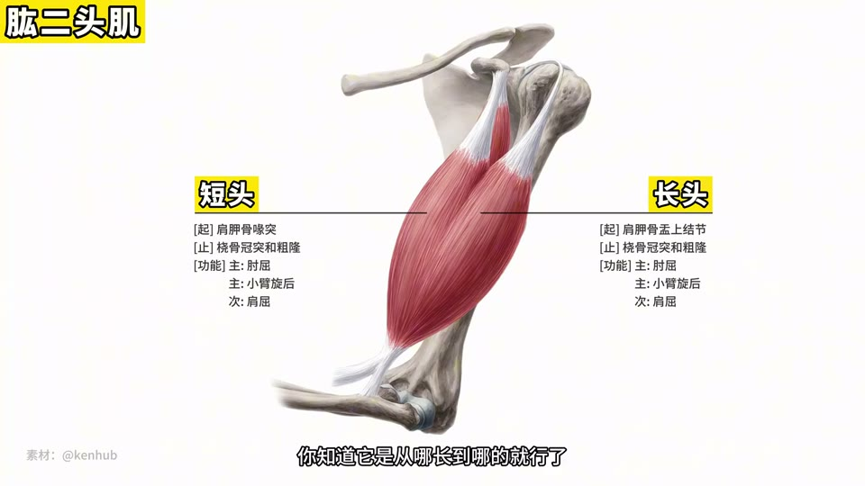

*图 4：肱二头肌短头（喙突）、长头（盂上结节），都止于桡骨粗隆；功能为主：肘屈、小臂旋后，次：肩屈。*

### 2.2 远端肌腱长短影响外形 [05:00]

- 肌肉两端是**肌腱**（不能通过训练增厚），中间是**肌腹**（能增厚）。
- **肌腱过短**：肘窝附近别人是凹下去的肌腱，他这里却是增厚的肌腹，整块肱二头肌显得过长、偏细（此处原视频用词 Whisper 未听清，大意如此）。
- **肌腱过长**：肌腹能高高隆起，但总体积显小，像个「迷你二头」，过犹不及。
- **自测**：肘屈 90° 时，肘窝到肱二头肌下端之间能放进 **1–2 根手指**，比较合适，看起来不长也不短。

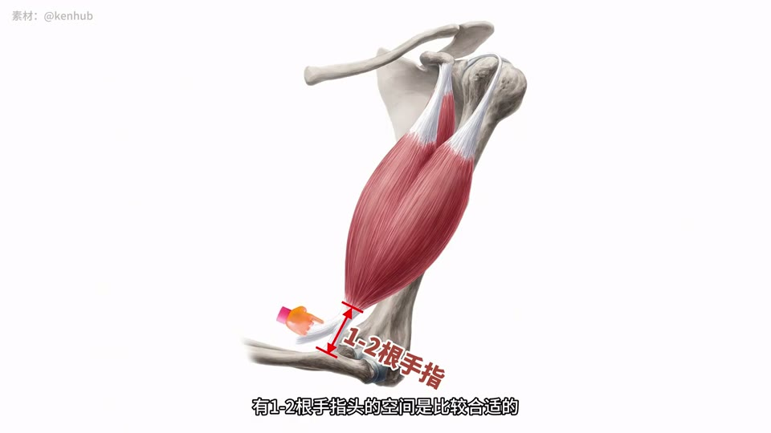

*图 5：「有 1–2 根手指头的空间是比较合适的」。*

### 2.3 解剖变异：肱二头肌副头 [05:48]

- **副头**：在长头、短头之外多长出第三组（甚至更多）肌束。最常见的是起于**肱骨中段**，位置在长头和短头之间，往下和另外两个头融合。
- 一篇综述统计了全球 **10603 条手臂**：
  - 总发生率 **9.6%**（约每 10 人有 1 人）
  - 男性约 **10.2%**，女性约 **7.3%**
  - 单侧 **8.4%**，双侧仅 **0.2%**，所以有副头的人多半只有一侧有
- UP 主的推论：如果你没有单边受伤，两侧肘屈力量却明显不平衡，可能就是这十分之一，一侧多长了副头。
- 有副头的人肌肉肥大、体脂又很低时，可能看到「**三瓣二头**」（表面多一条分界线）。UP 主说实拍图里的例子是推测，毕竟没有剖开看。

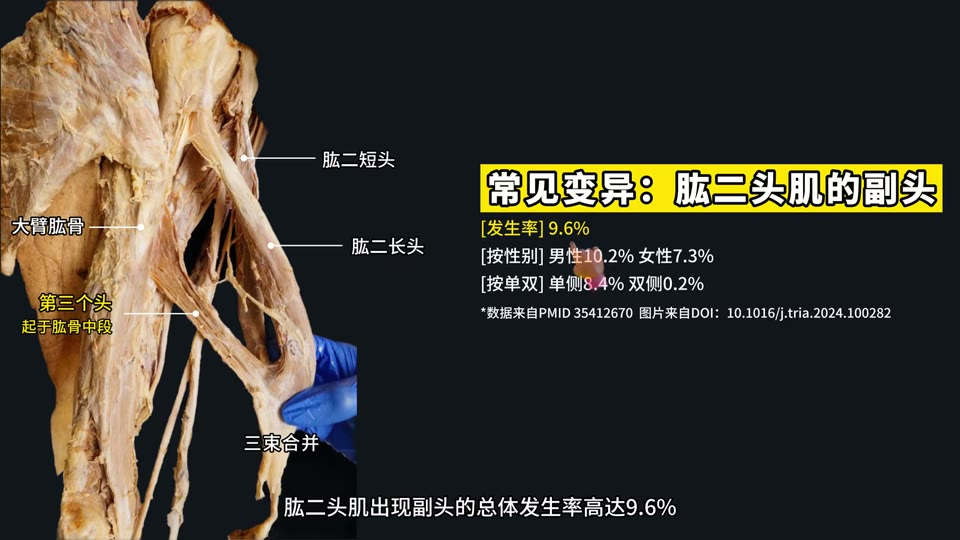

*图 6：常见变异「肱二头肌的副头」，发生率 9.6%；男 10.2%、女 7.3%；单侧 8.4%、双侧 0.2%。*

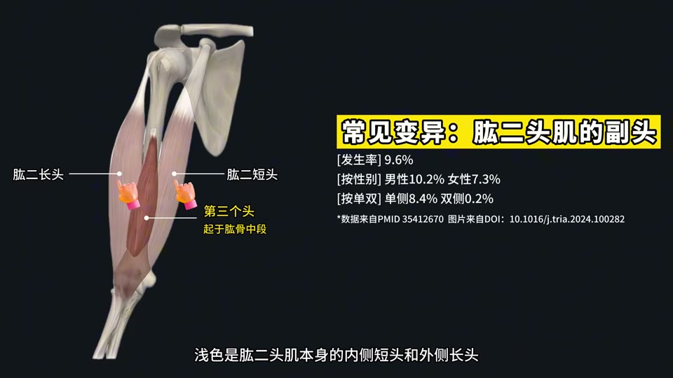

*图 7：浅色是原本的短头和长头，深色是起于肱骨中段的第三个头。*

### 2.4 关节活动①：肘屈 [08:23]

肩关节固定时，肱二头肌收缩把小臂拉向大臂，就是弯举这类**肘屈**。细节放到第 5 节讲。

### 2.5 关节活动②：小臂旋后 [08:39]

**先补课：小臂怎么转**

- 桡骨绕着尺骨**往内**转 = **小臂旋前**（俗称「内旋」）；**往外**转 = **小臂旋后**（俗称「外旋」）。
- UP 主强调**不要叫内旋、外旋**：内旋外旋的定义是一根骨头**绕自身纵轴自转**（比如肱骨）。小臂旋转是桡骨**绕尺骨**转，不是自转。大众误以为小臂只有一根骨头在自转，才会这么叫。
- **等价关系**：手掌连在桡骨上，所以
  - **小臂旋前 = 手掌朝下**
  - **小臂旋后 = 手掌朝上**
- 英文 pronation / supination 的词根本义就是「面朝下 / 面朝上」，中文译成旋前旋后，把这层意思弄丢了。

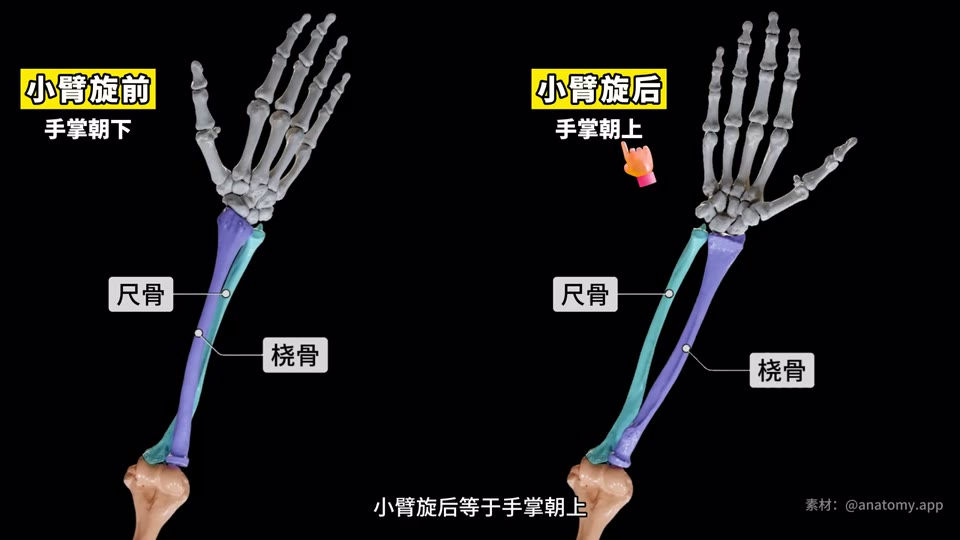

*图 8：小臂旋前 = 手掌朝下；小臂旋后 = 手掌朝上。*

**为什么肱二头肌能旋后**

- 负责小臂旋后的是**肱二头肌**和**旋后肌**两块。
- 肱二头肌是「**包绕式**」长在桡骨上的，不是简单附着在一个点上。它一收缩就像抽陀螺，把桡骨往外转，产生旋后。
- 演示：不做肘屈、只做小臂旋后，也能看到肱二头肌明显收缩变短。

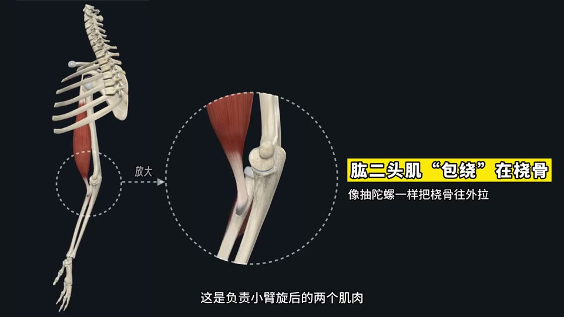

*图 9：肱二头肌「包绕」在桡骨上，像抽陀螺一样把桡骨往外拉。*

### 2.6 关节活动③：肩屈（非常次要）[11:13]

- 肘关节固定时，肱二头肌跨过肩关节，收缩能抬起大臂（肩屈，如前平举）。
- 但前平举不会用来练肱二头肌，因为它在肩屈里**参与度很小**。
- 研究数据：不管肘屈多少度，肱二头肌产生的最大肩屈力矩出现在肩屈起始位（大臂下垂），各肘角平均只有 **1.68 牛米**，之后很快衰减到接近 0。而徒手肩屈按手臂重量估算，至少要克服 **10 牛米以上**的力矩，主要动力来自三角肌前束、上胸等其他肩屈肌。
- 朴素的观察：做肘屈、做小臂旋后时，肱二头肌都明显缩短；做肩屈时几乎看不到缩短。

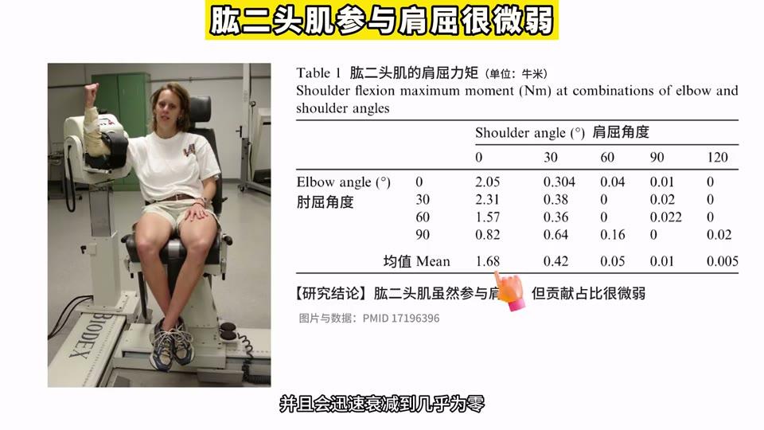

*图 10：肱二头肌的肩屈力矩（牛米）。*

画面上的表格（单位：牛米，PMID 17196396）：

| 肘屈角度 \ 肩屈角度 | 0° | 30° | 60° | 90° | 120° |
|---|---|---|---|---|---|
| 0° | 2.05 | 0.304 | 0.04 | 0.01 | 0 |
| 30° | 2.31 | 0.38 | 0 | 0.02 | 0 |
| 60° | 1.57 | 0.36 | 0 | 0.022 | 0 |
| 90° | 0.82 | 0.64 | 0.16 | 0 | 0.02 |
| **均值** | **1.68** | **0.42** | **0.05** | **0.01** | **0.005** |

**结论**：肱二头肌的主要关节活动是**肘屈 + 小臂旋后**，肩屈非常次要。

---

## 3. 肘屈三肌之二：肱肌 [13:05]

- **起点**：示意图上看着像起于肱骨中段的一个点，其实是**以一个面贴在整个肱骨下半段**，这在肌肉里比较少见。
- **止点**：**尺骨**（常规的点状附着）。
- **与肱二头肌大范围重叠**：侧面看像一块侧面肌肉，但转到背面、看横断面就知道，它**几乎完全压在肱二头肌下面**，像一本厚书压着一本薄书。
- 在手臂侧面看到的那块肱肌，只是没被肱二头肌盖住的边缘。**大臂正面的厚度 = 下层肱肌 + 上层肱二头肌**，不要以为全是肱二头肌的功劳。在隆起处扎一针，第一层扎到肱二头肌，第二层扎到肱肌。

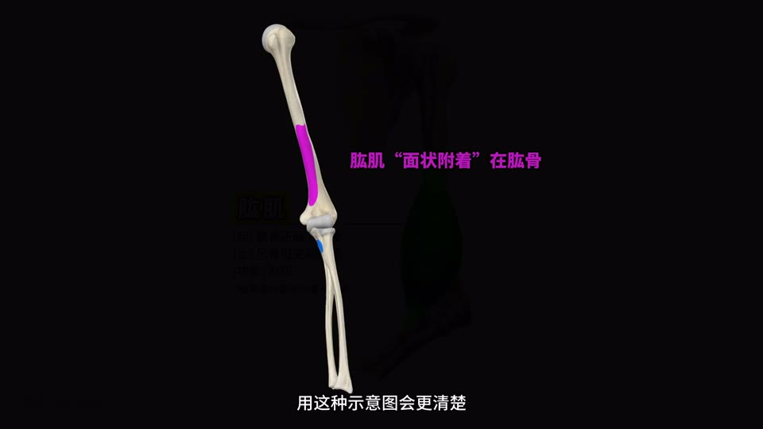

*图 11：紫色区域是肱肌「面状附着」的起点，止于尺骨。*

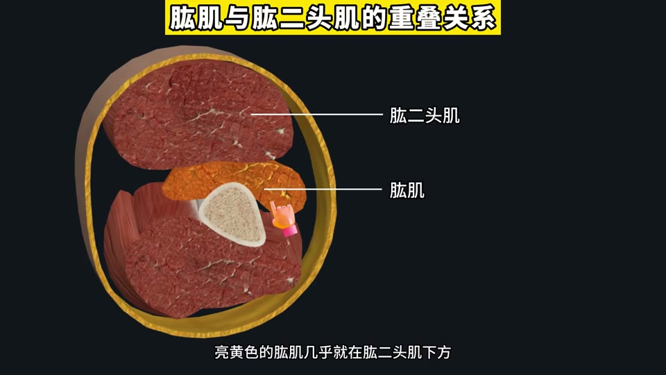

*图 12：横断面上，亮黄色的肱肌压在肱二头肌下方。*

- **关节活动只有肘屈**。为什么不能让小臂旋转？小臂旋转的本质是桡骨绕尺骨转，只有长在桡骨上的肌肉才能带动它；肱肌止于**尺骨**，所以和旋前旋后无关。
- **力矩**：力矩 = 肌肉力量 F × 肌肉到关节的力臂 r。一项研究测了 4 名受试者全力肘屈时三块肌肉的力矩占比：

| 肌肉 | A | B | C | D | 均值 |
|---|---|---|---|---|---|
| 肱二头肌 | 56% | 48% | 41% | 44% | **47%**（约半壁江山） |
| 肱肌 | 30% | 33% | 41% | 32% | **34%**（约三分之一） |
| 肱桡肌 | 14% | 19% | 19% | 24% | **19%**（约五分之一） |

（数据来源：PMID 8194543。「约三分之一」「约五分之一」的说法 Whisper 没听清，按百分比推断。）

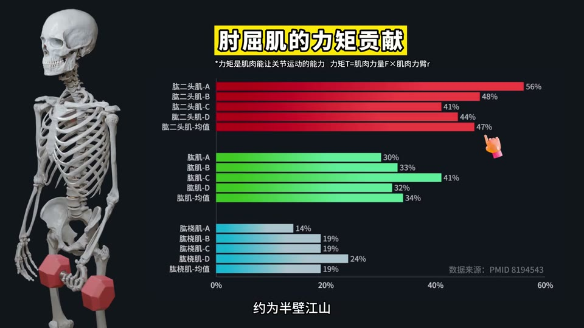

*图 13：肘屈时肱二头肌平均贡献 47%，肱肌 34%，肱桡肌 19%。*

- UP 主吐槽：很多人根本不知道有肱肌，它既贡献了大臂正面的厚度，又贡献了约三分之一的肘屈力矩，「流量都被肱二头肌拿走了」。

---

## 4. 肘屈三肌之三：肱桡肌 [16:58]

- **起点**：肱骨远端外侧（外上髁上方）。**止点**：桡骨远端外侧，也就是**大拇指那一侧**。
- 为什么强调「大拇指那一侧」？小臂一转，桡骨就转到内侧，肱桡肌的止点也跟着转。所以锁定「止于大拇指那侧」，就不会被小臂旋转干扰。这又回到「大桡小尺」：手心朝前时口诀「内尺外桡」成立，小臂一转就失效。

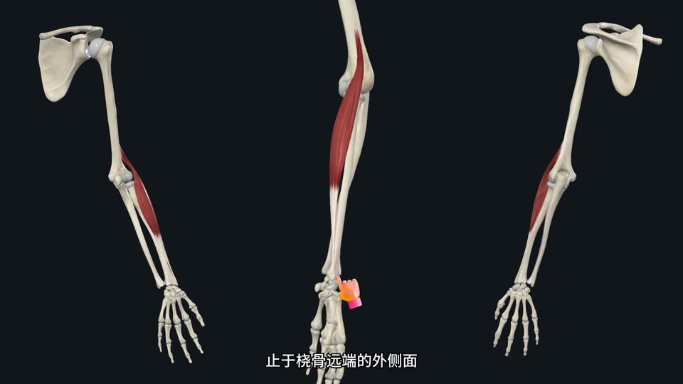

*图 14：肱桡肌止于桡骨远端外侧。*

**关节活动**

- **主要：肘屈**（肘屈三肌之一）。力矩贡献最小，但**感觉反馈却更强**。练背时小臂严重酸痛，常常就是它。
- UP 主借此提醒：**不要以「哪里酸、哪里有感觉」来判断练到了哪里**。现在的研究认为，肌肉的感觉反馈和它的募集程度关系不大（系列最后一集会专门讲）。
- **次要：让小臂回到中立位**。比较旋前、中立、旋后三种状态，肱桡肌在**中立位最短**，所以它收缩时，太旋前就往旋后拉一点，太旋后就往旋前拉一点。这个功能在健身里没有对应的专门训练动作。

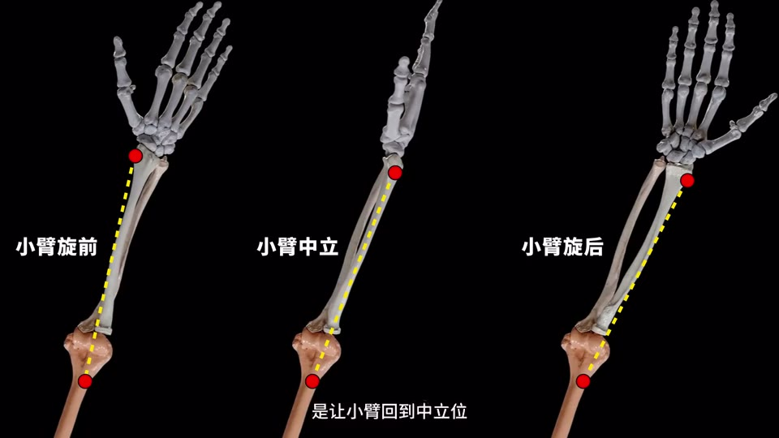

*图 15：中立位时肱桡肌最短，所以它的次要功能是让小臂回到中立位。*

---

## 5. 弯举：四个研究问题 [20:13]

三种常见弯举，关节活动都是**肘屈**，区别只是小臂的位置：

| 弯举 | 握法 | 小臂位置 |
|---|---|---|
| 正握弯举（常规） | 手心朝上 | 旋后位 |
| 锤式弯举 | 拳眼朝上 | 中立位 |
| 反握弯举 | 手心朝下 | 旋前位 |

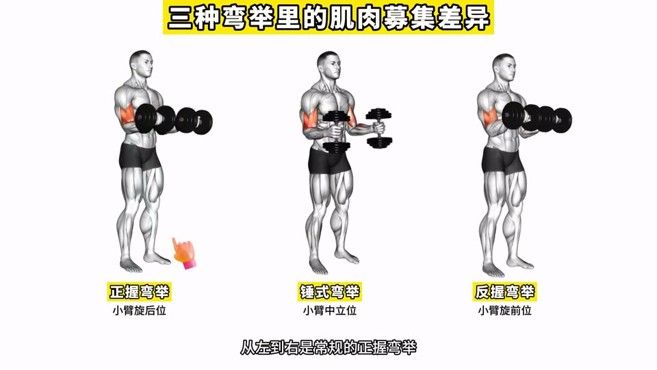

*图 16：从左到右是正握弯举（旋后位）、锤式弯举（中立位）、反握弯举（旋前位）。*

### 5.1 三种弯举的肌肉募集差异 [20:31]

- **表面肌电**（sEMG）是运动生物力学里常用的研究手段，方法得当时能反映运动单元的募集程度。但单篇研究受样本量和方法限制，一般不能盖棺定论，所以 UP 主汇总了 7 篇。
- 画面上的汇总表（√ = 肌电水平较高，× = 较低，- = 未观测）：

| 论文 | 一作 | 肱二头肌 正/锤/反 | 肱肌 正/锤/反 | 肱桡肌 正/锤/反 |
|---|---|---|---|---|
| 1（1957） | J. V. Basmajian | √ × × | √ √ × | × √ √ |
| 2（1991） | Akira Naito | √ × × | √ √ √ | √ √ √ |
| 3（2015） | Tim Kleiber | √ √ √ | - - - | × × √ |
| 4（2018） | Benoît Caufriez | √ × × | √ √ √ | × × √ |
| 5（2023） | Giuseppe Coratella | √ × × | - - - | √ × × |
| 6（2023） | Ahmad Aqil Mohamad Jahizi | √ × × | × × √ | - - - |
| 7（2025） | Yiming Chen | √ × × | - - - | × × √ |

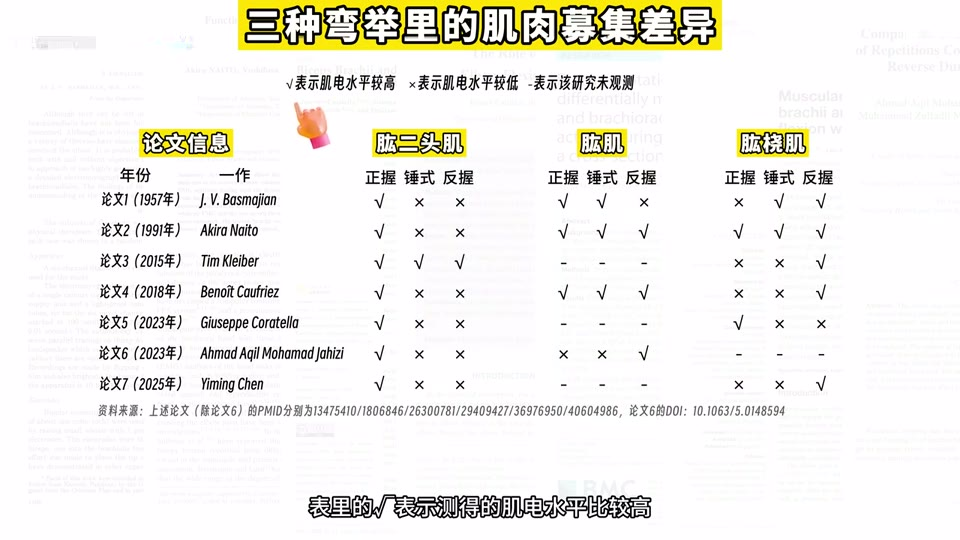

*图 17：7 篇研究的汇总。肱二头肌一栏的「正握」全是 √。*

- **结论**：
  - 肱二头肌：7 篇全部是正握最高，可以基本推论**肱二头肌适合正握弯举**。
  - 肱肌：正握、锤式、反握各有 3 个 √，不好下结论。
  - 肱桡肌：正握 2、锤式 2、反握 5 个 √，也不太好下结论。
  - 肱二头肌对大臂的视觉贡献最大，所以**建议弯举就用常规的正握弯举**。
- UP 主的态度：运动科学研究变量难控、样本量小，单篇研究之间很容易互相矛盾，拿一篇论文去指导大众怎么练是挺冒险的，要看有没有**一致性结论**。

### 5.2 肘屈时带一点肩屈，可能更有利于肱二头肌 [22:07]

- 一项研究对比了两种正握弯举：① 只有肘屈，大臂完全不动；② 肘屈的同时带约 **30° 肩屈**，大臂也在动（变成肘、肩双关节运动）。健身房里两种都常见。
- 结果：

| | 向心（举起）阶段 | 离心（下放）阶段 |
|---|---|---|
| 直杆弯举：带肩屈 vs 不带 | 肌电**高 17.7%** | 低 2.8% |
| EZ 杆弯举：带肩屈 vs 不带 | 肌电**高 20.3%** | 低 8.1% |

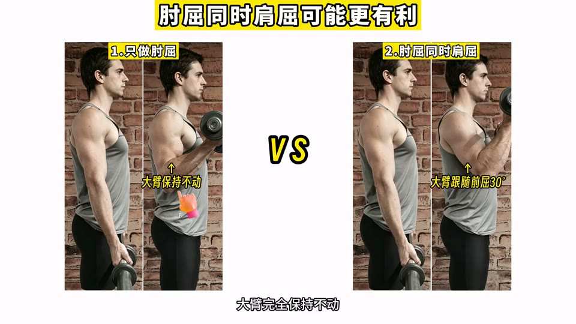

*图 18：左边大臂完全不动，右边大臂带约 30° 肩屈。*

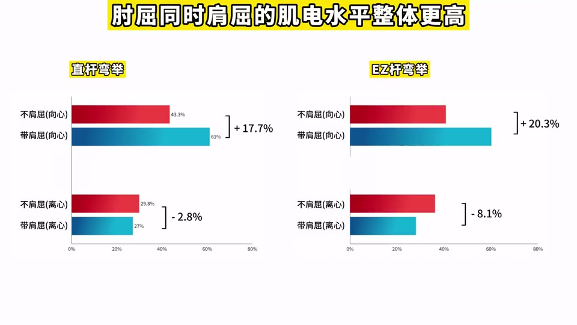

*图 19：直杆和 EZ 杆都是带肩屈的向心阶段肌电明显更高。*

- UP 主的保留：这是**单项研究**，能否复现存疑；而且肌电高不等于肌肥大更多。所以他只说「肘屈时带上肩屈，**可能**更有利」，大家可以抱着宁可信其有的心态去照做。

### 5.3 弯举一定要做「前半程」（底部要放完）[23:39]

- 很多人弯举放到一半就不放了，放弃了最初始的那一段，这可能是不良习惯。
- 实验：两组受试者都做 50° 范围的肘屈。
  - 一组做 **0–50°**（前半程，即手臂接近伸直的那段）
  - 一组做 **80–130°**（后半程）
  - 为了公平，先测了不同角度下的肘屈肌力矩，再给两组配不同的重量，让阻力力矩和该角度肘屈肌力矩的比例相同。
- **5 周共 30 组**训练后，用 B 超测大臂正面的肌肉厚度：
  - 前半程：增厚 **2.1 mm（+8.9%）**
  - 后半程：增厚 **0.8 mm（+3.4%）**
  - 前半程的增厚效率是后半程的 **2.6 倍**。
- 同时测了不训练的那只手臂，前后无差异，说明增肌纯粹来自训练。UP 主认为这项研究的变量控制比较周密，有一定参考价值。

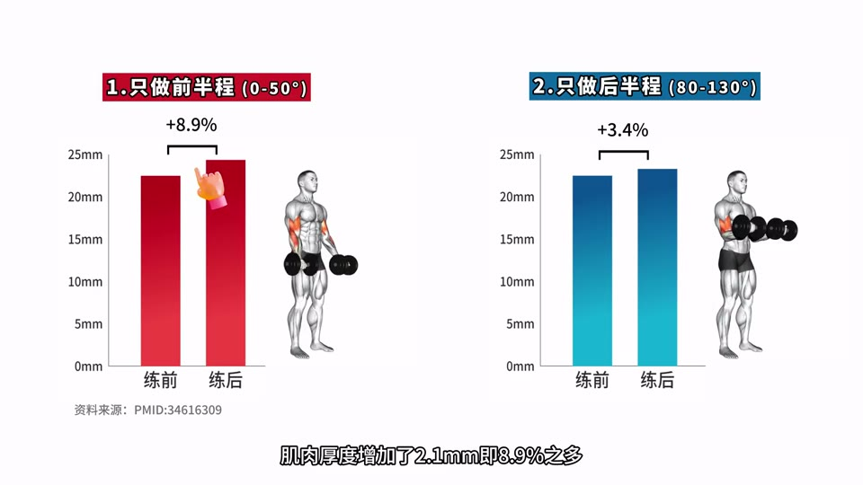

*图 20：只做前半程（0–50°）肌肉厚度 +8.9%，只做后半程（80–130°）+3.4%。*

- **提醒**：做弯举要老老实实**把手肘放完**，不要放弃最底部的行程。

### 5.4 在肩伸位还是肩屈位做弯举（长位 vs 短位）[25:10]

- 肱二头肌是**双关节肌**（跨肩、肘）：越是在**肩伸位**做弯举，它就越是在预先拉长的状态下开始收缩；越是在**肩屈位**，就越是在预先缩短的状态下开始收缩。

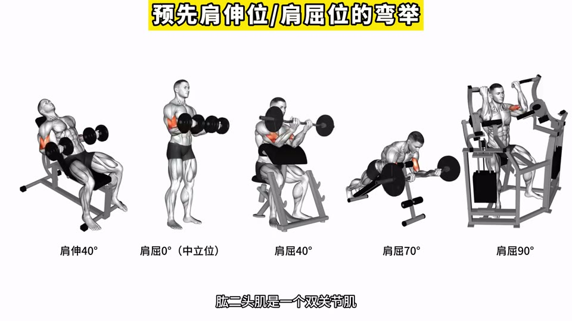

*图 21：肩伸 40°、肩屈 0°（中立位）、肩屈 40°/70°/90° 的不同弯举。*

- 学界结论参差，目前无法定论。画面上的文献汇总：

| 论文 | 研究对象 | 对比动作 | 结果 |
|---|---|---|---|
| 1（2009）Liliam F. Oliveira | 22 名有力训经验的男性 | 肩伸 50° / 中立位 / 肩屈 50° 的弯举 | 中立位、肩伸 50° 肌电较高；肩屈 50° 较低 |
| 2（2013）Jeheon Moon | 13 名有力训经验的男性 | 肩屈 30°/45°/60°/75°/90° 的弯举 | 肩屈 45°、75° 肌电较高；30°/60°/90° 较低 |
| 3（2023）Aitor Zabaleta-Korta | 31 名有力训经验的女性 | 肩伸 45° / 肩屈 45° 的弯举 | 肩屈 45° 肌肥大稍多；肩伸 45° 没有更多肌肥大 |
| 4（2025）Koulla Parpa | 11 名有力训经验的男性 | 肩屈位（未明确度数）/ 中立位 | 中立位肌电更高；肩伸位（未明确度数）更低 |
| 5（2025）Parsa Attarieh | 15 名无力训经验的男性 | 肩伸 50° / 肩屈 50° 的弯举 | 肱二头肌和肱肌的肌肥大**没有差异** |

（PMID 依次为 24150552 / 24259780 / 37559762 / 41133617 / 40082069，以画面为准。）

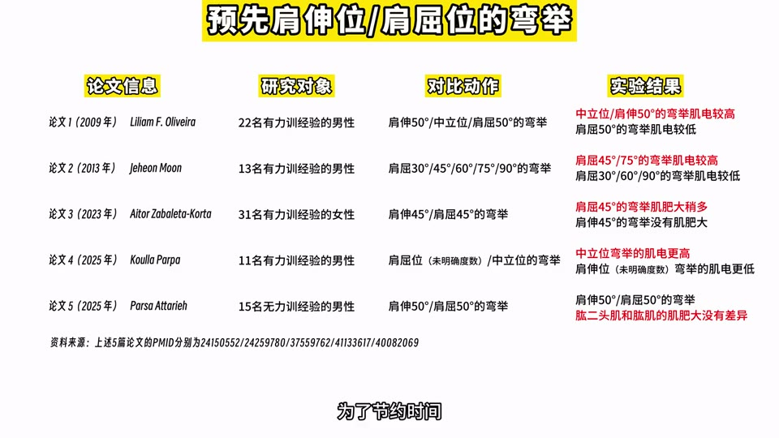

*图 22：5 篇相关研究的结论互相矛盾。*

- **最新那项研究（论文 5）的设计**：受试者一只手做**肩屈 50°** 的弯举，另一只手做**肩伸 50°** 的弯举。用**绳索**做阻力，两边的肘屈范围、阻力大小、阻力力臂都完全相同，所以全程阻力力矩相同，唯一的变量是肩的位置（也就是肱二头肌的长度）。
- **10 周共 80 组**训练后，两只手臂的肱二头肌、肱肌厚度都增加了：

| | 肱二头肌 近端/中段/远端 | 肱肌 中段/远端 |
|---|---|---|
| 肩屈 50° 弯举 | +6.4% / +6.9% / +7.2% | +14.0% / +7.2% |
| 肩伸 50° 弯举 | +8.8% / +9.1% / +8.7% | +13.3% / +5.2% |

经假设检验，**没有统计学意义上的差异**，通俗说就是实际上没有差异。

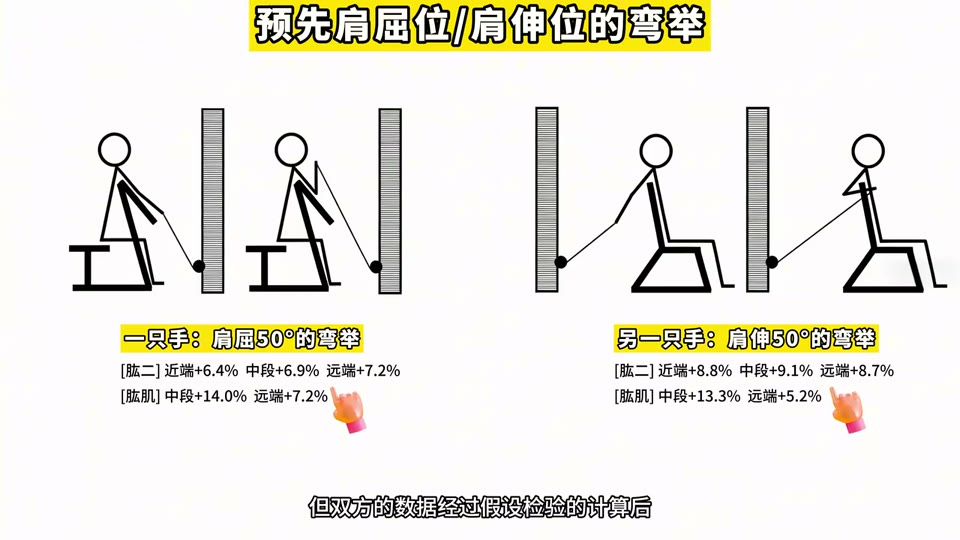

*图 23：用绳索让两边的阻力力臂完全相同，结果两种弯举增肌效果没有差异。*

- 作者的解释：以前的研究认为有差异，是因为没把两种弯举的**阻力力矩**设得完全一样。比如用哑铃做，肩屈位的哑铃弯举阻力力臂更大，阻力力矩也就更大，实验条件本身就不同。

### 5.5 延伸：肌肉应该在长位还是短位训练？[27:38]

- 以肱二头肌为例：极限肩屈 + 肘屈时最短（UP 主举例 10 cm），极限肩伸 + 肘伸时最长（举例 20 cm）。预先肩伸位的弯举是在**长位**收缩，预先肩屈位的是在**短位**收缩（肩屈没到极限，所以不算「最短位」）。
- 背阔肌的例子：坐姿划船和高位下拉的关节活动都是肩伸，但坐姿划船在背阔肌的**短位**做，高位下拉在**长位**做。
- **学界目前的理论解释（长度—张力关系）**：随着肌肉拉长，张力先增后减。每块肌肉的实际工作范围只是这条曲线的一部分，于是分成三类：
  - **A 类**：越长张力越大 → 理论上更适合**长位训练**
  - **B 类**：长位、短位张力差不多 → 无所谓
  - **C 类**：越短张力越大 → 更适合**短位训练**
- 肌肉张力是影响肌肥大的重要因素，所以理论上应该在张力最大的范围训练。但这**只是纯理论解释**，还需要更多具体研究验证。系列里凡是涉及长位/短位之争的肌肉，UP 主都会概述研究现状；就肱二头肌而言，目前看来长位、短位**似乎都可以**。

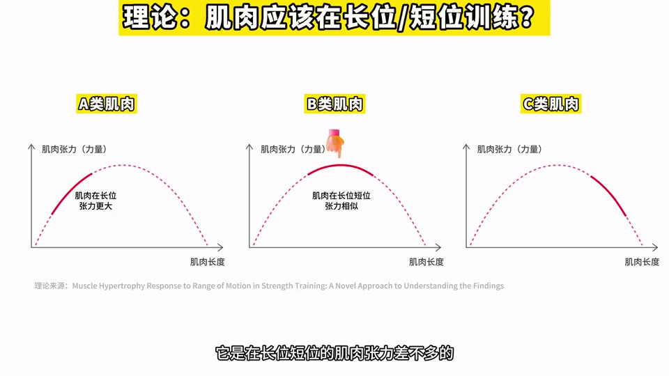

*图 24：A 类肌肉越长张力越大，B 类长短位差不多，C 类越短张力越大。*

### 5.6 弯举小结 [30:02]

- 归纳起来就是：做**正握、下放充分、可以伴随一点肩屈**的弯举。
- 讲这么多文献，最后结论却是一个普普通通的弯举。UP 主说这不算白讲：他想借此说明肌肥大的单项研究很容易互相矛盾，也没人敢保证能复现。**不要有论文崇拜**，要看有没有一致性结论、看荟萃分析的结果。

---

## 6. 课间推广 [30:38]

推广一句带过：每月 5 元的 B 站「充电学习社群」（训练与营养图文、每月直播课、粉丝群、资料网盘打包），以及填问卷的个人减脂/增肌方案定制。

---

## 7. 肘伸肌：肱三头肌 [32:30]

- 肘伸肌是**肱三头肌**和**肘肌**。肘肌很小，和健身无关，直接忽略。
- 看图的方位：从背后看右手，所以图上一侧是身体外侧，另一侧是身体内侧。

| | 长头 | 外侧头 | 内侧头 |
|---|---|---|---|
| 层次 | 浅层，靠身体内侧 | 浅层，靠身体外侧 | **深层**（被覆盖） |
| 起 | 肩胛骨**盂下结节** | 肱骨后方中上段 | 肱骨后方下段 |
| 止 | 尺骨鹰嘴 | 尺骨鹰嘴 | 尺骨鹰嘴 |
| 功能 | 肘伸 + **肩伸** | 肘伸 | 肘伸 |

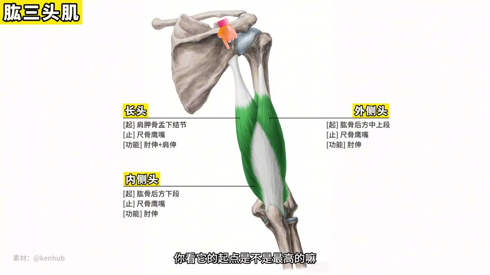

*图 25：长头起于盂下结节（功能是肘伸 + 肩伸），外侧头、内侧头起于肱骨后方，三个头都止于尺骨鹰嘴。*

要点：

- **浅层靠内的不叫内侧头，叫长头**，因为它的起点最高，最长。
- **长头是双关节肌**（跨肩、肘），收缩能肘伸，也能**肩伸**。但大臂已经垂在身体两侧时，长头的起止点几乎在一条竖直线上，没有前后关系了，就不能再参与肩伸。
- **内侧头的「内」**：UP 主让大家理解成「内裤的内」，意思是在里面、在更深处。它大部分被覆盖在第二层，只在两侧冒出一点：外侧头那边几乎看不到，长头那边冒出得多一些，常被误认为是长头的一部分，其实能和长头分开。
- 三个头共用的白色区域是**肌腱**，不会增厚，默认是一处凹陷。
- 实拍图：先看到巨大的、不会增厚的肌腱，外侧是外侧头，内侧是长头。长头旁边那块比较薄的隆起是下层内侧头没被盖住的部分。它薄，是因为那里只有内侧头一层；上方厚，是因为长头和内侧头两层叠在一起。

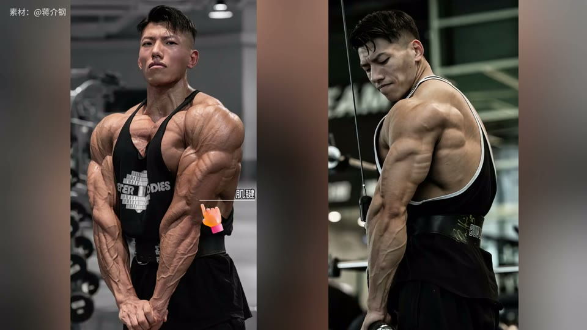

*图 26：实拍图里辨认外侧头、长头和冒出来的内侧头。*

**关节活动** [36:32]

- **三个头共同：肘伸**。单关节动作是各种臂屈伸；多关节动作是推胸、推举类，克服阻力时肘关节也在从折叠变为打直。
- **长头额外：肩伸**。肩伸五肌：**背阔肌、大圆肌、三角肌后束、肱三头肌长头、下胸**。对应的肩伸动作有直臂下压、仰卧上拉、各种窄握下拉、各种窄握划船。
- 以**直臂下压**为例，你会明显感到肱三头肌发力：
  - 长头作为肩伸肌，在做向心/离心收缩，感觉非常强烈。
  - 外侧头和内侧头不跨肩关节，和肩伸无关，但也会变硬。因为阻力有让你肘屈的趋势，它们在**等长收缩**阻止肘屈，所以略有感觉。

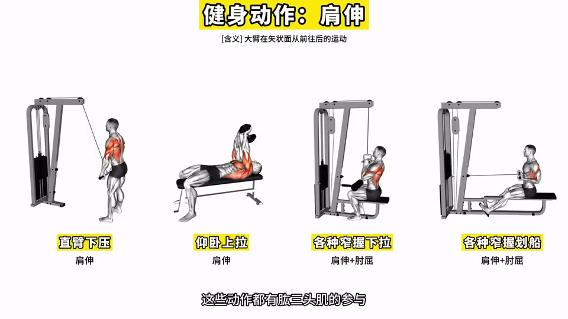

*图 27：直臂下压、仰卧上拉（肩伸），各种窄握下拉、各种窄握划船（肩伸 + 肘屈），这些动作都有肱三头肌长头参与。*

---

## 8. 臂屈伸：两个问题 [38:25]

### 8.1 肩屈位（过顶）的臂屈伸可能更有利于肌肥大 [38:31]

- 研究：受试者一只手做**肩屈 0°（中立位）**的臂屈伸，另一只手做**肩屈约 180° 的过顶臂屈伸**（画面写的是「保持肩屈近 180°」，口播说的是 90°，见「不确定之处」）。
- 训练**四个月、共 40 组**（以口播为准）后，用**核磁共振**检查：**过顶臂屈伸的肌肉体积增长比中立位的多四成**。
- UP 主的评价：变量控制不错（同一个人两只手臂各做一种，排除了个体差异），周期也有四个月算长的。他不敢说一定能复现，但可能是个趋势和方向，**大家可以多考虑做做过顶的绳索臂屈伸**。

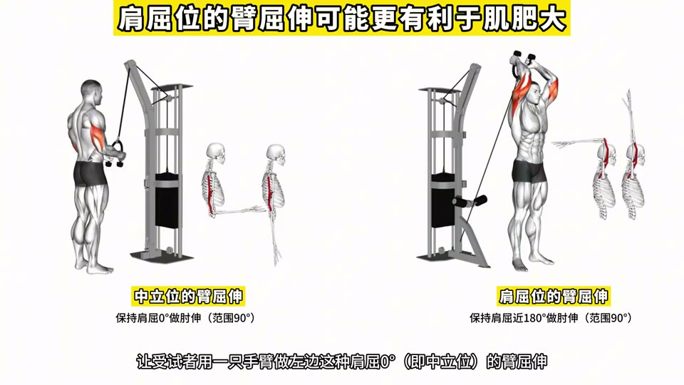

*图 28：左边是中立位的臂屈伸，右边是肩屈位的过顶臂屈伸。*

**过顶绳索臂屈伸怎么上下器械**（很多人不会）：

1. 把龙门架把手调到**低位**。
2. **蹲下**，一只手拿起绳索。
3. 转身把绳索放到背后，双手握好。
4. 站起来，就可以开始做了。
5. 结束时**不要直接松手**，先蹲下，等绳索没有拉力了再放开。

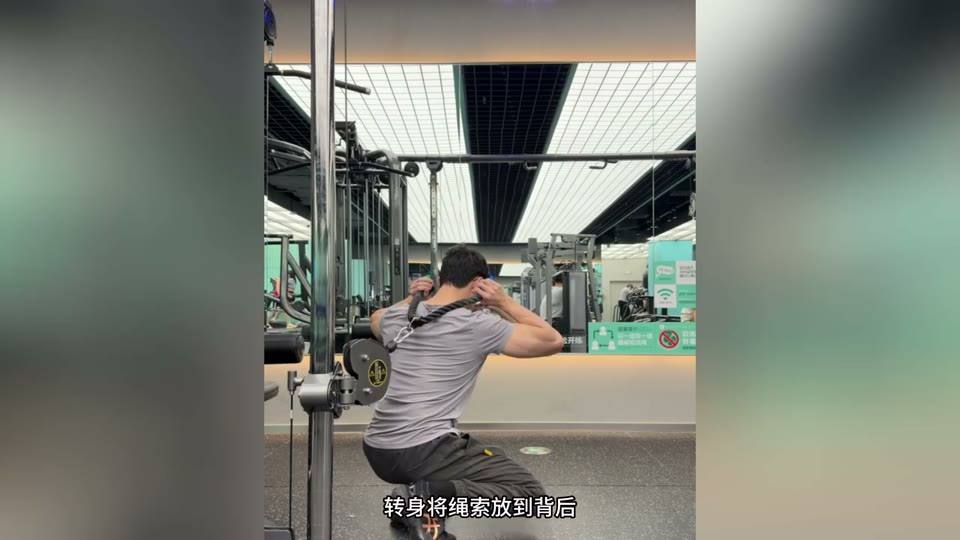

*图 29：蹲下拿绳，转身把绳索放到背后，再站起。*

### 8.2 臂屈伸结合肩伸：没有循证依据 [39:43]

- 有人提出臂屈伸时，大臂应该同时从前往后运动（相当于臂屈伸 + 直臂划船一起做）。逻辑是：把一块肌肉的多个关节活动全部用上，让它伸缩范围更大，就更利于肌肥大。
- UP 主：这是「朴素的愿望」，要有循证研究证明，**目前没有看到相关研究**。同理，弯举时做肘屈 + 旋后 + 肩屈，用上肱二头肌全部三个关节活动，能缩得更短、拉得更长，但是否更增肌并不知道，很可能不成立。
- 还有人提出：肘伸完成后继续往后**肩伸**，让大臂移到躯干后方，长头还能继续收缩。UP 主同样**持保留态度**。理由是大臂在躯干两侧时：
  - 背阔肌、大圆肌、三角肌后束的起止点仍有前后关系，还能继续把大臂往后拉（「仍能肩伸的三肌」）；
  - **肱三头肌长头**的起止点已经没有前后关系，收缩拉不动大臂往后；
  - **下胸**收缩是把大臂往前拉，更不能肩伸。

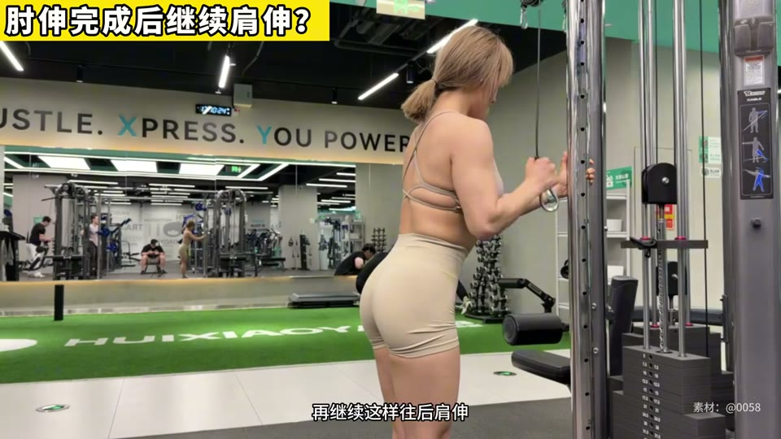

*图 30：「肘伸完成后继续肩伸？」这种做法目前没有循证支持。*

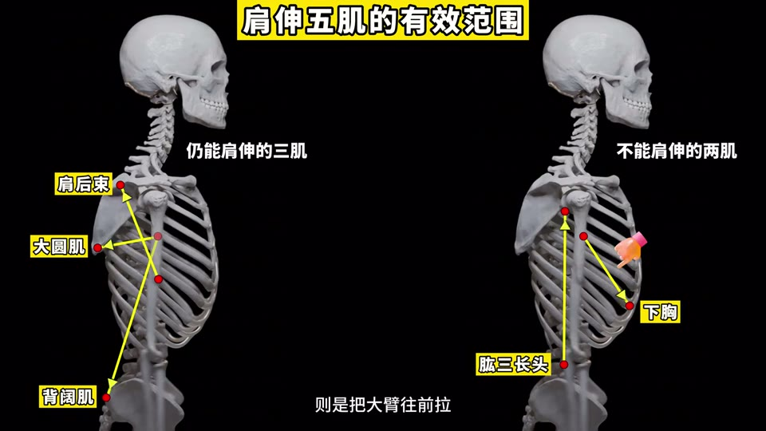

*图 31：仍能肩伸的三肌（三角肌后束、大圆肌、背阔肌）与不能肩伸的两肌（肱三头肌长头、下胸）。*

**本节小结**：① 可以多做过顶绳索臂屈伸，有较高质量的研究认为它的肌肥大效果更好；② 臂屈伸结合肩伸（不论同时做还是之后接着做）是健身博主们自己推理出来的，目前没有循证依据。

---

## 9. 关节角度—肌群力矩 [41:46]

- 同一块肌肉在不同关节角度产生的力矩不同，称为「**关节角度—肌群力矩**」的函数关系。
- 肘关节的研究：横坐标 10° 接近伸直，75° 大小臂快要垂直，125° 更屈。**肘屈肌和肘伸肌都在约 75° 时力矩最大**，比最小力矩高约五成。

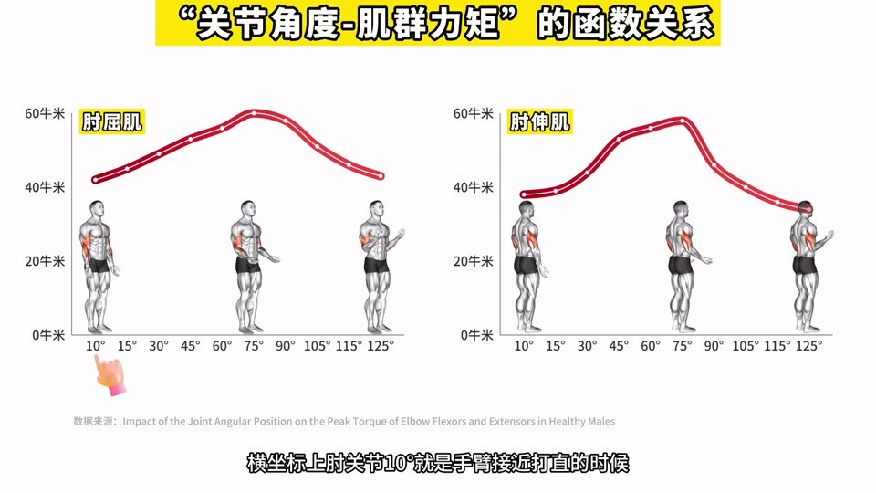

*图 32：肘屈肌、肘伸肌都在约 75° 时力矩最大。*

**为什么动作过程中难度会变**

- 例子：**器械弯举、器械臂屈伸**的钢线绕着一个**标准正圆**的圆盘，阻力力矩 = 配重拉力 F × 圆盘半径 r，**全程恒定**。可是做起来仍然有的角度轻松、有的角度吃力，因为肌群提供的**动力力矩**随角度变化。
- 所以动作难度的变化由两个因素决定：
  1. **阻力力矩的变化**：除了这种正圆圆盘的器械，其他健身动作的阻力力矩都在时时变化；
  2. **动力力矩的变化**：肌群在不同角度能产生的力矩时时在变。
- **理想器械**：阻力力矩和肌群动力力矩同增同减，全程难度没什么变化，有一种「丝滑感」。

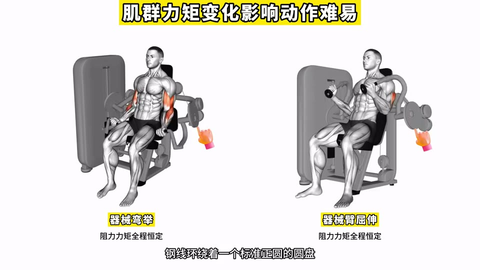

*图 33：钢线绕着标准正圆的圆盘，阻力力矩全程恒定。*

- **老办法：异形圆盘（凸轮）**。一些较贵的进口器械圆盘其实不圆，比如一台站姿臀推器械：品牌方测试认为某个角度肌群力矩小，就设计较小的半径（阻力矩小）；另一个角度肌群力矩大，就设计较大的半径。又比如少数进口品牌的蝴蝶机夹胸，上方圆盘是轻微椭圆的，起始时半径小、中段半径变大、结束时又变小，因为品牌方测得肩水平内收的动力力矩是「小—大—小」，就设计了同样「小—大—小」的阻力矩。

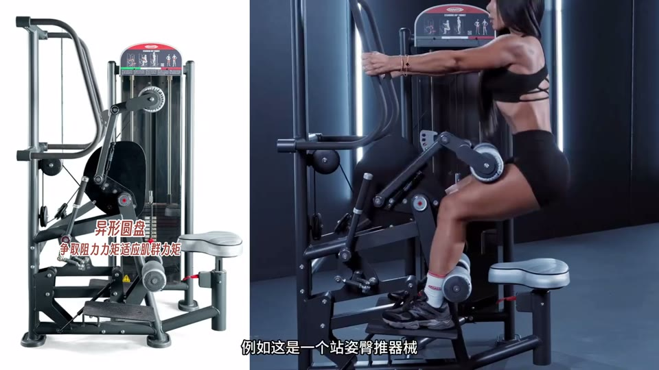

*图 34：异形圆盘让钢线半径在动作中不断变化，从而改变阻力力矩。*

- **局限：力矩函数因人而异**。一项研究测了 14 名受试者的肩屈角度—力矩关系：整体上肩屈超过 90°（大臂抬平以后）力矩会下降，但每个人下降的幅度不同，有的人最高点也不在 90°。用张三的函数设计的器械不一定适合李四，「你做起来丝滑，我做起来未必丝滑」。
- **更前沿：电磁阻力器械**。电流决定阻力力矩，可以先测出你在这个动作里各角度的动力力矩函数，再实时匹配出走势相同的阻力力矩。目前只在个别顶奢酒店里有，离大众健身还远。
- **结论**：健身里的阻力力矩和动力力矩时时刻刻都在变；匹配得好就丝滑，匹配得不好就会觉得难度骤变。

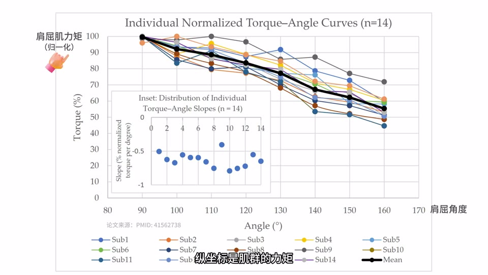

*图 35：肩屈力矩—角度曲线因人而异。*

---

## 10. 小臂：五组肌肉 [47:10]

- 健美训练基本不追求小臂的肌肥大，但观众问得多，所以简单讲一下。
- 小臂肌肉有 **20 块**，**不需要记住具体每一块**，只要知道按功能分成 5 组、各自怎么练就行。

画面上的「小臂全部 20 肌」：

| 组 | 功能 | 肌肉 |
|---|---|---|
| 1 | 肘屈肌 | 肱桡肌 |
| 2 | 腕屈肌 | 尺侧腕屈肌 + 桡侧腕屈肌 + 掌长肌 |
| 3 | 腕伸肌 | 尺侧腕伸肌 + 桡侧腕短伸肌 + 桡侧腕长伸肌 |
| 4 | 指屈肌 | 指浅屈肌 + 指深屈肌 + 拇长屈肌 |
| 5 | 指伸肌 | 指伸肌 + 拇短伸肌 + 拇长伸肌 + 示指伸肌 + 小指伸肌 |
| 其他 | — | 旋前圆肌（旋前）、旋前方肌（旋前）、旋后肌（旋后，和肱二头肌一起做小臂旋后）、拇长展肌（桡偏） |

（第 5 组里有一个名称被画面上的手指图标挡住，按上下文应是拇长伸肌。）

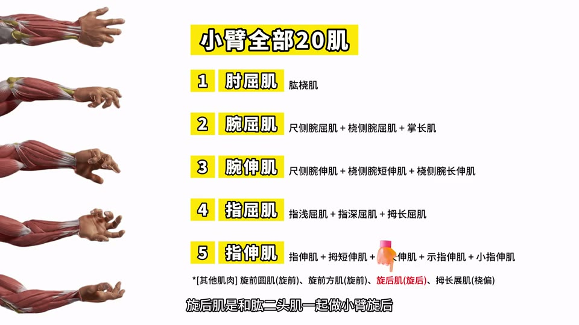

*图 36：小臂肌肉按功能分成肘屈、腕屈、腕伸、指屈、指伸五组。*

### 10.1 第 1 组：肘屈肌（肱桡肌）[47:25]

- 就是前面讲过的、肘屈三肌里力矩最小的老三，但它是**小臂上最大的肌肉**（「山中无老虎，猴子称大王」）。
- 起于肱骨**外上髁**这一侧（「外外外，不是内」），止于大拇指那一侧的桡骨。

### 10.2 腕屈与腕伸的定义 [48:14]

- **腕屈**：手心靠近小臂（「来来来，你过来嘛」的手势）。
- **腕伸**：手背靠近小臂（「滚滚滚」的手势）。
- 控制腕关节屈伸的肌肉，功能就写在名字里：「某某腕屈肌」「某某腕伸肌」，再加上尺侧/桡侧、长/短来区分。唯一例外是**掌长肌**，它屈腕能力很弱，所以没有这样命名。

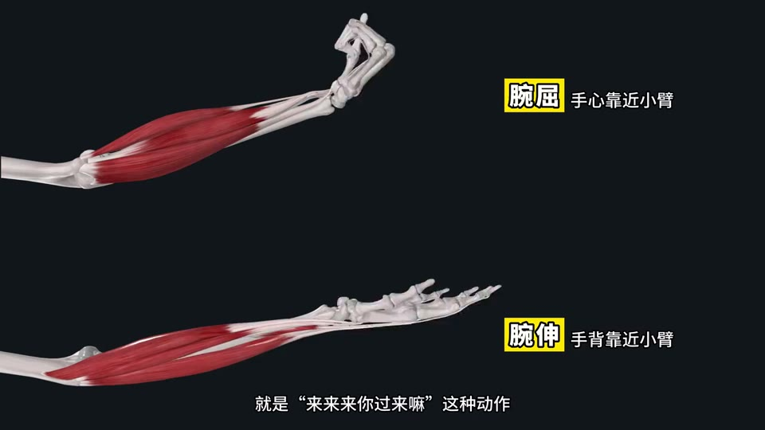

*图 37：腕屈是手心靠近小臂，腕伸是手背靠近小臂。*

### 10.3 第 2 组：腕屈肌 [49:02]

- 看图方位：都是右手、手心朝上（小臂正面视角）。短的是大拇指，长的是小拇指；大拇指那侧是桡骨，小拇指那侧是尺骨。
- 三块腕屈肌**共同起于肱骨内上髁**（肘关节处一个很大的骨性突起，再胖的人都摸得到），**共同止于手心一侧**，所以收缩能把手心拉向小臂。
  - 靠近尺骨的叫**尺侧腕屈肌**，靠近桡骨的叫**桡侧腕屈肌**。
  - **掌长肌**：连接手掌的那片扇形区域不是强韧的肌腱，而是一层软膜组织（**掌腱膜**），不适合拉起手掌，对腕屈贡献很小。所以临床上掌长肌是**最常用的自体肌腱移植来源**，取掉它几乎不影响腕屈。

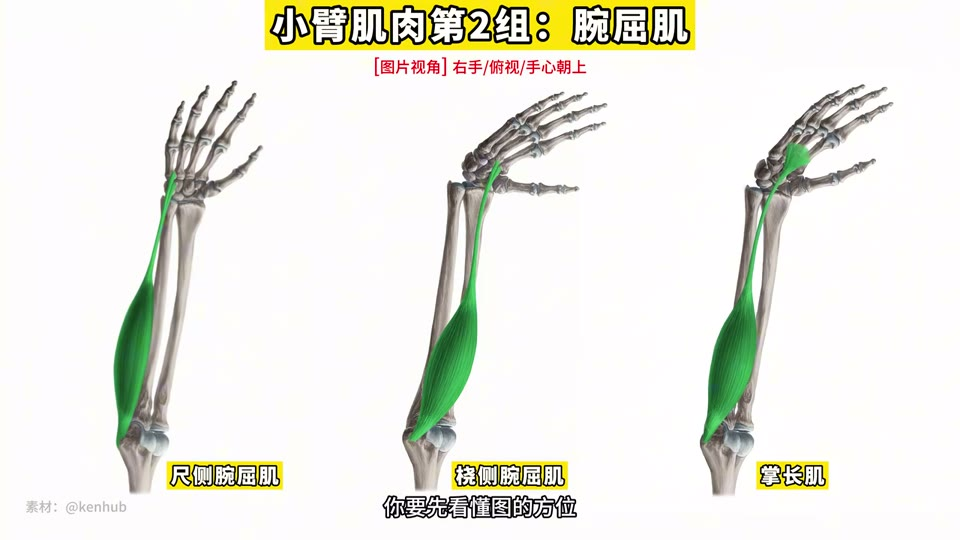

*图 38：尺侧腕屈肌、桡侧腕屈肌、掌长肌，都起于肱骨内上髁。*

### 10.4 第 3 组：腕伸肌 [50:34]

- 看图方位：仍然是右手手心朝上，但这是**从下往上看的仰视图**，所以看到的是手背。图上「内外」是反的，要先理解方位，看不懂就暂停想一想。
- 三块腕伸肌**起于肱骨外上髁**，**止于手背某处**，收缩能把手背拉向小臂。
  - 长在尺骨那边的叫**尺侧腕伸肌**；
  - 长在桡骨那边的两块叫**桡侧腕伸肌**，它们在外上髁的起点高低略有不同，所以再按长短分为**桡侧腕短伸肌**、**桡侧腕长伸肌**。
- **对称性**：腕屈肌从肱骨**内上髁**长到**手心**，腕伸肌从肱骨**外上髁**长到**手背**，两组空间位置是对称的。掏出自己的右手对着图比划一下就懂了。

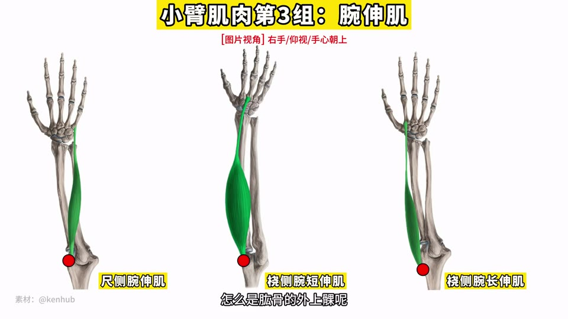

*图 39：尺侧腕伸肌、桡侧腕短伸肌、桡侧腕长伸肌，都起于肱骨外上髁。*

**腕屈肌、腕伸肌的训练** [52:25]

- 拿一个负重，克服阻力做**腕屈**就是练腕屈肌（腕弯举），克服阻力做**腕伸**就是练腕伸肌（腕屈伸）。
- 要练的话，和其他肌肉的训练方式一样：**每次 5–8 组，8–15RM 范围**。

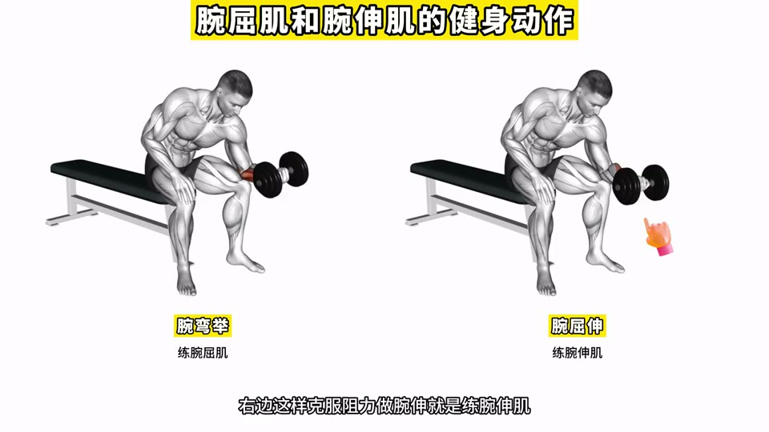

*图 40：左边是腕弯举（练腕屈肌），右边是腕屈伸（练腕伸肌）。*

### 10.5 第 4 组：指屈肌 [52:43]

- **握拳 = 指屈**，**张开 = 指伸**。
- 指屈肌跨过一个或多个指关节，收缩就会握拳。注意：**指屈肌是多关节肌，同时也跨过腕关节**。没有别的肌肉干预的话，它一收缩就会同时指屈 + 腕屈。
- **怎样做到只握拳、手腕不动**？靠**腕伸肌等长收缩**，抵抗指屈肌对腕关节造成的腕屈力矩。
- **自己试一下**：右手狠狠握拳，左手摸右小臂正面，是收紧的（指屈肌在收缩）；再摸小臂背面，也是收紧的（腕伸肌在等长收缩）。
- **通用原理**：所有多关节肌一收缩都会让 A、B 两个关节都动。想只让 A 动、B 不动，就要让 B 关节的拮抗肌等长收缩。

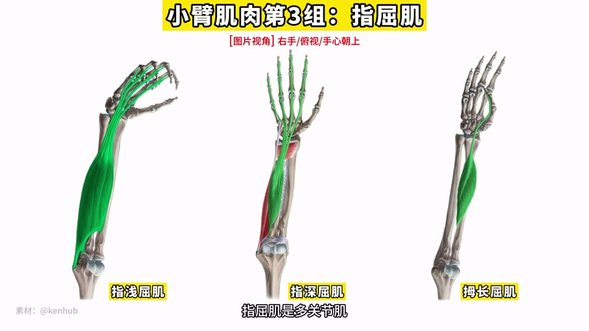

*图 41：指浅屈肌、指深屈肌、拇长屈肌，都是跨过腕关节的多关节肌。*

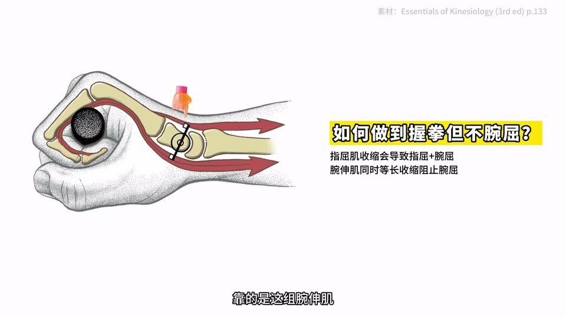

*图 42：指屈肌收缩会导致指屈 + 腕屈；腕伸肌同时等长收缩，才能阻止腕屈。*

**指屈肌的训练**

- **向心/离心收缩**：用**握力器**，克服阻力时做指屈；腕伸肌因为在等长收缩，也会练到。
- **等长收缩**也很常见：所有需要紧紧握杆的动作，比如**硬拉、引体、下拉**。为了不脱杆，手和杆之间的摩擦力 F 必须等于巨大的阻力，而 F = 摩擦系数 μ × 你给杆的压力 N，所以你必须握紧，才能产生足够的压力 N。
- **助力带**的材质（牛皮或橡胶）摩擦系数很高，较小的压力 N 就能得到足够的摩擦力，你就不用再紧紧抓握。所以**用助力带会对小臂指屈肌的训练造成一定损失**。

### 10.6 第 5 组：指伸肌 [55:33]

- 看图方位：右手手心朝上，仰视图，所以看到的是手背，也能看到尺骨鹰嘴。
- 指伸肌跨过一个或多个指关节，收缩能张开手指（指伸）；它**同时跨过腕关节**，也会导致腕伸。
- 只张开手指、手腕不动时，要靠**腕屈肌等长收缩**来阻止腕伸，和握拳时腕伸肌等长收缩是同一个道理。
- 训练：只有一种叫「**指力器**」的东西，有不同阻力，克服阻力做指伸就练到了指伸肌。
- 两类工具小结：**指力器练指伸肌，握力器练指屈肌**，都是用指关节活动来练小臂肌肉。

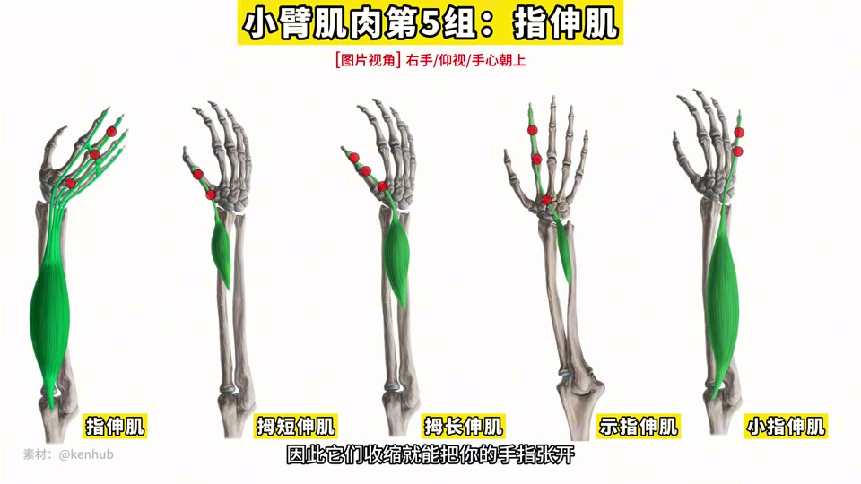

*图 43：指伸肌、拇短伸肌、拇长伸肌、示指伸肌、小指伸肌。*

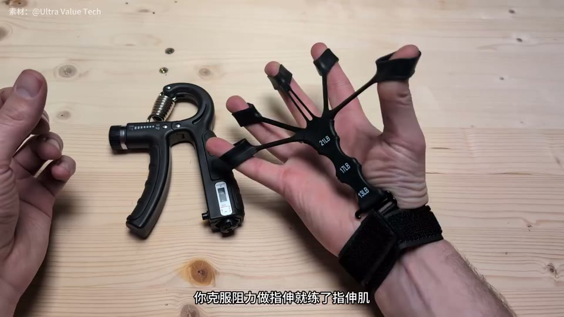

*图 44：握力器练指屈肌，指力器练指伸肌。*

### 10.7 剩下四块不归类的肌肉 [56:49]

旋前圆肌、旋前方肌（小臂旋前）；旋后肌（和肱二头肌一起做小臂旋后）；拇长展肌（手掌桡偏）。这四块对小臂的维度影响很小。**小臂练粗的关键是上面五组**，它们也确实有专门的训练动作。

### 10.8 吟诗环节：《咏臂肌》[57:12]

（这一段 Whisper 没有转写出来，按画面文字整理。）

> 肱二肱肌肱桡肌，肘屈铁杆三兄弟。
> 长头外头盖内头，合为肘伸三头肌。
> 小臂维度如何长，腕指屈伸是妙计。
> 纤纤细肢不用急，三连就变麒麟臂。

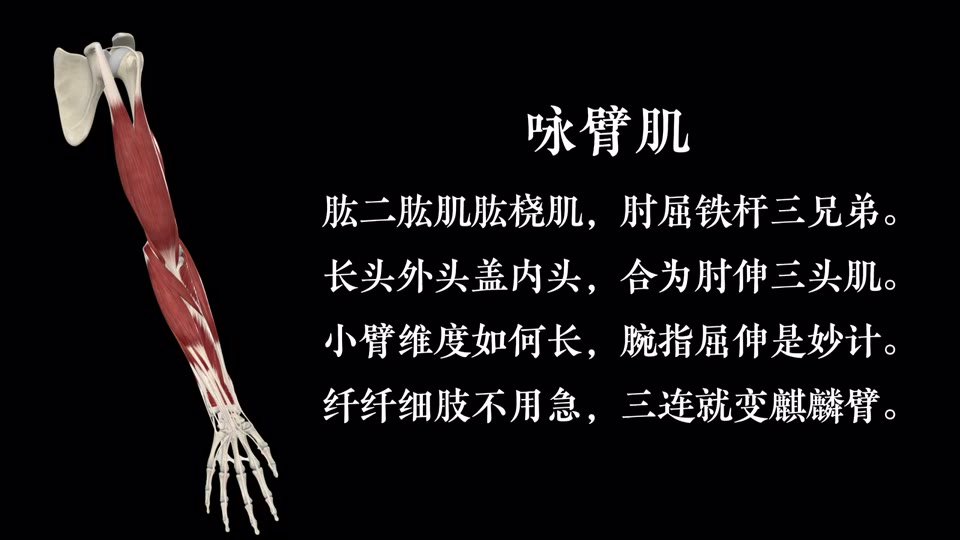

*图 45：用来复习大小臂内容的四句口诀诗。*

---

## 11. 腹部四肌的层次关系 [57:48]

- 腹部四肌：**腹直肌、腹外斜肌、腹内斜肌、腹横肌**。大家最关心的是腹直肌（俗称「腹肌」），但它被另外三块包裹着，所以要先讲位置关系。

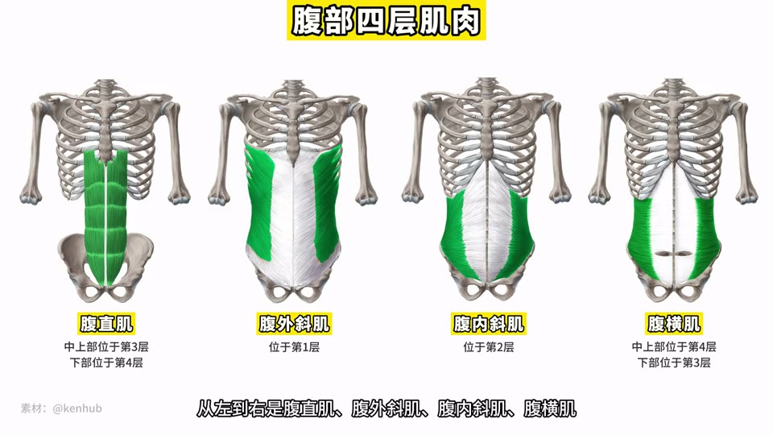

*图 46：腹直肌（中上部在第 3 层，下部在第 4 层）、腹外斜肌（第 1 层）、腹内斜肌（第 2 层）、腹横肌（中上部在第 4 层，下部在第 3 层）。*

UP 主用动画从深到浅讲了一遍：

1. **腹白线**：一根坚韧致密的结缔组织，从胸骨剑突长到耻骨联合；肚脐是腹白线中间的标志点。腹部四肌都长在这条线上。
2. **腹横肌**（最深层）：**水平走向**的肌纤维，从肋软骨、后背的胸腰筋膜、骨盆髂嵴水平长向腹白线。红色是肌腹，靠近腹白线的白色部分是它的**腱膜**（扁平状的肌腱）。**特别注意**：在肚脐以下几厘米处，腹横肌留了一道开口，用来把腹直肌「装进去」。
3. **腹直肌**：完全**竖直走向**，从胸骨剑突及附近肋软骨长到耻骨联合。上段它在腹横肌腱膜的**上面**；下段反过来，腹横肌腱膜在它上面，这里腹直肌才是最深的一层。
4. **腹内斜肌**：从胸腰筋膜、髂嵴长向腹白线；肌纤维上部偏斜上、中部偏水平、下部偏斜下；靠近腹白线的白色部分是腱膜。
5. **腹外斜肌**（最浅层）：主体是斜向肌纤维，从肋骨长到腹白线和髂嵴；靠近腹白线的部分也是腱膜。

**由此可知**：腹直肌并不像大家想的那么「表层」。除了脂肪层，它的**中上部被两层腱膜覆盖**，**下部被三层腱膜覆盖**。真实人体腹部去掉全部脂肪后，映入眼帘的不是腹直肌，而是一片多层腱膜融合成的**白膜**；局部去掉腱膜后，才看到竖直走向的腹直肌纤维。

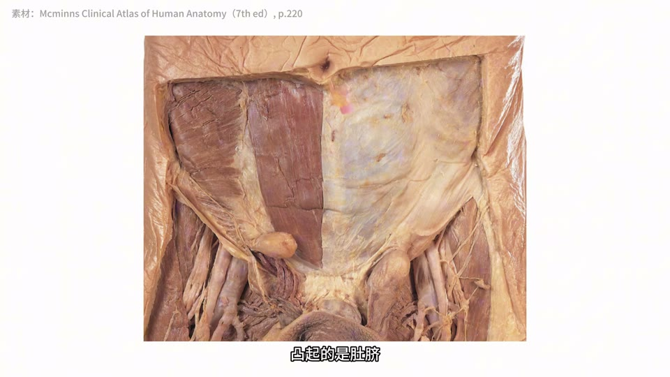

*图 47：凸起处是肚脐。看到的是一片白色腱膜，局部剥开后才是腹直肌。*

---

## 12. 腹直肌的分块 [61:15]

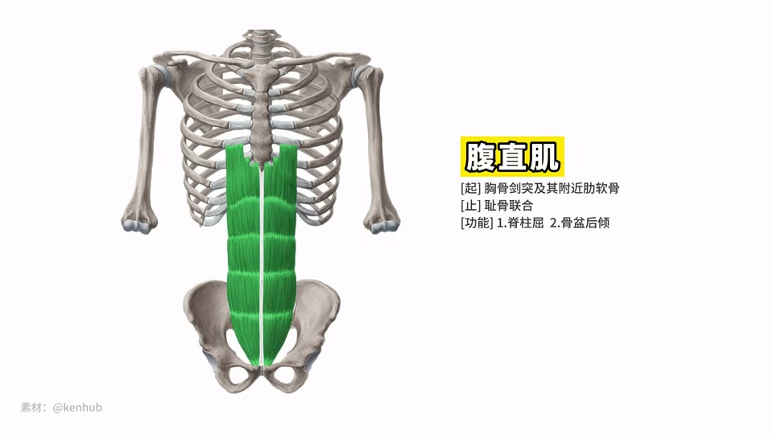

*图 48：腹直肌起于胸骨剑突及附近肋软骨，止于耻骨联合；功能是①脊柱屈、②骨盆后倾。*

- 腹直肌一端长在胸骨剑突和附近的肋软骨（简单说就是胸口），一端长在耻骨联合。
- 腹直肌表面横向的几条结缔组织叫**腱划**，纵向那条是**腹白线**。

### 12.1 分块的第一个决定因素：腱划数量 [61:44]

- 每多一条腱划，分块就多两个：2 条 → 6 块，3 条 → 8 块，4 条 → 10 块。
- 一项研究看了医院的 **200 张腹部 CT**，男女没有差异：
  - **2 条腱划：约 21%**（约五分之一）
  - **3 条腱划：约 77%**（约五分之四）
  - **4 条腱划：仅 2%**

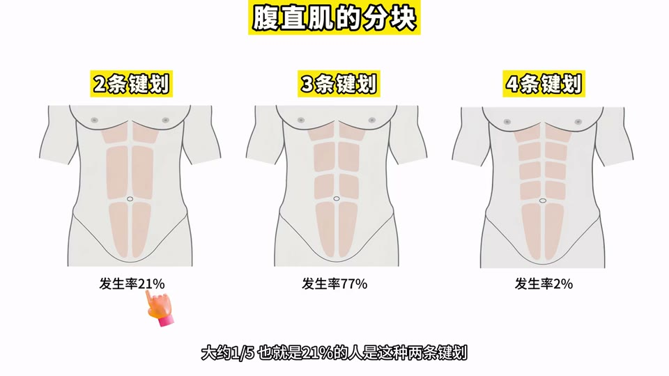

*图 49：2 条、3 条、4 条腱划的发生率分别是 21%、77%、2%。*

### 12.2 第二个因素：腹白线在肚脐以下迅速变细 [62:20]

- 大多数人的腹白线在**肚脐以下看不见**（不是不存在，是太细，CT 能看到，外表看不到），下腹的腹直肌左右就不再分块。所以实际的分块模式是 **4+1、6+1 或 8+1**，**6+1 最常见**。健美选手里也常看到肚脐以下没有腹白线的 6+1。
- 解剖示意图里那根像绳子的腹白线是高度简化的模型。对一百多人做 CT 三维重建发现，腹白线其实是**长条菱形**：在肚脐附近最宽，肚脐以下迅速变窄。
  - 肚脐处宽约 **3.7 cm（±1.9）**
  - 下腹处约 **1.7 cm（±1.2）**（画面数据；口播说「到这里只有 0.7 厘米」，见「不确定之处」）
- 再加上下腹的腹直肌上面盖着三层腱膜（腹横肌、腹内斜肌、腹外斜肌），腹白线就更难看见了。

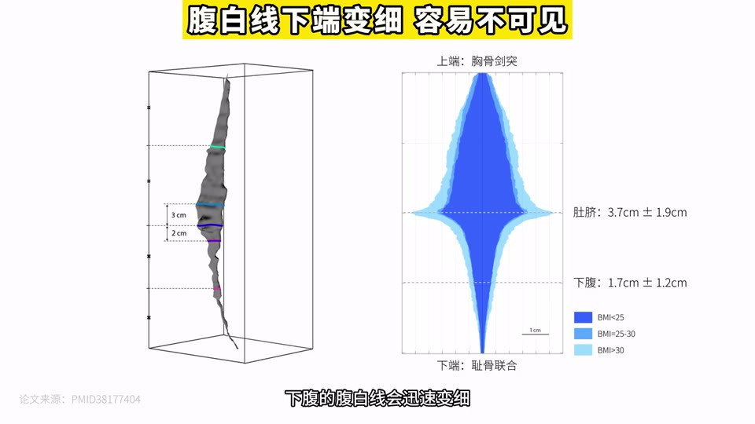

*图 50：腹白线从胸骨剑突到耻骨联合，在肚脐处最宽，肚脐以下迅速变细（PMID 38177404）。*

- UP 主自己就是 3 条腱划 + 肚脐下腹白线几乎看不见，形成 6+1。他强调**这不是体脂率的原因**，而是腹白线在肚脐以下可能「消失」。
- **十块腹肌极为罕见**（UP 主核查过那张图是真的）：要同时满足**4 条腱划**（约 2%）和**肚脐以下的腹白线保持宽度**（研究数据有标准差，确实有少数人下腹腹白线不那么细）两项天赋。

*图 51：3 条腱划，同时腹白线在肚脐以下几乎看不见，形成常见的 6+1 模式。*

### 12.3 腱划不对称很常见 [64:55]

- 腹白线左右各有一条腹直肌（就像左右各有一块胸大肌），各长各的，所以两侧腱划可能对称，也可能不对称。
- 两具遗体标本的对比：一具 2 条腱划、对称、肚脐以下腹白线细到看不见（下腹不分左右）；另一具 3 条腱划、不对称、肚脐以下腹白线仍有宽度（下腹能分左右）。
- 很多人很在意腹肌不对称，**其实没必要**，这是非常常见的现象。某位奥赛冠军的腹肌就左右不对称、肚脐以下也不分块，完全不影响他拿冠军。

---

## 13. 腹直肌的关节活动①：脊柱屈与卷腹 [66:06]

- 下端固定时，腹直肌收缩拉动躯干前屈，叫**脊柱屈**（不是说腹直肌长在脊柱上）。表现是**背从直变弯**。
- 相反的动作是**脊柱伸**（如山羊挺身）：竖脊肌收缩让背从弯变直。腹直肌让你变弯，竖脊肌让你变直。

### 13.1 卷腹 ≠ 仰卧起坐 [66:45]

| | 卷腹 | 仰卧起坐 |
|---|---|---|
| 关节活动 | 只做脊柱屈 | 髋屈 + 脊柱屈（不明显） |
| 主要靠 | 腹直肌 | 髂腰肌、股直肌等髋屈肌 |
| 下腰以下 | 完全不动，大腿与骨盆夹角不变 | 骨盆在靠近大腿（髋屈） |
| 能否坐起 | 不能，脊柱屈的幅度有限，只能起来一点 | 能坐起来 |

*图 52：「髋屈与腹直肌无关」。卷腹只做脊柱屈，仰卧起坐是髋屈 + 脊柱屈。*

- **要领**：我们要做的是**坐不起来的卷腹**。想象自己从下腰往下「截肢」了，只剩上半身。牢牢把握「**背部从直变弯，下腰以下没有运动**」。
- **卷腹垫**对新手是不错的引导：完全躺下时是脊柱伸，腹直肌充分拉长；卷腹结束时是脊柱屈，腹直肌充分缩短。它会提示你背是从反弓到变直再到变弯。
- 健身房里各种卷腹道理都一样：**只要背从直变弯了，就是腹直肌收缩导致的**。

*图 53：在卷腹垫上躺下时腹直肌足够拉长。*

### 13.2 卷腹时脖子酸怎么办 [68:06]

- 这是**胸锁乳突肌**在等长收缩。它由胸骨、锁骨两束合并止于耳后乳突，主要功能是拉动颈椎前屈（点头）。
- 为什么会发力：头颅的重力本来会让颈椎伸（头往后仰），而你在动作中保持头部稳定，靠的就是胸锁乳突肌全程等长收缩拉住头。
- 一般人其实不介意。实在受不了有三个办法：
  1. 把头砍掉再做卷腹（UP 主的玩笑）；
  2. **用一只手托着头**，减轻头的重量；
  3. 做**器械坐姿卷腹**或**举腿类**动作，不需要对抗头的重量。
- UP 主一般推荐**凳面或地面的卷腹**，器械卷腹也行，原理都是脊柱屈。

### 13.3 不太推荐龙门架卷腹 [69:32]

画面上列的「潜在缺点」：

1. **无意识地努力做髋屈**：不懂腹直肌原理的人会不自觉地去做髋屈，而不是脊柱屈。
2. **需要肩伸肌等长收缩**：钢线的阻力会把大臂往上抬（让你肩屈），你保持大臂不动靠的是肩伸肌等长收缩，所以会有额外的发力感，干扰感受。
3. **把手意外下落会砸脑袋**：所以有的健身房禁止做龙门架卷腹。

各种卷腹本质都是脊柱屈，这个动作没有额外优势，反而有潜在麻烦，所以 UP 主不太推荐。

*图 54：龙门架卷腹的三个潜在缺点。*

---

## 14. 腹直肌的关节活动②：骨盆后倾与举腿 [70:21]

- 腹直肌下端长在骨盆的耻骨上。**上端固定时**，它收缩会拉动骨盆往后转，叫**骨盆后倾**。
- 健身里这类动作叫「**举腿**」，但其实**和腿没关系**，不是大腿在动，而是腹直肌把骨盆往后转。「举腿」这个名字会让人误以为是去抬大腿（髋屈），那就完蛋了。
- 健身房的举腿动作（**悬垂举腿、支撑举腿、平板举腿**，以及健腹机）原理完全相同：上身固定，腹直肌收缩拉动骨盆后倾（画面标注：骨盆后倾 + 髋屈）。

*图 55：悬垂举腿、支撑举腿、平板举腿、健腹机，原理完全相同，都是骨盆后倾。*

### 14.1 通俗口诀：「菊花看人」[71:04]

- 骨盆不像四肢，看不见摸不着，很难熟练控制前倾后倾。
- 办法：骨盆和肛门是一体的，骨盆转动必然带着肛门朝向变化。人体肛门平时大约**朝向地面**；腹直肌收缩、骨盆后倾时，肛门朝向会**往前**转，能「看到前面的人来人往」，所以叫「菊花看人」。
- **举腿 = 骨盆后倾 = 菊花看人**。

*图 56：骨盆转动必然导致肛门朝向变化，所以举腿 = 骨盆后倾 = 菊花看人。*

- **错误的举腿**：动作过程中肛门朝向没变，只是在反复髋屈，练的是髋屈肌，和腹直肌没多大关系。
- **正确的举腿**：除了髋屈，还有骨盆后倾，肛门朝向转到了前方。
- **腹直肌力量不够**、拉不动骨盆时，可以**保持屈膝**来做：下肢重量形成的阻力力臂变短，阻力力矩就小一些。
- 平板举腿同理：开始和结束时肛门朝向变了（往前了），就说明腹直肌收缩拉动了骨盆后倾。
- 题外话：《猫和老鼠》里有一幕，猫的肛门从朝下变成**朝后**，那是和举腿相反的**骨盆前倾**，这时腹直肌是在拉长。

*图 57：左边错误的举腿只有髋屈，右边正确的举腿是骨盆后倾 + 髋屈。*

**腹直肌小结**：动作就两类。**卷腹 = 背从直变弯、下腰以下完全不动**；**举腿 = 肛门努力朝前、菊花看人**。

---

## 15. 能分上腹、下腹练吗？[73:44]

- 健身圈说「卷腹侧重上腹、举腿侧重下腹」，**目前没有循证依据**。
- **推理层面**：腹直肌从上到下是同一根肌纤维，一根肌纤维是整体同时收缩的。做卷腹时摸自己的下腹，一样在收缩变硬。就像我们不谈肱二头肌怎么分上部、下部练一样，腹直肌似乎也不该谈。腱划只是表面的结缔组织，并没有把腹直肌切成独立的几段（此处原视频有一句 Whisper 没转出来，大意如此）。
- **实践层面**：一项研究在 6 种练腹动作里，把腹直肌分成上下段测肌电。其中一种是普通卷腹（单纯脊柱屈、没有骨盆后倾），另外 5 种是「V 型」练腹动作（让平直的身体变成 V 型，脊柱屈和骨盆后倾都在做）。结果是**不管哪种动作，腹直肌上部和下部的肌电水平都没有差异**。
- 所以「卷腹练上腹、举腿练下腹」的说法很值得怀疑。
- **UP 主建议新手从卷腹开始**，卷腹比举腿好上手；他不认为两者在训练效果上有什么本质区别。

*图 58：6 种练腹动作的研究结论是「腹直肌上下部激活度没有差异」。*

---

## 16. 腹外斜肌 [75:24]

- **起**：第 5–12 肋；**止**：腹白线、骨盆髂嵴、耻骨（画面卡片）。主体肌纤维**斜下走向**，靠近腹白线的大片区域是它的腱膜。
- **实拍图**：腹外斜肌的标志是侧腹那几条斜下的肌束。它们不是本身分成几组在长，而是贴在肋骨上，显出了**肋骨的形状**；越往下越短，是因为那里的肋骨在变短。下方那条线是骨盆髂嵴，腹外斜肌长到这里就结束了。

*图 59：腹外斜肌起于第 5–12 肋，止于腹白线、髂嵴、耻骨；功能为主体：脊柱屈 mix 脊柱旋转，侧面：脊柱侧屈。*

**关节活动与训练**

- **主体肌纤维：脊柱屈 + 脊柱旋转的复合**。斜下走向的纤维收缩，会把胸廓拉向**对侧下方**，也就是矢状面的脊柱屈加上水平面的脊柱旋转。
- 最简单的对应动作是**对角线卷腹**：在标准卷腹的基础上往对角线靠，比如**右手去靠近左膝**，或者**左手去靠近右膝**，完全顺应腹外斜肌的纤维走向。
  - 示意图里的版本有严重的屈髋，相当于仰卧起坐，**没必要**，屈髋和练腹没关系。
- 其他还有伐木卷腹、转体举腿等，更难上手，远不如对角线卷腹好做，UP 主没展开讲。

*图 60：对角线卷腹，脊柱屈 mix 脊柱旋转。*

- **最外侧少量纤维：脊柱侧屈**。这部分纤维比较竖直，不是斜下长向腹白线，收缩让脊柱侧屈（比如负重侧屈，克服阻力时在做脊柱侧屈）。
  - 但这部分纤维肥大了**会让腰变粗**，所以健美训练者往往回避这类动作，甚至有比赛选手在这里打肉毒素让它废用萎缩，让倒三角显得更夸张。UP 主说如果你不在乎腰变粗，也可以练，他不反对。
- **腹内斜肌、腹横肌**完全看不见，本集略过。

### 吟诗环节：《咏腹肌》[77:53]

> 人有几块腹直肌，典型模式六加一。
> 骨盆后倾叫举腿，卷腹则靠脊柱屈。
> 切勿只会抬大腿，菊花看人多练习。
> 腹外斜肌要帅气，对角卷腹最适宜。

*图 61：腹部内容的四句口诀诗。*

---

## 17. 考试 [78:28]

答对几题就在弹幕评分里点几颗星。下面是题目和 UP 主给的答案与解析。

**第 1 题（多选）**：把大臂中段切开得到横断面，图上标出 A–E 五块肌肉，**哪些能参与肩关节活动？**

*图 62：大臂中段横断面上的 A–E 五块肌肉。*

- **答案：A、D**
- 解析：大臂正面的厚度是肱二头肌叠在肱肌上形成的，所以 **A = 肱二头肌，B = 肱肌**；顺藤摸瓜，肱肌往外是 **C = 肱三头肌外侧头**，**D = 长头**，**E = 内侧头**（在下层，表面看不到）。五块都跨肘关节，都能肘屈或肘伸；还能动肩关节的只有长在肩胛骨上的**肱二头肌（肩屈）**和**肱三头肌长头（肩伸）**。

**第 2 题（多选）**：下列动作里，哪些有肱三头肌一个或多个头参与？A. 窄握卧推　B. 宽握卧推　C. 仰卧上拉　D. 前平举

- **答案：A、B、C**
- 解析：卧推不管窄握宽握都有肘伸，所以能练肱三头肌（A、B）。仰卧上拉克服阻力时，大臂在矢状面从上往下、从前往后运动，是**肩伸**；肩伸五肌包括肱三头肌长头（C）。前平举是肩屈，和肱三头肌无关（不选 D）。

**第 3 题**：钢线绕标准正圆圆盘的器械弯举，阻力力矩一直恒定（不像哑铃弯举那样会变）。已知肘屈肌的力矩—角度函数（中间高、两头低），**什么时候觉得更轻松？** A. 刚开始启动时　B. 大小臂垂直时　C. 接近动作结束时　D. 阻力力矩恒定，难易几乎没差别

*图 63：器械弯举的阻力力矩恒定，肘屈肌力矩在中段最高。*

- **答案：B**
- 解析：难易变化由阻力力矩和肌肉动力力矩两个因素决定。阻力力矩恒定，所以只看动力力矩。函数图上，大小臂垂直时（约 75°）肘屈肌力矩最大，最轻松。

**第 4 题**：「千斤卷」（在棍子上系一个重物，转动棍子训练，在家也能自己搭）。左边正手握、右边反手握，**分别用离心/向心收缩练什么肌肉？** A. 腕屈肌、腕伸肌　B. 腕伸肌、腕屈肌　C. 指屈肌、腕伸肌　D. 腕屈肌、指伸肌

*图 64：左边正手握、右边反手握的千斤卷。*

- **答案：B**
- 解析：千斤卷不是指关节屈伸，也不是肘关节屈伸，而是**腕关节**在运动。两图播放的都是克服阻力阶段：左边（正手）是克服阻力做**腕伸**，练腕伸肌；右边（第一视角、反手）是克服阻力做**腕屈**，练腕屈肌。

**第 5 题**：举腿动作里，腹直肌收缩会让肛门朝向怎样变化？A. 更加朝前　B. 更加朝后　C. 更加朝左　D. 更加朝右

- **答案：A**
- 解析：腹直肌收缩拉动骨盆后倾，肛门朝向朝前，即「菊花看人」。UP 主吐槽：选朝后也就罢了，到底是谁在选朝左朝右。

**下集预告**：第 6 集讲下肢的臀腿，仍然先讲肌肉解剖，再讲健身动作。

---

## 要点速查

### 解剖速查表

| 肌肉 | 起 | 止 | 主要关节活动 | 次要/备注 |
|---|---|---|---|---|
| 肱二头肌（短头/长头） | 喙突 / 盂上结节 | 桡骨粗隆 | 肘屈、小臂旋后 | 肩屈（非常微弱）；不附着于肱骨 |
| 肱肌 | 肱骨下半段（面状附着） | 尺骨 | 肘屈（力矩约 34%） | 压在肱二头肌下面，贡献大臂厚度；不能旋转小臂 |
| 肱桡肌 | 肱骨远端外侧 | 桡骨远端（大拇指侧） | 肘屈（力矩约 19%） | 让小臂回到中立位；小臂最大的肌肉；感觉反馈强 |
| 肱三头肌长头 | 盂下结节 | 尺骨鹰嘴 | 肘伸 | **肩伸**（大臂到体侧后不再有效） |
| 肱三头肌外侧头 | 肱骨后方中上段 | 尺骨鹰嘴 | 肘伸 | 浅层靠外 |
| 肱三头肌内侧头 | 肱骨后方下段 | 尺骨鹰嘴 | 肘伸 | 深层（「内裤的内」） |
| 腕屈肌（3 块） | 肱骨内上髁 | 手心侧 | 腕屈 | 掌长肌贡献很小 |
| 腕伸肌（3 块） | 肱骨外上髁 | 手背侧 | 腕伸 | 与腕屈肌对称 |
| 指屈肌 / 指伸肌 | — | — | 指屈 / 指伸 | 都跨腕关节，需要拮抗肌等长收缩来稳住手腕 |
| 腹直肌 | 胸骨剑突及附近肋软骨 | 耻骨联合 | 脊柱屈 | 骨盆后倾 |
| 腹外斜肌 | 第 5–12 肋 | 腹白线、髂嵴、耻骨 | 脊柱屈 + 旋转 | 外侧少量纤维：脊柱侧屈 |

### 动作速查

| 想练 | 动作 | 关键点 |
|---|---|---|
| 肱二头肌 | **正握弯举** | 底部要放完（前半程更增肌）；可以带一点肩屈；肩伸位/肩屈位都行 |
| 肱三头肌 | 臂屈伸，**可以多做过顶绳索臂屈伸** | 上下器械先蹲下；「结合肩伸」没有循证依据 |
| 腕屈肌 / 腕伸肌 | 腕弯举 / 腕屈伸 | 5–8 组，8–15RM |
| 指屈肌 | 握力器；硬拉、引体、下拉里的握杆 | 助力带会让指屈肌少练一些 |
| 指伸肌 | 指力器 | — |
| 腹直肌 | **卷腹**（新手首选）、举腿 | 卷腹：背从直变弯、下腰以下不动；举腿：菊花看人（骨盆后倾） |
| 腹外斜肌 | **对角线卷腹** | 右手靠左膝 / 左手靠右膝，不要屈髋坐起 |

### 关键数字

- 肱二头肌副头：发生率 9.6%，单侧 8.4%、双侧 0.2%
- 肘屈力矩贡献：肱二头肌 47% / 肱肌 34% / 肱桡肌 19%
- 肱二头肌的肩屈力矩：最大均值 1.68 牛米（徒手肩屈需要 10 牛米以上）
- 弯举前半程 vs 后半程：+8.9% vs +3.4%（约 2.6 倍）
- 带肩屈弯举的向心肌电：直杆 +17.7%，EZ 杆 +20.3%
- 过顶臂屈伸 vs 中立位：肌肉体积增长多四成
- 肘屈肌、肘伸肌约 75° 时力矩最大，比最小值高约五成
- 腱划：2 条 21% / 3 条 77% / 4 条 2%；最常见 6+1
- 腹白线宽度：肚脐处约 3.7 cm，下腹迅速变窄

### 记忆口诀

- **大桡小尺**：大拇指侧永远是桡骨，小拇指侧永远是尺骨。
- **旋前 = 手掌朝下，旋后 = 手掌朝上**（别叫内旋外旋）。
- **举腿 = 骨盆后倾 = 菊花看人**。
- **卷腹 = 背从直变弯，下腰以下不动**。

---

## 初学者练习建议（只基于视频内容）

1. **练二头就做常规正握弯举**。每次都把手肘放到底，不要只做上半程；举起时让大臂顺带一点点肩屈也可以。
2. **练三头可以把过顶绳索臂屈伸加进来**。按视频的方法上下器械：低位把手、蹲下拿绳、转身放到背后再站起；结束时先蹲下再松手。
3. **别用「哪里酸」判断练到了哪里**。比如练背时小臂酸，多半是肱桡肌在反馈，不代表背没练到。
4. **小臂想练就按五组来练**：腕弯举（腕屈肌）、腕屈伸（腕伸肌），5–8 组、8–15RM；握力器、指力器练手指。知道用助力带会让握力训练少一些。
5. **练腹从卷腹开始**：只让背从直变弯，下腰以下不动，不要坐起来变成仰卧起坐。卷腹垫能帮你找感觉。脖子酸可以一只手托头。
6. **做举腿时盯住骨盆后倾（菊花看人）**，不要只是抬大腿。力量不够就屈膝做。
7. **练腹外斜肌用对角线卷腹**（手肘/手靠向对侧膝盖）。负重侧屈会让腰变粗，介意的话可以不练。
8. UP 主不太推荐**龙门架卷腹**（容易变成髋屈，还有砸头的风险）。
9. 不用纠结上腹、下腹分开练，也不用在意腹肌分块和是否对称，那主要由腱划数量和腹白线决定。

---

## 不确定之处

- **[05:09] 肌腱过短时的外观**：Whisper 这段转写混乱（「肌腱太短，肌腱太长，让肱二头肌显得细调」），按上下文整理为「肌腹显得过长、偏细」，原话用词（此处原视频未明确）。
- **[15:36] 肱肌、肱桡肌的「约占几分之几」**：转写成了「约占 1%」，显然是错字，文中按 34%、19% 推断为「约三分之一」「约五分之一」。
- **[38:45] 过顶臂屈伸的肩屈角度**：口播转写是「肩屈 90 度的过顶臂屈伸」，画面写的是「保持肩屈近 180°」，以画面为准，但两者不一致。训练量「四个月共 40 组」按口播记录，画面上的具体数字未核对（此处原视频未明确）。
- **[63:04] 下腹腹白线宽度**：口播转写是「到这里就只有 0.7 厘米」，画面图表标的是「下腹：1.7 cm ± 1.2 cm」，文中以画面为准；口播的「0.7」也可能是 Whisper 听错。
- **[74:13] 腹直肌能否分段练的推理**：中间有一句（约 74:13–74:19）Whisper 没转出来，大意按上下文补成「腱划并没有把腹直肌切成独立的几段」（此处原视频未明确）。
- **[57:12] 第一首吟诗**：Whisper 没转写出来，诗句按截图画面文字整理。
- **[10.1 节] 小臂指伸肌组里有一个名称**被画面上的手指图标挡住，按上下文推断为「拇长伸肌」。
- **论文 PMID 与年份**：表格里的作者、年份、PMID 是从 960 宽的截图里读的，个别数字可能有误，以原视频为准。
- **肱二头肌副头的「三瓣二头」实拍例子**：UP 主自己说是推测，没有解剖验证。
